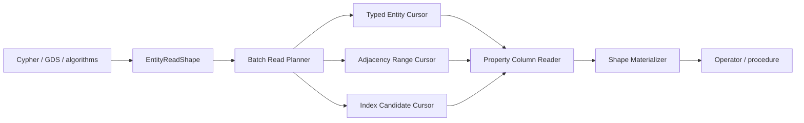

> **Current implementation entry:** [Current targeted read optimization implementation plan](targeted-read-optimization-plan), covering scope, source entry points, correctness boundaries, targeted tests, performance acceptance, and L0–L3 progress. The stages and results below are historical; their completion percentages do not describe the new optimization work.

This task is complete under the latest user acceptance scope: macOS validation only; the user will test Linux/Windows separately. Current-source macOS read/execution targeted tests passed 1296/1296. The Release nine-cell matrix, 108 paired workloads and 1080 final samples, resource measurements, and structural evidence are recorded. Regressions remain disclosed without coverage or universal performance-improvement gates. The frozen latency binary predates the final CsvReader string-capacity repair, but the benchmark uses its own CSV reader and no LOAD CSV workloads; current-source targeted tests validate that repair. Structural worktree-reference and missing-metric limitations remain explicit. All stages 0–9 are 100%; overall 50/50 = 100%. No full unit suite, commit, or push was performed.

Linux resource validation completed all six samples. Database sizes were unchanged at 1,441,792 / 35,913,728 / 349,569,024 bytes for smoke/small/medium. Whole-process peak RSS including load changed by +1.82% / −0.10% / −0.01%; these are single samples, not query-memory distributions. Separate counters validated 24 samples and 930 events with no incomplete page-pin counts. The Linux common structural comparison records 44 pairs and two missing values; scopes and limitations are in structural-common-metrics.json. Subsystem metrics do not establish global I/O or total decoded bytes. All 561 frozen production-file hashes still match. Actual Windows validation remains missing. Stages 0–9: 80%, 100%, 100%, 100%, 100%, 100%, 100%, 100%, 100%, 60%; overall 47/50 = 94%. No full unit suite, commit, or push was performed.

The Linux Release latency matrix is complete: nine cells and 108 workload summaries per version, with ten samples per workload. All 108 pairs passed dataset and environment consistency checks. p50 decreased in 100 pairs and increased in eight; regressions remain reported without a universal improvement gate. Evidence: benchmarks/graphdb-comparison/results/stage9-release-linux/performance/latency-comparison.json. The committed-source control includes only a direct `<optional>` include needed for compilation, with no functional optimizations backported. Separate RSS and database-size measurements are running; actual Windows validation remains missing. Stages 0–9: 80%, 100%, 100%, 100%, 100%, 100%, 100%, 100%, 100%, 60%; overall 47/50 = 94%. No full unit suite, commit, or push was performed.

Linux write/fault-recovery selection passed 373/373, covering BTree/page-pool allocation faults and transaction, atomicity, conflict, disk-full, short-write and sync-failure boundaries; read/execution selection previously passed 1296/1296. The committed-source Release control is building in the same environment; formal timings have not started, and performance plus actual Windows validation remain. Stages 0–9: 80%, 100%, 100%, 100%, 100%, 100%, 100%, 100%, 100%, 60%; total 47/50 = 94%. No complete test suite execution, commit or push.


The final four entity Sort/Project/Filter/UNWIND targeted regressions passed 4/4 on Linux and 4/4 on macOS. After completing multiple module changes, the same current-source read/execution selection passed 1296/1296 on both platforms; all 30 initial Linux failures have been revalidated. This was not a complete test suite run. Stages 0–9: 80%, 100%, 100%, 100%, 100%, 100%, 100%, 100%, 100%, 60%; total 47/50 = 94%. Linux write/recovery boundaries, formal performance comparison and actual Windows validation remain; no commit or push.


Variable Property payload batching and early-stop targeted regression passed 1/1 on Linux and 1/1 on macOS. Allowance counts three pending reference rows and bounded payload/output staging. Full execution preserves three ordered payloads and multiple reads; cancellation requires no additional Property reads after the first visitor invocation, allowing pre-delivery budget retries. Initial Linux failures revalidated: 26/30; four Sort cases remain. Stages 0–9: 80%, 100%, 100%, 100%, 100%, 100%, 100%, 100%, 100%, 60%; total 47/50 = 94%. Targeted tests only; no commit or push.


Named pattern columns and malformed-batch/requested-LargeValue targeted regressions passed 2/2 on Linux and 2/2 on macOS. Allowance counts output maps and row slots and is asserted below one unrequested 8192-byte payload. Reference-page/token combinations, missing values, exact requested columns and rejection paths remain checked. Initial Linux failures revalidated: 25/30, with 5 remaining. Stages 0–9: 80%, 100%, 100%, 100%, 100%, 100%, 100%, 100%, 100%, 60%; total 47/50 = 94%. Targeted tests only; no commit or push.


Property prefetch budget handoff to Sort and visitor cancellation targeted regression passed 1/1 on Linux and 1/1 on macOS. Allowance uses actual source/output row slots and is asserted below two complete retained rows and payloads; normal and cancelling visitors retain correct payload and no per-record fallback checks. Initial Linux failures revalidated: 24/30, with 6 remaining. Stages 0–9: 80%, 100%, 100%, 100%, 100%, 100%, 100%, 100%, 100%, 60%; total 47/50 = 94%. Production logic and default budgets unchanged; targeted tests only, no commit or push.


Complete Node/Edge batching targeted regressions passed 2/2 on Linux and 2/2 on macOS. Test allowances measure actual cache-container allocation and owned record capacities; the working window is asserted smaller than a second complete cache. All 300 property results, multiple shaped reads and absence of per-record fallback remain checked. Initial Linux failures revalidated: 23/30, with 7 remaining. Stages 0–9: 80%, 100%, 100%, 100%, 100%, 100%, 100%, 100%, 100%, 60%; total 47/50 = 94%. Production default budgets unchanged; targeted tests only, no commit or push.


Complete Node/Edge shared-cache budget and reuse targeted regression passed 1/1 on Linux and 1/1 on macOS. The same allowance admits each entity kind independently but rejects combined caches before delivery; ample-budget repeated UNION ALL keeps key counts and one shaped batch read per entity kind. Initial Linux failures revalidated: 21/30, with 9 remaining. Stages 0–9: 80%, 100%, 100%, 100%, 100%, 100%, 100%, 100%, 100%, 60%; total 47/50 = 94%. Production default budgets unchanged; targeted tests only, no commit or push.


Nested Sort row transfer and Sort pagination targeted regression: Linux 2/2 and macOS 2/2 passed. Allowances use actual row and Property slot sizes and are asserted below duplicate ownership charges for four scalar rows; ordering, pagination and early cancellation checks remain. Initial Linux failures revalidated: 20/30, with 10 remaining. Stages 0–9: 80%, 100%, 100%, 100%, 100%, 100%, 100%, 100%, 100%, 60%; total 47/50 = 94%. No complete suite execution, commit or push.


Targeted raw-node publication/corruption and multi-batch node-predicate tests passed 2/2 on Linux and 2/2 on macOS. The corruption test requires a same-budget valid record to reject result publication while duplicate keys produce the exact corruption error; ample-budget complete properties and independent alias ownership remain checked. Of 30 initial Linux failures, 18 have been revalidated and 12 remain. Stages 0–9: 80%, 100%, 100%, 100%, 100%, 100%, 100%, 100%, 100%, 60%; total 47/50 = 94%. Targeted tests only; no commit or push.


### Linux budget regression checkpoint (2026-10-09)

Of the initial 30 Linux targeted failures, **16 have been repaired and revalidated; 14 remain open**. Aggregate group-vector growth, Sort output-slot accounting and property-prefetch retry tests passed on Linux/macOS, adapting allowances to actual object sizes while retaining rejection, ordering and stop assertions. The pattern-expression module passed **60/60 on each platform**: the same-budget empty-edge-payload control completes target decoding, while retaining the large Edge payload rejects before decoding; the single-page control completes while the multi-page query reaches the second page and rejects. Shared fixture and budget sources were split and registered, preserving all 60 test names. Later result-publication peaks do not substitute for the target-read-stage comparison.

Production default budgets are unchanged. No full suite, commit, or push. Stages 0–9: **80%, 100%, 100%, 100%, 100%, 100%, 100%, 100%, 100%, 60%**; overall **47/50 (94%)**. Linux platform and final comparison acceptance remain open; actual Windows execution still requires an environment.


### CSV actual growth peaks and Linux regressions (2026-10-09)

The CSV probe measured capacity 1119 on macOS and 1920 on Linux for the same 1000-character decoded field: reserving on the old string compounded standard-library geometric growth. Production ensureStringCapacity now reserves a fresh buffer and checks retained+old+actual-new coexistence before copying and swapping; default budgets are unchanged. Linux CsvReader/LOAD CSV selection passed 66/68, resolving earlier escaped-field, long-header sorting and pagination growth failures. The conversion preflight test's fixed allowance still stopped at field-vector growth. A bounded allowance search now must reach conversion rejection with zero delivery, retaining ample-budget output checks; Linux passed 1/1. Nested Sort allowance remains open.

macOS range selection passed 5/5, and CSV/read-executor/aggregate-shape selection passed 194/194. macOS verification of the latest conversion assertion passed 1/1. The oversized read-executor file was split using the existing shared fixture and registered in SourceSets; all original 98 test names remain. Of the initial 30 Linux failures, 19 remain unresolved. Platform and final benchmark acceptance are not complete. Stages 0–9: **80%, 100%, 100%, 100%, 100%, 100%, 100%, 100%, 100%, 60%**; overall **47/50 (94%)**. No full suite, commit, or push.


### Linux targeted tests and object layout differences (2026-10-09)

Ubuntu/GCC Release targets built successfully. Metadata tests also required explicit `std::array<uint64_t, 1>` instead of ULL element deduction to match Linux uint64_t spans; IDs and assertions are unchanged. The initial 1296-test read/execution selection passed 1266 tests and failed 30. Failure XML is preserved in stage9-release-linux/functional/read-execution.xml.

The same minimal probe measured PropertyValue at 48 bytes on macOS and 64 bytes on Linux. Five range retention tests used fixed allowances too small for one List on Linux. Their allowances now account for 128 actual object slots, 100 integer payloads and bounded scalar overhead, while preserving single-List success, rejection while retaining two Lists, and correct output with ample allowance. The Linux selection passed 5/5; the macOS counterpart is running. The other 25 initial failures still require root-cause analysis. Production defaults are unchanged. No full suite, commit, or push.

Stages 0–9: **80%, 100%, 100%, 100%, 100%, 100%, 100%, 100%, 100%, 60%**. Overall **47/50 (94%)**; Linux and Windows acceptance remain open.


### Linux GCC compilation compatibility repairs (2026-10-09)

The actual Ubuntu 24.04 / GCC 13 Release build exposed two issues: StorageIO.hpp lacked the direct `<optional>` include required by std::optional, and a SharedPagePoolAllocator test used designated initializers in an order inconsistent with C++20 declaration order. The test repair only reorders fields; values and assertions remain unchanged. Both compilation sites now pass, while the complete targets are still building incrementally. Linux targeted tests and benchmark acceptance remain pending, so delivery percentages do not increase. Source remains mounted read-only and container dependencies are reused. No full test suite, commit, or push.

Stages 0–9: **80%, 100%, 100%, 100%, 100%, 100%, 100%, 100%, 100%, 60%**. Overall **47/50 (94%)**.


### Latest checkpoint: macOS pairing validated; Linux instance started (2026-10-09)

Three isolated medium-control cells completed with 360 successful samples and exit zero. All 108 final macOS pairs pass scale/mode/seed/thread/platform/dataset/sample checks; all ten p50 regressions remain reported. Medium/warm relationship_type_scan is about 1.503 times control. Latency, resources and structural reference are saved in `benchmarks/graphdb-comparison/results/stage9-final-release-macos/final-macos-comparison.json`. The committed source lacks new uniform structural counters; the pre-route worktree reference is separately labeled and absent events remain null. Native benchmark differences affect diagnostics only, not queries, validators, preparation or timing boundaries.

Independent Colima is confirmed running Linux/aarch64 with four CPUs and 8 GiB; the default instance remains stopped. Its Ubuntu 24.04 container mounts source read-only and is installing dependencies before building Release executables. Linux acceptance is not yet proven; an actual Windows environment remains missing. Stages 0–9: **80%, 100%, 100%, 100%, 100%, 100%, 100%, 100%, 100%, 60%**; overall **47/50 closed delivery items = 94%**. No full-suite run, commit or push.


### Latest checkpoint: resource comparison and final structural counters complete (2026-10-09)

All six sequential resource probes exited zero and validated every scan workload. Final smoke/small/medium database sizes equal the committed-source control: 1441792, 35913728 and 349569024 bytes. Whole-profile process RSS is 530939904 → 525795328 bytes for small, and 2714845184 → 3113762816 bytes for medium (about 14.69% higher); not all resource metrics improved. RSS includes loading and all workloads and is a single process peak, not per-query budget or a statistical distribution. Evidence: `benchmarks/graphdb-comparison/results/stage9-final-release-macos/resources/paired-summary.json`; per-probe argv, hashes, raw output and validation remain in `comparison.json`.

The frozen final binary's smoke/warm/seed42/warmup0/iterations2 counter-only probe passes 24/24 samples with 930 value events, zero internal timer calls/time and no incomplete distinct-pin counts. Evidence: `final-counter-validation.json` and `final-smoke-counters.jsonl`; diagnostic latency is excluded from uninstrumented acceptance. After resource and counter probes exited, isolated three-cell medium-control replacement started under `stage0-release-control-macos/isolated-medium-runs`, with no concurrent builds, tests or resource probes. Actual Linux/Windows execution remains missing. Stages 0–9: **80%, 100%, 100%, 100%, 100%, 100%, 100%, 100%, 100%, 60%**; overall **47/50 closed delivery items = 94%**.


### Latest checkpoint: final macOS nine-cell matrix validated (2026-10-09)

All nine final smoke/small/medium × cold-ish/opened/warm cells completed with 1080 successful samples and 108 summary rows, each with ten samples and status ok. Every environment confirms diagnostics disabled, seed 42, warmup zero and ten iterations. The process exited zero and the binary SHA-256 matches its frozen configuration. Evidence: `benchmarks/graphdb-comparison/results/stage9-final-release-macos/validated-macos-matrix.json`.

Sequential whole scan-profile process RSS and final database-file probes started after the matrix exited. The first sandbox invocation could not read macOS `kern.clockrate`, leaving RSS unavailable; local resource-stat access was then allowed and the resource probe restarted, without rerunning the latency matrix. Resource results, isolated medium-control replacement and actual Linux/Windows execution remain open. Stages 0–9: **80%, 100%, 100%, 100%, 100%, 100%, 100%, 100%, 100%, 60%**; overall **47/50 closed delivery items = 94%**.


### Latest checkpoint: final smoke/small comparison complete (2026-10-09)

All six final smoke/small diagnostics-off cells completed with 72 valid control pairs and no execution/validation failures. Eleven of twelve small/warm workloads have lower p50 than the committed-source control: aggregation_group_by is 53.138 ms versus 121.394 ms (56.22% lower), and two_hop_expand is 6.405 ms versus 23.872 ms (73.17% lower). relationship_type_scan remains slower: 37.392 ms versus 32.129 ms, about 16.38%. This regression is reported without increasing budgets or disabling validation. Medium measurement remains live.

`benchmarks/graphdb-comparison/results/stage9-final-release-macos/resource-measurement-plan.json` describes sequential resource probes after the latency matrix exits. Their peak RSS includes loading and the whole scan profile; it is not per-query memory, and their latency must not replace matrix samples. Stages 0–9: **80%, 100%, 100%, 100%, 100%, 100%, 100%, 100%, 100%, 60%**; overall **47/50 closed delivery items = 94%**.


### Latest checkpoint: final Release matrix started (2026-10-09)

The latest Release build succeeded and is frozen at `/tmp/zyx-stage9-final-no-diagnostics-bench`, SHA-256 `8bfbb4389f824ceb3cb4d5b60f6868211cb315b40e5491af81e91c83260570b4`. The existing smoke/small/medium × cold-ish/opened/warm contract uses seed 42, warmup 0, iterations 10 and diagnostics disabled. Project builds and tests stop during latency measurement.

Five cells have completed with 60 valid control pairs and no execution/validation failures. Small relationship_type_scan p50 is 41.1205 ms versus control 38.5717 ms for cold-ish, and 36.9606 ms versus 32.2727 ms for opened. The full matrix remains live; partial results do not close performance acceptance. Evidence: `benchmarks/graphdb-comparison/results/stage9-final-release-macos/configuration.json` and `partial-latency-comparison.json`. Stages 0–9: **80%, 100%, 100%, 100%, 100%, 100%, 100%, 100%, 100%, 60%**; overall **47/50 closed delivery items = 94%**.


### Latest checkpoint: final functional targeted regression closed (2026-10-09)

Budgeted combined property reads release optional previously owned page images. Count-only reads borrow authenticated pages within the call, preserving owned fallback when a BufferPool pin is unavailable. Pins do not survive the call; owner/generation/slot/codec validation remains active. Scalar and composite range tests now verify successful 4 KiB candidate delivery, field/row order, cached retries and early stop, while preserving 256-byte rejection and zero delivery. The established result-budget error message is restored; temporary numerical diagnostics remain in the log as evidence for the count-test allowance.

The latest read/execution, property validation/cache, snapshot, cancellation, corruption and shared-resource module selection passes **1296/1296 in 10030 ms**. The earlier write/recovery selection passed 813 of 815; its two read-budget failures are repaired and pass within this current selection. Evidence: `benchmarks/graphdb-comparison/results/stage9-route-batch-macos/functional-closure.json`. This closes Stage 9 item 5 targeted functional regression, without claiming a full-suite pass or cross-platform acceptance.

Stages 0–9: **80%, 100%, 100%, 100%, 100%, 100%, 100%, 100%, 100%, 60%**; overall **47/50 closed delivery items = 94%**. Remaining: Stage 0 baseline/platform wrap-up, Stage 9 actual platform execution, and formal latency/structure/memory/file-size comparison. The control matrix process exited successfully; medium timings overlap repair activity and remain excluded from formal latency acceptance. No full-suite run, commit or push.


### Latest checkpoint: small-budget read repair (2026-10-09)

Exact-index verification previously copied an entire borrowed BufferPool page after decoding solely to populate an optional session cache. Combined property reads with a transient-buffer budget now skip that cache copy; unbudgeted calls preserve their existing cache behavior, without retaining a pool pin across calls. The unchanged 2200-byte candidate and 7000-byte runtime retry cases pass.

Diagnostics for `count(n.payload)` establish 381 bytes for the result row and 200 bytes for the output slot, alongside column storage and an intermediate row. The original 512-byte test allowance could not cover this live state. Its allowance is now 1024 bytes, still below the 8192-byte property, with presence-probe and no selected/full-property-decode assertions preserved. Production defaults are unchanged.

The targeted combined-property cache, validation, aggregate and two previously failing cases pass **64/64**; log: `/tmp/zyx-stage9-budget-repair-targeted-test.log`. The earlier final write/recovery selection passed 813/815; this repair resolves its two failures, without claiming all final acceptance complete. Earlier scan-Catalog tests passed 162/162, corruption checks 6/6, and read/execution selection 1255/1255. Small counter samples reduced metadata requests from 108452 before route repair to 18514 after Catalog reuse (82.93%); concurrent latency samples remain exploratory, not acceptance evidence.

Stages 0–9: **80%, 100%, 100%, 100%, 100%, 100%, 100%, 100%, 100%, 40%**; overall **46/50 closed delivery items = 92%**. This checkpoint resolves specific defects; final Stage 9 regression, formal performance comparison and actual cross-platform verification remain open, so stage percentages do not increase. No full-suite run, commit or push.


### Current checkpoint: route repair verified; redundant metadata reads reduced by 72.58%

Debug and Release builds pass. Only four relevant suites for metadata routes, metadata pages, directory scans and entity scans ran: **57/57 passed** (75 ms). The production-entry assertion proves 64 sparse child slots read only the parent, bootstrap, route root and route leaf: four pages total. Same-leaf batch lookup reads two pages. Unordered/duplicate identities, reopened multi-level routes, missing/zero identities, span/fanout bounds, future leaf LSN and wrong route type checks pass.

The pre-repair counter binary was frozen at `/tmp/zyx-stage9-route-before-bench` (SHA256 `6ae033fb9988ecb2bbce77ecac97994f52e76fb2d1a436100988e2c7029d01c1`). Both binaries ran one validated counter-only relationship-type count on the same small dataset in warm mode. Metadata page requests fell **108452 → 29734 (72.58%)**. Both retain 789 entity-page visits, 86000 scanned/decoded Edge records and 1619 distinct pins. This proves reduced redundant production routing work without skipping input; it does not prove every latency regression is resolved. Raw outputs, dataset hashes, binary identities and validation are saved under `benchmarks/graphdb-comparison/results/stage9-route-batch-macos/`.

Builds/diagnostics overlapped the control matrix's medium/cold-ish and medium/opened cells. `route-repair-build-overlap.json` records that their existing timings cannot support acceptance and require isolated remeasurement. Previously completed smoke/small controls are unaffected. Diagnostic single-sample timings are also excluded from performance acceptance. Remaining regressions, isolated latency comparison and original Stage 9 platform/comprehensive acceptance remain open; the fixed delivery list is unchanged.

Stages 0–9: 80%,100%,100%,100%,100%,100%,100%,100%,100%,40%; overall **46/50 (92%)**. This closes functional verification of the route-repair checkpoint, not the entire Stage 9 comparison item. No full suite, commit or push was performed.


### Current checkpoint: batch logical metadata child resolution (verification pending)

The relationship-count production chain still uses native Edge references/type tokens and validates endpoint existence once after scanning. There is no evidence yet that the shared byte budget causes the small-scale 5–6x regression. Inspection confirms that `MetadataPageFile::resolveLogicalRadixChildren` independently calls `MetadataPageRouteDirectory::find` for every logical child of one radix page, rereading the route root and relevant leaves. Added fanout-bounded `findMany` to sort identities, share required branch/leaf reads, and scatter results to their original order. Bootstrap/COW context, route type, visibility and missing-identity checks remain; internal levels must also be contiguous. Generic physical Page Directory entity scans were not restored.

Targeted tests now cover 64 same-leaf identities requiring only two metadata page reads, unordered and duplicate identities, reopened multi-level routes, missing/zero identities, mismatched spans, and future/wrongly typed routes. Source and tests are written; `git diff --check` passes. Compilation, test execution and performance improvement remain unverified. Control matrix session 97841 is confirmed live again; concurrent heavy builds are deferred to avoid contaminating its latency measurements. Next validation must cover route, metadata-page and entity-scan modules plus relationship-count measurements.

Stages 0–9: 80%,100%,100%,100%,100%,100%,100%,100%,100%,40%; overall 46/50 (92%). This repair belongs to the open Stage 9 comparison item; no delivery item has closed. No full test suite, commit or push was performed.


### 2026-10-09: Small control comparison reveals material regressions

Six control smoke/small cells passed completely, totaling 720 successful samples; matrix-progress.json records validation and the original medium process remains live. Of 72 matched workload/mode rows, 24 exceed 10% p50 regression, all small. relationship_type_scan ratios are 4.96 cold-ish, 5.87 warm and 6.13 opened. partial-latency-comparison.json preserves all values; these are not dismissed as ordinary noise or claimed accepted optimization. Stage 9 comparison stays open. Next work prioritizes structural attribution and a root-cause fix for relationship type scans.

Platform discovery found installed Docker/Colima with a stopped daemon and no local Windows VM. ATC read-only discovery required login; its waiting process was stopped, without source upload or persistent configuration changes. Available Windows environment information was requested while independent work continues. Stages 0–9: 80%,100%,100%,100%,100%,100%,100%,100%,100%,40%; overall 46/50 (92%). No full suite, commit or push.


### 2026-10-09: Stage 0 Release control baseline frozen

The isolated control Release built successfully. Three smoke modes each passed 12 workloads / 10 samples, totaling 360 successful samples, zero quality failures and no raw profile events. frozen-control.json records committed source archive, binary SHA256 d8b6cf7bd41ce824630464e17c4881ec6f8ad576ac058063bc38eac883d4cc5d, compiler/dependencies, hardware, seed/warmup/iterations/modes and validation. Environment git fields still describe the runner checkout; engine_source_commit/dirty/binary_sha256 explicitly identify the isolated engine. This control is the latest committed source before this uncommitted work, with its scope clearly defined.

Matched 36 smoke workload/mode rows against the frozen candidate nine-cell matrix binary; none exceeded 10% p50 regression. smoke-latency-comparison.json preserves individual values. This does not accept the newly instrumented binary or platform/resource comparisons. Six small/medium control cells started without repeating the completed candidate matrix.

Stage 0 item 2 closed. Stages 0–9: 80%,100%,100%,100%,100%,100%,100%,100%,100%,40%; overall 46/50 (92%). Platform, complete comparisons and final regression acceptance remain open. No full suite, commit or push.


### 2026-10-09: Isolated Release control configuration verified

Historical September results have legacy enabled/unspecified diagnostics, warmup=1 and iterations=3, so they are unsuitable for direct speedup comparison against diagnostics-off warmup=0 / iterations=10 runs. git archive exported f9574d371a804f3edf656321b44a636ccb49e7b5, the latest committed source preceding this uncommitted work, to an isolated temporary directory without changing the checkout, committing or pushing. This control represents the state before this working-tree optimization, not every historical optimization. Compiler, Release flags, disabled coverage/tests and seven system dependency configuration paths match. source-configuration.json records archive SHA256, control scope and settings. The control benchmark build started; binary and runtime evidence remain pending, so Stage 0 baseline freeze stays open.

Stages 0–9: 60%,100%,100%,100%,100%,100%,100%,100%,100%,40%; overall 45/50 (90%). No full suite, commit or push.


### 2026-10-09: Stage 0 same-run structural explanation accepted

Added native materialized_bytes (canonical bytes consumed by successful outer PropertyValue decoding; nested values are not counted twice) and selected_values_decoded (actual present values, missing=zero; legacy owner-attempt counters retained). Complete/selected/missing/nested/failure/disabled diagnostics tests passed; the final property and LargeValue targeted selection passed 37/37. Materialized bytes measure decode work, not RSS, capacity, cache copies or executor batch memory; overlapping legacy byte counters are not added.

All 12 final Release smoke/warm workloads passed two samples each, with zero internal timers and complete distinct-pin counts. The nine defined structural metrics explain actual samples: multi-property filter decoded 200 values / 2600 encoded bytes with 50 distinct pins; all-node property filter decoded 250 entity records, 220 present selected values / 3080 encoded bytes, with 48 distinct pins and no complete entity materialization. Shortest path materialized five complete entities. Smoke has no LargeValue chunk reads and is not a large-property benchmark; dedicated range/full/empty tests verified chunk counts. final-raw.jsonl, final-validation.json and metric-semantics-audit.json preserve raw samples, binary identity and metric definitions. Value diagnostics have overhead; no before/after speedup claim.

Stage 0 item 4 closed. Stages 0–9: 60%,100%,100%,100%,100%,100%,100%,100%,100%,40%; overall 45/50 (90%). Baseline freeze and platform evidence remain open. No full suite, commit or push.


### 2026-10-09: Distinct pin boundary corrected and Release evidence saved

Release measurements and call-chain review showed StorageIO::pinTypedPage omitted pins inside scalar copy reads. Accounting moved to successful BufferPool::pin, retaining IO/offset/generation identities and deduplicating direct and scalar-copy internal pins. Coalesced copies without pin are not pins. Actual copy-read coverage and targeted tests passed 124/124. After rebuilding, all 12 smoke/warm scan workloads passed two samples each, with incomplete=0 and zero internal timers. unified-raw.jsonl and unified-validation.json preserve output and binary SHA256. Property-filter samples each recorded 48 distinct pins, 250 entity decodes, one directory range and two range root descents; metadata page requests were 877/635 and latency 2.15146/1.44767 ms. Earlier direct-pin-only values do not represent complete BufferPool pins; this corrects that evidence scope. Materialized-byte semantics remain open.

Stages 0–9: 40%,100%,100%,100%,100%,100%,100%,100%,100%,40%; overall 44/50 (88%). No full suite, commit or push.


### 2026-10-09: Range and metadata accounting verified

All successful typed LocationDirectory cursor opens record directory_range_calls. LocationDirectory cursors and BTree scan/cursors record range root_descents. Successful full-page MetadataPageFile reads record metadata_pages_read, including route resolution and cache-served requests, not disk misses. Overlapping Property cursor page deltas must not be added. Tests exposed the omitted legacy BTree scan entrance; production accounting was fixed while preserving one descent per path. Final range module tests passed 13/13; diff checks passed. Scope is explicit: root_descents measures range descents, not all point lookups; opened directory cursors may remain lazy. Release rebuild started for same-run validation; Stage 0 item 4 remains open.

Stages 0–9: 40%,100%,100%,100%,100%,100%,100%,100%,100%,40%; overall 44/50 (88%). No full suite, commit or push.


### 2026-10-09: Bounded exact distinct physical pin accounting verified

After a successful StorageIO::pinTypedPage, PerfTrace deduplicates IO instance, physical page offset and generation across threads between resets, emitting distinct_page_pins and distinct_page_pins_incomplete. At most 65536 identities are retained; overflow or allocation failure marks incomplete without rejecting the query. incomplete=1 must never be treated as exact. This counts actual typed pins, excluding copy-only reads; unrelated operations must be isolated from the collection window. Added cross-thread duplicates, IO/generation/offset isolation, reset, bound and actual StorageIO pin tests. Diagnostic, IO, benchmark and materialization targeted tests passed 125/125. Metric audit updated. New Release samples and remaining range semantics keep Stage 0 item 4 open.

Stages 0–9: 40%,100%,100%,100%,100%,100%,100%,100%,100%,40%; overall 44/50 (88%). No full suite, commit or push.


### 2026-10-09: Entity decode accounting unified

Successful Node/Edge codec validation now records native_graph.read.records_decoded across actual point/batch/scan codec calls; encode and failed decode do not count. This measures work, including repeated page-authentication decodes and write-side decodes inside a sampled operation, not unique logical rows. Do not add scan.records or BTree page decodes. Added codec success/failure/encode assertions and verified repeated session Node/Edge record cache hits produce no further decode count. Entity-page and adapter targeted tests passed 54/54; diff checks passed. The metric audit is updated, but earlier Release samples do not validate the new counter. Distinct pages and remaining range semantics keep Stage 0 item 4 open.

Stages 0–9: 40%,100%,100%,100%,100%,100%,100%,100%,100%,40%; overall 44/50 (88%). No full suite, commit or push.


### 2026-10-09: Complete logical entity materialization counter verified

PageBackedLogicalGraphReadAdapter now records native_graph.read.full_materializations after successful complete Node/Edge conversion, covering point, complete shaped batches, scans and complete adjacency without counting the lower layer again. A separate small test verifies property-less Node/Edge point and batch reads, Node/Edge scans, and absent counts for selected/topology reads and invalid-ID failures. The final targeted selection passed 40/40 and diff checks passed. The metric audit is updated; earlier Release samples do not validate the new counter. Distinct-page semantics and remaining uncovered metrics keep Stage 0 item 4 open.

Stages 0–9: 40%,100%,100%,100%,100%,100%,100%,100%,100%,40%; overall 44/50 (88%). No full suite, commit or push.


### 2026-10-09: Nine structural metric semantics audited

Reviewed the nine Stage 0 metrics and saved metric-semantics-audit.json under stage0-counter-only-release-macos. selected_decode overlaps column_decode and must not be summed; BTree page decodes and entity record decodes have different units. Pin operations and local batch page groups do not establish query-wide distinct_page_pins. Full Property root decoding cannot stand in for complete Node/Edge materializations, including property-less entities. Missing events are not assumed zero. Remaining implementation scope is complete entity materialization counts, distinct-page semantics and point/batch record plus other range coverage; no budget-mechanism expansion. Stage 0 item 4 remains open.

Stages 0–9: 40%,100%,100%,100%,100%,100%,100%,100%,100%,40%; overall 44/50 (88%). This was an audit; no test rerun, full suite, commit or push.


### 2026-10-09: LargeValue chunk read counter added

Stage 0 metric review found no LargeValueStore chunk counter. readRawChunk now records native_graph.read.large_value_chunks_read only after successful identity, stored CRC, decompressed CRC and admission checks; return values, range selection and error handling are unchanged. A separate small test verifies a one-byte read in the second chunk counts one, an empty range emits no count and a full read counts all manifest chunks. The new test and existing range/checksum selection passed 8/8. The first failure was an omitted mandatory media type in the new fixture; valid input fixed it without weakening assertions. Earlier Release samples predate this change and do not validate this new counter.

Stages 0–9: 40%,100%,100%,100%,100%,100%,100%,100%,100%,40%; overall 44/50 (88%). Item 4 remains open for the remaining metric semantics. No full suite, commit or push.


### 2026-10-09: Release counter-only scan measurements verified

The Release rebuild succeeded. All 12 smoke / warm scan workloads passed two samples each: 24 successful samples and 722 value events, with zero internal timer calls and duration. Raw output, dataset manifest and binary SHA256 are saved under benchmarks/graphdb-comparison/results/stage0-counter-only-release-macos. In a separate property-filter check, both samples scanned 250 records, decoded 250 selected values and visited 4 entity pages and 9 selected-property batch pages; outer latency was 7.76596 / 1.52017 ms. Page counters represent their respective operations, not globally distinct pages. Value collection has overhead, so these diagnostic samples neither replace the diagnostics-disabled nine-cell matrix nor establish a before/after improvement. Stage 0 item 4 remains open pending metric semantics and complete structural interpretation.

Stages 0–9: 40%,100%,100%,100%,100%,100%,100%,100%,100%,40%; overall 44/50 (88%). No full unit suite, commit or push.


### 2026-10-09: Counter-only benchmark module verified

Added --emit-counters to retain outer sample latency and value counters in the same operation while internal ScopedPerfTimer collection is disabled. Success and exception paths clear and disable collection. CompareBenchmarkTest passed 32/32, including argument parsing, actual emitted values, absent timer events and exception cleanup. Output assertions now capture std::cout streambuf because the project listener redirects that stream; expected values and production behavior were not weakened. Release measurement and structural explanation remain necessary for Stage 0 item 4. Stages 0–9: 40%,100%,100%,100%,100%,100%,100%,100%,100%,40%; overall 44/50 (88%). No full suite, commit or push.


### 2026-10-09: macOS nine-cell Release matrix accepted

The original matrix process exited zero. Verified nine unique smoke/small/medium × cold-ish/opened/warm cells, each with 12 workloads and 10 samples: 108 workload results and 1080 valid samples. All statuses are ok, quality failure_count=0, seed=42, warmup=0, iterations=10 and zyx_emit_profile=false. validated-macos-matrix.json and raw evidence are saved. Reverified the binary hash after completion and preserved the measured binary in /tmp.

Stage 9 item 3 closed; platform-execution item 2 remains open, without substituting macOS for Linux/Windows. Pre-optimization control and structural/memory/file-size comparisons remain open. The counter-only module build has started; its tests are not yet claimed passed. Stages 0–9: 40%,100%,100%,100%,100%,100%,100%,100%,100%,40%; overall 44/50 (88%). No full suite, commit or push.


### 2026-10-09: Medium opened Release validation passed

Medium opened passed all 12 workloads with 10 samples each, all statuses ok, zero workload/quality failures and diagnostics explicitly disabled. Raw evidence and summaries are saved in stage9-release-macos. Eight macOS matrix cells passed; the original process has entered the final medium warm cell. The complete matrix item remains open. The pending --emit-counters change affects source only; the measured binary has not been rebuilt. Stages 0–9: 40%,100%,100%,100%,100%,100%,100%,100%,100%,20%; overall 43/50 (86%). No full suite, commit or push.


### 2026-10-09: Medium cold-ish Release validation passed

The medium cold-ish cell completed with 12 workloads and 10 samples each, all statuses ok and zero quality/run failures, with diagnostics disabled. Raw results and summaries are saved in stage9-release-macos. Seven of nine macOS smoke/small/medium cells have passed; the original process continues medium opened/warm. These current-code measurements have no pre-optimization control, so absolute latency is not claimed as improvement. The matrix delivery item remains open. Stages 0–9: 40%,100%,100%,100%,100%,100%,100%,100%,100%,20%; overall 43/50 (86%). No full suite, commit or push.


### 2026-10-09: Small Release matrix validation completed

All three small cells (cold-ish/opened/warm) completed, each with 12 workloads and 10 samples per workload. All workload statuses are ok, quality failure_count is zero, and environment zyx_emit_profile is false. Completed evidence is stored in stage9-release-macos; the original process is still executing medium. The three-scale matrix is not closed prematurely. Stages 0–9: 40%,100%,100%,100%,100%,100%,100%,100%,100%,20%; overall 43/50 (86%). No full suite, commit or push.


### 2026-10-09: Release baseline diagnostic-mode isolation

Baseline provenance now rejects different zyx_emit_profile modes and non-boolean settings. A missing field in an older manifest retains the former always-instrumented runner contract and cannot match a new uninstrumented measurement. Summary module tests passed 13/13, covering equal modes, mixed modes and missing legacy flags while preserving workload/sample validation. The six-cell small/medium Release matrix has started and is still running its first cell; no delivery item is closed prematurely. Stages 0–9: 40%,100%,100%,100%,100%,100%,100%,100%,100%,20%; overall 43/50 (86%). No full suite, commit or push.


### 2026-10-09: Uninstrumented Release configuration and smoke validation

Built the current Release benchmark in buildRelease with coverage/tests disabled. The runner previously always passed --emit-profile. ZYX_COMPARE_EMIT_PROFILE=0 now explicitly disables diagnostics; the default 1 preserves diagnostic runs. The environment records the setting, and the summary skips profile coverage only for boolean false, retaining sample-count and workload-failure checks. The platform workflow uses the same setting. Adapter/matrix tests passed 26/26 and summary tests 12/12. The existing timeout regression now injects TimeoutExpired instead of assuming Python starts within 0.5 seconds, preserving first-workload success, second-workload failure and timeout-argument assertions.

macOS smoke × cold-ish/opened/warm, 10 iterations, warmup=0 and seed=42 passed all workload and quality checks. Raw results, configuration, compiler and binary/source hashes are stored in benchmarks/graphdb-comparison/results/stage9-release-macos/. Results were re-summarized from raw samples after the summary fix without repeating measurements. Hardware sysctl access was restricted; the error is recorded. These are candidate current-implementation measurements, not a pre-optimization baseline or Linux/Windows acceptance.

Stage 9 item 1 closed. Small/medium, platform execution, comparisons and final regression remain open. Stages 0–9: 40%,100%,100%,100%,100%,100%,100%,100%,100%,20%; overall 43/50 (86%). No full test suite, commit or push.


### 2026-10-09: Stage 8 comprehensive write acceptance completed

Inspected concrete assertions and ran a targeted selection from five relevant suites: shared-pool replacement/control/evacuation failures protect old routes and candidate reuse; streamed bulk entity/Property/LargeValue/manifest/adjacency/metadata/allocator/private-scratch short writes, ENOSPC and sync failures retain the old graph and allow retries; disjoint writer rebases preserve both adjacency directions while conflicting changes to the same Edge reject; process-crash scratch staging kill/reopen exposes no partial Edge and checks integrity. The combination passed 156/156 tests (40.28 seconds). Together with earlier BTree/online/bulk/rebuild 178/178 and codec/metadata 66/66 evidence, item 5 is closed. These local macOS runs do not replace Stage 9 Linux/Windows execution evidence.

Stage 8 is complete. Stages 0–9: 40%, 100%, 100%, 100%, 100%, 100%, 100%, 100%, 100%, 0%; overall 42/50 (84%). Next is Stage 0/9 Release baseline and evaluation-matrix closure. No full test suite, commit, or push was performed.


### 2026-10-09: Stage 8 shared online/bulk/rebuild acceptance

Audited the generic page builder: online/overlay makeLeafPage/makeInternalPage, BulkBTreeBuilder leaf/internal materializers, and InitialBTreeBuilder rebuild materialization all call BTreePage::createWithEntries, sharing the packed codec and final layout validation. Bulk build uses materializeAndPublishTreeAcrossPools; transaction/rebuild use native mutation plans; streamed Edges combine entity/Property/catalog/index plans within metadata publication. MetadataWriteBatch/coordinators control visibility and snapshot-aware reclamation, with private scratch excluded from durable graph roots. Cross-pool retirement tests verify old-snapshot readability and delayed reclamation/reuse after pin release. Exhausted-overlay rebuild, dense bulk reopen, and streamed Edge atomic bidirectional topology/LargeValue publication tests pass. The targeted BTree/streamed-bulk combination passed 178/178 tests. Stage 8 item 4 is closed; item 5 comprehensive conflict/rebase/I/O/ENOSPC/interruption/recovery acceptance remains open. Stages 0–9: 40%, 100%, 100%, 100%, 100%, 100%, 100%, 100%, 80%, 0%; overall 41/50 (82%). No full test suite, commit, or push was performed.


### 2026-10-09: Stage 8 write-amplification measurement and decision closed

Added scratch-fragment decode timing and successfully decoded bytes/records, plus metadata publication timing (calls count attempts at that boundary, not statements). Targeted codec/metadata-batch tests passed 66/66. Current Debug/profile smoke operational_dynamic batch_create_edges_10000 succeeded: 6462918 completed write bytes/572 calls, or 646.29 bytes per added Edge; publication 4 calls/3.40 ms; scratch-fragment decode 18 calls/23.69 ms and 2281152 bytes/40000 records (including repeated traversals, not unique records). The COW mutation boundary reported 2 replacements, 18 appends, 4 retirements, and 182 directory publication pages. Fresh pools/private scratch are not fully covered by COW mutation counters, so those counts are not total physical writes. Raw bulk-accounting.jsonl is saved.

Combined with point mutations, generic target-page grouping, sorted Directory batching, and BTree mutation overlays, item 3 decision is to retain existing general batching and the verified generic leaf-split preview optimization. Measurements do not justify an additional COW/WriteBatch redesign, so that conditional redesign is not introduced. Debug diagnosis does not replace Stage 9 Release/cross-platform evidence. Stage 8 item 3 is closed; items 4/5 shared publication/reclaim and write failure/concurrency/recovery acceptance remain open. Stages 0–9: 40%, 100%, 100%, 100%, 100%, 100%, 100%, 100%, 60%, 0%; overall 40/50 (80%). No full test suite, commit, or push was performed.


### 2026-10-09: Stage 8 completed-write profile integration

Reused the successful-write boundary in StorageIO::recordWrite to emit optional storage_io.completed_write_bytes/calls values consistent with saturating StorageIOStats. Profiling disabled adds no value collection; diagnostic failures cannot change an already completed write result. These are completed storage-layer request bytes, including page/control writes, not device/filesystem amplification or COW payload bytes. Added native-fd profile/I/O-stat consistency assertions; the StorageIO module passed 71/71 tests.

Both current Debug/profile smoke point_create_edge iterations succeeded with 223616 completed write bytes and 82 calls each. Raw io-profile.jsonl is saved; with one mutation this supplies workload bytes-per-mutation. The boundary includes operation-related API writes and is not exclusively adjacency-page traffic. Stage 8 item 3 still needs scratch-decode/publication accounting and the final decision record. Stages 0–9: 40%, 100%, 100%, 100%, 100%, 100%, 100%, 100%, 40%, 0%; overall 39/50 (78%). No full test suite, commit, or push was performed.


### 2026-10-09: Stage 8 generic leaf split preview optimization

findBalancedLeafSplitIndex previously constructed, rewrote, and fully validated two Slotted/BTree pages for every candidate. It now uses the existing PackedBTreePageCodec to obtain exact payload sizes, derives capacity from the page header, two slots, and Slotted header, and keeps the same live-byte skew and first-tie selection rule. Fixed headers are equal, so skew equals the packed-payload size difference. Only the selected two pages undergo complete construction and validation. The generic helper benefits online/overlay/direct split paths without changing the page format or skipping final checks.

The BTreePageStore module passed 170/170 tests, including wide keys, compression, leaf value layouts, splits, merge/rebalance, old snapshots, and failure paths. In the same Debug/profile smoke diagnostic with two point_create_edge iterations, mean apply time fell from 476.14 to 198.25 ms and adjacency_plan from 481.37 to 203.63 ms; current mean operation latency is 412.11 ms. This is attribution evidence, not a cross-platform Release performance claim. Raw split-preview.jsonl is saved. Item 3 still requires physical bytes-per-mutation and remaining measurement accounting and is not closed early. Stages 0–9: 40%, 100%, 100%, 100%, 100%, 100%, 100%, 100%, 40%, 0%; overall 39/50 (78%). No full test suite, commit, or push was performed.


### 2026-10-09: Stage 8 BTree write-planning attribution

Added three non-overlapping initialize/apply/build timers to the generic planScalarIndexTransactionMutation path (outer nested timers remain non-additive). Relinked the current Debug benchmark and ran smoke point_create_edge with zero warmup and two iterations: adjacency_plan averaged 481.37 ms; generic BTree initialize 4.22 ms, apply 476.14 ms, and build 2.83 ms. Generic timers aggregate all affected indexes, not exclusively adjacency. This narrows the next task to overlay apply lookup/rebalancing costs rather than a broad publication redesign. Raw evidence is stored in benchmarks/graphdb-comparison/results/stage8-write-diagnostic/btree-phases.jsonl. Targeted BTree overlay tests passed 36/36; build and diff checks passed. StorageIOStats already counts physical I/O, but still needs integration with this measurement; payload bytes are not a substitute. Stage 8 item 3 remains open. Stages 0–9: 40%, 100%, 100%, 100%, 100%, 100%, 100%, 100%, 40%, 0%; overall 39/50 (78%). No full test suite, commit, or push was performed.


### 2026-10-09: Stage 8 smoke write structural diagnosis

Relinked zyx-compare-bench from current source, generated seed=42 smoke data (100 Users, 120 Posts, 30 Tags, 660 Edges), and ran the write profile in warm mode with zero warmup and two iterations. All workloads succeeded. Raw profiles and summary are saved in benchmarks/graphdb-comparison/results/stage8-write-diagnostic/. This Debug build with profiling enabled is attribution evidence, not a Release performance baseline. Node creation averaged 144.03 ms, 3 replacement pages/12096 payload bytes and 30 directory publication pages. Edge creation averaged 666.38 ms, 5 replacement pages/20160 payload bytes and 22 directory publication pages; adjacency_plan averaged 469.26 ms (about 70% of total latency). Node Property updates averaged 155.53 ms, 2 replacement pages/8064 payload bytes and 20 directory publication pages. Nested timers are not additive; payload bytes are not physical disk-write bytes.

Evidence does not establish COW as the dominant cost, so no additional generic COW/WriteBatch redesign is introduced. Item 3 still requires physical bytes-per-mutation/publication/scratch-decode accounting and stronger validation. The next bounded task is the measured adjacency-planning cost and measurement gaps. Stages 0–9: 40%, 100%, 100%, 100%, 100%, 100%, 100%, 100%, 40%, 0%; overall 39/50 (78%). No full test suite, commit, or push was performed.


### 2026-10-09: Stage 8 write-measurement contract regression

Generic entity target-page grouping, sorted Directory batching, and shared-pool COW counters already exist, so no duplicate implementation was added. Added exact assertions for a normal prepareMutationPages replacement/append/retirement combination: one page each, with replacement/append payload bytes equal to actual input payload sizes. These measure payload bytes, not physical disk-write bytes. Together with contiguous publication-validation reads, 600-Node grouping, and sorted mutation Directory batching, the targeted selection passed 4/4 tests. This verifies counters and existing general batching contracts, but does not establish COW as the dominant cost. Stage 8 item 3 still requires publication/scratch-decode/physical bytes-per-mutation measurements and a decision. Stages 0–9: 40%, 100%, 100%, 100%, 100%, 100%, 100%, 100%, 40%, 0%; overall 39/50 (78%). No full test suite, commit, or push was performed.


### 2026-10-09: Stage 7 comprehensive lifecycle acceptance completed

Checked each closure condition against source assertions and ran corresponding modules: shared-pool durable generation keys, COW old/new pin isolation, cross-pool evacuation, retired-frame reuse after pin release and reopen; typed entity owner/checksum/slot-generation rejection, atomic replacement, delayed final Property-page reclamation; routed metadata relocation churn/reclaim/reopen; logical-reader Property presence and adjacency old/current snapshot isolation; SlottedPage owner/view, stale-slot and checksum-valid mutation checks; Property-cursor foreign/newer/released snapshot and cancellation rejection. The targeted entity/shared-page/reader/metadata combination passed 180/180 tests, and slot/Property/invalid-pin combination 64/64. Earlier consumer and cache-bound evidence remains valid. This acceptance covers Stage 7 read caching and validation, without replacing Stage 8 write acceptance or Stage 9 cross-platform evaluation.

Stage 7 item 5 is closed and Stage 7 is complete. Stages 0–9: 40%, 100%, 100%, 100%, 100%, 100%, 100%, 100%, 40%, 0%; overall 39/50 (78%). Next is Stage 8 write-amplification measurement and the general-batching decision, following the documented evidence condition. No full test suite, commit, or push was performed.


### 2026-10-09: Stage 7 cache and continuation limits closed

Necessary continuation translations now check admission before insertion: each map retains at most twice the staged Edge count, for at most four times that count across both maps. Entries contain fixed-size logical IDs and no Property/type payloads. Outgoing/incoming positions correspond to the two endpoints; ordinary pagination stores no translation, and revision changes clear state. Division avoids limit multiplication overflow; existing-key updates remain replayable. The 1,000-edge regression now scans both directions: 999 pages per direction retain only two gap translations, and old tokens still replay with different page sizes.

Read-cache inventory: Buffer Pool evicts by configured byte capacity; NativeReadSession bounds entity/existence/Property-presence/name entries and additionally bounds Property/label/schema payloads, including the repaired schema spare capacities. Property cursors retain one current page and a directory cursor; Location cursors retain one radix path and leaf; BTree range cursors retain traversal, the current leaf, and boundary key. Sequential adjacency/entity/index leaves use transient hints, and batch results use record/byte admission. Write placement/free-space caches belong to Stage 8. The targeted cache/overlay/cursor combination passed 147/147 tests; build and diff checks passed. Stage 7 item 4 is closed; item 5 comprehensive isolation/relocation/reopen/corruption/reclaim acceptance remains open. Stages 0–9: 40%, 100%, 100%, 100%, 100%, 100%, 100%, 80%, 40%, 0%; overall 38/50 (76%). No full test suite, commit, or push was performed.


### 2026-10-09: Stage 7 sparse continuation retention

Ordinary page tokens already contain the precise resume position and now bypass duplicate mapping storage. Topology retains translations only when visible/raw tokens differ; created-edge translations remain intact. No page-count limit or replay-state eviction was introduced. New ordinary/vector snapshot regressions traverse 999 single-row pages after one deletion in 1,000 edges, retain exactly one deleted-gap mapping, and replay both the first and gap tokens after traversal with different page sizes. The overlay module passed 67/67 tests; build and diff checks passed.

Item 4 still requires necessary gap/created state bounds and remaining cache/cursor inventory closure; item 5 comprehensive lifecycle acceptance remains open. Stages 0–9: 40%, 100%, 100%, 100%, 100%, 100%, 100%, 60%, 40%, 0%; overall 37/50 (74%). No full test suite, commit, or push was performed.


### 2026-10-09: Stage 7 schema cache retained-capacity fix

NativeReadSession schema caching previously counted only name/property-name sizes, omitting definition-vector slots, property_names-vector slots, string spare capacity, and IndexDefinition.vector_metric. Admission now sums actual capacities and checks multiplication using the remaining budget before multiplying. Oversized definitions bypass the cache; small definitions remain reusable. Added four spare-capacity rejection/retry cases for both index and constraint definitions plus a vector-metric capacity regression. Related session/index-session/constraint-builder modules passed 44/44 tests; build and diff checks passed.

Stage 7 delivery item 4 remains open: ordinary overlay continuations_ and topology_continuations_ currently clear only on revision change and can grow with pagination within one revision. The next bounded task is continuation-state limits while preserving replay and deleted-gap semantics. Stages 0–9: 40%, 100%, 100%, 100%, 100%, 100%, 100%, 60%, 40%, 0%; overall 37/50 (74%). No full test suite, commit, or push was performed.


### 2026-10-09: Stage 7 consumer lifecycle inventory closed

Audited every production file using NativeReadSession and the caller chains:

| Consumer | Lifetime and isolation evidence |
|---|---|
| Query/executor and Node/adjacency cursors | One logical snapshot is retained for execution or cursor lifetime; ExecutionState references it through finalization; output callbacks check the mutation fence before and after invocation. |
| GDS/procedures | A procedure retains its snapshot through projection and downstream output; projection construction checks the fence; the catalog separates projections by the complete revision. |
| Ordinary/vector overlay | Active-transaction and revision checkpoints guard access; vector delegates refresh by revision and remain held by shared_ptr during invocation. |
| Native shaped/columns/labels/topology/index | The logical snapshot passes its read_session_ member consistently; adapters bind before cache lookup and reject database/generation mismatch or released pins. |
| Constraint builder/mutation old-state validation | Each builder invocation creates a session bound to its fixed pin; the mutation executor owns a local oldStateReads session reading transaction.baseSnapshot(), without reuse across publication. |
| Routes/Buffer Pool | Routes come from pinned metadata; known-location access checks snapshot ownership; physical pages use durable generation keys; COW old/new pins return their respective payloads. |

The targeted consumer/overlay/GDS/cursor/index-session combination passed 125/125 tests, constraint construction 23/23, and mutation validation 30/30. The previous cache/session/route checkpoint passed 106/106. Stage 7 delivery item 3 is closed. Item 4 memory caps and item 5 comprehensive relocation/reopen/corruption/reclaim acceptance remain open and are not replaced by this inventory. Stages 0–9: 40%, 100%, 100%, 100%, 100%, 100%, 100%, 60%, 40%, 0%; overall 37/50 (74%). No full test suite, commit, or push was performed.


### 2026-10-09: Stage 7 released-snapshot acceptance with a warm entity cache

Added a native reader lifetime regression that warms the entity cache, releases the snapshot, and requires point record reads, complete Node reads, and batch record reads to reject it. After rejection, an independently held live pin for the same generation can still reuse the session and return the original results. Production entry points already bind before checking the cache, so no cache policy change was necessary. The targeted cache/session/route combination passed 106/106 tests; diff checks passed.

This closes the specific lifetime subtask. Stage 7 delivery item 3 still requires the complete consumer lifecycle inventory, and items 4/5 remain open; this regression does not close a whole delivery item. Stages 0–9: 40%, 100%, 100%, 100%, 100%, 100%, 100%, 40%, 40%, 0%; overall 36/50 (72%). No full test suite, commit, or push was performed.


### 2026-10-09: Stage 6 combined acceptance completed

Reference pending slots already had pre-allocation admission; added actual-capacity correction. Direct-edge pending rows retain identity, endpoints, and tokens after type filtering without copying unused type strings. Together with selection, ordering arrays, and pending allocation fixes, the final execution budget/cancellation selection passed 443/443. It covers batch splitting, NULL/duplicates, JOIN/UNION, CSV source/Sort/Aggregate, procedure downstream output sharing, and early stop. Stage 6 item 5 is closed. Stages 0–9: 40%, 100%, 100%, 100%, 100%, 100%, 100%, 40%, 40%, 0%; overall 36/50 (72%). Next is Stage 7 session/cache lifecycle and validation layering. No full suite, commit, or push was performed.


### 2026-10-09: Stage 6 traversal temporary admission

Direct-edge permutations, dedup ordinals, and Edge IDs are admitted before allocation. Reference traversal ordering admission moves before allocation, removes the later duplicate charge, and covers NULL predicates. Direct-edge pending slots use shared-budget PMR and byte-constrained capacity while retaining strict single-row early stop. The complete-Edge regression explicitly adds one pending slot's structural cost; other allowances and output assertions remain unchanged. Latest direct-edge tests passed 168/168; the preceding budget/cancellation combination passed 443/443. Stage 6 acceptance remains open. Next checks are pending dynamic type payloads and reference pending slots, within the existing temporary-batch scope. Stages 0–9: 40%, 100%, 100%, 100%, 100%, 100%, 80%, 40%, 40%, 0%; overall 35/50 (70%). No full suite, commit, or push was performed.

### 2026-10-09: Stage 6 consumer inventory closed

Inspected demand collection, BoundedBatch/SelectionVector, and streaming visitor entries for scan/filter/project/aggregate/JOIN/OPTIONAL/UNION/LIMIT/SKIP. LOAD CSV uses a bounded source with execution accounting. Procedures use selected-column batches, budgeted buffering, or top-K for applicable shapes. Complex Sort/DISTINCT bounded buffering satisfies the implementation scope; not every shape requires top-K. Consumer targeted tests passed 225/225, alongside direct-edge/variable-length 202/202. Stage 6 item 4 is closed; item 5 resource/cancellation acceptance remains open. Stages 0–9: 40%, 100%, 100%, 100%, 100%, 100%, 80%, 40%, 40%, 0%; overall 35/50 (70%). No full suite, commit, or push was performed.


### 2026-10-09: Stage 6 selection bitmap accounting

Direct-edge and reference traversal admit SelectionVector requiredStorageBytes before construction against the existing shared materialization budget, retaining the reservation until bitmap release. Inspected all LogicalPlanReadRuntime SelectionVector construction sites for budget reservations. Direct-edge tests passed 168/168; the combination with variable-length tests passed 202/202. Stage 6 consumer inventory and unified resource/cancellation acceptance remain open at 3/5. Stages 0–9: 40%, 100%, 100%, 100%, 100%, 100%, 60%, 40%, 40%, 0%; overall 34/50 (68%). No full suite, commit, or push was performed.

### 2026-10-09: Stage 5 lifecycle acceptance completed

The imported-entity regression used 3000 bytes, less than the final payload of three refreshed entities; splitting cannot remove final retained memory. It now verifies low-budget rejection and sufficient-budget retry on the same snapshot, without fixing split counts. Snapshot/executor contracts passed 21/21, covering missing/NULL cells, malformed columns, generation contracts, resource rejection, and old-snapshot root publication/removal. Native index lifecycle tests passed 50/50 and source allocation tests passed 28/28. Stage 5 item 5 is closed. Stages 0–9: 40%, 100%, 100%, 100%, 100%, 100%, 60%, 40%, 40%, 0%; overall 34/50 (68%). Next is remaining Stage 6 batching work. No full suite, commit, or push was performed.


### 2026-10-09: Stage 5 lifecycle acceptance checkpoint

Native index candidate lifecycle tests passed 50/50, covering owner/checksum corruption, persisted key/value mismatches, stale labels, stream bounds, and overlay visibility. Additional snapshot/executor contracts passed 20 with one failure: ImportedEntityBatchesSplitAtTheSharedByteAdmissionBoundary rejects its 3000-byte shared budget. Old-snapshot root publication/removal and direct-index failure/retry tests passed. Next work is limited to the imported-entity batch coexistence accounting and retry behavior; Stage 5 item 5 remains open. Stages 0–9: 40%, 100%, 100%, 100%, 100%, 80%, 60%, 40%, 40%, 0%; overall 33/50 (66%). No full suite, commit, or push was performed.

### 2026-10-09: Stage 5 dedup/scatter and source allocation closed

Inspected exact output/payload admission, whole-pending-batch retention accounting in scalar/composite ranges, ID/permutation admission, local sorting, and in-place column/row reordering. Dedup allocations now share admission with pending and boundary buffers. Corrected outdated retry budget assumptions: retain zero-delivery 4 KiB rejection, set separate materialization/candidate budgets for successful retries, and preserve single-candidate order and early stop. Decode counters include split retries and cannot equal unique output bytes. The final targeted combination passed 28/28. Stage 5 item 4 is closed; item 5 lifecycle acceptance remains open. Stages 0–9: 40%, 100%, 100%, 100%, 100%, 80%, 60%, 40%, 40%, 0%; overall 33/50 (66%). No full suite, commit, or push was performed.


### 2026-10-09: Range dedup allocation and low-budget regression

Scalar/composite range dedup allocation admission now includes pending slots, keys, and cursor boundary bytes before allocating. The existing 1 KiB regression cannot require completed liveness probes because coexisting page buffers already exceed that limit. Corrected its name and that assumption while retaining zero delivery, two same-snapshot rejections, and successful higher-budget retries. Targeted dedup, column permutation, duplicate-value, and label-resource regressions passed 5/5. Stage 5 item 4 still needs the remaining source allocation audit; item 5 lifecycle acceptance remains open. Stages 0–9: 40%, 100%, 100%, 100%, 100%, 60%, 60%, 40%, 40%, 0%; overall 32/50 (64%). No full suite, commit, or push was performed.


### 2026-10-08: Stage 4 combined acceptance completed

Inspected existing regressions for native 257/513-Edge batch crossings, transient multi-leaf streaming, cache eviction/continuation, early stop, older snapshots, overlay deleted gaps and created continuations, and resource rejection/retry. Native reads, adjacency cache, overlay, and snapshot targeted tests passed 108/108. Consumer tests passed 514/514, covering self-loops, parallel Edges, projection/GDS/Leiden cancellation, and execution budgets. Stage 4 item 5 is closed and the stage is complete. Stages 0–9: 40%, 100%, 100%, 100%, 100%, 60%, 60%, 40%, 40%, 0%; overall 32/50 (64%). Next is Stage 5 item 4: bounded value-major deduplication/scatter and source allocation. No full suite, commit, or push was performed.


### 2026-10-08: Stage 4 filtering-order delivery item closed

Source inspection confirms reference traversal filters type tokens before batching, then emits EntityRefs after target labels and predicates match; downstream consumers load complete properties on demand. Global/direct-edge paths filter types in consumeTopology/visitEdgeRefs, validate source endpoints in batches, and handle target conditions before emitting references. Projection filters endpoints/types before weight columns, and GDS/Leiden share its filtered CSR. Degree/count/shortest-path topology-only reads avoid unrelated complete properties. Together with the executor, topology/reference pattern, and traversal fallback fixes, the final targeted consumer combination passed 514/514. Stage 4 item 4 is closed; item 5 retains the original supernode, cancellation, lifecycle, and resource acceptance scope. Stages 0–9: 40%, 100%, 100%, 100%, 80%, 60%, 60%, 40%, 40%, 0%; overall 31/50 (62%). No full suite, commit, or push was performed.


### 2026-10-08: Reference pattern endpoints before properties

After type/direction filtering, reference patterns now probe deduplicated endpoints before label/property reads. The bounded batch validates result cardinality and missing endpoints, with temporary IDs and results charged to the existing materialization budget. The strengthened missing-endpoint regression exercises topology and reference paths, explicitly confirms reference scanning, and verifies errors with zero Edge reads on both paths. Targeted pattern expression, direct-edge, and variable-length tests passed 262/262. Stage 4 item 4 remaining checks are reference-traversal target filtering and global/direct-edge candidate reads; item 5 combined acceptance remains open. Stages 0–9: 40%, 100%, 100%, 100%, 60%, 60%, 60%, 40%, 40%, 0%; overall 30/50 (60%). No full suite, commit, or push was performed.

### 2026-10-08: Pattern topology target labels before properties

The pattern topology path now filters target labels before gathering Edge/Node property materialization IDs. Native reads use a lightweight label batch; compatibility reads only labels and validates Node identities, preserving malformed-identity errors. The strengthened regression verifies zero Edge shaped batches for rejected target labels; the identity regression still passes. Targeted pattern expression, direct-edge, variable-length, and executor tests passed 387/387. Remaining Stage 4 item 4 checks: reference-pattern endpoint ordering, reference-traversal target filtering, and global/direct-edge candidate reads. Item 5 retains its original supernode, continuation, cancellation, and resource acceptance scope. Stages 0–9: 40%, 100%, 100%, 100%, 60%, 60%, 60%, 40%, 40%, 0%; overall 30/50 (60%). No full suite, commit, or push was performed.

### 2026-10-08: Missing pattern topology endpoints before payload materialization

The pattern comprehension topology batch already obtained endpoint presence results, but handled missing endpoints only after reading Edge/Node payloads. It now rejects missing endpoints after cardinality validation and before any shaped payload batch, preserving the existing error semantics. The existing complete-topology endpoint regression retains its valid-query batch-probe checks and now verifies that a damaged graph throws with zero Edge reads. The targeted pattern expression, direct-edge, and variable-length combination passed 262/262. Stage 4 all-path filtering and combined acceptance remain open at 3/5 (60%). Stages 0–9: 40%, 100%, 100%, 100%, 60%, 60%, 60%, 40%, 40%, 0%; overall 30/50 (60%). No full suite, commit, or push was performed.


### 2026-10-08: Executor relationship types before property columns

The selected-property adjacency path in LogicalGraphReadExecutor now runs the identity/type-only batch before reading predicate columns for matching relationships. It preserves original page ordinals, topology consistency validation, and scan counters. A page with no matching types performs no property-column read. The new regression runs twice and verifies zero column reads and correct counters. Executor tests passed 125/125; the targeted consumer combination passed 514/514. Stage 4 items 4 and 5 still require all-path and combined acceptance, so progress remains 3/5 (60%). Stages 0–9: 40%, 100%, 100%, 100%, 60%, 60%, 60%, 40%, 40%, 0%; overall 30/50 (60%). No full suite, commit, or push was performed.


### 2026-10-08: Reference traversal endpoints before property columns

Reference-page traversal validates deduplicated endpoints in bounded batches before reading potentially matching Edge predicate columns. Temporary IDs use the existing budget memory resource; presence capacity and cardinality are checked, avoiding repeat probes later. Impossible NULL predicates still reject the batch with zero endpoint/property I/O. The new regression confirms actual reference scans, zero Edge property columns before missing endpoint rejection and two retries after restoration. All 513 final targeted consumer tests passed. Stage 4 all-path filtering order and combined acceptance remain open at 60%. Stages 0–9: 40%, 100%, 100%, 100%, 60%, 60%, 60%, 40%, 40%, 0%; overall 30/50 (60%). No full suite, commit or push was performed.


### 2026-10-08: Reuse topology order validation and cover corruption

Review confirmed readTopologyPageBudgeted validates direction, ID order, duplicates and continuation before returning a page. The redundant direction check during materialization ID collection was removed in favor of this shared entry. A native topology fallback duplicate-ID regression verifies zero Edge shaped batches before rejection and two successful retries after data repair. All 512 final targeted consumer tests passed. Stage 4 all-path filtering order and combined acceptance remain open at 60%. Stages 0–9: 40%, 100%, 100%, 100%, 60%, 60%, 60%, 40%, 40%, 0%; overall 30/50 (60%). No full suite, commit or push was performed.


### 2026-10-08: Any-type traversal uses topology prefiltering

Traversal fallback with Edge property predicates now uses native topology pages without requiring an explicit relationship type. Any-type reads also validate direction, available endpoint presence and target matches before materializing needed Edge properties. The small regression covers explicit and empty types with two runs each, actual topology scans and zero unnecessary Edge shaped batches. All 511 targeted consumer tests passed. Stage 4 all-path acceptance remains open at 60%. Stages 0–9: 40%, 100%, 100%, 100%, 60%, 60%, 60%, 40%, 40%, 0%; overall 30/50 (60%). No full suite, commit or push was performed.


### 2026-10-08: Typed topology endpoint checks before Edge properties

Typed topology fallback validates adjacency direction before collecting complete Edge materialization IDs and uses existing batched endpoint presence to reject missing endpoints for matching relationship types. The new regression verifies actual topology scans, zero Edge shaped batches before dangling endpoint rejection, and two successful retries after endpoint restoration. All 511 final targeted consumer tests passed. Stage 4 items 4/5 still require all-path review and combined acceptance, remaining at 60%. Stages 0–9: 40%, 100%, 100%, 100%, 60%, 60%, 60%, 40%, 40%, 0%; overall 30/50 (60%). No full suite, commit or push was performed.


### 2026-10-08: Typed topology traversal filters targets before Edge materialization

Typed topology traversal fallback uses precomputed target matches to filter Edge materialization IDs. processEdge skips rejected targets before property matching while preserving scan counters, identity, direction and order validation. A small independent test file is registered in the native CMake test sources; the fixture adds a topology capability switch disabled by default. Explicit source input ensures the intended branch is exercised, with actual topology scans and zero Edge shaped batches on two runs. All 510 final targeted consumer tests passed. Stage 4 items 4/5 remain open at 60%. Stages 0–9: 40%, 100%, 100%, 100%, 60%, 60%, 60%, 40%, 40%, 0%; overall 30/50 (60%). No full suite, commit or push was performed.


### 2026-10-08: Shortest-path endpoint batch cardinality

Procedure shortest-path start/end and BFS endpoint presence results must match requested ID cardinality. This fixes malformed entry batches being treated as no path and short BFS batches risking out-of-bounds indexing. Legitimately missing endpoints still return no path. A new regression covers short/long results at entry and BFS, followed by two retries after recovery. All 100 final targeted procedure, GDS, projection, algorithm, catalog and variable-length tests passed. Stage 4 items 4/5 remain open at 60%. Stages 0–9: 40%, 100%, 100%, 100%, 60%, 60%, 60%, 40%, 40%, 0%; overall 30/50 (60%). No full suite, commit or push was performed.


### 2026-10-08: Stage 4 consumer migration inventory closed

Production entry review: traversal/direct-edge/variable-length paths use LogicalPlanReadRuntime reference/topology page helpers; degree/count use native adjacent reference visitors; shortestPath expressions use reference/topology pages and procedure BFS uses scanAdjacentEdgeTopologies; projection uses topology pages and filters endpoints/types before weight columns; Leiden and other GDS algorithms consume projection.csr() without reading full adjacency properties. Compatibility full-read fallbacks remain for backends without native capabilities and are not native migration gaps. All 508 targeted consumer tests passed, closing Stage 4 item 3. Items 4/5 remain open: all-path type/endpoint-before-Property and supernode/cancellation/lifecycle/resource acceptance. Stages 0–9: 40%, 100%, 100%, 100%, 60%, 60%, 60%, 40%, 40%, 0%; overall 30/50 (60%). No full suite, commit or push was performed.


### 2026-10-08: Stage 4 projection actual page request limit

Projection already filters endpoints and types before weight properties, but its returned page bound previously checked only the per-Node total. It now checks the actual requested pageRecords (at most 256), preventing a generous total from admitting oversized pages. The existing malformed-page regression now uses a total of 512 and a returned page of 257; it failed on the old implementation and passes after the fix. All 171 targeted projection, algorithm, catalog and executor tests passed. Stage 4 consumer migration and acceptance remain open at 40%. Stages 0–9: 40%, 100%, 100%, 100%, 40%, 60%, 60%, 40%, 40%, 0%; overall 29/50 (58%). No full suite, commit or push was performed.


### 2026-10-08: Stage 4 relationship type precedes target labels

LogicalGraphReadExecutor topology pages now filter relationship type before gathering target label IDs and skip empty label batches when all types are rejected. Identity, direction, ordering, duplicate and continuation validation still runs for every Edge. A new unmatched type regression verifies zero target label batches, zero complete adjacency scans and correct scan counts. All 124 targeted executor tests passed. Stage 4 consumer migration and acceptance remain open at 2/5 (40%). Stages 0–9: 40%, 100%, 100%, 100%, 40%, 60%, 60%, 40%, 40%, 0%; overall 29/50 (58%). No full suite, commit or push was performed.


### 2026-10-08: Stage 3 resource and lifecycle acceptance complete

Data-page acquisition and decoded payload allocations now use admission before allocation with actual capacity correction. Reads decode owner-validated pages directly, avoiding serialized copies. New regressions cover corrupted header rejection before admission, retry and concurrent data-page buffers. The read combination passed 200/200 and the Property/LargeValue lifecycle selection passed 518/518. Together with completed consumer reader/session reuse, selected tokens, range reads, page reuse and cursor/manifest allocation admission, Stage 3 item 5 is closed. Cross-call cache and downstream operator total memory remain in Stages 6/7. Stages 0–9: 40%, 100%, 100%, 100%, 40%, 60%, 60%, 40%, 40%, 0%; overall 29/50 (58%). No full suite, commit or push was performed.


### 2026-10-08: Resource audit identifies data-page copy gap

The combined audit found readRawChunk copying the decoded payload from a temporary LargeValueDataFrame page(). It now retains the frame and borrows its page reference, removing the extra payload copy while preserving owner, chunk identity, CRC and content checks. All 199 final targeted LargeValue, Property root, read adapter, session and mutation tests passed. Admission before allocator page payload and frame allocations remains open under the existing resource acceptance scope; passing regressions do not close stage 3. Stages 0–9: 40%, 100%, 100%, 80%, 40%, 60%, 60%, 40%, 40%, 0%; overall 28/50 (56%). No full suite, commit or push was performed.


### 2026-10-08: Page reuse after initial pinned combined reads

Combined cursors preserve pinned zero-copy reads within the batch, then admit and retain one owned page image before releasing the final pin. Subsequent calls on the same page avoid another Property page acquisition. Retention failure clears current values/counts and preserves the exception. A real Buffer Pool regression covers image budget rejection, retry and zero page acquisitions on two subsequent calls. All 200 final targeted tests passed. Full resource, corruption and LargeValue lifecycle acceptance still requires combined review; stage 3 remains 4/5 (80%). Stages 0–9: 40%, 100%, 100%, 80%, 40%, 60%, 60%, 40%, 40%, 0%; overall 28/50 (56%). No full suite, commit or push was performed.


### 2026-10-08: Combined cursor reuses authenticated pages

Selected/count combined cursors reuse the current authenticated Property page and retain fallback pages in the cursor for subsequent calls. A cross-API regression followed by two combined calls verifies zero further Property page acquisitions, no additional disk reads and correct selected/count outputs. Buffer Pool total hits include directory work, so a dedicated Property page acquisition counter is used. All 199 final targeted tests passed. Initial pinned reads still use a local pin; cross-call reuse and full lifecycle acceptance remain open, keeping stage 3 at 80%. Stages 0–9: 40%, 100%, 100%, 80%, 40%, 60%, 60%, 40%, 40%, 0%; overall 28/50 (56%). No full suite, commit or push was performed.


### 2026-10-08: Selected/count cursor fallback admission

Combined cursors now admit fallback page acquisition and slot copying, including owner arrays, page and slot copies during selected decoding. A real Property page regression covers budget rejection followed by two retries. The first test process was stopped after a new callback caused page latch reentry during capacity lookup; capacity is now captured outside the callback. All 198 final targeted tests passed. Stage 3 session page authentication reuse and full lifecycle acceptance still require review; this local regression does not close the stage. Stages 0–9: 40%, 100%, 100%, 80%, 40%, 60%, 60%, 40%, 40%, 0%; overall 28/50 (56%). No full suite, commit or push was performed.


### 2026-10-08: Full decode cursor temporary admission

Full read cursors admit page acquisition and slot copying before allocation, including page and slot copies during decoding. After slot release, accounting returns to result entries capacity. A new regression covers rejection followed by two retries. The older first-admission assertion now reflects the page and slot copies, preserving final capacity and retry checks. All 136 targeted tests passed. Selected field cursor admission remains open: stage 3 stays at 80%, overall 28/50 (56%). Stages 0–9: 40%, 100%, 100%, 80%, 40%, 60%, 60%, 40%, 40%, 0%. No full suite, commit or push was performed.


### 2026-10-08: Count cursor page and slot admission

SlottedPage reads support admission before copying and correction to actual capacity, and expose retained page buffer capacity. Property count cursors account for old and new page copies during replacement, and for owner arrays, page copies and slot buffers during slot copying and decoding. Reused pages are also counted. New regressions cover rejected slot copying and real Property count cursor rejection followed by two retries. All 105 targeted tests passed. The callback retains per-operation transient semantics; cross-call cache ownership remains session memory work. Selected field and full decode cursor paths remain open. Stages 0–9: 40%, 100%, 100%, 80%, 40%, 60%, 60%, 40%, 40%, 0%; overall 28/50 (56%). No full suite, commit or push was performed.


### 2026-10-08: Full LargeValue read admission

Full reads now pass the existing admission callback into root acquisition and include root arrays during range reads, chunk handling and content hash verification. After root release, accounting falls back to the returned buffer capacity. Range reading already checks the size_t bound, so the early narrowing cast was removed. Regression coverage verifies initial root page rejection, live root plus payload/chunk accounting and two successful retries. All 163 targeted tests passed. Property cursor page copies and slot buffer admission remain open. Stages 0–9: 40%, 100%, 100%, 80%, 40%, 60%, 60%, 40%, 40%, 0%; overall 28/50 (56%). No full suite, commit or push was performed.


### 2026-10-08: Selected property root manifest admission

Manifest acquisition now accepts the existing admission callback before root page payload and decoded array allocation. Property LargeValue directory, location array and selected field reads include the live root manifest arrays. A new regression rejects root page and array admission separately and retries twice. All 163 targeted LargeValue, property root store, read adapter and NativeReadSession tests passed. Full LargeValue read entry and Property cursor page admission remain open. Stages 0–9: 40%, 100%, 100%, 80%, 40%, 60%, 60%, 40%, 40%, 0%; overall 28/50 (56%). No full suite, commit or push was performed.


### 2026-10-08: Recursive child manifest admission

LargeValue range reads now admit child manifest page payloads and decoded arrays, including simultaneously live child arrays during recursion in chunk buffer totals. Addition overflow is rejected explicitly. A real multi-page manifest regression covers budget rejection and two retries; all 115 targeted tests passed. The caller owns the supplied root manifest; root acquisition and Property cursor page admission remain open. Stages 0–9: 40%, 100%, 100%, 80%, 40%, 60%, 60%, 40%, 40%, 0%; overall 28/50 (56%). No full suite, commit, or push was performed.


### 2026-10-08: Remove redundant manifest read copies

LargeValue store root/child manifest reads now decode directly with owner validation, avoiding the serialized page copy and a second copy of decoded arrays. Direct decoding accepts the existing admission callback; budget rejection followed by retry and invalid owner rejection are covered. All 114 targeted tests passed. Page buffer and recursive read budget accounting remains open: stage 3 stays at 4/5 (80%), overall at 28/50 (56%). No full suite, commit, or push was performed.


### Stage 3 item 5: manifest decoded-array admission primitive (2026-10-08)

LargeValueManifestPageCodec::decode now accepts optional bufferAdmission, defaulting to existing behavior. After fixed page-size/header-checksum/field-size/padding validation, it reports expected aggregate bytes before media-type and child/chunk allocations, corrects actual media capacity before array reserve, and reports final string/vector capacities with overflow checks. The callback reports absolute retained bytes; no new threshold was introduced.

New leaf-root and internal-child layout regression checks rejection at the first admission with one callback, two equivalent successful retries, exact final capacity accounting, and checksum corruption rejection with zero admission callbacks. Manifest codec/Property root validation/cache **45/45** targeted tests, build, and diff checks passed. Public-header changes required recompilation of related targets; no full suite, commit, or push. Test file 672 lines.

This completes only the decoder admission capability. LargeValueStore manifest root/child page acquisition, decoder callback forwarding, and cursor Property pages are not yet fully connected to caller budgets. Next is wiring this primitive through existing store/readRange callbacks and validating reader lifetimes, within the fixed scope. Stages 0–9: 40%, 100%, 100%, 80%, 40%, 60%, 60%, 40%, 40%, 0%; overall 28/50 (56%).


### Stage 3 item 5: LargeValue manifest range lifecycle fix (2026-10-08)

readRangeFromManifest previously checked only root/range and returned empty ranges before accessing the store, letting released/foreign snapshots bypass lifecycle checks. Nonempty reads admitted/allocated output before later IO rejected the snapshot. Entry now validates metadata_.ownsSnapshot, range, and size_t-addressable length before buffer admission or allocation. Authenticated manifests remain reusable without new directory point lookups or cache authentication.

Regression covers foreign metadata domains and released snapshots with zero/one-byte ranges, requiring FERR_INVALID_STATE and zero admission calls. Reopening a valid snapshot allows empty and complete small-value reads twice. Address-space overflow is rejected before size_t conversion, preserving macOS/Linux/Windows and narrower-address-space boundaries.

Existing Property/LargeValue/metadata selection **508/508** passed; after the fix, root-cache/validation/lifecycle **41/41** and named LargeValue-file tests **75/75** passed, including ranges, codecs, checksum/owner validation, relocation, reopen, retirement/reclaim, and old snapshots. Build/diff checks passed. No full suite, commit, or push.

Item 5 remains open: manifest root/child acquisition, decoded arrays, and cursor-held Property pages are not all included in existing transient buffer admission. Payload/selected-directory tests cannot prove those allocation boundaries. Next is limited to admitting these existing reader temporaries, followed by final acceptance. Downstream operator/cache total memory remains in Stages 6/7; no new budget threshold is introduced. Stages 0–9: 40%, 100%, 100%, 80%, 40%, 60%, 60%, 40%, 40%, 0%; overall 28/50 (56%).


### Stage 3 item 4 closed: production reader/session reuse (2026-10-08)

The four required complete old-state reads in NativeGraphMutationExecutor now share an execution-local NativeReadSession bound to transaction.baseSnapshot. It does not cross publication or persist into another transaction. Node/Edge replacement/deletion, index retirement, and vector deltas retain complete old-state semantics. Exact candidate validateNodeExactPropertiesSorted combined count/selected reads also use the existing session Property cursor instead of independently calling the root store for every batch. The property_full_cursor_pages metric records actual page changes in full cursor reads for reuse regression evidence.

New native executor regression verifies two owners sharing one Property page, one page read during mutation, old snapshot values 1/2 and new values 3/3. Two consecutive exact candidate batches share one Property directory refill. Prior scan, point-count, selected point/batch/reference, NULL/absence, FIFO, and retry regressions remain passing.

Production inventory: query/GDS/procedure use logical adapters through snapshot-owned read_session_; overlay delegates to its pinned base snapshot or staged logical values; constraint adapters/support trees share local sessions; scalar/vector schema builds explicitly pass readSession; native mutation old-state reads now share an execution-local session. Logical point/batch/ref, named columns, count, scan, and exact verification use the existing Property cursor. Fixed EntityPageStore metadata authentication/write planning is distinct from Property payload decoding; one-shot public calls without a session retain local-session compatibility.

Final adapter/root-cache/query-kernel/runtime/GDS/constraint/support-tree/native-mutation selection: **314/314 passed**, about two seconds. Earlier write/schema/constraint/mutation selection: **310/310 passed**. Build and diff checks passed. No full suite, commit, or push. Stage 3 item 4 is closed; item 5 complete resource/corruption/LargeValue lifecycle acceptance remains open.

Stages 0–9: **40%, 100%, 100%, 80%, 40%, 60%, 60%, 40%, 40%, 0%**; overall **28/50 (56%)**.


### Stage 3: selected entity readers avoid duplicate cache publication and payload copies (2026-10-08)

Node/Edge point, batch, and reference methods in PageBackedLogicalGraphReadAdapter republished properties after the column reader already cached them, copying payloads and refreshing FIFO order. Removed six redundant publications. Selected point/batch columns move their payload into independent output; the underlying reader owns the separate cache copy. Cardinality, identity, name validation, NULL/absence semantics, and trace accounting remain.

The new regression reproduced FIFO distortion before the fix: with 512 cached entries, selected point hits refreshed insertion order and the next insertion evicted the wrong record. After the fix it checks successive point/batch/reference hits, a 512-byte payload, stored NULL, missing token, independent output mutation, and oldest-entry eviction for Nodes and Edges. **110/110** adapter/session/native/runtime tests and **146/146** executor/projection/constraint-adapter tests passed. Build/diff checks passed; test file 475 lines. No full suite, commit, or push.

Stage 3 item 4's scan, count, and duplicate selected-entity publication gaps are closed. The remaining call inventory confirms four required old-state reads in NativeGraphMutationExecutor do not yet share a session. Next is that maintenance caller and inventory acceptance, preserving required complete old-state reads. Stages 0–9: 40%, 100%, 100%, 60%, 40%, 60%, 60%, 40%, 40%, 0%; overall 27/50 (54%).


### Stage 3: point Property count uses the snapshot session cursor (2026-10-08)

PageBackedGraphReadAdapter::nodePropertyCount previously bound its NativeReadSession but bypassed it with a root-store point read, independently acquiring the Property page each time. It now uses the session Property cursor and existing count batch API for one owner, sharing authenticated-page state with selected/count/full reads. Zero-ID rejection, absent-root count=0, stored NULL inclusion, and snapshot binding remain.

New regression checks one page read for the first count and no additional count-page reads for the second in the same snapshot, with no full/selected payload decoding. Subsequent selected columns preserve ordinary and NULL values. After replacement publication, old snapshot count=2 and new snapshot count=1; absent owner count=0. **46/46** targeted adapter/session tests, build, and diff checks passed. No full suite, commit, or push.

Stage 3 item 4 has closed per-token Node scan decoding and point count bypassing the session. Review also identified redundant putProperty publication and output copies in LogicalGraphReadAdapter selected Node/Edge point reads after the column reader already cached values. Next is limited to that duplication and remaining consumer reuse acceptance. Stages 0–9: 40%, 100%, 100%, 60%, 40%, 60%, 60%, 40%, 40%, 0%; overall 27/50 (54%).


### Stage 3: gather shaped Node scan selected columns together (2026-10-08)

PageBackedGraphReadAdapter shaped Node scans previously read each selected token separately, parsing the same Property owner repeatedly. They now issue one readNodePropertyColumnsSorted using the scan's existing NativeReadSession, validate column/row cardinality, and scatter moved values in original Node-ID/token order. Missing fields remain absent and stored NULL remains present. Empty-token metadata reads do not access Property; COMPLETE retains its contract.

New native regression: two owners, two selected tokens, unrelated 16 KiB fields; exactly two selected-column owner decodes on the first scan, no full decode, and no selected decode on the second scan in the same snapshot. IDs, values, and missing/NULL semantics are checked. Build and **124/124** targeted adapter/session/projection/runtime tests passed. Two pre-existing fixture contract errors surfaced: string length differs from platform allocation capacity, so retained-cache eviction uses fixed-size Bytes; a zero-byte budget notification precedes allocation, so the rejection test now rejects the first positive admission while still checking 128 bytes and retries. Eviction and preallocation-rejection assertions were preserved.

The per-token Node scan gap within Stage 3 item 4 is closed. Remaining consumer reader/session reuse and item 5 resource/corruption/LargeValue lifecycle acceptance stay open. Stages 0–9: 40%, 100%, 100%, 60%, 40%, 60%, 60%, 40%, 40%, 0%; overall 27/50 (54%). No full suite, commit, or push.


### Stage 2 final acceptance: 5/5 (2026-10-08)

Closed the last nullable anchored-count gap: readers with cheap presence probes use selected columns and verify stored NULL presence instead of reading complete target Nodes. Native overlay regression checks stored NULL count=1, absent field count=0, retries, and no complete Property decoding with unrelated 16 KiB fields and an 8 KiB budget. Legacy readers retain their compatibility fallback.

| Consumer | Reviewed boundaries and acceptance evidence |
| --- | --- |
| query | Narrow ID/labels/type, predicate columns, count, and traversal reads; COMPLETE remains for public complete entities, properties/keys, and complete path results. ReadRuntime, DirectEdge, VarLength, PatternExpression, ReadExecutor, boundary, and native selected-before-complete regressions cover order, duplicates, NULL, limits, and stopping. |
| GDS | Projection Node ID/labels, Edge topology, and selected weight columns; shaped/complete equivalence, weight NULL/types, paging order, bounds, and revision tests. Database shortest-path requests complete properties only for final path Nodes. |
| procedure | ID-only identity checks, selected/batched properties, and topology reads; Identity, VectorPropertyBatch, and boundary tests cover NULL/absence, duplicate endpoints, and complete output. |
| overlay | Ordinary/vector point, batch, scan, and topology visitors preserve selected fields and visibility. ReferenceAdmission and OverlaySelection cover deletion/replacement, order, stopping, reentry, rollback, and budget retries. |
| constraint | Both production callers explicitly select constraint fields. Bounded adapter columns and selected support-tree scans preserve absence/NULL and composite-key order. Adapter, Validator, SupportTree, and native violation tests. |
| maintenance | Scalar/vector DDL use required-key unions and selected columns; schema source admission/cancellation and SupportTree tests. Four native mutation complete old-state reads are required for index retirement, vector deltas, and property replacement. |

Final named-module selection: **1011/1011 passed**, about 32.3 seconds. An earlier combined run crashed in the concurrent catalog test. System crash reports and single-test repetition exposed a race in the mock snapshot's mutable scan instrumentation vectors. Each creator now has an independent reader of the same immutable graph/revision; concurrent catalog publication/observation assertions remain. The corrected test passed **100 consecutive repetitions**, followed by successful final combined acceptance. No failed result was ignored or expectation weakened. No full suite, commit, or push; diff checks passed.

Stage 2 item 5 is closed. Stages 0–9: **40%, 100%, 100%, 60%, 40%, 60%, 60%, 40%, 40%, 0%**; overall **27/50 (54%)**. Complete allocation/cache accounting, remaining operator inventory, and final platform execution remain in Stages 3/6/7/9.


### Stage 2: nullable presence, overlay token selection, and topology visitors (2026-10-08)

Closed three existing read gaps: snapshots with cheap presence probes use named columns for nullable traversal predicates while distinguishing stored NULL from absent fields; native overlay token shapes exclude unrelated staged fields without catalog tokens; unresolved executor predicates read selected named columns. Global and adjacent topology visitors on ordinary and vector overlays now use property-free shapes or topology pages instead of inherited complete Edge reads. Ordering, endpoints, continuations, callback mutation/rollback checks, and early stopping are preserved. Compatibility backends retain necessary fallbacks, and complete entity output retains properties.

Validation: 194 overlay, executor, identity, and native regression tests passed; 384 related runtime and native guard tests passed. The new native regression covers unrelated 16 KiB fields, an 8 KiB traversal budget, source/target filtering, NULL versus absence, ordinary/vector snapshots, topology early stopping, and absence of complete Property decoding. No full suite, commit, or push was performed.

These three concrete gaps within Stage 2 item 5 are closed. Final semantic acceptance across six consumers remains open, so stage percentages do not increase yet. Stages 0–9: 40%, 100%, 80%, 60%, 40%, 60%, 60%, 40%, 40%, 0%; overall 26/50 (52%).


### Stage 2: named non-null traversal predicates without resolved tokens (2026-10-08)

Variable-length target predicates previously fell back to all_properties when any Property name lacked a token. This could read unrelated large fields and affected staged fields absent from the base catalog. For backends supporting Property admission and predicates containing only non-null equality values, production now combines identity/label shaped batches with named selected columns. Single source/target reads and endpoint batches share this implementation. It deduplicates keys, checks row/column cardinality and Entity identity, admits the source into the existing MaterializedByteBudget before copying, and transfers payload charges when moving values into records. No new threshold or independent budget owner is introduced.

Missing fields and stored NULL both fail non-null equality; no synthetic NULL entries are needed. Predicates containing NULL retain the presence-preserving shaped fallback, preserving the existing logical-predicate distinction between a stored NULL and a missing field. Nullable columns are not treated as existence evidence, and their fallback is not claimed as physically optimized.

New coverage uses a backend with no token resolver and named-column admission. Unrelated 16 KiB fields do not enter requested point/batch shapes; an 8 KiB budget supports zero-hop source and target matches. Missing fields and stored NULL fail non-null predicates. A required large value is rejected during admission, then a small query recovers. QueryResult batching includes duplicate matching endpoints and a missing-field endpoint: an actual two-ID unique batch preserves both matching relationships and their order over retries. Larger-budget NULL coverage distinguishes stored NULL from absence.

Build, diff checks and identity/variable traversal/pattern expression/direct edge/read runtime/QueryEngine boundary modules pass **384/384** filtered tests in approximately 0.90 seconds. The test file has 191 lines. No full suite, commit or push.

Stage 2 item 5 next covers nullable/unresolved-field presence reads, overlay selected-token shapes copying unrelated staged entries without tokens, and the final six-consumer semantic matrix. Source inspection confirms ordinary/vector overlay fallback copies unresolved staged entries whenever requested tokens are nonempty. This named-column regression does not prove that separate gap closed. The non-null traversal name fallback is complete; continue those concrete gaps without expanding container accounting.

Stages 0–9: **40%, 100%, 80%, 60%, 40%, 60%, 60%, 40%, 40%, 0%**; overall **26/50 (52%)**. Item 5 remains incomplete; fixed delivery-item closure credit is unchanged.


### Stage 2: traversal identity validation without existence probes (2026-10-08)

Production auditing found premature complete reads in pattern-source validation, shortestPath endpoints/BFS, relationship counts and variable-length/adjacent endpoint authentication. Without an existence probe these paths called readNodeCached solely to confirm identity, decoding and retaining complete Nodes. They now use validateNodeIdentity: readNodeShaped(id, {}) on the same snapshot, guard checking, nonzero identity and equality with the requested ID. Complete results, existing target bindings, nullable predicates and write-maintenance old states retain their respective semantics. Legacy default shaped implementations may still read complete records; their compatibility fallback is not claimed as a physical optimization.

A new regression uses a shaped-point backend without existence probes. Three Nodes each have an unrelated 16 KiB property. Variable traversal returning only target IDs succeeds under an 8 KiB budget, covering zero/one minimum hops, retries, the input-row API's existing early-stop exception, missing endpoints and recovery. Every observed point shape is identity-only. The initial regression proved endpoint changes alone were insufficient: the source fallback still exhausted the budget. The production source path was then fixed without increasing that budget.

The existing shortestPath retained-node/edge admission regression's 11 KiB limit no longer caused rejection before Edge copy after removal of complete BFS copies. Its test limit is now 9 KiB, verified with completed Node reads > 0, Edge admission > 0 and Edge batch copies = 0. The successful 16 KiB case still verifies all three entity payloads. This follows the actual lifetime change, not a relaxed production threshold. Input-row early-stop behavior is unchanged.

Build and diff checks pass. Identity, variable traversal, pattern expression, direct edge, read runtime and QueryEngine boundary modules pass **383/383** filtered tests in approximately 0.93 seconds. No full suite, commit or push. The two test files contain 118 and 1999 lines; do not append more cases to the latter.

Stage 2 item 5 remains open. Next, audit unresolved Property-token predicate fallback, missing-field versus explicit-NULL selection semantics and the final six-consumer semantic evidence. Identity authentication does not substitute for these distinct requirements or expand allocation accounting.

Stages 0–9: **40%, 100%, 80%, 60%, 40%, 60%, 60%, 40%, 40%, 0%**; overall **26/50 (52%)**. This closes item 5's identity-authentication subtask; the original delivery item is not yet fully accepted and receives no additional closure credit.


### Stage 2: mutation read controls and six-consumer contract acceptance (2026-10-08)

LogicalGraphMutationReadControl supplies synchronous checkpoints and absolute encoded selected-source bytes per batch. CREATE, SET/REMOVE, DELETE and MERGE autocommit publication paths forward the existing QueryContext guard and maximum_materialized_bytes. The native backend, mutation executor and constraint adapter forward these controls; vector bootstrap also receives checkpoints. The final check follows catalog staging and precedes durable commit, preventing cancellation errors after successful publication. Existing APIs remain available. Compatibility backends only check entry by default. Controls are not retained in transactions, so a completed statement context is not borrowed by a future explicit transaction commit.

New runtime coverage exercises all five statements with backend-side RSS growth and source rejection: no publication, then successful recovery. Native Node/Edge UNIQUE coverage cancels every observed checkpoint, verifies original properties and the unrelated 16 KiB payload survive, and retries twice. An 8-byte source limit rejects; 4096 bytes admits the required 512-byte field without including unrelated fields in constraint reads. Subsequent executor old-state reads for index retirement, vector deltas and complete property replacement remain; this checkpoint does not claim their removal or complete allocation accounting.

Overlay selected/shaped/adjacency admission uses the same caller callback for base and staged data. Existing regressions verify exact combined encoded charges, source/staged rejection, ordinary/vector revisions and retries. No duplicate production change is needed. B, selected-source admission and shared overlay budgets, is closed.

| Consumer | Combined acceptance evidence |
| --- | --- |
| query | LogicalPlanReadRuntimeTest, QueryEngineLogicalBackendBoundaryTest and native final-output/failure-cleanup regressions: shared snapshot, guard/fence, bounds/order and budgets. |
| GDS | LogicalGraphProjectionTest, LogicalProjectionCatalogTest, LogicalGraphAlgorithmsTest and native weighted-projection regressions: reference/selected sources, fixed revision, cancellation and weight budgets. |
| procedure | LogicalProcedureIdentityTest and LogicalVectorPropertyBatchTest: identity-only fallback, selected output, simultaneously live source/result budgets and pipeline order. |
| overlay | LogicalGraphTransactionOverlayTest and native ordinary/vector admission/visitor regressions: base/staged totals, revision, stop/cancellation, continuation and retries. |
| constraint | PageBackedConstraintMutationAdapterTest, ConstraintMutationValidatorTest, NativeConstraintSupportTreeBuilderTest and native DDL/data-mutation regressions: pinned snapshot/session, selected columns, batch order and cancellation/source admission. |
| maintenance | LogicalPlanSchemaRuntimeTest, NativeGraphWritePlannerTest and native scalar/vector/constraint schema regressions: shared sessions, selected-source admission and scan/build/precommit cancellation with no publication. |

Build succeeds. The related consumer modules and named tests from the reference-admission file pass **627/627** filtered tests across 15 suites in approximately 30.7 seconds. The earlier mutation/schema/overlay selection passed **348/348**. No full suite was run. Diff checks pass; the reference test file has 1923 lines. No commit or push. The fixed A/B/C checklist is **3/3 (100%)**, closing Stage 2 item 4. This accepts existing read interfaces' snapshot/session, encoded property-source budgets, cooperative cancellation and logical order. Complete container/cache/downstream allocation accounting remains Stage 6; final platform execution remains Stage 9.

Stages 0–9: **40%, 100%, 80%, 60%, 40%, 60%, 60%, 40%, 40%, 0%**; overall **26/50 (52%)**. Stage 2 item 5, full consumer semantics and no premature complete materialization, remains open. Next, distinguish necessary complete output/write old-state reads from unnecessary reads before filtering; this control-contract acceptance does not replace that audit.


### Stage 2: schema Property-source admission under existing query bounds (2026-10-08)

The four native checkpoint creation entries accept optional propertyAdmission reporting cumulative encoded-entry bytes for one bounded selected read. Request value types and old creation entries remain unchanged, with no callback by default. makeSelectedPropertyBatchAdmission converts incremental per-entry charges to an absolute batch total with overflow checking. It is recreated for each column read, so released earlier batches do not accumulate permanently. This contract does not cover container capacity, decoded-object overhead or every live cache/tree-output allocation; Stage 6 retains that complete resource acceptance.

Scalar single/batch DDL required-column unions, vector bootstrap selected columns, DDL constraint adapters, initial support-tree sources and cached canonical validation forward caller admission. Vector sources use the admission-capable single-column interface and share the label-scan session with selected reads, preserving already-scanned Entity records during authentication. QueryEngine passes existing logicalReadOptions.bounds.maximum_materialized_bytes to LogicalPlanSchemaRuntime, which checks native source batch charges before payload reads/copies. No new fixed threshold is introduced. Legacy defaults retain entry checkpoints only and do not establish native source admission. Ordinary data-mutation constraint callers do not yet forward this admission.

Native regressions cover source rejection, zero publication, two retries and no complete decoding of a 16 KiB unrelated field for single/batch scalar, vector and Node/Edge UNIQUE. A two-field batch verifies rejection when each field fits separately but their sum exceeds the bound. QueryEngine rejects native schema creation under an 8-byte configured source bound and succeeds after raising it to 4096. Three batches over 1025 Nodes succeed within one encoded-batch limit and reset accumulated charges at least twice; the fixture derives its bound from token plus canonical encoding rather than omitting wire headers. A support-tree regression rejects both initial source columns and cached canonical copies, proving admission is not bypassed by caches and two retries on the same snapshot succeed.

Final targeted native source/cancellation, schema runtime, QueryEngine boundaries, schema, constraint adapter/validator/support-tree and vector planner modules pass **302/302**, with build/diff checks passing; test sources are 1858 and 937 lines. This closes schema creation Property-source propagation inside B. Ordinary mutation constraint callers and overlay shared budgets still require caller-control verification; C combined six-consumer acceptance remains open. Continue with those existing caller controls without expanding this wire/container-accounting scope.

Stages 0–9: **40%, 100%, 60%, 60%, 40%, 60%, 60%, 40%, 40%, 0%**; overall **25/50 (50%)**. Item 4 A/B/C remains **1/3 (33%)**; partial B completion does not close the entire deliverable. No full suite, commit or push.


### Stage 2: selected fields for initial constraint support-tree construction (2026-10-08)

NativeConstraintSupportTreeBuilder no longer visits complete Nodes/Edges to generate initial entries. Nodes use label-token references, Edges use references carrying type tokens, and constraint scope is filtered before required Property columns are read in batches bounded by both 256 entries and validation_batch_entries. Read tokens are sorted and duplicates rejected; canonical keys retain definition.property_names order. Reference scans, selected columns and canonical validation share one NativeReadSession. Existing nullable UNIQUE, Node KEY completeness, digest collisions and sorting/cancellation semantics remain.

Bounded-scan completeness is also repaired. The underlying visitor returns false upon reaching the record bound even when exactly all records were scanned, so that return value cannot establish overflow. Construction probes one additional reference and rejects only the actual maximum_entries + 1 entity, admitting exact bounds while preventing partial scans from generating apparently complete trees. The maximum host bound is not incremented. A regression rejects three entities under bound 2, then succeeds twice under bound 3 on the same snapshot without publishing a root.

Native Node composite KEY (declaration order opposite token order) and Edge single-field UNIQUE regressions include matching entities, out-of-scope duplicate values, missing fields and a 16 KiB unrelated Property. They verify no complete Property decoding, unchanged duplicate rejection and two DDL retries. Total selected-column owners are Node **6** and Edge **7**: ordinary constraint validation reads four entities, initial construction reads only matching entities, and canonical validation reuses cached columns. The initially invalid composite UNIQUE fixture was corrected to composite Node KEY under the existing kind-specific schema contract, without relaxing production rules.

Final targeted native, schema, constraint adapter/validator/support-tree modules pass **197/197**, with build/diff checks passing. Test sources are 1772 and 901 lines. This closes premature complete materialization and scan-boundary subtasks for initial support-tree entries. Item 4 B still requires selected-property source admission and overlay merge budgets; C combined acceptance remains open. Next, handle B's existing property-source admission entries without expanding this construction logic again.

Stages 0–9: **40%, 100%, 60%, 60%, 40%, 60%, 60%, 40%, 40%, 0%**; overall **25/50 (50%)**. Item 4 internal A/B/C progress is **1/3 (33%)**; unfinished budget propagation adds no completed deliverable. No full suite, commit or push.


### Stage 2: cancellation through native schema creation (2026-10-08)

LogicalGraphSchemaBackend adds four optional-checkpoint creation entries (single/batch scalar index, vector index and constraint), preserving request value types and old entries. LogicalPlanSchemaRuntime forwards guarded QueryContext checks; unguarded contexts create no extra callback. Legacy default implementations check entry only and do not establish cancellation within long operations. RelocatableStorageBackend checks scan batches, tree cursors, vector bootstrap planning boundaries, constraint validation/support-tree construction and immediately before durable commit after catalog staging. Cancellation exceptions propagate unchanged. There is no post-commit check that could report failure after publishing schema.

Checks follow existing batches/build stages: selected constraint scans batch at most 128 IDs; scalar/constraint tree streams and vector bootstrap check every 256 entries. Vector label scans also check nonmatching records. Without a checkpoint, sort sources retain their original path without empty callback wrappers. Cooperative cancellation does not promise interruption inside one storage read, sort or durable commit.

A native regression cancels at every checkpoint across five creation categories (single/batch scalar, vector, UNIQUE and NOT NULL), verifies no failed index/constraint catalog entries, atomic batch behavior, two retries and catalog/original-Node consistency after reopening. A runtime regression raises RSS from 0 to 2 MiB after backend entry and verifies a 1 MiB guard prevents publication through the creation checkpoint, then succeeds after recovery. Final targeted schema, constraint adapter/validator/support-tree, vector planner and new native tests pass **235/235**, with build/diff checks passing; the test source is 1731 lines.

The finite item 4 closure list is now **A (native schema creation and its constraint-validation cancellation) complete; B (constraint/maintenance property sources and overlay merge budgets) open; C (combined six-consumer acceptance) open: 1/3 (33%)**. This internal checkpoint progress does not change the original five equal deliverables per stage. Constraint validation within ordinary data mutation and complete consumer cancellation evidence still require C; DDL tests do not replace them.

Further inspection found that NativeConstraintSupportTreeBuilder uses selected columns for canonical validation but still visits complete Nodes/Edges when initially generating support-tree entries. That production entry is distinct from the previously optimized ordinary constraint-validation adapter. It is explicitly included in the next B/C property-source closure: remove premature unrelated-property decoding and admit required source data, without skipping it because the validation phase was optimized. Proceed with B next, without expanding the verified schema checkpoints again.

Stages 0–9: **40%, 100%, 60%, 60%, 40%, 60%, 60%, 40%, 40%, 0%**; overall **25/50 (50%)**. Stage 2 item 4 is not fully closed. No full suite, commit or push.


### Stage 2: schema entry guard repair and finite contract matrix (2026-10-08)

LogicalPlanSchemaRuntime now uses checkGuardNow at entry: the first schema invocation must check an expired deadline or excessive query RSS growth instead of waiting for the 1024th periodic check. Previously that invocation could reach a backend and create/delete durable schema. The regression covers eight paths: scalar/vector index creation, constraint creation, index deletion by name/schema, constraint deletion and both SHOW operations. Timeout and memory rejection require zero backend calls; after resident growth recovers, the same memory guard succeeds twice. Related schema, constraint adapter/validator and native constraint tests pass **186/186**, with build/diff checks passing. Entry protection does not establish cancellation inside long backend operations.

This matrix fixes the six consumer categories for Stage 2 item 4 acceptance. It records boundaries supported by current source, without treating earlier passing tests as proof of the entire contract.

| Consumer | Session / snapshot evidence | Byte-budget evidence | Cancellation and order evidence / gap |
| --- | --- | --- | --- |
| query | RelocatableLogicalGraphRead shaped/selected/reference methods reuse snapshot-owned read_session_. | LogicalPlanReadRuntime admits selected reads/output buffering and cleans up while the budget owner is alive. | Immediate guard/fence checks around public output; ID/batch validation and module tests. Final caller-specific acceptance remains. |
| GDS | Projection uses its supplied snapshot, native reads reuse that session, and construction captures a fence. | Selected weight admission and existing maximum_property_bytes limit; this does not bound the entire projection/algorithm. | Build/catalog preparation cancellation/revision regressions closed; Node ID, Edge topology and column cardinality validation. |
| procedure | QueryContext and topology/selected paths on the same logical snapshot. | Existing procedure materialized budget and batch/output admission. | Shortest-path ID-only fallback, entry cancellation and output pipelines tested; final matrix acceptance must consolidate that evidence. |
| overlay | Ordinary/vector revision, active state and pinned delegate lifetime verified. | Underlying admission forwarded; staged/source merge budget still requires consolidated acceptance. | Nine visitors and Property/adjacency admission tested for callback mutation, stop, cancellation and retries. |
| constraint | Both production callers select properties explicitly; adapter reuses read_session_ and batches at most 128 IDs. | materializeSelected columns do not receive admission; current bounds limit entities/collisions. | Fixed MetadataSnapshotPin and EntityPageStore directory-order validation. No query cancellation callback in the adapter, so long scans are not proven cancellable. |
| maintenance | Scalar DDL refs/labels/selected columns share a session; vector selected batches use a session. | Existing scalar-sort run byte bounds; scalar/vector property sources do not admit caller byte budgets. | Schema entry guard repaired here; backend creation interfaces lack query checkpoints for scan/build/pre-publication cancellation. |

The vector DDL audit briefly attempted to pass the selected-property session into label scanning. Inspection showed readNodePropertiesSorted does not reread Entity records, so reduced duplicate reads could not be established and that edit was reverted. A unification label alone does not justify an ineffective change.

Remaining implementation scope for item 4 is fixed to **A. Query cancellation through native schema creation and constraint validation scan/build/pre-publication boundaries; B. Selected-property source admission for constraint/maintenance and overlay merge budgets under existing caller limits; C. Targeted combined acceptance of the six consumer categories**. Implement A next without reopening completed GDS/output/visitor callbacks or expanding individual container-capacity accounting. Stage 6 retains its separate complete source-allocation/cache budget acceptance; this matrix does not replace it.

Stages 0–9: **40%, 100%, 60%, 60%, 40%, 60%, 60%, 40%, 40%, 0%**; overall **25/50 (50%)**. Item 4 remains open; this entry fix and matrix audit do not add a completed deliverable. No full suite, commit or push.


### Stage 2: GDS projection build and catalog preparation revision/cancellation boundaries (2026-10-08)

LogicalGraphProjection captures the mutation fence at construction entry and verifies that revision at existing scan checkpoints, selected-weight property admission, after property batches and before returning. Checkpoint mutation or cancellation cannot return a projection assembled across overlay revisions. Legacy snapshots without a mutation fence remain compatible; this does not prove their revision isolation. LogicalProjectionCatalog also verifies its captured revision after the post-build and catalog-write-lock checkpoints, preventing callback mutation from preparing an entry tagged with an obsolete revision.

A native regression covers ordinary/vector overlays, cancellation at every build and catalog-preparation checkpoint, mutation with nested refresh at build entry/final return/both catalog boundaries, invisible failed catalog entries and two retries on the new revision. An Edge with a 16 KiB unrelated property reads only its numeric weight within a 1 KiB weight budget, without complete Property decoding. Targeted projection/catalog/algorithms, QueryEngine backend boundaries and the new native regression pass **110/110**, with build/diff checks passing; the test source is 1673 lines.

This closes the GDS construction/catalog-preparation subtask without expanding budget accounting or reopening completed overlay/query-output callback work. Stage 2 item 4 still requires consolidated session/budget/cancellation/order acceptance for the existing six consumer categories. The next scope is that contract matrix and production constraint/maintenance caller evidence: identify actual gaps before implementation, without further expanding GDS callbacks.

Stages 0–9: **40%, 100%, 60%, 60%, 40%, 60%, 60%, 40%, 40%, 0%**; overall **25/50 (50%)**. This repairs an actual defect inside an existing deliverable but does not yet close all of item 4, so stage percentages remain unchanged. No full suite, commit or push.


### Stage 2: public query-output callbacks and exception cleanup (2026-10-08)

Public LogicalPlanReadRuntime RowVisitor boundaries now immediately check QueryGuard before/after callbacks and compare mutation fences when supported. Last-row completion or a false visitor return cannot hide callback mutation, rollback or memory-limit failure. This covers both backend execute overloads, executeWithSnapshot and input-row execution. Internal QueryResult conversion is not an external callback and does not incur additional per-row fence comparisons.

Necessary exception cleanup was also repaired: the output buffer's MaterializedByteReservation outlives executeOnSnapshot's ExecutionState. Previously reset retained its budget pointer, with positive charges remaining on errors. Finalization now distinguishes normal completion from failure. Failure skips pending-row flush and releases/detaches the reservation while the ExecutionState budget is alive. Errors during final flush perform the same cleanup and preserve the original exception. Normal zero-charge owners also detach before state destruction.

A native regression covers ordinary/vector snapshots, four public execution boundaries, single-row aggregates and selected/input-row output, continue/stop returns, callback mutation with nested reads, rollback, QueryGuard RSS growth from 0 to 2 MiB against a 1 MiB limit, and repeated execution after recovery. A UNION regression buffers a Node output reference before the second branch divides by zero, verifying the unchanged error, no failed-cleanup decode of its 16 KiB payload, and successful subsequent complete output. Final related modules pass **284/284**, with build/diff checks passing; the test source is 1601 lines.

This closes the query-output callback and buffered exception-cleanup subtasks. Stage 2 item 4 still requires consolidated session/admission/cancellation/order acceptance for the remaining consumers. Next, build a finite contract matrix from the existing query/GDS/procedure/overlay/constraint/maintenance inventory and identify actual gaps per category without reopening completed callback paths.

Stages 0–9: **40%, 100%, 60%, 60%, 40%, 60%, 60%, 40%, 40%, 0%**; overall **25/50 (50%)**. No full suite, commit or push.

### Stage 2: overlay visitor revision and object lifetime (2026-10-08)

This closes the overlay visitor lifetime scope: seven direct entry points (Node references, label matches, Edge references, complete Nodes, complete Edges, complete adjacency, multi-Node adjacency references) and the two inherited topology visitor forwarding chains, **9/9 (100%)** callable paths. Ordinary/vector wrappers check active transaction state and the captured revision before/after visitors. Returning false cannot hide callback mutation or rollback. Vector wrappers retain the active delegate with a local shared_ptr across reentrant refresh. Admission and visitors share the same revision checkpoint. Unchanged multi-Node reference scans forward native base/derived batch interfaces; changed overlays retain visibility merging.

A native regression covers nine paths, ordinary/vector snapshots, base/staged state and continue/stop returns. Callback replacement followed by a nested read sees the new value, while the outer scan must reject after its first delivered row. Normal complete traversal order, early stop, repeated retries, unchanged cancellation exceptions and rejection after rollback are verified. Overlay tests pass **78/78**; related read-kernel/variable-length/pattern-expression modules pass **217/217**, with build/diff checks passing. The test source is 1493 lines.

This closes only the overlay visitor subtask of Stage 2 item 4. Other consumer session/cancellation/order contracts remain open. The actual query call-chain audit found a final flush/finalizer output boundary in `executeWithBatchedOutputMaterialization`, potentially outside source visitor lifetime. The next fixed scope is snapshot/revision and cancellation verification at that query-output callback boundary, without reopening completed overlay visitor work.

Stages 0–9: **40%, 100%, 60%, 60%, 40%, 60%, 60%, 40%, 40%, 0%**; overall **25/50 (50%)**. No full suite, commit or push.

### Stage 2: overlay admission reentrancy and delegate lifetime repair (2026-10-08)

The initial call-chain audit confirmed that point reads have no separate admission API and sorted batches already separate base/staged IDs and forward base callbacks correctly. No code was changed for that initial hypothesis. The actual gap was an admission callback changing the transaction and reentering a vector snapshot: refreshing its delegate could release the active reader or mix logical revisions within one operation.

All eight fixed-scope admission entry points are repaired, **8/8 (100%)**: Node/Edge shaped sorted batches, Node/Edge selected columns, and adjacency combined/Property/reference-buffer/topology-buffer reads. Ordinary and vector wrappers check active transaction state and the captured logical revision before/after external callbacks, rejecting changes immediately and preserving cancellation/budget exceptions. Vector forwarding retains a local shared_ptr to its active delegate across reentrant refresh. Revision-zero derived branches also reject callback-driven changes.

Two native regressions cover 16 KiB Node/Edge values, ordinary/vector snapshots, base/staged rows and shaped/selected batches, plus five adjacency callback branches (each combined callback separately) and continuation retry. Callback replacement followed by nested reads sees the new state; the outer call must reject after one callback. Repeated reads then succeed, cancellation permits retry, and rollback rejects further reads. Targeted overlay tests **77/77**, build and diff checks pass; the test source is 1427 lines.

This closes the overlay callback-lifetime subtask of Stage 2 item 4, not the entire shared session/budget/cancellation/order deliverable. Next, use the existing consumer inventory to audit visitor/query-output cancellation, revision and snapshot-lifetime boundaries, without expanding small memory-capacity details.

Stages 0–9: **40%, 100%, 60%, 60%, 40%, 60%, 60%, 40%, 40%, 0%**; overall **25/50 (50%)**. No full suite, commit or push.

### Stage 2 consumer inventory closed: six acceptance failures resolved, overall 50% (2026-10-08)

The six prior failures are resolved without changing their intended assertions. The generic `native_btree.read.range_cursor_root_descent` includes SystemCatalog reverse-name cursors (`SystemCatalog::findReverseName`), so it does not measure only candidate-index descent. Exact/scalar/composite candidate producer entry points now report `native_graph.read.index_candidate_root_descent`. Five schema assertions and the related integration assertion use it, keeping expected single/two-call totals at 1/2. The generic B+Tree counter remains. The query-memory policy test uses 65537 UNWIND rows to avoid an independent 64 MiB materialization limit; production budgets remain unchanged, and the test still verifies rejection at query.max_memory_mb=1 and success after disabling it.

The six targeted cases pass **6/6**. Final kernel, projection, native selected consumers, constraint/validator, schema maintenance and Node-scan integration tests pass **332/332**, with build/diff checks passing. Together with earlier procedure **79/79**, overlay **75/75** and the production entry-point audit, this closes Stage 2 item 3, the query/GDS/procedure/overlay/constraint/maintenance consumer inventory. It does not claim complete cross-platform, cancellation/budget/corruption or every deferred-hydration scenario; items 4/5 remain responsible for those requirements.

| Production consumer | Audited read boundary | Required complete reads retained |
| --- | --- | --- |
| LogicalPlanReadRuntime / LogicalGraphReadExecutor | Native references, labels, selected predicates/columns, shaped output batches; expansion filters targets before complete hydration | Complete expressions/public objects, unsupported-capability fallback; remaining semantics belong to item 5 |
| LogicalPlanProcedureRuntime | BFS topology/existence, ID-only endpoint fallback, demand-based YIELD/filter/project columns and final complete Node batches | Explicit Node or complete property-map output |
| GDS projection / DatabaseImpl algorithms | Node ID/labels, Edge topology/selected weights; complete path Nodes after path selection | Public complete path Nodes |
| LogicalGraphTransactionOverlay / vector delegate | Shaped point/batch/scan, merged references/candidates; complete Edge visit/adjacency merge visibility first | Staged complete output and required compatibility APIs |
| PageBackedConstraintMutationAdapter | Both production callers pass field selections, metadata/selected columns | Explicit legacy complete compatibility mode |
| NativeGraphMutationExecutor / mutation planner / index DDL | Scalar/vector DDL references and required columns, selected MERGE matching, required old mutation state | Index retirement, vector delta, replacement and complete output |
| LogicalGraphNodeCursor / LogicalGraphAdjacencyCursor | Currently used only in tests; public APIs return complete entity pages | Complete-page contract, not topology-only internal consumers |

Stages 0–9: **40%, 100%, 60%, 60%, 40%, 60%, 60%, 40%, 40%, 0%**; overall **25/50 (50%)**. Stage 2 item 4 (common session/budget/cancellation/order) and item 5 (full consumer semantics) remain open. Continue those existing deliverables without reopening the closed interface migration inventory. No full suite, commit or push.

### Stage 2: ID-only shortest-path endpoint fallback; six consumer acceptance failures (2026-10-08)

This checkpoint audited read kernel/query, mutation planner, GDS/procedure, overlay, constraint and maintenance entry points. Three shortest-path endpoint fallbacks in `LogicalPlanProcedureRuntime` now request only Node identity when a sorted existence probe is unavailable. A new regression covers ordinary/self paths, a missing intermediate endpoint, retry after restoration and unrelated 16 KiB payloads. The shared procedure fixture records and honors point shapes and can disable existence probes. Related procedure tests **79/79**, build and diff checks pass.

Inventory findings: native scan/filter/project use references and selected shapes; expressions requiring complete values and public entity output are COMPLETE boundaries. The two pull cursors publicly return complete entity pages and have no current internal production callers. GDS projection uses ID/labels, topology and weight columns; DatabaseImpl algorithms batch complete Nodes only for final path output. Both production constraint entry points pass field selections. Scalar/vector index DDL uses references and required columns. The four NativeGraphMutationExecutor old-state reads support index retirement, vector delta and replacement. Mutation planner complete match/output reads preserve old state and complete-value semantics. Unsupported capability fallbacks remain distinct from evidence that native unrelated decode is absent.

Further consumer/maintenance module acceptance passed **309/315**, with **6 failures**, recorded in `/tmp/zyx-shaped-consumer-acceptance-test.log`. These are schema tests: `AppliesDurableQueryMemoryPolicyToTheEngineDefaultGuard`, plus five root-descent assertions for scalar/composite session reuse and exact/scalar/composite early stop. The policy case encounters an independent materialization byte bound after query.max_memory_mb is disabled. Root-descent totals are 6/3/3/4/8 versus expected 2/1/1/1/2. These unresolved current-worktree results prevent closing the inventory delivery item. The next scope is root-cause investigation and necessary repairs for these six failures, preserving assertion meaning and distinguishing candidate-index versus underlying directory work.

Stages 0–9: **40%, 100%, 40%, 60%, 40%, 60%, 60%, 40%, 40%, 0%**; overall **24/50 (48%)**. Stage 2 item 3 remains open. No full suite, commit or push.

### Stage 2: filter overlay visibility before complete Edge hydration (2026-10-08)

The fixed scope was complete Edge visitation and complete adjacency pagination; **2/2 (100%)** are complete. With transaction changes and native base references, visitation reuses merged Edge references and hydrates the complete shape inside the visitor callback. Deleted/replaced base rows are not hydrated, and early stop does not read later properties. Complete adjacency uses the merged topology page followed by a sorted complete Edge batch, checks ID/endpoints/type, and preserves continuation. Plain, Property-admission and combined-admission interfaces share this path. Unchanged transactions and unsupported backends retain their existing compatibility paths.

A native 16 KiB payload regression covers ordinary/vector snapshots, replacement/deletion/deleted endpoints/creation/self-loops, complete values and order, visit bounds/early stop/replay, both directions, 1/8-record pagination, all three admission interfaces, and retry after buffer rejection. Only visible unchanged base rows cause full Property decode; an outgoing page containing only staged rows causes none. Targeted overlay tests **75/75**, build and diff checks pass. The wider module run exposed an old column-charge assertion that included zero-byte cancellation checkpoints. It now records only nonzero charges, keeping the original positive-charge assertion and all production cancellation checks.

This closes the overlay complete Edge visit/native adjacency subtasks in the consumer inventory. The non-native complete-object fallback remains. Final acceptance of the query/GDS/procedure/constraint/maintenance inventory and shared session/budget/cancellation/order are existing open deliverables, not claims made by this checkpoint. The next step is the final consumer inventory audit, distinguishing required COMPLETE output/old mutation state from unnecessary full reads.

Stages 0–9: **40%, 100%, 40%, 60%, 40%, 60%, 60%, 40%, 40%, 0%**; overall **24/50 (48%)**. No full suite, commit or push.

### Stage 2: execution hydrates output after filtering; residual IDs use batch windows (2026-10-08)

LogicalGraphReadExecutor native source reference/selected-filter paths retain matched IDs during expansion. The first emitted row reads the source with COMPLETE shape, reused across that source's subsequent rows. Sources with no adjacency or only rejected targets are not fully read. Selected Edge expansion derives distinct targets from validated references, filters labels/selected fields, removes Edges to rejected targets, then reads complete Edge/target output. The generic topology fallback also defers point Edge hydration until after target filtering. Row structure, source/Edge/target identity and endpoint checks, existing counters and adjacency output order are preserved.

Native regressions use unrelated 16 KiB source/Edge/target payloads with label-only/selected sources, all-rejected target fields, all-rejected labels, empty incoming adjacency and successful single-row output, repeated twice. Empty outputs have no property_full_decode; successful rows retain complete payloads for all three objects and measure exactly three full decodes.

The initial shared test group passed 122/123: an existing LogicalPlanReadRuntime residual-batch performance regression performed 30 column reads versus the expected 3. Copying all 600 candidate IDs before reading properties consumed the 8 KiB materialized budget and triggered repeated split/read attempts. Production residual reads now allocate IDs and required label bitsets per current batch. Whole-batch reference ordering/duplicate checks remain before delivery, with window slot/label accounting retained. The original budget and three-read assertion remain unchanged and now pass. Final shared execution modules plus the native regression pass **124/124**, with successful build and diff checks. No full suite, commit or push was performed.

These two execution subtasks are closed. Stage 2's whole-consumer deliverable remains open. Next is the bounded overlay complete Edge-visit hydration before deletion/replacement filtering, followed by consumer inventory closure, without extending the completed kernel changes. Stages 0–9: **40%, 100%, 40%, 60%, 40%, 60%, 60%, 40%, 40%, 0%**; overall **24/50 (48%)**.

### Stage 2: constraint validation reads the required field set (2026-10-08)

PageBackedConstraintMutationAdapter now accepts explicit Property selection with separate Node/Edge token sets. Point reads and scans retain labels/type metadata and selected columns, sharing one snapshot-bound NativeReadSession. Scans gather at most 128 IDs through reference cursors, read columns in batches and preserve delivery order. Row limits still reject overflow before the extra entity enters Property decoding. An unspecified selection preserves the explicit complete-adapter compatibility contract.

Both production callers are wired: NativeGraphMutationExecutor builds selection from existing constraint definitions; RelocatableStorageBackend createLogicalConstraint uses existing plus new definitions, resolving new fields through catalog write-session tokens. A newly allocated unpublished token with no persisted values is left absent without resolving a nonexistent base catalog name, so constraint semantics decide the violation. Node labels/Edge types remain available, and uniqueness support-tree candidates use the same selected reader for authoritative revalidation.

Adapter regressions cover Node/Edge field separation, deduplication, missing tokens, empty metadata-only selection, ordered 130-node batching, 129-row rejection/retry and no full decoding. Production regressions use unrelated 16 KiB Node/Edge payloads: NOT NULL/TYPE creation and duplicate/missing/type/Edge-field write rejection have no property_full_decode. Failed creation on a new catalog field reports Constraint violation, followed by successful valid writing without publishing the failed constraint. Final adapter, validator and native constraint modules pass **45/45**, with successful build and diff checks. No full suite, commit or push was performed.

The two production constraint-entry subtasks in the Stage 2 inventory are closed. The full consumer deliverable remains open; the next bounded task is LogicalGraphReadExecutor property filtering and hydration before complete row output. Stages 0–9: **40%, 100%, 40%, 60%, 40%, 60%, 60%, 40%, 40%, 0%**; overall **24/50 (48%)**. No complete delivery item was added.

### Stage 2: overlay shaped scans filter transaction visibility first (2026-10-08)

The consumer audit found that overlay paging applied the requested shape to base nodes before discarding transaction-deleted/replaced rows. Native snapshots with staged Node state now scan and validate base IDs/ordering/metadata-page costs using an ID-only shape, filter visible IDs, then reuse the overlay shaped sorted batch. Replaced rows come from final transaction state; only visible unchanged base rows read labels/selected/complete properties. No-staged-Node, ID-only and nonnative compatibility paths retain their existing behavior to avoid redundant batch reads. Base continuation, cumulative metadata bounds, created-Node order and may_have_more semantics are preserved.

Added ordinary/vector snapshots × selected/full/labels/ID shapes × 1/8-row pages × repeated reads. Three base nodes include one replaced, one deleted and one surviving row, plus a created row. IDs/order, labels, replacement values, selected fields and paging limits are verified. Complete reads show exactly one property_full_decode per scan; other shapes show none. Overlay modules and native scan/vector regressions pass **68/68**, with successful build and diff checks. No full suite, commit or push was performed.

Current Stage 2 consumer audit:

| Consumer | Required data and current status | Remaining work |
| --- | --- | --- |
| LogicalPlanReadRuntime | scan/filter/project collect shapes; indexes use candidate streams; complete entities are read at required output/expression boundaries. | Final expression/fallback inventory acceptance. |
| GDS LogicalGraphProjection / DatabaseImpl | Node projection requests IDs/labels; algorithm point lookups use explicit shapes; relationships use topology/selected weights. | Unified session/budget and full-path acceptance. |
| LogicalGraphReadExecutor | Reference/selected filtering and topology batches exist; public rows contain complete source/Edge/target objects. | Audit property rejection before complete row output. |
| LogicalGraphTransactionOverlay | Point/batch/vector shapes and candidates exist; this change closes invalid base hydration during shaped scans. | Audit complete Edge visits, compatibility adjacency and full consumers. |
| PageBackedConstraintMutationAdapter | Both production callers know constraint definitions/requests; materialize/visit still read all properties. | Pass the required constraint field set into the adapter while preserving metadata and validation semantics. |
| NativeGraphMutationExecutor / write planner | Updates/deletes require old fields for index removal, vector deltas and replacement; EntityPageStore reads fixed metadata records. | Retain necessary old-state reads; audit remaining maintenance entry points. |

This scan subtask is complete without closing the whole Stage 2 consumer deliverable. The next bounded task is the constraint adapter's two production callers and necessary module regressions. Stages 0–9: **40%, 100%, 40%, 60%, 40%, 60%, 60%, 40%, 40%, 0%**; overall **24/50 (48%)**.

### Overlay range/composite streams complete; Stage 5 consumer item closes (2026-10-08)

Ordinary/vector overlays now provide both scalar/composite range stream overloads and complete candidate APIs, reusing exact-stream transaction merging, selected columns, generation/revision checks, row/byte limits and stop propagation. Base candidates exclude changed IDs; final transaction nodes use query-consistent range comparisons, labels and equality prefixes. Missing/NULL range fields do not match. Range batches require predicate/label proofs without incorrectly requiring exact proof. Complete candidate APIs restore global ID order and aligned columns. Vector streams retain shared reader ownership, keeping an in-flight delegate alive until revision rejection if a callback mutates the overlay and performs a nested read that refreshes the delegate.

Native regressions cover ordinary/vector snapshots × scalar/composite × all four inclusive/exclusive boundaries × repeated reads: duplicate values, updates into/out of ranges, deletes, label removal, prefix changes, creates with matching/wrong prefix/NULL/missing fields, narrow-byte zero-delivery rejection, retry, early stop, complete-column alignment and nested reads/retry after callback mutation. Actual rank projections use candidates without property_full_decode. Final overlay and native Exact/Range modules pass **87/87**, with successful build and diff checks. No full suite, commit or push was performed.

Production call inventory: LogicalPlanReadRuntime scans prefer exact/scalar/composite streams, with complete lookups retained only as compatibility fallbacks; reverse pruning prefers exact streams; ordinary/vector transaction overlays provide all three interfaces. RelocatableLogicalGraphRead dispatches to RelocatableStorageBackend producers and explicit complete-entity APIs, sharing candidate validation and sorted shaped batch hydration. Other query/GDS/procedure/constraint/maintenance sources contain no independent exact/range/composite lookup consumers. This closes Stage 5 item 3, the common candidate stream/page-group contract for all consumers, without closing full source/cache allocation in item 4 or lifecycle/resource acceptance in item 5.

Stages 0–9: **40%, 100%, 40%, 60%, 40%, 60%, 60%, 40%, 40%, 0%**; overall **24/50 (48%)**. Stage 5 advances from 2/5 to 3/5 with unchanged deliverables and weights. Subsequent functional work moves to the Stage 2 shaped-consumer inventory without extending the closed candidate-interface task.

### Transaction overlays expose exact candidate streams to queries (2026-10-08)

Ordinary and vector overlays now expose native exact capability, both stream overloads and the complete candidate API. Base candidates exclude every ID changed by the transaction, then matching final overlay nodes are appended. Only verified predicate columns are copied, without unrelated properties. Streams retain batch-local ordering; the complete candidate API restores global ID order and aligned columns. The base producer receives half the shared byte limit, with output slots and selected payload checked against the remaining allowance. Early stop propagates directly to the producer. Generation combines pinned base generation with transaction revision; active/revision checks before and after delivery reject mutation during a callback. Base generation/proofs, row bounds, column cardinality and required fields remain validated. Unsupported or unverified base streams fall back before any result is delivered.

Added ordinary/vector snapshot regressions for creates, updates into/out of matches, deletes, repeated reads, narrow-byte zero-delivery rejection, successful retry, early stop and callback mutation rejection. Complete candidate results verify global ordering and aligned columns. An actual LogicalPlanReadRuntime id projection returns three rows; traces confirm index candidates and no property_full_decode. Further checks cover invalid generation, missing/duplicate columns, invalid column lengths, stopping before the producer tail, and legal empty batches without predicate columns. Final related modules pass **68/68**, with successful build and diff checks. No full suite, commit or push was performed.

The exact overlay interface task is complete. Stage 5's whole-consumer deliverable remains open: scalar/composite range overlays still lack candidate streams and use scan fallback. The next bounded task is transaction-visible migration of those two interfaces. Full source/cache accounting and lifecycle acceptance remain separate open deliverables. Stages 0–9: **40%, 100%, 40%, 60%, 40%, 40%, 60%, 40%, 40%, 0%**; overall **23/50 (46%)**.

### Transaction overlay exact lookup filters before complete reads (2026-10-08)

LogicalGraphTransactionOverlay previously materialized every base index match before discarding deleted or replaced rows. Its complete exact API now prefers the base snapshot native exact candidate stream, checks pinned generation, exact/predicate/label proofs, strict ID order, Node references and cumulative row bounds, excludes changed overlay rows, then reads surviving base rows through one shaped sorted batch. Final transaction-state merging and result order are preserved. Unsupported streams or missing proofs retain the complete API compatibility fallback. Incomplete streams, invalid generations, duplicate IDs and bounds violations fail before complete hydration.

The native regression uses three matching base nodes with 16 KiB payloads, modifies one, deletes one and creates one. Ordinary and vector snapshots each repeat twice, returning the surviving base node and created node with exactly one property_full_decode per lookup. Tests also cover changed-value matches, misses, cross-batch invalid/zero generation, duplicate/zero ID, Edge references, cumulative bounds, incomplete streams, successful retry after rejection, all three missing proofs and unsupported-stream fallback. Final related modules pass **66/66**, with successful build and diff checks. The new test file is registered in the explicit CMake source list. No full suite, commit or push was performed.

This complete-read consumer subtask is closed. Stage 5 item 3 remains open: the overlay itself does not yet expose native candidate streams to queries, which can still use the complete-entity compatibility path. Source allocation in item 4 and full lifecycle/resource acceptance in item 5 also remain open. Stages 0–9: **40%, 100%, 40%, 60%, 40%, 40%, 60%, 40%, 40%, 0%**; overall **23/50 (46%)**. The next bounded task is the overlay candidate interface and transaction visibility, without extending this completed complete-read optimization.

### Variable-length reverse pruning migrates to exact candidate streams (2026-10-08)

The production consumer inventory found that LogicalPlanReadRuntime reverse reachability seeds used complete findNodesByExactProperties despite needing only IDs. It now prefers native exact candidate streams, checks snapshot generation, exact/predicate/label proofs, Node references and row/byte limits, and retains only ID stubs. Candidate batches and seed capacity growth, including old/new arrays coexisting, join the materialized budget. Unavailable streams or incomplete proofs retain the complete-read compatibility fallback; exceptions and incomplete streams cannot silently produce a pruning envelope.

Added a native backend regression with an unrelated 16 KiB target payload: target.id projection is read twice for hits/misses, with hit traces confirming one candidate seed and no property_full_decode. The initial count fixture used an existing topology-count shortcut, so it was corrected to a projection that exercises reverse pruning. Existing variable-length tests pass 34/34, the native case passes 1/1, and build/diff checks pass. This consumer migration is closed. Remaining exact calls include LogicalGraphTransactionOverlay base-overlay and derived-snapshot complete reads; legacy compatibility fallback and explicit complete-entity APIs remain. The full Stage 5 consumer item is not closed.

Stages 0–9: 40%, 100%, 40%, 60%, 40%, 40%, 60%, 40%, 40%, 0%; overall 23/50 (46%). No full suite, commit or push.

### B+Tree leaf decode reuse and one complete-key reservation (2026-10-08)

BTreePage::entries formerly decoded through validateLayout and again through packedEntries; it now returns one packedEntries decode with identical owner/slot/header/order/child validation. descendToLeaf transfers validated leaf entries to scan/cursor, and scan successor leaves reuse entries already decoded for boundary validation instead of decoding again for emission. Scan output transfers entry keys. Added packed_page_decodes diagnostics and a one-decode entries regression. Both scan/cursor on the three-internal-page/four-leaf fixture measure 14 decodes: one open authentication and one entries decode per page, with ordered output checks.

Initial four-module tests passed 59/60; the narrow-budget composite runtime failed because earlier entry copy removal retained decodeOne vectors grown to nearly twice the reconstructed key size during suffix insertion. Production decoding now reserves the complete key once. The original 7000-byte runtime success budget is retained; tests were not loosened to hide the regression. Final complete codec/index/cursor modules plus that runtime case pass 48/48, with successful build and diff checks. Duplicate leaf decoding and key growth subtasks are closed; full cursor memory admission and other stage deliverables remain open.

Stages 0–9: 40%, 100%, 40%, 60%, 40%, 40%, 60%, 40%, 40%, 0%; overall 23/50 (46%). No full suite, commit or push.

### B+Tree decoded entries and cursor routes transfer ownership (2026-10-08)

Packed decode moves validated temporary entries into the result instead of copying each key again. Root descent and routed successor move internal-page entry arrays into traversal; later upper bounds read from the owned route entries, eliminating a second route copy of every page key. Added decoded key independence across restart groups and after encoded-input release, plus two cross-subtree cursor reads on the existing multilevel tree fixture. Initial module tests passed 41/42: the old boundary rejection callback also rejected new zero-capacity release reports. It now rejects only positive capacity under the current callback contract, retaining position/retry and allocation-count assertions. Final page codec/index/cursor targeted tests pass 42/42, with successful build and diff checks. Duplicate-copy removal is complete; full preallocation shared admission for cursor pages, decoding and routes remains open.

Stages 0–9: 40%, 100%, 40%, 60%, 40%, 40%, 60%, 40%, 40%, 0%; overall 23/50 (46%). No full suite, commit or push.

### Range bound construction removes redundant encoding and prefix copies (2026-10-08)

Scalar lower bounds call tryEncodeEntryKey directly with the inclusive/exclusive Entity-ID sentinel, combining representability validation and bound construction in one encoding. Composite prefix arrays reserve field-count capacity and share one push/pop workspace for lower and upper bounds, eliminating two deep copies of prefix PropertyValues including strings; the workspace is released after both bounds are built. Added scalar/composite tests for all four inclusive/exclusive combinations, duplicate scores, NUL-containing string prefixes and two reads on the same snapshot. Range tests plus two boundary schema cases pass 15/15, with successful build and diff checks. Redundant bound encoding/copy removal is complete; shared admission for encoded bounds and complete cursor decoded leaf/page/traversal resource acceptance remain open.

Stages 0–9: 40%, 100%, 40%, 60%, 40%, 40%, 60%, 40%, 40%, 0%; overall 23/50 (46%). No full suite, commit or push.

### Range cursor boundary keys join the shared budget (2026-10-08)

Scalar/composite range consumers connect the existing cursor boundary admission to remaining bytes shared with deduplication and pending slots/keys. Candidate emitters retain the boundary key charge. Cursor callbacks report retained capacity and zero after release across leaves; new boundary copies remain admitted before emission position changes. Zero is reported in the next loop after leaf state transition, so callback rejection cannot break cross-leaf retry position. A regression rejects boundary admission twice, then still reads a/b/c/d in order and observes zero final retention. Targeted cursor/range tests pass 15/15, with successful build and diff checks. Both boundary consumer integrations are complete, 2/2 (100%). Decoded leaves, pages/traversal, external range bounds, encoded validation keys and complete output ordering remain in the existing open resource acceptance scope; boundary callbacks are not claimed as a complete cursor memory budget.

Stages 0–9: 40%, 100%, 40%, 60%, 40%, 40%, 60%, 40%, 40%, 0%; overall 23/50 (46%). No full suite, commit or push.

### Streaming range output preallocation admission checkpoint (2026-10-08)

Scalar/composite streaming candidate slots, column containers, key names and PropertyValue slots are admitted before reserve/copy and corrected to actual capacity, together with live reader and candidate source buffers. Composite per-row actual storage becomes one reusable workspace admitted under the same budget. A regression uses the maximum legal 1024-byte property name: both paths, each twice after warming caches, reject a 1024-byte budget after property liveness probes with zero visitor delivery; 64 KiB retries preserve ID/key/value alignment and support early stop. The initial 3000-byte fixture violated the System Catalog 1024-byte limit and was corrected. A 1536-byte budget accommodated scalar output, so rejection uses 1024 bytes, consumed by the name alone; production behavior was not relaxed. The dedicated regression passes 1/1; Range tests previously passed 11/11 with the same production change, with successful build and diff checks. Production defaults remain 16 MiB candidate/64 MiB materialization.

Both streaming output growth integrations are complete, 2/2 (100%). Full deliverables remain open: cursor/bound workspaces, temporary encoded validation keys, complete output ordering and resource acceptance for other candidate consumers. Stages 0–9: 40%, 100%, 40%, 60%, 40%, 40%, 60%, 40%, 40%, 0%; overall 23/50 (46%). No full suite, commit or push.

### Pending candidate key ownership and shared budget (2026-10-08)

Both range paths move cursor-returned keys into pending instead of copying them. Candidate processing includes the entire pending vector slot capacity and every owned key capacity in its shared base. Recursive splits borrow subspans while the full batch remains live, so charging only a subspan is incorrect. The former 1800-byte success budgets omitted roughly 1 KiB of key storage plus pending slots; the first run failed those two cases and passed nine others. After verifying the additional live capacity, success budgets now use 4096 bytes while still producing single-candidate batches; 256-byte rejection, composite 64 KiB success and runtime budgets remain. Final Range tests pass 11/11, with successful build and diff checks. Both processing-time pending integrations are complete, 2/2 (100%). Preallocation admission for cursor-produced keys/internal workspaces, bounds, output growth and complete ordering budgets remain open.

Stages 0–9: 40%, 100%, 40%, 60%, 40%, 40%, 60%, 40%, 40%, 0%; overall 23/50 (46%). No full suite, commit or push.

### Range deduplication memory budget across batches (2026-10-08)

Scalar/composite cursor-wide deduplication sets use a dedicated PMR memory_resource that checks actual node/bucket allocations before allocation and subtracts deallocations. Rehash peaks include old and new buckets. Every candidate emitter includes retained deduplication capacity in its shared base instead of treating cross-batch state as free. A 512-node regression covers both range types, each twice on the same snapshot: 16 KiB rejection after multiple batches, complete 256 KiB retries, and 16 KiB early stop. The dedicated case passes 1/1; Range tests previously passed 10/10 with the same production change. Build and diff checks pass. Both dedup integrations are complete, 2/2 (100%). Output growth, pending keys, cursor/bounds and complete-result order arrays remain open; the full Stage 5 source-allocation deliverable is not closed.

Stages 0–9: 40%, 100%, 40%, 60%, 40%, 40%, 60%, 40%, 40%, 0%; overall 23/50 (46%). No full suite, commit or push.

### Complete range candidates remove wrapper-level redundant sorting (2026-10-08)

Both complete range sources already order candidates and property columns. Candidate wrappers now validate with is_sorted without allocating another order array or moving columns again. The scalar unsorted fallback is removed; source contract violations are rejected instead of hidden. Added six-node scalar permutation cycles, filtered subsets, empty results and repeated reads checking ID/property alignment. Together with complete composite ordering and two schema batch/selected-column regressions, targeted tests pass 12/12; build and diff checks pass. Both redundant wrapper sorting removals are complete, 2/2 (100%). Source-level complete result order arrays, output growth, deduplication and cursor/bound aggregate resource acceptance remain open.

Stages 0–9: 40%, 100%, 40%, 60%, 40%, 40%, 60%, 40%, 40%, 0%; overall 23/50 (46%). No full suite, commit or push.

### Streaming range outputs reuse row mappings and property values (2026-10-08)

Scalar/composite streaming output ordering reuses already charged propertyOrder; output rows cannot exceed input candidates, so resize only shrinks and adds no capacity. Scalar properties move into candidate columns after canonical/bound validation instead of being deep-copied again. Existing string property narrow-budget rejection/repeated reads and composite row/column ordering/cancellation regressions cover the changes. Range tests pass 9/9, with successful build and diff checks. Streaming duplicate ordering array removal is complete, 2/2 (100%); complete output order arrays, output growth, deduplication and cursor/bound budgets remain open.

Stages 0–9: 40%, 100%, 40%, 60%, 40%, 40%, 60%, 40%, 40%, 0%; overall 23/50 (46%). No full suite, commit or push.

### In-place range candidate output ordering (2026-10-08)

Scalar/composite streaming and complete candidate outputs share in-place row permutation, rotating candidates and every property column together and consuming the existing order array. Duplicate candidate arrays, property slots and streaming batch column containers are removed; output byte checks and column length validation remain. Added two complete composite reads checking ID/tenant/rank alignment alongside existing three-node ordering, narrow-budget retry and cancellation cases. Range tests pass 9/9, with successful build and diff checks; the test file has 1995 lines. Duplicate output array removal is complete for both sources, 2/2 (100%). Order arrays, output growth, deduplication and cursor/bound shared-resource acceptance remain open.

Stages 0–9: 40%, 100%, 40%, 60%, 40%, 40%, 60%, 40%, 40%, 0%; overall 23/50 (46%). No full suite, commit or push.

### Range property scatter reuses existing arrays (2026-10-08)

Scalar range no longer allocates a second optional PropertyValue array; composite range no longer allocates a second property matrix. Already charged propertyOrder drives in-place permutation cycles, followed by tokenOrder cycles for composite columns. Column length checks, canonical index validation and output order remain intact. Existing composite three-node cycles, reversed fields, narrow-budget rejection/retry and cancellation regressions cover the change. Range tests pass 9/9, with successful build and diff checks. Both intermediate scatter allocation removal subtasks are complete, 2/2 (100%). Candidate outputs, deduplication and cursor/bound resources remain open; no complete Stage 5 deliverable is closed.

Stages 0–9: 40%, 100%, 40%, 60%, 40%, 40%, 60%, 40%, 40%, 0%; overall 23/50 (46%). No full suite, commit or push.

### Range candidate source array budget checkpoint (2026-10-08)

Scalar/composite range node ID, ordering, and sorted ID arrays now share the candidate byte budget; composite also charges token ordering and sorted token arrays. Admission precedes allocation and accounts for actual capacity together with live label and property buffers. Both source integration subtasks are complete, 2/2 (100%); this does not close all candidate source memory requirements. The composite ordering/retry/early-stop test's former 1600-byte success budget cannot hold the newly charged arrays, so it now uses 1800 bytes while retaining a single-candidate batch, the 256-byte rejection and 64 KiB success checks. Final targeted Range tests pass 9/9 and the build succeeds. No full suite was rerun.

Stages 0–9: 40%, 100%, 40%, 60%, 40%, 40%, 60%, 40%, 40%, 0%; overall 23/50 (46%). Stage 5 Property scatter, candidate outputs, deduplication and cursor/bound memory remain open, so complete-deliverable closure is unchanged. No commit or push.

### Label session byte limits and oversized replacement invalidation (2026-10-05)

Label arrays charge actual capacity under a 64 KiB aggregate limit with FIFO byte eviction. Replacements swap fresh arrays to release old capacity. Individual sets use byte limits instead of the 256-entry count cap. Uncacheable replacements remove stale same-ID entries and FIFO records and subtract their capacity; insertion exceptions roll back FIFO state. Regressions cover byte eviction, larger sets, oversized skips/invalidation, and two recaching attempts. Graph/range tests pass **45/45**, with successful build and diff checks. Map/FIFO metadata, temporary replacement peaks, and complete session budgets remain open.

Stages 0–9: **40%, 100%, 40%, 60%, 40%, 40%, 60%, 40%, 40%, 0%**; overall **23/50 (46%)**. No full-suite run, commit, or push.


### Close scalar/composite stale-label-before-Property regressions (2026-10-05)

After creating scalar and composite indexes, the fixture removes all node labels through EntityLabelSetStore while retaining stale index entries, then reopens the backend. Both range paths reject across two retries in the same snapshot with zero visitor deliveries. PerfTrace confirms property_combined_batch_owners is never entered. The focused regression passes **1/1**, with successful build and diff checks. This closes the dedicated invalid-candidate ordering regression gap; Stage 5 full corruption/concurrency/resource acceptance remains open.

Stages 0–9: **40%, 100%, 40%, 60%, 40%, 40%, 60%, 40%, 40%, 0%**; overall **23/50 (46%)**. No full-suite run, commit, or push.


### Validate scalar range labels before Property reads (2026-10-05)

Scalar range previously checked labelMatches after reading Properties. It now checks label cardinality and all matches immediately after label reads, matching composite ordering and avoiding premature Property materialization for invalid candidates. Range targeted tests pass **8/8**, with successful build and diff checks. These cover normal results, budget boundaries, and retries; a dedicated deliberately invalid index-label regression proving zero Property reads is still missing, so full corruption acceptance remains open.

Stages 0–9: **40%, 100%, 40%, 60%, 40%, 40%, 60%, 40%, 40%, 0%**; overall **23/50 (46%)**. No full-suite run, commit, or push.


### Scalar/composite range label budgets and isolated regressions (2026-10-05)

Both range consumers forward graph label admission into candidate byte limits, retaining label bitset charges during Property validation and adding property buffers. Batch cache hits use short-lived nodeLabelsView borrows instead of vector copies; views cannot cross session mutations, with graph regressions passing 34/34. Earlier range/graph tests passed 41/41. An isolated regression with only small tenant/rank properties and four overflow labels checks both paths across two fresh snapshots: 2048 bytes rejects with zero deliveries, and 65536 bytes succeeds. The focused test passes **1/1**, with successful build and diff checks. Session-cache budgets, allocator workspaces, and remaining candidate-source arrays remain open.

Stages 0–9: **40%, 100%, 40%, 60%, 40%, 40%, 60%, 40%, 40%, 0%**; overall **23/50 (46%)**. No full-suite run, commit, or push.


### Retained budgets for graph label result bitsets (2026-10-05)

Result bitsets admit a conservative uint64_t per requested bit before allocation and then report actual capacity bits converted to bytes. After temporary Entity/overflow arrays are released, accounting retains only the returned bitset charge instead of incorrectly reporting zero. Repeated reads verify actual output capacity; graph tests pass **33/33**, with successful build and diff checks. Cached label copies and range forwarding remain open. The previous Entity callback now includes returned bitsets, so consumers must retain that charge until output release.

Stages 0–9: **40%, 100%, 40%, 60%, 40%, 40%, 60%, 40%, 40%, 0%**; overall **23/50 (46%)**. No full-suite run, commit, or push.


### Shared admission for graph batch overflow label buffers (2026-10-05)

Overflow record/ordinal staging reserves and admits capacity by overflow-node count. Live graph Entity staging is added to label-store page, map, codec, and merged-result charges. Overflow staging is released before return and accounting reaches zero. Added graph-level label-page budget rejection followed by repeated reads. Graph/contract tests pass **42/42**, with successful build and diff checks. Result bitsets, cached label copies, and range consumer forwarding remain open; the callback is not yet a complete consumer budget.

Stages 0–9: **40%, 100%, 40%, 60%, 40%, 40%, 60%, 40%, 40%, 0%**; overall **23/50 (46%)**. No full-suite run, commit, or push.


### Graph label Entity staging and alignment budgets (2026-10-05)

The batch label API has an optional Entity-buffer callback for missing IDs and readNodesSorted arrays. Resolved records and byte alignment flags now admit allocation and actual capacity. Releasing missing IDs/read results removes only those charges while alignment arrays remain charged until return, then accounting reaches zero. Regressions cover initial rejection, two reads, peak alignment capacity, and final zero accounting. Graph tests pass **33/33**, with successful build and diff checks. Result bitsets, overflow staging/cache, and range consumer forwarding remain open.

Stages 0–9: **40%, 100%, 40%, 60%, 40%, 40%, 60%, 40%, 40%, 0%**; overall **23/50 (46%)**. No full-suite run, commit, or push.


### Point-label corruption preflight and consumer entry audit (2026-10-05)

Complete label point reads validate canonical inline labels, overflow prefixes, and reference structure before page admission or array allocation, matching batch corruption precedence. Regressions combine zero tokens and partial prefixes with throwing admission callbacks and confirm FormatException with zero callbacks. Related tests pass **54/54**, with successful build and diff checks. Scalar/composite range readNodeLabelMatchesSorted calls still omit budget forwarding; integration must account for graph staging arrays as well. Allocator internal workspaces remain open.

Stages 0–9: **40%, 100%, 40%, 60%, 40%, 40%, 60%, 40%, 40%, 0%**; overall **23/50 (46%)**. No full-suite run, commit, or push.


### Shared page and decode budgets for label point reads (2026-10-05)

Point reads admit one page before acquisition, then add actual pin-frame or fallback payload capacity to codec arrays. Page ownership is scoped to decoding; after release only result capacity is reported. Existing containsNodeLabel/exact callbacks automatically include this page cost. Added first-admission page rejection; merge, retry, retained-capacity, and exact targeted tests pass **59/59**, with successful build and diff checks. Allocator internal workspaces and forwarding from other query label consumers remain open.

Stages 0–9: **40%, 100%, 40%, 60%, 40%, 40%, 60%, 40%, 40%, 0%**; overall **23/50 (46%)**. No full-suite run, commit, or push.


### Budget retained page bytes in batch label reads (2026-10-05)

Each unique overflow page admits one page before acquisition, then charges the actual pin-frame span or fallback payload capacity. Codec/result arrays share accounting with retained pages. Pages and pins are released and their charges removed before return. Regressions cover page-budget rejection, at least one page of peak usage, and retained result capacity. Related tests pass **54/54**, with successful build and diff checks. Allocator internal workspaces, point-read page charges, and query consumer forwarding remain open; complete source-allocation budgeting is not claimed.

Stages 0–9: **40%, 100%, 40%, 60%, 40%, 40%, 60%, 40%, 40%, 0%**; overall **23/50 (46%)**. No full-suite run, commit, or push.


### Actual allocation budgets for label page indexes (2026-10-05)

The batch page index uses a PMR unordered_map whose resource admits actual node/bucket allocation requests, including overlapping rehash buckets. Deallocation only updates counters and never invokes a throwing user callback during unwinding. The map is released before retained result capacity is reported. Existing first-cache-allocation rejection, two retries, multi-page/pin, and final-capacity regressions pass **54/54**, with successful build and diff checks. Page frames/payloads and consumer forwarding remain open.

Stages 0–9: **40%, 100%, 40%, 60%, 40%, 40%, 60%, 40%, 40%, 0%**; overall **23/50 (46%)**. No full-suite run, commit, or push.


### Batch label page-cache slot budgets (2026-10-05)

Owner/pin/view arrays now grow explicitly, admitting overlapping old/new storage before allocation and updating cumulative actual capacity. All three temporary arrays and pins are released before reporting retained result capacity. Added rejection before the first view-array allocation; multi-page, maximum-label, retry, and retained-capacity regressions continue to pass. Related tests pass **54/54**, with successful build and diff checks. Overflow reference/prefix preflight also precedes budgets. unordered_map metadata, page frames/payloads, and consumer forwarding remain open; complete resource budgeting is not claimed.

Stages 0–9: **40%, 100%, 40%, 60%, 40%, 40%, 60%, 40%, 40%, 0%**; overall **23/50 (46%)**. No full-suite run, commit, or push.


### Canonical inline label preflight before budgets (2026-10-05)

Batch records without overflow validate their complete inline labels before result allocation, covering zero tokens, duplicates, and ordering. The constructed inline result is no longer redundantly revalidated. Regressions combine malformed later records with a throwing budget callback and confirm FormatException takes precedence with zero callbacks. Related tests pass **54/54**, with successful build and diff checks. Overflow retains complete decode and validation; page-cache/pin budgets and consumer forwarding remain open.

Stages 0–9: **40%, 100%, 40%, 60%, 40%, 40%, 60%, 40%, 40%, 0%**; overall **23/50 (46%)**. No full-suite run, commit, or push.


### Batch label result budgets and input preflight (2026-10-05)

Batch results admit outer slots, completed labels, current codec buffers, and merging arrays through an absolute budget callback, reporting retained result capacity at return. All inline counts are checked first, rejecting a malformed later record before result admission. Regressions cover outer-slot rejection, inline allocation rejection, invalid input with zero callbacks, two retries, and retained capacity. Earlier related tests passed 53/53; current store tests pass **21/21**, with successful build and diff checks. Page-cache/pin budgets and consumer forwarding remain open.

Stages 0–9: **40%, 100%, 40%, 60%, 40%, 40%, 60%, 40%, 40%, 0%**; overall **23/50 (46%)**. No full-suite run, commit, or push.


### Reserve batch overflow label results once (2026-10-05)

Overflow batch results decode first and reserve the complete label count once, eliminating inline-prefix allocation followed by growth. Inline results still use actual counts. Mixed and repeated records spanning a maximum-label node and another overflow page are checked across two fallback reads and Buffer Pool pin reads, also exercising view stability after owner-array growth. Related tests pass **53/53**, with successful build and diff checks. Complete batch resource budgets remain open.

Stages 0–9: **40%, 100%, 40%, 60%, 40%, 40%, 60%, 40%, 40%, 0%**; overall **23/50 (46%)**. No full-suite run, commit, or push.


### Grow label batch caches by actual overflow pages (2026-10-05)

Removed node-count reservations from the page map, owned-page array, pin array, and view array. These caches now grow only when a unique overflow page is encountered. All-inline batches avoid these page-cache allocations, and sparse-overflow batches avoid node-count metadata amplification. Views borrow underlying payload/pin bytes, which remain stable when owners move. Added a 1024-record batch with three references to one overflow page. Related tests pass **53/53**, with successful build and diff checks. Growth-peak accounting and total pin limits remain open.

Stages 0–9: **40%, 100%, 40%, 60%, 40%, 40%, 60%, 40%, 40%, 0%**; overall **23/50 (46%)**. No full-suite run, commit, or push.


### Borrow Buffer Pool pins for batch overflow label pages (2026-10-05)

Each unique overflow page prefers readPinned and retains its pin and read-only view until the batch completes; disabled pools use owned-payload fallback. Page lookup uses a shared view ordinal so separate pinned/fallback storage cannot misalign results. Repeated same-page records with Buffer Pool enabled and stale-slot regressions pass; related tests pass **53/53**, with successful build and diff checks. Batch staging, pin limits, and fallback source-allocation budgets remain open.

Stages 0–9: **40%, 100%, 40%, 60%, 40%, 40%, 60%, 40%, 40%, 0%**; overall **23/50 (46%)**. No full-suite run, commit, or push.


### Borrow Buffer Pool pins for overflow label point reads (2026-10-05)

With Buffer Pool enabled, label point reads use allocator.readPinned and retain the pin through codec decoding, removing allocator payload copies. Shared owner/pool/snapshot validation supports owned payloads and pinned views; disabled pools retain the existing fallback. Added two complete-label and tail-membership reads after enabling Buffer Pool. Related tests pass **53/53**, with successful build and diff checks. Batch pin integration and fallback source-allocation budgets remain open.

Stages 0–9: **40%, 100%, 40%, 60%, 40%, 40%, 60%, 40%, 40%, 0%**; overall **23/50 (46%)**. No full-suite run, commit, or push.


### Reuse read-only views for batch overflow label pages (2026-10-05)

Batch reads retain each unique page payload and its validated read-only view, removing mutable SlottedPage copies and per-slot record copies. Views are created once per page, avoiding repeated whole-page validation; reserved page storage keeps borrowed bytes stable. Added repeated same-page records across two reads and stale-slot rejection after a valid record. Related tests pass **53/53**, with successful build and diff checks. Batch cache and page-load budgets remain open.

Stages 0–9: **40%, 100%, 40%, 60%, 40%, 40%, 60%, 40%, 40%, 0%**; overall **23/50 (46%)**. No full-suite run, commit, or push.


### Read overflow labels through a read-only page view (2026-10-05)

store.read retains the allocator payload and validates a SlottedPageReadView, borrowing the slot span instead of copying the whole page through SlottedPage::open and copying the record through SlottedPage::read. Owner, snapshot, slot generation, and complete codec validation remain active. Existing corruption, stale, snapshot, budget rejection/retry, and graph/exact regressions pass **66/66**, with successful build and diff checks. Page-load budgets and batch label-page retention remain open.

Stages 0–9: **40%, 100%, 40%, 60%, 40%, 40%, 60%, 40%, 40%, 0%**; overall **23/50 (46%)**. No full-suite run, commit, or push.


### Complete label merge budgets and exact integration verification (2026-10-05)

readNodeLabels reports overflow decode buffers, expected merge capacity before allocation, actual overlapping capacity, and retained result capacity after releasing overflow. containsNodeLabel returns accounting to zero after releasing labels; exact validation adds these buffers to existing staging accounting. Related targeted tests previously passed 66/66. Additional regressions now reject merge allocation after successful overflow decoding and verify two retries, overlapping peak, and retained capacity. Contract tests pass **8/8**, with successful build and diff checks. Page loading and complete budgets for other consumers remain open.

Stages 0–9: **40%, 100%, 40%, 60%, 40%, 40%, 60%, 40%, 40%, 0%**; overall **23/50 (46%)**. No full-suite run, commit, or push.


### Label decoder and store overflow budget interfaces (2026-10-05)

The codec admits checksum and label-result arrays before allocation, reports actual capacity, and releases checksum storage before constructing results. store.read forwards the optional absolute budget callback to the codec while preserving existing callers through a default argument. Regressions cover both allocation rejections, repeated decoding, store overflow rejection, two retries, and retained result capacity. Earlier codec/store label tests passed 28/28; current store verification is recorded in the execution log. Page loading, complete label merging, and query shared budgets remain open; end-to-end completion is not claimed.

Stages 0–9: **40%, 100%, 40%, 60%, 40%, 40%, 60%, 40%, 40%, 0%**; overall **23/50 (46%)**. No full-suite run, commit, or push.


### Reserve label results by actual count (2026-10-05)

Scalar and batch label reads no longer unconditionally reserve the maximum label count. Scalar reads decode overflow first and reserve the actual combined count. Inline batch results reserve the record count, and overflow merging reserves the actual combined count. Capacity regressions cover inline/overflow scalar and batch results while retaining complete ordering, duplicate, and corruption validation. Related tests pass **58/58**, with successful build and diff checks. Full budget callbacks and page-buffer accounting remain open; this closes the maximum-reserve memory amplification subtask.

Stages 0–9: **40%, 100%, 40%, 60%, 40%, 40%, 60%, 40%, 40%, 0%**; overall **23/50 (46%)**. No full-suite run, commit, or push.


### Close the corrupt-overflow label scan regression (2026-10-05)

Added a structurally valid overflow reference to a missing page. A matching inline label still causes scan rejection, with zero visitor deliveries and no label-cache insertion. Two retries in the same session also verify scalar and batch rejection. The initial fixture used generation zero and was rejected during Entity writes; using a nonzero generation makes the regression exercise missing-page reads. Targeted tests pass **10/10**, with successful build and diff checks. The dedicated scan regression gap is closed; complete label budget accounting remains open.

Stages 0–9: **40%, 100%, 40%, 60%, 40%, 40%, 60%, 40%, 40%, 0%**; overall **23/50 (46%)**. No full-suite run, commit, or push.


### Reuse membership validation in label scans (2026-10-05)

Inline label scans validate and search records directly, removing temporary label vectors and label-cache insertion. Overflow is fully read and validated on the first lookup before caching; an inline-prefix match no longer skips overflow reads. Cached overflow still uses the snapshot session. Mixed-node regressions now compare scan and batch predicates individually across repeated reads, empty predicates, multiple labels, and overflow tail labels. Related tests pass **52/52**, and build/diff checks pass. Dedicated corrupt-overflow scan regressions and complete budget accounting remain open; full lifecycle acceptance is not claimed.

Stages 0–9: **40%, 100%, 40%, 60%, 40%, 40%, 60%, 40%, 40%, 0%**; overall **23/50 (46%)**. No full-suite run, commit, or push.


### Remove intermediate arrays from batch label predicates (2026-10-05)

Batch label matching computes results directly from inline records or cached labels; uncached overflow records retain page-grouped batch reads. Removed whole-batch decodedLabels/hasLabels arrays, inline label vector/cache construction, and an intermediate copy after overflow decoding. Overflow staging records are created only for nodes requiring them. Regressions cover mixed inline/overflow/unlabelled nodes, empty predicates, multiple labels, overflow tail labels, and repeated reads. Related tests pass **57/57**, the final focused case **1/1**, and build/diff checks pass. Complete source-array, overflow, and cache budget accounting remains open; the full stage deliverable is not closed.

Stages 0–9: **40%, 100%, 40%, 60%, 40%, 40%, 60%, 40%, 40%, 0%**; overall **23/50 (46%)**. No full-suite run, commit, or push.


### Scalar inline label predicates without array materialization (2026-10-05)

nodeHasLabelTokens reuses its authenticated Entity record and uses membership checks for labels without overflow, avoiding another record lookup and label vector construction. Empty, repeated/unsorted, and zero-token predicate semantics remain unchanged; overflow reads retain the existing full-label cache path. Regressions cover repeated predicates, missing labels, zero tokens, empty predicates, and same-session retries. Related module tests **51/51**, build, and diff checks pass. Batch label arrays and overflow budgets remain open.

Stages 0–9: **40%, 100%, 40%, 60%, 40%, 40%, 60%, 40%, 40%, 0%**; overall **23/50 (46%)**. This completes the scalar inline subtask. No full-suite run, commit, or push.


### Inline label membership for exact validation (2026-10-05)

Exact residual validation now uses containsNodeLabel. Inline labels are validated and searched directly in the record array, removing vector allocation for a single membership check. Overflow labels are still fully read and validated, even when an inline label matches, preserving corrupt and stale overflow detection. Regressions cover empty labels, first/last matches, misses, duplicate labels, and corrupt/stale overflow. Related targeted module tests pass **56/56**. Overflow label buffer accounting and other label consumers remain open; this subtask does not close a complete stage deliverable.

Stages 0–9: **40%, 100%, 40%, 60%, 40%, 40%, 60%, 40%, 40%, 0%**; overall **23/50 (46%)**. Completed subtasks are recorded separately; stage percentages advance when a complete deliverable closes. No full-suite run, commit, or push.


### Incremental overlay adjacency budget accounting (2026-10-05)

Removed repeated whole-page metadata scans while merging complete adjacency and appending created edges. Output metadata is maintained incrementally; base-page metadata is initialized once and adjusted for moved-from capacity. Growth still admits overlapping old and new arrays. A regression with 40 created edges checks growth, actual retained capacity, budget rejection, and repeated reads. Overlay module tests **63/63**, build, and diff checks pass. This subtask is complete; continuation/session accounting, nested-value metadata, and cross-page property charging remain open.

Stages 0–9: **40%, 100%, 40%, 60%, 40%, 40%, 60%, 40%, 40%, 0%**; overall **23/50 (46%)**. Percentages count closed stage deliverables; this checkpoint completes a performance subtask within an open deliverable. No full-suite run, commit, or push.


### Shared directory for LargeValue selection and count (2026-10-05)

The combined selection/count codec previously parsed the directory before calling selection, which parsed and allocated the same directory again. Both results now share one validated directory; plain selection uses the same implementation. Added regressions for unsorted/duplicate/missing tokens, count-only reads, and corrupt directories. Codec tests pass 14/14; related storage tests pass 46/46, and build and diff checks pass. This performance subtask is complete; Stage 3 consumer and lifecycle deliverables remain open.

Stages 0–9: **40%, 100%, 40%, 60%, 40%, 40%, 60%, 40%, 40%, 0%**; overall **23/50 (46%)**. No full-suite run, commit, or push.


### Transfer temporary constraint-validation properties (2026-10-05)

The constraint consumer still requires complete properties for validation. Point-read Node/Edge temporaries now transfer property values, names, and Node schema tokens into the validation result instead of deep-copying them again. Scans borrow const entities and copy only required results without intermediate array copies. Added Node/Edge regressions modifying nested property results and checking independent repeated reads and scans. The fixture has no LargeValue placement, so nested data stays within its supported inline limit. Module tests 4/4, build, and diff checks pass. The full consumer shape/session/budget audit remains open; Stage 2 is not closed.

Stages 0–9: **40%, 100%, 40%, 60%, 40%, 40%, 60%, 40%, 40%, 0%**; overall **23/50 (46%)**. No full-suite run, commit, or push.


### Required Property point-read buffer admission (2026-10-05)

Added optional absolute buffer admission to store/cursor readEntity and forwarded it through existing full-root decoding. Both required and optional reads can reject inline root slots and LargeValue payload/chunk/directory/root allocations and report retained root capacity on return. Existing calls remain source-compatible. Extended store/cursor inline rejection and two retries, plus LargeValue temporary peak, rejection, and two retries. Related suites pass 52/52; strengthened boundary tests pass 2/2, with build and diff checks passing. Selected-directory paths and complete consumer resource lifecycles remain open.

Stages 0–9: **40%, 100%, 40%, 60%, 40%, 40%, 60%, 40%, 40%, 0%**; overall **23/50 (46%)**. No full-suite run, commit, or push.


### LargeValue selected codec slot admission (2026-10-05)

Added optional absolute buffer admission to directory, selected, and selected/count codecs. Directory validation precedes array admission; result reserve admits overlapping directory and result capacity, and return reconciles result capacity after releasing the directory. Directory parsing remains shared. Added rejection before any value decode, two retries, overlapping peak capacity, and corruption-before-rejection regressions. Three related suites pass 53/53, with build and diff checks passing. This completes the codec contract; selected-path propagation through store/session/query is still pending, so end-to-end completion is not claimed.

Stages 0–9: **40%, 100%, 40%, 60%, 40%, 40%, 60%, 40%, 40%, 0%**; overall **23/50 (46%)**. No full-suite run, commit, or push.


### One directory read for cursor selection and count (2026-10-05)

The production combined cursor counted from one directory read and selected from a second read of the same directory. Extracted the existing store combined decoder into a shared helper; the cursor now uses one validated directory. Inline reads share the selected/count codec as well. Owner/page/content checks, column order, and cancellation-before-publication remain intact. Added a LargeValue directory-read structural counter and asserted exactly one read per successful store/cursor combined retry. Three related suites pass 53/53, with build and diff checks passing. Production duplicate directory reads are removed; end-to-end absolute selected-buffer admission remains open.

Stages 0–9: **40%, 100%, 40%, 60%, 40%, 40%, 60%, 40%, 40%, 0%**; overall **23/50 (46%)**. No full-suite run, commit, or push.


### LargeValue buffer admission for combined store/cursor reads (2026-10-05)

Combined selection/count APIs now optionally accept absolute LargeValue buffers through the shared decoder. Header/directory range reads admit chunk/result buffers; directory allocation includes live header and directory capacity. Selected result reserve admits directory/result overlap, entry range reads include result slots, and directory release reconciles retained result capacity. Property payload admission stays independently additive. Added rejection with unpublished result/count, two same-cursor retries, and peak checks. Three related suites pass 53/53, with build and diff checks passing. Manifest metadata, owner-batch arrays, and propagation through graph/session/query remain open; interface comments define the callback scope.

Stages 0–9: **40%, 100%, 40%, 60%, 40%, 40%, 60%, 40%, 40%, 0%**; overall **23/50 (46%)**. No full-suite run, commit, or push.


### Forward LargeValue buffers through graph/session combined columns (2026-10-05)

The graph combined Node property-column/count API optionally forwards LargeValue buffer admission through the session-owned Property cursor on misses. The cached-value count-only path also forwards it to directory reads and reports zero transient capacity after directory destruction. Removed an unused owner×token entry array. Added graph rejection without property-cache insertion, repeated reads, and cached count-only rejection preserving property cache. Three related suites pass 68/68, with build and diff checks passing. Query/index consumer integration, manifest/owner-batch arrays, and cache-copy budgets remain open; the complete lifecycle deliverable is not closed.

Stages 0–9: **40%, 100%, 40%, 60%, 40%, 40%, 60%, 40%, 40%, 0%**; overall **23/50 (46%)**. No full-suite run, commit, or push.


### Shared LargeValue budget for scalar range candidates (2026-10-05)

Scalar range candidates now connect graph/session combined-read absolute LargeValue buffers to maximumCandidateBytes alongside cumulative selected payload. Updates to either component check the shared remaining capacity. Existing split/single-candidate rejection remains intact before candidate delivery. Added a small indexed rank with unrelated 16 KiB payload in the same root: 4 KiB rejects, 64 KiB succeeds, and retries include cached count-only reads. Scalar boundary tests pass 2/2; all named Range regressions pass 6/6, with build and diff checks passing. Composite/exact consumers and owner/manifest/cache metadata remain open; Stage 5 is not closed.

Stages 0–9: **40%, 100%, 40%, 60%, 40%, 40%, 60%, 40%, 40%, 0%**; overall **23/50 (46%)**. No full-suite run, commit, or push.


### Combined composite range reads and shared LargeValue budget (2026-10-05)

Composite range candidates now use graph/session combined columns/counts instead of separate count and selected reads, removing duplicate directory work and sharing the allowance with LargeValue temporary buffers. Label validation still precedes Property reads; root count bounds, token uniqueness, column/row scatter, and split/rejection remain intact. Added small tenant/rank index fields with unrelated 16 KiB payload: 4 KiB rejection, 64 KiB retries, and cached count-only coverage. Named Range regressions pass 7/7, with build and diff checks passing. Exact paths, owner/manifest/cache metadata, and complete consumer acceptance remain open.

Stages 0–9: **40%, 100%, 40%, 60%, 40%, 40%, 60%, 40%, 40%, 0%**; overall **23/50 (46%)**. No full-suite run, commit, or push.


### Shared LargeValue budget for exact candidates (2026-10-05)

Scalar and composite exact validation now forward LargeValue buffer admission through the graph adapter to combined selected/count store reads. Initial candidate output capacity, cumulative payload, and absolute temporary buffers share maximumCandidateBytes; either callback checks the remaining allowance. Existing rejection and batch boundaries remain intact. Added scalar/composite small indexed values with unrelated 16 KiB root properties: 4 KiB rejects before delivery and 64 KiB permits two retries. Named Exact/Range regressions pass 11/11, with build and diff checks passing. Index-category callback integration is 3/3 (100%): scalar range, composite range, and exact. This narrow subtask does not prove owner/manifest/cache metadata or full consumer acceptance, so Stage 5 remains open.

Stages 0–9: **40%, 100%, 40%, 60%, 40%, 40%, 60%, 40%, 40%, 0%**; overall **23/50 (46%)**. No full-suite run, commit, or push.


### Owner/location/order arrays in combined Property budgets (2026-10-05)

Store/cursor combined selection/count admits owner location slots before allocation and reconciles actual capacity. propertyPageOrder optionally admits before/after reserve alongside live location slots. Decoder transient callbacks include owner-array capacity. Owner/order arrays are released before reporting zero transient capacity on return. Renamed largeValueBufferAdmission to transientBufferAdmission and documented separate caller output, page copies, and manifest metadata. Added sparse-order rejection, two retries, and actual-capacity regression; updated the combined-read release boundary assertion. Related targeted tests pass 52/52, with build and diff checks passing. Count-only owner arrays, inline selected slots, graph staging, and page/manifest/cache metadata remain open.

Stages 0–9: **40%, 100%, 40%, 60%, 40%, 40%, 60%, 40%, 40%, 0%**; overall **23/50 (46%)**. No full-suite run, commit, or push.


### Count-only cursor owner-array budget (2026-10-05)

The cached-value count-only cursor admits owner location allocation and actual capacity; order admission includes live locations. LargeValue directory callbacks also include owner/order capacity. Arrays are released before reporting zero transient capacity on return. Added location/order rejection without count publication, two same-cursor retries, and capacity-release checks. Related store/cursor and Exact/Range targeted tests pass 50/50, with build and diff checks passing. Owner arrays for both combined and cached count-only paths are connected; inline selected slots, graph staging, and page/manifest/cache metadata remain open.

Stages 0–9: **40%, 100%, 40%, 60%, 40%, 40%, 60%, 40%, 40%, 0%**; overall **23/50 (46%)**. No full-suite run, commit, or push.


### Inline selected slot admission (2026-10-05)

Inline selected and selected/count codecs optionally admit expected result slots before allocation, check platform arithmetic bounds, and reconcile actual capacity afterward. Combined store/cursor decoding forwards the transient callback alongside owner/order arrays and candidate payload budgets. Both inline and LargeValue returns reconcile result slots. Added rejection before any value decode, two retries, and actual-capacity regression. Related codec/store/cursor/Exact/Range targeted tests pass 66/66, with build and diff checks passing. Graph staging, page/manifest/cache metadata, and non-combined selected consumers remain open.

Stages 0–9: **40%, 100%, 40%, 60%, 40%, 40%, 60%, 40%, 40%, 0%**; overall **23/50 (46%)**. No full-suite run, commit, or push.


### Graph combined property-column staging slots (2026-10-05)

Combined graph columns/counts admit keys/counts/columns/owner ordinals, missing keys/entries/counts, and cached-count arrays before allocation and reconcile actual capacity. Cursor callbacks include live graph slots; branch release removes temporary arrays, and return reports only column/count slots. Per-column reserve/resize removes the fill constructor's intermediate column copy; empty-token count output is admitted too. Added first-key allocation rejection, empty-token rejection, and cold/warm returned-capacity checks. The old scalar range success allowance of 1200 covered payload alone; raised it to 1800 with slots included, retaining 256 rejection and decoded-byte assertions. Related targeted tests pass 64/64; final capacity boundary passes 1/1, with build and diff checks passing. Exact graph verification staging, page/manifest/cache metadata, and other consumers remain open.

Stages 0–9: **40%, 100%, 40%, 60%, 40%, 40%, 60%, 40%, 40%, 0%**; overall **23/50 (46%)**. No full-suite run, commit, or push.


### Exact graph staging admission and borrowed expected values (2026-10-05)

Exact graph verification admits predicate ordinals, sorted tokens, owner keys, returned Entity record slots, and counts/selected arrays. Combined Property callbacks include live graph slots; arrays are released before reporting zero on completion. Entity reader internals and label arrays remain separate open work. Removed deep copies into sortedExpected and compare borrowed values through original predicate ordinals. Added first-ordinal allocation rejection, unsorted-token same-session retries, unchanged source values, and final release checks. Graph/Exact/Range targeted tests pass 42/42, with build and diff checks passing. Page/manifest/cache, Entity reader internals, and full consumer resource lifecycles remain open.

Stages 0–9: **40%, 100%, 40%, 60%, 40%, 40%, 60%, 40%, 40%, 0%**; overall **23/50 (46%)**. No full-suite run, commit, or push.


### Internal Entity Node batch array admission (2026-10-05)

EntityPageStore::readNodesSorted optionally admits absolute buffers, matching Edge batch checks before result/location/present-ordinal allocation and after actual capacity is known. ID validation precedes result allocation; sparse results reserve order slots only for present owners. Page/location/order release reconciles retained result capacity. Exact graph verification forwards live graph slots so internal array peaks share the candidate allowance. Added Node result/location rejection, missing ID, actual capacity/peak, and invalid-order rejection before any admission. Entity sorted/graph/Exact/Range targeted tests pass 46/46, with build and diff checks passing. Directory cursors, decoded pages, label arrays, manifest/cache metadata, and other consumers remain open.

Stages 0–9: **40%, 100%, 40%, 60%, 40%, 40%, 60%, 40%, 40%, 0%**; overall **23/50 (46%)**. No full-suite run, commit, or push.

# Optimization Strategy

### Modified overlay complete adjacency combined budgeting (2026-10-05)

Modified ordinary/vector views now support combined complete adjacency Property and buffer admission. Base reads retain merged output; array growth admits overlapping old/new slots. Staged replacement and created-edge copying admit Property slots and type/key names before copying and reconcile retained capacity after moving. Created continuations preserve the callback. Regressions cover merge-buffer rejection, staged values, created-continuation rejection with two retries, and output independence; prior capability-withdrawal expectations reflect the new behavior. Four suites passed **141/141**; boundary tests passed **2/2** after avoiding extra scans without admission; build/diff checks passed. Continuation/session caches, nested-value metadata, and conservative cumulative Property charges across pages remain open. Stage 6 full lifecycle acceptance remains incomplete.

Stages 0–9: **40%, 100%, 40%, 60%, 40%, 40%, 60%, 40%, 40%, 0%**; overall **23/50 (46%)**. No full suite, commit, or push.


### Chunked overlay selected Property copies (2026-10-05)

Staged Node/Edge selected-column values and selected shape entries now use chunked copying with zero-byte cancellation callbacks after admission. Regressions cover cancellation during a 256 KiB column copy, two retries, output/source independence, and selected-shape key/value cancellation and retry. Relevant tests passed **110/110**, and the enhanced shape case passed **1/1**, plus build/diff checks. Modified-overlay combined buffer admission and complete cache lifecycle acceptance remain open.

Stages 0–9: **40%, 100%, 40%, 60%, 40%, 40%, 60%, 40%, 40%, 0%**; overall **23/50 (46%)**. No full suite, commit, or push.


### Chunked created Edge continuation copies (2026-10-05)

Created-edge append now copies identity, copies type names and admitted properties in chunks, and moves the assembled edge into output. The continuation regression uses a 256 KiB string, cancels mid-copy, then retries the same continuation with correct identity, properties, and termination. Relevant tests passed **109/109**, plus build/diff checks. Selected-column copying and modified overlay combined budgeting remain open.

Stages 0–9: **40%, 100%, 40%, 60%, 40%, 40%, 60%, 40%, 40%, 0%**; overall **23/50 (46%)**. No full suite, commit, or push.


### Overlay staged complete Property copies support chunk cancellation (2026-10-05)

GuardedPropertyCopy now lives in core with compatibility exports for query callers. Admitted staged Node/Edge complete properties copy keys and values in chunks; zero-byte callbacks check cancellation without adding charges. Ordinary/vector regressions interrupt staged list copying, retry on the same snapshot, and preserve source values. Relevant tests passed **109/109**, plus build/diff checks. Selected columns, created-edge append copies, combined buffer admission, and session/manifest lifecycles remain open.

Stages 0–9: **40%, 100%, 40%, 60%, 40%, 40%, 60%, 40%, 40%, 0%**; overall **23/50 (46%)**. No full suite, commit, or push.


### Release consumed overlay base adjacency slots（2026-10-05）

After base adjacency records are merged and no base continuation remains, release the consumed page slot array before checking/appending created edges. This shortens overlap between base staging and output while preserving moved output, staged replacements, direction, and continuation behavior. Relevant overlay/traversal tests passed **102/102**, plus build/diff checks. Combined admission for modified overlays remains open.

Stages 0–9: **40%, 100%, 40%, 60%, 40%, 40%, 60%, 40%, 40%, 0%**; overall **23/50 (46%)**. No full suite, commit, or push.


### Unmodified overlays forward complete adjacency combined admission (2026-10-05)

Ordinary overlays forward base snapshot combined Property/buffer admission at logical revision zero. Vector overlays prefer the derived view capability, otherwise delegating graph reads through the same overlay's base snapshot. Both callbacks must be nonempty. Staged mutations withdraw the capability and retain existing Property admission; modified-page buffers are not claimed covered. Regressions cover ordinary/vector forwarding markers, buffer rejection, two retries, and capability withdrawal after mutation. Three suites passed **132/132**, plus build/diff checks. Marker tests prove delegation only, not a complete memory model. Modified overlays, manifests, nested values, and shared session budgets remain open.

Stages 0–9: **40%, 100%, 40%, 60%, 40%, 40%, 60%, 40%, 40%, 0%**; overall **23/50 (46%)**. No full suite, commit, or push.


### RAW LargeValue chunks transfer without a duplicate copy (2026-10-05)

readRawChunk now transfers the authenticated stored vector for RAW chunks instead of cloning the entire uncompressed chunk through decompressPayload. Common uncompressed length/CRC validation remains; compressed codecs still charge overlapping stored and decompressed buffers. The 8 KiB RAW budget regression now bounds the peak to final output plus one chunk. LargeValue storage/range/budget tests passed **56/56**, plus build/diff checks. Manifest, page-read/codec internal workspaces, nested values, and shared session/overlay budgets remain open.

Stages 0–9: **40%, 100%, 40%, 60%, 40%, 40%, 60%, 40%, 40%, 0%**; overall **23/50 (46%)**. No full suite, commit, or push.


### LargeValue chunk read and decompression buffer admission (2026-10-05)

Full reads forward buffer admission into readRangeFromManifest and readRawChunk. Final output, stored chunk, and decompressed chunk coexistence is charged: stored reserve is admitted first, decompression admits both chunk buffers before output allocation, actual capacity is reconciled, and return boundaries retain only final output. Addition is overflow checked. Existing Property root forwarding carries these peaks to adjacency/query shared budgeting. Regressions reject limits sufficient only for final output, retry on the same snapshot, and assert a peak exceeding output capacity. Relevant LargeValue/Property/store/adjacency/overlay/traversal tests passed **215/215**, plus build/diff checks. Manifest, page-read and codec internal workspaces, nested values, and shared session/overlay budgets remain open; not all LargeValue memory is claimed covered.

Stages 0–9: **40%, 100%, 40%, 60%, 40%, 40%, 60%, 40%, 40%, 0%**; overall **23/50 (46%)**. No full suite, commit, or push.


### Full LargeValue reads reuse the authenticated manifest (2026-10-05)

LargeValueStore.read previously authenticated the root manifest and then called readRange, resolving/decoding the same root again. It now calls readRangeFromManifest with the authenticated root, removing a duplicate directory lookup/root decode and manifest object while retaining immutable reference matching, child-manifest checks, chunk reads, and full SHA-256 validation. Relevant LargeValue storage/range/budget rejection/retry regressions passed **56/56**, plus build/diff checks. This removes repeated work; it does not close manifest staging admission, chunk decompression, nested values, or shared session/overlay lifecycle acceptance.

Stages 0–9: **40%, 100%, 40%, 60%, 40%, 40%, 60%, 40%, 40%, 0%**; overall **23/50 (46%)**. No full suite, commit, or push.


### LargeValue Property directory staging admission (2026-10-05)

Complete LargeValue Property decoding now charges directory staging through existing absolute slot admission. With admission enabled it validates all tokens/offsets without allocating, then admits directory reserve and actual capacity. Overlapping directory and output Property slots are charged together; directory destruction is followed by reconciliation to output slots. The no-callback path retains one-pass scanning. Addition is overflow checked. A new corrupt-directory regression proves format validation precedes resource rejection with zero callbacks; capacity/retry expectations include directory storage. Five suites passed **158/158**, and codec tests passed **13/13** after the added regression, with build/diff checks passing. Manifest, chunk decompression, nested values, and shared session/overlay budgets remain open.

Stages 0–9: **40%, 100%, 40%, 60%, 40%, 40%, 60%, 40%, 40%, 0%**; overall **23/50 (46%)**. No full suite, commit, or push.


### LargeValue full payload admission before allocation (2026-10-05)

LargeValueStore.read now accepts optional absolute buffer admission: after authenticating the manifest it validates platform materialization bounds and admits logical payload bytes before the full byte read, then reconciles returned capacity. Property root decoding forwards overlapping payload and native Property slots to complete adjacency buffer admission, releasing the payload charge after its destruction. A regression rejects an 8 KiB payload and succeeds twice on the same snapshot. Reader-path tests passed **215/215**, LargeValue storage/range compatibility tests **55/55**, plus build/diff checks. Manifest, chunk decompression, LargeValue directory staging, nested values, and shared session/overlay budgets remain open.

Stages 0–9: **40%, 100%, 40%, 60%, 40%, 40%, 60%, 40%, 40%, 0%**; overall **23/50 (46%)**. No full suite, commit, or push.


### Native adjacency Property slot admission connected (2026-10-05)

Complete adjacency scans now forward absolute slot admission through Edge materialization, readProperties, optional store/cursor root reads, and inline/LargeValue decoding before native Property arrays reserve. Completed-edge slots remain charged alongside ID/record/output staging; the return boundary reports output frames plus all Property slots. Inline owner validation also precedes slot-only admission so rejection cannot hide an owner mismatch. Store/cursor regressions cover missing owners without callbacks, rejection followed by two retries on the same snapshot/cursor, and actual capacity. Six suites passed **214/214**, with build/diff checks passing. This adjacency path no longer relies solely on charging raw arrays after return. LargeValue directory/raw-byte buffers, nested-value metadata, and shared session/overlay budgets remain open.

Stages 0–9: **40%, 100%, 40%, 60%, 40%, 40%, 60%, 40%, 40%, 0%**; overall **23/50 (46%)**. No full suite, commit, or push.


### Property root decode slot admission interface (2026-10-05)

Complete inline EntityPropertyCollectionRootCodec and EntityPropertyLargeValuePayloadCodec decoding now expose separate absolute slot admission, checking multiplication overflow before reserving PropertyCollectionRootEntry arrays and reconciling actual capacity afterward. Inline token ordering is authenticated before slot rejection. Existing additive wire payload admission is unchanged. Inline/LargeValue regressions corrupt the first value and prove slot rejection precedes value decoding, then restore input and verify two retries and actual capacity. Three relevant suites passed **98/98**, with build/diff checks passing. Store/cursor/adjacency readers do not yet forward this callback. LargeValue directory/raw-byte buffers, nested values, and shared session/overlay budgeting remain open; this interface checkpoint does not claim the reader chain is complete.

Stages 0–9: **40%, 100%, 40%, 60%, 40%, 40%, 60%, 40%, 40%, 0%**; overall **23/50 (46%)**. No full suite, commit, or push.


### Complete Edge deduplication admits actual allocations (2026-10-05)

Complete Edge Property deduplication now uses a temporary PMR resource, admitting actual upstream bucket/node requests before allocation and covering rehash overlap. Deallocation never invokes potentially throwing user callbacks; the caller reconciles released temporaries after the helper returns. Name and Property slot callbacks retain current deduplication charges. Stronger adjacency peak assertions and a boundary allowing output/raw slots while rejecting extra deduplication storage pass. Five suites passed **194/194**; the added boundary case passed **1/1**; build/diff checks passed. Admission before native Property arrays, nested-value metadata, and shared session/overlay budgets remain open.

Stages 0–9: **40%, 100%, 40%, 60%, 40%, 40%, 60%, 40%, 40%, 0%**; overall **23/50 (46%)**. No full suite, commit, or push.


### Complete adjacency Property key names and catalog admission (2026-10-05)

Property key resolution now exposes name admission. Logical session hits admit before copying and move the returned copy. Native resolvers forward admission through SystemCatalog.findPropertyName, reusing reverse-name cursor admission and covering the retained name plus temporary forward-validation key. After validation the temporary key charge is released and the name is moved. Complete adjacency conversion retains type and Property key capacities across subsequent slot callbacks. Output capacity assertions now include keys; catalog regression covers rejection, two retries on the same snapshot, and forward-key peaks. Five suites passed **194/194**, with build/diff checks passing. Compatibility resolver internals still reconcile after name generation. Duplicate sets, admission before native Property arrays, nested-value metadata, and shared session/overlay budgets remain open.

Stages 0–9: **40%, 100%, 40%, 60%, 40%, 40%, 60%, 40%, 40%, 0%**; overall **23/50 (46%)**. No full suite, commit, or push.


### Complete adjacency Property conversion slot budget (2026-10-05)

Complete adjacency conversion includes all raw PropertyCollectionRootEntry array capacities and admits each logical LogicalGraphPropertyEntry array before reserve, reconciling actual capacity afterward. Previous output slots, retained type names, the current type name and Property array remain charged alongside the raw page. The return boundary retains logical slots and type names. The returned-capacity regression now includes Property slots. Four suites passed **138/138**, with build/diff checks passing. Admission before native Property array allocation, nested-value metadata, Property key names, duplicate sets, and shared session/overlay budgets remain open.

Stages 0–9: **40%, 100%, 40%, 60%, 40%, 40%, 60%, 40%, 40%, 0%**; overall **23/50 (46%)**. No full suite, commit, or push.


### Complete Edge property deduplication borrows output keys (2026-10-05)

materializeEdgeImpl now uses string_view deduplication keys borrowed from reserved output Property slots. It checks duplicates before inserting output, then registers the stable output key, avoiding temporary-key SSO lifetime errors and one extra string copy per Property. Zero-token, empty-name, and duplicate-name rejection remain intact. The complete shaped batch regression now also rejects duplicate logical names on the moved raw-result path; existing scalar rejection and independent output regressions remain. Four suites passed **138/138**, with build/diff checks passing. Native complete roots do not populate session properties, so logical cache insertion remains necessary. Duplicate-set buckets/nodes, key resolution, Property slots, and shared session budgeting remain open.

Stages 0–9: **40%, 100%, 40%, 60%, 40%, 40%, 60%, 40%, 40%, 0%**; overall **23/50 (46%)**. No full suite, commit, or push.


### Complete adjacency relationship type name budget (2026-10-05)

Complete adjacency conversion now passes name admission through materializeEdgeImpl to relationship type resolution. Cache-hit copies and admission-aware resolvers check conversion buffers, prior retained type names, and the new name before copying; accounting then reconciles returned string capacity and retains nonempty type names in the output buffer total. The retained-capacity assertion now covers type names. Four suites passed **138/138**, with build/diff checks passing. The base resolver compatibility fallback cannot guarantee admission before internal name generation. Property key names, duplicate-check sets, Property containers, shared session budgets, and overlay combined admission remain open.

Stages 0–9: **40%, 100%, 40%, 60%, 40%, 40%, 60%, 40%, 40%, 0%**; overall **23/50 (46%)**. No full suite, commit, or push.


### Complete adjacency snapshot and runtime combined admission (2026-10-05)

The optional scanAdjacentEdgesWithAdmission contract separates additive Property admission from absolute live buffer admission. Native snapshots forward both through the logical adapter. Generic traversal charges their sum to the shared budget and checks cancellation immediately; returned complete pages retain existing actual-capacity reconciliation. A regression admits two individual 4 KiB components against a 6 KiB total limit, rejects before reading/delivering complete edges, and succeeds on a 64 KiB retry. An edge Property predicate ensures this exercises the complete-property path. Four suites passed **138/138**, plus build and diff checks. Overlay snapshots retain existing Property admission but do not yet expose the combined capability. Names, Property container metadata, and shared session budgeting remain open; Stage 6 lifecycle acceptance is not closed.

Stages 0–9: **40%, 100%, 40%, 60%, 40%, 40%, 60%, 40%, 40%, 0%**; overall **23/50 (46%)**. No full suite, commit, or push.


### Complete adjacency logical conversion slot budget (2026-10-05)

The logical adapter forwards native complete adjacency buffer admission and admits overlapping PageBackedGraphEdge and LogicalGraphEdge arrays before reserve. Overflow-checked accounting reconciles actual capacity and reports retained output slots at the return boundary. Logical conversion peak, retained capacity, and rejection regressions pass. Adapter/session tests passed **37/37**, overlay/traversal tests **100/100**, and build/diff checks passed. Snapshot/query runtime integration remains open. Type names, Property key names, and Property container metadata remain outside this slot budget and require further work.

Stages 0–9: **40%, 100%, 40%, 60%, 40%, 40%, 60%, 40%, 40%, 0%**; overall **23/50 (46%)**. No full suite, commit, or push.


### Complete adjacency buffer admission and cache eviction fix (2026-10-05)

Native complete adjacency reads now expose a separate absolute buffer admission callback for scanned IDs, output slots, captured cache hits, missing IDs, and Entity reader staging before allocation, reporting retained output slot capacity at the return boundary. Property payload admission remains additive and separate. The mixed-hit regression beyond session capacity exposed miss insertion evicting later hits in the same page; capturing hits before insertion fixes the resulting lost-Edge error. Rejection followed by two retries using the same session and peak accounting pass. Four relevant suites passed **137/137**; build and diff checks passed. Logical adapter/query forwarding, Property container metadata, and shared session budgeting remain open; no stage deliverable closes here.

Stages 0–9: **40%, 100%, 40%, 60%, 40%, 40%, 60%, 40%, 40%, 0%**; overall **23/50 (46%)**. No full suite, commit, or push.


### Actual session-cache copy capacity and map bucket accounting (2026-10-05)

Cache insertion reconciles actual copied capacity, discards over-cap results, and evicts as needed before updating retained bytes. This prevents large source-list reserve from causing mismatched copy/refund accounting. Map estimates now include bucket slots and key capacity with bounded multiplication. New cases verify copied small lists do not spuriously evict beside a near-cap string and oversized empty-map buckets reject without consuming the source. Four modules passed **137/137**; build and diff checks passed. Implementation-specific map node/allocator metadata, query shared-budget integration, and native page buffers remain open.

Stages 0–9: **40%, 100%, 40%, 60%, 40%, 40%, 60%, 40%, 40%, 0%**; overall **23/50 (46%)**. No full suite, commit, or push.

### Account for reserved list and byte capacity in NativeReadSession (2026-10-05)

Property cache estimates now use string/bytes capacity and list capacity times slot size plus recursive active payloads, preventing small-size/high-reserve moved values from bypassing the cache cap. New one-element oversized-capacity list/bytes rvalue cases verify no cache insertion and unchanged source size/data. Four modules passed **136/136**; build and diff checks passed. Map bucket/node metadata and query shared-budget integration remain open. Lvalue source-capacity admission may conservatively skip caching without changing read semantics.

Stages 0–9: **40%, 100%, 40%, 60%, 40%, 40%, 60%, 40%, 40%, 0%**; overall **23/50 (46%)**. No full suite, commit, or push.

### Direct NativeReadSession Property admission without optional temporaries (2026-10-05)

putProperty now accepts PropertyValue lvalues/rvalues directly, borrowing source values for size/cap checks before cache insertion rather than implicitly constructing optional payload copies or moves at the call boundary. A regression verifies oversized rvalues retain string size/data, small lvalues produce independent cached copies, and explicit NULL remains a cached value. Four modules passed **135/135**; build and diff checks passed. This uses the existing session cap, not the query shared budget; session metadata/capacity, resolver, and adjacency buffer budgets remain open.

Stages 0–9: **40%, 100%, 40%, 60%, 40%, 40%, 60%, 40%, 40%, 0%**; overall **23/50 (46%)**. No full suite, commit, or push.

### Modified existing Edge adjacency admission regression (2026-10-05)

New ordinary/vector-derived overlay cases replace an existing Edge with a 4096-element property, permit the base marker, then reject staged payload admission and verify both callbacks. Two retries check canonical payload charges, identity, and intact output. Mutating returned properties leaves the original base unchanged and later staged retries intact. The overlay module passed **59/59**; build and diff checks passed. The 17-byte fixture marker proves forwarding; staged charges use actual canonical encoding. Page buffers and resolver/session allocation acceptance remain open.

Stages 0–9: **40%, 100%, 40%, 60%, 40%, 40%, 60%, 40%, 40%, 0%**; overall **23/50 (46%)**. No full suite, commit, or push.

### Complete-adjacency Property admission for staged overlays (2026-10-05)

A shared merge implementation forwards admission through base pages, modified staged Edge reads, and created Edge append/continuation copies. Ordinary overlays retain capability after revision changes; vector-derived views forward modified reads to the overlay. The regression replaces capability withdrawal with base-to-created continuation, rejection/retry on the same continuation, equal payload, and termination checks. Three selections passed **100/100**; build and diff checks passed. This case isolates created continuations, not modified existing Edge admission thresholds. Page buffers and resolver/session allocations remain open.

Stages 0–9: **40%, 100%, 40%, 60%, 40%, 40%, 60%, 40%, 40%, 0%**; overall **23/50 (46%)**. No full suite, commit, or push.

### Forward adjacency Property admission through unmodified overlays (2026-10-05)

Unmodified ordinary overlays forward the new capability and callback to the base; vector-derived views query capability by revision and forward to the derived snapshot when unmodified. A regression rejects, retries, then mutates the same overlay and verifies capability withdrawal rather than falsely advertising an unimplemented merge path. Three relevant selections passed **100/100**; build and diff checks passed. The fixture's 17-byte marker proves forwarding only, not payload accounting. Staged complete-adjacency merge admission remains required.

Stages 0–9: **40%, 100%, 40%, 60%, 40%, 40%, 60%, 40%, 40%, 0%**; overall **23/50 (46%)**. No full suite, commit, or push.

### Connect complete-adjacency Property admission to native reads (2026-10-05)

Added optional supportsAdjacencyPropertyReadAdmission/scanAdjacentEdgesWithPropertyAdmission capability. Relocatable snapshots forward callbacks through logical/page adapters into Property root decoding; generic traversal accumulates admission and reconciles retained page capacity after return. Logical conversion moves raw properties instead of cloning. Native adapter coverage now rejects and retries twice in the same session, verifying 536 admitted bytes, Edge identity, and continuation. Five modules passed **329/329**; build and diff checks passed. This covers Property payload only; ID/record/output buffers, resolver/session allocations, and overlay forwarding remain open.

Stages 0–9: **40%, 100%, 40%, 60%, 40%, 40%, 60%, 40%, 40%, 0%**; overall **23/50 (46%)**. No full suite, commit, or push.

### Targeted verification of native Property admission (2026-10-05)

Verified that RelocatableLogicalGraphReadSnapshot forwards shaped admission through PageBackedLogicalGraphReadAdapter to complete Property roots and selected columns. Rvalue entity materialization already moves decoded properties. Existing native-adapter complete Node/Edge root, cold/cache-hit, combined-column, exact-validation, and large-target cases passed **5/5**. This proves Property payload admission only, not all Entity/label/name/session-cache allocations. The complete adjacency entry still exposes scanAdjacentEdges without admission, identifying the remaining interface gap.

Stages 0–9: **40%, 100%, 40%, 60%, 40%, 40%, 60%, 40%, 40%, 0%**; overall **23/50 (46%)**. No full suite, commit, or push.

### Observable rejection before large target copying (2026-10-05)

The 5 MiB target regression now rejects at 2 MiB with zero delivery, asserting shaped admission occurred and the target ID never reached the entity read log. This distinguishes pre-read rejection from post-read accounting failure. The same snapshot/runtime then rejects source/output coexistence at 8 MiB and retries successfully at 32 MiB. The enhanced targeted case passed **1/1**; build and diff checks passed. Evidence uses the admission test backend and does not replace native-storage or complete-adjacency pre-allocation acceptance.

Stages 0–9: **40%, 100%, 40%, 60%, 40%, 40%, 60%, 40%, 40%, 0%**; overall **23/50 (46%)**. No full suite, commit, or push.

### Reuse shaped admission for generic target reads (2026-10-05)

On borrowed-target cache misses, backends supporting shaped property admission use a single-ID complete-shape batch. Callbacks admit payloads before allocation and check guards immediately; cardinality and identity are validated. Records move into the cache or a reserved bypass optional without another clone. The 5 MiB target regression enables admission while retaining low-budget coexistence rejection and successful retry. Four modules passed **272/272**; build and diff checks passed. Backends without admission retain legacy single-record reads; complete adjacency-page pre-allocation admission and full consumer lifetimes remain open.

Stages 0–9: **40%, 100%, 40%, 60%, 40%, 40%, 60%, 40%, 40%, 0%**; overall **23/50 (46%)**. No full suite, commit, or push.

### Borrow cached targets and retain budgeted cache bypasses (2026-10-05)

Generic traversal borrows charged complete Node cache records while building output, moving cache misses into the cache to avoid an extra complete temporary copy. Cache record/4 MiB limits may skip insertion, so an optional bypass entity is retained with a longer-lived independent reservation. A 5 MiB target property exceeding the cache cap rejects with zero delivery at 8 MiB while source/output copies coexist and retries at 32 MiB. Six modules passed **310/310**; after adding the low-budget assertion the single case passed **1/1**. Build and diff checks passed. Complete source pre-allocation admission and full consumer acceptance remain open.

Stages 0–9: **40%, 100%, 40%, 60%, 40%, 40%, 60%, 40%, 40%, 0%**; overall **23/50 (46%)**. No full suite, commit, or push.

### Retain boolean results and eliminate default label arrays (2026-10-05)

Page target existence and label results have longer-lived reservations: requested bit counts are admitted before reading and reconciled with packed capacity after return. Without label predicates matching is unconditional, avoiding an all-true array; with predicates only the returned array is built, eliminating default/returned replacement overlap. Existing label/existence/cardinality/resource regressions passed in five modules: **302/302**. Build and diff checks passed. Source APIs still expose no callbacks for internal allocator requests; packed-capacity estimates exclude unobservable allocator metadata. Temporary targets and source-page pre-allocation admission remain open.

Stages 0–9: **40%, 100%, 40%, 60%, 40%, 40%, 60%, 40%, 40%, 0%**; overall **23/50 (46%)**. No full suite, commit, or push.

### Borrow generic target predicates and remove duplicate ID charging (2026-10-05)

Target predicate scratch borrows plan-owned string views and PropertyValue pointers; sorted indices and key views use the page PMR resource. Returned columns are compared directly, avoiding nested expected-value copies and per-target selectedProperties maps. propertyColumnBytes accepts key spans. Removed legacy target ID capacity charges already covered by PMR allocation. Five modules covering existing target predicates/NULL/type semantics and resources passed **302/302**; build and diff checks passed. Returned boolean arrays, temporary targets, and source-page pre-allocation admission remain open; this selection does not isolate copy counts for the borrowing implementation.

Stages 0–9: **40%, 100%, 40%, 60%, 40%, 40%, 60%, 40%, 40%, 0%**; overall **23/50 (46%)**. No full suite, commit, or push.

### Shared-budget page target matching and existence scratch (2026-10-04)

Generic traversal pageTargetMatches/pageTargetPresence now use pmr::unordered_map, and pageTargetIds/targetIds use pmr::vector. A longer-lived page-local BudgetMemoryResource admits actual node, bucket, ID-slot, and rehash-overlap allocations and refunds releases. Existing target existence/property/type semantics and resource failure/overlap/refund regressions passed in five modules: **302/302**. Build and diff checks passed. No case isolates these four containers alone; returned boolean arrays, predicate scratch, temporary targets, and source-page pre-allocation admission remain open.

Stages 0–9: **40%, 100%, 40%, 60%, 40%, 40%, 60%, 40%, 40%, 0%**; overall **23/50 (46%)**. No full suite, commit, or push.

### Shared-budget allocation for type-filter matching IDs (2026-10-04)

Generic traversal matchingIds now uses pmr::vector with a longer-lived BudgetMemoryResource. Actual reserve allocation requests are admitted before allocation and refunded on release. Type collection checks the guard immediately. Existing generic type-prefilter semantics and resource allocation-failure/growth-overlap/refund tests passed in five relevant modules: **302/302**. Build and diff checks passed. No end-to-end case isolates matchingIds alone, so other scratch containers and source-page pre-allocation admission remain open.

Stages 0–9: **40%, 100%, 40%, 60%, 40%, 40%, 60%, 40%, 40%, 0%**; overall **23/50 (46%)**. No full suite, commit, or push.

### Retain generic adjacency sources and type-filtered batches (2026-10-04)

Complete adjacency pages validate Edge identity/property keys after return and charge actual vector capacity and entity payloads. Their reservation outlives the page and covers downstream consumption. Type-filtered matchingEdges retain shaped-read admission and reconcile actual capacity until batch destruction. The anonymous Edge regression now also bounds retained sources: 8 KiB rejects a 64 KiB source with zero delivery; 256 KiB retries and delivers the target without an empty alias. Five modules passed **268/268**; build and diff checks passed. Complete adjacency pages still lack pre-allocation byte callbacks, so admission occurs after return. Temporary targets, scratch containers, and complete consumer acceptance remain open.

Stages 0–9: **40%, 100%, 40%, 60%, 40%, 40%, 60%, 40%, 40%, 0%**; overall **23/50 (46%)**. No full suite, commit, or push.

### Skip unused anonymous Edge output copies (2026-10-04)

Generic traversal now skips output binding prediction and complete Edge copying when its alias is empty, while source type/property predicates remain validated. A regression explicitly enables the generic complete adjacency-page path: a 64 KiB Edge property allows target Node delivery under an 8 KiB output budget without an empty alias. Four modules passed **245/245**; build and diff checks passed. This bounds output copying only; source adjacency-page admission and retention remain open, so it does not prove the entire read fits 8 KiB.

Stages 0–9: **40%, 100%, 40%, 60%, 40%, 40%, 60%, 40%, 40%, 0%**; overall **23/50 (46%)**. No full suite, commit, or push.

### Generic single-hop output admission and reservation handoff (2026-10-04)

Generic adjacency fallback admits output payloads before copying input rows and entity bindings, reconciles actual row capacity, and transfers the same reservation to a charged receiver. Traversal is included in the handoff capability list. The former 2500-byte intermediate-row case now rejects with zero delivery under complete payload accounting; its budget was not raised and the 12000-byte complete-result and corruption assertions remain. A Sort regression consumes nested entities and stops after one intact output; input-row execution reports visitor stop under its existing contract. Five modules passed **267/267**; build and diff checks passed. Source-page/temporary-target accounting, conservative repeated-alias prediction, and container metadata remain open.

Stages 0–9: **40%, 100%, 40%, 60%, 40%, 40%, 60%, 40%, 40%, 0%**; overall **23/50 (46%)**. No full suite, commit, or push.

### Guarded entity bindings in generic single-hop traversal (2026-10-04)

Generic adjacency fallback now builds Edge and target Node bindings with guarded entity copies and moves them into bindValue, removing a subsequent complete entity copy. A regression disables native adjacency reference pages and imports a source with 4096-element nested properties; it verifies Edge/target payloads, independent storage, outgoing row count, and unchanged source. Four relevant modules passed **244/244**; build and diff checks passed. Multiline guarded callbacks already use immediate checks. Complete fallback source/output admission and charged handoff remain open.

Stages 0–9: **40%, 100%, 40%, 60%, 40%, 40%, 60%, 40%, 40%, 0%**; overall **23/50 (46%)**. No full suite, commit, or push.

### Avoid double guard throttling at guarded-copy boundaries (2026-10-04)

Single-line checkpoint callbacks for guarded copies and retained-size accounting now call checkGuardNow, avoiding another QueryGuard sampling interval at already bounded helper checkpoints. This covers Project, JOIN/OPTIONAL, CALL imports/output, SingleRow, UNWIND, CSV, paths, and traversal copies. The nested subquery regression now rejects on RSS sample 32, checks zero delivery and unchanged source, and retries without a guard. Six relevant modules passed **294/294**; build and diff checks passed. The end-to-end case proves cancellation/retry, not the cancellation location in each operator. Multiline callbacks, remaining consumer lifetimes, and metadata budgeting still require audit.

Stages 0–9: **40%, 100%, 40%, 60%, 40%, 40%, 60%, 40%, 40%, 0%**; overall **23/50 (46%)**. No full suite, commit, or push.

### Guarded CALL imports and retained-capacity reconciliation (2026-10-04)

CALL imports now use guarded value, Property/metadata map, and path helpers. Existing pre-copy shared-budget admission is retained; the reservation is reconciled with actual copied capacity instead of requiring source and copy estimates to match. A 4096-element list with spare capacity verifies zero delivery at 1 KiB, an independent retry at 16 MiB, and unchanged source capacity. Five relevant modules passed **266/266**; build and diff checks passed. Helper cancellation regressions passed in this selection, but the new end-to-end case does not isolate cancellation inside CALL imports. Complete consumer lifecycle, container metadata, and demand pruning remain open.

Stages 0–9: **40%, 100%, 40%, 60%, 40%, 40%, 60%, 40%, 40%, 0%**; overall **23/50 (46%)**. No full suite, commit, or push.

### Cancellable multi-alias projection cache copies (2026-10-04)

propagateProjectedEntityCaches now uses guarded map copies for Property and metadata payloads; both normal and intermediate Project pass execution state. A new imported multi-alias regression checks a 4096-element property, 128 labels, and independently stored metadata lists. Targeted tests across four modules passed **231/231**; build and diff checks passed. This completes guarded projection cache copying, while container metadata budgeting and complete consumer lifecycle acceptance remain open.

Stages 0–9: **40%, 100%, 40%, 60%, 40%, 40%, 60%, 40%, 40%, 0%**; overall **23/50 (46%)**. This counts closed top-level items, not implementation progress within open items. No full suite, commit, or push.

### Imported cache pruning preservation regression (2026-10-04)

A dual Project/SingleRow regression uses the same input. Project reads sentinel rank 999 from the EntityRef selected cache, which public delivery clears under its existing materialization contract. SingleRow preserves primitive caches, completeness markers, and paths under complete entity aliases. Both verify EntityRef metadata, exclusion of stale complete-entity caches, identity, and unchanged input. Only import-related targeted tests were run: **8/8** passed, with clean diff checks. Project itself prunes primitive/path caches, so its final output is not required to retain them. Full consumer and resource lifecycle acceptance remain open.

Stages 0–9: **40%, 100%, 40%, 60%, 40%, 40%, 60%, 40%, 40%, 0%**; overall **23/50 (46%)**. No full-suite run, commit, or push.

### Skip invalidated caches for imported complete entities (2026-10-04)

Cache prediction and copying exclude Property/metadata caches and completeness markers for full Node/Edge bindings that invalidate them. EntityRef/primitive caches and all paths remain preserved; outer maps reserve only retained aliases. Redundant later clearing/refund scans are removed, superseding the earlier copy-then-delete implementation. The regression now uses a 1 MiB stale cache and 512 KiB fresh Property, succeeding within 768 KiB without changing input. Three targeted modules passed **203/203**; diff checks passed. Other operator demand pruning, container metadata, and complete consumer acceptance remain open.

Stages 0–9: **40%, 100%, 40%, 60%, 40%, 40%, 60%, 40%, 40%, 0%**; overall **23/50 (46%)**. No full-suite run, commit, or push.

### Refund invalidated imported entity caches before refreshing (2026-10-04)

After invalidating old entity caches, executeWithSnapshotAndInputRow reconciles importedCacheBytes to current cache retention before source reads. A regression with a 512 KiB stale cache and 512 KiB fresh Property succeeds within 768 KiB and preserves the source. Removing only refund reconciliation incorrectly rejects it; restoring production code passes **203/203** across three targeted modules, with clean diff checks. Avoiding unused stale-cache copies, map metadata, and full consumer lifecycle acceptance remain open.

Stages 0–9: **40%, 100%, 40%, 60%, 40%, 40%, 60%, 40%, 40%, 0%**; overall **23/50 (46%)**. No full-suite run, commit, or push.

### Negative control for repeated refresh copy budgets (2026-10-04)

A new eight-Node-alias regression uses 4096-element lists and count-only output. A budget of two list slot capacities plus 64 KiB admits the source but rejects retained refreshed copies without delivery; 16 MiB retries with count 1. Removing only refresh-copy reservations incorrectly delivers one row and fails the test. Restoring production code passes **209/209** across four targeted modules; diff checks passed. The initial entity-cache overlap assumption was disproved and replaced, not retained as evidence. Complete demand pruning and consumer lifecycle acceptance remain open.

Stages 0–9: **40%, 100%, 40%, 60%, 40%, 40%, 60%, 40%, 40%, 0%**; overall **23/50 (46%)**. No full-suite run, commit, or push.

### Imported refreshed entity payload reservation and transfer (2026-10-04)

Refreshed rows have a separate entity reservation that outlives the row. Non-final Node/Edge copies admit full entity estimates before copying and reconcile actual capacity; final aliases transfer source payload charges before moving records, while source frames remain charged. Failure rolls back the current reservation and transfer; consumer counts decrement only after success. Five targeted modules with double-alias nested payload, import, and budget regressions passed **287/287**; diff checks passed. No negative control isolates the new reservation threshold. Demand pruning, container metadata, and complete consumer lifecycle acceptance remain open.

Stages 0–9: **40%, 100%, 40%, 60%, 40%, 40%, 60%, 40%, 40%, 0%**; overall **23/50 (46%)**. No full-suite run, commit, or push.

### Cancellable repeated imported entity refresh copies (2026-10-04)

refreshNodeBatch/refreshEdgeBatch use GuardedEntityCopy for non-final aliases and move source records for the final alias. A Node/Edge double-alias regression with 4096-element lists rejects 1 KiB without delivery, retries at 4 MiB with equal independent alias payloads, and preserves the source. Five targeted modules passed **287/287**; diff checks passed. Source batches are reserved, but existing consumer charges cover index scratch only. Complete repeated entity payload reservations and handoff remain open; resource lifecycle acceptance is not closed.

Stages 0–9: **40%, 100%, 40%, 60%, 40%, 40%, 60%, 40%, 40%, 0%**; overall **23/50 (46%)**. No full-suite run, commit, or push.

### Guarded imported primitive and SingleRow copies (2026-10-04)

Imported primitive/reference values and SingleRow injected rows reuse guarded value/row helpers. The import regression includes a 4096-NULL primitive and verifies equal independent retry storage. Unconditional admission rejected COUNT(*) for an unused 4 KiB binding under its existing 2 KiB budget, so that charge was removed while guarded copying remains; count-only and subquery budgets/assertions were not loosened. Five targeted modules passed **286/286**; diff checks passed. Demand-aware imported value admission, SingleRow charged handoff, and entity refresh copies remain open.

Stages 0–9: **40%, 100%, 40%, 60%, 40%, 40%, 60%, 40%, 40%, 0%**; overall **23/50 (46%)**. No full-suite run, commit, or push.

### Imported cache admission and guarded copy lifetime (2026-10-04)

executeWithSnapshotAndInputRow establishes ExecutionState and reservations before cache copying. Property/metadata maps, completeness markers, and paths use guarded helpers; admission precedes copying and retention reconciles afterward, with reservations outliving the refreshed row. A 4096-NULL nested cache with spare references rejects 1 KiB without delivery and retries with independent storage at 4 MiB, preserving source content and capacity. Five targeted modules passed **297/297**; diff checks passed. This combination does not isolate a spare-slot threshold. Completeness/map metadata, imported primitive values, and refresh copies remain open.

Stages 0–9: **40%, 100%, 40%, 60%, 40%, 40%, 60%, 40%, 40%, 0%**; overall **23/50 (46%)**. No full-suite run, commit, or push.

### Retained outer slot capacity in path rows (2026-10-04)

logicalReadRowBytesIncluding charges spare Node/Edge path slots using capacity minus size, avoiding double charging live record objects already included in entity estimates. node_refs and edge_refs use capacity. Four targeted modules containing path budgets, cancellation, Sort handoff, and semantic regressions passed **132/132**; diff checks passed. No new end-to-end case isolates a spare-slot threshold, so this combination does not establish complete capacity-boundary acceptance. Map metadata, search-state source allocations, and full consumer acceptance remain open.

Stages 0–9: **40%, 100%, 40%, 60%, 40%, 40%, 60%, 40%, 40%, 0%**; overall **23/50 (46%)**. No full-suite run, commit, or push.

### Variable-length path charged-row reservation handoff (2026-10-04)

When a chargedReceiver is present, variable-length output transfers its existing outputReservation without refunding and readmitting through the receiving batch. Ordinary visitor delivery retains its previous contract. A Sort regression consuming a two-hop path verifies three Nodes, two Edges, endpoint identity, and both normal and early-stop delivery. Four targeted modules passed **132/132**; diff checks passed. Search-state allocations, container metadata, and complete consumer lifecycle acceptance remain open.

Stages 0–9: **40%, 100%, 40%, 60%, 40%, 40%, 60%, 40%, 40%, 0%**; overall **23/50 (46%)**. No full-suite run, commit, or push.

### Variable-length output payload reservation before copying (2026-10-04)

Variable-length traversal admits input-copy, target-binding, path entity, and reference payload estimates before whole-row copying and reconciles the constructed row afterward. Materialized target Nodes use guarded entity copies moved into bindValue, avoiding a second complete binding copy. Four targeted modules containing cancellation/retry, budget, and path semantic regressions passed **131/131**; diff checks passed. Ordinary visitor delivery still releases reservations beforehand. Full charged-row handoff, search-state source allocations, and exact container metadata admission remain open.

Stages 0–9: **40%, 100%, 40%, 60%, 40%, 40%, 60%, 40%, 40%, 0%**; overall **23/50 (46%)**. No full-suite run, commit, or push.

### Guarded variable-length path output copying (2026-10-04)

LOAD CSV review confirmed outputBytes already includes the input row and is admitted before copying; no duplicate change was made. The path helper accepts spans and copies search-state entities/references directly, replacing whole path-container aggregate copying without constructing a complete temporary source path. A 4096-NULL nested Node payload regression verifies cancellation at checkpoint twelve, unchanged source, retained references, and independent retry storage. Four relevant modules passed **131/131**; diff checks passed. Complete path output admission, other entity binding copies, and resource acceptance remain open.

Stages 0–9: **40%, 100%, 40%, 60%, 40%, 40%, 60%, 40%, 40%, 0%**; overall **23/50 (46%)**. No full-suite run, commit, or push.

### UNWIND output payload admission before copying (2026-10-04)

UNWIND reserves the input copy and new alias/value slot estimate before whole-row copying, then uses copyReservedPropertyValue to admit and guarded-copy the expanded value. Charged receivers receive the same reservation. The existing 8 KiB JOIN/OPTIONAL case may now reject at shared admission before UNWIND copies; its assertion accepts that specific budget error or the original receiving-buffer error. The 20 KiB success, ordering, and zero-delivery assertions remain unchanged. Five targeted modules passed **284/284** after correcting the error-site assertion; diff checks passed. Exact container metadata, other operator admission, and complete lifecycle acceptance remain open.

Stages 0–9: **40%, 100%, 40%, 60%, 40%, 40%, 60%, 40%, 40%, 0%**; overall **23/50 (46%)**. No full-suite run, commit, or push.

### JOIN/OPTIONAL payload admission before merging (2026-10-04)

Both operators establish output reservations before constructing combined rows, covering reusable input copies and right-side payload overlap. Final consumption transfers the input reservation to output while retaining the probe key separately; actual row estimates reconcile charges after merging. Optional prediction follows excluded-alias rules. Five targeted modules containing nested-buffer, budget rejection, ordering, and conflict regressions passed **284/284**; diff checks passed. JOIN right-side prediction may conservatively include duplicate aliases. Container metadata, actual allocator requests during copies, and other operator admission remain open; complete resource acceptance is not closed.

Stages 0–9: **40%, 100%, 40%, 60%, 40%, 40%, 60%, 40%, 40%, 0%**; overall **23/50 (46%)**. No full-suite run, commit, or push.

### Guarded JOIN/OPTIONAL right-side value and cache merges (2026-10-04)

GuardedRowCopy exposes reusable value/path helpers. JOIN/OPTIONAL MATCH right-side values, Property maps, metadata values, and paths use guarded copies. Existing compatible entries are checked before copying to avoid redundant payloads; conflict rejection and excluded-alias rules remain intact. Full-field cancellation/retry and operator semantic regressions passed **284/284** across five targeted modules; diff checks passed. Complete admission before merging and cache container metadata remain open, so Stage 6 lifecycle acceptance is not closed.

Stages 0–9: **40%, 100%, 40%, 60%, 40%, 40%, 60%, 40%, 40%, 0%**; overall **23/50 (46%)**. No full-suite run, commit, or push.

### Seven operator whole-row copies use the guarded helper (2026-10-04)

Five whole-row copy sites in CallSubquery, UNWIND, LOAD CSV, variable-length and ordinary traversal, plus reusable non-final JOIN/OPTIONAL MATCH branches, now use GuardedRowCopy. Final consumption retains move semantics. Full-field cancellation/retry regressions and seven affected targeted modules passed **345/345**; diff checks passed. Right-side values and cache merges in JOIN/OPTIONAL still contain ordinary copies, and some paths check budgets after allocation. This closes cancellation gaps at seven whole-row copy sites, not complete consumer budget or lifecycle acceptance.

Stages 0–9: **40%, 100%, 40%, 60%, 40%, 40%, 60%, 40%, 40%, 0%**; overall **23/50 (46%)**. No full-suite run, commit, or push.

### Guarded whole expanded-row copying (2026-10-04)

GuardedRowCopy covers value variants, Property and metadata caches, complete-Property markers, path entities, and delayed references, reusing guarded helpers for strings and nested payloads. Direct traversal cached-source and adjacency input-row copies admit row estimates first and reconcile copied retention afterward. A mixed entity/primitive/reference/cache/path regression verifies cancellation at checkpoint twelve leaves the source unchanged and retry preserves all fields with independent storage. Four modules passed **205/205**; diff checks passed. Exact row map metadata budgeting and other operator copy entries remain open; complete consumer and lifecycle acceptance is not closed.

Stages 0–9: **40%, 100%, 40%, 60%, 40%, 40%, 60%, 40%, 40%, 0%**; overall **23/50 (46%)**. No full-suite run, commit, or push.

### Cancellable nested lvalue copies into prefetch caches (2026-10-04)

After existing budget admission, putCacheValue uses GuardedPropertyCopy for lvalues and moves the copy into the cache; rvalues retain the move path. Exception rollback and actual capacity reconciliation remain in place. A 4096-element nested list projection regression verifies one column batch read, equal payloads, and independent storage. Four relevant modules passed **204/204**; diff checks passed. GuardedPropertyCopy tests cover in-copy cancellation; this runtime case does not isolate a cancellation point. Whole input-row copies, cache map metadata, and remaining lifecycle entries stay open.

Stages 0–9: **40%, 100%, 40%, 60%, 40%, 40%, 60%, 40%, 40%, 0%**; overall **23/50 (46%)**. No full-suite run, commit, or push.

### Budgeted cancellable selected Property copies into expanded rows (2026-10-04)

copyReservedPropertyValue admits nested retained payload before guarded copying, reconciles actual copy capacity, and rolls back the reservation on exceptions. Direct traversal Edge caches and adjacency expanded Edge/target caches use it, with reservations covering the targets collection or current expanded row. The traversal regression now also tests a nested target Node predicate, verifying low-budget rejection and complete retry for both query variants. Four relevant modules passed **203/203**; diff checks passed. Whole input-row copies, cache map metadata, and other source/target copy entries remain open; complete lifecycle acceptance is not closed.

Stages 0–9: **40%, 100%, 40%, 60%, 40%, 40%, 60%, 40%, 40%, 0%**; overall **23/50 (46%)**. No full-suite run, commit, or push.

### Selected Property reservation release after source destruction (2026-10-04)

Direct traversal releases selectedPropertyBytes after sorted columns leave scope; reordered columns retain their separate reservation. Adjacency reconciles retention to actual output columns after sorted columns and reorder scratch are destroyed. Its reservation now precedes the output container, so payload destruction precedes refunds. Existing nested-list, spare-slot, traversal, guard, and allocator regressions passed **203/203** across four targeted modules; diff checks passed. This checkpoint verifies static lifetime order and existing behavior, without a new isolated refund-threshold case. Ordinary nested copies into expanded row caches, source allocation admission, and complete lifecycle acceptance remain open.

Stages 0–9: **40%, 100%, 40%, 60%, 40%, 40%, 60%, 40%, 40%, 0%**; overall **23/50 (46%)**. No full-suite run, commit, or push.

### Direct traversal selected Property reorder copy budget (2026-10-04)

Direct traversal reserves outer reorder columns and actual slot capacity separately. Each copy admits the nested retained source payload before GuardedPropertyCopy and reconciles actual copy retention afterward. Sorted source and reordered copy charges coexist; reservations precede the reordered container for destruction order. Adjacency move reordering checks the guard per item. A nested Edge list traversal regression verifies low-budget rejection and complete high-budget retry. Four relevant modules passed **203/203**; diff checks passed. No negative control has isolated the copy peak, and source charges currently remain conservative until flush completion. Source allocation admission, wrapper metadata, and other copy lifecycles remain open.

Stages 0–9: **40%, 100%, 40%, 60%, 40%, 40%, 60%, 40%, 40%, 0%**; overall **23/50 (46%)**. No full-suite run, commit, or push.

### Selected Property column capacity and move handoff (2026-10-04)

propertyColumnBytes includes actual outer column and PropertyValue slot capacities. Adjacency Edge and both target paths replace existing frame estimates when reconciling retention to avoid double charging. Node scan and indexed residual paths transfer nested retained value charges from column to row reservations. A selected Node count regression returning 4096 spare slots rejects 64 KiB and retries completely with 4 MiB. Relevant modules passed **215/215**; diff checks passed. Source allocation admission, reordered column copy peaks, wrapper metadata, and full lifecycle acceptance remain open.

Stages 0–9: **40%, 100%, 40%, 60%, 40%, 40%, 60%, 40%, 40%, 0%**; overall **23/50 (46%)**. No full-suite run, commit, or push.

### Selected Property column nested payload accounting and guard (2026-10-04)

propertyColumnBytes explicitly receives QueryContext at all nine call sites and uses cancellable retainedPropertyValueBytes estimates for nested retained capacity. A selected Node count regression with a 128-NULL list rejects a 4 KiB budget and returns the complete count on a 1 MiB retry. Four targeted modules passed **214/214**; diff checks passed. No old-implementation negative control has isolated this helper's contribution. Column slot reservation conventions still require unification; source allocation admission and full lifecycle acceptance remain open.

Stages 0–9: **40%, 100%, 40%, 60%, 40%, 40%, 60%, 40%, 40%, 0%**; overall **23/50 (46%)**. No full-suite run, commit, or push.

### Nested verified-column capacity and guards in index candidates (2026-10-04)

logicalIndexCandidateBatchBytes explicitly receives QueryContext and includes verified_property_columns outer capacity, dynamic key buffers, and retained nested values. A new exact verified candidate with a 128-NULL list property rejects a 1 KiB candidate budget without delivery and retries completely at 64 KiB. Restoring only the old nested-value estimate makes the regression fail by incorrectly delivering one row. After restoring the implementation, relevant selections pass **213/213**, with a clean diff check. Candidate-source pre-allocation admission, other index lifetimes, and complete Stage 5 structural acceptance remain open.

Stages 0–9: **40%, 100%, 40%, 60%, 40%, 40%, 60%, 40%, 40%, 0%**; overall **23/50 (46%)**. No full suite, commit, or push was performed.

### PMR budgets for outer Node/Edge caches (2026-10-04)

ExecutionState Node/Edge caches use pmr::unordered_map with a shared BudgetMemoryResource declared before both caches. Bucket/node requests and old/new rehash overlap are admitted before allocation and refunded on release. Payload reservations exclude entity objects already charged in PMR nodes; record bounds retain the full-entity accounting convention. Two Sort handoff tests and the complete Edge batch case calibrate platform-measured outer metadata plus one bucket array for coexistence, preserving ordering, result, batch-count, and point-read assertions. Relevant selections pass **316/316**, with a clean diff check. Inner payload allocation, source reads, and other batch-copy peaks remain open.

Stages 0–9: **40%, 100%, 40%, 60%, 40%, 40%, 60%, 40%, 40%, 0%**; overall **23/50 (46%)**. No full suite, commit, or push was performed.

### Cancellable cache insertion copies and actual-capacity reconciliation (2026-10-04)

After reserving, cacheEntityRecord uses GuardedEntityCopy for lvalues and preserves rvalue moves. It reconciles actual copied Node/Edge capacity and cache bytes, checks the cache bound, then moves into the cache. Exceptions restore the previous reservation; copied capacity is not assumed equal to source capacity. Existing entity-copy cancellation/retry, spare-slot imports, result/pattern, and relevant selections pass **316/316**, with a clean diff check. Outer cache allocation, other batch copies, and complete source-peak acceptance remain open.

Stages 0–9: **40%, 100%, 40%, 60%, 40%, 40%, 60%, 40%, 40%, 0%**; overall **23/50 (46%)**. No full suite, commit, or push was performed.

### Cancellable entity copies for cache hits and bound materialization (2026-10-04)

GuardedEntityCopy copies Node/Edge identity, labels/type, property keys, and nested values without modifying sources. Cache-hit returns in readNodeCached/readEdgeCached and existing-entity branches of materializeNodeValue/materializeEdgeValue use the current guard. New Node 4096-element-list and Edge 512 KiB bytes regressions verify mid-copy cancellation and independent retries with equal identities, endpoints, and payloads. Relevant selections pass **316/316**, with a clean diff check. Cache insertion, other batch copies, and copy-peak budgets remain open.

Stages 0–9: **40%, 100%, 40%, 60%, 40%, 40%, 60%, 40%, 40%, 0%**; overall **23/50 (46%)**. No full suite, commit, or push was performed.

### Cancellable label/type copies in entity results (2026-10-04)

Reference, single, and repeated entity branches in materializeResultValue use copyPropertyStringsGuarded for Node labels and chunked string copying for Edge types. String copying checks before reserve, including empty strings. A new 4096-label regression verifies cancellation and retry with independent storage and original order. Nested map/list cancellation moves to checkpoint eight so new key checks cannot reject before entering its nested list. Relevant selections pass **315/315**, with a clean diff check. Other source/expression copy entry points and allocation admission remain open.

Stages 0–9: **40%, 100%, 40%, 60%, 40%, 40%, 60%, 40%, 40%, 0%**; overall **23/50 (46%)**. No full suite, commit, or push was performed.

### Cancellable entity-result copies of borrowed property maps (2026-10-04)

materializeUniqueEntityProperties copies borrowed input-row maps with copyResultPropertyMap/copyPropertyMapGuarded; repeated Node/Edge result copies of auxiliary-cache maps use the same path. This avoids bulk nested-value copies during result construction while preserving independent result ownership and separate cache/output reservations. Existing double-alias, nested-copy cancellation/retry, result-budget, NamedPath, Unwind, and relevant selections pass **314/314**, with a clean diff check. Result label/type string copy entry points, container pre-allocation admission, and complete source lifetimes remain open.

Stages 0–9: **40%, 100%, 40%, 60%, 40%, 40%, 60%, 40%, 40%, 0%**; overall **23/50 (46%)**. No full suite, commit, or push was performed.

### Cancellable copies for primitive results and Map property caches (2026-10-04)

Final primitive results use GuardedPropertyCopy. Map bindings in readBindingProperties use copyPropertyMapGuarded returning MapType directly, avoiding a wrapped copy followed by another bulk copy. A new 512 KiB map-key regression containing an embedded NUL cancels at checkpoint four, preserves source, and retries with equal independently stored keys. Relevant selections pass **291/291**, with a clean diff check. Other copy entry points and container pre-allocation budgets remain open; complete lifetime acceptance is not established.

Stages 0–9: **40%, 100%, 40%, 60%, 40%, 40%, 60%, 40%, 40%, 0%**; overall **23/50 (46%)**. No full suite, commit, or push was performed.

### Chunked cancellation for large string/bytes copies (2026-10-04)

GuardedPropertyCopy copies strings, bytes, and nested map keys in 64 KiB chunks with a checkpoint before each chunk. Final capacity is reserved first to avoid incremental growth. New 512 KiB string/binary regressions cancel at the fourth checkpoint and retry with equal independent copies; nested map/list coverage remains. Relevant selections pass **290/290**, with a clean diff check. The two entity-property conversion entry points receive this behavior; other copies and reserve allocation budgets remain open.

Stages 0–9: **40%, 100%, 40%, 60%, 40%, 40%, 60%, 40%, 40%, 0%**; overall **23/50 (46%)**. No full suite, commit, or push was performed.

### Cancellation during nested property copies (2026-10-04)

GuardedPropertyCopy copies list/map values element by element, checking every 256 values and at entry/exit; exceptions destroy partial copies without modifying sources. readInlineProperties and materializeCompleteEntityProperties forward the query guard. A new 4096-element nested map/list regression checks cancellation and retry with an independent copy, registered in the native test source set. Relevant selections pass **289/289**, with a clean diff check. Individual strings/bytes retain ordinary copy semantics; other copy entry points and inner-container allocation admission remain open. This does not establish cancellation for all copies.

Stages 0–9: **40%, 100%, 40%, 60%, 40%, 40%, 60%, 40%, 40%, 0%**; overall **23/50 (46%)**. No full suite, commit, or push was performed.

### Shared budgets for Node-label validation scratch (2026-10-04)

validateNode and nodeBindingId explicitly receive ExecutionState, using the current shared budget and context at every call. Label duplicate detection uses BudgetMemoryResource/pmr::unordered_set: bucket/node and rehash requests are admitted before allocation and refunded after validation. Imported execution establishes the same state before pre-refresh validation. A new 4096-label import regression rejects at 1 KiB before any storage read with zero delivery, retries completely at 4 MiB, and preserves input. Relevant selections pass **288/288**, with a clean diff check. Inner PropertyMap admission, cancellation within copies, and complete source lifetimes remain open.

Stages 0–9: **40%, 100%, 40%, 60%, 40%, 40%, 60%, 40%, 40%, 0%**; overall **23/50 (46%)**. No full suite, commit, or push was performed.

### Context propagation through every runtime Node validation entry (2026-10-04)

validateNode has no default context argument, and all LogicalPlanReadRuntime validation calls explicitly pass the current QueryContext. nodeBindingId receives and forwards context across scans, reference materialization, patterns, paths, aggregates, and imports; compilation requires the argument. Existing wide-label early-validation cancellation and relevant functionality selections pass **287/287**, with a clean diff check. Label-validation scratch budgets, inner-map pre-allocation admission, and complete source lifetimes remain open.

Stages 0–9: **40%, 100%, 40%, 60%, 40%, 40%, 60%, 40%, 40%, 0%**; overall **23/50 (46%)**. No full suite, commit, or push was performed.

### Guards in imported/result validation and complete property conversion (2026-10-04)

validateNode accepts optional QueryContext and checks immediately at entry and every 256 labels. Imported-entity and result materialization/prediction callers forward the context. materializeCompleteEntityProperties explicitly receives ExecutionState and checks per property. The extended wide-label regression cancels a valid imported Node with 4096 labels before storage refresh, delivers nothing, and preserves input; existing path-cache cancellation/retry remains. Relevant selections pass **287/287**, with a clean diff check. Other validation entry points, validation scratch budgets, cancellation inside individual value copies, and inner-map allocation admission remain open.

Stages 0–9: **40%, 100%, 40%, 60%, 40%, 40%, 60%, 40%, 40%, 0%**; overall **23/50 (46%)**. No full suite, commit, or push was performed.

### Allocation budgets for result-prediction property-key scratch sets (2026-10-04)

Duplicate-key string_view sets in completeResultPropertyBytes and inlineResultPropertyBytes now use BudgetMemoryResource/pmr::unordered_set. Prediction-stage buckets, nodes, and rehash overlap are charged before upstream allocation and refunded on return or exception; key characters remain borrowed. Existing duplicate complete Node/Edge rejection, invalid direct-property, result-budget, and allocator selections pass **287/287**, with a clean diff check. Inner PropertyMap construction admission remains unfinished; this checkpoint closes only the prediction scratch-set budget gap.

Stages 0–9: **40%, 100%, 40%, 60%, 40%, 40%, 60%, 40%, 40%, 0%**; overall **23/50 (46%)**. No full suite, commit, or push was performed.

### Typed entity keys in auxiliary caches (2026-10-04)

MaterializedPropertyCache uses a uint64 ID and is_edge structure, removing N:/E: formatting, dynamic key copies, and key-capacity adjustments. PMR node admission covers the structural key before allocation, while identical Node/Edge IDs remain separate. A new named-path regression gives a Node and Edge ID 1, preserves distinct node/edge property markers, and verifies each path position. Relevant selections pass **287/287**, with a clean diff check. Auxiliary key allocation is resolved; inner PropertyMap, source-read peaks, and other consumers remain open.

Stages 0–9: **40%, 100%, 40%, 60%, 40%, 40%, 60%, 40%, 40%, 0%**; overall **23/50 (46%)**. No full suite, commit, or push was performed.

### Pre-allocation admission for auxiliary property caches with PMR (2026-10-04)

MaterializedPropertyCache now uses pmr::unordered_map with BudgetMemoryResource in final-result and NamedPath lifetimes. Bucket/node requests are admitted before upstream allocation, rehash overlap is charged, and deallocation refunds. Earlier bucket/node estimates are removed; payload reservations exclude the PropertyMap object already charged in the PMR node. Reservations and resources outlive their caches. A platform-calibrated rehash regression fits final buckets but rejects the overlap before upstream allocation, preserves elements/accounting, and refunds to zero on destruction. Relevant selections pass **286/286**, with a clean diff check. Inner PropertyMap and key strings remain non-PMR; source-read peaks and other consumers remain open.

Stages 0–9: **40%, 100%, 40%, 60%, 40%, 40%, 60%, 40%, 40%, 0%**; overall **23/50 (46%)**. No full suite, commit, or push was performed.

### Auxiliary property-cache bucket and key capacity (2026-10-04)

After insertion, materializeEntityProperties reserves outer bucket pointers from the bucket_count increment, counting the first insertion from zero, plus actual dynamic key capacity beyond predicted length. It does not rescan the cache, and hits do not recharge. Payload reservations and earlier map reconciliation remain held. NamedPath rejection/retry, repeated-entity double-alias, and related selections pass **282/282**, with a clean diff check. This covers retained capacity; old/new bucket coexistence during rehash, pre-allocation admission, and other source lifetimes remain open.

Stages 0–9: **40%, 100%, 40%, 60%, 40%, 40%, 60%, 40%, 40%, 0%**; overall **23/50 (46%)**. No full suite, commit, or push was performed.

### Reservations for repeated-entity auxiliary property caches (2026-10-04)

Repeated Node/Edge outputs pass an independent propertyCacheReservation to materializeEntityProperties, reusing source-map prediction, actual-map reconciliation, and entry charges. Cache hits do not recharge payload; borrowing input-row properties does not create owned payload. The reservation is declared before the cache, so the cache is destroyed first. A new double-alias Node/Edge regression with a 128-element list property checks 8 KiB rejection and a 1 MiB retry, verifying both aliases. Relevant selections pass **282/282**, with a clean diff check. Actual outer bucket capacity, source-read peaks, and full lifetime acceptance remain open.

Stages 0–9: **40%, 100%, 40%, 60%, 40%, 40%, 60%, 40%, 40%, 0%**; overall **23/50 (46%)**. No full suite, commit, or push was performed.

### Per-column reservations for unpredictable result copies (2026-10-04)

Results without whole-row preflight now reserve each column: primitives and bound entities before copying, EntityRef values after loading records. Reservations include the constructed row prefix and current value, then reconcile to actual constructed bytes. Admission updates the existing reservation instead of comparing its already charged prefix against remaining bytes again. Final result accounting absorbs the reservation. Existing multi-column/repeated-entity, reference, result-budget, NamedPath, and pattern selections pass **281/281**, with a clean diff check. Repeated-entity auxiliary property caches, complete source-read peaks, and outer-container metadata remain open.

Stages 0–9: **40%, 100%, 40%, 60%, 40%, 40%, 60%, 40%, 40%, 0%**; overall **23/50 (46%)**. No full suite, commit, or push was performed.

### Hold and transfer reservations while copying predictable results (2026-10-04)

Predictable-result preflight now holds outputReservation before copying, rather than merely checking available bytes. Each constructed column retains the larger of predicted and constructed bytes. appendMaterializedResultRow absorbs that reservation before updating final accounting, avoiding premature refunds and double charges. The reservation is declared before the output row so exception unwinding destroys output first. Existing result-budget, Sort handoff, NamedPath, and pattern selections pass **281/281**, with a clean diff check. Unpredictable results, repeated-entity caches, and source-read peaks remain open.

Stages 0–9: **40%, 100%, 40%, 60%, 40%, 40%, 60%, 40%, 40%, 0%**; overall **23/50 (46%)**. No full suite, commit, or push was performed.

### Label slots and nested capacity in result admission predictions (2026-10-04)

Complete and bound entity predictions include label-vector capacity and dynamic label/type buffers. Primitive, inline-property, and complete-property predictions use guarded retained capacity; cached property maps receive the context and label prediction loops check every 256 entries. Source capacity may exceed copied capacity, so prediction is conservative and final actual accounting still reconciles. Existing retained-label rejection/retry, NamedPath, Sort handoff, and pattern selections pass **281/281**, with a clean diff check. Exact pre-allocation map admission, outer metadata, and all copy peaks remain open.

Stages 0–9: **40%, 100%, 40%, 60%, 40%, 40%, 60%, 40%, 40%, 0%**; overall **23/50 (46%)**. No full suite, commit, or push was performed.

### Final entity-result label slots and string capacity (2026-10-04)

LogicalNodeResult accounting includes label vector capacity and dynamic label string buffers; LogicalEdgeResult includes dynamic type-string capacity, preserving the previous length lower bound. A regression retains Node results over 64 rounds with 128 distinct labels per Node: 256 KiB rejects, while a 4 MiB retry returns and verifies all labels. Two tight Sort handoff tests calibrate the added actual copied-label slots without changing semantic assertions. Union, DirectEdge, and VarLength selections pass **221/221**, with a clean diff check. Prediction admission and final actual-capacity consistency remain open.

Stages 0–9: **40%, 100%, 40%, 60%, 40%, 40%, 60%, 40%, 40%, 0%**; overall **23/50 (46%)**. No full suite, commit, or push was performed.

### NamedPath property-map prediction and post-copy reconciliation (2026-10-04)

NamedPath source reservation predicts nested values with guarded retained-capacity accounting. After constructing PropertyMap, its actual retainedPropertyMapBytes replaces the predicted map portion before moving it into the cache; the outer cache-entry reservation remains. Existing source-cache rejection, result-copy rejection, and successful higher-budget path regressions pass in the **33/33** VarLength suite; other relevant selections pass **298/298**, with a clean diff check. Exact pre-allocation admission, outer cache bucket/string capacity, and full source-copy peaks remain open.

Stages 0–9: **40%, 100%, 40%, 60%, 40%, 40%, 60%, 40%, 40%, 0%**; overall **23/50 (46%)**. No full suite, commit, or push was performed.

### Guards in final-result and prefetch-cache accounting (2026-10-04)

resultValueBytes explicitly receives QueryContext and forwards its guard to nested primitive and Node/Edge property-map accounting. Result Node label loops check every 256 entries. Prefetch replacement, insertion estimates, and post-copy capacity reconciliation use guarded retainedExpressionValueBytes. Existing nested cancellation/retry, prefetch handoff, result materialization, and QueryGuard regressions pass **298/298** in targeted selections, with a clean diff check. NamedPath property-map prediction and complete outer-container metadata acceptance remain open.

Stages 0–9: **40%, 100%, 40%, 60%, 40%, 40%, 60%, 40%, 40%, 0%**; overall **23/50 (46%)**. No full suite, commit, or push was performed.

### Context propagation through Node/Edge source accounting (2026-10-04)

Every direct Node/Edge capacity-accounting call in LogicalPlanReadRuntime now explicitly receives the current QueryContext, including shaped batches, reference materialization, pattern expressions, scans, and imported-entity refresh. retainShapedBatchBytes forwards the context; both entity-accounting functions have no default argument to prevent silent omissions in new calls. Existing wide-label cancellation/retry and pattern, DirectEdge, Union, Unwind, and BoundedBatch selections pass **287/287**, with a clean diff check. This verifies entity-accounting call propagation, not cancellation coverage for every other accounting type.

Stages 0–9: **40%, 100%, 40%, 60%, 40%, 40%, 60%, 40%, 40%, 0%**; overall **23/50 (46%)**. Source allocation peaks, other consumers, and complete lifetime acceptance remain open. No full suite, commit, or push was performed.

### Cancellation during complete-entity label accounting (2026-10-04)

Node label accounting checks the QueryContext guard every 256 labels. Node/Edge cache insertion and temporary binding payload accounting now receive the current context. A valid Node retained in the path cache with 4096 distinct labels verifies cancellation during accounting, zero delivered rows, unchanged input, and a complete retry without the guard. Path-cache input isolates retained-entity accounting from imported-entity storage refresh. Four relevant suites pass **227/227**, with a clean diff check.

Stages 0–9: **40%, 100%, 40%, 60%, 40%, 40%, 60%, 40%, 40%, 0%**; overall **23/50 (46%)**. Other source-accounting context entry points and full lifetime acceptance remain open. No full suite, commit, or push was performed.

### Actual Sort key-slot capacity accounting (2026-10-04)

Sort reserves requested slots before allocating key vectors, then reconciles each vector against its actual capacity and checks both shared and operator budgets. Output releases the actual slot capacity of its row instead of a uniform requested count. Extra capacity is only known after standard-container allocation; allocation-peak acceptance remains open. Existing slot rejection/retry, large-key temporary sharing, LIMIT/SKIP handoff, and related module regressions pass **226/226**, with a clean diff check.

Stages 0–9: **40%, 100%, 40%, 60%, 40%, 40%, 60%, 40%, 40%, 0%**; overall **23/50 (46%)**. The Stage 6 actual key-slot capacity subtask is complete. No full suite, commit, or push was performed.

### Sort row-cache growth reservation (2026-10-04)

After each key evaluation, Sort reserves both key payload and current-row cache growth, then transfers and reconciles once without scanning the entire batch per key. An isolated regression covers keys(m) cache enrichment sharing the budget with a later size argument temporary. Disabling cache-growth accounting makes the regression fail by incorrectly delivering two rows. After restoring the implementation, **226/226** tests in four relevant suites pass, with a clean diff check. The earlier additional-parameter-copy explanation was not established and is not a conclusion.

Stages 0–9: **40%, 100%, 40%, 60%, 40%, 40%, 60%, 40%, 40%, 0%**; overall **23/50 (46%)**. The Stage 6 Sort cache-growth subtask is complete; source allocation/copy peaks, remaining consumers, and complete lifetime acceptance remain open. No full suite, commit, or push was performed.

### Nested Sort key capacity and shared reservations during evaluation (2026-10-04)

Sort key admission and decorated-row estimates use guarded retainedExpressionValueBytes. Each evaluated key immediately retains a keyPayload reservation, so later key expressions see the shared balance after its payload. BoundedBatch gains an enrichment-reservation absorption overload before byte reconciliation; Sort transfers keyPayload in one final reconciliation without refunding live values, charging twice, or rescanning all rows per key. Key slots and payloads remain separate; source/cache enrichment and cancellation during recursive comparison still require review.

Added large-list parameter keys with small output rows: reject at 4 KiB and correctly sort on retry at 64 KiB. Added a 6 KiB case where final key storage fits but an existing key cannot coexist with a later size argument temporary. A BoundedBatch regression absorbs 3 enrichment bytes under an exact 6-byte shared allowance, verifies unchanged total charge, correct charged handoff, and zero after destruction. Four affected suites passed **225/225**; diff checks passed.

Stage 0–9: **40%, 100%, 40%, 60%, 40%, 40%, 60%, 40%, 40%, 0%**; overall **23/50 (46%)**. Source allocation/copy peaks, remaining consumers, and complete lifetime acceptance remain open. No full suite, commit, or push.


### QueryContext guards in generic row accounting and batch handoff (2026-10-04)

logicalReadValueBytes, logicalReadRowBytesIncluding/logicalReadRowBytes, and nested Node/Edge property estimates accept QueryContext. Outer row-variable/cache-alias/path loops check every 256 entries; nested PropertyValues use guarded single-pass estimates. Relevant prefetch, Join/OptionalMatch, subquery/import-subset, Sort, UNWIND, CSV, and output batch estimators/handoffs pass the current context, updating lambda captures without changing charge amounts or relaxing stale checks. Compatibility callers without context, complete periodic checks for entity-label scans, and other source/result accounting still require review.

Added a production-path regression with 4096 values in imported property_cache/entity_metadata_cache. A controlled QueryGuard RSS sampler exceeds its allowance at the eighth check; recursive row accounting rejects without delivery or input mutation. Clearing the guard retries against the same snapshot with complete cache verification. Read/Union/Unwind/DirectEdge/PatternExpression/LoadCsv passed **417/417**; diff checks passed. Source allocation/copy peaks, remaining entries, and complete consumer lifetime acceptance remain open.

Stage 0–9: **40%, 100%, 40%, 60%, 40%, 40%, 60%, 40%, 40%, 0%**; overall **23/50 (46%)**. No full suite, commit, or push.


### Guard saved map caches when temporary variables shadow bindings (2026-10-04)

Added retainedPropertyMapBytes to compute the previous per-value lower bound and the map-object/bucket/estimated-node/payload lower bound directly from the original map in one traversal, removing two recursive accounting walks. propertyMapBytes uses it; ScopedRowBinding passes QueryContext when saving same-name property_cache and entity_metadata_cache entries, checking at entry/exit and every 256 nested values. Other map accounting callers that do not pass context remain unguarded; entity temporary bindings and generic row-cache accounting still require migration.

Added a map containing a 4096-element list regression verifying third-checkpoint cancellation, input preservation, successful retry, and equivalence to the larger of the previous per-value and heap lower bounds. CSV/Union/Unwind/DirectEdge/PatternExpression passed **305/305**; diff checks passed. Copy peak admission, remaining entries, and complete consumer lifetime acceptance remain open.

Stage 0–9: **40%, 100%, 40%, 60%, 40%, 40%, 60%, 40%, 40%, 0%**; overall **23/50 (46%)**. No full suite, commit, or push.


### Guarded accounting shared by list sources and mapped temporaries (2026-10-04)

The checkpoint entry point propertyBufferEstimates returns logical/heap estimates from one traversal. materializedListStorageBytes preserves its logical-plus-slots lower bound using that result, removing the preceding unguarded getPropertyValueSize walk. Static list copies, slice/comprehension/REDUCE/quantifier sources, and owned expression UNWIND lists use it. Slice selections/results, comprehension mappings, REDUCE accumulators, pattern mappings, and ScopedRowBinding PropertyValues also use guarded accounting. Entity temporary bindings, generic row/cache/map estimators, and Property comparison operations are not all migrated.

The 4096-element nested map/list regression checks mid-walk cancellation, input preservation, retry, and exact equivalence of guarded logicalBytes to getPropertyValueSize and heapBytes to the existing heap estimator. CSV/Union/Unwind/DirectEdge/PatternExpression passed **304/304**; diff checks passed. Copy peak pre-admission, remaining accounting entries, and complete consumer lifetime acceptance remain open.

Stage 0–9: **40%, 100%, 40%, 60%, 40%, 40%, 60%, 40%, 40%, 0%**; overall **23/50 (46%)**. No full suite, commit, or push.


### Cancellation entry point for recursive temporary-value accounting (2026-10-04)

Added a checkpoint overload of retainedPropertyValueBytes that computes logical and heap estimates in one traversal, checking at entry/exit and every 256 nested values. This avoids a second uninterruptible logical fallback walk. Dynamic list literal elements, scalar function arguments, binary/IN operands, and simple CASE comparison/WHEN values use QueryContext::checkGuardNow. Default row estimators, Property map helpers, and other temporary values are not all migrated; this checkpoint adds no recursion-depth limit.

Added a map containing a 4096-element list regression: cancellation at the third checkpoint preserves the input; retry matches the existing estimate and verifies periodic callbacks. CSV/Union/Unwind/DirectEdge passed **244/244**; diff checks passed. Source copy peaks, other recursive operations/accounting entries, and complete consumer lifetime acceptance remain open.

Stage 0–9: **40%, 100%, 40%, 60%, 40%, 40%, 60%, 40%, 40%, 0%**; overall **23/50 (46%)**. No full suite, commit, or push.


### Old/new slot peaks during list result growth (2026-10-04)

List and pattern comprehensions admit simultaneous existing and requested new slots before reserve, then refund to actual new capacity after reserve completes. Pattern mapped payloads use recursive retainedPropertyValueBytes. Relocation moves payloads rather than charging a second complete payload copy; allocator internals are not included, and other list/expression allocations still require review.

Added a 128-integer comprehension regression whose allowance fits the source and final result but rejects the additional live old slots during 64-to-128 growth without delivery; retry at 64 KiB returns size 128. The named pattern-column regression adds capacity differences for its two result maps and an old slot, retaining unknown/missing/NULL, selected-column, and exclusion of unrequested 8 KiB payload assertions. Four suites passed **265/265**; diff checks passed.

Stage 0–9: **40%, 100%, 40%, 60%, 40%, 40%, 60%, 40%, 40%, 0%**; overall **23/50 (46%)**. Recursive cancellation, source copy peaks, and complete consumer lifetime acceptance remain open. No full suite, commit, or push.


### Nested capacity in list sources and results (2026-10-04)

materializedListStorageBytes preserves its existing logical-value-plus-outer-slot lower bound and takes the larger of that and recursive retainedPropertyValueBytes, covering nested list/map/Bytes capacity. Dynamic list literal elements, slice selections/results, comprehension mapped results, and REDUCE initial/next accumulator values also use retained capacity estimates. Outer result slot reservations remain separate rather than blindly adding slots twice to recursive values.

Added an empty-slice source regression: one outer element contains 128 NULLs. Although size($nested[0..0]) returns 0, a 1 KiB allowance rejects its retained source without delivery or parameter mutation; retry at 64 KiB returns 0. Union/Unwind/DirectEdge/PatternExpression suites passed **264/264**; diff checks passed. Source copy peaks, cancellation during recursive accounting, coexistence of old/new result slots during growth, and complete consumer lifetime acceptance remain open.

Stage 0–9: **40%, 100%, 40%, 60%, 40%, 40%, 60%, 40%, 40%, 0%**; overall **23/50 (46%)**. No full suite, commit, or push.


### Release CASE branch reservations and account function argument capacity (2026-10-04)

Scalar function argument payloads, simple CASE comparison values, and WHEN values use retainedPropertyValueBytes. Each WHEN has a separate scoped reservation instead of accumulating completed branches in the comparison reservation. The current comparison and WHEN still share admission; the previous WHEN reservation is released before the next branch.

Added size($values) and three-unmatched-WHEN CASE regressions. A 128-element parameter list fails without delivery under 1 KiB. An allowance for two lists plus 1 KiB of frames returns 128 for size and traverses all CASE branches to return 0, preserving parameters. That allowance cannot retain three WHEN values simultaneously, verifying completed branch reservations are released. Union/Unwind/DirectEdge passed **203/203**; diff checks passed. Copy peak admission, other temporary values, and complete consumer lifetime acceptance remain open.

Stage 0–9: **40%, 100%, 40%, 60%, 40%, 40%, 60%, 40%, 40%, 0%**; overall **23/50 (46%)**. No full suite, commit, or push.


### Retained capacity for comparisons, IN, and temporary bindings (2026-10-04)

Binary left/right operands, IN actual/candidates, and ScopedRowBinding PropertyValue reservations use retainedPropertyValueBytes, covering nested container slots and payload capacity. Short-circuiting, NULL behavior, results, and binding restoration remain unchanged. This checkpoint accounts for retained values; parameter/expression copy peaks, other temporary values, and cancellation boundaries during large recursive accounting/comparison remain open.

Added parameter-list comparison and IN regressions: a 128-NULL list fails without delivery or parameter mutation under 1 KiB and retries under 64 KiB; equality returns true and 7 IN the list returns NULL. Union/Unwind/DirectEdge passed **202/202**; PatternExpression/VarLength passed **93/93**; diff checks passed.

Stage 0–9: **40%, 100%, 40%, 60%, 40%, 40%, 60%, 40%, 40%, 0%**; overall **23/50 (46%)**. Complete consumer and shared resource lifetime acceptance remains unfinished. No full suite, commit, or push.


### Outer Property map accounting and retained result values (2026-10-04)

Extracted propertyMapHeapBufferBytes to inspect the original map's bucket_count, estimated node storage, dynamic key buffers, and nested payloads without constructing a temporary PropertyValue that changes capacity. propertyMapBytes takes the larger of existing logical accounting and map object plus estimated heap storage, avoiding double addition of PropertyValue slots. QueryResult primitive outputs use retainedPropertyValueBytes. Node/allocator metadata remains estimated; this is not exact RSS or complete source pre-allocation admission.

Added empty-map reserved-bucket and nested-list reserved-slot regressions. Two nested Sort tests add the actual extra accounting of their output Property maps to the previous 3200-byte boundary while preserving order, row-transfer, and single selected-column batch-read assertions. CSV/Union/Read/DirectEdge passed **339/339**; VarLength/PatternExpression/Unwind/LoadCsv passed **144/144**; diff checks passed.

Stage 0–9: **40%, 100%, 40%, 60%, 40%, 40%, 60%, 40%, 40%, 0%**; overall **23/50 (46%)**. Source pre-allocation admission, outer cache containers, temporary expressions, and complete consumer lifetime acceptance remain open. No full suite, commit, or push.


### Complete entity outer slots and string capacity (2026-10-04)

logicalNodeCacheBytes accounts for actual labels/properties vector capacity; logicalEdgeCacheBytes accounts for properties capacity. Labels, property keys, and relationship types use the larger of the existing logical length and dynamic string buffer capacity, preserving existing small-string accounting while covering retained external buffers. Source batches, complete entity caches, and paths share these estimators without adding outer record slots twice.

Added a source snapshot regression reserving 512 Node label/property and Edge property slots while retaining just one property. Imported entity refresh fails without delivery at 4 KiB, then retries against the same snapshot at 1 MiB with the row and value verified. Read/DirectEdge/Union suites passed **301/301**; VarLength/PatternExpression passed **93/93**; diff checks passed. Source capacity pre-admission, outer Property map metadata, and complete consumer lifetime acceptance remain open.

Stage 0–9: **40%, 100%, 40%, 60%, 40%, 40%, 60%, 40%, 40%, 0%**; overall **23/50 (46%)**. No full suite, commit, or push.


### Nested Property capacity in complete entities and maps (2026-10-04)

logicalNodeCacheBytes, logicalEdgeCacheBytes, and propertyMapBytes now use retainedPropertyValueBytes for property values. Complete entity caches and rows, path entities, and QueryResult Property maps no longer charge nested values solely by their serialized length. This checkpoint unifies property-value accounting; complete capacity and metadata accounting for outer entity vectors, strings, and maps still requires further review.

Added complete Node/Edge output regressions: each entity carries a 128-NULL list property, fails without delivery under 4 KiB, then retries at 1 MiB with all entities and values verified. Read/DirectEdge/Union suites passed **300/300**; VarLength/PatternExpression/Unwind suites passed **116/116**; diff checks passed. Source copy peak pre-admission, outer containers, and complete consumer lifetime acceptance remain open.

Stage 0–9: **40%, 100%, 40%, 60%, 40%, 40%, 60%, 40%, 40%, 0%**; overall **23/50 (46%)**. No full suite, commit, or push.


### Reconcile copied prefetch-cache capacity (2026-10-04)

After pre-admission and cache insertion, putCacheValue reconciles its reservation with the capacity of the owned PropertyValue before subsequent batch splitting transfers row charges. Smaller copies refund the difference; an unexpectedly larger copy that exceeds the shared allowance aborts execution rather than passing an undercharged mutated row to the splitting path. This is post-copy reconciliation, not proof of complete allocation-before-copy peak admission.

Added a regression for a list with 512 reserved slots and one integer: original and copy remain equal while accounting follows each actual capacity. CSV, Union, and DirectEdge suites passed **213/213**; diff checks passed. Stage 0–9: **40%, 100%, 40%, 60%, 40%, 40%, 60%, 40%, 40%, 0%**; overall **23/50 (46%)**. Cache container metadata, all copy peaks, and complete consumer lifetime acceptance remain open. No full suite, commit, or push.


### Consistent row-cache and prefetch capacity accounting (2026-10-04)

Logical-row property_cache and entity_metadata_cache values now use retainedPropertyValueBytes, including nested list slots and payload capacity. Prefetch putCacheValue uses the same estimate when removing the previous value and admitting the replacement. This prevents budget-pressure batch splitting from transferring row charges larger than its pending reservation after cache enrichment. Reservation transfer guards remain intact.

Added imported-row property/metadata cache regressions: a 128-NULL list is rejected under 1 KiB without delivery or input mutation, then succeeds with complete value verification on retry against the same snapshot at 64 KiB. The existing 2 KiB label prefetch regression still splits successfully under 10 KiB without test changes. Three affected suites passed **299/299**; diff checks passed. This checkpoint unifies cached-value accounting; cache container metadata, temporary expressions, fixed source pages, and complete consumer lifetime acceptance remain open.

Stage 0–9: **40%, 100%, 40%, 60%, 40%, 40%, 60%, 40%, 40%, 0%**; overall **23/50 (46%)**. No full suite, commit, or push.


### Retained Property capacity follows execution rows (2026-10-04)

The generic logical-row estimator now includes string and Bytes capacity, allocated list slots and nested payloads, and map buckets with estimated node storage. Container capacity inside CSV values remains charged with rows retained by BoundedBatch after the CSV receiver returns, rather than relying solely on the temporary source reservation during that call. Added nested list/string and Bytes spare-capacity regressions. Map node metadata remains estimated; row caches, temporary expressions, fixed source pages, and complete consumer lifetime acceptance remain open.

The targeted combination of eight affected suites passed **434/434**; `git diff --check` passed. The DISTINCT/Sort regression's previous 6000-byte allowance did not cover the simultaneous Project input row, projected row, and two distinct keys. Its allowance now derives from these row/key components, preserving standalone success, combined Sort rejection, and successful early-stop/full retry with a larger allowance. The 1500-byte strings have identical old/new estimates; this failure was not caused by literal UNWIND list capacity, since those lists remain plan-owned and are not charged to execution.

Stage 0–9: **40%, 100%, 40%, 60%, 40%, 40%, 60%, 40%, 40%, 0%**; overall **23/50 (46%)**. This checkpoint completes the capacity-handoff subtask, not Stage 6's complete consumer and shared-budget acceptance. No full suite, commit, or push.


### LOAD CSV wide conversion guards and budget retry (2026-10-04)

CSV value/output-capacity summation, header-map construction and headerless-list conversion now check immediate guards every 256 fields. A 512-column header integration regression rejects under 16 KiB, retries under 2 MiB and verifies the complete map and every 40-byte value. Targeted CSV tests passed **63/63**, and diff checks passed. BoundedBatch relies on exact estimator charges; CSV extra capacity ownership after receiver return still requires coordinated row-estimator/receiver migration. Stale-charge checks have not been weakened. That lifecycle issue and BTree page/route admission remain open. Stages 0–9: **40%, 100%, 40%, 60%, 40%, 40%, 60%, 40%, 40%, 0%**. Overall **23/50 (46%)**. No full suite, commit or push.

### LOAD CSV extra capacity retained during current delivery (2026-10-04)

After CSV conversion, the reservation no longer immediately drops outputBytes to the generic logical row estimate. It retains the larger value and splits excess capacity into a separate reservation lasting until the charged receiver/visitor returns. BoundedBatch exact-row charges and stale-charge validation remain intact. Two semantic regressions rejected the initial attempt to pass a larger row charge; reservation handoff was corrected without changing tests. Targeted CSV tests passed **62/62**, and diff checks passed. This covers the current delivery call only; capacity ownership of buffered rows after receiver return still requires explicit migration and lifecycle acceptance remains open. Stages 0–9: **40%, 100%, 40%, 60%, 40%, 40%, 60%, 40%, 40%, 0%**. Overall **23/50 (46%)**. No full suite, commit or push.

### QueryResult/procedure small heap-name capacity migration (2026-10-04)

QueryResult columns, procedure result columns, Vector request index_name and DISTINCT output variables now use shared StringBufferBytes instead of capacity > sizeof(string). Object slots retain their existing charges; external character buffers charge actual capacity+1 separately. No instance of that heuristic remains in the execution directory. Shared small-external/retained-capacity tests and existing procedure empty-column/budget regressions cover the migration. Targeted Vector property batch/graph read executor/CSV tests passed **233/233**, and diff checks passed. Other deep payload/container budgets and complete consumer lifecycle acceptance remain open; Linux/Windows execution is still unverified. Stages 0–9: **40%, 100%, 40%, 60%, 40%, 40%, 60%, 40%, 40%, 0%**. Overall **23/50 (46%)**. No full suite, commit or push.

### Shared dynamic string capacity accounting in LOAD CSV runtime (2026-10-04)

The new StringBufferBytes helper unifies parser and runtime csvStringCapacityBytes accounting, detecting external data buffers and charging capacity+1. This removes the runtime small-heap-buffer omission. Overflow is checked; regressions cover a 23-byte external string and retained 128-byte capacity after resizing, proving capacity rather than size is charged. Targeted CsvReader/LOAD CSV tests passed **62/62**, and diff checks passed. Similar QueryResult-column/procedure heuristics remain to migrate, as do Linux/Windows execution evidence and complete consumer budget acceptance. Stages 0–9: **40%, 100%, 40%, 60%, 40%, 40%, 60%, 40%, 40%, 0%**. Overall **23/50 (46%)**. No full suite, commit or push.

### Portable accounting for small CSV heap strings (2026-10-04)

dynamicStringCapacity no longer identifies SSO using capacity > sizeof(string), which can miss small external buffers with libstdc++/MSVC. It checks whether data lies inside the string object; external buffers charge capacity+1. Reserve beyond current capacity always pre-admits a new external buffer. A 23-byte field regression rejects an 80-byte allowance and reads completely under 256 bytes. Targeted CsvReader/LOAD CSV tests passed **61/61** on the current macOS host, and diff checks passed. Linux/Windows library execution evidence is still required; cross-platform acceptance is not claimed. Complete consumer lifecycle and BTree page/route admission remain open. Stages 0–9: **40%, 100%, 40%, 60%, 40%, 40%, 60%, 40%, 40%, 0%**. Overall **23/50 (46%)**. No full suite, commit or push.

### CSV wide-record capacity-check cancellation (2026-10-04)

Capacity summation after field-vector relocation and final full-capacity validation now check cancellation every 256 fields. A 1024-column regression cancels at the last capacity checkpoint: hasNext publishes no prefetched row, and reset/retry returns every field. Incremental accounting and pre-allocation peak checks remain intact. Targeted CsvReader/LOAD CSV tests passed **60/60**, and diff checks passed. This closes wide-record capacity-scan guard coverage; complete consumer lifecycle and BTree page/route admission remain open. Stages 0–9: **40%, 100%, 40%, 60%, 40%, 40%, 60%, 40%, 40%, 0%**. Overall **23/50 (46%)**. No full suite, commit or push.

### Incremental capacity accounting for wide CSV records (2026-10-04)

parseLine no longer scans all prior fields on every character append or field completion. Completed-field dynamic capacity is accumulated; raw/vector/active field checks are constant time. Vector relocation rechecks actual string capacities and the final full-capacity validation remains. Pre-allocation overlap checks and budget rejection remain effective; actual capacity is not replaced with logical size. A 512-column regression with 80-byte heap fields verifies complete results after relocation and rejection under a smaller allowance. Targeted CsvReader/LOAD CSV tests passed **59/59**, and diff checks passed. This removes repeated wide-record traversals, not complete consumer lifecycle or underlying cursor-budget acceptance. Stages 0–9: **40%, 100%, 40%, 60%, 40%, 40%, 60%, 40%, 40%, 0%**. Overall **23/50 (46%)**. No full suite, commit or push.

### LOAD CSV prefetched-row cancellation boundary (2026-10-04)

CsvReader cached hasNext and nextRow branches now call the checkpoint before changing peeked state or swapping the row. A regression prefetches the first row, cancels both cached entry points, then clears cancellation and consumes the original first row and subsequent row without skipping data. Targeted CsvReader/LOAD CSV tests passed **58/58**, and diff checks passed. This closes cached-entry guard coverage, not complete CSV/operator source/downstream lifecycle acceptance or BTree decoded-buffer admission; prior adjacency work remains intact. Stages 0–9: **40%, 100%, 40%, 60%, 40%, 40%, 60%, 40%, 40%, 0%**. Overall **23/50 (46%)**. No full suite, commit or push.

### Multi-node adjacency root-descent cancellation propagation (2026-10-04)

Multi-node adjacency openRangeCursor now passes a local CancellationCheckpoint connecting source admission/guards to BTree root-to-leaf descent and later page transitions. Checks republish current boundary-owned bytes rather than adding a charge. Calls without admission retain a null checkpoint. A regression throws at the first cursor-opening checkpoint, verifies one check and zero key delivery, and existing same-snapshot retry remains passing. Targeted adjacency/native-batch-reference/COUNT/adapter tests passed **50/50**, and diff checks passed. This closes root-descent guard propagation, not pre-allocation admission for decoded leaves, routes/pages or sessions. Stages 0–9: **40%, 100%, 40%, 60%, 40%, 40%, 60%, 40%, 40%, 0%**. Overall **23/50 (46%)**. No full suite, commit or push.

### Multi-node adjacency fixed lower bound and returned key capacity (2026-10-04)

lowerBoundFixed returns a fixed 17-byte array, removing lower-bound vector allocation from multi-node range scans. The existing vector API delegates to the fixed encoding, preserving bytes and nonzero Node validation; regression checks direction, big-endian Node 42 and the zero Edge suffix. Moved-out returned key capacity is admitted alongside boundary-key capacity before reference delivery, with overflow checks. Rejection of the first key now occurs with zero delivery; explicit retry on the same snapshot returns all ordered edges. Targeted codec/adjacency/batch-reference/COUNT/adapter tests passed **54/54**, and diff checks passed. Returned keys move existing decoded storage: this admits live capacity but does not prove pre-allocation admission for decoded pages. Cursor pages/routes and session caches remain open. Stages 0–9: **40%, 100%, 40%, 60%, 40%, 40%, 60%, 40%, 40%, 0%**. Overall **23/50 (46%)**. No full suite, commit or push.

### Multi-node adjacency cursor boundary-key admission (2026-10-04)

GlobalAdjacencyIndex::visitForNodes forwards BTree RangeCursor boundary-key admission. The physical batch adapter adds live boundary-key bytes to key/gather/record accounting, then removes the cursor contribution after traversal returns and destroys the cursor before the final flush. Arithmetic overflow is explicitly checked. A cross-leaf native adjacency regression verifies boundary rejection delivers only the earlier first edge and an explicit retry on the same snapshot returns 1/2/3, with observed key-capacity admission. Targeted native batch-reference/COUNT/adapter/adjacency tests passed **50/50**, and diff checks passed. This closes boundary-key propagation only; decoded leaf entries, cursor route/pages, lower-bound/returned keys and complete session-cache accounting remain open. Stages 0–9: **40%, 100%, 40%, 60%, 40%, 40%, 60%, 40%, 40%, 0%**. Overall **23/50 (46%)**. No full suite, commit or push.

### Pressure-flush exception propagation and coexistence estimates (2026-10-04)

The projected gather/record frame no longer includes the old key buffer, which is released after reserve before that frame exists. Old/new key reserve overlap remains independently admitted, avoiding charges for noncoexistent buffers. A high-fanout regression throws both ordinary runtime_error and the dedicated pressure exception inside the pressure-flush visitor. Both propagate after one invocation; explicit retries on the same snapshot return all 102 ordered unique edges. Only growth-admission pressure is adapted; visitor failures are not caught and replayed. Targeted tests passed **199/199** and diff checks passed. Fixed cursor/session buffers and complete consumer acceptance remain open. Stages 0–9: **40%, 100%, 40%, 60%, 40%, 40%, 60%, 40%, 40%, 0%**. Overall **23/50 (46%)**. No full suite, commit or push.

### Source budget pressure triggers batch flushing (2026-10-04)

A dedicated LogicalGraphBufferPressure is emitted only for two-hop source admission pressure. Before growing keys, the adapter estimates coexistence of keys, Edge IDs, records, locations and ordinals. Pressure flushes existing keys and reuses their capacity. Only this budget exception is caught; cancellation, corruption and visitor failures are not replayed. A regression reads 102 edges within a 4 KiB source allowance, observes pressure and verifies ordered output without duplicates or omissions. It first exposed omitted location/ordinal estimates; production code was fixed without raising the allowance. Targeted tests passed **198/198** and diff checks passed. Unexpected returned capacity growth or pressure during downstream consumption still fails closed; fixed cursor/session buffers and complete consumer acceptance remain open. Stages 0–9: **40%, 100%, 40%, 60%, 40%, 40%, 60%, 40%, 40%, 0%**. Overall **23/50 (46%)**. No full suite, commit or push.

### Native two-hop COUNT budget failure and retry integration (2026-10-04)

A real native-backend regression creates independent Seed/Mid/End labels, 100 parallel first-hop edges and one final edge, then executes a two-hop labeled COUNT. A 512-byte query budget rejects without delivery; increasing it to 32 KiB allows the same plan to retry and return count 100. This supplements memory fixtures and direct snapshot-admission evidence with native storage/query integration. It does not establish all budget boundaries or cross-platform acceptance. Targeted **1/1** passed and diff checks passed. Pressure adaptation, fixed cursor/session buffers, unsupported sources and complete consumer lifecycle acceptance remain open. Stages 0–9 remain **40%, 100%, 40%, 60%, 40%, 40%, 60%, 40%, 40%, 0%**, overall **23/50 (46%)**. No full suite, commit or push was performed.

### Native batch adjacency keys grow on demand (2026-10-04)

The key array no longer reserves the configured batch limit eagerly. The first actual Edge allocates one slot, followed by bounded geometric growth. Each growth admits old/new overlap before allocation and retains actual capacity afterward; reaching keyLimit flushes and reuses storage. A native snapshot regression reads two actual edges with a configured limit of 4096 and a 4 KiB source allowance, preserving order while all admitted peaks stay within the allowance. Targeted native-reference/adapter/direct-edge tests passed **196/196**, and diff checks passed. This selection differs from the previous run, so counts are not directly comparable. Pressure-triggered flushing/record batch reduction, fixed cursor/session buffers and complete consumer lifecycle acceptance remain open. Stages 0–9 remain **40%, 100%, 40%, 60%, 40%, 40%, 60%, 40%, 40%, 0%**, overall **23/50 (46%)**. No full suite, commit or push was performed.

### Native batch adjacency admission -> two-hop COUNT (2026-10-04)

Native batch adjacency source admission now propagates through the logical adapter and snapshot API to both two-hop COUNT reads. Source reservations share the query budget with downstream PMR containers and check cancellation. Unsupported sources retain their prior path. A native snapshot regression verifies rejection without delivery, ordered retry, nonzero source charges inside visitors and zero at completion. Targeted adapter/reference-admission/direct-edge tests passed **197/197**. Fixed cursor/session buffers, unsupported sources, adaptive source batching and complete lifecycle acceptance remain open. Stages 0-9: **40%, 100%, 40%, 60%, 40%, 40%, 60%, 40%, 40%, 0%**. Overall **23/50 (46%)**. No full suite, commit or push.

### Native multi-node adjacency source admission foundation (2026-10-04)

PageBackedGraphReadAdapter::visitAdjacentEdgeRefsForNodesUntil now accepts an optional absolute retained-buffer admission callback. Keys, Edge ID gathers, Edge record output and readEdgesSorted scratch are admitted before allocation and retained by actual capacity. Sorting and reference consumption republish coexistence bytes for cancellation checkpoints. Batch transitions restore keys-only charges; successful completion and early-stop publish zero after releasing keys. Regressions cover rejection before keys/gathers without reference delivery, ordered retry on the same snapshot, and one-reference early-stop with zero retained bytes. Targeted adapter tests passed **30/30**, and diff checks passed. This is physical-source admission only: logical adapter, snapshot and runtime propagation remain open, as do fixed adjacency cursor buffers and fully unified session-cache accounting. Stages 0–9 remain **40%, 100%, 40%, 60%, 40%, 40%, 60%, 40%, 40%, 0%**, overall **23/50 (46%)**. No full suite, commit or push was performed.

### Two-hop source buffer audit and pre-allocation rejection evidence (2026-10-04)

PageBackedGraphReadAdapter::visitAdjacentEdgeRefsForNodesUntil retains eagerly reserved keys, per-flush edgeIds and records returned by entities_.readEdgesSorted. The interface currently has no source budget callback, so execution-layer PMR accounting cannot prove source peak admission. Admission must next be propagated through the physical adapter, logical adapter, snapshot API and runtime, covering key growth, sorting gathers, record reads and coexistence during downstream consumption. The allocator regression now uses a counting upstream resource: after allocating 80 bytes, rejection of a 49-byte over-budget request does not invoke a second upstream allocation, and release invokes one deallocation. Targeted tests passed **3/3** and diff checks passed. This strengthens evidence and identifies the source gap; it closes no additional whole acceptance item. Stages 0–9 remain **40%, 100%, 40%, 60%, 40%, 40%, 60%, 40%, 40%, 0%**, overall **23/50 (46%)**. No full suite, commit or push was performed.

### Two-hop COUNT merged targets, labels and row bounds (2026-10-04)

A converging-target regression uses first-hop multiplicities 2 and 3, with two and one final edges respectively to the same End target. Other targets are filtered by labels, leaving count 7. A row bound of 6 rejects before delivery; retrying with 7 succeeds, proving retained path multiplicity rather than unique targets or unfiltered paths drives the bound. Four source-set construction, intermediate label compaction and intermediate ID collection loops now check guards. Targeted direct-edge tests passed **164/164**, and diff checks passed. This verifies the previous endpoint aggregation optimization; source-internal allocation and complete consumer cancellation/lifecycle acceptance remain open. Stages 0–9 remain **40%, 100%, 40%, 60%, 40%, 40%, 60%, 40%, 40%, 0%**, overall **23/50 (46%)**. No full suite, commit or push was performed.

### Two-hop COUNT final candidates aggregated by endpoint (2026-10-04)

Final candidates now use a shared-budget PMR map accumulating path multiplicity per target. Target IDs are stored only on first insertion; repeated final-hop edges no longer require separate candidate slots. After existence and label filtering, counting uses accumulated multiplicity with overflow checks and cancellation checkpoints. A regression verifies 100 repeated final-hop edges and target label filtering produce count 100 within a 1 KiB query budget. Earlier parallel first-hop and two-hop product regressions remain passing. Direct-edge tests passed **163/163**, and diff checks passed. This reduces duplicate endpoint storage; it does not prove complete admission for all distinct endpoints or source-internal buffers. Stages 0–9 remain **40%, 100%, 40%, 60%, 40%, 40%, 60%, 40%, 40%, 0%**, overall **23/50 (46%)**. No full suite, commit or push was performed.

### Two-hop COUNT distinct first-hop endpoint gathering (2026-10-04)

First-hop target IDs are appended only when an endpoint first enters the multiplicity map. Parallel edges still increment path multiplicity individually while repeated endpoint ID storage is removed. Sorted existence/label probe semantics are preserved. A regression handles 100 parallel first-hop edges to one intermediate endpoint followed by one final edge within a 1 KiB query budget, with intermediate label filtering and a correct count of 100; batch adjacency references are used. Direct-edge tests passed **162/162**, and diff checks passed. Source-internal buffers, final-candidate scaling and complete consumer lifecycle acceptance remain open. Stages 0–9 remain **40%, 100%, 40%, 60%, 40%, 40%, 60%, 40%, 40%, 0%**, overall **23/50 (46%)**. No full suite, commit or push was performed.

### Two-hop COUNT returned bitmap budgets and label retry (2026-10-04)

First-hop/final existence and label bitmaps now reserve slots including machine-word rounding before probes, retain actual returned capacity and check cancellation. Reservations precede returned containers to cover their lifetimes. Unfiltered final targets no longer allocate an all-true bitmap; counting consults labels only when present. A regression separately verifies malformed first-hop and final label cardinality publishes no result, then retries the same plan successfully after correcting the source, using batch adjacency references. Targeted allocator/gather/direct-edge tests passed **166/166**, and diff checks passed. Returned bitmap and preceding array/hash allocation gaps are closed; source-internal allocation admission, the consumer migration inventory and complete cancellation/lifecycle acceptance remain open. Stages 0–9 remain **40%, 100%, 40%, 60%, 40%, 40%, 60%, 40%, 40%, 0%**, overall **23/50 (46%)**. No full suite, commit or push was performed.

### Two-hop COUNT intermediate array budgets and guarded sorting (2026-10-04)

The seed, first-hop target, intermediate, final-candidate and final-target arrays now use the shared-budget PMR allocator, admitting actual allocations and overlapping growth and releasing charges at destruction. Seed IDs no longer reserve the configured upper bound eagerly. Seed/intermediate/final ID sorting uses the cancellation-aware helper, generalized for vector allocators. A new regression verifies that rejected vector growth preserves old elements and accounting, and destruction releases the charge. Targeted allocator/gather/direct-edge tests passed **165/165**, including parallel-edge multiplicity and low-budget failure/retry. Returned existence/label bitmaps, source-internal buffers and complete consumer lifecycle acceptance remain open; this does not close all two-hop memory accounting. Stages 0–9 remain **40%, 100%, 40%, 60%, 40%, 40%, 60%, 40%, 40%, 0%**, overall **23/50 (46%)**. No full suite, commit or push was performed.

### Two-hop COUNT hash allocation budget and retry regression (2026-10-04)

The five two-hop COUNT hash containers now use a shared-budget PMR allocator. Bucket, node and overlapping growth allocations are admitted before upstream allocation and released on deallocation; upstream failures roll back the reservation. Allocator tests cover rejection, upstream failure and container release. An integration regression verifies that a low-budget failure publishes no result, a larger-budget retry preserves four paths formed by two parallel edges at each hop, and the batch adjacency reference path is used. Targeted allocator/direct-edge tests passed **162/162**. This checkpoint closes hash allocation accounting only; two-hop ID/candidate arrays, source-internal buffers and complete consumer lifecycle acceptance remain open. Stage 6 remains **3/5 (60%)**, overall **23/50 (46%)**. No full suite, commit or push was performed.

### Borrowed anchored COUNT Property keys and actual column capacities (2026-10-04)

Property batches use a string_view targetPropertyKeys array borrowing stable plan-owned names, removing owned-name copies and the second keyViews array. Keys are validated before allocation; view slots are admitted before reserve and retained by actual capacity, with duplicate predicates requesting one column. Cold owner IDs count cache misses before reserving the actual count, with pre-admission and retained capacity. Returned columns are charged by outer-vector and per-column capacities plus existing payload estimates, without borrowed-key length charges; shape validation still precedes post-admission. A regression verifies an 8 KiB name and duplicate predicates return two matches under a 4 KiB query budget with one key per batch. The direct-Edge module passes **159/159**; diff checks pass. Main gather/key/column capacities on this entry are admitted; source auxiliaries, deep payload capacities, two-hop containers and full consumer lifecycle acceptance remain open. Stage 6 stays **3/5 (60%)**, overall **23/50 (46%)**. No full suite, commit or push was run.

### Anchored COUNT Property-cache container admission (2026-10-04)

The Property cache replaces its eagerly reserved hash map with a maximum-64-owner PropertyCacheEntry vector, grown on demand and charged by actual outer capacity. Optional insertion jointly checks internal value arrays/existing payload charges and old/new outer-array growth overlap against shared and local cache budgets. Internal value slots retain actual capacity, with reservations declared before the cache for its lifetime. Full or unaffordable caching falls back to current resolved columns without changing predicate matches. The regression covers 70 distinct targets and uncached repeated targets, returning 45 matches across eight-row batches; fixture column-batch IDs confirm the final singleton cold Property probe. The direct-Edge module passes **158/158**; diff checks pass. This closes uncharged cache containers/value slots. Deep Property payloads retain getPropertyValueSize accounting; batch auxiliary arrays, source internals, two-hop containers and full consumer lifecycle acceptance remain open. Stage 6 stays **3/5 (60%)**, overall **23/50 (46%)**. No full suite, commit or push was run.

### Optional anchored COUNT label cache admission and batch scatter (2026-10-04)

targetLabelCache replaces its eagerly reserved hash map with a maximum-64-entry LabelMatch vector. Growth occurs only for actual insertion, admits old/new array overlap and retains actual capacity until the source finishes. Warm labels fill labelsMatch directly; cold labels scatter into the current batch before optional caching. Full capacity or insufficient shared budget skips insertion without losing current results. A new anchored_label_cache_capacity metric records allocations. The regression covers 70 distinct targets and repeated targets beyond the cache limit, returning 45 matches across eight-row pages; the final uncached target is correctly handled by a singleton cold label probe. The direct-Edge module passes **157/157**; diff checks pass. Label-cache charging and current-batch semantics when full are closed; Property caches, two-hop intermediate containers, source internals and complete consumer budget/lifecycle acceptance remain open. Stage 6 stays **3/5 (60%)**, overall **23/50 (46%)**. No full suite, commit or push was run.

### Anchored COUNT label and existence bit admission (2026-10-04)

Anchored COUNT now pre-admits current label, cold label-result and existence bit vectors with machine-word tail allowance before resize/probing, retains actual capacity after return and checks cancellation. Cold label IDs are admitted before reserve and retained by actual capacity. Without a label predicate no all-true labelsMatch vector is allocated; consumption filters only when that vector exists. A new reference-page regression verifies malformed label cardinality emits no partial count and retry succeeds with two Person targets after correcting the probe source. The direct-Edge module passes **156/156**; diff checks pass. This fixture forbids fallback adjacency visitors, so the new regression does not establish fallback acceptance. Label/Property caches, source internals and two-hop intermediate-container full budget/lifecycle acceptance remain open. Stage 6 stays **3/5 (60%)**, overall **23/50 (46%)**. No full suite, commit or push was run.

### Demand-driven anchored COUNT pending and endpoint admission (2026-10-04)

Anchored relationship count removes eager pendingTargets reserve based on configured page size. Allocation starts with actual candidates, grows within the row cap, admits old/new overlap before growth and retains actual capacity afterward. Budget pressure flushes existing candidates and reuses the old buffer; first allocation can fall back to one slot. Endpoint targetIds are admitted before allocation and retained by actual capacity without deduplication reductions. The new anchored_pending_capacity metric verifies a small graph returns three Edges under a 256-row configuration and 4 KiB, with two nonempty sources allocating 16 slots each, 32 total, and no allocation for the empty source. Direct-Edge/pattern selections pass **215/215**; diff checks pass. Label/existence bit vectors, label/Property caches, two-hop intermediate containers and full source/downstream budget lifecycle acceptance remain open. Stage 6 stays **3/5 (60%)**, overall **23/50 (46%)**. No full suite, commit or push was run.

### Pattern topology fallback gather and presence budgets (2026-10-04)

Pattern-expression topology fallback admits endpoint-ID and Edge-ID gathers before reserve and retains actual capacity afterward. Sorting and deduplication do not release live allocation capacity. Batch existence probes precharge presence bits with machine-word tail allowance, then retain actual bit-vector capacity and check cancellation after return. All three arrays share the materialized budget with the topology page and shaped Edge/target payloads, with reservations matching array lifetimes. The pattern module passes **60/60**, including reference/fallback retained Edge/target budget, direction/type/duplicate/empty-result and batch-probe regressions; diff checks pass. These fallback gather/presence charging gaps are closed; fixed source internals and full consumer resource/lifecycle acceptance remain open. Stage 6 stays **3/5 (60%)**, overall **23/50 (46%)**. No full suite, commit or push was run.

### Cancellation in thirteen runtime ID-gather sorts (2026-10-03)

The internal sortUniqueIdsGuarded checks cancellation every 256 comparisons or deduplication steps, at entry, after sorting and before final resize. Thirteen LogicalPlanReadRuntime target/Edge gather sites now call it with checkGuardNow to avoid multiplying sampled-guard intervals. Capacity and its existing reservation remain unchanged. Cancellation may modify private gather contents, but snapshot batch reads and result publication occur only after success; retry rebuilds gathers from the snapshot. New tests cover sort/dedup cancellation, unchanged capacity, no premature resize, empty input, sorted unique output and rebuild retry. The helper, pattern, direct-Edge, variable-length and native cross-page label selection passes **250/250**; after explicit std::size_t portability cleanup the helper passes **2/2** again. Diff checks pass. Fixed source pages, other auxiliary buffers and full consumer resource/lifecycle acceptance remain open. Stage 6 stays **3/5 (60%)**, overall **23/50 (46%)**. No full suite, commit or push was run.

### Pattern label probe and cross-page cache capacities (2026-10-03)

Native-reference pattern label filtering retains sorted target IDs and the bit vector until candidate compaction, replacing the per-page hash map. Arrays are admitted before allocation/probing and retained by actual capacity, then released before Edge/target payload reads. The cross-page cache uses a maximum-64-entry LabelMatch vector with actual-capacity admission and old/new allocation overlap during growth. Insufficient budget skips optional cache insertion while current-page results remain available through probe arrays. Filter strings are constructed in place and charged by actual vector/string capacity without initializer-list copies. A native cross-page regression verifies repeated targets, unlabeled rejection, Edge order, low-budget failure and same-snapshot retry. Two related module selections pass **61/61**; diff checks pass. This closes label-array/cache charging gaps on this path; source internals, CPU-sort cancellation and complete consumer resource/lifecycle acceptance remain open. Stage 6 stays **3/5 (60%)**, overall **23/50 (46%)**. No full suite, commit or push was run.

### In-place pattern candidate compaction and gather admission (2026-10-03)

Native-reference pattern batches compact label-filtered pointers in place, removing the second matchingCandidates allocation while preserving Edge order and duplicate semantics. Candidate slots are admitted before allocation and retained by capacity after allocation; filtering does not reduce the live-byte charge to size. Edge-ID and target-Node-ID gathers reserve the matching count, admit their coexisting allocations before reserve, and retain actual combined capacity after reserve. Sorting and deduplication do not release live storage. The pattern module passes **60/60**, including existing label/direction/duplicate/empty-match, selected/complete and retained Edge/target budget regressions; diff checks pass. Label hash caches, label-probe temporary arrays, fixed source pages and other consumer resource/lifecycle acceptance remain open. Stage 6 stays **3/5 (60%)**, overall **23/50 (46%)**. No full suite, commit or push was run.

### Shared budget for EXISTS candidate and endpoint arrays (2026-10-03)

findPatternReferenceMatch reserves candidate-pointer and endpoint-ID slots before reserve, then retains actual capacities. Sorting and deduplication do not release live allocation capacity. The presence bit vector is precharged with final machine-word allowance before the batch probe and charged by actual capacity after return, followed by cancellation checking. A regression shrinks the reference page to one row, fills the budget with its candidate slots and verifies endpoint allocation rejects before any batch probe; retrying the same snapshot with a larger budget returns true with exactly one batch probe. The pattern-expression module passes **60/60**. These three temporary arrays now share the budget; other consumer auxiliary arrays, fixed source pages and full lifecycle acceptance remain open. Stage 6 remains **3/5 (60%)**, overall **23/50 (46%)**. No full suite, commit or push was run.

### Overlay reference CPU cancellation and retry (2026-10-03)

Reference conversion re-admits the same live-byte peak every 256 ordinal fills, type-sort comparisons and output scatters, and again after each phase. Runtime admission cancellation guards therefore cover CPU-only work without accumulating charges. A new regression cancels during sort comparisons and scatter on a 601-reference continuation page, then retries the same continuation and verifies every Edge ID/type token and terminal state. The reference-page module selection passes **9/9**; diff checks pass. This closes the previously open reference-conversion CPU cancellation gap; fixed source pages, caches and remaining consumer resource/lifecycle acceptance stay open. Stage 6 remains **3/5 (60%)**, overall **23/50 (46%)**. No full suite, commit or push was run.

### Transaction overlay reference source admission (2026-10-03)

Ordinary and vector overlay snapshots now expose reference buffer admission. Unmodified ordinary overlays delegate directly when the native reference source supports admission. Modified views first use admitted topology paging for visibility and continuation, then admit coexisting output-reference and sorting-index allocations. Type grouping uses topology-owned name views and sorted ordinals instead of a hash cache that copies names; output is scattered back to original Edge order. Created Edges retain their existing relationship tokens, including zero for unknown types. Topology and ordinal arrays are released before final output-capacity admission. Regressions cover ordinary/vector views, modification of the same snapshot after native delegation, deleted and created Edges, different types, restored order, source/conversion/final rejection and continuation retry. Three related module selections pass **100/100**; diff checks pass. Fixed source pages, session caches, cancellation during CPU sorting and remaining consumer lifecycle acceptance stay open. Stage 6 remains **3/5 (60%)**, overall **23/50 (46%)**. No full suite, commit or push was run.

### Native reference admission and seven runtime consumers (2026-10-03)

Native snapshots expose reference buffer admission, reusing ID/Edge-record admission and charging conversion overlap before output allocation. Raw arrays are released before final output-capacity admission. Seven runtime reference-page call sites share reservations and budget-pressure page shrinking: pattern expressions, shortestPath, anchored count including its boundary probe, variable-length and ordinary traversal. shortestPath separately reserves reference and projected topology buffers, removes duplicate charging and size-only reductions, and retains actual vector/type capacities. Regressions cover rejection, continuation retry/replay, peak release, and native shortestPath completing 202 outgoing Edges under 8 KiB through multiple pages without full Property decode. Four module selections pass **253/253**; diff checks pass. Overlays remain checked after return; fixed source pages, session caches and other consumer lifecycle acceptance stay open. Stage 6 remains **3/5 (60%)**, overall **23/50 (46%)**. No full suite, commit or push was run.

### Four runtime topology-page consumers share budget and adaptive retries (2026-10-03)

Pattern expressions, shortestPath, variable-length traversal and traversal type prefiltering now use readTopologyPageBudgeted. Admission-capable snapshots check the shared budget before source allocations; actual vector and type capacities remain reserved through consumption. Only budget pressure reduces the page request and retries the same continuation; cancellation, validation and other failures propagate. Page size, increasing IDs, endpoints and continuation are validated consistently. Snapshots without source admission can still only be checked after return. The new regression verifies a rejected source temporary buffer shrinks the request without duplicate shortestPath results. The retained Edge/target regression includes the newly retained topology frame and still rejects target payload before decoding. The three related modules pass **246/246**. Reference pages, fixed source buffers and remaining consumer resource/lifecycle acceptance stay open: Stage 6 **3/5 (60%)**, overall **23/50 (46%)**. No full suite, commit or push was run.

### Share cancellable page ordering across seven Property batch paths (2026-10-03)

Seven selected/count/combined batch paths in PropertyCollectionRootStore and its scan cursor now use propertyPageOrder. Ordinal capacity is reserved for present owners only. Counting, ordinal collection and sorting comparisons check cancellation every 256 work units, with another check after sorting, covering CPU staging beyond existing I/O checks. The helper preserves input and returns physical page/slot order with logical ordinals; each caller retains explicit zero counts for absent owners. Regressions cover sparse page/slot ordering, no allocation for all-absent input, cancellation during staging/sorting, unchanged inputs and successful retry. The four property/order/adapter suites passed **69/69**. Shared auxiliary-buffer peaks and other consumer lifecycle boundaries remain open; Stage 6 **3/5 (60%)**, total **23/50 (46%)**. No full suite, commit, or push.

### Check cancellation after Property decoding before owner publication (2026-10-03)

Property scan cursors now check cancellation again after complete-root, single-token and multi-token decoding, preventing a final owner from succeeding when cancellation arrives during admission. Cursor and non-cursor combined selected/count reads validate decoded shape, check cancellation, and only then publish the current owner count and selected values. A regression sets cancellation during admission without directly throwing, verifies rejection without current-owner output for selected cursor, combined cursor and combined store, and retries successfully on the same snapshot/cursor after clearing cancellation. Complete-root retry is covered too. The property cache/graph adapter/native admission selection passed **45/45**. Other consumers, shared buffer peaks and overall lifecycle acceptance remain open; Stage 6 **3/5 (60%)**, total **23/50 (46%)**. No full suite, commit, or push.

### Size native token-column gathers by actual misses (2026-10-03)

Node/Edge token-column readers validate IDs/tokens before allocating the optional-result matrix and construct columns individually without a full-row temporary. They count owners requiring decode, reserve missingIds for that actual count, and eliminate missingOrdinals by restoring output positions through validated increasing IDs. Cache hits transfer into output before cold-owner reads. The property_column_gather_capacity structural counter and native Node/Edge regression verify two gather slots for five owners with three warm hits, zero slots on the fully warm repeat, interleaved positions and explicit NULL. The adapter/native admission/overlay selection passed **33/33**. Existing payload admission and caller result-frame reservation cannot simply be added again; unified peak admission for all auxiliary arrays, fixed pages and lifecycle remains open. Stage 6 **3/5 (60%)**, total **23/50 (46%)**. No full suite, commit, or push.

### Validate native named columns early and reduce staging (2026-10-03)

Node/Edge named Property columns now validate nonzero strictly increasing IDs and nonempty keys before result allocation or name resolution, including requests whose keys all resolve to absent tokens. Result columns are constructed individually without creating and copying a full NULL-row temporary; zero-key requests no longer create a row-sized temporary either. Alias mapping uses contiguous groups in the existing sorted resolved array instead of nested per-token outputColumns arrays, and token storage reserves the actual unique count. The last alias moves payload while other aliases retain independent values. Regressions cover zero, descending and duplicate IDs, empty keys, unknown and zero-key requests, and interleaved tokens/missing fields/duplicate aliases with order and independence. The native admission/presence and pattern selection passed **69/69**. Admission still primarily covers decoded payload; unified peak admission for all internal arrays remains open. Stage 6 **3/5 (60%)**, total **23/50 (46%)**. No full suite, commit, or push.

### Admit singleton selected-Property reads in the executor (2026-10-03)

readSelectedPropertyBudgeted now serves EntityRef Property cache misses and existing _type marker reads for shortestPath length. Admission-capable snapshots use the single-ID/single-key column API: reserve column/value frames, accumulate source decode charges while checking the guard, validate returned column/row cardinality, reconcile actual capacity and move the value. Unsupported snapshots retain point-read compatibility. Presence probes still distinguish missing markers, unsupported presence retains complete-read semantics, and explicit NULL is unchanged. New Node/Edge regressions cover rejection before copying an 8 KiB value under a 4 KiB budget, no failed-cache publication, successful retry with a larger budget, NULL and malformed columns. Existing marker-override tests now exercise admission. The pattern/direct-edge selection passed **212/212**. Other consumers, fixed source buffers and overall lifecycle acceptance remain open; Stage 6 **3/5 (60%)**, total **23/50 (46%)**. No full suite, commit, or push.

### Charge adjacency leaf-boundary keys in the shared budget (2026-10-03)

GlobalAdjacencyIndex now charges leaf-boundary keys together with ID arrays, including coexistence during ID growth. Return destroys the cursor before reconciling to actual ID-array capacity. A two-leaf regression covers rejection, retry on the same snapshot, cross-leaf order, continuation and final charge; the adjacency/native topology selection passed **17/17**. Stage 6 still requires the full operator/expression/procedure inventory and source/downstream budget and lifecycle acceptance including LOAD CSV. Inspection identified the EntityRef cache-miss selected-Property path in LogicalPlanReadRuntime::readProperty and shortestPath length _type marker presence/read as requiring source-admission and missing/NULL validation. Fixed cursor pages, decoded-key staging and continuation indexes remain open. Stage 6 **3/5 (60%)**, total **23/50 (46%)**. No full suite, commit, or push.

### Retain only position metadata for overlay continuations (2026-10-03)

Topology continuation state now stores the raw position preceding lookahead instead of an owned pending row and relationship type string. Resumption uses the bounded topology source and visibility validation again, eliminating accumulated type payloads per issued continuation and cached-pending/tail array merging. Previously issued continuations remain replayable with different page sizes. The tradeoff is rereading the probe through native page/session caches without materializing complete Edges. Ordinary/Vector regressions cover deleted gaps, the base/created transition, 4 KiB types, changed page sizes and old-token replay; native budget tests also verify replay and final capacity. The overlay/native topology selection passed **60/60**. Fixed continuation-index metadata and underlying fixed read-page/route admission remain open; Stage 6 **3/5 (60%)**, total **23/50 (46%)**. No full suite, commit, or push.

### Admit temporary topology merge storage in modified overlays (2026-10-03)

When the base snapshot supports topology buffer admission, modified ordinary and Vector overlays now expose that capability. Merge admission adds retained output to native source buffers, reserves coexistence of old and new arrays during growth, and updates source/destination type capacity after moves. Created-Edge and cached-pending type copies are admitted before allocation. Tail and lookahead reads include retained output, and return reconciles to actual output slots and type capacities. Empty callbacks are rejected; unsupported bases retain their compatibility path. Native regressions cover retry after a 256-byte rejection, ordinary/Vector continuation rejection and retry, base/created ordering, tail/lookahead peaks, 128-byte names, and created-Node type-copy rejection and retry. The overlay/native topology selection passed **59/59**. Snapshot continuation caches, fixed read pages/routes, and resolver/Entity internals remain separate open boundaries; Stage 6 remains **3/5 (60%)**, total **23/50 (46%)**. No full suite, commit, or push.

### Grow overlay adjacency buffers only for visible results (2026-10-03)

Modified ordinary and Vector overlays no longer reserve(maximumRecords) for topology and complete-Edge adjacency merges. Capacity is allocated only when a visible row arrives, starting with at most 16 slots and growing geometrically within the requested record bound; fully rejected output remains unallocated. Base-page rows, continuation tails and topology lookahead transfer ownership through moves, and visibility checks avoid copying relationship types. Regression tests cover a size_t maximum record bound with sparse results, 4 KiB type strings, growth to 21 rows, and complete rejection after detach, while preserving base data. The overlay/native topology selection passed **58/58**. Complete byte admission and retained continuation accounting for modified overlays remain open and capability reporting stays conservative; Stage 6 **3/5 (60%)**, total **23/50 (46%)**. No full suite, commit, or push.

### Admit leaf-boundary validation keys and avoid per-row copies (2026-10-03)

RangeCursor retains previous_leaf_last_key only for the final entry of a leaf with a successor, rather than copying every emitted key. Capacity is admitted before copying and reconciled before moving the result or advancing its position. Admission rejection preserves the entry for retry on the same cursor; successful sibling validation releases the key charge. SystemCatalog adds this charge to its retained reverse key in the shared name-resolution budget. Targeted tests cover no admission for non-boundary rows, rejected-boundary retry, sibling order and release. The BTreeIndex/SystemCatalog/adjacency/native topology selection passed **92/92**. Initial leaf and route decoding remain open; Stage 6 **3/5 (60%)**, total **23/50 (46%)**. No full suite, commit, or push.

### Release reverse-name probe storage and admit overlapping capacity（2026-10-03）

SystemCatalog reverse-name lookup now uses a RangeCursor to inspect at most two entries, releasing the cursor and ambiguity probe before allocating the name instead of retaining a scan result array. Admission accounts for the retained encoded key and name together, then releases the key and reconciles to the final name capacity. A targeted assertion verifies overlapping key/name admission. Initial cursor decoding remains outside this callback, so the complete source-budget boundary remains open. Targeted tests passed **58/58**; no full suite, commit, or push. Stage 6 **3/5 (60%)**; total **23/50 (46%)**.

### Admit first native type-name decoding and forward-key storage (2026-10-03)

SystemCatalog Token-ID schema lookup now accepts nameAdmission. Persisted name length is validated before admitting the owned string allocation. Forward-key verification pre-admits the simultaneous name/key storage, reconciles actual capacity, and refunds the key after validation. Names move through optional/token/resolver ownership instead of being copied again. The native relationship-type resolver propagates admission into logical topology shared budgets. Compatibility custom resolvers still reconcile after their existing lookup and do not claim pre-allocation support. A 128-byte schema-name regression verifies first-allocation rejection, same-snapshot retry, forward-key peak accounting, final name capacity, and zero admission for a missing Token. The focused System Catalog, token-cache, native graph-adapter, and native snapshot/shortest-path selection passes **91/91**; the target builds and `git diff --check` passes. Encoded catalog-key staging, directory/Entity decoded pages, and modified-overlay merging remain separate open boundaries. Stage 6 **3/5 (60%)**, total **23/50 (46%)**. No full suite, commit, or push was run.

### Pre-admit cached topology type-name copies and remove duplicate copying (2026-10-03)

NativeReadSession::tokenName accepts optional copyAdmission and reports cached string capacity before copying a hit. Rejection leaves cached contents and retention accounting unchanged. Logical topology type resolution includes this callback in the shared native-array, logical-output, and previously retained name allowance. The owned optional string then moves into the return value, eliminating a second copy. Uncached names check retained capacity after resolution and before caching; the first resolver allocation still requires a lower-level contract. A 4 KiB-name regression covers Property/Label/Relationship namespaces, cache preservation after rejection, retry with independent owned copies, and zero admission for a missing token. The focused token-budget, native graph-adapter, and native snapshot/shortest-path selection passes **35/35**; the target builds and `git diff --check` passes. Directory cursor/decoded pages, first name resolution, and modified-overlay source budgets remain open. Stage 6 **3/5 (60%)**, total **23/50 (46%)**. No full suite, commit, or push was run.

### Include Entity sorted-Edge staging in topology shared budgets (2026-10-03)

EntityPageStore::readEdgesSorted now admits absolute live capacities for returned optional records, directory locations, and present ordinals before allocation, then reconciles actual capacity. Ordinal storage reserves only the actual present count instead of all input IDs. Location/ordinal staging and the current page object are released before return, leaving only the returned record array in the final callback. Strictly increasing, nonzero ID validation precedes any result reservation. The topology adapter combines Entity admission with its source ID, cached-record, and gather allowance, so native shortest-path retries cover these internal batch arrays. A separate small test file verifies result/location rejection, same-snapshot retry, sparse ordering/missing values, final capacity refunds, and zero admission for invalid input. Existing COW/relocation/reopen/corruption, native topology, and low-budget shortest-path selections pass **34/34**; the target builds and `git diff --check` passes. Directory cursor/decoded pages, name resolution, and modified-overlay source budgets remain open. Stage 6 **3/5 (60%)**, total **23/50 (46%)**. No full suite, commit, or push was run.

### Propagate topology buffer budgets through logical snapshots and shortest-path execution (2026-10-03)

Logical topology conversion now forwards native buffer admission and charges still-live native arrays before reserving the logical Edge array. Actual output and retained type-name capacity are reconciled, and freed native arrays refund their charge. LogicalGraphReadSnapshot exposes an explicit buffer-admission capability implemented by native snapshots. Unmodified ordinary/Vector overlays forward it; modified overlays do not advertise support. Shortest-path uses this interface to share native source buffers with BFS state. Its dedicated pressure path releases reservations and halves the same continuation request without swallowing format or guard failures. Regressions cover native snapshot rejection/retry, final logical capacity, overlay forwarding and capability removal after mutation, plus a real native-storage 200-edge shortest-path traversal with an 8 KiB budget. The focused five-suite selection passes **47/47**; the target builds and `git diff --check` passes. The array-budget chain is connected, but modified-overlay merging, Entity-reader internals, cursor pages, and name-resolver pre-allocation remain open. Name capacity is known only after resolution, so complete source-peak acceptance is not claimed closed. Stage 6 **3/5 (60%)**, total **23/50 (46%)**. No full suite, commit, or push was run.

### Add pre-allocation buffer admission to native topology pages (2026-10-03)

PageBackedGraphReadAdapter::scanAdjacentEdgeTopologies now accepts retainedBufferAdmission and propagates it into GlobalAdjacencyIndex ID growth admission. Absolute live bytes cover source IDs, cached-record arrays, miss-count ID gathers, returned batch arrays, and final Edge ID/record arrays. Allocations reconcile actual capacity and refund released staging. Output arrays are allocated after missing-batch staging frees; source IDs and cached records are freed before return, leaving only returned-array capacity in the final callback. The 145-edge regression adds first-ID-allocation rejection, same-snapshot/session retry, a peak larger than final payload, and final capacity accounting. The focused adjacency-index, cache, and native graph-adapter selection passes **43/43**; the target builds and `git diff --check` passes. Propagation through logical topology, snapshots, and execution remains open, as do Entity-reader internals, cursor pages, and session/type-name budgets. End-to-end source acceptance is not closed. Stage 6 **3/5 (60%)**, total **23/50 (46%)**. No full suite, commit, or push was run.

### Stream single adjacency ranges with cursor and pre-admit ID growth (2026-10-03)

GlobalAdjacencyIndex::scan now validates and collects matching Edge IDs through RangeCursor instead of first materializing maximumEntries+1 BTreePageEntries. It stops at the range boundary or matching lookahead. The ID vector starts with at most 16 slots and grows within the row bound. An optional retainedIdAdmission receives old-plus-new buffer peaks before reserve and actual capacity after the old buffer frees. Regressions cover rejection of the 48-ID peak for 16-to-32 growth, same-snapshot retry, the 32-to-40 peak and final capacity, and sparse allocation under a million-row limit. The focused adjacency-index, cache, and native graph-adapter selection passes **43/43**; the target builds and `git diff --check` passes. Default production reads benefit from cursor streaming. ID admission still needs propagation through topology, logical snapshots, and execution; cursor-page and Entity/type allocations remain open, so end-to-end source budgeting is not claimed complete. Stage 6 **3/5 (60%)**, total **23/50 (46%)**. No full suite, commit, or push was run.

### Remove derivable ordinal and presence buffers from native topology staging (2026-10-03)

PageBackedGraphReadAdapter topology-page reads now capture session hits first, reserve missing IDs using the actual miss count, and fill record gaps in original order after the batch read. The missingOrdinals and wasMissing buffers are removed. Missing record/ID staging is destroyed before publishing output rather than retained throughout that phase. Capturing hits before insertion preserves later hits even when new records evict them from the session. A 145-edge regression covers alternating hits/misses, the 128-record cache limit, repeated reads, and 73+72-row continuation. The fixture moves to a shared header, keeping the original test file below 2000 lines. The native graph adapter module passes **29/29**; the target builds and `git diff --check` passes. This reduces native source staging peaks, but source budgeting still requires the complete adjacency-index, Entity-batch, and type-name allocation chain. Stage 6 **3/5 (60%)**, total **23/50 (46%)**; source admission is not claimed complete. No full suite, commit, or push was run.

### Retry shortest-path topology pages with smaller shared-budget prefixes (2026-10-03)

Before processing Edges or probing endpoints, `algo.shortestPath` now checks actual topology vector/type capacity plus planned endpoint/presence storage against the shared allowance. An oversized page is released and reread from the same continuation with at least half the requested records; a single-record failure remains closed, and processed Edges are never replayed. Cardinality, continuation, Edge identity, order, and directional endpoints are validated before budget retry, so malformed pages cannot be hidden. A 200-edge, 8 KiB regression verifies an immediate scalar path, then uses 199 self-loops to place the target on later pages and check continuation/endpoint deduplication, followed by nonmonotonic-page rejection. The focused three-suite shortest-path selection passes **11/11**; the target builds and `git diff --check` passes. Topology allocation peaks before storage returns still need a source admission contract; this checkpoint closes consumer page retry behavior only. Stage 6 **3/5 (60%)**, total **23/50 (46%)**. No full suite, commit, or push was run.

### Share Dijkstra path authentication budgets with retained path capacity (2026-10-03)

`gds.shortestPath.dijkstra.stream` now admits the actual capacity of retained Node ID and step-weight vectors before calculating probe batch capacity from the remaining allowance. Sorted ID storage is reserved before allocation and remains charged by capacity after deduplication. Existence results reserve flag storage and packed-word slack before the call, then reconcile the actual `vector<bool>` bit capacity. Authentication buffers leave scope before output row construction. A 20-Node descending-path regression verifies bounded probe batches of 3+3+3+3+3+3+2, original path order, cumulative costs, zero complete Node reads, and rejection of a missing intermediate Node. The focused GDS path/procedure selection passes **18/18**; the target builds and `git diff --check` passes. This advances procedure lifecycle boundaries in Stage 6 deliverable 5; other consumers remain open: Stage 6 **3/5 (60%)**, total **23/50 (46%)**. No full suite, commit, or push was run.

### Compact Vector Project/Filter in place and release discarded payloads promptly (2026-10-03)

Buffered Vector Project and Filter now compact the original row vector in input order instead of reserving a second complete row array. DISTINCT and Filter discards immediately clear the BufferedProcedureRow, releasing Property/cache payload before subsequent rows are processed. Retained rows move only when their position changes, avoiding self-moves. Project preserves shared expression accounting for pending source and completed output rows, and Filter now checks the guard per row. A nine-row regression with 1 KiB bodies verifies leading, trailing, and consecutive discards, aligned score/body values, and a subsequent DISTINCT yielding one row. Existing cross-batch DISTINCT/SKIP/LIMIT and budget regressions still pass. The focused three-suite Vector selection passes **87/87**; the target builds and `git diff --check` passes. This removes duplicate output arrays but does not close all consumer slot-capacity or source-allocation peak acceptance. Stage 6 deliverables 4 and 5 remain open: Stage 6 **3/5 (60%)**, total **23/50 (46%)**. No full suite, commit, or push was run.

### Preallocate selected-Property Vector ID gathers and retain capacity charges (2026-10-03)

Selected-Property prefetch now counts uncached Entity references, admits ID storage before reserve, then fills, sorts, and deduplicates the buffer. Deduplication retains the reservation for the live vector capacity. Actual key-view vector capacity is charged to the same budget. Exact preallocation removes geometric push growth while preserving cache skips, Node/Edge classification, zero-ID rejection, and cancellation checks. A 300-row full-sort/projection regression verifies two selected-column batches (256+44), every rank/score pairing, and no complete Node reads with 512 KiB; 256 KiB still rejects because the source and final two-column results share an allowance. Exact ID allocation reduces one narrow-budget top-K regression from seven column reads to six with unchanged results. The focused three-suite Vector selection passes **86/86**; the target builds and `git diff --check` passes. Other consumer and lifecycle acceptance in Stage 6 deliverables 4 and 5 remains open: Stage 6 **3/5 (60%)**, total **23/50 (46%)**. No full suite, commit, or push was run.

### Use index permutations and in-place row rotation for full Vector sorting (2026-10-03)

The full Vector sort fallback now retains only sort keys and original row indices instead of moving complete BufferedProcedureRows into a second decorated array. Original indices break equal-key ties, and permutation cycles reorder rows in place. Keys are released before rotation, which requires one temporary row frame. Actual capacity slack in the index, key, and original row vectors is charged to the shared budget; the temporary frame is admitted before creation, and cycle steps check cancellation. A regression in a separate small test file covers two three-row cycles, a two-row cycle, fixed rows, stable ties, both directions, and alignment of 1 KiB Entity property payloads with scores. Existing string-key/row shared-budget rejection and retry coverage still passes. The focused three-suite Vector selection passes **85/85**; the target builds and `git diff --check` passes. This belongs to Stage 6 deliverable 5; full consumer and lifecycle acceptance remains open: Stage 6 **3/5 (60%)**, total **23/50 (46%)**. No full suite, commit, or push was run.

### Share Vector top-K heap capacity and output handoff budgets (2026-10-03)

Vector top-K now reserves heap slots using actual capacity and accounts for both buffers during growth. If growth lacks headroom, it drops unprocessed read-ahead before retrying without replaying admitted heap candidates. Reservations transfer candidate payload and allocated slots without transient double charging. After sorting, sort keys and DISTINCT membership are released before reserving output row storage. Regressions retain the existing narrow bounds, cover rejection of the newly accounted growth peak and correct results with sufficient headroom, and update two read-count expectations to reflect read-ahead release. The focused Vector procedure and logical-backend boundary selection passes **84/84**; the target builds and `git diff --check` passes. This checkpoint advances Stage 6 shared lifecycle work, but remaining consumer acceptance is still open: Stage 6 **3/5 (60%)**, total **23/50 (46%)**. No full suite, commit, or push was run.

### Budget the final Vector Node-output reference gathers by capacity (2026-10-03)

Final bare-Node QueryResult materialization now counts output Entity references before allocation and reserves its reference vector; after sorting those references, it counts unique Node IDs and reserves the ID vector. Both reservations use actual vector capacity and remain active through batched Node reads and result publication, so duplicate aliases cannot make a deduplicated ID count hide a still-live reference buffer. A regression with 300 Nodes and two aliases of the same Entity per row verifies search order, independent result payload ownership, batched reads, and zero point reads. The focused Vector procedure and logical-backend boundary selection passes **84/84**; the target builds and `git diff --check` passes. Stage 6 remains **3/5 (60%)**, and total progress remains **23/50 (46%)**; other consumers and end-to-end shared lifecycle acceptance remain open. No full suite, commit, or push was run.

### Charge Vector procedure complete/metadata ID gathers by actual capacity (2026-10-03)

The `keys(entity)`/`properties(entity)` complete-Entity prefetch and `labels(entity)` metadata prefetch now count uncached Entity references before allocating their ID gather vectors, reserve that storage up front, and charge the vectors' actual post-allocation capacity to the shared budget. Deduplicating IDs does not shrink a vector, so the reservation now remains at actual capacity until the bounded read batch completes instead of incorrectly dropping to the unique-ID count. A new 300-hit regression covers both complete-Entity and metadata prefetch across multiple batches, preserving every result without point reads. The focused Vector procedure and logical-backend boundary selection passes **83/83**; the target builds and `git diff --check` passes. Stage 6 remains **3/5 (60%)**, and total progress remains **23/50 (46%)**; other procedure/GDS/overlay/maintenance consumers and shared lifecycle acceptance remain open. No full suite, commit, or push was run.

### Extend Sort-first Vector DISTINCT top-K to equivalent scalar expressions (2026-10-03)

The Sort-first Vector `Sort -> DISTINCT Project -> Skip/Limit` fast path now supports structurally identical scalar expression trees in addition to direct variable references. Supported forms include variable/property references, literals, and unary or binary operations. A mismatched tree or an unsupported expression type keeps the full-sort fallback, so candidates are never truncated using a non-equivalent key. A regression uses `node.rank + 1` as both the sort and DISTINCT projection expression and limits `maximum_distinct_rows` to the two rows needed by the window; the bounded path returns the expected rows, while a full-sort fallback would exceed that distinct-row limit. The focused `LogicalVectorPropertyBatchTest` suite passes **73/73**; the target builds and `git diff --check` passes. Stage 6 remains **3/5 (60%)**, and total progress remains **23/50 (46%)**; other consumers and shared lifecycle acceptance remain open. No full suite, commit, or push was run.

### Increase portable LOAD CSV map-node conversion allowance (2026-10-03)

Header-based LOAD CSV conversion now budgets each unordered-map node for its
key/value object, linkage, a possible cached hash field, and alignment slack;
the actual bucket array remains charged using the map's reported bucket count.
The shared-budget integration regression now uses a 10 KiB limit and confirms
selected Property prefetch plus live CSV headers fail before delivering a row,
while the independent and sufficient-budget retries still succeed. CsvReader and
LOAD CSV suites pass **57/57**; the target builds and `git diff --check` passes.
This strengthens the portable conversion estimate but does not claim allocator
metadata or RSS accounting. The LOAD CSV byte-budget work package remains **2/3**;
Stage 6 remains **3/5 (60%)**, overall **23/50 (46%)**. No full suite, commit, or
push was run.

### Charge complete-Entity reference gather buffers before allocation (2026-10-03)

The cross-row `properties(entity)`/`keys(entity)` collector now counts pending
Node and Edge references and reserves their combined vector storage against the
shared materialization budget before allocating either gather buffer. It then
reconciles the reservation with the vectors' actual capacities before collecting
references and starting complete-Entity reads. Node and Edge shaped materializers
now halve a chunk and retry when shaped source/result reservations exceed the
shared allowance, releasing the failed batch first. New 300-Node and 300-Edge
`properties(entity)` regressions complete under a 112 KiB limit with more than
three shaped reads each, proving budget-driven retries beyond the one initial
512-row chunk; all results are preserved without point reads. A 96 KiB limit
fails closed. The focused
direct-edge and read-runtime suites pass **215/215**. The target builds and
`git diff --check` passes. Stage 6 remains **3/5 (60%)**, overall **23/50 (46%)**
because other
temporary owners and lifecycle/source-peak acceptance remain open. No full suite,
commit, or push was run.

### Charge batched Entity metadata source and result owners (2026-10-03)

The `labels()`/`type()` prefetch path now counts uncached Entity IDs before
allocating its gather vectors and reserves their storage. It reserves result
record frames before shaped reads, keeps each returned shaped batch charged
through validation, and moves labels/types into the retained metadata batch
instead of copying them. Those source owners stay charged while output-row
metadata caches are populated, so the existing row split path handles combined
source/output pressure. A new 2 KiB-label regression verifies correct results
while the combined working set forces multiple bounded shaped reads. The
direct-edge and read-runtime suites pass **213/213**; build and `git diff
--check` pass. Stage 6 remains **3/5 (60%)**, overall **23/50 (46%)**. Other
temporary owners and lifecycle/source-peak acceptance remain open. No full
suite, commit, or push was run.

### Account cross-row selected-Property gather and column working sets (2026-10-03)

Cross-row Filter/Project prefetch now reserves its maximum Node/Edge ID gather
scratch and key views before building them, then replaces that estimate with the
actual ID storage and Node/Edge column frames before invoking readers. Retained
column payloads are charged alongside those structures, including for
compatibility readers without pre-read admission. Once values move into output
row caches, temporary columns and gather vectors are released before downstream
row-budget validation. The last consumer now forwards moved values into the
cache, avoiding a duplicate large payload while duplicate row bindings still
receive independent copies. The split and Sort-transfer regression limits were
raised from 1,024 to 1,152 bytes to include the verified single-row working set;
multi-row payloads still split. A new missing-Property regression proves column
frames over budget fail before the reader runs. The direct-edge and read-runtime
suites pass **212/212**; build and `git diff --check` pass. Stage 6 remains **3/5
(60%)**, overall **23/50 (46%)**. Remaining source/output owners and lifecycle
acceptance stay open. No full suite, commit, or push was run.

### Charge direct-adjacency Property column frames before reading (2026-10-02)

Reference-page traversal now includes sorted Edge/Node ID arrays, column frames,
and the temporary reordered Edge columns in the shared materialization charge
before invoking selected-Property readers. This also bounds batches whose values
are all missing or NULL and therefore report no payload bytes through admission.
The constrained-source reference-page path also reserves its pending EntityRef
buffer and caps the batch by the currently available shared allowance. Three
low-budget regressions verify that Node target, Edge predicate, and constrained
source readers fail before copying when the budget cannot admit their working
set. The direct-edge suite passes **150/150**; the build and `git diff --check`
pass. Stage 6 remains **3/5 (60%)**, and overall progress remains **23/50 (46%)**.
Other consumer and lifecycle checks remain open. No full suite, commit, or push
was run.

### Admit constrained direct-traversal source columns before copying payloads (2026-10-02)

The source-property batch used by constrained direct traversals now reserves its
column frames and sorted IDs against the shared materialization budget. Snapshots
with selected-Property admission reject oversized values before copying them;
compatibility readers retain post-read cardinality and actual-size checks. A 4 KiB
source Property under a 1 KiB limit verifies that admission runs and the column
reader is never entered. `LogicalPlanDirectEdgeRuntimeTest` passes **147/147**;
the build and `git diff --check` pass. Stage 6 remains **3/5 (60%)**, and total
progress remains **23/50 (46%)**. Other Stage 6 consumers and shared lifecycle
checks remain open. No full suite, commit, or push was run.

### Admit MERGE relationship identity columns before copying payloads (2026-10-02)

After topology narrows MERGE relationship candidates, the runtime now accounts
for requested Property names and invokes the snapshot's selected-Property
admission before reading identity columns. Supporting readers reject an
oversized value before copying it; compatibility readers retain the existing
post-read cardinality and byte checks. A 4 KiB relationship Property under a
1 KiB limit verifies admission runs, the column-result reader is never entered,
and no mutation batch is published. `LogicalPlanMutationRuntimeTest`,
`LogicalPlanDirectEdgeRuntimeTest`, and
`LogicalPlanPatternExpressionRuntimeTest` pass **366/366** combined; the build
and `git diff --check` pass. Stage 6 remains **3/5 (60%)**, and total progress
remains **23/50 (46%)**. Other procedure/GDS/overlay/maintenance consumers and
shared lifecycle checks remain open. No full suite, commit, or push was run.

### Admit and account anchored relationship-count target columns (2026-10-02)

Anchored relationship `COUNT` now reserves selected target-Property column
structure and shared materialization allowance before reading non-NULL columns.
Snapshots that support admission can reject oversized payloads before copying;
compatibility readers are checked against the actual column size afterward.
Predicate matching reads directly from sorted columns or cached values, removing
the per-target map and full-column matrix copies. Cross-page Property cache values
also consume the shared allowance; when there is not enough room, caching is
skipped while the current bounded page still completes. A 4 KiB target Property
under a 1 KiB limit verifies admission runs and the column reader is never
entered. `LogicalPlanDirectEdgeRuntimeTest` and
`LogicalPlanPatternExpressionRuntimeTest` pass **202/202** combined; the build and
`git diff --check` pass. Stage 6 remains **3/5 (60%)**, and total progress remains
**23/50 (46%)**. Other procedure/GDS, overlay, and maintenance consumers plus the
shared lifecycle audit remain open. No full suite, commit, or push was run.

### Admit complete-page target Properties and lower shortestPath materialization peaks (2026-10-02)

Batchable target predicates on complete adjacency pages now reserve shared
materialization allowance before selected-Property reads and verify the actual
column size afterward. Readers that support admission can reject before copying
payloads. A regression confirms an ordinary Traversal rejects an oversized
payload before the property-column read. Once a single shortestPath has selected
its deterministic first route, the runtime releases its BFS distance map, parent
DAG, and frontier before reading complete Node and Edge result payloads, reducing
the overlap between search state and result materialization. The
`ShortestPathRetainsNodesWhileAdmittingEdgeBatch` test covers budget rejection
and successful retry; two other budget regressions now set limits that reach the
intended boundary after fixed record-frame reservations. The focused suites pass:
`LogicalPlanPatternExpressionRuntimeTest` **56/56** and
`LogicalPlanDirectEdgeRuntimeTest` **145/145**. The runtime builds and
`git diff --check` passes. Stage 6 remains **3/5 (60%)**, and total progress
remains **23/50 (46%)**; other consumers and lifecycle checks remain open. No
full suite, commit, or push was run.

### Admit direct-traversal predicate columns before backend copies (2026-10-02)

Direct-traversal Edge predicates and target-Node predicates now use the
snapshot's selected-Property admission interface. If the shared byte allowance
is exhausted, the read is rejected before the reader constructs the column
payload; compatibility readers retain post-read size validation. Large-payload
regressions verify admission on both Edge and target paths and confirm rejection
before the column result read begins. `LogicalPlanDirectEdgeRuntimeTest` passes
**143/143**, and `git diff --check` passes. Stage 6 remains **3/5 (60%)**, and
total progress remains **23/50 (46%)**. No full suite, commit, or push was run.

### Transfer direct-traversal source-predicate column values into row caches (2026-10-02)

After a source row passes direct-traversal Property predicates, the runtime now moves its values from temporary sorted columns into the row cache instead of copying each payload while retaining the column buffer. A 4 KiB Property regression verifies the downstream projection reuses the cached value after the source predicate and that the Property column is read once. `LogicalPlanDirectEdgeRuntimeTest` passes **141/141**, and `git diff --check` passes. Stage 6 remains **3/5 (60%)**, and total progress remains **23/50 (46%)**. No full suite, commit, or push was run.

### Keep NativeReadSession entity-cache publication FIFO-consistent (2026-10-02)

Node/Edge record and Node-existence caches now insert the map entry before publishing its FIFO order entry. If allocating the order entry fails, the new map entry is rolled back; eviction happens only after both indexes accept the value. A regression verifies that updating an old entry at capacity does not refresh its FIFO position and that the next insertion still evicts the oldest ID. `NativeReadSessionTest` passes **9/9**, `NativeReadSessionTokenBudgetTest` passes **3/3**, and `git diff --check` passes. This exception-path fix does not close Stage 7's cache-budget or all-consumer lifecycle deliverables; Stage 7 remains **2/5 (40%)**, and total progress remains **23/50 (46%)**. No full suite, commit, or push was run.

### Skip procedure columns already cached by every Entity row (2026-10-02)

Buffered procedure prefetch now removes a selected Property column from the
batch request when every pending Entity row already has that value cached.
This avoids rereading a Filter's selected column when a later Project requests
it alongside a new column; rows with mixed cache contents retain the existing
batch path. The Vector property-batch, GDS procedure and Vector backend-boundary
focused selection passes **96/96**. Stage 6 remains **3/5 (60%)**, and audited
deliverables remain **23/50 (46%)**. No full suite, commit, or push was run.

### Verify GDS weight admission through transaction overlays (2026-10-02)

The transaction overlay regression now exercises selected-Property admission
for a base Edge and a staged Edge in one sorted column request. It confirms the
base reader and overlay both contribute their payload costs while preserving
the returned values and ID order. Overlay, GDS projection, GDS procedure and
backend-boundary suites pass **149/149**. Stage 6 remains **3/5 (60%)**, and
audited deliverables remain **23/50 (46%)**. No full suite, commit, or push was
run.

### Admit GDS projection weight columns before payload copies (2026-10-02)

Weighted logical-graph projection now uses the snapshot's selected-Property
admission interface when available, checking each source payload against the
remaining property-byte allowance before the backend copies it. Readers without
that capability keep the existing post-read validation fallback. Regressions
cover 300 values across 256/44 batches and rejection after exactly 280 values
under a 280-value cap. The projection suite passes **17/17**; projection,
logical GDS procedure and backend-boundary suites pass **94/94**. Stage 6
remains **3/5 (60%)**, and audited deliverables remain **23/50 (46%)**. No full
suite, commit, or push was run.

### Forward renamed Entity projections without copying payloads (2026-10-02)

Single-item Project plans that rename a bare Entity reference now transfer its
value and rename the associated selected-property, complete-entity, metadata,
and path caches with it. A constrained-budget Node and Edge regression confirms
that the renamed result is published without retaining the original binding.
The Node/Edge cases pass **2/2**, and the affected four-suite selection passes
**343/343**, including selected-Property and metadata-cache handoff through the renamed binding. Stage 6 remains **3/5 (60%)**, and audited deliverables remain
**23/50 (46%)**. No full suite, commit, or push was run.

### Forward identity Entity projections without copying payloads (2026-10-02)

Single-item Project plans that return an Entity under its existing variable
name now prune unrelated bindings and caches before charging the outgoing row,
then transfer the original Node, Edge, or `EntityRef` to the consumer. This avoids
copying a complete Entity while preserving selected caches belonging to that
binding. The constrained complete-Node and complete-Edge publication regressions
pass **2/2**. Stage 6 remains **3/5 (60%)**, and audited deliverables remain
**23/50 (46%)**. No full suite, commit, or push was run.

### Bound Aggregate group-vector growth peaks (2026-10-02)

Grouped aggregation now accounts for retained `AggregateGroup` vector capacity
separately from per-group accumulator and key state. Before vector growth, the
runtime admits the requested new buffer while the old one remains live; after
growth it reconciles against the allocator's actual capacity. A nine-group
regression crosses the 8-to-16 slot boundary, expects rejection under a budget
too small for the growth peak, and verifies all groups at a sufficient budget.
Aggregate-focused executor and direct-edge tests pass **5/5**. Stage 6 remains
**3/5 (60%)**, and audited deliverables remain **23/50 (46%)**. No full suite,
commit, or push was run.

### Keep Vector top-K for stacked post-SKIP Filters (2026-10-02)

Sort-first Vector top-K now retains its bounded path across multiple Filters
after SKIP, including safe `DISTINCT Project` plans. Candidate expansion continues
until the whole ordered Filter chain yields `LIMIT` rows, preserving operator
order and the configured distinct-row cap. A regression places two predicates
after SKIP and verifies the distinct prefix expands only as needed. The Vector
procedure and backend-boundary focused selection passes **80/80**. Stage 6
remains **3/5 (60%)**, and audited deliverables remain **23/50 (46%)**. No full
suite, commit, or push was run.

### Expand Sort-first Vector DISTINCT through post-SKIP Filter (2026-10-02)

The bounded Vector top-K path now also supports a post-SKIP Filter after a safe
`Sort -> DISTINCT Project`, when sort keys directly match projected variable
references. It geometrically expands the number of retained unique rows until
the filter yields `SKIP + LIMIT` rows or the configured distinct-row bound is
reached; unsupported expression shapes retain the full-sort fallback. The
Vector procedure and backend-boundary focused selection passes **80/80**.
Stage 6 remains **3/5 (60%)**, and audited deliverables remain **23/50 (46%)**.
No full suite, commit, or push was run.

### Bound Sort-first Vector DISTINCT with retained unique top-K rows (2026-10-02)

The Sort-first Vector fast path now accepts `Sort -> DISTINCT Project ->
Skip/Limit` when every sort key is the same variable reference as a projected
expression. It keeps a stable top-K heap of unique projected rows, and charges
the retained encoded keys and set/index nodes; evicting a heap row releases its
key state. Other DISTINCT expression shapes keep the existing full-sort path.
The regression uses duplicate sort values, a distinct-row bound equal to
`SKIP + LIMIT`, a descending case that evicts a retained key, and a low-byte
case that must fail closed. The Vector procedure and backend-boundary focused
selection at that checkpoint passed **79/79**. Stage 6 remains **3/5 (60%)**, and audited
deliverables remain **23/50 (46%)**. No full suite, commit, or push was run.

### Stop LOAD CSV parsing at the configured row bound (2026-10-02)

After the configured data-row limit is reached, LOAD CSV now uses the reader's
allocation-free EOF probe to decide whether another record exists. If it does,
the runtime reports the row-bound error before buffering or parsing that
forbidden record. A regression with an unterminated quoted record confirms the
limit error takes precedence and that the next row is not parsed. The new test
passes **1/1**. An initial LOAD CSV module run exposed two adjacent accounting
issues through the existing `NestedSortTransfersRowsWithoutDuplicatingSharedCharges`
test. Identity scalar projections now forward the
existing row when it has no side caches, avoiding an unnecessary live copy;
output batches charge their reserved row-vector slots once and account rows by
payload. The nested-sort test now allows the actual old/new QueryResult growth
peak while still rejecting duplicated row charges. The LOAD CSV module passes
**27/27**; the read-executor and read-runtime selections pass **184/184**. LOAD
CSV byte-budget work remains **2/3**, Stage 6 remains **3/5 (60%)**, and audited
deliverables remain **23/50 (46%)**. No full suite, commit, or push was performed.

The row-bound regression remains part of the passing LOAD CSV module: after the
configured number of data rows, an allocation-free EOF probe reports the row
bound before buffering or parsing a forbidden next record, including an
unterminated quoted record.

### Verify Sort-first Vector post-SKIP top-K checkpoint (2026-10-02)

Rebuilt the affected target and reran the Vector procedure and backend-boundary
selection: **77/77 passed**. This confirms the existing bounded
`SKIP -> [non-DISTINCT Project] -> Filter -> LIMIT` path after the current
workspace changes. Sort-first DISTINCT remains on the fallback path: safe
support needs a bounded heap of unique projected rows, retained distinct-key
accounting, and eviction handling. Merely allowing a DISTINCT Project in the
prefix would retain duplicate heap entries and can return too few distinct
rows. Stage 6 remains **3/5 (60%)** and audited deliverables remain
**23/50 (46%)**. No full suite, commit, or push was performed.

### Expand bounded Vector top-K across a post-SKIP Filter (2026-10-01)

Sort-first Vector pipelines now retain the bounded top-K path for
`SKIP -> [non-DISTINCT Project] -> Filter -> LIMIT`. Because filtering after SKIP must not move ahead
of the window, the runtime starts with the `SKIP + LIMIT` prefix and geometrically
widens it when too few rows survive, re-reading selected sort/filter columns from
the same snapshot on each pass. A regression confirms a 4 KiB bound rejects,
8 KiB returns the exact sorted survivors, and the expanded path reads selected
columns without complete Node materialization. The Vector procedure and relevant
backend-boundary selection pass **77/77**. Stage 6 items 4 and 5 remain open;
audited deliverables remain **23/50 (46%)**. No full suite, commit, or push was
performed.

### Validate empty sorted Vector top-K publications (2026-10-01)

The bounded Sort/top-K route now validates its final `QueryResult` against the
remaining allowance after source and heap state are accounted for. This covers
the case where a pre-window Filter rejects every retained candidate and only
the output columns remain. A regression verifies low-budget rejection and
sufficient-budget success while preserving the empty ordered result. The Vector
procedure and relevant backend-boundary selection pass **76/76**. Stage 6 items
4 and 5 remain open; audited deliverables remain **23/50 (46%)**. No full suite,
commit, or push was performed.

### Charge retained columns for empty buffered-procedure results (2026-10-01)

Buffered procedure results now validate their final retained `QueryResult`
against the shared byte limit even when `LIMIT 0`, `topK = 0`, or an empty source
produces no rows. Dynamic output-column strings are charged by their allocated
storage, and Vector, catalog, and administration result paths use the same final
check. A long-alias empty Vector regression passes with a sufficient allowance
and fails closed with a smaller one. The Vector procedure and relevant backend-boundary
selection passes **75/75**. Stage 6 items 4 and 5 remain open; audited
deliverables remain **23/50 (46%)**. No full suite, commit, or push was performed.

### Account output-column storage in logical-read budgets (2026-10-01)

`executeToQueryResult` now retains the visible output-column names directly in
the returned `QueryResult` and charges their vector and string capacities against
the same materialized-byte allowance as execution batches and rows. This also
covers plans that produce no rows, such as `LIMIT 0`. A regression with a long
output alias confirms a 1 KiB allowance is rejected while 16 KiB succeeds. The
logical graph-read executor and backend-boundary selections pass **185/185**.
Stage 6's broader consumer and lifecycle audit remains open; audited
deliverables remain **23/50 (46%)**. No full suite, commit, or push was performed.

### Account QueryResult row-vector growth in logical reads (2026-09-30)

The ordinary `executeToQueryResult` path now includes retained `QueryResult`
row-vector capacity in the shared read budget. Before growth it admits the
current allocation, requested next capacity, pending row, and existing row
payload together; after reserve it reconciles against actual capacity before
appending. A 16-row UNWIND regression rejects a 2.5 KiB allowance at this shared
boundary and returns all rows with 16 KiB. The logical graph-read executor and
backend-boundary modules pass **184/184**. Stage 6 item 5 remains open; audited
deliverables remain **23/50 (46%)**. No full suite, commit, or push was performed.

### Resolve procedure arguments without deep-copying payloads (2026-09-30)

`LogicalCallProcedure` now exposes an argument view over either its plan-owned
values or the query parameter map. The procedure runtime validates bound names
at entry and reads the referenced values without first deep-copying Lists, Maps,
or strings into a temporary argument vector. The GDS graph-project codec now
also accepts a bounded span of references, so its procedure path no longer
copies payloads before decoding; the existing owning-vector API remains
available to other callers. Regressions verify direct and parameter-bound
references preserve their value addresses and both decoder entry points return
equivalent projection specs. Vector procedure, GDS procedure, projection-codec,
and selected administration/GDS/Vector backend-boundary modules pass **113/113**.
Stage 6 items 4 and 5 remain open; audited
deliverables remain **23/50 (46%)**. No full suite, commit, or push was performed.

### Retain the Vector query buffer through result publication (2026-09-30)

`db.index.vector.queryNodes` now keeps the converted float query vector and any
dynamic index-name storage charged while hit buffers, top-K state, output batches,
and the public `QueryResult` are materialized. Each execution route receives the
same retained-source allowance. Regressions verify rejection at the ordinary
source-plus-result handoff and at the Sort/top-K working-set boundary when the
converted query vector remains live; sufficient budgets still return the same
rows. The Vector property-batch and logical-backend Vector boundary selections
pass **82/82**.
Stage 6 item 5 and the broader procedure lifecycle audit remain open, so the
audited ledger remains **23/50 (46%)**. No full suite, commit, or push was
performed.

### Procedure result-row vector growth accounting checkpoint (2026-09-30)

Procedure publication now computes and explicitly reserves the next `QueryResult`
row-vector capacity before appending. Its admission includes both the old and
requested new row storage during growth, along with retained procedure inputs,
buffered source rows, and the pending public result; the actual capacity is
checked again after reserve. The QueryResult capacity regression and three
buffered procedure publication boundaries pass **4/4** focused tests. This
extends Stage 6 result-lifecycle accounting but does not close its consumer or
physical-allocation audit; audited deliverables remain **23/50 (46%)**. No full
suite, commit, or push was performed.

### Reusable Dijkstra path-validation scratch buffer checkpoint (2026-09-30)

Snapshot identity validation for bounded Dijkstra path slices now reserves one
scratch Node-ID vector per returned path and reuses its capacity for every
slice. The record and byte limits, sorting/deduplication, and snapshot checks
are unchanged. `LogicalVectorPropertyBatchTest.GdsDijkstraProcedureForwardsMaterializedByteBudget`
passed 1/1 after a targeted rebuild. This is one execution-path allocation
checkpoint, not a stage closure; the audited deliverables remain 23/50 (46%).
No full suite, commit, or push was performed.

### Direct Vector training result budget checkpoint (2026-09-30)

The no-pipeline `db.index.vector.train` result now passes its scalar `status`
row through the same source-plus-retained-result byte-budget handoff used by
other buffered procedure results. A one-byte budget rejects before the prepared
maintenance operation commits; a 4 KiB budget returns the expected status.
`QueryEngineLogicalBackendBoundaryTest.VectorTraining*` passed 6/6 after a
targeted rebuild. This closes one path in the Stage 6 consumer audit only; the
stage ledger remains 3/5 (60%) and the overall audited deliverables remain
23/50 (46%). No full suite, commit, or push was performed.

This is the single execution document for performance work on the new ZYX architecture. It defines a reusable batched read and execution framework. It must not introduce a branch for one benchmark, Cypher text, or dataset. The [native single-file storage plan](native-single-file-storage-plan) owns persistent layout, page formats, Catalog, Page Directory, recovery, relocation, and reclamation. The [native capability acceptance matrix](native-capability-acceptance-matrix) owns feature migration and legacy-retirement status.

Queries and graph algorithms declare a logical read shape. The shared framework organizes reads by snapshot, logical page, and bounded batch. Every optimization preserves snapshot isolation, corruption detection, resource limits, cancellation, result order, duplicates, `NULL`, `LIMIT`, and `SKIP` semantics.

## Current Assessment

Historical diagnostic measurements do not show a uniform result: index loading/building has beaten the old path in some runs, and point lookup is close, while larger gaps are concentrated in full entity scans, property filters, index-candidate verification, and short-path traversal. These runs include dated workload and instrumentation context, so they are not the final performance verdict.

The common cost is repeated execution of:

```text
generic Page Directory route
  -> Entity Map lookup
  -> Entity page validation
  -> Property Directory lookup
  -> Property page validation
  -> complete-object materialization
```

When this chain is repeated for every entity or candidate, it hides the benefits of logical identity, snapshot routing, and relocatable pages. Remove repeated work first; use structural counters before considering a page-layout change.

Reusable foundations already present include `EntityReadShape`, `NativeReadSession`, `BoundedBatch`, `SelectionVector`, `BTreeIndex::RangeCursor`, selected-column Property APIs, ordered Node/Edge batch reads, topology/reference adjacency APIs, and LargeValue manifest/chunk/range-read support. These foundations do not mean that every consumer has migrated. A stage closes only after its consumer audit, tests, and lifecycle evidence are complete.

### What is implemented versus what is planned

The target design in this document is not yet fully implemented. The current
working tree contains several production checkpoints, but no checkpoint should
be read as completion of the whole roadmap:

- Stage 1 typed Entity cursors are implemented and have focused lifecycle and
  corruption evidence.
- Stage 2/3 has a verified shape-aware Node-scan checkpoint: the native
  page-backed adapters and GDS projection preserve continuation and ordering
  while avoiding unrequested label/Property roots. Its focused projection and
  adapter run is `15/15`; the current projection suite is `16/16` after
  one-pass staging, bounded weight-column reads, and shaped-versus-complete
  scan equivalence; none is a Stage 2/3 close result.
- Stage 6 has a historical runtime/executor checkpoint (`306/306`, with the
  direct-edge suite at `77/77` at that time) for the listed mixed-expression,
  complete-Entity, deferred-`EntityRef`, and cross-row NamedPath paths. The
  direct-edge suite passed `78/78` after the read-only correlated-subquery
  complete-Entity checkpoint but before the current Vector change. Neither result covers every JOIN, procedure, GDS,
  overlay, or maintenance consumer.
- After rebuilding the current working tree,
  `QueryEngineLogicalBackendBoundaryTest.*` passed `58/58`, including `9/9` in
  `VectorProcedure*`. It verifies lazy-`EntityRef` output, no complete Node
  batch read for score-only output followed by LIMIT, and batched identity-
  checked reads when Node output is required. This is focused evidence, not a
  full regression result.
- Stages 0 and 2-8 remain partial where their consumer, structural-counter,
  lifecycle, or error-path evidence is incomplete. Stage 9 has not started.

After the procedure DISTINCT batching, expression-based and correlated-subquery
UNWIND, JOIN/OPTIONAL MATCH and CALL SUBQUERY cache propagation, the Vector
procedure Filter/DISTINCT/SKIP/LIMIT batching, and the mixed aggregate-expression
checkpoint, `./scripts/run_tests.sh --quick` passed all 7,947 tests
serially and passed the CTest registration check on 2026-09-29 (run ID
`native-20260929T132431-79811`). The later per-expression complete-Entity
selection change is covered by the focused five-suite run at 201/201; rerun the
full suite after the next coherent batch. An earlier two-shard attempt ended with shard
1 receiving signal 10; this single-shard run passed. The related
direct-edge/read/union/var-length suites also pass 159/159. The frozen no-diagnostic
benchmark has not been run, so there is no final performance verdict.
Historical coverage, benchmark, and
focused-test counts remain useful audit records, but they cannot promote a
partial stage or prove a global speedup.

The next full quick attempt, `native-20260929T135824-10567`, followed the
compound-expression complete-Entity and Vector top-K checkpoints. Shard 0 passed
3,975 tests, but shard 1 exceeded the configured 1,800-second timeout and
remained active after termination, so the run did not produce a full-suite or
coverage result. Its isolated workspace was retained for diagnosis. Do not
repeat the expensive full run until the stalled crash-recovery test is
understood; focused module tests remain available in the meantime.

### Current working-tree verification boundary (2026-09-29)

The following records the Stage 6 Vector procedure checkpoint and verification
boundary in the current working tree:

- Search hits remain lightweight `EntityRef` rows during validation, filtering,
  projection, `SKIP`, and `LIMIT`. Hit order, duplicate detection, finite-score
  checks, Node identity, and cancellation are validated without opening a
  complete Node payload.
- Selected Property expressions use a selected-column cache. Operations that
  require `properties(node)`, `keys(node)`, `node{.*}`, or a bare Node output
  use a separate complete-property fallback; a selected cache must never be
  treated as complete.
- Complete Node materialization is deferred until the final output columns
  still contain a Node. Surviving IDs are sorted and read in bounded batches,
  then scattered back to their original row and search-score order. Repeated
  references to one Node reuse the first materialized value.
- Scalar-only and Property-only outputs must not trigger a complete Node batch
  read. Filtering before materialization must prevent rejected hits from being
  charged to the materialized-byte bound.

The current implementation was rebuilt (Ninja reported no pending build work);
the combined Vector procedure and logical-backend boundary focused group passed
`25/25` across two suites. This closes only the Vector procedure lazy-
materialization checkpoint and does not change the approximately 34%
production-read estimate. Other Stage 6 consumers remain open. Commands run:

```bash
cmake --build buildDir --target zyx_test_suite -j 4
./buildDir/zyx_test_suite --gtest_filter='LogicalVectorPropertyBatchTest.*:QueryEngineLogicalBackendBoundaryTest.VectorProcedure*'
```

The six-suite focused regression and full test suite were not run for this
checkpoint; only the relevant Vector suites were selected.

### Procedure selected-Property batching checkpoint (2026-09-29)

Buffered procedure Sort, Project, and Filter reuse the logical read runtime's
safe expression collector and issue bounded selected-Property column reads by
Entity ID. No-Sort Vector queries process Project/Filter/DISTINCT in bounded row
batches. Expressions that cannot be prefetched retain their original evaluator
path. Vector queries also have a restricted path for Project/Skip/Limit
combinations without Filter, Sort, or DISTINCT: it computes the input prefix
required by LIMIT in operator order and batches selected fields without crossing
the early-stop boundary. Filter/Project/DISTINCT/SKIP/LIMIT pipelines without
Sort now also execute in bounded hit batches, retaining distinct keys and each
SKIP/LIMIT counter across batches, then stop requesting batches once a LIMIT is
reached. A Sort-first pipeline can retain a stable bounded top-K when a downstream
LIMIT is preceded only by non-DISTINCT projections and window operators. A
Filter directly after Sort and before any window operator is now evaluated
before candidate retention, so the heap keeps only the required number of
matching rows; the heap and sort-key payload remain under the materialized-byte
bound. Filters after a window, Projects before such a Filter, and DISTINCT still
retain the complete-sort fallback. The
selected cache follows
renamed `EntityRef` bindings, and a complete Property map drops NULL sentinels
that represented missing selected fields.

Focused evidence is `LogicalVectorPropertyBatchTest.*` combined with the
logical-backend boundary suite at 69/69, and related procedure/GDS/runtime
regressions at 404/404 across 10 suites. New cases verify Project→Skip→Limit,
Skip→Limit→Project, and DISTINCT key state across a 256-row batch boundary.
No-Sort Project/Filter/DISTINCT pipelines now execute in bounded batches. The
new `BatchesFilterDistinctSkipLimitAcrossHitBoundaryAndStopsAtLimit` regression
uses 600 hits to verify order and DISTINCT/SKIP/LIMIT state across two 256-row
batches, and confirms the third batch is not read after LIMIT is satisfied.
The focused run for `LogicalVectorPropertyBatchTest.*` and
`QueryEngineLogicalBackendBoundaryTest.VectorProcedure*` passed 22/22,
including validation of negative SKIP/LIMIT when the search returns no hits.
`UsesBoundedTopKForSortSkipLimitPipeline` verifies ascending stable ties,
descending order, SKIP/LIMIT semantics, and a constrained byte budget across ten
hits. Sort plans with DISTINCT or filters outside the supported position, plus
other procedure, GDS, overlay, and maintenance consumers remain open, so Stage 6 is
still partial. The latest focused vector/boundary group passes 25/25, including
`UsesBoundedTopKWhenFilterPrecedesSkipAndLimitAfterSort` and
`KeepsFilterAfterSkipSemanticsInSortWindowPipeline`.
The overall production-read estimate remains about 34%; this feature checkpoint
is about 94% complete. Coverage remains diagnostic and is not a feature-completion gate.

### Mixed selected-Property and complete-Entity aggregate checkpoint (2026-09-29)

An aggregate argument may need both a selected Property and the complete Entity
map in one expression, for example `n.rank + size(keys(n))`. The read runtime
collects these requirements together, materializes each Entity once in the
bounded batch, and evaluates the original expression against the populated
caches. `LogicalPlanDirectEdgeRuntimeTest.BatchesSelectedPropertyAndCompleteEntityWithinOneAggregateExpression`
checks the result and confirms one shaped complete-Property batch with no
point-Property reads. The seven Aggregate-focused direct-edge regressions pass
7/7; Stage 6 remains partial while other expression consumers and lifecycle
paths still need audit.

### Complete-Entity requirement subset checkpoint (2026-09-29)

Filter, Project, Aggregate, Sort, and read-only correlated-subquery consumers
collect complete-Entity requirements per top-level expression. An unsupported
nested graph scope no longer erases safe sibling requirements, and traversal
now also finds safe siblings inside compound expressions such as CASE and
function arguments without entering that graph scope. The regressions
`KeepsSafeCompleteEntityAggregateBatchBesideExistsExpression` and
`BatchesCompleteEntityInsideCaseBesideNestedExistsScope` verify the fallback for
EXISTS and one shaped batch read for safe `keys(n)` requirements. The direct-edge,
pattern-expression, read-runtime, UNION, and variable-length suites pass 202/202.
The 7,947-test full run above predates this change and will be repeated after
more related modules are updated.

### UNWIND selected-Property checkpoint (2026-09-29)

Expression-based `UNWIND` prefetches safe selected Properties from a bounded
child-row batch in QueryResult execution, then evaluates each list expression
and expands its rows in the original order. The unary-body collector for
read-only correlated subqueries now includes expression-based UNWIND list
expressions, allowing imported Entity Properties to batch across outer rows.
Literal-list UNWIND does not need storage reads and bypasses this path. Public
row visitors keep direct row-wise evaluation, so they do not read Properties
for later input rows before the visitor requests them; this preserves the
LIMIT/cancellation early-stop boundary.

`LogicalPlanDirectEdgeRuntimeTest.BatchesNodeListPropertiesBeforeUnwindExpansion`
and `BatchesImportedListPropertiesForCorrelatedSubqueryUnwind` verify normal
and correlated-subquery input boundaries. `PublicVisitorKeepsUnwindPropertyReadAheadDisabled`
verifies that a row visitor reads only its first consumed input. The direct-edge,
UNWIND, and read-runtime suites passed 144/144 at this checkpoint. The previous
475/475 combined focused run and full quick run `native-20260929T122403-22424`
predate the correlated-subquery change; the later full quick run
`native-20260929T132431-79811` passed all 7,947 tests and covers this checkpoint.
This Stage 6 consumer checkpoint does not change the
approximately 34% overall estimate; other query, procedure, GDS, overlay, and
maintenance consumers still need migration and verification. Coverage is
diagnostic only and is not a feature-completion gate.

### JOIN / OPTIONAL MATCH row-cache checkpoint (2026-09-29)

When JOIN and OPTIONAL MATCH combine rows, they now merge selected-Property,
complete-Entity, Entity-metadata, and deferred-path caches from the right or
optional side. Conflicting entries still fail explicitly, and OPTIONAL MATCH
does not replace caches belonging to a same-named input binding. Later
projection, `labels()`/`type()`, and NamedPath consumers can reuse data already
resolved in the same snapshot, avoiding repeated metadata reads and preserving
deferred variable-length routes.

`LogicalPlanDirectEdgeRuntimeTest.JoinAndOptionalMatchRetainEntityMetadataCaches`
checks cache reuse after both operators and confirms one shaped metadata batch.
`LogicalPlanVarLengthRuntimeTest.JoinAndOptionalMatchPreserveDeferredVariableLengthPathCaches`
checks that NamedPath order and content survive both combination boundaries.
The direct-edge, variable-length, read-runtime, and UNION suites passed 159/159.
The latest full quick run `native-20260929T132431-79811` passed all 7,947 tests
and covers this change; this checkpoint does not change the approximately 34%
overall production-read estimate.

### CALL SUBQUERY cache checkpoint (2026-09-29)

Read-only CALL SUBQUERY now injects imported-variable Property, complete-Entity,
Entity-metadata, and path caches into its unary body. Caches for returned
variables are merged back into the outer row through the same compatibility
checks. The body can reuse outer `labels()`/`type()` results, and an Entity
returned under an alias carries metadata resolved inside the body to later
operators; conflicting cache entries still fail explicitly.

`LogicalPlanDirectEdgeRuntimeTest.CallSubqueryCarriesEntityMetadataCachesAcrossImportedAndReturnedAliases`
tests the full chain from outer metadata read, through import and alias return,
to a later metadata projection, and asserts exactly one shaped metadata batch.
The variable-length suite also verifies that an imported deferred path cache
can build a NamedPath inside the body. Together with the imported-Property,
complete-Entity, and correlated-UNWIND cases, the direct-edge, variable-length,
read-runtime, and UNION suites pass 159/159. The latest full quick run
`native-20260929T132431-79811` passed all 7,947 tests serially, including these
changes.

## Implementation Status

This document is both the target design and the execution plan. The presence of a
class or API is not evidence that a stage is complete. A stage is `partial` until
all relevant consumers use the shared contract and its structural counters and
tests satisfy the stage's close criteria.

The target design is not yet fully implemented. The status table below is the
current implementation ledger: `implemented` means that the stage boundary and
its focused correctness evidence are complete; `partial` means that the shared
foundation exists but at least one consumer family still uses the old access
pattern or lacks lifecycle evidence. A benchmark result cannot promote a
`partial` stage to `implemented`, and the existence of a reusable API cannot do
so either.

This roadmap is separate from the Stage 0-10 storage-core and capability status
recorded in the [native single-file storage plan](native-single-file-storage-plan)
and the [native capability acceptance matrix](native-capability-acceptance-matrix).
A storage stage marked `native core complete` means that its format, durability,
recovery, and public-behavior owner exists and has the required correctness
evidence. It does not mean that every query, procedure, GDS, or maintenance
consumer has adopted the shared read-shape and batch execution path below.
`production-read complete` is a separate status and can only be claimed from
this document after the relevant consumer audit, structural counters, and
lifecycle tests close.

The transaction Vector snapshot now forwards shaped Node/Edge batches as a
whole: an unchanged transaction delegates to its pinned derived snapshot, while
a transaction with staged changes opens one overlay read snapshot for the entire
batch. This preserves native batch reads instead of falling back to one shaped
point read per ID. The focused `LogicalGraphTransactionOverlayTest.*` run passes
33/33, including mixed base/staged rows, shape projection, ordering, empty batches,
invalid ID ordering, and completed-transaction rejection. This is a Stage 2
consumer checkpoint; the stage estimate remains 40% and the roadmap estimate
remains approximately 34%. No full test suite was run for this checkpoint.

The subsequent Vector-overlay Property checkpoint forwards both single-column
and multi-column sorted Node/Edge reads to the pinned derived snapshot or one
overlay snapshot per batch. The focused overlay suite now passes 34/34, with
structural call counters verifying batch forwarding before and after staged
mutations, and regressions for missing values, repeated keys, mixed base/staged
entities, empty batches, invalid inputs, deleted edges, and transaction lifetime.
This removes the wrapper's per-entity fallback; it does not establish source
allocation bounds or close the remaining Stage 2/3 consumer audit. The estimates
remain unchanged. No full suite, commit, or push was performed.

The next overlay checkpoint preserves explicit shapes through resumable Node
scans. The ordinary overlay forwards the shape to base pages and projects staged
replacement/created rows with the same shape; complete scans use this shared path
with the complete Node shape. The Vector wrapper forwards shaped scans and both
wrappers expose pinned-schema Property-token resolution. Existing metadata-page
budget and deletion filtering rules remain shared. The focused overlay suite
passes 35/35; together with the six query-boundary transaction-overlay tests,
the selected run passes 41/41. Regression checks cover identity, label-only and
selected-token pages, staged replacement/creation/deletion, continuation order,
no additional base point reads, and transaction lifetime. This proves shape
forwarding, not the absence of complete reads in generic backend fallbacks;
the remaining consumer audit and stage estimates are unchanged.

The Vector-overlay lifecycle checkpoint fixes loss of adjacency continuation
state: previously, opening a fresh overlay snapshot for every call caused the
second page for a staged Node to throw an unknown-continuation error. The wrapper
now retains one overlay read snapshot within a logical revision and rebuilds it
after the revision changes. Both complete and topology adjacency paging are
covered across staged Nodes and mixed base/staged edges, followed by creation
and deletion updates; a staged-Node continuation retained from the prior revision
is rejected before any new mappings are created. The regression failed before
the fix. The latest overlay suite passes 36/36 and the selected query-boundary
transaction-overlay group passes 6/6 (42/42 combined). This establishes wrapper
continuation lifetime, not a general cross-revision cursor contract or completion
of the snapshot-cache roadmap. Stage estimates remain unchanged; no full suite,
commit, or push was performed.

The overlay Edge-visitor checkpoint fixes early-stop propagation from base rows
to staged rows. Previously a visitor returning false on a base Edge could still
receive a staged Edge, or encounter a spurious row-bound error. The overlay now
records the stop and returns before traversing staged entities. The regression
failed before the fix and covers both ordinary and Vector wrappers, stopping at
the first/last base row with exact and larger bounds, and repeat full traversal.
The latest focused overlay suite passes 37/37 and the selected transaction-overlay
query-boundary group passes 6/6 (43/43 combined). Remaining consumer migrations
are still open; stage estimates remain unchanged. No full suite, commit, or push
was performed.

The overlay Node-page validation checkpoint rejects base pages that exceed the
remaining row allowance or contain zero, duplicate, descending, or non-advancing
IDs. Validation runs before visibility filtering and staged-row replacement;
complete and shaped scans share the same checks. The new regression failed
before the fix, covers ordinary and Vector wrappers, and verifies normal reading
after removing the malformed page response. The latest focused overlay suite
passes 38/38, plus 6/6 selected transaction-overlay query-boundary tests (44/44
combined). This closes this Node-page validation checkpoint only; the overall
consumer audit and phase estimates remain open and unchanged. No full suite,
commit, or push was performed.

The native constraint-adapter scan checkpoint reuses complete Node/Edge rows
already produced by the typed scan instead of rereading each logical ID. Point
reads and scan rows share the same validation conversion, preserving schema
tokens, full properties, invalid-name rejection and finite scan bounds. The
constraint adapter/validator selection passes 29/29; three constraint-related
native write-planner tests pass 3/3. The strengthened adapter scan regression
also passes independently and confirms two Node records and one Edge record
scanned, with no Entity-record point-read cache misses. This removes duplicate
materialization where full properties are required by constraint semantics;
it does not introduce selected-property constraint validation or close Stage 2.
Estimates remain unchanged. No full suite, commit, or push was performed.

The public C++ BFS and shortest-path adjacency checkpoint now consumes topology
pages instead of complete Edge pages. Outgoing endpoint validation, logical Edge
order, continuation checks, depth limits and visitor early-stop remain shared;
public Node results still materialize their requested labels and properties.
The targeted public-algorithm selection passes 14/14, including the independent
directed BFS oracle and error paths. A native structural regression uses 16 KiB
Edge properties, parallel edges and a self-loop, confirms topology scans, and
observes no full Property decode while returning the expected BFS order and
path. Generic backends may still use the default topology fallback; this does
not close all Stage 4 consumers or the shortest-path Node-materialization audit.
Stage estimates remain unchanged. No full suite, commit, or push was performed.

The public shortest-path Node checkpoint now uses explicit identity-only reads
for start lookup and search validation. Complete labels and properties are
requested only for returned Nodes; same-start/end requests still return a full
Node. Final path materialization gathers at most 512 IDs, reads them in sorted
complete-shape batches, validates cardinality/identity and scatters them back to
path order. The targeted public-algorithm selection passes 16/16. Regressions
confirm only three Property roots decoded for a three-Node path with a large
unreturned branch, no Property decode for unreachable/zero-depth results, full
same-Node results, and correct descending logical order with labels/properties
across a 513-Node path. The fixed-record batch counter counts only IDs missing
from the snapshot session, so cached search identities are not charged again.
The 512-row cap does not establish a source allocation byte bound. Generic
backend fallbacks and the overall consumer audit remain open; estimates are
unchanged. No full suite, commit, or push was performed.

The overlay topology-page validation checkpoint validates direction, remaining
row allowance, strictly increasing nonzero Edge IDs, nonzero matching endpoints,
exact resumption at a supplied base continuation, and forward-progress metadata.
These checks run before visibility filtering, including for already deleted
edges. Regressions exercise ordinary and Vector wrappers and verify that topology
scanning adds no complete Edge point reads; staging deletion itself still reads
the persisted record. The focused overlay suite passes 39/39, plus six selected
transaction-overlay query-boundary tests (45/45 combined). At that validation checkpoint the overlay did
not yet advertise native topology-page capability: deletion filtering must first
provide a continuation pointing to the next visible record before that stronger
executor contract can be enabled. Stage estimates remain unchanged. No full
suite, commit, or push was performed.

The subsequent overlay topology checkpoint normalizes continuation metadata by
reading ahead one visible topology record and retaining it for the next page.
Deleted base/staged gaps no longer make `next_edge_id` point to a hidden record.
Revision changes invalidate these mappings. Topology/reference-page capabilities
are advertised only when the base supports native topology pages; reference
pages project topology without Property reads and do not advertise type tokens.
The executor integration verifies one Edge batch and one deduplicated target
Node batch for mixed persisted/staged relationships. It also exposed and fixed
the Node scan's false nonterminal flag at an exact exhausted row bound. The
latest overlay/executor/transaction-boundary selection passes 166/166 across
three suites. Continuation-map memory limits and remaining lifecycle/consumer
audits are still open. Stage estimates remain unchanged. No full suite, commit,
or push was performed.

The staged-adjacency paging checkpoint now resumes from an Edge-ID threshold
with the ordered overlay map's `upper_bound`, rather than collecting every
created Edge and slicing by offset on each call. Both complete and topology pages
construct only their returned records and seek past the consumed prefix. Shared
revision refresh clears complete/topology continuation state after staged changes.
A 64-Edge regression covers both directions, deleted gaps, three-row pages and
complete properties, and bounds candidate inspections by three times the staged
record count for each traversal. The latest focused overlay/executor/transaction
boundary selection passes 167/167 across three suites. This removes repeated
prefix traversal and unbounded per-page staging vectors; continuation-map memory
limits and the remaining consumer audit still require work. Stage estimates are
unchanged. No full suite, commit, or push was performed.

The Vector exact-overlay candidate checkpoint adds scorer-owned
`exactOverlayCandidateReadShape`: the default requests complete Nodes to preserve
generic scorer semantics, while the native scorer selects labels and its indexed
vector Property token when resolvable. Overlay fallback now uses shaped Node pages
of at most 512 candidates with cancellation checks before page reads and scoring,
retaining the overall mapping bound. Regressions cover selected versus complete
candidate payloads, stable hits, cancellation/retry, exact and exceeded candidate
bounds, native token resolution/fallback, and a deleted staged tail that must not
produce a false nonterminal Node page. The related overlay, native snapshot,
Vector metric and query-boundary selection passes 80/80 across four suites. This
did not establish a source byte-allocation bound or bound the retained hit set
by top-K at that checkpoint. Stage estimates
are unchanged. No full suite, commit, or push was performed.

The subsequent Vector exact-overlay result-buffer checkpoint retains at most K
hits in a heap, ordered by score and then Node ID, instead of collecting every
hit before truncation. K=0 retains no hits; candidate scoring and mapping limits
keep their existing semantics. Tests compare K=0/1/3/20 against a fully sorted
oracle, verify retained slot counts, and retry after cancellation during partial
scoring. The original 42 overlay tests were preserved while extracting a shared
fixture and seven Vector tests into separate files, all below 2000 lines. With
the new regression, the related four-suite selection passes 81/81. Source byte
limits, continuation-map memory limits and remaining consumers are still open;
stage estimates remain unchanged. No full suite, commit, or push was performed.

The complete-adjacency validation checkpoint closes an overlay source-validation
gap: complete Edge pages now share the topology page validator for source row
bounds, nonzero ordered IDs, endpoint/direction checks, exact continuation resume
and forward progress. Validation precedes overlay visibility filtering, including
deleted staged records. Invalid directions are rejected before created-Node
dispatch. A failing regression first reproduced acceptance of malformed complete
pages through both ordinary and Vector snapshots; after the source fix, the
overlay, read-executor and transaction-boundary selection passes 171/171 across
three suites. This does not close continuation-cache memory limits or the broader
lifecycle audit. Stage estimates remain unchanged. No full suite, commit, or push
was performed.

The overlay visitor paging checkpoint caps Node and complete-adjacency page
requests at 512 rows instead of requesting the entire remaining visit allowance.
Both ordinary and Vector-overlay snapshots preserve row order, complete payloads,
deleted-record filtering, exact visit bounds and callback early-stop across pages.
A 1025-record regression with Property payloads verifies bounded source requests,
cross-page results, first-callback stop without another output-page request, and
failure after the exact allowed prefix when additional rows remain. The latest
overlay, read-executor and transaction-boundary selection passes 172/172 across
three suites. This bounds page rows, not source payload bytes or continuation-map
memory. Stage estimates remain unchanged. No full suite, commit, or push was
performed.

The overlay snapshot lifetime checkpoint adds transaction-state checks to its
implemented read entry points, including staged-only shaped reads, existence
probes and empty shaped/Property batches. Previously these paths could bypass
the base snapshot and return staged data after commit or rollback, whereas the
Vector wrapper already rejected expired reads. The regression first reproduced
the ordinary snapshot gap, then verifies both wrappers after commit and rollback
for staged Nodes/Edges, identity shapes, sorted batches, Property columns, schema
tokens, mutation fences and scan entry points. The related overlay, read-executor
and transaction-boundary selection passes 173/173 across three suites. This
closes that expired-read gap, not continuation-cache memory limits or the broader
lifecycle audit. Stage estimates remain unchanged. No full suite, commit, or push
was performed.

The overlay existence-batch checkpoint advertises Node existence probes only
when the underlying snapshot supports them. Sorted batches resolve staged
created/deleted Nodes locally, send remaining IDs to one base batch, validate
its cardinality and restore the original order without reading Node payloads.
The Vector wrapper forwards both capability and batches across overlay revisions.
Tests cover supported/unsupported capability, unchanged and staged revisions,
missing Nodes, staged-only and empty batches, malformed IDs/cardinality, retry
and expired snapshots. The related overlay, read-executor and transaction-boundary
selection passes 174/174 across three suites. Generic backends retain their
complete-read capability fallback; broader consumer and resource audits remain
open. Stage estimates remain unchanged. No full suite, commit, or push was
performed.

### Stage 6 work package: bounded LOAD CSV source (2026-09-29)

This work package is complete: **3/3 deliverables, 100%**. Its scope is the source
read boundary, not all of Stage 6 or the overall roadmap.

| Deliverable | Evidence | Status |
| --- | --- | --- |
| Reject oversized physical records during reading, before whole-line allocation | Source reader appends only within the remaining logical-record bound; regression rejects a 64 KiB line under a 16-byte bound before the next read checkpoint; exact-bound CRLF/EOF and multiline semantics pass | Complete |
| Check the query guard within long record reads and parsing | Optional reader checkpoints run during source reads, quote scanning and field parsing; runtime uses immediate guard checks; deterministic guard failure delivers zero rows and a fresh execution succeeds | Complete |
| Preserve LIMIT and visitor stop without reading the next record | Existing LOAD CSV early-stop and LIMIT-before-malformed-next-row regressions pass | Complete |

CSV/parser and LOAD CSV module selection passes 36/36. This limits logical record
buffer growth, not total allocator capacity or the combined decoded-field/map
peak; execution byte-budget unification and downstream consumer batching remain
open. No full suite, commit, or push was performed.

### Stage 6 work package: LOAD CSV execution byte budget (2026-09-29)

Current subtask progress: **2/3, 67%**; Stage 6 delivery item 5 remains open.

1. Complete: reader source buffers use the execution allowance. Physical-line
   append charges simultaneous physical/logical records; parsing charges the raw
   record, decoded field bytes and string slots before growth.
2. Complete: the runtime subtracts retained input-row and header bytes from the
   reader allowance and checks outgoing rows against that remaining allowance.
   Tests cover exact/insufficient parser allowances, empty-field slot costs,
   changing allowance after a consumed row, header/list source rejection before
   delivery, and retry under a sufficient budget.
3. Partial: list/map conversion now preflights live field bytes, field slots,
   target value slots and copied header keys before reserve/emplace. Output row
   payload is estimated before copying the input, with the temporary PropertyValue
   included. Moved-from field slots and unused extra columns are released before
   the input copy. Wide list/map regressions reject conversion before delivery
   and retry under a sufficient allowance; an earlier CSV/LOAD CSV selection
   passed 40/40. The runtime now bounds its output-row batch by the byte limit
   and subtracts the actual reserved row-slot capacity from the shared execution
   allowance before source traversal. Header-validation and CSV/property
   coexistence regressions include those resident slots. The parser checks
   retained raw-record and decoded-field capacities; the runtime charges actual
   header/field vector capacities, list capacity, map bucket count and
   conservative map-node storage. String and field-vector growth preflights the
   old/new requested-capacity overlap before reserve and checks the allocator's
   actual capacity after reserve. A regression confirms a record that fits by
   logical bytes can still be rejected for its growth peak. The current CSV
   parser, CLI import, LOAD CSV, logical-read and direct-edge selections pass
   **327/327**. Allocator over-allocation beyond requested capacity and exact
   implementation-specific map-node overhead remain open; this item is still
   partial.

   A fresh build of the current checkout and focused rerun of the CSV reader,
   CLI import and LOAD CSV runtime modules passed **128/128** tests. The earlier
   327/327 five-module result remains the broader focused checkpoint. This rerun
   also verified checked arithmetic for the string terminator byte. It did not
   change the work package's 2/3 status or the Stage 6/overall percentages.

CSV, LOAD CSV and shared CLI-import module selection passes 113/113. At that checkpoint the fixed
stage ledger remained 22/50 (44%) because that work advanced an open delivery item
without closing its complete scope. No full suite, commit or push was performed.

### Stage 6 checkpoint: owned output-row normalization (2026-09-29)

This normalization work package is **4/4 consumers, 100%**: JOIN, OPTIONAL MATCH,
CALL SUBQUERY and UNION now transfer owned input rows to the shared normalizer.
The normalizer extracts/inserts existing container nodes for output values,
selected Property caches, complete-cache flags, metadata and paths, avoiding
duplicate payload copies during normalization. Undeclared bindings are discarded;
missing declared bindings still fail, repeated column requests retain their
previous behavior, and complete-cache flags still require a corresponding cache.
This does not eliminate the copies required for join fan-out or subquery outer
row combinations, and does not close the full Stage 6 consumer inventory.

An initial suspicion that SKIP bypassed JOIN row bounds was disproved: the
existing BoundedBatch already rejects the oversized combined row. The retained
regression checks that protection for JOIN/OPTIONAL MATCH with and without SKIP
and under sufficient budgets; no redundant production bound check was added.
Direct-edge, read-runtime and UNION module selection passes 145/145, including
existing cache propagation and payload semantics. The fixed ledger stays at
23/50 (46%); LOAD CSV peak accounting remains open at 2/3. No full suite, commit
or push was performed.

### Stage 6 checkpoint: consumed subquery-return merge (2026-09-29)

The return-transfer subtask is **2/2, 100%**: CALL SUBQUERY moves normalized
return-value nodes into the combined row, then transfers consumed Property,
complete-cache, metadata and path nodes. Cache conflicts are validated before
transfer; compatible metadata entries merge without copying their payloads.
Outer-variable rebind rejection remains in place. Reusable JOIN/OPTIONAL MATCH
rows retain their existing merge behavior. Copying the outer input for multiple
subquery returns remains necessary and this does not prove a whole-pipeline
allocation peak bound. The new 8 KiB return regression covers multiple outer rows,
duplicate returns and visitor early-stop; existing cache/contract regressions
remain in the three-module selection, which passes 146/146. The stage ledger
remains 23/50 (46%), with Stage 6 at 3/5 (60%) and LOAD CSV budget at 2/3 (67%).
No full suite, commit or push was performed.

### Stage 6 checkpoint: UNWIND list ownership (2026-09-29)

This input-copy subtask is **3/3 modes, 100%**. Literal UNWIND uses a span over
the plan-owned list; expression UNWIND retains its evaluated value and borrows
the list for that invocation; scalar expansion borrows its single evaluated
value. Entity expressions preserve the existing scalar-ID conversion and
scalar suppression. Emitted rows still own their values. No plan/context value
is moved from, so early-stop and repeated execution preserve the inputs.
Tests cover 8 KiB nested map values, duplicates, NULL, early-stop and repeated
literal/parameter execution, plus entity conversion/suppression. The four
UNWIND/read-runtime/direct-edge/UNION modules pass 161/161. Expression evaluation
and per-output-row ownership still allocate; source byte accounting and the
broader consumer inventory remain open. The ledger stays 23/50 (46%), Stage 6
3/5 (60%), and LOAD CSV budget 2/3 (67%). No full suite, commit or push was
performed.

### Stage 6 checkpoint: CSV header-validation storage (2026-09-29)

LOAD CSV duplicate-header validation now borrows names in a sorted string-view
array rather than copying them into a hash set. Header payload/slots and the
validation array share the remaining input-row byte allowance; overflow and
budget checks precede allocation, and guard checks surround sorting. Sorting
views leaves original column/value association unchanged. The array is released
before reading data rows. Multiline source assembly appends the separator and
physical line directly, eliminating the extra concatenated line temporary.

Focused tests pass: CSV reader/LOAD CSV **42/42**, shared CLI import **74/74**.
New regressions exercise header-validation allowance minus one/exact allowance,
non-adjacent duplicate headers, unsorted column association, and bounded multiline
escaped quotes with reset/replay. The exact-allowance test includes the empty
input-row object, as required by the existing row-size accounting. These changes
do not prove allocator capacities or source/downstream simultaneous retention are
fully bounded: LOAD CSV remains 2/3 (67%), Stage 6 3/5 (60%), and the stage ledger
23/50 (46%). No full suite, commit or push was performed.

### Stage 6 checkpoint: scoped expression read requirements (2026-09-29)

Selected Property, metadata and complete-Entity requirement collectors now track
list-comprehension, REDUCE element/accumulator and quantifier shadowing separately
from pattern shape eligibility. A locally rebound name no longer requests reads
from the same-named outer Entity. Source lists and REDUCE initializers retain the
outer scope; nested scopes inherit exclusions. Pattern outer-name discovery also
respects the enclosing allowed-name set and carries metadata/exclusions forward.

New structural regressions cover local Property access, keys(), selected/all map
projection, REDUCE element and accumulator shadowing, quantifiers and nested list
scopes. They assert exact scalar results and one rank-column batch, with zero
point/full Entity reads; a separate regression proves source-list and initializer
outer reads remain batched. Direct-edge/read-runtime/UNWIND/Vector Property batch
modules pass **175/175**. This closes the scoped-demand defect, not the complete
consumer inventory or unified allocation budget: Stage 6 remains 3/5 (60%), the
ledger 23/50 (46%). No full suite, commit or push was performed.

### Stage 6 checkpoint: COUNT non-NULL probe contract (2026-09-29)

The ungrouped non-DISTINCT direct-Property COUNT fast path now uses optional
nodePropertyIsNonNull/edgePropertyIsNonNull probes. Key existence is a separate
contract: a stored NULL must remain present while COUNT excludes it. Unsupported
readers return nullopt and use the ordinary Property evaluator, avoiding the
previous additional complete-Entity existence fallback.

Native probes inspect the authenticated canonical value header rather than
materializing its payload. Inline roots use their selected token entry; LargeValue
roots read only the token/value-header prefix from the resolved entry range.
Envelope validation checks kind, reserved flags, declared length and type length;
full payload semantic decoding remains on value-read paths. A NULL result is not
cached as key absence. Cached decoded NULL values preserve both contracts.

Transaction overlays forward unchanged base probes and check staged values
locally; Vector snapshots forward according to the current revision. Deleted
Edges/endpoints and ended transactions remain rejected. Focused runtime/overlay/
codec/root tests plus four native presence/COUNT integration cases pass
**165/165**. New tests cover Node/Edge NULL, missing, zero/false, inline/LargeValue,
cache reuse, transaction wrappers and invalid headers. A compatibility Edge
reader internally reads its Edge for each Property point read; its regression
asserts no additional Entity-read pass rather than claiming physical zero reads.

Grouped/mixed aggregates, complete consumer migration and unified source/downstream
allocation budgets remain open. Stage 6 stays 3/5 (60%) and the ledger 23/50 (46%).
No full suite, commit or push was performed.

### Stage 6 checkpoint: grouped and mixed direct-Property COUNT (2026-09-29)

Snapshots advertise supportsPropertyNonNullProbes separately from key presence.
For capable snapshots, grouped/mixed aggregates omit non-DISTINCT direct-Property
COUNT arguments from payload prefetch and use the non-null probe when consuming
rows. Group keys and sibling aggregate expressions still contribute their actual
column requirements; unsupported snapshots retain the previous column-batch
fallback. Exact projected columns take precedence over entity probes, matching
the normal Property evaluator.

The integration regression exposed full materialization at transaction wrappers.
Unmodified Node/Edge sources now forward native reference visitors and label-match
visitors, while Vector wrappers forward by revision. Relationship type token
capability/lookup also forwards for unchanged Edge state; staged new types decline
the native-token capability so they cannot be silently rejected by a base-catalog
lookup. Sources affected by staged changes retain their existing semantic fallback
and remain a migration item.

Focused direct-edge/read-runtime/overlay/Vector modules and five native COUNT/
presence integration cases pass **217/217**. New regressions prove group and SUM
results, duplicate input multiplicity, NULL/missing handling, supported/unsupported
column selection, projected-column precedence, visitor early-stop and ended
transaction checks. Native Node and Edge group/COUNT/SUM queries pass with an
8 KiB COUNT-only value under a 4 KiB runtime allowance, both directly and through
read-only transactions, with zero full Property decodes. A staged new relationship
type still produces its correct count through fallback.

This closes the direct-Property grouped/mixed COUNT checkpoint for the validated
sources. Staged-source reference migration, compound/complete-Entity expression
consumers and unified source/downstream budgeting remain open. Stage 6 remains
3/5 (60%); the ledger remains 23/50 (46%). No full suite, commit or push was performed.

### Stage 6 checkpoint: staged Node native-reference merging (2026-09-29)

Transaction overlays now retain native Node-reference scans when Nodes have staged changes.
The scan merges the ordered staged map with the base reference stream, hides deleted Nodes,
and preserves staged Property reads. Created Nodes match labels locally, including labels
absent from the base catalog. Vector wrappers forward the same merge by revision. No graph-sized
reference array or Property payload copy is introduced.

Visible records retain the caller's original bound. Only deleted persisted Nodes increase the
base-source allowance; deleted created Nodes do not. A false visitor result stops either source
immediately. Zero IDs, Edge references, non-increasing base IDs, collisions with created IDs,
and a base source ignoring stop are rejected. Unsupported base snapshots retain their fallback.

Two overlay regressions and one native query integration were added. The selected overlay,
Vector and execution modules plus three named native integrations pass **217/217**. Coverage
includes repeat execution, interleaved IDs, deletion allowance, stops on both base and created
references, no extra full Node point reads, and staged-only labels. COUNT/SUM over modified and
created Nodes containing 8 KiB Properties succeeds with a 4 KiB execution allowance and zero
full Property decodes.

This subtask is complete. Stage 6 item 4 still needs staged Edge references and the remaining
consumer inventory; item 5 still needs unified source/downstream resource-budget acceptance.
Stage 6 remains 3/5 (60%), and the ledger remains 23/50 (46%). No full test suite, commit or
push was performed. Verification was on macOS.

### Stage 6 checkpoint: staged Edge native-reference merging (2026-09-29)

Transaction overlays merge base Edge references with the ordered staged Edge map, retaining
ID order, endpoints and existing type tokens while hiding deletions. Property replacements
no longer force complete Edge scans; created references come from staged topology. Staged
endpoint deletion is checked locally without creating another persisted endpoint-presence
cache. Only deleted persisted Edges increase the base allowance; visible output retains its
original bound. Visitor stop terminates either source. Invalid IDs, endpoints, reference kinds,
non-increasing IDs, created-ID collisions and sources ignoring stop are rejected.

Created Edges using existing types, Property replacement and deletion retain native type-token
capability. New staged types absent from the base catalog decline that capability and preserve
string type filtering; untyped scans can still use native references. Vector wrappers forward
the same merge at the current revision.

Two overlay regressions and one native COUNT/SUM integration were added. The relevant overlay,
Vector and execution modules plus four named native integrations pass **220/220**. Tests cover
merging, repeat execution, visible bounds, stopping on created references, type-capability changes,
detach deletion, malformed sources and no extra full Edge point reads. Typed and untyped native
COUNT/SUM queries handle 8 KiB staged Properties under a 4 KiB execution allowance with zero
full Property decodes. Verification was on macOS. No full test suite, commit or push was performed.

This staged Edge subtask is complete. Together with the preceding checkpoint, **2/2 staged
Node/Edge reference scan entry points are complete**. Other consumer migrations in Stage 6
item 4 and unified budgets in item 5 remain open. Stage 6 remains 3/5 (60%); the ledger remains
23/50 (46%). The next step is to audit the remaining consumer inventory and close its concrete
unmigrated entry points; these two scan entry points do not prove the entire consumer scope.

### Stage 6 checkpoint: procedure complete-Property expression batching and consumer inventory (2026-09-29)

Procedure Project/Filter/Sort previously prefetched only selected Properties. Complete requirements
from properties(node), keys(node) and `node{.*}` now reuse the logical runtime's scoped collector.
Uncached Node IDs are sorted and deduplicated for complete-shaped batches bounded by at most
256 rows and caller byte/record allowances. Complete maps are cached on rows and marked complete;
selected missing-field NULL sentinels cannot enter those maps. Later layers reuse the cache.
Bare Node outputs still use the existing batched object-materialization boundary.

Four regressions cover buffered/streaming properties, keys and all-Property map projections,
mixed selected/complete expressions, upgrading a selected missing-field cache, and reuse across
Filter→Sort→Project. Error cases cover Node/Property/byte limits, cardinality, ID order and duplicate
Property keys. The selected Vector procedure, logical-backend boundary, direct-edge and read-runtime
modules pass **226/226**. A three-hit complete-Property projection performs one three-Node batch
with zero full Node point reads and selected-column reads. This does not prove unified storage-source
peak allocation bounds. No full test suite, commit or push was performed. Verification was on macOS.

This inventory maps current code entry points to evidence and concrete remaining boundaries;
it is not a claim that every consumer has passed acceptance.

| Consumer entry point | Current implementation/evidence | Open boundary |
| --- | --- | --- |
| Node scan / direct Edge scan / transaction overlay | Native reference sources, ordered staged Node/Edge merges and named scan/COUNT integrations. | New staged relationship types retain string filtering; unified source/downstream budgets. |
| Read-runtime Filter / Project / Aggregate / Sort | Selected, metadata and complete collectors with batching; corresponding modules passed this run. | Internal graph scopes in compound pattern/EXISTS expressions and all fallback entry points need individual acceptance. |
| JOIN / OPTIONAL MATCH / UNION / CALL SUBQUERY | Existing row-cache transfer, owned row merging and correlated-body batch checkpoints. | Combined lifetime and shared resource accounting; their separate modules were not rerun this turn. |
| UNWIND / LOAD CSV | Existing owned-list and incremental bounded CSV source checkpoints. | CSV capacities, map/hash nodes and simultaneous source/downstream peak accounting belong to Stage 6 item 5. |
| Procedure Project / Filter / Sort | Selected columns and complete Node expressions share the scoped collector after this change. | labels() now enters metadata batching in the subsequent checkpoint. Current Node-producing procedures do not construct Edge/type() outputs. |
| algo.shortestPath / gds.shortestPath.dijkstra.stream | Path Nodes already use sorted batch reads. | The subsequent checkpoint defers both path entry points to reference/expression/output requirements; other graph scopes and unified resource budgets still need acceptance. |
| GDS projection / constraint / maintenance | Existing projection shapes, weight columns and constraint adapter reuse checkpoints; see Stages 2/4. | Per-entry session, cancellation, resource and lifetime audit remains open; query/procedure tests cannot close this scope. |

This closes the concrete procedure complete-Property expression gap. Other listed entry points in
Stage 6 item 4 and unified budgets in item 5 remain open. Stage 6 stays 3/5 (60%); the ledger stays
23/50 (46%). Next, batch procedure metadata, then remove premature path-procedure materialization.

### Stage 6 checkpoint: procedure Node metadata batching (2026-09-29)

labels(node) in current Node-producing procedures now uses the shared scoped collector.
Project/Filter/Sort sort and deduplicate uncached IDs for label-only batch reads, filling
entity_metadata_cache. Complete Property batches also cache returned labels, avoiding a
second metadata read for the same Node. Entity alias projections transfer metadata by logical
ID. Procedure row budgets include metadata alias, key and payload bytes.

The shared selected collector no longer discards safe Property requests merely because an
expression also contains metadata: size(labels(node)) + node.rank uses one label-only batch
and one selected-column batch. Wrong entity kinds retain evaluator type errors. Current
procedures produce Nodes/scalars and have no Edge type() output path; no such feature was added.

Four regressions cover buffered/streaming mixed expressions, cache reuse through alias rename
and Filter/Sort/Project, shared complete+metadata reads, invalid cardinality/ID order, duplicate
labels and oversized labels. The four selected procedure/boundary/read-runtime modules pass
**230/230**. Metadata/selected queries over Nodes with 4 KiB Properties succeed under a 4 KiB
row allowance, requesting label-only shapes with zero full Node point reads. This proves the
execution shape/call contract, not complete native-reader or unified source peak-budget acceptance.

This concrete metadata entry point is complete. Next is premature materialization for scalar-only
path-procedure outputs. Other consumers in Stage 6 item 4 and unified resource budgets in item 5
remain open. Stage 6 stays 3/5 (60%); the ledger stays 23/50 (46%). Verification was on macOS.
No full test suite, commit or push was performed.

### Stage 6 checkpoint: deferred path-procedure Node materialization (2026-09-29)

algo.shortestPath now returns IDs in path order and constructs EntityRef rows.
gds.shortestPath.dijkstra.stream likewise constructs references and cost/totalCost scalars.
Project/Filter/Sort use the existing selected, metadata and complete batch requirements;
bare Nodes are materialized through the sorted output batch boundary. LIMIT trims rows
before bare Node reads. Scalar step/path_length/nodeId/cost outputs do not read Node
Properties. The premature complete-materialization/scatter helper was removed; both
entry points share the existing row pipeline and output boundary.

Dijkstra still sorts/deduplicates path IDs and probes existence against the current pinned
snapshot. A cached projection referencing a deleted Node cannot bypass validation through
scalar output. Path order and cumulative costs remain unchanged. Generic readers without
native batched existence retain their compatible read semantics.

Three procedure regressions and one native integration cover scalar path outputs under a
4 KiB allowance with 8 KiB Node Properties, selected columns restored to path order, LIMIT
materializing only one Node, self paths, and zero full/selected Property decodes for scalar
outputs from both native procedures. The selected procedure/boundary/read-runtime/GDS modules
pass **150/150**. After adding a deleted-path-Node assertion, only that integration was rerun
and passed **1/1**, confirming scalar Dijkstra rejects invalid paths. Existing module tests
continue to cover complete Node results, costs and filtered/sorted outputs. No full suite,
commit or push was performed. Verification was on macOS.

This closes premature complete materialization in both path procedures. Internal pattern/EXISTS
and other consumer acceptance in Stage 6 item 4, plus unified source/downstream budgets in item 5,
remain open. Stage 6 stays 3/5 (60%); the ledger stays 23/50 (46%).

### Stage 6 checkpoint: scoped pattern shapes and source identity (2026-09-29)

Pattern comprehension and EXISTS no longer hydrate a source EntityRef merely to start traversal.
With batched existence probes, the source ID is authenticated in the pinned snapshot and passed
as identity; the outer row binding retains its original semantics. Unsupported readers keep
their existing fallback.

Comprehension shapes combine selected and complete requirements: properties(m), keys(m) and
`m{.*}` request a complete target Node; properties(r) requests only the complete relationship.
Metadata and constant mappings can use shaped page batches without selected Properties.
Anonymous target-label predicates force label retention in both reference and topology pages.
Complete-map EXISTS WHERE retains the lazy fallback, so a first match cannot read later payloads.

Four execution regressions and one named native integration were added, and the existing complete-map
regression now checks batch shapes. The selected direct-edge/read-runtime/UNWIND modules and native
integration pass **167/167**. Native selected/metadata comprehensions and selected-WHERE EXISTS
handle source, target and relationship entities with unrelated 8 KiB Properties under a 4 KiB
allowance with zero full Property decodes. Complete Node/Edge maps batch separately without
requesting complete Properties on the other entity. A complete-map EXISTS early-stop regression
confirms the second candidate's 8 KiB payload is not read.

These concrete scoped-shape gaps are closed. Lazy shaped reads for metadata-WHERE EXISTS, deeper
internal graph scopes and unified resource budgets remain open. Stage 6 stays 3/5 (60%); the ledger
stays 23/50 (46%). No full suite, commit or push was performed. Verification was on macOS.

### Stage 6 checkpoint: lazy shaped EXISTS candidates (2026-09-29)

EXISTS now passes planned scoped shapes to target traversal. Reference and topology pages request
one candidate at a time. Metadata WHERE reads only target labels; complete-map WHERE reads target
Properties while relationships retain topology/type shapes. A first match stops before later
candidate payloads are read; rejected candidates continue through the cursor. Comprehensions retain
multi-record page batches. Unsupported expressions/unresolved tokens keep the semantic fallback
with candidate-by-candidate stopping.

Before predicate evaluation, candidates validate Node/Edge records, Property entry limits and
combined entity bytes. These checks occur after storage APIs return and do not prove unified source
allocation peaks or outer-row budgets. The obsolete has_selected_property gate was removed so
metadata and complete requirements are no longer excluded.

One regression was added, the complete-map stop assertions were extended, and metadata WHERE was
added to the native integration. The selected direct-edge/read-runtime/UNWIND modules and named
integration pass **168/168**. Tests cover both sources, not reading the second candidate's 8 KiB
labels after a first match, rejecting oversized labels actually required from the first candidate,
and a single complete-target read without complete relationship Properties. Native metadata-WHERE
EXISTS handles unrelated 8 KiB entity Properties under a 4 KiB allowance with zero full Property
decodes. Verification was on macOS. No full suite, commit or push was performed.

This concrete EXISTS gap is complete. Deeper graph scopes, other consumer acceptance and unified
source/downstream budgets remain open. Stage 6 stays 3/5 (60%); the ledger stays 23/50 (46%).

### Stage 6 checkpoint: deferred topology traversal source (2026-09-29)

Variable-length traversal without target label/Property predicates now authenticates
its source through the pinned snapshot existence probe instead of reading its complete
Node. Its path cache retains an aligned source reference, including zero-hop paths,
so NamedPath and public entity output still materialize full data at their boundaries.
The native batched variable-length COUNT zero-hop branch uses the same identity path.
Readers without existence probes and predicate-bearing sources retain their existing
complete-read compatibility path.

Two new regressions check scalar id(target) output with zero/positive minimum hops,
native reference and generic topology sources, visitor early stopping, and zero-hop
native COUNT. Scalar traversal performs zero complete Node/Edge point reads; COUNT
returns one without reading a complete source or requesting adjacency. Existing
NamedPath, UNION path batching, target-predicate and malformed-endpoint regressions
remain passing. Public callbacks materialize entity outputs by contract, so the scalar
projection is necessary to isolate traversal reads. The var-length and read-runtime
modules pass **74/74** on macOS. No full suite, commit or push was performed.

The two identified topology-only source gaps are closed (2/2, 100%). This does not
close the full consumer inventory: predicate-bearing traversal sources/targets still
require shaped-read acceptance, deeper graph scopes and unified budgets remain open.
Stage 6 remains 3/5 (60%); overall remains 23/50 (46%).

### Stage 6 checkpoint: shaped variable-length predicates (2026-09-29)

Variable-length traversal now plans a target read shape from required labels and
sorted/deduplicated Property tokens. Unknown tokens retain complete-Property fallback.
Zero-hop predicate checks read this shape; positive-hop traversal authenticates its
source identity without applying target predicates prematurely. Both reference-page
and generic topology paths use shaped target reads, validate identity and per-record
Property/byte limits, and retain Node references for entity/NamedPath output. Partial
predicate Nodes are never inserted into the complete Node cache or exposed as complete
output. Native batched variable-length COUNT also reads its zero-hop predicate source
through a singleton shaped batch with cardinality, identity and resource validation.

A new native regression verifies label-only, selected-Property and zero-hop scalar
queries plus zero-hop COUNT against Nodes/Edges containing unrelated 8 KiB values
under a 4 KiB bound, with zero complete-Property decode. Returning the full target
still fails under that bound and restores its full 8 KiB Property under 64 KiB.
Var-length/read-runtime modules and the named native regression pass **75/75** on
macOS. No full suite, commit or push was performed.

This closes the identified premature complete-read gap for variable-length predicate
sources/targets. Generic traversal still issues shaped point reads for predicate
endpoints; page-batch/session reuse, deeper expression scopes and unified source/path/
downstream peak accounting remain open. Stage 6 stays 3/5 (60%), overall 23/50 (46%).

### Stage 6 checkpoint: adjacency-page predicate target batches (2026-09-29)

When the QueryResult boundary permits bounded read-ahead, variable-length traversal
now gathers type-filtered endpoint IDs from each reference/topology adjacency page,
sorts/deduplicates them, and issues one shaped target batch. Lookup by Node ID restores
original Edge order and path multiplicity. Batch cardinality, ID order, Node validity,
Node count, Property count and retained target-byte limits are checked. Public callbacks
retain lazy shaped point reads so their first-row stop does not read later predicate
candidates. Reference-page existence results now also validate cardinality before lookup.

Two new regressions cover both page sources: endpoint sequence 3,2,2 is read as one
strictly ordered unique batch, rejected target 3 does not remove the two paths to 2,
and callback stopping reads only candidates 3 and 2. Fault cases reject truncated,
reversed, wrong-ID and oversized-label batches. Var-length/read-runtime modules and
the native large-Property predicate integration pass **77/77** on macOS. No full suite,
commit or push was performed.

The previously open page-batch entry point is implemented and verified. Deeper graph
expression scopes, cross-entry session reuse and unified allocation/lifetime acceptance
remain open; target-byte checks occur after storage returns and do not prove complete
pipeline peak bounds. Stage 6 stays 3/5 (60%), overall 23/50 (46%).

### Stage 6 checkpoint: nested graph expression requirements (2026-09-29)

Complete, selected and metadata requirement collection now enters nested pattern/
EXISTS expressions with scoped target/relationship exclusions. Reads of free outer
aliases remain visible to the owning shape; nested local aliases do not accidentally
prefetch outer entities. This removes the prior unconditional complete-collector
failure that forced enclosing patterns to read complete entities. No partial Node
is treated as a complete map: keys()/properties()/all-map needs remain attached to
the correct outer or inner entity scope.

Two new regressions cover nested pattern selected fields, nested EXISTS, EXISTS in
EXISTS, reused bound target aliases, and complete maps belonging to either graph
scope. Both reference and topology sources handle unrelated 8 KiB payloads under
4 KiB without requesting full Node/Edge properties. The native integration adds
selected nested-pattern and nested-EXISTS cases with zero full Property decode.
Direct-edge/read-runtime/native checks pass 156/156; affected procedure batch/GDS
modules pass 42/42, **198/198 combined**, on macOS. No full suite, commit or push.

Concrete remaining consumer boundaries: (1) inspectPatternBindingReadShape still
returns no shape on an unresolved selected token, widening complete reads to both
entities; (2) SHORTEST_PATH is not a selected-collector leaf and materializePath builds
complete maps even when its caller observes a scalar list size; (3) combined JOIN/
OPTIONAL/UNION/subquery/CSV source-to-output budget and lifetime acceptance remains
open. These are located code paths, not an unspecified deeper-scope placeholder.
Stage 6 stays 3/5 (60%); overall 23/50 (46%).

### Stage 6 checkpoint: named pattern columns for unresolved tokens (2026-09-29)

Unresolved pattern Property tokens no longer discard the entire read shape. Known
fields retain selected-token shapes; unresolved keys are sorted/deduplicated per
entity and fetched through readNodePropertyColumnsSorted/readEdgePropertyColumnsSorted.
Columns validate dimensions and shaped record order before scatter, plus retained
Property and byte limits afterwards. Missing fields become selected NULL values,
while explicit complete-map requirements bypass this injection. Compatibility readers
that already return the field reuse it without redundant column reads; readers without
native name resolution retain their existing named-column fallback.

Three new regressions cover Node/Edge unknown-present and missing keys, both adjacency
sources, token/no-token readers, malformed column rows, requested 8 KiB values rejected
under 4 KiB, and complete maps without synthetic missing keys. The native integration
verifies never-registered Node/Edge keys return NULL under 4 KiB despite unrelated
8 KiB payloads, with zero full Property decode. Relevant modules pass 158/158 and the
final added complete-map case passes 1/1 (**159 distinct cases**) on macOS. No full suite,
commit or push. The located unresolved-token gap is closed; shortestPath scalar
consumption and combined pipeline budget/lifetime acceptance remain open. Post-read
limits do not prove storage allocation peaks. Stage 6 stays 3/5 (60%), total 23/50 (46%).

### Stage 6 checkpoint: topology-only shortestPath size consumption (2026-09-29)

Direct size(shortestPath(...)) now requests a scalar result from the existing BFS:
2 * shortest distance + 1 preserves the alternating Node/Edge list representation.
Direct size(allShortestPaths(...)) counts the parent DAG with memoization, including
parallel-Edge multiplicity, without enumerating path lists or materializing entity
maps. Endpoint authentication, traversal/parent/result bounds, NULL/no-path, zero-hop
and depth semantics remain enforced; scalar memo entries also charge traversal state.
The selected-expression collector recognizes SHORTEST_PATH as a leaf whose runtime
owns its read requirements, so enclosing pattern shapes need not become complete.

Three unit regressions verify native/generic topology with unrelated 8 KiB payloads
under 4 KiB, parallel paths, zero-hop, NULL/depth and input-list bounds, plus a DAG
with 16 paths accepted/rejected at the corresponding result limit. A native integration
verifies scalar sizes 5 and 2 with zero complete or selected Property decode, and
full output remains bounded and retains all 8 KiB Node/Edge properties. Pattern,
direct-edge and named native checks pass **152/152** on macOS. No full suite, commit
or push. Direct size consumption is closed; length() path-marker semantics, paths
passed through aliases, and combined pipeline budget/lifetime acceptance remain open.
Stage 6 remains 3/5 (60%), overall 23/50 (46%).

### Stage 6 checkpoint: direct shortestPath length consumption (2026-09-29)

Direct length(shortestPath(...)) now follows the deterministic chosen parent chain
and returns its hop count without constructing path entity maps. It checks only
_type Property presence and values to preserve existing generic-list fallback when
user Properties override generated path markers, including explicit NULL. Unsupported
presence probes retain complete-reader fallback. Requested marker values retain a
byte bound; absent markers require no Property payload decode in the native backend.
length(allShortestPaths(...)) reuses the bounded parent-DAG path-count mode, matching
its existing outer-list semantics. NULL, self paths, depth and input-list bounds remain.

Unit coverage expands scalar checks to size/length and adds marker overrides for both
Node/Edge entities, supported/unsupported presence probes, and oversized requested
markers. Native integration expands all four size/length × single/all combinations
and a persisted NULL marker, while preserving full path output. Relevant modules
pass 153/153; the final new/extended marker checks pass 3/3 (154 distinct cases overall),
on macOS. No full suite, commit or push. Direct size and length consumers are closed;
paths carried through WITH/Project aliases still materialize early, and combined
pipeline budget/lifetime acceptance remains open. Stage 6 stays 3/5 (60%), total
23/50 (46%). Post-read marker limits do not prove storage allocation peak bounds.

### Stage 6 checkpoint: shortestPath scalar aliases across adjacent Projects (2026-09-29)

When adjacent Projects have a non-DISTINCT inner Project and the outer expressions
consume a path alias only through size(p)/length(p), the inner Project computes the
requested scalars and transfers them in the row cache without constructing complete
path entity maps. Other columns and entity caches are preserved; cached bytes count
against the row bound. Bare paths, path DISTINCT, CASE, AND/OR, and unsupported
expressions retain ordinary execution to preserve complete-path and lazy semantics.
Requesting both scalars still traverses separately; this is not shared BFS.

New regressions cover scalar aliases, NULL, complete-path fallback, and conditional
branches. Native integration checks 8 KiB unrelated properties under a 4 KiB bound
without complete decoding, and retains complete-materialization checks for path
DISTINCT. Pattern, direct-edge, and the named native test passed **156/156** on macOS;
build and diff-format checks passed. No full-suite tests, commit, or push were run.

This closes the adjacent-Project alias subtask within Stage 6 item 4. Paths across
other operator boundaries, the complete consumer inventory, and unified source-to-
downstream budgets/cancellation/lifetimes remain unverified. Stage 6 remains 3/5
(60%); overall remains 23/50 (46%). Future reports must pair percentages with concrete
subtask evidence and the remaining delivery-item scope.

### Stage 6 checkpoint: shared physical-line and logical-record CSV buffer (2026-09-29)

CsvReader now appends physical-line bytes directly into the logical record instead
of retaining and copying a complete physical-line scratch string. Quote-state scanning
visits only the new segment. Record/source bounds are checked before appending;
CRLF, escaped quotes, multiline fields, peek/reset, and cancellation are preserved.
Raw records and decoded fields/slots still share maximum_buffered_bytes.

New reader regression checks a 2,002-byte quote-dense record at the exact raw + decoded
+ field-slot allowance and rejection one byte below it, including LF/CRLF/EOF/reset
and multiline fields. LOAD CSV integration verifies the 1,000-byte decoded value
with and without headers under a 3,500-byte execution bound, which cannot admit the
previous two raw-record copies. CSV reader, LOAD CSV, and CLI import passed
**118/118** on macOS; build and diff-format checks passed. No full-suite tests,
commit, or push were run.

This is a source-buffer subtask within Stage 6 item 5, not delivery-item closure.
String/vector capacity, map hash allocation, and reallocation peaks are outside the
current logical-byte accounting evidence. Unified budgets for simultaneously live
source and downstream Sort/DISTINCT/JOIN buffers also remain to be implemented and
verified. Stage 6 remains 3/5 (60%); overall remains 23/50 (46%).

### Stage 6 checkpoint: shared logical byte allowance for retained CSV data and Sort (2026-09-29)

MaterializedByteBudget/Reservation supplies a common allowance for simultaneously
live owners. BoundedBatch optionally participates; failed insertion rolls back its
reservation, and recalculation/clear/destruction release the corresponding bytes.
CSV input/headers retain a reservation; reading/conversion checks the current
remainder, including rows already held by Sort. The allocation-free atEnd probe
avoids requiring another record allowance at EOF. Sort rows and keys participate;
output pops rows in sorted order and discards obsolete keys so nested Sort does not
keep charging the previous owner for a row transferred to the next buffer.

Four new component regressions cover multiple owners, failed insertion,
recalculation, transfer, and SIZE_MAX. EOF and two pipeline regressions were added.
At 5,000 bytes, CSV streaming and the same scalar rows sorted independently pass,
while the combination rejects simultaneous input/header/Sort retention before
output delivery. At 16,000 bytes all ten rows are ordered correctly. The nested-Sort
claim is withdrawn: a later audit found that WITH ordering had not generated the
inner Sort. The following WITH fix and pipeline regression replace that evidence. Five related
modules passed 168/168 and read-runtime passed 50/50: **218 distinct tests** on macOS.
Build and diff-format checks passed. No full-suite tests, commit, or push were run.

Integrated owners: persistent CSV input/headers, Sort rows, and sort keys. CSV
raw/decoded/conversion checks the common remainder rather than tracking individual
allocator calls. Remaining owners include property prefetch, Aggregate,
JOIN/OPTIONAL, NamedPath, SKIP/LIMIT, final output buffers, DISTINCT/hash indexes,
and caches. Project temporaries, container capacity, and allocation peaks are not
yet unified. This completes the first shared-owner combination within Stage 6 item
5, not the entire delivery item. Stage 6 remains 3/5 (60%); overall remains 23/50 (46%).

### Stage 6 checkpoint: shared pagination budgets and WITH window semantics (2026-09-29)

SKIP/LIMIT batches now participate in the common logical allowance and reserve
selection-bitmap bytes before append. On insufficient allowance for the incoming
row, the existing batch flushes first. SelectionVector retains prefix selection;
rows pop in original order, releasing discarded rows and transferring selected
ownership so downstream buffers do not duplicate the old batch's charge.

Pipeline regression uncovered two production bugs. buildWith previously generated
only Project/Aggregate, dropping ORDER BY/SKIP/LIMIT. It now reuses analyzed
projection construction for aliases, DISTINCT, aggregates, and star windows;
star RETURN also retains ordering. LIMIT reaching its own cap stops the physical
child but exhausts its logical window, allowing downstream Sort/Aggregate to
finalize. Consumer cancellation still propagates incompleteness; LIMIT 0 reports
an exhausted empty window without accessing its child. Ordering/pagination before
subsequent clauses follows the [Cypher WITH semantics](https://neo4j.com/docs/cypher-manual/current/clauses/with/).

New regressions cover pagination flush under 1,000 bytes, actual
Sort→SKIP→LIMIT→Sort ordering/cancellation under 2,000 bytes, alias/star/DISTINCT/
aggregate windows, and Sort/Aggregate after LIMIT 0/1/2. CSV plus pagination rejects
shared retention at 5,000 bytes and returns correct results at 16,000 bytes without
parsing a malformed record past the cap. The old nested-Sort test now uses a
constant outer sort key to prove inner WITH ordering; its prior evidence claim
above has been corrected. Seven related modules passed **247/247** on macOS;
build and diff-format checks passed. No full-suite tests, commit, or push were run.

Current shared owners cover persistent CSV input/headers, Sort, SKIP/LIMIT rows,
and pagination bitmaps. Property prefetch, Aggregate, JOIN/OPTIONAL, NamedPath,
final output, DISTINCT/hash/cache, Project temporaries, and container capacity
remain to be integrated/verified. CSV still rejects when reading/conversion lacks
allowance; this does not establish a complete source/downstream pressure-feedback
protocol. Stage 6 items 4/5 remain open: 3/5 (60%); overall is 23/50 (46%).

### Stage 6 checkpoint: shared Aggregate state and result ownership transfer (2026-09-29)

Aggregate's existing logical estimates for groups/distinct keys/accumulator payload
now participate in the common byte allowance, together with its input BoundedBatch
and selection bitmap. Flush pops rows in input order before updating groups so the
old batch no longer charges transferred rows. On insufficient allowance it flushes
first, preserving COUNT's existing non-buffered large-transient-input behavior;
that branch does not claim per-allocation transient input accounting.

New takeResult() destructively finalizes completed groups; reusable getResult()
snapshots remain supported. Collect/min/max, including distinct collect, transfer
payloads; other accumulators use getResult followed by reset. Lookup keys are
released after input exhaustion. Each output group releases its containers and
accumulators before checking the row against the current shared remainder and
handing it off. Empty group slots stay charged until the vector owner ends.

Two new accumulator regressions cover 8 KiB/4 KiB strings, NULL/duplicates,
post-transfer reset/reuse, and results surviving accumulator destruction. New
CSV/Aggregate regression passes independent aggregation at 5,000 bytes, rejects
simultaneous CSV input/header retention before delivery, and returns ten correctly
ordered groups through Aggregate→Sort at 16,000 bytes. Relevant runtime/CSV/
direct-edge/accumulator modules passed **272/272** on macOS; build and diff-format
checks passed. No full-suite tests, commit, or push were run.

Integrated scope is persistent Aggregate logical estimates and input batches.
Accumulator objects, hash buckets, container capacity, and update/result conversion
allocation peaks are not fully charged. Property prefetch, JOIN/OPTIONAL,
NamedPath, final output, other DISTINCT/hash/cache, and Project transients remain.
Property prefetch's splitBufferedRowsAndFlush temporary vector must retain pending
row reservations and refund each transfer; integrating only the main batch would
miss this owner. Stage 6 items 4/5 remain open: 3/5 (60%); overall 23/50 (46%).

### Stage 6 checkpoint: shared accounting and handoff of completed prefetch batches (2026-09-29)

After property enrichment passes row-byte validation, ready rows and the SelectionVector
bitmap reserve the shared allowance. Validation subtracts bitmap storage from the current
shared remainder; multi-row overflow uses the existing split retry, while single-row overflow
fails before delivery. Rows are recalculated after selection predicates can grow caches.
They are popped in original order and their charge is refunded before downstream handoff.
Rejected rows are destroyed, and visitor cancellation clears the remaining batch and refunds it.

A new Property→Sort regression delivers a 400-byte payload under 1,024 bytes, covering
visitor cancellation and subsequent execution. A live CSV-header/prefetch regression proves
that independent property and CSV projections fit under 5,000 bytes, while their combination
fails after reading the Property column and before delivery. Under 16,000 bytes the combination
returns the correct 900-byte payload. The direct-edge, read-runtime and LOAD CSV modules pass
**185/185** targeted tests; compilation and diff checks pass on macOS.

This closes only the completed-prefetch handoff subtask. Input collection, the split-retry
pending vector, temporary Property columns, complete Entity caches and allocation peaks are
still outside unified accounting. Reserving a successful batch does not close those gaps.
Stage 6 delivery items 4/5 remain open: 3/5 (60%), overall 23/50 (46%). No full-suite tests,
commit or push were performed.

### Stage 6 checkpoint: shared allowance for complete Node/Edge caches (2026-09-29)

ExecutionState now charges the existing logicalNodeCacheBytes / logicalEdgeCacheBytes estimates
to the shared materialized_budget. Both caches use one reservation alongside migrated batches,
Sort, pagination, Aggregate and CSV owners. Admission retains the record limits and 4 MiB cap;
eligible records reserve before copying, refund on insertion failure or no insertion, and publish
the retained byte count only after success. Repeated entities incur no duplicate charge.
Member destruction destroys caches before refunding the reservation and destroying the budget.

A new regression uses Node and Edge records with 2,000-byte payloads each. Independent complete
reads fit under 3,000 bytes; their combination fails against the shared allowance before delivery.
Under 16,000 bytes, UNION ALL returns correct key counts and reads one complete Node batch and
one complete Edge batch per execution. Re-execution reads again, proving execution-local reuse.
Six related execution modules pass **263/263** targeted tests; compilation and diff checks pass
on macOS. No full-suite tests, commit or push were performed.

This migrates the persistent caches' existing logical estimates. Admission has no proactive
eviction; hash buckets, container capacity, read batches, returned copies, temporary Property
columns and allocation peaks still need unified accounting. Input batches and split-pending
owners also remain open. Stage 6 stays at 3/5 (60%), Stage 7 at 2/5 (40%), overall 23/50 (46%).

### Stage 6 checkpoint: shared JOIN/OPTIONAL buffers and input handoff (2026-09-29)

JOIN rightRows and OPTIONAL patternRows now use materialized_budget. The existing hash-index
key/entry/match-position estimates use a separate reservation acquired before index insertion.
The current normalized left/input row and probe key retain their own reservation, preventing
nested joins from independently consuming the entire allowance. Index and row containers are
destroyed before their corresponding reservations release.

The last candidate/match moves the normalized input into its output; unmatched OPTIONAL null
extension moves the input as well. Its payload charge is refunded while the probe key remains
charged. Earlier candidates still copy and retain input to preserve duplicate candidates and
original output order. This removes the unnecessary last-input copy overlapping downstream SKIP.

A new JOIN/OPTIONAL regression proves independent joins fit under 4,000 bytes, while nested
retained sides exceed the shared allowance before delivery. Under 12,000 bytes, results retain
ca/cb/da/db order, cancellation delivers only ca, and re-execution returns all four rows.
The existing SKIP regression with roughly 3,000-byte input payloads still passes under 12,000
bytes. Under 5,000 bytes it now fails earlier at shared right-side/input reservation rather
than SKIP's local batch check; rejection semantics remain intact. Six related execution modules
pass **264/264** targeted tests; compilation and diff checks pass on macOS.

This migrates retained rows, existing index estimates and the current input. Hash buckets,
match-vector capacity, normalization/copy/merge allocation peaks and transient outputs are
not yet charged per allocation. Prefetch input/pending buffers, temporary Property columns,
subqueries and other DISTINCT/hash/path owners remain open. Stage 6 stays at 3/5 (60%), overall
23/50 (46%). No full-suite tests, commit or push were performed.

### Stage 6 checkpoint: shared correlated-subquery input/import owners and release (2026-09-29)

CALL SUBQUERY reserves its retained outer input and injected import copy separately against
the shared allowance using logicalReadRowBytes, including copied property/metadata/path caches.
Reservations span body execution and normal body output callbacks; outer input remains available
for later body rows. After body completion or cancellation, the previous injected_row is restored
before clearing imports and refunding their charge. Empty-body passthrough with no returned
variables refunds the outer input before downstream handoff, avoiding overlap with Sort.

A regression uses a 3,000-byte payload: independent input fits under 5,000 bytes, while correlated
input/import copies fail together before delivery. Under 16,000 bytes, size and payload results
are correct, covering cancellation and subsequent execution. A unit-subquery→Sort regression
imports a 3,000-byte payload, produces no body rows, and uses a 2,000-byte sort key. Two executions
fit under 7,500 bytes and return one correct row, proving unused imports are released after body.

Six related execution modules pass **266/266** targeted tests; compilation and diff checks pass
on macOS. Import-construction copy peaks, SingleRow import copies, normal body normalized/combined
transients and other source/output lifetimes still need per-allocation accounting. Prefetch pending
buffers, temporary columns and other DISTINCT/hash/path owners remain open. Stage 6 stays at 3/5
(60%), overall 23/50 (46%). No full-suite tests, commit or push were performed.

### Stage 6 checkpoint: shared Project/UNION DISTINCT key allowance (2026-09-29)

Project DISTINCT and UNION DISTINCT charge retained keys and existing hash-node metadata
estimates to materialized_budget. Reservations precede their sets so destruction refunds only
after key destruction. New keys reserve before insertion, restore the previous reservation on
failure or no insertion, and publish retainedBytes after success. Temporary keys move into the
set to avoid another payload copy. Duplicate keys add no charge; ordinary Project and UNION ALL
reserve no distinct-state bytes. Existing local DISTINCT byte and row checks remain intact.

A regression covers Project DISTINCT and UNION DISTINCT: independent distinct and two-row Sort
operations each fit under 5,000 bytes, while their combination fails before Sort delivery.
Under 16,000 bytes, first-seen a/b order remains intact, cancellation emits only a, and subsequent
execution returns both rows. A UNION DISTINCT cancellation regression leaves a missing parameter
in the second branch; cancellation avoids that branch in two executions. Six related execution
modules pass **268/268** targeted tests; compilation and diff checks pass on macOS.

This migrates existing key/hash-node logical estimates. Hash buckets, string capacity, key-encoding
allocation peaks and current Project/UNION output transients still need per-allocation accounting.
Prefetch input/pending buffers, temporary Property columns and other path/source owners remain
open. Stage 6 stays at 3/5 (60%), overall 23/50 (46%). No full-suite tests, commit or push were performed.

### Stage 6 checkpoint: shared prefetch input and split-pending row reservations (2026-09-29)

Property prefetch reserves input rows immediately using logicalReadRowBytes. Cache assignment
calculates alias/key/value byte changes, checks and reserves before writing. Metadata lookup
no longer creates uncharged empty aliases via []. Admission leaves enrichment headroom based
on the largest input row rather than a fixed fraction of every allowance; the existing grouped
COUNT regression still reads its six input rows in one column batch.

On enrichment byte pressure, retry runs after temporary read containers unwind. Splitting
recalculates current row sizes and moves their reservation to a pending owner. The pending
vector pops rows in original order, refunding their pending charge before the current batch
accepts them. Completed caches survive; missing fields are read later. Nested retries, normal
completion and cancellation retain pending-row reservations until handoff or destruction.

New six-row regressions with 500/1,500-byte payloads cover partial-cache retries, oversized-column
nested retries, ordering and early stop. A pending-owner regression proves one 3,000-byte payload
fits under 4,096 bytes, while six pending inputs plus single-row enrichment fail before delivery;
under 16,000 bytes all six rows return. No Property point or complete Node fallback is used.
The complete Node/Edge cache regression now allows 4,000 bytes for its independent cases because
input rows are charged too. Small-budget cancellation now performs one fitting column read
instead of reading and retrying first. These changes follow the actual retained owners and
earlier stopping; resource rejection and result semantics have not been weakened.

Six related execution modules pass **270/270** targeted tests; compilation and diff checks pass
on macOS. Existing input/pending logical estimates are migrated; Property/metadata read temporaries,
cache-assignment allocation peaks, vector/string capacity and source feedback before allocation
remain open. This does not prove unified physical allocation limits. Other path/source/output
consumers remain open. Stage 6 stays at 3/5 (60%), overall 23/50 (46%). No full-suite tests,
commit or push were performed.

### Stage 6 checkpoint: Property column payload ownership transfer (2026-09-29)

The payload-transfer subtask is complete. Native Node/Edge selected-column readers move
owned cache lookup results and decoded entries into their output. They no longer re-fetch
and copy every populated cell from the session after decoding. The session retains its own
independent cached values. Logical columns copy earlier duplicate requested keys and move
the payload into the final duplicate output. Execution prefetch likewise copies earlier
bindings of the same Entity and moves each selected cell into its final row cache after
reservation succeeds. Complete-Entity cache lookup avoids an intermediate payload copy;
shared cache ownership remains unchanged.

Storage/session modules pass **30/30** targeted tests. Six related execution suites pass
**212/212** targeted tests; the extended Node/Edge duplicate-binding regression also passes
individually after adding Edge coverage. Tests cover heap-backed strings, duplicate keys,
missing and persisted NULL values, independent cache reuse, snapshot/session destruction,
ordered duplicate bindings, cancellation and repeated execution. Build and diff checks pass
on macOS. No full-suite tests, commit or push were performed.

This reduces redundant payload allocations; it does not implement source feedback before
allocation or a shared reservation for all decoded column/metadata temporaries. The bounded
last-consumer index, container capacity and allocation peaks also remain outside the logical
byte estimates. These original tasks and the remaining consumer inventory stay open.
Stage 6 remains **3/5 (60%)**, overall **23/50 (46%)**.

### Stage 3/6 checkpoint: admission before selected Property payload reads (2026-09-29)

The selected-reader admission entry point is implemented. Multi-token inline and
owner-neutral codecs invoke a caller-owned SelectedPropertyReadAdmission callback with
encoded entry length before decoding its variable-sized value. The snapshot-bound Property
cursor forwards the same callback across owners. LargeValue selected reads invoke it after
owner/reference/directory validation and before readRangeFromManifest for the selected entry.
Absent tokens do not invoke admission. The cursor moves decoded owner cells into its output,
removing another temporary payload copy. Admission exceptions propagate; a retry resets output
and reuses the authenticated cursor. A caller must discard partial results on failure and owns
its callback accounting and rollback policy.

Five relevant storage/session suites pass **76/76** targeted tests, including three new
regressions. A malformed selected value proves rejection precedes value decoding for both
inline and owner-neutral codecs. Cursor rejection/retry covers multiple owners and absent
tokens; the native LargeValue case covers a 16,000-byte selected string. Build and diff checks
pass on macOS. No full-suite tests, commit or push were performed.

The callback measures encoded entry bytes, not decoded retained bytes or physical allocation.
Metadata/directory reads and result-container allocation precede it. Production execution does
not yet supply shared admission through the logical snapshot/native adapter/cache-hit paths;
that integration, logical-size translation, shared lifetime reservations and remaining consumers
stay open. This source entry point is a dependency of that work, not end-to-end budget closure.
Stage percentages remain unchanged; overall **23/50 (46%)**.

### Stage 3/6 checkpoint: selected-column adapter and cache admission (2026-09-29)

Native Node/Edge column readers and their logical adapters now accept and forward the
caller-owned selected-entry admission callback. NativeReadSession invokes admission before
copying a present cached Property, using exact canonical wire size plus the token bytes without
allocating an encoded scratch. Cached absence has no payload admission; persisted NULL does.
The logical adapter invokes admission before each additional duplicate-key payload copy; the
final output takes ownership without another payload copy. Partial-cache owners are identified
without copying values: if an owner needs the rectangular token decode, its cached cells are
not copied first and then redundantly decoded/overwritten. This avoids duplicate admission and
payload work on that path. Source decode, cache-hit and duplicate-output exceptions propagate.

Five related storage/session suites pass **77/77** targeted tests. The new regression covers
Node and Edge reads with cold, complete-cache and partial-cache states. Zero allowance rejects;
2,000 bytes returns duplicate payloads and NULLs; 1,000 bytes permits the unique cells but
rejects the extra payload output. Retrying preserves values and absent columns. Cold and warm
reads each admit one 10-byte NULL entry and two 526-byte string entries. The initial test's
522-byte string expectation was corrected after checking the canonical format: token (4),
value header (6), string length (4), payload (512). Production validation was not relaxed.
Build and diff checks pass on macOS; no full-suite tests, commit or push were performed.

Logical snapshot forwarding and execution-level shared reservations are still not connected
to this callback. Encoded entry bytes are not decoded retained bytes or physical capacity;
result-container allocation, metadata/directory buffers, session-cache publication copies and
other read paths remain outside this admission contract. Those original tasks remain open.
Stage percentages remain unchanged; overall **23/50 (46%)**.

### Stage 6 checkpoint: execution-to-native selected Property admission (2026-09-29)

The production prefetch path now supplies shared admission through the logical snapshot,
native logical column adapter, raw column reader and decode/cache entry points. The logical
contract advertises admission capability explicitly; unsupported admission calls fail rather
than silently claiming a pre-read guarantee. Native snapshots forward both Node and Edge
callbacks and reject empty callbacks. Other snapshots retain their existing read behavior and
gain a post-read column reservation in this prefetch path.

A shared column reservation lives from source admission through column destruction. Its
initial canonical-entry estimate is reconciled to existing logical column estimates after
cardinality validation. Earlier duplicate Entity rows copy values while the source lease stays
live; the final consumer transfers the value allowance to its row cache before moving the
payload. A failed transfer restores source accounting before unwind. Scope order destroys
columns before refunding the lease on retry/cancellation. Source admitted-byte diagnostics
prove the native runtime path invokes admission; they include successful admissions across
retries and do not measure RSS.

Seven related suites pass **215/215** targeted tests. New native integration covers Node/Edge
snapshot admission rejection, duplicate-key cold/warm reuse, empty-callback rejection, and
six ordered repeated bindings under 4,096 bytes with cancellation and subsequent execution.
Existing COUNT/presence tests remain green. One non-admission backend's 500-byte early-stop
read-count expectation changes from one to two: the initial complete column now shares
allowance with input rows and requires a smaller post-read retry before delivery. Result,
ordering, pending-owner rejection and no-point/full-read assertions stay intact. Build and
diff checks pass on macOS; no full-suite tests, commit or push were performed.

This closes execution wiring for selected-column prefetch, not the whole Stage 6 budget item.
Transaction overlays and other read entry points still lack pre-read admission. Metadata,
directory/result-container capacity, session-cache publication copies, physical peaks and
remaining consumers still require closure. Current estimates switch from encoded source bytes
to retained logical bytes; they are not a universal decoded-size or physical-memory bound.
Stage 6 remains **3/5 (60%)**, overall **23/50 (46%)**.

### Stage 6 checkpoint: transaction-overlay selected Property admission (2026-09-29)

Transaction overlay column reads now advertise admission when their pinned base reader
supports it. Unmodified Node/Edge columns forward admission to that reader, then move its
owned cells into merged output. Staged replacement/create cells compute exact canonical
entry size without an encoded scratch and invoke admission before copying the value. Duplicate
requested keys each admit their output payload; absent cells have no payload admission and
persisted NULL cells do. Existing activity, ID/key ordering, deletion and base cardinality
checks remain. Unsupported base readers fail explicit admission calls before invoking the
callback; ordinary compatibility reads remain available.

Vector-derived overlay snapshots forward capability and admitted reads along their existing
clean/dirty routes. A revision change sends reads through the current overlay snapshot rather
than a stale derived view. No new durable publication is performed.

Two related modules pass **55/55** targeted tests. The new native mixed-source test covers
base/replacement/created Nodes and Edges, duplicate columns, NULL/absence, staged-copy budget
rejection and retry, clean/dirty vector-derived forwarding, six-row order and cancellation under
4,096 bytes, rollback invalidation, and unchanged persisted values after rollback. A separate
non-native-base regression checks unsupported admission fails without invoking its callback.
Build and diff checks pass on macOS; no full-suite tests, commit or push were performed.

Selected-column prefetch now has admission through native-backed transaction overlays too.
Other selected-read call sites, metadata/directory/result capacity, cache publication copies,
source allocation peaks and the remaining consumer inventory still require closure. This
checkpoint does not close all Stage 6 resource/lifecycle requirements. Stage 6 remains
**3/5 (60%)**, overall **23/50 (46%)**.

### Stage 6 checkpoint: direct filtered relationship-count working set (2026-09-29)

The direct relationship-count path now keeps pending topology records in a shared-budget
BoundedBatch, flushing before the next topology exceeds its allowance. Endpoint key estimates,
endpoint validation ID/presence scratch, sorted ordinals, selected-edge IDs and the selection
bitmap also reserve shared bytes. Endpoint keys are released after validation and before the
count result reaches downstream consumers. Hash buckets and physical capacities remain outside
these logical estimates.

Selected relationship columns now use source admission through capable snapshots, including
native-backed overlays. Their lease stays live during comparison and is reconciled to retained
logical column size after cardinality validation. Byte pressure destroys column/ID scratch before
recursively reading smaller ID ranges; the original selection mapping is preserved and rows are
counted only after all ranges validate. An individually oversized cell fails before count output.
Non-admission readers retain post-read enforcement. Source-byte and split diagnostics expose
this path without changing count semantics or forcing complete Entity reads.

Two related suites pass **121/121** targeted tests. New regressions cover reordered edges,
1,000-byte payload splitting under 2,000 bytes, 4,000-byte cell rejection, repeated execution and
visitor cancellation. Native and overlay integration both prove source admission and splitting,
return count 2 and avoid complete Property decode. Corrupted column cardinality fails on the
original read before resource retries. Existing direct-edge runtime regressions remain green.
Build and diff checks pass on macOS; no full-suite tests, commit or push were performed.

This migrates these direct-count working-set estimates, not every execution allocation. Predicate
construction copies, allocator capacity/peaks, metadata/cache publication, other selected-column
entry points and the remaining consumer inventory stay open. Pending topology and accumulated
endpoint keys remain charged while ranges retry; a tiny allowance may reject their joint working
set. Stage 6 remains **3/5 (60%)**, overall **23/50 (46%)**.

### Stage 6 checkpoint: borrowed direct-count predicate payloads (2026-09-29)

The direct relationship-count predicate-copy subtask is complete. Filter inspection now first
collects views of plan-owned literal payloads; COUNT merges those views with references to
inline relationship predicates. String, list and MAP comparison payloads are not copied through
literal evaluation, inspected-result assignment or merged COUNT predicate construction. Small
primitive literals stay in scalar slots. Equality retains PropertyValue variant semantics;
string views compare directly against the string alternative. Views only live during synchronous
execution while the owning plan is alive.

The regular traversal inspector shares the same validated literal walk but materializes its
required independent predicate values once. COUNT predicate/key-view slots receive a shared
logical reservation on its normal scan path, and their vectors are destroyed/refunded before
count output is handed downstream. Zero/unsupported short-circuit inspection and vector assembly
allocation peaks are not covered by that reservation; physical capacity remains outside it.

Two related suites pass **122/122** targeted tests. New coverage includes 1,000-byte strings,
boolean/integer/double literals, nested list/MAP PropertyValue literals, repeated forward/reverse
equality, agreement/conflict with inline predicates, cancellation and repeated execution. Matching
cases retain direct reference scans and avoid Property point reads; contradictions return zero
without scanning. Native and overlay source-admission/count regressions remain green. Build and
diff checks pass on macOS; no full-suite tests, commit or push were performed.

This removes the direct-count payload copies listed in the preceding checkpoint. Other selected
read entry points, generic traversal predicate ownership, zero-path/assembly peaks, capacity,
metadata/cache publication and remaining consumers still need closure. Stage 6 remains
**3/5 (60%)**, overall **23/50 (46%)**.

### Stage 6 checkpoint: native Node predicate admission and ownership (2026-09-29)

The native reference-scan selected-column predicate subtask is complete. Pending Node
references, sorted-ID/ordinal scratch, selected payloads and the current row now share the
execution byte allowance. Reference capacity leaves headroom for lookup and payload work.
Admission-capable snapshots reserve selected source bytes before payload decode/copy; other
backends retain the post-read size check. Byte pressure before delivery releases temporary
columns and lookup reservations, then splits contiguous original scan ranges. Sorting remains
local to storage lookup, so unsorted scan order survives scatter and retries. No pressure retry
is performed after delivery from a range.

Columns move directly into the row cache through an inverse ordinal mapping, removing the
intermediate copied scan-order matrix and per-row payload copy. Node equality/range/composite
checks borrow existing cached values; composite equality also avoids constructing a copied
key/value pair. Source and row ownership transfer their logical reservations as cells move.
Missing cells remain NULL. Invalid column shape fails before post-read pressure retry.

Two related suites pass **125/125** targeted tests. New regressions cover shuffled reference
order, 1,000-byte payloads, missing cells, oversized singleton rejection, malformed columns,
cancellation/re-execution and 51 Nodes under a 2,000-byte allowance. Real native and transaction
overlay executions exercise source admission and split diagnostics without full Property decode.
The build and diff checks pass on macOS; no full suite, commit or push was performed.

This closes this scan subtask only. Indexed candidate verification, other selected read entry
points, metadata/cache publication, template/key assembly, allocator capacities and allocation
peaks remain open. Reservations describe supplied logical sizes, not a universal physical
memory bound. Stage 6 remains **3/5 (60%)**, overall **23/50 (46%)**; the fixed delivery items
are not reweighted or split to give credit for this partial scope.

### Stage 6 checkpoint: unverified index residual admission and downstream headroom (2026-09-29)

The unverified native index-candidate selected-column residual subtask is complete. Candidate
ID/label scratch, selected columns and the current row now share the execution allowance.
Admission-capable readers reserve source bytes before copying/decoding; compatibility readers
retain post-read checks. Pre-delivery pressure destroys the temporary columns and row before
splitting contiguous candidate ranges. Invalid column shape is rejected before post-read
pressure retry, and no pressure retry is performed after rows have been delivered from a range.
Selected cells move into row caches; Node predicate comparison reuses cached values.

A regression exposed downstream prefetch retaining its first enriched row while the next
upstream selected read needed the same allowance. Prefetch now immediately flushes a first row
that consumes the reserved headroom instead of waiting for another input row to arrive. The
2,000-byte regression retains its original allowance and delivers two matching 1,000-byte
payloads among four candidates, including a rejected value and a missing NULL, in order.
Cancellation and rerunning the same plan are tested with source admission both enabled and
unsupported. A 4,000-byte singleton rejects before the admission-capable fixture copies it;
malformed compatibility columns fail without retries. The older 64-byte guard now rejects
before reading because the structural row alone exceeds that allowance.

Four related suites pass **257/257** targeted tests, including existing exact/range/composite
candidate contracts, executor/direct-edge semantics and four native/overlay admission
integration regressions. The source-admission-specific unverified-candidate tests use a
capability-controlled fixture; they do not claim native producers return unverified columns.
Build and diff checks pass on macOS; no full suite, commit or push was performed.

Verified candidate-column ownership, candidate-source admission, seen-ID set budgets, complete
Node temporary ownership, metadata/key assembly and allocator peaks remain open. Candidate
batches retain their separate candidate-byte limit; this change does not unify every candidate
allocation with the row allowance. Stage 6 remains **3/5 (60%)**, overall **23/50 (46%)**.

### Stage 6 checkpoint: verified candidate retention and consumed-ID reservations (2026-09-29)

The verified candidate retention and seen-ID logical-key subtasks are complete. While an
immutable verified batch is borrowed by the consumer, its candidate-byte estimate also receives
a shared execution reservation. ID/packed-label scratch is reserved on both verified and
unverified paths. Independent row-cache copies reserve their key/value estimates before copying;
repeated keys replace the previous estimate rather than accumulating it. The row reservation is
handed off before delivery while the source batch remains charged throughout the callback.
The existing const visitor contract is preserved; verified producer fields are not moved from.

The cross-batch seen-ID set reserves each logical uint64 key before insertion, rolls back the
reservation on insertion failure, and is destroyed before its execution reservation. Batch
validation still checks strict order and already-seen IDs before reads. IDs are inserted only
when actually examined: a downstream LIMIT does not retain the unconsumed tail of a batch.
An existing 600-candidate/8 KiB LIMIT regression continues to return Node 250 with three selected
reads, without weakening its allowance or read-count assertion.

Four related suites pass **259/259** targeted tests. New regressions reject a three-cell
1,000-byte verified batch under 2,400 bytes and reject the combined source/row working set under
4,000 bytes; 7,000 bytes admits complete/cancelled/repeated execution. Another regression
bounds a seen-ID set across 200 one-candidate batches, reproduces the same stopping point on
rerun after failure, and succeeds in order with sufficient allowance. Existing exact/range/
composite corruption, duplicate, early-stop and native/overlay source regressions remain green.
Build and diff checks pass on macOS; no full suite, commit or push was performed.

This is consumer-side retained accounting after the producer constructs the batch. Source
allocation admission, producer-held batches outside callback scope, hash buckets/node capacity,
metadata/cache assembly, complete-Node temporaries and allocation peaks remain open. Independent
candidate-byte limits continue to apply as well. Stage 6 remains **3/5 (60%)**, overall
**23/50 (46%)**; universal shared-source/downstream closure is not established by these tests.

### Stage 6 checkpoint: exact candidate column construction guard (2026-09-29)

The ordinary exact-index and unique-support-tree verified output-column construction subtasks
are complete. Exact predicates supply the known payloads copied into candidate columns. The
producer computes checked row/key/slot estimates before reserving result arrays or copying
payloads, reserves explicit capacities, and checks the standard library's actual capacities
again before copying. Ordinary exact stream capacity is also capped by those known payload
sizes, preserving the existing conservative staging cap. Both exact paths check this boundary
before their selected Property validation batch; zero byte limits retain the invalid-header
error contract. Runtime exact streams with Property admission support receive at most half the
currently available execution allowance, additionally capped by the configured candidate limit,
to leave downstream row headroom. Compatibility paths retain their existing candidate bound.

Five related suites pass **296/296** targeted tests, including existing exact/unique, range,
composite-range producer contracts and query execution regressions. A real native index with
three 1,000-byte values rejects a 256-byte output allowance before selected Property decode or
verified-row diagnostics. The same snapshot retries successfully with sufficient allowance;
query execution returns all three values and preserves cancellation/re-execution under a
7,000-byte allowance. After preserving the zero-limit error type, the new native integration
and existing ordinary/unique producer byte-bound cases were rechecked **3/3**. Build and diff
checks pass on macOS; no full suite, commit or push was performed.

This guards known verified output arrays/payload copies, not every source allocation. Predicate
planning copies, index/support-tree keys and directories, validation-time actual payloads,
range/composite-range selected decode/scatter, producer caches/metadata and allocator peaks
remain open. Admission for actual stored values still requires migration on those source paths.
Stage 6 remains **3/5 (60%)**, overall **23/50 (46%)**.

### Stage 6 checkpoint: combined selected/count admission and scalar range source (2026-09-29)

The snapshot cursor's combined selected-Property/count path now forwards optional admission
before variable payload decode. Decoded cells move to its result span. The raw graph adapter
forwards that callback, checks owner cache completeness without copying, admits complete cached
values before copying, and moves cold decoded values into columns. Partial cache owners skip
copies that the rectangular cold read would overwrite. The independent session-cache publication
copy remains; result arrays/counts/directory metadata are not covered by the payload hook.

Scalar range candidate validation uses this combined reader with a per-attempt selected source
allowance. Cached and cold payloads follow the same admission boundary. Pre-delivery source
pressure unwinds temporary columns, then splits the original entry range; a singleton rejects
with the established candidate-byte error. The sorted-to-index-order column transfer now moves
values. Runtime scalar-range producers with Property admission support receive at most half the
available execution allowance, capped by the separate candidate limit, matching exact streams.
Compatibility dispatch and the existing source/result guard remain intact.

Storage module selection passes **109/109**; the affected executor/index-contract selection and
extended native range integration pass **135/135** (one native test overlaps the selections).
New tests cover cold/full/partial cache, stored NULL/missing cells, authenticated counts, rejection
and warm retry, plus real scalar index rejection before payload approval/liveness validation,
accepted source bytes, query cancellation and repeated execution. The selected-decode diagnostic
counts entry before admission, so its presence is not proof that a variable payload was decoded.
The multi-entry source-pressure split branch is implemented but is not directly forced by these
new regressions; this remains part of universal resource acceptance. Build and diff checks pass
on macOS; no full suite, commit or push was performed.

Composite-range source admission and scatter copies, exact-validation actual-value admission,
noncursor combined reads, cache publication, index keys, output sorting/copy peaks and remaining
consumer/resource acceptance remain open. Hook byte estimates do not cover allocator capacity
or every source allocation. Stage 6 remains **3/5 (60%)**, overall **23/50 (46%)**.

### Stage 6 checkpoint: composite range source admission and payload moves (2026-09-29)

Composite-range selected validation now forwards admission to the native sorted Property
reader. Each attempt bounds admitted selected-entry bytes, including cache copies. Pre-delivery
pressure releases temporary columns before recursively splitting the original entry range;
a singleton rejects with the established candidate-byte error. Payloads move from token-sorted
columns to index-order columns, then to the validation row and the candidate output. Existing
canonical-key, owner/count, token-order, bounds and output checks remain. Runtime composite
streams with Property admission support receive the same half-available candidate allowance as
exact/scalar streams; compatibility dispatch retains the configured candidate limit.

Four related suites pass **176/176** targeted tests. A native composite index with a 1,000-byte
prefix and ranks inserted as 3/1/2 exercises source rejection, cold/warm retry, logical field
mapping, value-major one-row batches and ID-sorted larger batches. Visitor cancellation stops
at the batch boundary; the execution integration uses an explicit equality-prefix/range logical
scan and verifies source diagnostics plus complete/cancelled/repeated projected results. Direct
parser output did not select this entry point, so it is not used as proof of composite consumer
migration. Existing index corruption, upper-bound-before-budget and executor contracts remain
green. Build and diff checks pass on macOS; no full suite, commit or push was performed.

The multi-entry source-pressure split branch is not directly forced by the new regression.
Exact-validation actual-value admission, noncursor combined reads, producer seen-set/metadata
budgets, cache publication, index-key encoding/output capacities, parser/optimizer consumer
selection and universal allocation/lifecycle acceptance remain open. This checkpoint closes the
composite selected-source forwarding and payload-move subtasks, not the universal Stage 6
budget item. Stage 6 remains **3/5 (60%)**, overall **23/50 (46%)**.

### Stage 6 checkpoint: noncursor combined reads and exact actual-value admission (2026-09-29)

Noncursor combined selected/count store reads and both combined codecs now accept optional
admission. Inline selected entries invoke it before variable payload decode; LargeValue selected
ranges invoke it before range read/decode through the existing selected-range helper. Store
results move decoded entries instead of copying them. Existing owner, root directory, framing,
count and cancellation checks are preserved; default arguments retain caller compatibility.

Exact batch validation forwards admission through the noncursor combined reader, guarding the
actual stored values rather than only the expected predicate/output payloads. Ordinary exact
index and unique support-tree producers start their actual-value allowance with the already
reserved output-slot estimate, and admit decoded selected bytes against the remaining candidate
allowance. Actual selected values are destroyed on returning from validation before output
payload copies are constructed. Predicate planning copies, node/label metadata and key buffers
remain outside this accounting.

Six related suites pass **116/116** targeted tests. New coverage includes combined inline and
owner-neutral codecs rejecting malformed selected values before payload decode, noncursor
NULL/missing/count retry semantics, and exact validation rejecting a stored heap string before
comparison with a wrong scalar expectation. Allowing that read still reports the stale-value
error; a matching expectation succeeds. The physical 16,000-byte LargeValue regression was
extended to both cursor/noncursor combined reads; these four affected boundary cases were
rechecked **4/4** after that addition. Existing ordinary/unique/range/composite contracts stay
green. Build and diff checks pass on macOS; no full suite, commit or push was performed.

The noncursor combined and exact actual-value forwarding gaps listed in the preceding
checkpoint are removed. Metadata/root directories, cache publication, producer seen-set/key/
capacity budgets, allocation peaks, source-pressure split acceptance, optimizer consumer
selection and universal lifecycle/resource acceptance remain open. Stage 6 remains **3/5 (60%)**,
overall **23/50 (46%)**.

### Stage 6/7 checkpoint: property-cache publication and replacement cap (2026-09-29)

NativeReadSession Property publication now borrows const optional lvalues until cache admission
and consumes optional rvalues only when retained. Oversized values are estimated and bypassed
before the cache payload copy/move; an older value for that key is removed. Accepted replacements
remove their old payload and use the same retained-byte/count eviction checks as new entries.
This fixes an actual bug where replacing an existing key could increase the total above the
Property cache byte cap without evicting other keys. Replacements refresh FIFO insertion order.
The cache inserts its owned value before the order entry, removes it if order insertion fails,
and adds byte accounting only after both steps succeed. On allocation failure, prior evictions
may remain, but the cache can fall back to a source read without corrupt byte/order accounting.

Five related suites pass **94/94** targeted tests. New tests replace one of two half-cap payloads
with a full-cap value and verify the other key is evicted, then verify subsequent small/missing
insertions and byte eviction. An oversized optional rvalue retains its caller payload after
bypass while the previous cached value is removed. Accepted borrowed values and cache reads
retain independent ownership. Existing cold/partial/warm Property admission, exact/scalar/
composite candidate, native/overlay retry and cancellation regressions remain green. Build and
diff checks pass on macOS; no full suite, commit or push was performed.

This closes the Property-cache pre-copy bypass and replacement retained-cap bugs, not every
cache budget. The session's Property cap remains independent of the shared execution allowance;
metadata/token/entity caches, hash/order container capacity, publication allocation peaks and
universal cache lifetime/resource acceptance remain open. Stage 6 stays **3/5 (60%)**, Stage 7
**2/5 (40%)**, overall **23/50 (46%)**.

### Stage 6/7 checkpoint: retained token-name budgets before publication (2026-09-29)

NativeReadSession now limits each of its four token-name namespaces to 512 KiB of
logical retained string payload as well as 128 entries. Name-to-token caches count
both owned key copies in the map and FIFO. Publication borrows string_view and
checks admission before constructing either copy; the logical adapter and native
relationship-type resolver no longer create a temporary string before publication.
Oversized names bypass caching while the resolved token remains available to the
caller. Hits and cached misses keep their original FIFO position. Token-to-name
replacement refunds the old payload, evicts other keys when needed, and removes
an oversized replacement's old entry. Its accepted updates preserve FIFO order.
Map/order publication rolls back the new map entry if order insertion throws;
byte accounting is committed only after both succeed.

The six related session/adapter/cache/candidate suites pass **97/97** targeted
tests on macOS. Three new tests cover all name-to-token namespaces, duplicate key
ownership, hit/miss updates, oversize bypass, eviction refunds, independent namespace
budgets, replacement growth/shrink/rejection/retry, token-kind separation and the
entry cap/FIFO contract. Build and diff checks pass. No full suite, commit or push
was performed; coverage was not a gate.

This closes the unbounded retained token-name payload subtask of Stage 7 item 4.
These namespace caps remain separate from the shared execution allowance and do
not account for allocator/container capacity or source metadata allocation peaks.
Schema/entity/continuation budgets, universal consumer migration and lifetime/resource
acceptance remain open. Stage 6 stays **3/5 (60%)**, Stage 7 **2/5 (40%)**, overall
**23/50 (46%)**; no fixed delivery item is yet fully closed by this checkpoint.

### Stage 6 checkpoint: procedure selected columns share retained-row allowance (2026-09-29)

The common prefetchProcedureProperties consumer now reserves its retained rows,
logical ID scratch, per-ID consumer counts and temporary column slots against one
MaterializedByteBudget. Admission-capable snapshots receive a callback before
variable Property decode/cache copy; compatibility snapshots retain post-read
accounting. Column cardinality is validated before post-read pressure handling.
Only source/temporary-column pressure splits the sorted ID range, after temporary
columns and reservations unwind. A singleton fails closed. Row publication and
other backend/guard errors do not trigger prefix replay. Independent duplicate
bindings are admitted before payload copy; the final consumer receives the moved
column value, transferring its charge to the row cache. Hit/result order remains
owned by the original buffered row sequence, not the sorted read sequence.

Two procedure/boundary suites pass **87/87** targeted tests on macOS. New cases
verify rejection before any admitted payload copy, source interruption without
retry and successful later execution, actual pressure splitting with sorted reads
and original hit order, NULL/missing cells and both admission/compatibility paths.
The split test returns size(body) and score to isolate the prefetch retention
contract; direct large-string projection also retains a Node-property map and
requires its separate downstream allowance. Existing malformed-column, resource,
window/DISTINCT/top-K, complete-property and cancellation boundary cases remain green.
A focused malformed admission-source check also requires the cardinality error
before pressure retry. No full suite, commit or push; coverage is not a gate.

This completes the selected-column source/row boundary, not the universal Stage 6
budget or consumer inventory. The next procedure boundaries are explicit:

| Consumer | Remaining boundary |
| --- | --- |
| prefetchProcedureCompleteNodes / prefetchProcedureNodeMetadata | Complete/metadata source admission and joint source/cache publication budget. |
| applyProjection / applyFilter | Evaluation-row copies, persistent Node-property maps and owned expression outputs share the allowance. |
| buffered Sort / top-K | Retained rows, decorated keys, rejected candidates and source scratch share the allowance. |
| materializeProcedureNodeOutputs / final QueryResult | Complete-node source batches, duplicate bindings and retained output lifetime. |

These and other execution/GDS/overlay consumers, physical allocation peaks and
full lifecycle acceptance remain open. Stage 6 stays **3/5 (60%)**, overall
**23/50 (46%)**. This checkpoint narrows concrete unfinished scope without
closing or skipping those original tasks.

### Stage 6 checkpoint: procedure expressions retain row caches in place (2026-09-29)

Project, Filter, buffered Sort and bounded top-K now evaluate against their original
mutable row cache instead of copying the complete row per expression. Projection
outputs remain separate from the source bindings, so an output alias cannot shadow
the source scope for later items. Evaluated output values and Sort keys move into
their final owners. Filter/Sort no longer duplicate every resolved Property in a
persistent identity-indexed Node map. Project resolves that map once, only for Node
identities surviving in the output, and prunes identities leaving scope; scalar-only
output retains no discarded Entity Property map. Metadata and complete/selected
cache propagation across Entity alias renaming remain intact. Cache consistency
comparisons now borrow the found value rather than copy it through a conditional
expression. Singleton Property-source errors include retained-row/ID bytes and the
limit, making a legitimate joint-budget rejection diagnosable.

The procedure and logical-backend boundary modules pass **90/90** targeted tests
on macOS. Three new regressions verify direct 1 KiB string projection under a joint
bound without retaining a second discarded Node map, Filter followed by selected
Project with one surviving row cache, and original source-alias scope/NULL/independent
returned payloads. The first two retain actual source pressure-split assertions;
the Filter case includes its later rank fields and encoded-entry admission headroom.
Existing complete/selected/metadata alias reuse, missing fields, stable order,
DISTINCT/windows/top-K, error and cancellation cases remain green. Build and diff
checks pass; no full suite, commit or push, and no coverage gate.

This closes the unnecessary whole-row/identity-map expression-copy subtask across
these four procedure consumers. It does not establish shared source-to-expression
allocation admission, joint retained Sort-key/input budgets, complete/metadata
source admission, duplicate Entity-output ownership, final QueryResult lifetime
or physical peak bounds. Nested expression-local rows and the remaining execution,
GDS/overlay/maintenance consumer/lifecycle inventory remain open. Stage 6 stays
**3/5 (60%)**, overall **23/50 (46%)**; those original delivery items are not skipped.

### Stage 6 checkpoint: buffered procedure Sort rows and keys share a budget (2026-09-29)

The buffered procedure Sort consumer now accounts for all retained row payload,
decorated-wrapper overhead, every key slot and owned key payload through one
MaterializedByteBudget. Wrapper/key-slot admission precedes vector reservation;
row payload is counted once as it moves from the input buffer to decorated rows.
Expression cache changes reconcile the row reservation before a key is published,
and the key value moves into its admitted slot. The input sequence is an explicit
final tie breaker; in-place std::sort preserves stable equal-key behavior without
stable_sort's additional buffered-row allocation. Comparator guard checks remain.

Two procedure/boundary modules pass **92/92** targeted tests on macOS. New cases
reject three 1 KiB strings when cached rows and independently owned sort keys fit
separately but exceed the joint 6 KiB limit, repeat that rejection, then execute
successfully at 12 KiB with correct property order and no complete Node reads.
Multi-key ascending/descending behavior and 64 equal missing/NULL keys preserve
the original hit order, exercising beyond small-array sort thresholds. Existing
scalar/heap projection, metadata/complete alias reuse, source rejection/splitting,
window/DISTINCT/top-K and cancellation boundary regressions pass. Build and diff
checks pass. No full suite, commit or push; coverage is not a gate.

The buffered Sort row/key retention subtask is closed. Key expressions still
produce their result before reconciliation; universal expression/source allocation
admission and allocator capacity/RSS bounds are not established. Top-K remains a
separate next consumer: its heap, pending source rows and new/rejected candidate
must share the allowance, and its decoratedBytes currently includes the Buffered
row object both through sizeof(DecoratedRow) and bufferedProcedureRowBytes. The
unified model must charge that row once while preserving bounded windows and
stable ties. Complete/metadata source admission, final result lifetime and the
remaining consumer/lifecycle inventory remain open. Stage 6 stays **3/5 (60%)**,
overall **23/50 (46%)**; no original task is skipped or broadly closed by this test scope.

### Stage 6 checkpoint: top-K heap/source/candidate retention shares an allowance (2026-09-29)

The top-K procedure consumer now owns one MaterializedByteBudget for its retained
heap, pending input rows and current candidate/key slots/payload. decoratedBytes
counts the Buffered row object once, adding only wrapper overhead. Source prefetch
receives the remaining allowance after heap retention; future key slots are not
charged during the earlier column phase. Source capacity adapts to that allowance.
Only identified procedure byte-pressure errors retry a smaller, unprocessed source
prefix; cardinality, backend, overflow and guard errors propagate. Row/ID/cache
reservations report that pressure explicitly rather than catching generic errors.
If a computed key needs more headroom, the consumer destroys unread prefetched rows
and resumes their hit suffix after handling the current candidate. It never replays
processed heap candidates. Candidate-to-heap transfers and replaced/rejected/filtered
candidate cleanup release the corresponding charges. Retained keys are destroyed
before the suffix pipeline receives its row buffer.

Two procedure/boundary modules pass **95/95** targeted tests on macOS. Three new
regressions cover heap plus next heap-payload joint rejection and clean rerun,
malformed columns/source interruption without retries, 40 equal-key stable windows
across pressure-limited batches on admission/compatibility snapshots, and a 10 KiB
computed key over a 1 KiB source that requires releasing unread rows. No complete
Node reads occur. The original 1800-byte SKIP/LIMIT regression still passes; with
two rows retained it now requires seven singleton rank reads after its first
three-row batch plus the retained tag read, so its inspected structural expectation
changes from five reads to nine. Its byte limit and result assertions are preserved.
Build and diff checks pass; no full suite, commit or push, coverage is not a gate.

This closes top-K logical heap/pending-row/candidate retention and selected-source
allowance forwarding. Source metadata/complete payloads still need allocation-time
admission; generic expression results are produced before their retained size is
reconciled. Independent session cache caps, allocator capacities/RSS, retained vector
hit/search/validation data, final QueryResult lifetime and universal consumer/lifecycle
acceptance remain open. Stage 6 stays **3/5 (60%)**, overall **23/50 (46%)**; no
fixed delivery item is broadly closed by the focused procedure evidence.

### Stage 6 checkpoint: complete procedure prefetch and cache publication retention (2026-09-30)

prefetchProcedureCompleteNodes now accounts for retained rows, logical ID scratch,
consumer counts and the returned temporary Node batch together. Source Nodes are
measured as Nodes rather than imagined output rows. Every Node/cardinality/order/
Property-key/entry-limit check precedes resource splitting. A publication preflight
simulates every simultaneous source/cache peak before changing rows; pressure
unwinds temporary Nodes before smaller sorted reads. Selected/NULL cache entries
are replaced by authenticated complete maps. Duplicate bindings admit independent
copies; the final consumer moves Property keys/values and label strings into its
cache, transferring their charges. Existing complete aliases are skipped. Consumer
counters are reused for the preflight and publication, avoiding another count array.

The two procedure/boundary modules pass **97/97** targeted tests on macOS. New
regressions publish three 1 KiB bodies plus labels at a 5000-byte allowance through
actual complete-batch splits, preserve rank/hit order and labels, avoid selected/
point reads and rerun with intact source payload. Under the same pressure bound,
invalid source Node order and duplicate Property keys fail on their first read,
then correct data succeeds. Existing selected-to-complete missing-sentinel
replacement, complete/metadata alias reuse, stable Sort/top-K, source errors and
cancellation boundaries remain green. Build and diff checks pass; no full suite,
commit or push, and no coverage gate.

This closes the complete-prefetch post-read joint-retention/publication subtask.
The current shaped Node API has already allocated/decoded the returned Nodes when
this admission runs; allocation-time complete-Entity source admission is still
explicitly open. Metadata-only source/publication, bare-Node output materialization,
final QueryResult retention, generic expression allocations, independent session
caches and universal consumer/lifecycle/physical-peak acceptance remain open.
Stage 6 stays **3/5 (60%)**, overall **23/50 (46%)**. This checkpoint does not
replace or skip those remaining original requirements.

### Stage 6 checkpoint: full Property decode admission through Store and Cursor (2026-09-30)

Full inline and owner-neutral LargeValue Property codecs now accept the existing
encoded-entry admission callback. Full decode validates directory framing and token
order, then admits all entries before reserving the decoded entry collection or
constructing any Property values. Store and scan-cursor required/optional point
reads forward the callback; inline owner authentication precedes admission. Missing
optional owners invoke no callback. Calls without a callback retain their existing
behavior and inline decoding avoids the extra token prepass.

The three Property codec/Store/Cursor modules pass **49/49** targeted tests on macOS.
New checks reject at the third entry while the first value is deliberately invalid,
proving collection-wide admission precedes all value decoding; invalid inline token
order fails before callbacks. Ordinary-page and real LargeValue Store/Cursor reads
reject, retry and return intact values. Build and diff checks pass. No full suite,
commit, push or coverage gate was used.

This closes the storage full-value decode-hook subtask, not end-to-end complete
Entity source admission. LargeValue encoded input is still read before the callback;
directory allocation, decoded entry-slot capacity, token-name copies and query-layer
complete-Node forwarding remain open. Stage 6 remains **3/5 (60%)**, overall
**23/50 (46%)**. Those remaining requirements are retained for subsequent work.

### Stage 6 checkpoint: complete Property admission at the page adapter (2026-09-30)

Page-backed Node/Edge complete Property point and sorted-batch reads now forward
encoded-entry admission to Store/Cursor. Complete batches move decoded entries
from each root into their output, removing the former second payload copy. The
whole input ID sequence is validated before any Property read/admission, so late
zero or nonmonotonic IDs cannot be hidden by an earlier resource rejection.

The page adapter passes **28/28** targeted tests on macOS after correcting a new
test's expected wire size: a 512-byte string includes its 4-byte length field,
so string plus NULL entries admit 536 bytes. The three Property modules passed
**49/49** in the same verification cycle. New Node/Edge checks cover rejection,
repeated successful reads, absent roots, scalar forwarding and invalid trailing
IDs before callbacks. Build and diff checks pass; no full suite, commit, push or
coverage gate. This adds no platform-specific production dependency.

This closes page-adapter complete Property forwarding and its redundant-copy
subtask. Logical shaped materialization and the snapshot/procedure complete-read
API still need forwarding and ownership accounting; encoded LargeValue input,
label/name copies, entry/vector capacity and universal shared lifecycle budgets
remain open. Stage 6 remains **3/5 (60%)**, overall **23/50 (46%)**.

### Stage 6 checkpoint: logical shaped Property admission and owned payload transfer (2026-09-30)

Logical shaped sorted Node/Edge reads now forward optional encoded-entry admission
to both complete-root and selected-column page reads. Complete roots move into
raw records, then owned materialization moves Property values into logical records;
Node label-token vectors also move from the aligned batch. Const borrowed inputs
retain copying semantics. Owned and borrowed paths share name/identity validation
and bounded session-cache publication, rather than duplicating these checks.

The adapter module passes **28/28** targeted tests on macOS. Extended Node/Edge
regressions reject through logical complete reads before decoding, retry twice
with intact string/NULL payloads and exact 536-byte admission, then mutate returned
values and verify the session cache remains independent. Four targeted backend
snapshot/adjacency/full-output checks also pass **4/4**. Build and diff checks pass;
no full suite, commit, push or coverage gate. No platform-specific code was added.

This completes logical shaped Property-hook forwarding and the two redundant
payload-copy transitions. The public snapshot WithAdmission API and procedure
caller still need to consume this hook. It excludes name/label allocation,
container capacity, independently bounded session-cache copies and encoded
LargeValue input. End-to-end complete-source and universal shared budget/lifecycle
acceptance therefore remain open. Stage 6 stays **3/5 (60%)**, overall **23/50 (46%)**.

### Stage 6 checkpoint: native snapshot and procedure complete-source Property admission (2026-09-30)

The public snapshot contract now separates shaped Property admission from selected
column support. Unsupported readers advertise false and WithAdmission calls fail
explicitly. Native snapshots advertise shaped support, validate nonempty callbacks
and forward Node/Edge requests to the logical adapter. Procedure complete prefetch
uses this capability: Node frames and canonical entry bytes share the existing
row/ID/consumer allowance before Property decode; returned Nodes reconcile to their
actual logical retention after record checks. Only its private pressure marker
triggers batch splitting, with temporary reservations unwinding first. Guard and
source exceptions still propagate without pressure retry. Readers lacking shaped
support retain the existing post-read validation/pressure path.

The procedure/boundary modules plus the new native snapshot integration test pass
**99/99** targeted tests on macOS. A 10 KiB singleton Property at a 5000-byte bound
is rejected twice before any complete Node copy; a domain-error source interruption
is called once and propagates unchanged, then a 1 KiB payload succeeds repeatedly.
Native Node/Edge WithAdmission calls reject, retry cold/warm and preserve values;
empty callbacks fail explicitly. Build and diff checks pass; no full suite, commit,
push or coverage gate.

This closes native snapshot/procedure Property decode-hook consumption. Transaction
overlay shaped capability/base forwarding/staged Property copy admission remains
open; it currently advertises no shaped capability. Encoded LargeValue input,
name/label allocations, container capacities, session cache copies, bare-Node output,
final QueryResult retention and universal consumer/lifecycle closure remain open.
Stage 6 stays **3/5 (60%)**, overall **23/50 (46%)**; this callback is not a claim
of a universal physical allocation/RSS bound.

### Stage 6 checkpoint: transaction overlay shaped Property admission (2026-09-30)

Logical overlay snapshots now mirror the base shaped-admission capability and
forward base WithAdmission batches. Staged complete properties are all admitted
before their collection copy; selected staged properties admit only copied entries,
including present NULL values. Base-owned Nodes/Edges move into merged output
instead of being copied again. The vector/derived snapshot facade forwards the
capability and read APIs before any revision and routes through the overlay after
staged mutations. Unsupported bases, empty callbacks and inactive transactions
fail explicitly; whole input/deleted staged-state validation precedes base reads.

The overlay plus procedure/boundary modules passed **152/152** targeted tests on
macOS. After adding exact selected-NULL/missing-projection accounting and deleted
owner checks, the final overlay module passed **54/54**. Tests cover both snapshot
kinds, base and staged rejection/retry, revision routing, independent outputs,
exact canonical entry accounting, NULL, absent projected tokens, invalid IDs,
empty callbacks, unsupported readers and rollback. Build and diff checks pass;
no full suite, commit, push or coverage gate. Production remains portable C++20.

This completes the shaped Property callback route through codec, Store/Cursor,
page/logical adapters, native snapshots, transaction overlays and procedure complete
prefetch. It does not close the full Stage 6 shared-budget delivery item: encoded
LargeValue input, names/labels, container capacities, independent session-cache
copies, metadata-only prefetch, bare-Node outputs, final results, generic expressions
and universal consumer/lifecycle accounting still require work. Stage 6 remains
**3/5 (60%)**, overall **23/50 (46%)**; those original requirements remain active.

### Stage 6 checkpoint: metadata-only procedure joint retention and publication (2026-09-30)

Procedure labels prefetch now accounts retained rows, sorted/deduplicated IDs,
consumer counters and returned temporary Nodes together. Source Nodes are measured
as Nodes, avoiding imaginary output-row charges. All returned cardinality/order/
label checks precede resource splitting. Every publication peak is preflighted
before any cache mutation; private pressure unwinds temporary Nodes/reservations
before smaller reads. Already-cached rows are skipped. Duplicate consumers admit
copies before construction; the final consumer moves label strings and transfers
their payload charge into the row cache. Only pressure markers trigger retries.

The procedure and boundary modules pass **100/100** targeted tests on macOS. Three
Nodes with twenty heap labels each at a 6000-byte limit force actual batch splits,
preserve score order and exact label lists, avoid Property/point reads and rerun
with intact source values. Under the same limit, invalid Node order and duplicate
labels fail on their first read. Correct three-Node 1500-byte labels still exceed
the joint retained-row allowance at 6000 bytes; the test now expects that rejection
and verifies success at 8000 bytes instead of assuming splitting removes retained
row costs. Existing alias reuse, complete-to-metadata cache reuse, malformed source,
Sort/top-K and procedure behavior remain green. Build and diff checks pass; no full
suite, commit, push or coverage gate.

This completes metadata-only post-read joint-retention/publication accounting.
Label/name allocation still occurs before the source returns and lacks decode-time
admission; container capacities, bare-Node output/final result retention, generic
expression allocations, independent caches and universal lifecycle acceptance remain
open. Stage 6 remains **3/5 (60%)**, overall **23/50 (46%)**. No original requirement
is dropped by the narrower verified checkpoint.

### Stage 6 checkpoint: bare procedure Node output joint retention (2026-09-30)

Bare Node output materialization now shares one allowance across retained rows,
sorted output-reference routing, deduplicated IDs and returned complete Node
batches. Native shaped admission charges source frames and canonical entries before
Property decode; compatibility readers reconcile returned Nodes afterward. All
Node/cardinality/order/Property-key/entry-limit checks precede pressure retry.
Publication preflights the entire batch before replacing any reference. Multiple
output aliases admit independent Node copies; the final alias moves the source
Node and transfers its vector/payload charge. Only the private resource marker
splits batches after temporary state unwinds. Singleton errors include phase,
requested bytes, retained rows, routing bytes and limit for diagnosis.

The procedure/boundary modules pass **102/102** targeted tests on macOS. A test
with explicitly declared Node/score outputs derives its allowance from public
sizes, retains one input EntityRef until the source returns and forces real sorted
batch splits while preserving hit order and 1 KiB bodies over repeated executions.
The initial test omitted that live reference; diagnostics identified the extra
40 bytes on this platform and the portable bound now uses sizeof(EntityRef).
An oversized native-admitted source rejects before any Node copy; two 1 KiB alias
outputs reject an insufficient allowance then succeed independently on retries.
Existing scalar-only, prefix/top-K, shortest-path and 300-hit bounded-read behavior
remain green. Build and diff checks pass; no full suite, commit, push or coverage gate.

This completes the reference-to-buffered-Node output transition's logical joint
accounting. ResultValue Property-map/cache construction and QueryResult retention
still require accounting; label/name source allocations, encoded input, capacities,
generic expressions and universal lifecycle/consumer acceptance remain open.
Stage 6 stays **3/5 (60%)**, overall **23/50 (46%)**; these outstanding original
requirements remain active rather than being replaced by this checkpoint.

### Stage 6 checkpoint: consumed procedure ResultValue ownership (2026-09-30)

Procedure final-row conversion now consumes PropertyValue payloads directly.
Complete Nodes validate before transfer, discard the same-identity temporary
Property cache and move their Property keys/values into the result map, then move
labels into LogicalNodeResult. This removes the former Node-to-map, map-to-identity-
cache and cache-to-result payload copies. Property-key validation scratch is released
before map construction; the consumed Property-entry vector is freed afterward.
The remaining EntityRef fallback authenticates a shaped Node then uses the same
owned conversion. Separate output aliases still own independent Node payloads.

The procedure/boundary modules pass **102/102** targeted tests on macOS. An extended
alias regression records a heap body's address in the returned source batch: the
last alias retains that allocation through ResultValue, while the earlier alias's
address differs. Both values remain intact over repeated executions. Three targeted
GDS algorithm-result/empty-stream/weighted-Dijkstra checks pass **3/3**; result
columns, types, Node properties, scalar output and ordering remain green. Build and
diff checks pass; no full suite, commit, push or coverage gate.

This completes the avoidable result-conversion payload-copy subtask. It does not
establish admission for unordered-map nodes/buckets, the final QueryResult's total
retention, generic expressions, names/labels, encoded source buffers or independent
session caches. Universal consumer/lifecycle/shared-budget acceptance remains open.
Stage 6 stays **3/5 (60%)**, overall **23/50 (46%)**; those original requirements
continue rather than being closed by this ownership-only checkpoint.

### Stage 6 checkpoint: BoundedBatch move lifecycle (2026-09-30)

Moving a BoundedBatch now transfers its rows and shared-budget charge together,
resets the source byte count, and leaves the source's size estimator and original
budget binding usable for another batch. Move assignment destroys the destination's
old rows before refunding their charge; a throwing estimator copy leaves both
batches and their reservations unchanged. Self-move remains harmless. This closes
a lifecycle defect where a moved-from batch retained a stale byte count and lost
its estimator and budget binding.

The BoundedBatch module passes **12/12** targeted tests, including shared and
separate budgets, reuse, self-move and estimator-copy failure. Three affected
execution modules pass **218/218** targeted tests. Build and diff checks pass; no
full suite, commit, push or coverage gate was run.
The LOAD CSV runtime module separately passes **22/22** targeted tests; its
source-to-downstream peak-allocation contract remains open.

This is a subtask of Stage 6's remaining consumer and shared-budget lifecycle
acceptance. Physical source allocation, final QueryResult retention, the remaining
operators and LOAD CSV have not been closed. Stage 6 stays **3/5 (60%)** and the
overall ledger stays **23/50 (46%)**.

### Stage 6 checkpoint: shared output-batch and LOAD CSV budget (2026-09-30)

The common output materialization batch now reserves its retained row bytes in
the execution-wide budget. LOAD CSV sees those reservations before reading the
next record, so source buffers, live headers/input and buffered output rows share
one logical allowance. The batch recalculates its charge after EntityRef
materialization and refunds only after destroying rows, including on visitor
early stop. Eager row-slot reservation is capped by the byte allowance.

A new LOAD CSV regression checks that ten 100-byte records stream through a
one-row visitor under a 1,500-byte budget, while retaining multiple rows for a
QueryResult is rejected; a larger allowance returns all ten unchanged. JOIN and
OPTIONAL MATCH tests now count a copied output row while their right rows remain
live: three 4 KiB right rows plus an output row cannot fit in 16 KiB once row
and index overhead is included. Their low-budget rejection remains tested.
The six affected execution/boundary modules pass **420/420** targeted tests on
macOS. Build and diff checks pass; no full suite, commit, push or coverage gate.

This closes the output-batch reservation gap, not final QueryResult retention or
physical allocator/RSS accounting. Other consumer and lifecycle paths remain in
Stage 6's open items. Stage 6 stays **3/5 (60%)**, overall **23/50 (46%)**.

### Stage 6 checkpoint: retained QueryResult rows (2026-09-30)

The public QueryResult path now reserves each materialized result row in the same
execution budget as upstream sources and output batches. A failed append refunds
its prospective charge. Output batches release each row after delivery and flush
existing rows before admitting a new row that cannot fit alongside them; this
avoids retaining already-published batch rows while the result grows. The result
reservation remains live for the execution and is released with its state.

The pagination regression now checks that the old 1,000-byte allowance rejects
the simultaneous pagination/output/result owners, while 1,500 bytes returns the
correct final two rows. Eight affected execution and boundary modules pass
**452/452** targeted tests on macOS. Build and diff checks pass; no full suite,
commit, push or coverage gate.

Logical result retention is now charged, but admission before every result-value
allocation, vector/hash capacity, source encoded buffers, independent session
caches and allocator/RSS peaks still need the broader Stage 6 acceptance. Stage 6
stays **3/5 (60%)**, overall **23/50 (46%)**.

### Stage 6 checkpoint: scalar result admission before copying (2026-09-30)

For QueryResult rows whose declared columns are all PropertyValue scalars, the
runtime now computes the exact logical result-row size from the source values
and checks the shared execution allowance before allocating the output map or
copying payloads. Both QueryResult overloads use one publication helper, while
entity results continue through their existing shaped materialization and
post-construction accounting. A regression covers a 500-byte scalar that is
valid for a one-row visitor but cannot coexist with its retained public result
under a 1,000-byte cap; a larger cap returns the value unchanged.

Eight relevant execution/boundary modules pass **453/453** targeted tests on
macOS. Build and diff checks pass; no full suite, commit, push or coverage gate.
Entity cache lookup now compares the existing Node/Edge by const reference
instead of copying the complete entity into a temporary variant for each
result publication. The three directly affected boundary/runtime modules pass
**234/234** targeted tests after this change.
Entity result pre-admission and physical map/vector capacity remain open. Stage 6
stays **3/5 (60%)**, overall **23/50 (46%)**.

### Stage 6 checkpoint: inline Entity result admission (2026-09-30)

For result rows containing scalar values and distinct, already materialized
Nodes/Edges, the runtime now borrows each entity's matching row-cache map or
inline Property entries to compute the complete public result size before
allocating the output map and copying payloads. Inline entries are checked for
entry count, empty keys and duplicates before byte pressure can reject the row.
Repeated identities and deferred EntityRefs retain the existing materializer
path because their final map source cannot be predicted independently per column.

Targeted raw Node and Edge regressions exercise the non-reference read path:
streaming under a tight budget, result-copy rejection under that budget,
successful larger-budget output and malformed-key precedence. The Node test
also checks that two output aliases own independent heap payloads. Eight
related execution/boundary modules pass **455/455** targeted tests on macOS.
Build and diff checks pass; no full suite, commit, push or coverage gate.

Deferred-reference result admission, Property-map scratch/capacity and physical
allocator/RSS accounting remain open. Stage 6 stays **3/5 (60%)**, overall
**23/50 (46%)**.

### Stage 6 checkpoint: cached EntityRef result admission (2026-09-30)

Public result rows with distinct deferred Node/Edge references now use their
already-prefetched complete entity cache records to calculate result bytes
before copying labels, types or Property values. The preflight validates Edge
topology and duplicate complete Property keys with the same errors as result
materialization. A cache miss or repeated entity identity still uses the
ordinary path; this does not close physical scratch/capacity or RSS accounting.

Two targeted regressions exercise native references with shaped batch reads,
complete result payloads and duplicate Property-key rejection. Four relevant
execution/boundary modules pass **261/261** targeted tests on macOS. The
stage remains **3/5 (60%)**, overall **23/50 (46%)**.

### Stage 6 checkpoint: prefetch without discarded Entity copies (2026-09-30)

Entity-reference prefetch paths now request validation and cache warming without
constructing a result vector that is immediately discarded. Complete shaped
records move directly into the shared cache, avoiding a second full-record
copy; they move into the fallback buffer only when the cache does not
retain them; retained records are borrowed for later result publication without
copying the complete cached entity into a temporary. Edge
references still receive per-reference topology validation. Eight related
execution/boundary suites pass **354/354** targeted tests on macOS. Physical
capacity/RSS accounting remains open, so Stage 6 is **3/5 (60%)** and overall
delivery is **23/50 (46%)**.

### Stage 6 checkpoint: bounded deferred-reference ID scratch (2026-09-30)

Deferred Node/Edge materialization no longer reserves a missing-ID slot for
every reference, or a fallback Node slot for every missing ID. The missing-ID
vector grows only for actual cache misses and charges its allocated slots to
the shared execution byte budget before growth. Repeated native Node aliases
still return complete values with one shaped batch read. Eight relevant
execution/boundary suites pass **354/354** targeted tests on macOS; build and
diff checks pass. This is one bounded scratch owner, not completion of the
source/downstream allocator or RSS audit. Stage 6 remains **3/5 (60%)** and
overall delivery **23/50 (46%)**.

### Stage 6 checkpoint: bounded complete-Entity fallback (2026-09-30)

When a complete shaped Node/Edge exceeds the shared cache's admission limit,
reference materialization now charges retained fallback vector slots and
entity heap payloads to the shared execution budget before moving the record.
The Edge fallback still validates each reference against the shaped topology.
A regression exercises a >4 MiB Edge that bypasses the cache and returns its
complete Property payload across repeated executions. Eight relevant modules
pass **355/355** targeted tests on macOS. Source-return allocation and
temporary public-result copies still need physical peak accounting, so Stage 6
remains **3/5 (60%)** and overall delivery **23/50 (46%)**.

### Stage 6 checkpoint: uncached Entity result-copy admission (2026-09-30)

An uncached deferred Node/Edge result now retains a byte reservation for its
complete shaped record while checking that the record and forthcoming public
result value fit the shared execution budget together. The check runs before
copying Property entries into the result map. Cached or repeated references
use the constructed row prefix for the same per-column check when whole-row
preflight is unavailable. Complete-reference Properties now move directly into
the public result instead of being copied through an extra per-row map; the
already preflighted common path avoids a second Property scan.

The >4 MiB uncached Edge regression now rejects a 5 MiB budget after reaching
the shaped point read, while a larger budget returns the intact payload twice.
Native Node aliases retain separate result-owned strings. Eight related
execution/boundary modules pass **355/355** targeted tests on macOS. Storage
API return allocations, repeated raw-Entity temporary maps and allocator capacity/RSS
remain open. Stage 6 stays **3/5 (60%)**, overall **23/50 (46%)**.

### Stage 6 checkpoint: unique raw-Entity result ownership (2026-09-30)

A raw Node/Edge whose identity occurs only once in the public output now
materializes its Property map directly into the result value. Repeated
identities retain the row-local shared map path so aliases remain independent
without repeated storage reads. Raw Node/Edge low-budget and duplicate-key
regressions, native reference aliases, and the oversized uncached Edge all
pass; eight related execution/boundary modules pass **355/355** targeted tests.
The remaining repeated-identity scratch, storage-return allocations and
allocator capacity/RSS audit keep Stage 6 at **3/5 (60%)** and overall at
**23/50 (46%)**.

### Stage 6 checkpoint: source admission for complete reference batches (2026-09-30)

Deferred Node/Edge reference materialization now uses shaped Property-read
admission when the snapshot supports it. Each reported encoded Property byte
increment is charged to the shared execution budget while the source batch is
being built, so a tight budget rejects before the backend copies the full
Property payload. Readers without shaped admission keep the established path.
The source reservation is released when the batch returns; decoded records
then follow the existing cache/fallback accounting. Native admission currently
covers canonical token and value wire bytes, not labels, container capacity or
RSS, so the full Stage 6 lifecycle audit remains open.

Node and Edge runtime regressions verify early source rejection and successful
larger-budget results; the native shaped-admission backend test also passes.
Eight related execution/boundary modules pass **356/356** targeted tests on
macOS. Stage 6 remains **3/5 (60%)**, overall **23/50 (46%)**.

### Stage 6 checkpoint: shared shaped source admission across read consumers (2026-09-30)

All sorted shaped Node/Edge batch reads in the logical-plan read runtime now
pass through one source-budget helper. Native capable snapshots apply the
Property wire-byte admission callback before payload copying; other snapshots
retain their established reads. The routed consumers include deferred result
references, pattern-expression bindings, shortest-path materialization,
metadata batches, variable-length target checks, traversal predicates and
typed relationship batches. Shortest-path Node/Edge records are also moved
from source batches into the retained lookup maps rather than copied.

A shortest-path regression verifies that an oversized Edge Property is
rejected at source admission before a complete Edge batch is returned, and
that a larger budget preserves the path payload. Eight related
execution/boundary modules pass **357/357** targeted tests on macOS. This
closes the shaped-batch call-site gap in this runtime, while point reads,
other consumers and decoded-capacity/RSS accounting remain open. Stage 6
stays **3/5 (60%)**, overall **23/50 (46%)**.

### Stage 6 checkpoint: standalone read-executor batch ownership (2026-09-30)

The standalone `LogicalGraphReadExecutor` now moves complete Edge and target
Node records from shaped result vectors into its bounded page caches. Row
assembly borrows the cached records directly, avoiding another full-record
copy before the visitor row is built; point-read fallbacks retain the same
behavior. Its two focused read-executor suites pass **134/134** tests on
macOS. The procedure runtime's complete Node batches already use shaped
source admission, while this standalone executor still lacks a shared
materialized-byte bound. This is a consumer-copy checkpoint, not closure of
the remaining Stage 6 consumer and lifecycle requirements. Stage 6 stays
**3/5 (60%)**, overall **23/50 (46%)**.

### Stage 6 checkpoint: public shortest-path path-buffer sizing (2026-09-30)

The public shortest-path API no longer reserves its reverse-path ID buffer for
every visited Node. It grows with the returned parent chain, which can be far
smaller than the explored graph. Existing path order, cycle checks and sorted
complete-Node batches are unchanged. Seven focused C++ API shortest-path
tests pass on macOS. This does not close the public API's remaining source
byte-admission and lifecycle audit; Stage 6 stays **3/5 (60%)**, overall
**23/50 (46%)**.

### Stage 6 checkpoint: reference-batch source-to-cache budget handoff (2026-09-30)

Complete Node/Edge reference batches now retain a reservation for their
returned records until each record is moved into the query cache or the
bounded fallback buffer. The source reservation starts with record frames,
adds encoded Property bytes through native admission when available, and is
reconciled to decoded record sizes after validation. Transferred heap payload
is released from the source charge while vector frames remain charged until
the batch ends. This accounts for source/cache overlap that was previously
lost when the shaped read helper returned. Five focused execution modules
pass **262/262** tests; LOAD CSV and GDS modules pass **38/38** tests on
macOS. Other shaped consumers and allocator-capacity/RSS accounting remain
open, so Stage 6 stays **3/5 (60%)**, overall **23/50 (46%)**.

### Stage 6 checkpoint: simultaneous pattern Edge and target batches (2026-09-30)

Pattern-expression reference-page and topology-page paths now keep the shaped
Edge batch charged while admitting and visiting the target Node batch. Both
decoded batches are reconciled to their retained record sizes, including
vector frame capacity, and their charges are refreshed after named Property
columns are attached. A focused regression checks both page paths: a tight
shared budget rejects the target at source admission after the Edge batch has
returned, while a larger budget preserves the expression result. The three
related execution suites pass **202/202** tests on macOS. Other consumers and
Property-column scratch/capacity accounting remain open; Stage 6 stays
**3/5 (60%)**, overall **23/50 (46%)**.

### Stage 6 checkpoint: pattern named-Property column budget handoff (2026-09-30)

When pattern bindings need named Node or Edge Properties absent from their
shaped records, the column read now reserves its value frames and, on native
readers, admits encoded Property bytes before copying them. Returned column
capacity and decoded values are reconciled to the shared budget. Each moved
value transfers its charge from the column buffer to the retained page record;
the column frames remain charged until the buffer is destroyed. A focused
regression covers both reference and topology pages: the Edge column returns,
then a tight budget rejects the target Node column before copying its value;
a larger budget returns the expected result. Four related execution suites
pass **226/226** tests on macOS. Remaining source/consumer inventories and
allocator/RSS accounting keep Stage 6 at **3/5 (60%)**, overall **23/50
(46%)**.

### Stage 6 checkpoint: shortest-path retained-record handoff (2026-09-30)

The `shortestPath` expression now keeps its complete Node and Edge records in
the sorted vectors produced by shaped batch reads, using binary search for
path order instead of allocating separate hash lookup tables. Source batch
frames remain charged until each batch is destroyed, while moved Property
payloads transfer to reservations for the retained Node and Edge vectors.
The retained Node charge is still live when Edge source admission begins;
temporary sorted ID vectors are released after their records are staged.
A focused regression verifies low-budget rejection before the Edge batch is
copied and correct complete-path output with a larger budget. Four related
execution/GDS suites pass **248/248** tests on macOS. The parent DAG, result
construction and remaining consumers still need unified lifecycle accounting,
so Stage 6 stays **3/5 (60%)**, overall **23/50 (46%)**.

### Stage 6 checkpoint: shortest-path DAG and retained-result budget (2026-09-30)

The shortest-path BFS parent/distance/frontier state now reserves bytes in
the same execution budget used by shaped reads and retained records. Completed
paths also retain their result-byte charge while another path is constructed,
so a later source batch sees both the graph-search state and earlier results.
The focused low-budget regression was adjusted after confirming that the
shared DAG charge correctly moved rejection earlier; it again verifies Node
completion followed by Edge source-admission rejection. Four related modules
pass **248/248** targeted tests on macOS. In-progress result construction,
temporary vector capacities and the handoff to the caller remain open. Stage
6 stays **3/5 (60%)**, overall **23/50 (46%)**.

### Stage 6 checkpoint: shortest-path result construction budget (2026-09-30)

The `shortestPath` expression now reserves the in-progress path-list slots and
each entity-map payload in the shared execution budget before copying Property
values. It validates direct Property keys without making an intermediate
Property-value map, preserving duplicate-key rejection and `_type`/`_id`
override behavior while eliminating one full Property copy. The construction
reservation stays live until the completed-path reservation takes ownership;
the completed-path vector also reserves its element-slot capacity before growth.
Four related execution/GDS suites pass **249/249** targeted tests on macOS,
including a new duplicate-key regression. Other temporary capacities, source
allocation peaks, remaining consumers and caller handoff still need audit;
Stage 6 remains **3/5 (60%)**, overall **23/50 (46%)**.

### Stage 6 checkpoint: shortest-path parent and scratch admission (2026-09-30)

The shortest-path BFS now charges frontier and parent-DAG records before
inserting them, including the copied relationship-type payload of each parent.
Result collection reserves live reverse-path capacity and type payloads, then
the forward path and sorted Node/Edge ID buffers before their copies. The
reverse reservation retains allocated slots while recursion unwinds and releases
type payloads as edges leave the path. A regression checks that a long
relationship type is rejected before complete Edge result materialization, and
a larger budget still returns the expected path. Four related execution/GDS
suites pass **250/250** targeted tests on macOS. Adjacency source-page peaks,
other consumers and caller handoff remain open; Stage 6 remains **3/5 (60%)**,
overall **23/50 (46%)**.

### Stage 6 checkpoint: shortest-path adjacency-page ownership (2026-09-30)

The shortest-path BFS now moves a returned topology page into its working
vector instead of copying every Edge topology and relationship name. While
the page is retained, its frames and decoded type payloads share the execution
byte budget with the parent DAG and path results. The native-reference branch
also charges its source references and projected topology concurrently while
constructing that page, then retains only the projected page charge. A
long-type regression confirms rejection after the topology page is read and
before complete Edge result materialization; a larger budget returns the path.
Four related execution/GDS suites pass **250/250** targeted tests on macOS.
The storage API still lacks allocation-before-return admission for adjacency
pages, so source allocation peaks and the wider consumer audit remain open;
Stage 6 stays **3/5 (60%)**, overall **23/50 (46%)**.

### Stage 6 checkpoint: retained Pattern comprehension values (2026-09-30)

Pattern comprehension now retains its accumulated element payloads and list
slot capacity in the shared execution byte budget while later adjacency pages
and mapped expressions run. Capacity is reserved before vector growth, and
the collection envelope remains included in the result limit. A two-page
regression verifies that a result whose final payload fits the standalone
limit is still rejected when its retained first value and the next page exceed
the shared budget; a larger budget returns both values in order. Three related
execution suites pass **236/236** targeted tests on macOS. Nested expression
allocation before its value is returned, source-page admission and handoff to
the public result remain open. Stage 6 stays **3/5 (60%)**, overall
**23/50 (46%)**.

### Stage 6 checkpoint: bounded List comprehension output (2026-09-30)

List comprehension no longer reserves result slots for every source element
before evaluating its filter. It grows capacity only for emitted elements and
holds both the copied source List and accumulated result payload/slots in the
shared execution byte budget during iteration. A focused regression confirms
that a final result fitting the standalone byte limit is rejected when the
simultaneously live source and output exceed the shared budget, while a larger
budget preserves the two values. Three related execution suites pass
**237/237** targeted tests on macOS. Source-expression allocation before it
returns, nested map-expression peaks, REDUCE/quantifier lifetimes and public
result handoff remain open. Stage 6 stays **3/5 (60%)**, overall
**23/50 (46%)**.

### Stage 6 checkpoint: REDUCE and quantifier retained values (2026-09-30)

REDUCE now retains charges for its current accumulator and copied source List
during iteration. Replacing the accumulator temporarily charges both old and
new values until the move completes, and scoped variable bindings finish before
the replacement. Quantifier expressions also retain the copied source List
charge while evaluating predicates and preserve their early-return behavior.
Two focused low/high-budget regressions cover these lifetimes. Three related
execution suites pass **239/239** targeted tests on macOS. Temporary scoped
binding copies, nested expression allocation before return and public-result
handoff still need the wider Stage 6 audit. Stage 6 remains **3/5 (60%)**,
overall **23/50 (46%)**.

### Stage 6 checkpoint: scoped expression-binding admission (2026-09-30)

All seven `ScopedRowBinding` call sites now pass values by reference and reserve
their copied Property, Node or Edge payload before constructing the temporary
row binding. If the name shadows an outer row value, its saved value and
Property/metadata cache copies are also charged before those copies occur.
The reservation stays live through nested expression evaluation and restores
the outer binding on scope exit. A regression checks rejection before replacing
a large outer value and correct restoration under a larger budget; the existing
outer-map restoration regression still passes. Four related runtime/executor
suites pass **360/360** targeted tests on macOS. Nested expression allocation
before return, source-page admission and public-result handoff remain open;
Stage 6 stays **3/5 (60%)**, overall **23/50 (46%)**.

### Stage 6 checkpoint: List literal and slice construction budget (2026-09-30)

Dynamic List literals now reserve element slots before growth and retain each
evaluated value's payload charge while subsequent elements run. Static List
literal copies are admitted before copying. List slices retain their source
List charge while index expressions run; single-element copies and partial
range output are admitted before copying. A full-range slice returns the
already materialized source List without building a duplicate vector. A focused
regression covers bounded literal construction, partial-slice rejection and
full-range handoff at a lower budget. Three related execution suites pass
**241/241** targeted tests on macOS. Child-expression allocation before return
and caller result ownership remain open; Stage 6 stays **3/5 (60%)**, overall
**23/50 (46%)**.

### Stage 6 checkpoint: Map Projection result-copy admission (2026-09-30)

Map Projection and map literals now retain a shared-budget charge for the
constructed map while inserting each Property. Selector and literal values are
charged while their result copies are made, and `.*` reads its source map by
reference while retaining its charge during expansion. Ordinary `map.key`
access also reads the bound map directly; `properties(map)` retains its existing
cache and scope-restoration behavior. Result accounting uses the final
unique-key count; replacing a key accounts for the incoming value while the old one is still live, then
releases the old value's result charge. Expansion checks the configured
Property-entry bound as it inserts, alongside the existing projection-item
count bound. A new regression covers two large fields
under a low byte bound, duplicate-key replacement semantics, and a `.*`
expansion above the entry bound, plus the absence of an extra map cache in
direct-access paths. Four related runtime/executor suites pass
**362/362** targeted tests on macOS. Source-map allocation before return and
caller result ownership remain open; Stage 6 stays **3/5 (60%)**, overall
**23/50 (46%)**.

### Stage 6 checkpoint: NamedPath output-map admission (2026-09-30)

NamedPath now admits the output List's element slots before reserving them.
For each Node or relationship map, it calculates the final unique Property
count and payload, including `_type` and `_id` overrides, then reserves the
shared result bytes before copying any Property. Existing row Property maps
are borrowed instead of copied into the per-result cache; genuinely new cache
maps are now admitted from their inline Property entries before the map copy
and join the shared allowance while result maps are built. The reservations
remain live through the downstream row visitor. A focused regression verifies
the expanded Property-entry bound, separate byte bounds that reject source-cache
and output-map construction, and the successful five-element path contract.
The cross-row NamedPath input batch now joins the same budget as reference
prefetch and output construction. Rows are popped in original order; each row's
input charge moves with it and remains live through path construction and
delivery. A `LIMIT 1` regression
keeps final output to one row and verifies that retaining two source rows can
exceed the shared allowance where a single path succeeds; a larger allowance
returns the same five-element path. The shared reference prefetcher now admits
Node/Edge reference-vector growth and distinct-ID hash storage before reserve
or insertion. Its reservation covers old and new buckets during rehash, while
duplicate IDs still retain the first encountered reference. The focused
regression also hits a scratch-specific low-budget rejection. NamedPath's local
Node/Edge pointer, deferred-reference and record-slot vectors now admit their
capacity before reserve. Deferred-reference vectors grow only when references
exist, and captured Edge record slots are reserved only for references that
will be copied. A fixed-length path transfers its bound-Node pointer vector
into the path view instead of allocating and copying a second vector.
Materialized Node/Edge records are moved into the path's local record storage
after validation, avoiding another live heap-payload copy. Captured inline Nodes
no longer inflate the local record-slot reservation.
NamedPath now holds shared-budget reservations for the slot capacity and heap
payload of batched Node/Edge reference results before copying them from the
cache; those charges remain live after the records move into path-local storage.
A native-reference regression with 4 KiB Node and Edge properties reaches both
result-specific budget rejections and verifies the larger-budget path values.
Complete Node/Edge bindings now admit their copied heap payload before entering
NamedPath's local records; an injected-row regression reaches both inline
admission failures and the input-row admission failure, then verifies the
preserved payloads. Four related execution
suites pass **264/264** targeted tests on macOS. Other input owners,
storage-read peaks and full
source/result budget handoff remain open;
Stage 6 stays **3/5 (60%)**, overall **23/50 (46%)**.

`BoundedBatch::popBackCharged` transfers a popped value and its existing shared
budget charge together, while the existing `popBack` refund contract remains
available. NamedPath and Aggregate now use that transfer for buffered rows;
direct input rows still admit their own charge. A focused batch test verifies
that a popped row continues to occupy the shared allowance until destroyed.
`MaterializedByteReservation::splitOff` now divides that charge without a
refund/re-admission interval; a component regression checks the unchanged
shared total, independent release, and an excessive-transfer rejection.
Aggregate retains that charge while grouping and accumulator state grow.
COUNT-only aggregation
keeps its streaming exception because it does not retain the input payload.
An injected 4 KiB scalar-row regression verifies low-budget rejection for a
grouped aggregate, successful COUNT-only streaming under the same allowance,
and the grouped result with a larger allowance. Four related Aggregate/runtime
suites plus NamedPath and BoundedBatch pass **376/376** targeted tests on macOS. Other batch handoffs remain
open; the Stage 6 and overall percentages above are unchanged. Sort's handoff
to another buffering operator requires an ownership transfer: charging the
outgoing row again causes the existing low-budget Sort/UNION regressions to
reject valid pipelines. Sort behavior remains unchanged pending that transfer.

### Stage 6 checkpoint: projected Vector top-K filters (2026-09-30)

The bounded, stable Vector procedure top-K path now handles one non-DISTINCT
Project between Sort and a pre-window Filter. It evaluates sort keys against
the original row, applies the Project, then evaluates the Filter against its
new bindings before retaining a heap candidate. Selected-Property prefetch
covers the sort and Project expressions without incorrectly evaluating a
Filter that reads a projected alias against the source row. Filters after a
window and DISTINCT still use the buffered path. Regressions cover scalar and
Entity aliases, SKIP/LIMIT results under a low byte bound, and DISTINCT before
LIMIT. The Vector procedure and logical-backend boundary suites pass
**105/105** targeted tests on macOS. Remaining procedure consumers and
source-allocation peak bounds keep Stage 6 items 4 and 5 open; Stage 6 remains
**3/5 (60%)** and overall progress remains **23/50 (46%)**. No full test suite,
commit, or push was run.

### Stage 6 checkpoint: bounded procedure result publication (2026-09-30)

After validating buffered rows against the shared byte cap, procedure result
publication now moves scalar `PropertyValue` payloads into `QueryResult` and
releases each source row's value and cache containers before publishing the
next row. This avoids retaining a second set of buffered values or cache
container capacity while the final result accumulates. The procedure and
Vector-property focused suites pass **68/68** after rebuilding; `git diff
--check` is clean. This improves the publication boundary but does not yet
account for every source allocation peak or close the remaining consumer
audit. Stage 6 remains **3/5 (60%)**, overall progress **23/50 (46%)**. No full
suite, commit, or push was run.

The projected-Entity Filter path now also maps selected-Property requests
through a direct Entity alias to its source variable before source batches are
read. Sort and Filter Property keys can therefore share a sorted column read;
the cache follows the Entity through Project, and the Filter evaluates against
the projected alias. A new low-byte-bound regression checks a Filter Property
that differs from the sort key and verifies both keys are present in each
column request, with no complete Node reads. The two focused suites now pass
**106/106** tests. Other expression forms and source-allocation peaks remain
open; the fixed Stage 6 and overall percentages are unchanged.

The stable bounded top-K selector also accepts a source Filter followed by one
non-DISTINCT Project and a second pre-window Filter. It computes Sort keys on
the source row, applies the first Filter, then projects and filters the new
bindings before heap retention; both Filter Property needs can join the same
source-column prefetch. A low-byte-bound regression verifies the ordered
survivors and SKIP/LIMIT result while both Property keys appear in each batch
request. The Vector procedure and logical-backend boundary suites now pass
**107/107** targeted tests on macOS. DISTINCT and post-window Filters still
fall back to buffered execution. Stage 6 remains **3/5 (60%)** and overall
progress remains **23/50 (46%)**.

### Stage 6 checkpoint: LOAD CSV header-map structure budget (2026-09-30)

`LOAD CSV WITH HEADERS` now includes unordered-map node links and bucket
pointer slots in its conversion preflight before reserving and inserting the
output map. A ten-column regression uses a byte allowance that previously
accepted the conversion but now rejects it before row delivery; removing the
new charge makes that regression fail, and a larger allowance preserves the
ten-field result. The CSV Reader and LOAD CSV modules pass **52/52** targeted
tests on macOS. This is an estimate of logical map structure, not proof of
implementation-specific bucket capacity or whole-pipeline allocation peaks.
The LOAD CSV budget work package remains **2/3 (67%)**, Stage 6 **3/5 (60%)**,
and overall progress **23/50 (46%)**. No full suite, commit, or push was run.

### Stage 6 checkpoint: atomic prefetch retry handoff (2026-09-30)

When selected-Property prefetch splits a pressured batch, each pending row now
transfers its live shared-budget charge directly to the rebuilt batch. The
reservation `absorb` operation combines same-budget owners without a
refund/re-admission interval; wrong-budget transfer fails without changing
either owner, and self-transfer is a no-op. This closes the temporary
under-count while a moved row is inserted during a retry. BoundedBatch and
direct-edge targeted modules pass **144/144** tests on macOS, including the
prefetch retry, partial-cache, order and early-stop regressions. Sort's handoff
through the generic row visitor and the broader source/downstream peak audit
remain open. Stage 6 is **3/5 (60%)** and overall progress is **23/50 (46%)**.
No full suite, commit, or push was run.

### Stage 6 checkpoint: Sort key-slot admission (2026-09-30)

Logical Sort now charges the `PropertyValue` key-vector slots for all retained
rows before reserving those vectors. Its existing key-payload check includes
the slot charge, and each row releases its slot charge after the obsolete keys
are destroyed on output. A platform-size-based boundary regression rejects a
two-row Sort one byte below the slot allowance before delivery and preserves
ordered output under a larger allowance. The Sort/UNION, LOAD CSV and direct-edge
focused suites pass **160/160** tests on macOS. Sort's transfer of the row
charge across the generic visitor and other source-allocation peaks remain
open. Stage 6 stays **3/5 (60%)** and overall **23/50 (46%)**. No full suite,
commit, or push was run.

### Stage 6 checkpoint: direct Sort row handoff (2026-09-30)

When a Sort feeds `LIMIT` or `SKIP` directly, or another Sort without an
intervening Property-prefetch layer, the sorted row now leaves its batch with
the existing shared-budget reservation. The receiving bounded
batch absorbs that reservation after accounting for any selection
storage, so the same live row is neither refunded before handoff nor charged
twice. Sort keys are destroyed and their charges released before the row is
transferred. A four-row 4 KiB payload regression checks sorted `LIMIT 1` and
`SKIP 3` results under a tight shared allowance; an existing nested-Sort
regression checks its low-budget order. BoundedBatch, direct-edge,
LOAD CSV and UNION-focused modules pass **177/177** targeted tests on macOS.
Intervening operators, prefetch-mediated nested Sort and other buffering
consumers still need an explicit ownership path. Stage 6 remains **3/5 (60%)**,
overall **23/50 (46%)**. No full
suite, commit, or push was run.

### Stage 6 checkpoint: prefetch-mediated Sort row handoff (2026-09-30)

Selected-Property prefetch now accepts an existing row reservation from a
direct Sort child. The prefetch batch retains that charge while enriching
caches, recalculates the row size, and splits the selected row's charge into
the receiving Sort without refunding or double-charging it. Rejected rows
still release their charge. A nested-Sort regression sorts three deferred
Nodes by an outer Property key under a 3000-byte allowance, verifies one
sorted Property-column read and the output order, and avoids point Property
reads. Filter also accepts and forwards a charged Sort row, releasing rejected
rows; its selected-Property prefetch can hand the surviving rows to an outer
Sort. A Sort–Filter–Sort regression verifies the selected order and one batched
Property read under the same allowance. BoundedBatch, direct-edge, LOAD CSV and
UNION-focused modules pass **179/179** targeted tests on macOS. Other
intervening row-transforming operators and buffering consumers remain open.
Stage 6 stays **3/5 (60%)**,
overall **23/50 (46%)**. No full suite, commit, or push was run.

### Stage 6 checkpoint: Project row-charge handoff (2026-09-30)

Project now accepts a charged row from a buffered child, evaluates its output,
releases the input payload, and resizes the reservation to the projected row
before handing it downstream. Its ordinary and selected-Property prefetch
paths both preserve the handoff. The prefetch layer can also receive charged
rows through Project and Filter, so a Sort–Project–prefetch–Sort pipeline keeps
one row reservation across those boundaries. A deferred-Node regression checks
the renamed projection, outer Property order, and one batched Property read
under a 3000-byte allowance. A DISTINCT projection regression checks that
discarded duplicates release their row reservations. Six relevant suites pass **293/293** targeted
tests on macOS. Other row transformations and source/downstream peak-budget
acceptance remain open. Stage 6 stays **3/5 (60%)** and overall **23/50 (46%)**;
no full suite, commit, or push was run.

### Stage 6 checkpoint: Sort handoff without outer prefetch (2026-09-30)

The ordinary Sort collection path now requests charged rows from intervening
Filter, Project, LIMIT and SKIP operators, rather than only from a direct Sort
child. This preserves a reservation through a Sort–Project–Filter–Sort chain
even when the outer Sort has no Property expression to trigger its prefetch
path. A regression checks a projected Node alias, selected-Property Filter,
stable outer order and batched Property read under a bounded allowance. Six
related suites pass **294/294** targeted tests on macOS. Separately accounting
for transient input/output copies during Project evaluation requires a
semantics-preserving allocation strategy; the retained-row budget has not been
tightened for those copies. Stage 6 remains **3/5 (60%)**, overall **23/50
(46%)**. No full suite, commit, or push was run.

### Stage 6 checkpoint: SKIP/LIMIT output row handoff (2026-09-30)

SKIP and LIMIT now transfer each selected batch row with its reservation when
the downstream operator accepts charged rows. Discarded rows release their
charge, while LIMIT retains its early-stop and cancellation distinction. Their
input path also accepts charged rows through other supported unary operators,
allowing Sort–SKIP–LIMIT–Sort to keep row ownership across both windows. A
focused regression verifies the selected output under a bounded allowance;
eight relevant execution suites pass **339/339** targeted tests on macOS. The
remaining operator inventory and source/downstream peak-budget lifecycle work
stay open. Stage 6 remains **3/5 (60%)**, overall **23/50 (46%)**. No full
suite, commit, or push was run.

### Stage 6 checkpoint: eager SKIP prefix and LOAD CSV alias validation (2026-09-30)

SKIP now discards its known prefix as each row arrives, instead of retaining
rows that its selection batch would later reject. It preserves the discarded
counter and cancellation checks while leaving room for charged-row handoff to
LIMIT and other downstream buffers. The 1500-byte pagination regression again
returns its selected rows; a CSV-with-headers regression now succeeds at 5000
bytes after SKIP 8/LIMIT 2 because skipped rows no longer occupy the batch,
while the no-SKIP budget rejection remains. LOAD CSV also rejects an existing
`AS` binding before opening the source, even when its value would equal the CSV
row; the generic path-binding helper previously allowed that collision.
Seven related CSV/read execution suites pass **389/389** targeted tests on
macOS. One-to-many UNWIND ownership needs downstream backpressure before it
can transfer per-output charges without changing valid pagination behavior;
the broader Stage 6 inventory and peak-budget acceptance remain open. Stage 6
stays **3/5 (60%)**, overall **23/50 (46%)**, and the LOAD CSV budget package
stays **2/3 (67%)**. No full suite, commit, or push was run.

### Stage 6 checkpoint: one-to-many UNWIND handoff (2026-09-30)

UNWIND now retains a charged input row throughout list expansion and passes
each newly produced row to the receiving buffer with an empty reservation.
The receiver can first flush or discard existing rows, then admit the output;
pre-charging in UNWIND had caused a valid 1500-byte pagination pipeline to
fail before SKIP could release its prefix. Filter and Project now resize only
existing charges and forward uncharged rows for downstream admission. A
Sort–UNWIND–Sort regression verifies six ordered outputs, while the existing
low-budget pagination and Sort/window regressions preserve early-stop behavior.
Eight related execution suites pass **432/432** targeted tests on macOS. The
input list's expression allocation, other one-to-many consumers and full
source/downstream peak-budget lifecycle remain open. Stage 6 stays **3/5
(60%)**, overall **23/50 (46%)**. No full suite, commit, or push was run.

### Stage 6 checkpoint: LOAD CSV input-row reservation handoff (2026-09-30)

LOAD CSV now accepts an existing reservation from a supported upstream buffer
and retains that charge while evaluating the URI, opening the source and
converting records. This avoids charging a buffered UNWIND input row a second
time and admits the input before URI evaluation. URI and path storage are added
to the retained-source charge before CSV parsing, including both filesystem
path storage and the converted path string. Regression coverage now exercises
the retained header alongside a transferred UNWIND reservation, and confirms
that URI/path/header storage counts against the same allowance. A 10 KiB UNWIND
input followed by LOAD CSV succeeds under a 23 KiB shared cap; the focused LOAD
CSV and UNWIND suites pass **48/48**. The LOAD CSV work package remains **2/3
(67%)** because
allocator peaks and full source/downstream lifecycle acceptance remain open.
Stage 6 stays **3/5 (60%)**, overall **23/50 (46%)**. No full suite, commit, or
push was run.

### Stage 6 checkpoint: account for overlapping Project rows (2026-09-30)

Project now charges the input row before evaluating projection expressions and
charges input plus partially built output while both remain live. After the
input is destroyed, its reservation shrinks to the emitted row size before
handoff. A 10 KiB UNWIND→Project→LOAD CSV regression rejects a 23 KiB cap and
returns the correct row at 36 KiB; a separate direct UNWIND→LOAD CSV visitor
still succeeds at 23 KiB, proving the source does not charge an already-owned
input reservation twice. The focused LOAD CSV and UNWIND suites pass **49/49**.
Their CSV/output and property-prefetch threshold tests also verify the revised
overlap accounting. Stage 6 remains **3/5 (60%)**, overall **23/50 (46%)**;
allocator-capacity and full consumer/lifecycle acceptance remain open. No full
suite, commit, or push was run.

### Stage 6 checkpoint: admit the Vector procedure hit buffer (2026-09-30)

After Vector search returns, the runtime now accounts for the retained hit
vector's actual capacity before sorting hits or reading any Nodes. If that source
buffer alone exceeds the materialized-byte limit, execution fails at the source
boundary. A regression uses a three-hit result with room for only two hits and
confirms that neither point nor batch Node reads begin. The procedure row
pipeline now subtracts both retained source bytes and already published
`QueryResult` storage (row-vector capacity, map buckets/entries and retained
values) before admitting the next output batch. Hit capacity is carried through
the batched, top-K, and direct-result paths. A 100-hit regression fails after
multiple individually bounded batches at 12 KiB and returns all 100 ordered
rows at 64 KiB. The Vector procedure suite passes **56/56**, and the GDS and
call-procedure suites pass **21/21**. Other procedure sources and a complete
physical allocator peak contract remain open. Stage 6 stays **3/5 (60%)**,
overall **23/50 (46%)**. No full suite, commit, or push was run.

### Stage 6 checkpoint: UNION branch row handoff (2026-09-30)

UNION ALL and UNION DISTINCT now preserve an existing row reservation from a
buffered branch across output normalization and pass it to a downstream
buffering operator. Normalization moves the declared values and caches, then
resizes only a nonempty reservation; an uncharged branch row remains available
for downstream admission. DISTINCT still charges its retained keys separately
and releases duplicate rows. A Sort–UNION–Sort regression covers both duplicate
and deduplicated ordering, and a LIMIT regression proves the charged path stops
before evaluating the right branch. Eight related suites pass **372/372**
targeted tests on macOS. Other binary consumers and full source/downstream
peak-budget acceptance remain open. Stage 6 stays **3/5 (60%)**, overall
**23/50 (46%)**. No full suite, commit, or push was run.

### Stage 6 checkpoint: streaming SKIP after eager prefix discard (2026-09-30)

After SKIP began discarding its prefix on arrival, its remaining batch always
contained at most one selected row and its SelectionVector could never reject
anything. SKIP now streams selected rows directly, forwarding an existing row
reservation when available and letting the downstream buffer admit uncharged
rows. It still enforces the per-row bound, counts discarded rows, checks
cancellation, and stops when the downstream visitor stops. An exact-byte
regression verifies that SKIP 0 can deliver a row without an extra selection
allocation. Nine related execution suites pass **493/493** targeted tests on
macOS, including pagination, CSV and Sort/window paths. Other Stage 6
consumers and full source/downstream peak-budget acceptance remain open; Stage
6 stays **3/5 (60%)**, overall **23/50 (46%)**. No full suite, commit, or push
was run.

### Stage 6 checkpoint: overlay selects type-token paths per relationship type (2026-09-30)

The transaction overlay can now declare native type-token support for the
queried relationship type. A type already present in the base catalog keeps
tokenized EntityRef filtering even when the same transaction creates another
type that has no catalog token yet. The new type retains the string fallback so
staged Edges are not missed. Pattern, variable-length, shortest-path and direct
Edge runtime consumers now use this query-specific capability; the original
global capability contract remains available.

Staged Edge type tokens are resolved once when an Edge enters the overlay and
retained in transaction state. Repeated reference scans reuse that token rather
than querying the pinned Catalog for every staged relationship. A staged type
without a base token retains token zero and the string fallback.

The overlay regression covers capability selection and mixed known/new-type
reference filtering. Reviewing two stale variable-length regression assumptions
showed that the frontier case's 128-byte budget was rejected by the output-batch
reservation before reaching the operator. It now uses a budget that passes that
reservation and enough source Nodes to exercise the frontier bound. The shared
target case now verifies that exhausted allowance rejects before reading the next
Node, so the expected read count is one. The focused combination of direct-edge,
pattern-expression, variable-length and overlay tests passes **227/227**, including
**33/33** variable-length tests. The Stage 6 consumer inventory and shared-budget
acceptance remain open. A lookup-count regression confirms repeated Edge reference
scans perform no additional type-token lookups. Stage 6 stays **3/5 (60%)**, overall
**23/50 (46%)**. No
full suite, commit, or push was run.

### Stage 6 checkpoint: streaming LIMIT without selection storage (2026-09-30)

LIMIT now forwards each admitted row immediately instead of retaining a
single-row `BoundedBatch` and `SelectionVector`. It transfers an existing row
reservation when present and keeps the per-row bound, guard checks, delivered
counter, and early-stop trace. Reaching the LIMIT window completes its logical
output for a blocking parent, while downstream cancellation remains incomplete.
An exact-byte regression delivers one large UNWIND row with no selection
storage. The CSV budget regression distinguishes rejection before row delivery
at 2,000 bytes from successful streaming at 5,000 bytes, including stopping before malformed
records after the window. Nine related execution suites pass **494/494**
targeted tests on macOS. Other Stage 6 consumers and full source/downstream
peak-budget acceptance remain open; Stage 6 stays **3/5 (60%)**, overall
**23/50 (46%)**. No full suite, commit, or push was run.

### Stage 6 checkpoint: direct Aggregate input consumption (2026-09-30)

Aggregate consumes every input row, so its separate all-selected input batch
and SelectionVector did no filtering. It now accumulates rows as they arrive,
accepting an existing row reservation from charged child operators or selected
Property prefetch. Count-only paths still discard input payload charges, while
grouped and value-consuming aggregates hold each input row's charge during
group-state growth. Eight related execution suites pass **335/335** targeted
tests on macOS, including grouped Aggregate byte limits, selected-Property
prefetch, CSV, UNWIND, and Sort/window combinations. Remaining Stage 6
consumers and full source/downstream peak-budget acceptance keep Stage 6 at
**3/5 (60%)**, overall **23/50 (46%)**. No full suite, commit, or push was run.

### Stage 6 checkpoint: JOIN/OPTIONAL MATCH output admission (2026-09-30)

JOIN and OPTIONAL MATCH already charged retained right/pattern rows and their
binding indexes, but copied combined output rows were not admitted against the
same live allowance. They now reserve each merged or null-extended output row
while the retained side remains live, and transfer that reservation to charged
downstream operators such as Sort. A focused regression runs both operators
with and without Sort: two 3 KiB payloads are rejected before delivery at an
8 KiB shared bound and are delivered under a sufficient bound. Six related
execution suites pass **317/317** targeted tests on macOS. Other Stage 6
consumers and full source/downstream peak-budget acceptance remain open; Stage
6 stays **3/5 (60%)**, overall **23/50 (46%)**. No full suite, commit, or push
was run.

### Stage 6 checkpoint: correlated subquery output admission (2026-09-30)

Read-only CALL SUBQUERY already reserves retained outer input and imported
copies, but its normal combined return row had no shared-budget admission.
The runtime now admits the outer copy before making it, then grows that
reservation to the merged output size before downstream delivery. Charged
downstream operators receive the reservation; the empty-body passthrough
transfers its existing outer-row reservation. A focused regression verifies
that a correlated 3 KiB import plus a 3 KiB return is rejected specifically at
output admission under 10 KiB and succeeds under a sufficient budget, both
directly and through Sort. Six related execution suites pass **318/318**
targeted tests on macOS. Body-row normalization and source allocation peaks,
other Stage 6 consumers, and complete lifecycle acceptance remain open; Stage
6 stays **3/5 (60%)**, overall **23/50 (46%)**. No full suite, commit, or push
was run.

### Stage 6 checkpoint: correlated body row charge handoff (2026-09-30)

CALL SUBQUERY now accepts a charged body row when its child can transfer one,
or admits an uncharged body row before combining it with the retained outer
input. Normalization refunds discarded body columns; the remaining row charge
is absorbed into the combined output reservation, which is reconciled to the
final row size before downstream delivery. This keeps the body row owned
through the merge instead of dropping and re-admitting its charge. Six related
execution suites pass **318/318** targeted tests on macOS, including the
correlated import/output byte-bound regression and direct/Sort handoff paths.
Source allocation peaks, import-construction transients, other Stage 6
consumers, and complete lifecycle acceptance remain open; Stage 6 stays
**3/5 (60%)**, overall **23/50 (46%)**. No full suite, commit, or push was run.

### Stage 6 checkpoint: pre-admitted correlated imports (2026-09-30)

CALL SUBQUERY now validates imported bindings and computes the selected row's
value, Property-cache, metadata-cache, and path-cache bytes before copying any
imported payload. It reserves that estimate against the shared allowance,
then verifies the completed copy has the same logical size. A 3 KiB import
regression now rejects a 5 KiB shared bound specifically at import admission
before delivery, while sufficient-budget results and imported selected-Property
batching remain correct. Six related execution suites pass **318/318** targeted
tests on macOS. This closes the known import-copy admission gap, but allocator
capacity and other source/downstream peak allocations still require audit;
Stage 6 stays **3/5 (60%)**, overall **23/50 (46%)**. No full suite, commit, or
push was run.

### Stage 6 checkpoint: charged LOAD CSV output handoff (2026-09-30)

LOAD CSV already retained its input and headers in the shared byte allowance.
Each expanded output row now acquires a reservation while those source owners
remain live and transfers it to a charged downstream operator when available.
The uncharged public-visitor path still admits the row before delivery and
releases the reservation at the callback boundary. Five related execution
suites pass **288/288** targeted tests on macOS, including CSV/Sort with live
headers, pagination, source bounds, and cancellation. Parser-field allocations
and source/downstream peak reconciliation remain open; Stage 6 stays **3/5
(60%)**, overall **23/50 (46%)**. No full suite, commit, or push was run.

### Stage 6 checkpoint: continuous CSV conversion ownership (2026-09-30)

After `CsvReader` returns a field vector, LOAD CSV now reserves its field
payload and slots in the shared allowance. The same reservation grows to the
predicted conversion storage before map/list construction, then changes to the
predicted output-row size after moved-from field slots are released and before
the input row is copied. It is reconciled to the actual row size and transferred
to charged downstream operators. This preserves one owner across the phases
instead of checking independent allowances around uncharged allocations.
Five relevant CSV reader/execution suites pass **262/262** targeted tests on
macOS, including conversion-slot and map-structure rejection, retained headers,
Sort, pagination, and early-stop. `CsvReader` bounds logical line/field sizes,
but allocator capacity and physical source peak remain open; Stage 6 stays
**3/5 (60%)**, overall **23/50 (46%)**. No full suite, commit, or push was run.

### Stage 6 checkpoint: retained variable-length predicate targets (2026-09-30)

Both paged variable-length traversal paths now keep the shaped predicate-target
Node batch and its endpoint-ID slots reserved in the shared materialized-byte
allowance for the entire page traversal. The endpoint-ID reservation precedes
vector allocation and is reconciled to actual capacity. A separate target
reservation is passed into the batch read, reconciled to the retained vector
capacity and Node payload after validation, and released when the page's target
records leave scope. Four related execution suites pass **349/349** targeted
tests on macOS. An attempted budget regression did not distinguish this change
from the prior behavior and
was removed; a discriminating concurrent-owner/peak-allocation test and the
remaining consumer inventory are still open. Stage 6 stays **3/5 (60%)**,
overall **23/50 (46%)**. No full suite, commit, or push was run.

### Stage 6 checkpoint: retained single traversal predicate targets (2026-09-30)

When cross-row target batching is unavailable, variable-length traversal now
keeps each shaped predicate-target Node charged to the shared materialized-byte
allowance through its edge callback and recursive path visit. Zero-hop source
predicate reads use the same owner. Batched targets are referenced directly
from the already charged page vector instead of copied once per Edge. A focused
test finds a tight shared-budget rejection for recursive single-target reads
and confirms normal output with ample budget on both adjacency paths. Four
related execution suites pass **350/350** targeted tests on macOS. Earlier
source allocations, copied path records, and full source/downstream peak
reconciliation still need audit; Stage 6 remains **3/5 (60%)**, overall
**23/50 (46%)**. No full suite, commit, or push was run.

### Stage 6 checkpoint: owned UNWIND expression-list lifetime (2026-09-30)

Expression-backed UNWIND now holds a shared-byte reservation for a newly
evaluated List or scalar through all of its output rows. Direct parameters and
static list literals instead borrow the existing QueryContext or plan value,
avoiding a redundant List copy; this preserves the low-memory count path.
A focused dynamic-list/LIMIT regression distinguishes the retained-source
peak: a 10 KiB allowance rejects the live three-element List plus first output
row, whereas removing the new reservation would accept it. Four related
execution suites pass **111/111** targeted tests on macOS, including the
existing count-like aggregate bound. The UNWIND test file was split with a
shared fixture to keep each test source below 2000 lines. Pre-admission for
arbitrary expression allocations and the remaining Stage 6 consumer/lifecycle
audit are still open; Stage 6 stays **3/5 (60%)**, overall **23/50 (46%)**.
No full suite, commit, or push was run.

### Stage 6 checkpoint: UNWIND input and output handoff (2026-09-30)

UNWIND now retains the dynamic binding bytes of an input row throughout its
expansion when the upstream operator cannot transfer an existing reservation.
The empty stack row frame adds no binding charge. When a downstream operator
accepts charged rows, each expanded row acquires a reservation before handoff;
the public one-row visitor keeps its established direct-delivery behavior.
A nested-UNWIND regression demonstrates that a retained large outer binding
and its expanded output share the allowance: the tight cap rejects the new
path but passed when input retention was removed. Four relevant execution
suites pass **112/112** targeted tests on macOS, including exact-budget
LIMIT/SKIP streaming, Sort, DISTINCT, CSV, and early-stop paths. Full source
allocation pre-admission and the remaining consumer/lifecycle audit remain
open; Stage 6 stays **3/5 (60%)**, overall **23/50 (46%)**. No full suite,
commit, or push was run.

### Stage 6 checkpoint: bounded range() List construction (2026-09-30)

The logical `range()` evaluator now reserves shared materialized bytes before
each List-capacity increase and reconciles the reservation to actual vector
capacity. It also accounts for the integer payload as elements are appended.
Initial capacity is capped at sixteen and follows the predicted range length,
so singleton and empty ranges avoid unnecessary slots. A targeted test verifies
that an oversized `range(1, 100)` fails at the range construction boundary
under a tight byte allowance and returns the complete sequence with adequate
space, with singleton/empty checks under a small allowance. Four related
execution suites pass **113/113** targeted tests on macOS.
The returned List still needs ownership through every expression consumer;
this closes the construction admission gap, not the entire Stage 6 consumer
inventory. Stage 6 stays **3/5 (60%)**, overall **23/50 (46%)**. No full suite,
commit, or push was run.

### Stage 6 checkpoint: retained Project values during later expression evaluation (2026-09-30)

Project now keeps the materialized charge for each completed output item while
evaluating later items. A charged input row reuses its existing reservation and
grows it as needed, then transfers the final output charge downstream after the
input is released. This avoids charging the same prefetched row twice at the
Project-to-Sort handoff. A two-`range()` projection regression confirms that
the second List is rejected at its construction boundary under a tight shared
allowance and succeeds with enough space. `range()` now checks the query guard
during List construction; a deterministic guard regression rejects a long
range before any row is delivered. Six related execution suites pass
**307/307** targeted tests on macOS, including the property-prefetch/Sort
handoff and visitor cancellation case. Other expression consumers and lifecycle
boundaries remain to audit. Stage 6 stays **3/5 (60%)**, overall **23/50
(46%)**. No full suite, commit, or push was run.

### Stage 6 checkpoint: scalar function argument ownership (2026-09-30)

Scalar function evaluation now reserves argument-vector capacity and retains
each evaluated argument payload until the function returns. This keeps an
earlier List charged while later arguments are evaluated, including nested
`range()` calls. Binary expression evaluation likewise retains its left value
while computing the right operand and charges both operands before applying the
operator. Dynamic `IN` evaluation retains the actual value while evaluating its
candidate list and accounts for both values during membership checks. Simple
`CASE` retains its comparison value while evaluating each `WHEN` expression.
Dynamic List literals, slices, and comprehensions now reconcile their reserved
slot charges against the vector capacity actually returned by `reserve()`.
Regression tests use a budget where one `range(1, 100)` fits:
two projected ranges reject the second List, and `coalesce()` rejects its
second range while holding the first argument; equality, `IN`, and simple `CASE`
reject a second List while retaining the first. Six related execution suites
pass **311/311**
targeted tests on macOS. Stage 6 remains **3/5 (60%)**, overall
**23/50 (46%)**; remaining expression and procedure consumers are still open.
No full suite, commit, or push was run.

### Stage 6 checkpoint: retained values across procedure Project expressions (2026-09-30)

The ordinary buffered Vector procedure Project path now reduces the byte
allowance passed to each expression by earlier projection outputs that remain
live in the current row and completed sibling rows, plus unprocessed source
rows still held by the input batch. Regression tests verify that two projected
Lists exceed the shared bound both within one row and across rows, while a
larger bound returns both columns. Source bytes are accumulated once and
updated as rows transition from input to output, avoiding a per-row rescan of
the whole batch. Top-K and immediate streaming paths retain their existing
budget behavior. The Vector procedure batching and procedure API boundary
suites pass **59/59** targeted tests on macOS. This does not yet account for
every allocation across the full procedure batch's source-plus-output peak,
and other procedure consumers remain open. Stage 6 remains **3/5 (60%)**,
overall **23/50 (46%)**. No full suite, commit, or push was run.

Vector hit validation also no longer allocates a hash set proportional to the
complete result size just to reject duplicate Node IDs. It checks the required
score ordering, sorts the owned hit vector in place by Node ID to detect
duplicates, then restores score/ID order before execution. This preserves
bounded hit batching under small byte caps without an auxiliary O(n) identity
set. The same 59/59 focused group covers duplicate and unordered backend hits,
large hit sets, batching and byte-bound behavior.

### Stage 4 checkpoint: variable-length count frontier byte accounting (2026-09-30)

The batched variable-length count path no longer eagerly reserves an initial
frontier based on the configured Node-record limit. It now accounts for the
actual outer `FrontierPath` vector capacity, including growth slack, alongside
the retained visited-Node buffers for both the initial and next frontiers.
The focused regression checks that a multi-source frontier fails under a small
materialized-byte limit and still returns the expected count with a sufficient
limit.

The exact-target reverse-reachability traversal also accounts for the retained
target Nodes, its distance-map entries, and both active frontier capacities
against the shared materialization limit. Bidirectional expansion reuses one
next-frontier vector instead of retaining a second temporary vector. Its
regression verifies that a tight budget rejects the envelope while a larger
budget preserves the exact-target result. The complete variable-length runtime
suite passes **33/33** targeted tests on macOS.

Shortest-path adjacency pages now include the endpoint-ID buffer and the
existence-probe result buffer in the same page reservation as topology records.
The focused regression verifies that the shared byte cap rejects the combined
page and BFS peak while a larger cap preserves the path. Together, the
variable-length and pattern-expression runtime suites pass **88/88** targeted
tests. Stage 4 remains **2/5 (40%)**, overall progress remains **23/50 (46%)**
because the topology, supernode streaming, and lifecycle audit are still
incomplete. No full suite, commit, or push was run.

### Stage 6 checkpoint: shortest-path procedure BFS state budget (2026-09-30)

The `algo.shortestPath` procedure now admits its retained depth/parent indexes
and frontier high-water estimate against `maximum_materialized_bytes` before
adding each discovered Node. Hash maps reserve for growth only after that
admission. Topology pages, endpoint-ID buffers, and existence-probe results
share the same live budget with BFS state; a tight cap stops before the page's
endpoint probe. The reconstructed path buffer is also admitted while the BFS
state remains live. Focused Vector-procedure regressions cover state rejection,
page rejection before probing, and unchanged scalar path output with a
sufficient bound. The `LogicalVectorPropertyBatchTest.*` suite passes **51/51**
targeted tests on macOS. Stage 6 remains **3/5 (60%)**, overall
progress remains **23/50 (46%)**; other procedure consumers and complete
source-plus-output/lifecycle accounting remain open. No full suite, commit, or
push was run.

### Stage 6 checkpoint: GDS Dijkstra search-state byte bound (2026-09-30)

`gds.shortestPath.dijkstra.stream` now passes the query's materialized-byte
limit into the projection algorithm. Dijkstra admits its fixed distance/parent
arrays before allocation, checks priority-queue growth before insertion, and
accounts both reconstructed path vectors while search state is still live. The
direct algorithm API keeps an opt-in zero default for non-query callers. A
focused regression rejects a queue that would exceed the cap and preserves the
same weighted path with sufficient capacity. The GDS algorithm and Vector
procedure suites pass **69/69** targeted tests on macOS. A follow-up review
caught and corrected a call-site wiring mistake: the byte limit now appears
only on the Dijkstra invocation, not PageRank. A new procedure-runtime
regression injects an 80-byte cap, confirms Dijkstra rejects its retained
search state, and then verifies the same projected path with sufficient budget.
The runtime now authenticates path Nodes in slices bounded by both the
adjacency-page record limit and the query byte cap, avoiding a second full-path
ID copy. The integration regression sets the slice limit to one and confirms a
three-Node path is probed in three batches.
Together with `LogicalGdsProceduresTest.*` (15/15), the three focused suites
pass **85/85** on macOS. Stage 6 remains
**3/5 (60%)**, overall progress remains **23/50 (46%)**; other GDS/procedure
consumers and full output lifecycle accounting remain open. No full suite,
commit, or push was run.

### Stage 6 checkpoint: GDS PageRank and WCC state-byte limits (2026-09-30)

The query runtime now forwards its materialized-byte cap to PageRank and WCC.
Before allocating retained state, PageRank accounts for both score arrays and
the returned score vector; WCC accounts for its parent index and returned
component vector while both are live. Focused direct-algorithm and procedure
runtime regressions reject caps just below each required peak and preserve
three-row results when the cap is sufficient. Stage 6 remains **3/5 (60%)**,
overall progress remains **23/50 (46%)**: Betweenness, Leiden, and
the full procedure-output lifecycle are still open. No full suite, commit, or
push was run.

### Stage 6 checkpoint: shortest-path direct-result byte handoff (2026-09-30)

The no-follow-up-operator `gds.shortestPath.dijkstra.stream` and
`algo.shortestPath` paths now publish through the shared buffered-procedure
boundary. Scalar catalog procedures that use `makeProcedureResult`, including
`gds.graph.list`, use the same row-publication accounting. Accumulated
`QueryResult` rows remain charged alongside buffered rows during publication,
and declared procedure columns are preserved when a bare `CALL` root has no
logical output list. `LogicalGdsProceduresTest.*` passes **15/15** on macOS,
including direct and yielded Dijkstra result contracts. The procedure-runtime
regressions reject Dijkstra output at 16 KiB and return all rows at 24 KiB;
direct shortest-path output rejects at 16 KiB and preserves Node order and
scalar columns at 64 KiB. The catalog-list regression rejects at 8 KiB during
the source/result handoff and preserves sorted names at 64 KiB. The combined
Vector procedure and GDS procedure suites pass **73/73**. This
closes one consumer handoff checkpoint only; the remaining procedure/GDS output
lifecycle audit is still open. Stage 6 remains **3/5 (60%)**, overall progress
remains **23/50 (46%)**. No full suite, commit, or push was run.

### Stage 6 checkpoint: direct Vector result publication (2026-09-30)

The bare `db.index.vector.queryNodes` path now validates the complete hit set
before materializing Nodes and applies the same source-row/retained-QueryResult
handoff budget used by the direct shortest-path results. A low-budget regression
proves hit-buffer rejection; a 4 KiB case proves that source rows and retained
results cannot silently exceed their combined allowance, and a larger budget
preserves all values. The 300-hit batching regression now distinguishes its
retained hit-buffer rejection at 1 KiB from a successful bounded multi-batch
result at 1 MiB. The Vector procedure and logical-backend boundary focused
group passes **68/68** after rebuild. The bounded top-K suffix now uses that
same publication handoff; a new low/high-budget regression proves heap rows
and accumulated QueryResult rows are accounted together, and the focused top-K
subset passes **10/10**. The combined Vector procedure and logical-backend
boundary group passes **70/70**; `git diff --check` is clean. Stage 6 stays
**3/5 (60%)**, overall progress **23/50 (46%)**. Other procedure consumers and
source-allocation/lifecycle acceptance remain open; no full suite, commit, or
push was run.

The GDS Dijkstra yielded pipeline also carries the live path-vector bytes into
the shared publication boundary and accounts source rows against accumulated
QueryResult rows. A regression with three 6 KiB projected payloads rejects at
20 KiB and preserves all rows at 64 KiB.

PageRank, WCC, Betweenness, Closeness, and Leiden YIELD pipelines now use the
same buffered-row publication handoff. PageRank coverage confirms three 6 KiB
projected rows reject at 20 KiB and succeed at 64 KiB. The combined Vector,
logical-backend boundary, and GDS procedure selection passes **86/86**; build
and diff checks pass. Stage 6 remains **3/5 (60%)**, overall **23/50 (46%)**;
other procedure consumers and universal lifecycle acceptance remain open.

The remaining Vector exact-prefix-through-LIMIT and no-Sort batched
Project/Filter/DISTINCT/SKIP/LIMIT paths now also use the source-row/result-row
handoff. The retained-result regression requires enough allowance for complete
buffered rows and the public result together; malformed source ordering and
duplicate Property errors still precede budget rejection. The same 86-test
focused selection passes after rebuild.

### Stage 6 checkpoint: GDS Closeness state-byte limit (2026-09-30)

Closeness now checks a conservative live-state estimate for its symmetric
adjacency, distance and queue arrays, and score output before building them.
The query runtime forwards the same materialized-byte cap. Focused algorithm
and procedure tests reject an undersized cap while preserving the expected
three-row stream under a sufficient cap. Stage 6 remains **3/5 (60%)**, overall
progress remains **23/50 (46%)**; remaining GDS/procedure consumers,
and complete output-lifecycle accounting remain open. No full
suite, commit, or push was run.

### Stage 6 checkpoint: GDS Betweenness state-byte limit (2026-09-30)

Betweenness now checks a conservative peak estimate before allocating source
indices, undirected adjacency, per-source distance/dependency state, predecessor
lists, work stacks, and returned scores. The estimate includes growth headroom
for adjacency and predecessor vector capacities. The GDS procedure forwards the
query byte cap; focused algorithm and procedure regressions reject an
undersized cap and retain the three-row result when sufficient. Stage 6 remains
**3/5 (60%)**, overall progress remains **23/50 (46%)**; Leiden, remaining
procedure consumers, and complete output-lifecycle accounting remain open. No
full suite, commit, or push was run.

### Stage 6 checkpoint: GDS Leiden state-byte limit (2026-09-30)

Leiden now admits a conservative peak envelope before building its weighted
adjacency, per-level maps, refinement partitions, and result state. The query
runtime forwards the same byte cap. Direct-algorithm and procedure regressions
reject a one-byte limit and preserve the three-row result under a sufficient
limit. Stage 6 remains **3/5 (60%)**, overall progress remains **23/50 (46%)**;
remaining procedure consumers and complete source-to-output lifecycle
accounting are still open. No full suite, commit, or push was run.

### Stage 6 checkpoint: GDS output-row reservation bounds (2026-09-30)

GDS and `algo.shortestPath` procedures no longer reserve one
`BufferedProcedureRow` slot for every algorithm result unconditionally. Their
initial output-row reservation is now capped by both the configured row limit
and the materialized-byte allowance. The returned algorithm vector's capacity
is deducted before output rows are admitted, and each row's bytes are checked
before insertion. Focused tests cover row-limit rejection and a PageRank call
whose algorithm state fits but whose score vector plus buffered rows exceed
the cap. The focused procedure and projection group passes **32/32**.
QueryResult publication and complete source-to-output lifetime accounting still
need an audit, so
Stage 6 remains **3/5 (60%)**, overall progress **23/50 (46%)**. No full suite,
commit, or push was run.

### Stage 6 checkpoint: output-batch slots share source budget (2026-09-30)

The runtime now limits its resident output-row vector capacity by the execution
byte bound and subtracts the actual reserved slot bytes before source traversal.
This makes LOAD CSV record parsing and downstream output batches consume one
allowance, including before the first source row is emitted. Exact-boundary
regressions cover header-validation storage, live CSV headers with selected
Properties, scalar publication, and read operators. Parser/runtime now preflight
old/new requested string and field-vector capacities during growth, check actual
capacity after reserve, and charge retained raw/decoded strings, header/field
vectors, list slots, map buckets and conservative node storage. A growth-peak
regression is included. The CSV parser, CLI import, LOAD CSV, logical-read
runtime, and direct-edge selections pass **327/327**. Allocator over-allocation
beyond the requested capacity and exact map-node overhead remain open, so this
advances but does not close LOAD CSV's third subtask. Stage 6 remains
**3/5 (60%)**, overall progress **23/50 (46%)**. No full suite, commit, or push
was run.

### Stage 6 checkpoint: preserve relationship tokens in overlay adjacency refs (2026-09-30)

The transaction overlay's native adjacency-reference scan now preserves catalog
tokens for known relationship types. Newly staged types without a catalog token
remain tokenless and continue through the query-specific string fallback. This
fixes a correctness gap where emitting token `0` for every overlay adjacency
reference could reject known types on token-filtered query paths. The overlay
module passes **54/54**; the combined overlay, direct-edge, pattern-expression,
and variable-length group passes **228/228**. `git diff --check` passes. Stage 6
remains **3/5 (60%)**, overall progress **23/50 (46%)**, because the remaining
consumer inventory and unified resource/lifecycle acceptance are still open.
No full suite, commit, or push was run.

For each native adjacency-reference page, base relationship-type tokens are now
resolved at most once per distinct type and reused for subsequent Edges of that
type. Newly staged Edges still use their cached transaction token directly.
The regression includes multiple base Edges of one type and asserts a single
catalog lookup; the latest overlay module run passes **54/54**, and
`git diff --check` passes. Stage 6 and overall progress remain unchanged.

### Stage 6 checkpoint: batch-refresh imported input-row entities (2026-09-30)

`executeWithSnapshotAndInputRow` now converts imported Node and Edge values to
lightweight references while preparing the row, deduplicates their IDs, and
refreshes them through bounded sorted shaped batches. Multiple aliases of the
same entity share one source read, then receive independent complete values.
Refreshing an entity clears that alias's snapshot-local Property and metadata
caches. Batch source records, consumer counters, and routing IDs participate in
the shared materialization budget during refresh; the imported row remains
charged by downstream operators according to their actual use, preserving
count-only streaming behavior. Regressions assert one Node and one Edge batch
for duplicate aliases and validate refreshed values and invalidated caches.
The related input-row, direct-edge, and variable-length suites pass **186/186**.
The direct-count byte-bound regression now advances its budget past output-batch
admission before asserting endpoint-index admission, instead of failing at an
earlier boundary. Stage 6 remains **3/5 (60%)**, overall progress **23/50 (46%)**;
other consumers and lifecycle acceptance remain open. No full suite, commit, or
push was run.

Follow-up compatibility execution for the same input-row entry covered direct
complete-Entity Filter, grouped Aggregate, JOIN-adjacent expression, and
variable-length paths: the IndexLookupContracts, direct-edge, and var-length
groups passed **186/186**. A wider, separate PatternExpression/UNION/UNWIND run
initially exposed four budget-boundary regressions; they were traced to missing
output/internal slot allowances in three test preconditions and a Sort key-slot
preflight that ignored shared-budget availability. The Sort preflight now checks
the remaining shared allowance before reserving key slots. The exact-row,
distinct/sort, key-slot, and range-growth regressions pass, and the combined six
suite selection passes **275/275**. No full suite was run.

### Stage 6 checkpoint: account for shared Sort key-slot availability (2026-09-30)

Sort now rejects key-slot materialization through its own bounded path when the
remaining shared allowance cannot admit the slots, before attempting the
reservation that otherwise produced only the generic shared-budget error. The
focused regression walks past output and Sort row-slot admission to verify the
key-slot boundary itself. Limit, UNION, Sort, and range budget tests now account
for the resident output slot and pass **4/4**; PatternExpression, UNION, and
UNWIND suites pass **89/89**. Together with the related imported-row, direct-edge,
and variable-length tests, the six-suite selection passes **275/275**. Stage 6
remains **3/5 (60%)**, overall progress **23/50 (46%)**; remaining consumers and
lifecycle acceptance are open. No full suite, commit, or push was run.

### Stage 6 checkpoint: use bounded multi-Entity batches for imported rows (2026-09-30)

Imported Entity refresh batches are now sized by the Entity record bounds, the
shared materialization allowance, and the common 512-row ceiling. They no longer
inherit the scan-page limit, which could turn a shaped batch into one point read
per imported binding. If a source batch exceeds the shared byte allowance, the
runtime halves it recursively before publishing refreshed values; this preserves
count-only behavior when several large input Entities do not fit in one source
batch. Regressions verify three distinct Nodes and three Edges are fetched in
one sorted batch despite a scan-page size of one, duplicate aliases are read
once, and an over-budget three-Node source batch retries as `[1]` and `[2, 3]`.
The matching Edge batch follows the same bounded split and is covered by its
own payload regression.
Cancellation is checked immediately before imported-row processing and after each
storage batch, and periodically while validating, routing, and publishing aliases.
A focused timeout regression confirms a cancelled request performs no Node batch
read. The complete affected seven-suite selection now passes **292/292**.
The combined input-row, direct-edge, variable-length, pattern-expression, UNION,
UNWIND, and GDS procedure selection passes **292/292**. Stage 6 remains
**3/5 (60%)**, overall progress **23/50 (46%)**; the full consumer inventory and
lifecycle acceptance remain open. No full suite, commit, or push was run.

### Stage 6 checkpoint: cancellation through procedure read batches (2026-09-30)

Procedure metadata, complete-Node, and selected-Property batch readers now check
the query guard immediately after storage returns and periodically while validating
the returned Nodes. A timed-out read therefore stops before continuing a potentially
large validation and cache-publication pass. The `queryNodes` procedure also checks
the converted `float` query vector against its byte bound before allocating it and
checks cancellation periodically for large vectors. A regression confirms an
oversized vector fails before starting search. The focused Vector property-batch,
logical-backend boundary, and GDS procedure selection passes **78/78**. Stage 6
remains **3/5 (60%)**, overall progress remains **23/50 (46%)**; other procedure
consumers and source/output lifetime acceptance remain open. No full suite, commit,
or push was run.

### Stage 6 checkpoint: preflight GDS routing-index materialization (2026-09-30)

GDS algorithms now check projection Node/Edge bounds before building the lazy CSR
cache or its per-Node lookup hash table. The lookup table's conservative retained
size is included both in the pre-allocation admission and in each algorithm's
working-set estimate, including Dijkstra's frontier budget. CSR node and edge
validation now checks cancellation between records; a regression cancels during
validation and confirms the immutable projection remains reusable. Focused tests
also confirm an over-bound projection and a too-small lookup budget leave the CSR
cache unmaterialized. The GDS algorithm and procedure suites pass **35/35**. Stage 6
remains **3/5 (60%)**, overall progress remains **23/50 (46%)**; other consumers
and end-to-end source/output lifetime acceptance remain open. No full suite, commit,
or push was run.

### Stage 6 checkpoint: sorted Vector procedure result retention (2026-09-30)

The general buffered Vector path used when Sort is not eligible for the top-K
fast path now publishes each output through the shared procedure result helper.
The bound includes the still-live hit buffer, unprocessed buffered rows, and
the QueryResult accumulated so far. This closes the gap where retained sorted
results were omitted from the logical byte allowance. Low-budget regressions
reject and can retry at a sufficient limit while preserving score order,
selected/complete Property values, and bare Node output. The Vector procedure
batch module passes **62/62** targeted tests. The stage remains **3/5 (60%)**
and the overall delivery ledger **23/50 (46%)**; other Stage 6 consumers and
full resource/lifecycle acceptance remain open. No full suite, commit or push
was run.

### Stage 6 checkpoint: shortestPath path-ID source lifetime (2026-09-30)

Both projected and direct `algo.shortestPath` result paths now keep the live
path-ID vector in the shared byte allowance until QueryResult publication
finishes. The source vector and buffered rows were already admitted together
while rows were built; the missing boundary was their overlap with retained
result rows. A scalar projection regression confirms that 4 KiB rejects at
the result handoff and 8 KiB succeeds without reading full Node payloads. The
combined Vector procedure, shortest-path boundary, and GDS procedure selection
passes **81/81**; the focused regression also passes individually. Stage 6
remains **3/5 (60%)**, overall **23/50 (46%)**; other consumers and full
resource/lifecycle acceptance remain open. No full suite, commit or push was run.

### Stage 6 checkpoint: GDS catalog pipeline result retention (2026-09-30)

GDS catalog and projection procedure pipelines now use the shared result-row
handoff too; the handoff also continues to charge Dijkstra's retained path
source. No-operator catalog calls already use `makeProcedureResult`, so this
closes the corresponding YIELD/Filter/Project/Sort path. A `gds.graph.exists`
projection regression rejects at 1 KiB and succeeds at 4 KiB. The boundary
regression and all GDS procedure tests pass **17/17**; `git diff --check` passes.
Stage 6 remains **3/5 (60%)**, overall **23/50 (46%)**; other consumers and full
resource/lifecycle acceptance remain open. No full suite, commit or push was run.

### Stage 6 checkpoint: Vector Training pipeline result retention (2026-09-30)

The YIELD/Filter/Project path for `db.index.vector.train` now uses the shared
result-row handoff before the prepared maintenance operation reaches commit.
A 1 KiB budget rejects at result publication and leaves the training commit
count unchanged; retrying at 4 KiB returns the status and commits once. The
Vector Training boundary selection passes **7/7**. Stage 6 remains **3/5
(60%)**, overall **23/50 (46%)**; other consumers and full resource/lifecycle
acceptance remain open. No full suite, commit or push was run.

The logical graph executor's native topology-callback fallback now buffers a
### Stage 6 checkpoint: administration procedure result retention (2026-09-30)

Both administration pipeline routes now publish through the shared result-row
handoff, charging retained procedure rows and the accumulated QueryResult before
a deferred configuration/statistics/slow-query mutation can commit. A
`dbms.setConfig` YIELD/RETURN regression rejects at 1 KiB without changing
configuration, then succeeds and commits at 4 KiB. The four administration
boundary tests pass; `git diff --check` passes. Stage 6 remains **3/5 (60%)**,
overall **23/50 (46%)**; the broad consumer and source/output lifetime audit
remains open. No full suite, commit or push was run.

The logical graph executor's native topology-callback fallback now buffers a
bounded adjacency batch even when the target filter has no label predicate.
It reads matching Edge and target Node records through sorted shaped batches,
reuses selected target-property filtering when available, and restores original
adjacency order for emission. `LogicalGraphReadExecutorTest.*` passes **121/121**;
the regressions verify no-label batching and batched selected-target filtering
on a backend without the topology-page API. A rejected selected target does not
enter either the complete-Node batch or its related complete-Edge batch. The
no-label case also processes 257 additional parallel Edges across two batches,
checking the 256-row cap, output order, and aggregate scan counts.

Direct global relationship COUNT no longer eagerly reserves its deduplicated
endpoint set from the configured adjacency-page size. It charges each endpoint
before insertion using key and conservative hash-node/bucket-link bytes, so a
small shared materialization limit rejects the growth before the next insert.
The regression rejects the same three-Edge count under 140 bytes and returns
the correct count under 4 KiB. The direct-count contract and anchored/pattern
count selections pass **19/19** targeted tests on macOS.

### Auditable delivery-item progress (2026-09-29)

The current metric is **47/50 closed delivery items = 94%**. Each stage has five
fixed items below, derived from its implementation and close conditions. Each
item has equal weight; partial or unverified items receive no completion credit.
This is a conservative delivery-item closure ratio, not an effort estimate,
performance score, test-count ratio or release acceptance. It supersedes the
historical 34% planning estimate; the two metrics are not directly comparable.
A stage reaches 100% only when all five items close. Do not split, remove or
reweight items just to increase progress. Necessary subtask fixes contribute to
an open item until its complete scope is verified.

| Stage | Progress | Closed | Closed delivery items | Open delivery items |
| --- | --- | --- | --- | --- |
| Stage 0 | 80% | 4/5 | 1. Independent diagnostics; 2. isolated committed-source Release manifest frozen/reviewed with 360 successful samples; 3. saturating counters; 4. same-run Release latency/structure and targeted tests. | 5. baseline/platform evidence and required test acceptance. |
| Stage 1 | 100% | 5/5 | 1. Typed Node/Edge directory cursors; 2. route/authenticated-page reuse; 3. bounded sequential cursor admission and stopping; 4. retired scan source removal; 5. documented relocation/reopen/old-snapshot/corruption/early-stop acceptance. | None for this accepted stage; later consumer migrations remain in other stages. |
| Stage 2 | 100% | 5/5 | 1. Explicit shape contract; 2. native shaped point/batch/resumable scans; 3. six-consumer inventory; 4. common session/budget/cancellation/order; 5. consumer semantics and no premature complete materialization (2026-10-08, 1011/1011 targeted acceptance). | None in this stage; later resource/cache/operator/platform acceptance retains its original scope. |
| Stage 3 | 100% | 5/5 |1. Native gather/page-group/scatter reader; 2. shared selected/count/full cursor and token selection; 3. LargeValue offset-to-range reads; 4. production consumer reader/session reuse (2026-10-08, 314/314 targeted acceptance). 5. Resource/corruption/LargeValue lifecycle acceptance (200/200 and 518/518 targeted tests). | — |
| Stage 4 | 100% | 5/5 | Topology/reference boundaries, native topology batching, consumer migration, filtering order, and supernode/cancellation/lifecycle/resource acceptance are closed. | None. |
| Stage 5 | 100% | 5/5 | Candidate implementation, residual validation, common consumer streams, dedup/scatter/source allocation, and lifecycle/error/resource acceptance are closed. | None. |
| Stage 6 | 100% | 5/5 | Batch components, mixed demands, semantic regressions, consumer inventory, and unified budget/cancellation/lifecycle acceptance are closed, including LOAD CSV. | None. |
| Stage 7 | 100% | 5/5 | Cache infrastructure, layered validation, consumer lifetimes, memory limits, and isolation/relocation/reopen/corruption/reclaim acceptance are closed. | None. |
| Stage 8 | 100% | 5/5 | Bulk planning, page-local batching, measurement/decision, shared publication/reclamation, and comprehensive write acceptance are closed. | None. |
| Stage 9 | 60% | 3/5 | 1. Uninstrumented Release configuration and runner switch; 3. macOS nine-cell matrix; 5. final functional/lifecycle/corruption/resource targeted regression closure (2026-10-09, 1296/1296). | 2. actual macOS/Linux/Windows execution; 4. compare latency/pages/bytes/memory/file size. |

Evidence anchors: `PerfTrace.cpp`; `NativeReadSession.hpp`;
`PageBackedGraphReadAdapter.cpp`; `PageBackedLogicalGraphReadAdapter.cpp`;
`PropertyCollectionRootStore.cpp` (page grouping and LargeValue range reads);
`LogicalGraphReadExecutor.cpp`; `LogicalPlanReadRuntime.cpp`;
`NativeBulkEdgeMaterializer.cpp` and `NativeBulkEdgeEntityPageBatcher.cpp`.
The stage-status table and named focused checkpoints above remain the evidence
boundary for each closed item. The native session/graph adapter/Property cursor
module selection was rechecked at 41/41; it does not prove the open universal
consumer and lifecycle items. No full suite, commit or push was performed.

The next implementation work closes Stage 6 item 4 and item 5, starting with
LOAD CSV source/downstream byte-budget accounting. Stage 0 counter saturation is now closed by the checkpoint below; Stage 6
consumer and budget closure remains the implementation priority.

### Stage 0 checkpoint: saturating diagnostic aggregation (2026-09-29)

Stage 0 item 3 is closed. PerfTrace duration totals, batch/call counts and signed
value totals now use overflow-safe saturating additions for both thread-local
shard updates and snapshot merging. Signed totals clamp at each update/merge;
opposing updates may move them away from a bound, and mixed-sign sums after
saturation are not exact unbounded sums. Diagnostics remain independently
switchable. PerfTrace module tests pass 18/18, covering unsigned duration/count
limits, signed positive/negative limits, opposing updates, worker aggregation and
snapshot reset. The stage ledger advances to 23/50 (46%), with Stage 0 at 2/5
(40%); no other item is closed by this change. No full suite, commit or push was
performed.

### Progress reporting correction (2026-09-29)

The repeatedly reported Stage 0–9 percentages and aggregate 34% are inherited
planning estimates, not a newly measured completion state. Recent overlay,
public-algorithm and constraint checkpoints added verified functional work,
but their contribution was not reconciled with a weighted deliverable inventory.
Repeating unchanged estimates does not establish that no progress occurred and
must not be presented as an up-to-date calculation. The delivery-item inventory above now replaces those historical estimates;
its explicit denominator and open items govern current percentage reporting. Preserve the stage acceptance conditions; do not invent a new
percentage from test counts or raise a stage to complete on narrow evidence.

The immediate implementation priority returns to the Stage 6 consumer audit
named below, alongside explicit Stage 2–5 dependency gaps. Overlay fixes remain
valid checkpoints, but repeated local fixes must not substitute for closing the
documented consumer inventory. Each future work package must identify its stage
deliverable, completion evidence and remaining boundary. The user's latest test
policy permits module selections only; no full-suite run or coverage threshold
is required during this work. No commit or push is authorized.

The current implementation status is:

| Stage | Status | Current boundary |
| --- | --- | --- |
| Stage 0: trusted baseline and counters | Partial | Counters and benchmark manifests exist, but the final no-profile baseline contract is not closed. |
| Stage 1: typed Entity cursors | Implemented | Normal Node and Edge scans use typed Entity-directory cursors and reuse the current decoded Entity page; scan, relocation, reopen, corruption, early-stop, and obsolete-source cleanup evidence passes. |
| Stage 2: unified `EntityReadShape` | Partial | Several native and topology paths use explicit shapes, including selected target-Property prefiltering, topology-page target filtering, and the resumable shape-aware Node scan used by GDS projection construction. The earlier projection/adapter checkpoint passed 15/15; the current projection suite passes 16/16 after one-pass staging, bounded weight-column reads, and shaped-versus-complete scan equivalence. The query, procedure, overlay, maintenance, and remaining GDS consumers still need the full audit. |
| Stage 3: Property page batch reader | Partial | Selected-column and LargeValue range paths exist; native index candidates, topology-page targets, the native Node scan, and GDS projection weight columns now use bounded reads where the shape permits. The current projection suite is 16/16, but scan and remaining consumers still need the full audit. |
| Stage 4: topology-first adjacency | Partial | Topology/reference APIs and topology-page target prefiltering exist. The transaction overlay now normalizes continuations across deleted records and advertises native topology/reference pages when its base supports native topology pages; executor integration verifies batched Edge/target materialization (166/166 selected tests). while complete adjacency/materialization paths remain for consumers that have not migrated to a topology shape. |
| Stage 5: index candidate stream | Partial | Exact, range, and composite candidate paths exist; native candidates without verified Property columns now use selected-column residual-validation sub-batches capped at 512 rows, adapted to the configured byte budget, and checked against actual payload bytes, but the consumer audit and all lifecycle/error paths are not closed. |
| Stage 6: batch execution | Partial | `BoundedBatch` and `SelectionVector` are used by several operators, including mixed Project expressions, Map Projection selectors, dynamic list literals, expression-based and correlated-subquery UNWIND, list comprehensions, reduce, quantifier expressions, `labels()`/`type()` metadata, pattern-local target/relationship Property reads, cross-row NamedPath payloads, JOIN/OPTIONAL MATCH and CALL SUBQUERY cache propagation, read-only correlated subquery imports, and the public `QueryResult` deferred-`EntityRef` boundary. A complete-Entity requirement collector now batches `properties(entity)`, `keys(entity)`, and `entity{.*}` for Filter, Project, Aggregate, Sort, and unary read-only correlated subquery bodies without disabling safe selected-column siblings. The native `algo.shortestPath` and `gds.shortestPath.dijkstra.stream` procedures share bounded sorted path-Node materialization. Vector deferred Node materialization is verified (Vector 9/9; logical-backend 58/58). Procedure selected-Property batching covers buffered Sort/Project/Filter and bounded no-Sort Project/Filter/DISTINCT/SKIP/LIMIT pipelines with cross-batch state; simple LIMIT/SKIP retains its exact-prefix path, and Sort-first pipelines with non-DISTINCT Project/SKIP/LIMIT, the direct-reference `Sort -> DISTINCT Project -> Skip/Limit` shape, safe pre-window Filter placements, and post-SKIP Filter chains use stable bounded top-K under a byte cap; candidate prefixes expand geometrically as needed. The current Vector procedure/boundary focused group passes 80/80. Earlier related procedure/GDS/runtime regressions passed 404/404 across 10 suites; JOIN/OPTIONAL MATCH/CALL SUBQUERY cache propagation passed a separate four-suite run at 159/159. The direct-reference `Sort -> DISTINCT Project -> Skip/Limit` shape uses bounded top-K with charged unique-key state. Other DISTINCT expression shapes and unsupported post-window Filter paths, other procedure consumers, GDS/overlay/maintenance consumers, and lifecycle audit remain open. Public row visitors retain strict early-stop by flushing one row at a time. Cross-row selected-Property prefetch flushes before the next input row exceeds the batch byte budget. If returned columns or enriched rows exceed the budget, each retry at least halves the row count and releases oversized columns before retrying; a single oversized row still fails closed. Order and visitor early-stop are preserved. Node/Edge column and row cardinalities are validated before byte accounting or retries, so smaller retries cannot conceal invalid storage output. Checks after the storage API returns do not establish a source-allocation peak bound. The original 87 direct-edge tests were preserved across three files under 2000 lines, with a new variable-payload/early-stop regression. JOIN right-side materialization no longer double-charges row payload: BoundedBatch accounts for rows once, while the hash index charges only keys, entries and match-list positions. A same-budget JOIN/OPTIONAL MATCH regression returns three 4 KiB strings, including duplicates, under 16 KiB and rejects the materialized side under 8 KiB before delivering results. BoundedBatch eager reserve now caps slot preallocation by both the row bound and `maximum_bytes / sizeof(T)`, avoiding large allocation based solely on a large row bound. Payload accounting remains the size function’s responsibility, and this does not establish a storage-source peak bound. The regression covers enormous reserve requests, clear/reuse, and a byte budget smaller than one row. The latest six relevant read execution suites (BoundedBatch, direct-edge, graph-read, read-runtime, UNION, var-length) pass 291/291. |
| Stage 7: snapshot cache and layered validation | Partial | Snapshot-local route/page/session caches and layered validation exist, but lifecycle, relocation, reopen, corruption, and reclaim evidence is incomplete for every consumer. |
| Stage 8: general write batching | Partial | Bulk mutation planning and selected write batching exist; generic write-batch/COW decisions remain evidence-driven and are not closed. |
| Stage 9: final evaluation and regression closure | Deferred (not started) | The current benchmark emits diagnostic events and is not the required final no-diagnostic, cross-platform evaluation. It starts only after functional consumer migration, legacy cleanup, and necessary focused tests are stable. |

The historical aggregate planning estimate recorded on **2026-09-24** was approximately **34%**; it is not a current audited percentage.
This is a planning indicator based on stage deliverables, not a line-count or
performance score: Stage 1's core is implemented, while Stages 2–8 are only
partially migrated and Stage 9 is intentionally deferred. A stage status remains
the authoritative acceptance signal. The estimate is deliberately not
recalculated for each focused checkpoint or test count; it changes only after a
roadmap-level consumer audit rebalances the stage deliverables.

This percentage applies only to this production-read optimization roadmap. It is
not the completion percentage of the native storage migration, native
correctness-core work packages, unit-test suite, or final release gates. The
native roadmap may therefore describe Stage 0–10 and C0–C7 correctness cores as
functionally complete while this document still reports Stages 2–8 as partial.
Those statements are consistent: the former describes the storage and public
behavior owner, while this document describes whether every read consumer uses
the shared shape and batch contract.

### Evidence and progress update rules

Every status update must label its evidence as one of the following:

- **Latest verified focused evidence:** after rebuilding the current working
  tree, Vector property batching plus the logical-backend boundary suite passed
  `69/69`; related procedure/GDS/runtime regressions passed `404/404` across 10
  suites. After adding the UNWIND consumer, the direct-edge, UNWIND, and
  read-runtime suites passed `143/143`, and the combined Vector, procedure, GDS,
  and runtime regression passed `475/475` across 12 suites. The 2026-09-24
  six-suite checkpoint was the combined
  `LogicalGraphReadExecutorTest.*:LogicalPlanDirectEdgeRuntimeTest.*:LogicalPlanPatternExpressionRuntimeTest.*:LogicalPlanReadRuntimeTest.*:LogicalPlanUnionRuntimeTest.*:LogicalPlanVarLengthRuntimeTest.*`
  run, which passed 306/306 tests; it predates the latest correlated-subquery
  complete-Entity change and the current lazy-`EntityRef` Vector procedure
  change. The newer direct-edge suite after the correlated-subquery change
  passed 78/78; both `306/306` and `78/78` are now historical records.
  This is focused evidence for the compiled
  mixed-expression selector, complete-Entity prefetch, and cross-row NamedPath
  checkpoint, not a full-suite result. The command covers six suites; it must
  not be shortened to three suites or interpreted as a repository-wide total.
- **Historical full-suite evidence:** the unfiltered `./scripts/run_tests.sh --quick`
  run `native-20260929T132431-79811` passed 7,947 tests serially and the CTest
  registration check after the then-current Vector procedure pipeline and mixed
  aggregate-expression checkpoints. This predates the later overlay, public-algorithm
  and constraint-adapter changes; it is not full-suite evidence for the current tree. It does not replace Stage 9's no-diagnostic
  performance baseline.
- **Historical evidence:** any result from an earlier working tree, benchmark
  manifest, or coverage artifact. Historical numbers remain useful for audit but
  cannot close a current stage or replace a current full-suite run.

The approximately 34% figure must be changed only after a roadmap-level stage
audit. Focused test counts, coverage percentages, benchmark latency, or the
presence of a reusable API must not independently change it. When a new checkpoint
is added, update the stage table, the evidence boundary, and the next open
consumer list together; do not leave a contradictory older sentence in the
current-status section.

### Canonical interpretation of the current record

The following rules resolve the progress and benchmark wording that previously
looked contradictory:

- `306/306` is the runtime/executor checkpoint before the latest correlated-subquery
  complete-Entity change; the direct-edge suite passed `78/78` after that change but
  before the current Vector change. Neither is the result of every edit currently
  present in the working tree. They validate the
  deferred-`EntityRef` output boundary, the listed metadata/expression paths,
  the mixed Filter/Project/Aggregate/Sort selector tests, and bounded path
  reference prefetch across UNION rows; they are not a full-suite result and do
  not close Stage 6. The preceding `298/298`, `297/297`, and `296/296` runs are now historical focused evidence.
- `229/229`, `222/222`, `220/220`, `219/219`, `104/104`, and the earlier `113/113` or `64/64` groups
  are dated focused records. They remain useful for regression history, but they
  must not be added to `306/306` or presented as independent current totals.
- The local `medium` scan result in the benchmark document is a diagnostic
  workload-orchestration checkpoint. It does not close Stage 0, Stage 9, or the
  cross-platform/scale evaluation. Only a frozen, no-profile Release manifest
  reviewed for runner identity and structural counters can serve as the final
  performance evidence.
- In the older checkpoint captured below, the latest full
  `./scripts/run_tests.sh --quick` record predates its uncommitted runtime
  changes. Historical full-regression evidence is recorded at the top of this
  document; focused results remain separate from that run.
- The current metadata checkpoint is covered by
  `LogicalPlanDirectEdgeRuntimeTest.BatchesEntityMetadataForRepeatedIntrospectionExpressions`.
  It verifies one bounded Node label/Edge type batch for repeated introspection
  expressions; it does not imply that every aggregate, sort, join, procedure,
  GDS, overlay, or maintenance consumer is already batched.

### Status and evidence boundary (2026-09-24)

The percentage above is not a formal weighted completion percentage, a performance
improvement percentage, or a claim that the new architecture is already faster
than the retired architecture. It is only a roadmap indicator. The current
evidence boundary is:

- **Implemented:** typed Node/Edge cursors and their focused lifecycle and
  corruption evidence (Stage 1).
- **Partially implemented:** selected-before-complete reads for native source
  scans and topology target/Edge batch paths in `LogicalGraphReadExecutor`; this
  is the first Stage 2/3 checkpoint, not a full consumer migration.
- **New Stage 2/3 checkpoint:** `LogicalGraphReadSnapshot` exposes a resumable
  shape-aware Node scan. The native page-backed adapters honor identity/label-only,
  selected-column, and complete-property shapes without changing continuation,
  Node-ID ordering, or metadata-page bounds. `LogicalGraphProjection::build()`
  now requests identity plus labels only when a label filter is present, so a
  projection scan does not open every Node Property root before adjacency
  filtering. The existing complete scan remains the compatibility fallback for
  generic adapters. The focused `LogicalGraphProjectionTest.*` and
  `PageBackedGraphReadAdapterTest.ShapeAwareNodeScanAvoidsUnrequestedLabelsAndProperties`
  run passes 15/15 tests. This is an independent shape-scan checkpoint, not part
  of the recorded 306/306 result and not a Stage 2/3 close condition.
- **New Stage 5 checkpoint:** native index candidates without verified Property
  columns are validated through selected-column reads in candidate sub-batches of
  at most 512 rows (also limited by configured row, Node, and estimated byte
  bounds). Actual selected payload bytes are checked after each read and before
  residual validation. Only surviving candidates reach complete result
  materialization; the 600-candidate regression verifies bounded reads, an 8 KiB test verifies byte-adaptive sub-batches and LIMIT order, and an oversized variable-length payload fails before reaching the visitor. A separate exact-index structural test verifies 600 candidates stream across multiple batches with one B+Tree root descent. The
`LogicalGraphReadExecutorTest.*` suite passes 120/120.
- **New Stage 2/3/4 checkpoint:** topology-page traversal batches target labels
  and non-NULL selected Property predicates before complete target reads. If no
  target variable is projected, a matching predicate is evaluated entirely from
  the selected shape; nullable predicates retain the complete-read fallback.
- **New Stage 6 checkpoint:** Map Projection property selectors and nested literal
  expressions participate in the same selected-column batch as ordinary Project
  expressions. `.*` deliberately keeps the complete-property fallback because it
  requests the full map.
- **New Stage 6 checkpoint:** a bare Entity variable projected under a new alias
  transfers its selected-field and metadata caches when the logical Entity
  identity is unchanged. A later Project, Sort, or Aggregate can therefore reuse
  the same snapshot-local fields instead of rereading them under the alias. The
  focused two-Project Edge regression is included in the 64/64 direct-edge suite.
- **New Stage 6 checkpoint:** `labels(entity)` and `type(entity)` metadata
  expressions are collected with the same bounded expression batch as selected
  Property accesses. Distinct Node/Edge IDs are sorted and read with a narrow
  label/type shape, duplicate metadata expressions reuse one batch, and complete
  entity bindings remain on the in-row cache path. Entity-kind validation,
  generation/topology checks, row order, and byte bounds remain unchanged.
- **New Stage 6 checkpoint:** dynamic list literals recursively collect supported
  nested Property expressions, so a projection such as `[n.rank, n.rank + 1]`
  uses one selected-column batch while preserving list order and expression
  semantics.
- **New Stage 6 checkpoint:** list comprehension, reduce, and quantifier
  expressions recursively collect outer-entity Property accesses. Scoped values
  remain ordinary expression inputs; requests that cannot be resolved to a child
  Entity binding retain the existing row-at-a-time fallback.
- **New Stage 6 checkpoint:** pattern comprehension expressions now batch
  outer-row Entity Property accesses while preserving target and relationship
  bindings as scoped evaluator inputs. Pattern-local target and relationship
  bindings now also use bounded selected-column batches per candidate
  adjacency page for both reference-page and topology-page traversal paths.
  The runtime restores adjacency order after the batch and preserves duplicate
  edges, self-loops, continuation, missing-endpoint checks, and early-stop
  semantics. It falls back to complete reads when a Property token cannot be
  resolved or a complete map is requested. The related direct-edge and
  pattern-expression run passed 104/104 tests before the output-boundary change;
  the historical six-suite runtime/executor validation passed 306/306 tests,
  including complete-Entity prefetch, mixed-expression selector, and
  cross-row NamedPath regressions. The direct-edge 78/78 result is pre-Vector-change
  evidence; the six-suite run has not been repeated after the latest subquery or
  Vector change.
  This closes only the candidate-page checkpoint; the remaining consumer audit
  is still open.
- **New Stage 6 checkpoint:** the public `executeToQueryResult(...)` boundary
  collects deferred Node/Edge references in bounded row/byte batches, sorts and
  deduplicates IDs for one shaped read, and scatters records back into the
  original row order. Focused regressions cover repeated Node and Edge references,
  duplicate output rows, complete Property materialization, and strict visitor
  early-stop. The regular row-visitor APIs deliberately use a one-row flush to
  preserve their no-read-ahead stop contract; this is a semantic constraint, not
  a benchmark-specific exception.
- **New Stage 6 checkpoint:** QueryResult-only cross-row read-ahead now prefetches
  deferred Node/Edge references retained by `LogicalPlanReadPath` before the
  NamedPath boundary. This covers path payloads propagated through JOIN,
  OPTIONAL MATCH, and UNION without changing the public row-visitor contract:
  result rows preserve order and duplicates, while visitor execution keeps a
  one-row flush and never reads ahead after cancellation. The regressions
  `LogicalPlanVarLengthRuntimeTest.BatchesDeferredPathReferencesAcrossUnionRows`
  and `LogicalPlanVarLengthRuntimeTest.PublicVisitorKeepsNamedPathReadAheadDisabled`
  verify the bounded batch and strict early-stop behavior.
- **New Stage 6 checkpoint:** complete-Entity requirements are collected separately
  from selected-column requirements. `properties(entity)`, `keys(entity)`, and
  `entity{.*}` now prefetch complete Node/Edge records once per bounded batch for
  Filter, Project, Aggregate, and Sort. A mixed operator can therefore reuse a
  complete record for its safe Property siblings instead of issuing a second
  point read. The focused regressions cover a complete Node projection and a
  mixed complete-Entity Sort, and a count-only complete-Entity Aggregate;
  Focused Filter contract tests now cover rejected rows, duplicate rows, `NULL`
  predicates, and visitor early-stop; complete-Entity consumers outside these
  operators remain open.
- **New Stage 6 checkpoint:** a direct Cartesian `JOIN` and a direct
  `OPTIONAL MATCH` now pass complete-Entity payloads through the same outer
  Project batch boundary. Focused evidence preserves row order and duplicates
  while issuing one shaped Node batch per operator. More complex correlated
  joins, path payloads, and procedure/GDS/overlay/maintenance consumers remain
  open.
- **New Stage 6 checkpoint:** read-only correlated subqueries with a unary
  expression pipeline now prefetch safe imported Entity Properties across outer
  rows before invoking the body. The body still executes row by row, preserving
  scope, cardinality, cancellation, and early-stop semantics; nested or
  side-effecting shapes retain the normal fallback. The focused regression is
  `LogicalPlanDirectEdgeRuntimeTest.BatchesImportedPropertiesAcrossReadOnlyCorrelatedSubqueryRows`.
- **New Stage 6 checkpoint:** the native `algo.shortestPath` procedure now
  materializes the discovered path's complete Node payload through one bounded
  `readNodesShapedSorted(...)` batch, then restores traversal order from the
  logical IDs. The BFS still uses topology/existence reads and adapters without
  existence probes retain the complete point-read fallback. The focused
  `QueryEngineLogicalBackendBoundaryTest.ShortestPathProcedureUsesTheLogicalReadSnapshot`
  regression and its focused `ShortestPath*` boundary group pass `3/3` after
  the change; this
  closes only the final path-payload materialization boundary, not every
  procedure, GDS, overlay, or maintenance consumer.
- **New Stage 6 checkpoint:** `gds.shortestPath.dijkstra.stream` uses the same
  sorted, bounded `materializeProcedureNodes(...)` helper for its returned path
  Nodes. The helper preserves the algorithm's logical path order after the
  storage-required ID sort, validates cardinality and Node-ID alignment, and
  accounts for repeated path positions separately under the materialized-byte
  bound. This keeps Dijkstra and `algo.shortestPath` on one storage-neutral
  materialization contract; it does not batch arbitrary Property expressions
  inside procedures.
- **Verified Stage 6 Vector consumer checkpoint:** the current implementation
  keeps search hits as `EntityRef` rows while validating score order, identity,
  duplicates, finite scores, filtering, projection, `SKIP`, `LIMIT`, and
  cancellation. It separates selected Property caches from complete-property
  caches and defers complete Node reads until final output still contains a
  Node. Surviving IDs are sorted for bounded reads and scattered back to the
  original search-score order; repeated references reuse the first materialized
  value. Scalar-only and Property-only outputs therefore avoid complete Node
  reads, and rejected hits do not consume the materialized-byte bound. The
  current Vector-focused group passed `25/25` across two suites, including
  ordering, identity, byte-bound, lazy-materialization, and bounded-batch cases.
  This closes only the Vector lazy-materialization checkpoint; it does not
  close Stage 6 or replace a full regression run.
- **Not closed:** the remaining logical-plan runtime, procedure, GDS, overlay,
  maintenance, index-verification, cache-lifecycle, and write-batch consumer
  audits. An existing API is a foundation, not proof that every consumer uses
  the contract.
- **Deferred:** final no-diagnostic Release comparison, cross-platform execution,
  scale matrix (Stage 9); coverage remains diagnostic and is not a completion gate.

The latest verified six-suite runtime/executor run before the latest subquery
change passed 306/306 tests. The newer focused direct-edge suite after the
correlated-subquery complete-Entity change passed 78/78. The earlier direct-edge
77/77 and combined 306/306 runs, as well as 305/305, 304/304 and 298/298, are
historical focused evidence; the six-suite run has not been repeated on the
current worktree.
The earlier `LogicalGraphReadExecutorTest` 113/113 run, direct-edge 64/64 run,
and pattern-expression 104/104 run remain historical focused evidence. As of
the 2026-09-24 record, the latest full macOS
`./scripts/run_tests.sh --quick` run passed both isolated shards and CTest
registration (`native-20260923T211232-90355`). It predates the then-current
uncommitted changes and is historical; current-worktree full validation is
recorded at the top of this document. Its diagnostic coverage snapshot was Region 94.33%,
Function 99.11%, Line 95.55%, and Branch 89.13%. These values are a dated
diagnostic snapshot, not a Stage close gate or a claim that every low-coverage
file has been addressed. Focused tests prove only the paths they exercise; they
do not establish universal consumer coverage.

### Current worktree verification boundary (2026-09-24)

The current worktree also contains the first native shape-aware resumable Node
scan checkpoint described above. Its focused projection and page-backed adapter
regressions pass 15/15 tests and cover identity-only, label-only, selected-token,
complete-property, continuation, invalid-token-order, and no-property-root
behavior. The recorded 306/306 and 77/77 runs predate this checkpoint; the
independent 15/15 result does not close Stage 2/3 or replace the current full
regression boundary.

`LogicalGraphProjection::build()` now consumes that scan in one pass: it validates
logical Node-ID order and label selection page by page, retains only selected
logical IDs, and no longer keeps a second full vector of transient Node payloads
until adjacency construction. The existing multi-page, malformed-order, bounds,
and cancellation tests remain the semantic guard for this memory reduction;
`LogicalGraphProjectionTest.*` passed 14/14 at that checkpoint. This is a
projection-staging improvement within the same Stage 2/3 checkpoint, not a new
stage completion claim or a benchmark result.

Weighted projection construction now stages relationship metadata only for the
current adjacency page, sorts that page's Edge IDs per requested weight
property, reads batches of at most 256 values, and applies the configured byte
budget cumulatively across the whole property column before assigning weights.
This avoids retaining graph-sized pending metadata, a `PropertyValue` vector,
and an Edge-ID lookup map together. `ReadsLargeWeightColumnsInBoundedEdgeBatches`
verifies a 300-Edge column is read as 256+44 with unchanged weights, and that a
budget exceeded by the second page fails. The projection suite passes 15/15.
This closes only the weight-column batching checkpoint, not the remaining Stage
2/3 or GDS consumer audit.

The cross-row output-materialization lifecycle issue identified in the previous
snapshot is fixed. `executeOnSnapshot()` and `executeInternal()` now invoke a
completion callback while their `ExecutionState` is alive, so the final buffered
rows never retain a dangling state pointer. The latest verified validation passes
`306/306` tests across `LogicalGraphReadExecutorTest`,
`LogicalPlanDirectEdgeRuntimeTest`, `LogicalPlanPatternExpressionRuntimeTest`,
`LogicalPlanReadRuntimeTest`, `LogicalPlanUnionRuntimeTest`, and
`LogicalPlanVarLengthRuntimeTest`.

The current Stage 6 checkpoint extends the read-only correlated-subquery batch
boundary to complete-Entity expressions. `properties(n)`, `keys(n)`, and
`n{.*}` requirements discovered in a unary subquery body are now prefetched
across bounded outer rows through the same `tryVisitBatchedPropertyExpressions`
contract used by Filter, Project, Aggregate, and Sort. The body still executes
one logical row at a time, so scope, cardinality, cancellation, and early-stop
semantics are unchanged. `LogicalPlanDirectEdgeRuntimeTest.BatchesCompleteImportedEntityAcrossReadOnlyCorrelatedSubqueryRows`
and the pre-Vector-change direct-edge `78/78` run verify the boundary. This is a Stage 6
consumer checkpoint; other procedure, GDS, overlay, maintenance, and lifecycle
audits remain open.
This includes the generic mixed-expression selector for Filter, Project, Aggregate,
and Sort, together with focused complete-expression fallback coverage. The new
`LogicalPlanDirectEdgeRuntimeTest.BatchesDeferredNodeSortKeysBeforeQueryResultMaterialization`
regression verifies that deferred Node sort keys use a bounded Property batch and
one complete shaped read at the QueryResult boundary.

The new checkpoint is limited to the `executeToQueryResult(...)` boundary and
does not claim universal Stage 6 migration. Public row visitors use a one-row
bounded flush to preserve strict early-stop and no-read-ahead behavior. At this
2026-09-24 checkpoint, the latest full quick run
(`native-20260923T211232-90355`) predated the then-uncommitted runtime changes.
It remains a historical regression record; current-worktree full validation is
recorded at the top of this document.

This evidence also resolves the recent benchmark discrepancy: the latest
optimization work has not produced a global end-to-end speedup yet. That result
is expected while the read-shape and batch contracts remain only partially
migrated; it does not prove that the native storage design is inferior, and it
does not mean that this document's target design has already been fully applied.
The next performance conclusion must be based on the structural counters listed
in Stage 0 and on a no-diagnostic run with a frozen manifest. Until then, the
only valid progress claim is the stage status above (approximately 34% for this
roadmap), not a speedup percentage.

Stage 1's core implementation is now complete. `EntityPageStore` Node and Edge
visitors consume typed Entity-directory entries and reuse a decoded page for
consecutive entries, while validating the logical ID, slot generation, page kind,
and snapshot. The sorted multi-Entity lookup APIs remain separate because they
serve point/batch ID lookup rather than a continuous typed scan. Future changes to
scan continuation or prefetch must preserve this typed boundary and its close
tests.

At the 2026-09-24 checkpoint, the Stage 1 source-set cleanup was complete: the unreferenced
`loadPhysicalScanReadPage()` helper from the retired generic physical-scan path
was removed from the header and implementation. It is not a fallback and must
not be revived for a later optimization. The last recorded focused scan group
passed 108 tests across three suites. The last recorded complete quick regression
at that checkpoint also passed with both isolated shards and CTest registration,
but predates the then-current uncommitted output-materialization changes. Current
full validation is recorded at the top of this document.

The first Stage 2/3 consumer checkpoint is also implemented in
`LogicalGraphReadExecutor`: when a pinned backend can resolve all target-filter
Property names to tokens, topology expansion requests only those selected columns
before complete target materialization. Rejected targets therefore do not read
their full Property roots. Backends without token resolution retain the explicit
complete-read fallback, and emitted rows preserve the existing logical shape and
ordering. The same rule now applies to the bounded Edge-Property batch path and
native Node source scans: selected batches are filtered first, complete reads are
limited to survivors, and page-local rejected/matched sets prevent duplicate
reads. The focused regressions verify source, point-target, and batch-target
selected-before-complete ordering; the fallback remains covered by the existing
executor suite.

The topology-page runtime now applies the same boundary when a traversal target
has labels or non-NULL Property predicates. It gathers distinct endpoint IDs for
one bounded page, reads labels and selected columns once, rejects non-matching
targets before complete materialization, and does not materialize a target that
is not part of the output. Explicit NULL predicates deliberately use the prior
complete-read path because a selected nullable column cannot distinguish a
missing Property from a stored NULL. The focused runtime regression covers the
label-plus-property case and confirms that the source result remains unchanged.

The current benchmark also must not be interpreted as proof that the framework has
reduced scan work. In the `scan` profile, only the `User.id` index is created; the
`country`, `score`, and relationship `weight` predicates therefore perform full
Entity scans. Current measurements still show approximately one Property decode
per scanned candidate. The typed scan path is complete; the remaining per-candidate
decode is the unresolved generic predicate access path covered by Stages 2 and 3.

The benchmark runner's `--profile` option selects a workload profile (for example,
`scan`); it is not compiler or runtime instrumentation. The ZYX adapter currently
forwards `--emit-profile` for diagnostic per-phase events. Those events use
`PerfTrace`, which updates a shard map under a mutex for every recorded value.
Such runs are suitable for attribution but not for final latency claims. Final
performance comparisons must use the same dataset, seed, machine, thread
contract, warmup, and iteration policy with diagnostic event emission disabled.
A diagnostic run and a no-diagnostic run are separate artifacts and must never be
mixed into one baseline.

The presence of `.github/workflows/optimization-benchmark.yml` or a local
benchmark artifact does not close Stage 9. The workflow is a reproducible
evaluation harness; runner identity, configuration, workload, and instrumentation
state still have to be reviewed before selecting a formal baseline.

### Documentation synchronization correction (2026-09-24)

Some earlier progress notes used “optimization completed” to describe a focused
consumer checkpoint. That wording was too broad and is corrected here. The
shared framework is implemented only on the paths named in the status table; the
target design is not fully implemented, and no production-read stage may be
closed merely because its API, one consumer, or one focused test exists.

The evidence has three separate time boundaries:

| Evidence | Correct interpretation |
| --- | --- |
| `306/306` runtime/executor and historical `77/77` direct-edge | Recorded focused validation for the listed Stage 6 runtime paths before the latest correlated-subquery complete-Entity change. They are not a current full-suite result. |
| Current `78/78` direct-edge | Current focused suite after complete-Entity prefetch was added to read-only correlated subqueries; it covers the new regression but remains a focused result. |
| `15/15` projection/adapter run | Earlier shape-aware Node-scan checkpoint covering selected/complete equivalence, continuation, and adapter behavior. It predates the latest one-pass projection staging change. |
| `14/14` `LogicalGraphProjectionTest.*` run | Focused projection-suite result at the one-pass Node-ID retention checkpoint. The suite later grew to 15/15 after bounded weight-column batching and now passes 16/16 with shaped-versus-complete scan equivalence; neither result closes Stage 2/3. |
| Current `16/16` `LogicalGraphProjectionTest.*` run | Includes shaped-versus-complete scan equivalence for projected node IDs, edges, adjacency, CSR offsets/targets, and weights. This focused result does not close Stage 2/3. |
| `native-20260923T211232-90355` full quick run | Historical macOS regression record. It predates the current uncommitted worktree and must not be reported as current full validation. |

The recent benchmark observation of little or no global speedup is therefore an
implementation-boundary result, not proof that the native storage architecture
is inferior. Several consumers still execute the generic per-entity route, and
profiled runs include diagnostic overhead. A formal comparison remains blocked
until the workload manifest, seed, machine, compiler, thread contract, warmup,
iterations, open mode, and diagnostic state are frozen. Coverage remains a
final release gate after functional consumer migration and source-set cleanup;
it is not the current optimization progress metric.

### Why the current benchmark has not improved globally

The implemented checkpoints reduce redundant reads only on the source-scan,
topology-target, Edge-batch, and native-index-candidate paths that exercise them.
They do not yet cover every logical-plan consumer, and the `scan` profile still
performs a full Entity scan for predicates without a matching index. A benchmark
can therefore show little or no end-to-end change even when a focused path has
fewer complete materializations. This is an implementation boundary, not evidence
that the shared design should be replaced by a benchmark-specific fast path.

Before claiming a performance result, the remaining consumers must emit comparable
structural counters (`root_descents`, `distinct_page_pins`, selected decodes, full
materializations, and materialized bytes) under the same snapshot and workload.
If those counters do not improve after a consumer migration, the next action is to
inspect the shared session, page grouping, and batch contract rather than tune a
Cypher string or fixed dataset.

### Next implementation checkpoint

The next active work is the remaining Stage 6 consumer audit in
`LogicalPlanReadRuntime.cpp`. The direct complete-Entity Filter contract now has
focused evidence for rejected rows, duplicates, `NULL`, and visitor early-stop;
grouped Aggregate, deferred-EntityRef Sort, and the read-only correlated
subquery import checkpoint now have focused evidence, so the next priority is
the remaining complex consumers. The pattern-local target/relationship binding
checkpoint is complete for candidate adjacency pages. The generic
`selectBatchableExpressions(...)` helper is compiled and verified for Filter,
Project, Aggregate, and Sort, so a complete-entity/path expression does not
disable safe Property/metadata batching for its siblings. The focused suite now
  has the historical result 306/306, while the current direct-edge suite passes
  78/78; the audit must then cover
mixed Project expressions,
aggregate expressions that combine Property access with entity/path values, and
procedure paths. JOIN/OPTIONAL MATCH/UNION
path payloads now have a bounded NamedPath checkpoint, and complete Entity
prefetch is implemented for the four core operators; grouped Aggregate and
direct JOIN/OPTIONAL MATCH payloads now have focused evidence, while complete
payload consumers outside those operators and the
remaining lifecycle audit still need the same evidence.
The single-expression nested-graph-scope gap is now covered for safe sibling
requirements inside compound expressions. Sort-first Vector pipelines use stable bounded top-K for non-DISTINCT
projection/window paths and safe pre-window Filters. A post-SKIP Filter can now
use geometric candidate-prefix expansion, including one non-DISTINCT Project
before that Filter; DISTINCT and unsupported post-window shapes still use the
full-sort path.
The implementation should migrate one shared path at a time through
`BoundedBatch` and `SelectionVector`, add focused ordering/duplicate/`NULL`/
early-stop tests for both the selected and complete-expression subsets. The new
GDS projection scan now has shaped/complete-scan equivalence coverage (focused
projection suite 16/16). After several related consumer modules are complete,
run the accumulated macOS quick suite once, following the user’s request to
defer full-suite runs. No progress claim
should be made from coverage percentages or benchmark latency alone.

The mixed-expression checkpoint is covered by
`LogicalPlanDirectEdgeRuntimeTest.BatchesSafeSubsetOfMixedAggregateExpressions`
and `LogicalPlanDirectEdgeRuntimeTest.BatchesSafeSubsetOfMixedSortKeys`; both
assert result semantics and that the safe Property column is batched even when a
complete entity expression remains in the same operator.

The Map Projection, alias-cache, dynamic-list, pattern-comprehension, list-comprehension,
reduce, and quantifier checkpoints are covered by
`LogicalPlanDirectEdgeRuntimeTest.BatchesMapProjectionPropertySelectorsWithNestedPropertyExpressions`;
`LogicalPlanDirectEdgeRuntimeTest.ReusesSelectedPropertiesAcrossEntityAliasProjections`;
`LogicalPlanDirectEdgeRuntimeTest.BatchesDynamicListLiteralPropertyExpressions`,
`LogicalPlanDirectEdgeRuntimeTest.BatchesOuterPropertiesUsedByPatternComprehension`,
`LogicalPlanDirectEdgeRuntimeTest.BatchesOuterPropertyInsidePatternLocalMapProjection`,
`LogicalPlanDirectEdgeRuntimeTest.BatchesOuterPropertiesUsedByListComprehensions`,
`LogicalPlanDirectEdgeRuntimeTest.KeepsPatternLocalPropertiesOnSemanticFallback`,
and `LogicalPlanDirectEdgeRuntimeTest.BatchesOuterPropertiesUsedByReduceAndQuantifierExpressions`;
this earlier expression-shape subgroup passes 17 tests. It is complemented by
the last recorded 104/104 related-suite run mentioned above, which predates the
current uncommitted output-materialization changes. These are reusable
expression-shape extensions, not query-text special cases, and they do not close
Stage 6. The newer
`LogicalPlanDirectEdgeRuntimeTest.BatchesEntityMetadataForRepeatedIntrospectionExpressions`
regression is included in the historical verified 306/306 combined run rather than in that
historical 17-test subgroup.

### Current execution scope

The active implementation phase is functional optimization on the current macOS
development environment. Stage 9 activities (cross-platform benchmark execution,
smoke/small/medium comparison, and comprehensive four-dimensional coverage) are
intentionally deferred until Stages 2–8 and their required tests are complete.
Do not treat the presence of the CI workflow or a profiled local run as evidence
that Stage 9 has started or that a performance gate has passed. Every completed
stage still requires focused tests and a full `./scripts/run_tests.sh --quick`
regression run, but the full run should follow a coherent batch of related
changes rather than every small edit. Coverage remains diagnostic during this phase and after it; functional completion
is based on the necessary correctness and lifecycle tests, not a coverage threshold.

## Target Architecture



The framework has five boundaries:

1. **Shape**: the consumer declares fields instead of choosing physical reads.
2. **Plan**: logical IDs, Property tokens, and budgets become ordered batches.
3. **Execute**: requests are grouped by typed directory, PageId, and page slot.
4. **Validate**: page admission, record decoding, and semantic cross-checks enforce invariants.
5. **Materialize**: only the declared result shape is built, in logical order.

Every new consumer must use these boundaries and must not implement its own per-entity loop.

## Read Shape Contract

All Node, Edge, adjacency, and index reads use an explicit shape:

| Shape | Data |
| --- | --- |
| `IDENTITY` | NodeId or EdgeId, liveness, and state |
| `TOPOLOGY` | EdgeId, source, target, relationship type, and state |
| `LABELS` | Identity plus label tokens |
| `SELECTED_PROPERTIES` | Identity plus requested Property-token columns |
| `COMPLETE` | Complete logical Node or Edge |

A shape also carries the pinned snapshot, row and temporary-byte budgets, cancellation checkpoint, admission/prefetch policy, early-stop requirement, and ordering/duplicate contract.

Default shapes are:

| Consumer | Shape |
| --- | --- |
| degree, count, BFS, DFS, shortest path, Leiden | `TOPOLOGY` |
| relationship-type filter | `TOPOLOGY` |
| entity references | `IDENTITY` |
| Property predicate | `TOPOLOGY + SELECTED_PROPERTIES` |
| GDS projection | Declared projection fields |
| `RETURN n` or `RETURN r` | `COMPLETE` |

`COMPLETE` is reserved for consumers that really return complete objects. A topology algorithm must not create a Property cursor for adapter convenience.

## Batch Read Contract

Batch reads use gather, execute, and scatter:

```text
Gather:
  collect logical IDs, shape, Property tokens, and budgets

Execute:
  resolve directories, group by PageId, pin pages sequentially, decode in-page

Scatter:
  restore the caller's requested order by input ordinal
```

Physical requests may sort and deduplicate, but results preserve logical order, duplicate IDs, `NULL` and missing positions, `LIMIT`, `SKIP`, early-stop, and snapshot visibility. Every variable-length Property, LargeValue, label set, and result object is charged before it enters downstream execution. A batch is bounded by both rows and bytes.

`LOAD CSV` is an external pull source and remains row-at-a-time at the visitor
boundary. It still enforces the same row/byte budgets and cancellation checks,
while downstream operators batch the rows they receive. A CSV implementation
must not pre-read a batch before invoking the visitor: doing so would change
`LIMIT`, cancellation, and fail-fast behavior. True CSV source batching is
reserved for a future generic pull/batch protocol shared by all external
sources; it must not be introduced as a CSV-specific fast path.
`LogicalPlanLoadCsvRuntimeTest.LimitStopsBeforeParsingTheNextCsvRecord` verifies
that `LIMIT 1` returns the first row without parsing a malformed second record;
the focused LOAD CSV suite passes `12/12`.

The physical cost of a batch should track directory ranges, metadata pages, distinct data pages, decoded records, and selected values rather than the number of input rows.

## Typed Entity Page Cursors

Node and Edge scans must use typed entity-directory entry points. Do not walk the generic `visitPageLocationsUntil()` stream and filter pages by segment or owner afterward.

The shared cursor family is:

```text
NodePageCursor
EdgePageCursor
PropertyPageCursor
IndexPageCursor
AdjacencyRangeCursor
```

Each cursor binds one `MetadataSnapshotPin`, reads only its typed directory, caches the current pool route, admits and pins each page once, scans many records in that page, uses bounded sequential admission/prefetch, resumes through logical continuation, and stops at row, byte, cancellation, or visitor limits. A record scan must not cause a Page Directory root descent. A page must not be re-authenticated and re-pinned for multiple owners in one session.

## Property Column Reader

Property pages are shared 4 KiB slotted pages. Node and Edge roots may share a page. Property reads are page-oriented:

```text
EntityPropertyKey
  -> one Property Directory range merge
  -> group by Property PageId
  -> pin each Property page once
  -> decode multiple owner roots in-page
  -> decode only requested tokens
  -> restore entity order
```

The common reader provides `readSelectedColumns(keys, tokens, budget)`, `readPropertyCounts(keys, budget)`, `readPropertyExists(keys, tokens, budget)`, and `readFullRoots(keys, budget)`. Small roots decode only framing, slot, token offsets, and requested values. Selected reads must not decode an entire root merely because one token was requested.

Directory cursors, route cache, page image, owner/slot-generation validation, token offset directory, snapshot generation, cancellation, and row/byte budget are shared by all four APIs.

## LargeValue Reads

When a Property collection does not fit in a Property page, the page stores only a `LargeValueRef`. The generic LargeValueStore stores the payload in manifests, chunks, and 4 KiB data pages. It serves source code, JSON, text, images, and arbitrary bytes without a domain-specific store.

The existing mechanism provides immutable logical IDs, manifest trees, chunked data pages, per-chunk `RAW`/`LZ4`/`ZSTD` codecs, content hashing and bounded deduplication, full and range reads, generation-aware retirement, and snapshot-safe reclaim.

The selected range-reading path exists in the shared framework, but its stage is not
closed until every Property consumer uses it. The Property payload offset directory
maps to LargeValue chunk ranges so a selected token reads only overlapping chunks.
Reading one small field must not unconditionally read a large source file or binary
object. The selected path reuses the already authenticated manifest route while
reading the requested entries, so each token does not reopen the manifest directory.
Full Property reads still perform full-content validation, and ranged reads retain
chunk, codec, checksum, and snapshot validation. Compression remains a generic
per-chunk policy with a savings threshold and RAW fallback; it must not contain
file-type-specific branches.

## Topology-First Adjacency

Ordinary graph adjacency is the global key-only Packed B+Tree:

```text
(direction, NodeId, EdgeId) -> empty
```

The Edge Entity page remains authoritative for endpoints, type, and state. An adjacency leaf contains no complete Edge, Property, endpoint copy, or physical offset.

The common API is:

```text
scanTopology(node, direction)
scanReferences(node, direction)
scanSelected(node, direction, shape)
scanFull(node, direction, shape)
scanForNodes(nodes, direction, shape)
```

Multi-Node scans reuse `GlobalAdjacencyIndex::visitForNodes()` and one continuous range cursor. Edge IDs are then grouped by Entity page and decoded as topology. Type and other light predicates run before selected Property reads.

Topology-only paths must not pin unrelated Property pages, build complete `LogicalGraphEdge` objects, resolve Property names, or read LargeValues. Endpoint and direction validation remains in the same snapshot, including self-loop, parallel-edge, continuation, and early-stop semantics.

## Index Candidate Stream

Indexes use `(canonical value tuple, EntityId)` keys. The index is an access path; authoritative Property values remain in the Property Store. Reads expose a generation-bound candidate batch containing the canonical key, EntityId, index definition/version, and snapshot generation.

Exact, scalar-range, and composite-range candidates share one root-descent `BTreeIndex::RangeCursor`, bounded candidate batches, Entity-page grouping, selected Property-column grouping, candidate/column alignment and reorder, residual validation, early-stop, and byte budgets.

Candidate verification must not perform independent Entity Directory and Property Directory root lookups for every candidate. When the index and Property state were published atomically in one generation, the query performs the necessary liveness, shape, and residual checks; full cross-store verification belongs to index build, maintenance, recovery, and the integrity scanner.

Every candidate stream rejects a wrong snapshot or definition, zero/duplicate/invalid IDs, owner/generation/checksum/codec mismatches, missing or misaligned Property columns, row/byte overflow, and a physical reorder that cannot be scattered back to logical order.

## Snapshot-Local Cache

Caches store physical reads and authenticated intermediate state, never final query answers:

1. **Buffer Pool** caches physical 4 KiB pages.
2. **Snapshot route cache** maps logical PageIds to current physical routes.
3. **NativeReadSession** caches typed pages, Entity records, tokens, and Property columns for one snapshot.

Cache identity includes logical identity, snapshot generation, page generation, owner kind, and codec/layout version. Relocation changes only the Page Directory route; a route-generation change invalidates the old route while PageId, EntityId, EdgeId, LargeValueRef, and cursor continuation remain stable. Authenticated owner, generation, LSN, checksum, and layout state may be reused in one session, never across snapshots or owner kinds.

## Layered Validation

| Layer | Checks |
| --- | --- |
| Page admission | magic, owner, kind, generation, LSN, checksum, layout |
| Page scan | slot bounds, bitmap/slot directory, record kind, page-local offsets |
| Semantic read | logical ID, endpoint, direction, index key, Property token, snapshot visibility |

Full page validation remains mandatory at admission, recovery, and integrity scans. A page authenticated in one session may use lightweight record checks on repeat reads, but semantic fail-closed checks remain mandatory and benchmark mode cannot disable corruption validation.

## Batch Execution Primitives

`BoundedBatch`, typed columns, and `SelectionVector` are shared by scan, filter, project, aggregate, JOIN, OPTIONAL MATCH, UNION, `LOAD CSV`, `LIMIT`, and `SKIP`.

Each batch declares row count, selected count, materialized bytes, validity/null masks, logical ordinals, cancellation state, and downstream ownership. Filters should update selection vectors instead of copying rejected complete objects. Projects copy Property payload only when the column is retained. Count, degree, and existence operations do not create complete result rows.

Batching changes internal order only; null, duplicate, ordering, short-circuit, and error semantics remain unchanged.

## Writes and Maintenance

Online mutations, bulk ingest, index builds, adjacency rebuilds, and maintenance share canonical ordering, a byte-aware page builder, fill/split/merge policy, codecs/checksums, COW publication, retirement, and reclaim.

Bulk Edge writes plan the Edge Entity, OUT adjacency, IN adjacency, Property root, and affected indexes in one transaction-local sorted overlay. Each Edge must not cause an independent root-to-leaf insertion, split, or metadata publication. Add generic dirty-path COW, Directory merge, or a shared B+Tree WriteBatch only when structural counters show that COW amplification remains the dominant cost.

Bulk Edge preflight validates only the canonical Property key/token shape; it does not copy or sort Property values. Token hits and misses are memoized for the transaction snapshot, so preflight and materialization do not repeat catalog/index resolution for the same key. The actual Property roots are materialized once in the unified write phase, avoiding a second full resolved payload for large batches.

Scalar index mutation planning also caches published-root presence by database and base snapshot generation. Entity staging therefore does not repeat the same Metadata Directory lookup for every owner, while a new generation invalidates the cache before the next transaction.

Every write optimization proves writer conflict/rebase, short I/O, ENOSPC, interruption, old-snapshot reads, reopen/recovery, retire-queue reclaim, single-file durability, and atomic visibility of Entity, adjacency, Property, and index state.

## Staged Execution Plan

These are the only stages. Names describe reusable capabilities, not benchmarks.

### Stage 0: Trusted Baseline and Structural Counters

Separate diagnostic profile overhead from measured latency. Fix the Release toolchain, dataset, seed, warmup, iterations, and execution mode. Record `directory_range_calls`, `root_descents`, `metadata_pages_read`, `distinct_page_pins`, `records_decoded`, `selected_values_decoded`, `full_materializations`, `materialized_bytes`, and `large_value_chunks_read`. Counters are saturating and cannot change query behavior.

Close when one run explains both latency and structural work and the required tests pass.

### Stage 1: Typed Entity Cursors

Use typed Node/Edge page-location cursors, remove generic Page Directory scans and segment filtering, cache pool routes and authenticated pages, and add sequential admission, bounded prefetch, and cancellation.

Close when root descents and page pins no longer repeat per record, the retired
physical-scan helper is absent from the source set, and relocation, reopen,
old-snapshot, corruption, and early-stop tests pass. This close condition is now
satisfied.

### Stage 2: Unified EntityReadShape

Audit query, GDS, procedure, overlay, constraint, and maintenance Entity entry points. Use explicit shapes everywhere, remove field-by-field reads and premature complete materialization, and unify session, budget, cancellation, and logical-order handling.

Close when topology consumers create no Property cursor, complete objects are produced only for `COMPLETE`, and null, duplicate, order, limit, and snapshot regressions pass.

### Stage 3: Property Page Batch Reader

Implement gather/execute/scatter Property batches, group roots by PageId, locate selected tokens through offset directories, share one cursor across count/exists/selected/full APIs, and map Property offsets to LargeValue chunk ranges.

Close when one session authenticates and pins each Property page once, selected reads decode no unrequested token, LargeValue selected reads are ranged, and large-value/corruption tests pass.

### Stage 4: Topology-First Adjacency

Move traversal, degree, count, shortest path, Leiden, GDS, and procedures to topology/reference shapes. Use continuous multi-Node adjacency cursors, batch Edge topology by Entity page, and apply type/endpoint predicates before complete Property reads.

Close when topology-only paths have no unrelated Property pins/decodes, supernodes stream across leaves, and self-loop, parallel-edge, continuation, early-stop, and cancellation tests pass.

### Stage 5: Index Candidate Stream

Unify exact, range, and composite candidate streams. Descend once, verify by Entity and Property page groups, preserve generation/owner/checksum/codec/liveness/residual checks, and support value-major batch order with bounded deduplication and scatter.

Close when root descent does not grow with candidate count, candidates do not independently visit both directories, and stale, missing-field, duplicate, corruption, concurrent-snapshot, and resource-bound tests pass.

### Stage 6: Batch Execution

Connect `BoundedBatch`, typed columns, and `SelectionVector` to scan/filter/project/aggregate/JOIN/OPTIONAL MATCH/UNION/`LIMIT`/`SKIP`. Apply the same bounded row/byte accounting and cancellation contract at the `LOAD CSV` source boundary, and batch its downstream consumers without source read-ahead. Separate selection from payload and enforce one byte budget and cancellation contract.

Close when empty, all-selected, all-rejected, null, duplicate, unsorted, early-stop, and aggregate-boundary semantics pass and count-like operations avoid complete entities.

### Stage 7: Snapshot Cache and Layered Validation

Unify Buffer Pool, route-cache, and NativeReadSession lifetimes. Reuse authenticated pages in one session, move full page checks to admission/recovery/integrity scans, and retain record and semantic fail-closed checks.

Close when route generation invalidates stale routes, snapshots do not contaminate one another, and corruption, relocation, reopen, and reclaim tests pass.

### Stage 8: General Write Batching

Measure replacement, append, retirement, publication, scratch decoding, and bytes per mutation. Implement target-page grouping, sorted Directory merge, and B+Tree WriteBatch only when evidence supports them. Online, bulk, and rebuild paths share page building and publication.

Close when writer-conflict, fault-injection, ENOSPC, recovery, reclaim, old-snapshot, and concurrent-write tests pass and the optimization applies to a mutation class rather than one workload.

### Stage 9: Final Evaluation and Regression Closure

Run the no-profile Release binary on macOS, Linux, and Windows across smoke, small, and medium scales and warm, opened, and cold-ish modes. Compare latency, page work, bytes, memory, and file size. Feature acceptance is based on required correctness, lifecycle, corruption, and resource-bound tests. Coverage figures remain diagnostic data for later improvement and are not a feature-completion gate.

The reproducible cross-platform harness is the manually triggered
`.github/workflows/optimization-benchmark.yml` workflow. It builds the Release
`zyx-compare-bench` binary independently on all three platforms, runs the same
ZYX-only matrix, and uploads the raw manifests and summaries as artifacts. CI
results are evidence for comparison, not an automatic performance baseline or
threshold; a baseline must be selected only after hardware and runner identity
have been reviewed.

## Test Protocol

Under the user's latest execution constraint, run necessary targeted tests for the relevant modules only; do not run the full unit suite. Coverage is not a gate. After related modules change, combine their GoogleTest selections to verify the shared call chain while retaining an explicit filter.

```bash
./scripts/run_tests.sh --quick --gtest-filter "SuiteName.*" --file path/to/changed/source.cpp
```

`--file` limits rendered coverage detail, not test scope; targeted script runs require `--gtest-filter`. Alternatively, build and run the relevant suite directly:

```bash
cmake --build buildDir --target zyx_test_suite
./buildDir/zyx_test_suite --gtest_filter="SuiteName.*"
```

Necessary stage tests cover normal/cross-page reads, empty/full results, early-stop, unordered/duplicate/missing/malformed input, relocation, reopen, old snapshots, owner/generation/slot-generation/checksum/codec corruption, cancellation, record/byte budgets, LargeValue compression/range reads and reclaim. Select the paths affected by each change; do not expand testing solely to increase coverage. Historical full-suite results do not prove the current tree passed the complete suite; never claim an unexecuted full run passed. Tests must not be changed to hide source defects.

## Structural Acceptance Metrics

| Metric | Target |
| --- | --- |
| root descents | correlated with ranges/batches |
| directory range calls | not linear in record count |
| distinct page pins | bounded by pages actually needed |
| full materializations | no more than the declared shape requires |
| selected decodes | only requested tokens |
| LargeValue chunks | only requested ranges |
| materialized bytes | always within batch budget |
| result order | identical to the existing contract |

If a speedup cannot be explained by these structural metrics, the stage stays open and the shared framework is investigated instead of adding a local fast path.

## Prohibited Changes

- Branches keyed by benchmark names, Cypher text, fixed node counts, or fixed degree;
- restoring the old Segment Chain or Edge linked list;
- copying complete Properties into indexes as covering data;
- final-result caches in the query layer;
- disabling owner, generation, checksum, or snapshot validation;
- assuming a fixed number of entities per page;
- domain-specific stores for code, images, or another payload type;
- a second persistent database file or external WAL;
- enlarging pages or bitmaps before read-path attribution is complete.

The optimization is complete when all consumers use the shared shape, batch, typed-cursor, Property-column, topology-cursor, and snapshot-cache contracts; required feature, lifecycle, corruption, and resource tests pass; and the final no-profile multi-platform Release evaluation is explained by structural counters.

## Related Documents

- [Native Single-File Storage Plan](native-single-file-storage-plan)
- [Native Architecture Remaining Work Roadmap](native-remaining-work-roadmap)
- [Native Capability Acceptance Matrix](native-capability-acceptance-matrix)
- [Relationship Traversal](../algorithms/relationship-traversal)
- [Property Index](../algorithms/property-index)
- [Packed B+Tree Indexing](../algorithms/btree-indexing)
