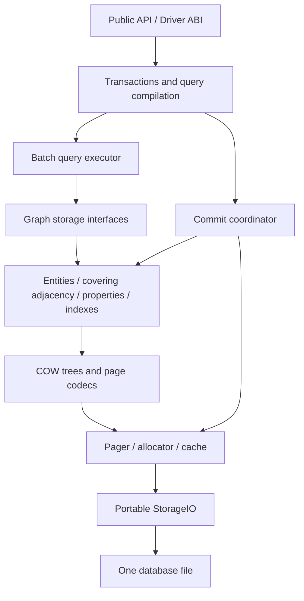

> **Current implementation entry:** [Current targeted read optimization implementation plan](targeted-read-optimization-plan), covering scope, source entry points, correctness boundaries, targeted tests, performance acceptance, and L0–L3 progress. The whole-engine alternative and G0–G7 below are research material, not the current execution roadmap.

# Next-generation single-file graph database design

Date: 2026-10-09. Status: **whole-engine research alternative, not the default refactoring plan; prioritize the local changes in section 0. No replacement engine has been implemented.**

The workload assumption is a balanced embedded database serving transactions, local graph traversal, and property scans. This is an actionable architecture decision, not proof of a universally optimal design. Existing files remain governed by the [current format specification](native-single-file-storage-plan). Replacements described here apply to a new format, never to a silent reinterpretation of existing files.

## 0. Benefit review: preserve the core and narrow the changes

Reinspection of source and existing measurements does not justify replacing the Pager, page directories, transaction engine, property storage, and executor together. Sections 1–15 remain an alternative design; their G0–G7 ledger is not the currently approved implementation roadmap. Previous design completion meant document delivery, not engineering validation of the selection.

**Preserve** the single file and A/B publication, page-level COW, stable entity/PageId identities and snapshots, shared allocation/safe reclamation, explicit codecs/StorageIO, B+Tree components, page-based entity scans, shaped property reads, batched topology/property interfaces, NativeReadSession, selection vectors, and plan cache. These already exist and must not be presented as capabilities requiring a rewrite.

| Priority | Current evidence | Minimum change and benefit contract | Unnecessary replacement |
|---|---|---|---|
| P0 Directory read amplification | `MetadataPageFile.cpp` resolves every valid logical child of the visited radix page; a recorded one-entity lookup has 2823 metadata reads and 58 distinct page pins | Keep directories, add selected-child resolution, batch only the requested access set, and review snapshot-bound resolution/decoded reuse; a seek does not resolve unrelated siblings | Do not delete PageDirectory or change file identities |
| P1 Exact-index verification reuse | Candidate emission invokes `validateNodeExactPropertiesSorted`; existing tests reject structurally valid indexes that disagree with primary properties | Keep the first necessary cross-check, batch reads, and reuse verified fields within the same immutable snapshot to avoid subsequent repeated reads/checks | Keep B+Tree and first verification; never forge verified flags; no-refetch index-only execution leaves the initial scope |
| P1 Type counts | Recorded count of 50000 matching relationships scans 86000 edges; execution filters a full reference scan by type | Maintain exact per-type counts in the same generation across creation/deletion/type changes/import and overlay; use only for matching queries without extra predicates, decoding zero Edge rows | No aggregation-engine rewrite; global Node/Edge counts already exist |
| P2 Covering adjacency | Key-only tree returns EdgeId; topology-only reads still call `readEdgesSorted`, partially mitigated by caches | First evaluate a local codec extension covering NeighborId/TypeId while preserving current direction/node/EdgeId order and cursor semantics; expansion avoids Edge primary reads; measure added writes/file size | Do not first change global ordering, introduce per-node trees, or replace the storage engine |

P0 changes implementation/read interfaces; initial P1 indexing reuses verified results without changing the read trust contract; P1 counts add transactionally maintained metadata; P2 changes a local durable structure. Covering adjacency requires an explicit revision of the key-only specification, format/index codec, rebuild, and reclamation contracts, never silent reinterpretation. Preserving EdgeId order does not automatically enable type seeks; a type-qualified access path requires separate evidence.

Preimplementation review found `RejectsPersistedScalarIndexKeysThatDisagreeWithThePropertyRecord`, explicitly protecting rejection of a checksummed, structurally valid index key that disagrees with the primary property. Atomic normal writes do not establish equivalent corruption detection without refetching. Preserve this contract/test initially and remove only repeated verification. Future no-refetch index-only execution needs equivalent validation or an explicit integrity-contract review, not a claim of unchanged semantics. Type counters cannot answer property/endpoint predicates or silently remove existing endpoint-existence validation; design counter maintenance first and enable fast queries only after defining the error-detection boundary.

### 0.1 Preimplementation constraints (override the alternative below)

- **Initial scope**: retain format and logical directories, add selected-path resolution and necessary snapshot-bound reuse, and batch/reuse verified index results. Existing caches and batch interfaces must be reused; add caches only where counters establish repeated work.
- **Validation boundaries**: preserve structure, checksum, owner, generation, and selected-reference identity checks. Keep full-child resolution for callers requiring it; integrity scans and relocation validation cannot accidentally use a single-path API. Lazy access is not whole-graph verification; explicitly define when unvisited references are checked.
- **Cache consistency**: bind database identity, snapshot, and the root interpreting a reference, never bare PageId/EntityId alone. Overlay mutations invalidate or bypass affected verified results; persistent caches cannot hide a transaction's own writes. Preserve snapshot, ABI, and recovery semantics.
- **Counter prerequisites**: cover creation, deletion, type changes, bulk import, rollback, old snapshots, and overlays, checking overflow/underflow. Match logical-plan semantics, including predicates, direction, self-loops, and parallel edges, not query text. Missing/unsupported counters use the existing generic path. If fast counts stop detecting dangling endpoints, resolve or explicitly review that contract before enabling them.
- **Adjacency prerequisites**: do not directly mutate the current key-only codec. First specify local codec/version, build/upgrade, atomic dual-direction maintenance, integrity, reclamation, and cursors while retaining authoritative entities, PageId, and shared paged structure. Read/write/space evidence determines acceptance; the array probe does not validate durable adjacency.
- **Generality**: production code cannot recognize benchmark names, label/type names, fixed IDs, seeds, scales, or expected answers. Semantic and structural-statistics-based choices are allowed. Validate held-out seeds/names, degree distributions, type selectivities, post-delete layouts, and read/write mixes.
- **Acceptance**: preserve correctness and corruption tests, never delete failing assertions for speed. Under equal resources/durability report latency, necessary work, and write/space costs. Do not multiply speculative gains or mark untested architectures verified. Run affected modules only, actual macOS acceptance now, no coverage gate or commit/push.

Conclusion: the contract-preserving first tranche can proceed; the original four recommendations cannot all be implemented unconditionally. Counter fast paths and covering adjacency remain conditional follow-up work. A replacement engine is outside implementation scope.

**Defer** wholesale physical page addressing, replacement of all primary properties with PAX, a new transaction/OCC protocol, a full factorized executor, default column projections, blanket page-size changes, and arbitrary cache increases. Property layout may remain a long-term bottleneck, but first remove directory/refetch amplification and measure scan decoding/physical bytes. Slow writes require separate data/metadata write, cloned-page, sorting, and sync measurements before selecting a different commit mechanism.

Do not multiply speculative speedups across these changes. Existing profile counters include cache hits, and profiled timings are diagnostic rather than uninstrumented acceptance results. Earlier local work within the current architecture improved medium property-filter p50 by about 12.14x, label filtering by 10.15x, and one-hop expansion by 5.35x, while type scans regressed. This demonstrates useful local optimization without proving universal success. Source: `benchmarks/graphdb-comparison/results/20261009-user-performance/optimization-comparison.csv`; this control is not the earliest architecture.

Each change preserves results, snapshots/recovery, and equal cache budgets; run affected module tests/workloads and report latency, page/decoding work, write amplification, and space. Only if directories remain a dominant cost after P0 should optimized-directory, single-mapping, and direct-reference prototypes be compared. This review does not approve a wholesale rewrite.

## 1. Whole-engine alternative (not the active implementation plan)

Adopt **a directly addressed COW page core, a neighbor-covering paged adjacency B+Tree, page-local PAX entity properties, selectable transactional column projections, and vectorized graph execution with late materialization**.

| Layer | Selected design | Accepted cost |
|---|---|---|
| File and recovery | One file, immutable committed 4 KiB pages, A/B publication, page-level COW | Small writes copy affected pages and ancestor paths; strict commits require two durability barriers |
| Addressing | Stable business IDs; physical page number plus birth generation on internal tree edges | Relocation rewrites the owning ancestor path; arbitrary relocation is not constant time |
| Adjacency | One covering tree ordered by node, direction, type, neighbor, edge ID | Two entries per directed edge; traversal startup requires a tree seek |
| Entities and properties | Separate Node/Edge primary trees; small properties in PAX leaves; sparse overflow tree | Narrow scans of primary storage still read complete physical pages |
| Analytics | Explicitly selected, synchronously maintained column projection indexes | Additional write and storage cost for selected columns; no default full-database duplication |
| Concurrency | Parallel logical transaction preparation; one validating publisher; serializable OCC by default | Conflicting transactions retry; durable publication throughput is bounded |
| Execution | Typed batches, selection vectors, direct neighbor expansion, late property fetch, selective factorization | More execution machinery than row interpretation, with independent storage boundaries |

Do not use immutable whole-graph CSR as the only writable format, restore edge-linked lists, default to one tree per node, introduce unbounded base/delta chains, or implement both an embedded WAL and COW as the initial core.

B+Tree selection reflects combined update, range access, reclamation, and implementation costs. Trees are not intrinsically faster than linked lists. The important gains are reading usable neighbors together and skipping unrelated relationship types.

## 2. Product boundaries and preserved semantics

1. Data, indexes, large values, allocation metadata, sort spill, and index-build scratch occupy the database file. Normal operation creates no WAL, SHM, lock-file, or temporary database sidecar. Explicit export/backup destinations are separate user operations.
2. Local filesystems; portable bytes and error semantics across macOS, Linux, and Windows. Cross-machine shared writes on network filesystems are outside the contract.
3. The initial engine gives one process ownership of a writable file. Multiple handles in that process share one kernel instance. Other processes cannot read that live writable file. Multiple read-only processes may share a file with no writer. OS locks operate on the database itself, and identity must account for hard links/file identity rather than path strings alone.
4. Preserve stable 64-bit NodeId/EdgeId, parallel edges, self-loops, multiple labels, sparse properties, heterogeneous types, and existing NULL/missing semantics. Logical IDs never encode physical positions.
5. Committed snapshots are immutable root sets. Transactions read their own overlay. Statement failure does not contaminate previously staged changes.
6. Successful strict commit means the OS/device durability contract completed. A failed commit sync may have an uncertain outcome; the engine must not claim rollback and keep writing through the same handle.
7. Long-term historical snapshots are not an initial product feature. Active readers and backups may retain snapshots, with observable retained space.
8. Preserve logical C++/Driver ABI behavior. New configuration, isolation modes, and migration behavior require explicit API review.

Single-file does not imply single-threaded or log-free. COW is selected to reduce recovery state and read-path complexity. An embedded redo log would be a different complete storage protocol, not a small patch.

## 3. Evidence and its limits

### 3.1 Observed current issues

- Current adjacency keys contain direction, node, and edge ID. Neighbors and relationship types require Edge Entity Store reads.
- Metadata radix reads resolve all valid logical child references in a node rather than only the selected path, creating one source of amplification.
- Existing diagnostics report 2823 metadata page reads for an indexed lookup decoding one record, and 86000 decoded edges for a type count returning 50000. These counters include cache hits and are not physical disk-read counts.
- The old edge chains use logical EdgeId references. Relocation does not necessarily require rewriting adjacent edges. Dependent access and transactional update coupling are the actual concerns.
- Previous Docker comparisons did not explicitly equalize buffer capacities or prove identical durability boundaries for every operation. Their ratios cannot all be attributed to architecture.

Existing repository evidence is under `benchmarks/graphdb-comparison/results/20261009-root-cause/`, `20261009-paper-comparison/`, and `20261009-docker-kuzu-zyx/`. None is a result from the proposed new engine.

### 3.2 Primary references

- [Neo4j store formats](https://neo4j.com/docs/operations-manual/current/database-internals/store-formats/) motivate locality, inlining, and typed/directional dense relationship organization. This proposal does not copy its per-node dense roots.
- [LiveGraph](https://www.vldb.org/pvldb/vol13/p1020-zhu.pdf) motivates sequential adjacency access. Its transactional edge log is not a drop-in single-file COW protocol.
- [Kuzu, CIDR 2023](https://www.cidrdb.org/cidr2023/papers/p48-jin.pdf) motivates columns, CSR-style adjacency, and factorized execution. Its read-optimized positioning does not establish optimality for random updates.
- [PAX](https://www.vldb.org/conf/2001/P169.pdf) motivates attribute grouping within pages for cache efficiency; it does not eliminate whole-page disk reads.
- [LMDB official source documentation](https://raw.githubusercontent.com/LMDB/lmdb/mdb.master/libraries/liblmdb/lmdb.h) demonstrates COW and serialized writers. Its default lock-file arrangement does not satisfy this stricter one-file requirement.
- [SQLite atomic commit](https://www.sqlite.org/atomiccommit.html) informs ordering and device assumptions; [SQLite WAL](https://www.sqlite.org/wal.html) identifies version lookup and checkpoint costs.

These references support principles, not ZYX performance promises.

### 3.3 Experiment performed for this proposal

`benchmarks/architecture-design/adjacency_layout_probe.cpp` was compiled and run with C++20, Apple clang 17, O3, on macOS arm64. It uses 1048576 edges, seed 42, degrees 4/32/512, clustered/scattered records, two warmups, seven measured samples, rotating variant order, and equal-result checksums.

Variants are an edge-linked list, adjacency IDs followed by edge reads, and an array covering neighbor/type/edge ID. Full samples are in `adjacency-layout-results.csv`; environment and hashes are in `provenance.json` in the same directory.

This is a **read-layout probe**. It excludes tree seeks, compression, disk I/O, updates, transactions, reverse-index construction, and durability. It supports removing dependent per-edge reads, not an engine-wide speedup prediction. G1/G2 must validate write and file-lifecycle costs separately.

Queries repeatedly visit at most 4096 shuffled nodes. Distinct working sets vary by degree, so compare variants only within a layout/degree. Covering records are 24-byte AoS, not the proposed grouped 16-byte SoA codec. Measured scattered-layout median ns/edge for linked, ID-refetch, and covering variants respectively: degree 4, 1.585/1.204/0.616; degree 32, 9.528/2.053/0.755; degree 512, 94.506/4.657/0.892. CPU clocks and host activity were not isolated; these are not production p95/p99 predictions.

## 4. Layers and ownership

Graph storage returns stable IDs and typed column views, not physical page numbers. Pager does not interpret Cypher. The coordinator owns validation, allocation, and publication ordering; indexes cannot commit independently. All graph structures share one COW, reclamation, and fault-injection core.

## 5. File, page, and addressing specification

### 5.1 Initial parameters

| Item | Initial value | Classification |
|---|---|---|
| Ordinary page | 4096 bytes | File-format parameter; larger pages require a different file, not a runtime toggle |
| Reserved prefix | 128 KiB | Publication and reserved space, never recycled user pages |
| A/B offsets | 0 and 64 KiB | Separate publication regions; sector atomicity is not assumed |
| PageRef | 64-bit page number and 64-bit birth generation | Direct offset calculation; zero is null |
| Common header | 64 bytes | Explicit LE magic, codec, kind, owner, birth, lengths, checksum, reserved fields |
| Leaf fill | 80% bulk-build target; approximately 50% after split | Tunable policy, not logical semantics |
| Query batch | At most 1024 rows, also byte bounded | Runtime policy; rows alone cannot bound large values |
| Default main cache | 64 MiB, caller configurable | Not a performance claim; comparisons must equalize it |
| New-kernel total budget | Initially 256 MiB, independently configurable | Includes engine-owned cache, transaction, execution, and temporary memory; excludes results already transferred to the application |

Separated A/B regions cannot repair hardware that lies about flush. The VFS contract must bound write-damage radius below the region separation and correctly implement flush and file growth. Without that contract, do not claim power-loss durability. Successful creation also requires directory-entry durability. File-format validation and device capability checks are separate.

Ordinary header offsets: 0 magic/u32, 4 codec/u16, 6 kind/u16, 8 flags/u32, 12 payloadBytes/u32, 16 physicalPageNo/u64, 24 birthGeneration/u64, 32 owner/u64, 40 itemCount/u32, 44 reserved/u32, 48 checksum/u64, 56 reserved/u64. All fields are LE; reserved bits are zero. CRC64-ECMA-182 covers the whole page with its checksum field zeroed. It detects accidental corruption, not malicious modification. G0 produces portable golden bytes; never persist a native C++ struct.

### 5.2 Root set and addressing

Publication records contain file UUID, format version, generation, root-manifest PageRef, allocation high-water mark, length/checksum, and required capability bits. A bounded one-page manifest holds Node, Edge, Adjacency, OverflowProperty, LabelMembership, TypeMembership, Schema/IndexCatalog, FreeExtent, RetiredExtent, ScratchOwner roots and global counts. Arbitrarily many user indexes belong in IndexCatalog, not in an unbounded superblock.

Internal tree edges contain direct PageRefs; primary-tree leaves are entity data pages. A point lookup makes one primary-tree descent after the root manifest, with **no EntityMap → PageDirectory → MetadataRouteDirectory chain**. Multi-level extent descriptors are visited only when large values are actually requested.

Trees own their pages; different logical trees do not share relocatable data pages. Snapshots share unchanged immutable pages. Cross-entity large-value deduplication is excluded initially to avoid global reference counting and reverse-reference graphs. A later deduplicated BlobId subsystem may introduce localized indirection rather than taxing every ordinary page.

Cache keys are file UUID, physical page number, and birth generation. Validated views may be cached while pinned; dangling views are forbidden. New pages validate codec, owner, generation, offsets, overflow, and checksum. Field access must not repeatedly decode the entire page.

Cache, decoded views, overlays, validation journal, operator arenas, and result staging share the total budget; subsystem caps are not additional simultaneous allocations. The 64 MiB main cache includes root/metadata retention and decoded cache. Execution may initially borrow up to 50% of the total, the validation journal at most min(64 MiB, 25% of the total), with remaining capacity for writers and other objects. Evict, reduce batches, or spill before reporting exhaustion. Avoid scalar-level accounting in hot loops. Measure RSS separately: code, stacks, libraries, and OS effects mean a 256 MiB engine budget is not a 256 MiB RSS guarantee.

### 5.3 COW tree cursors

Do not persist doubly linked leaves initially: changing a leaf under COW would otherwise propagate predecessor rewrites. Range cursors retain the root snapshot and an ancestor stack, advancing through the next subtree. Prefetch known upcoming child PageRefs from the parent. Resume tokens carry the root snapshot and complete ordering key, not a public slot reference.

Visit selected paths only; resolving a child must not load a complete routing directory. Sort writes by tree/key, clone each affected page once per publication batch, and merge common ancestor paths.

## 6. Covering, grouped, paged adjacency

### 6.1 One durable representation

One global tree is ordered by `NodeId, Direction, TypeId, NeighborId, EdgeId`. Persisted direction values are fixed and checked; new C++ enum members use prefixes such as `ADIR_OUT` and `ADIR_IN`.

Leaf groups share a node/direction/type prefix and contain separate 64-bit NeighborId and EdgeId columns. Groups may span pages; pages may pack groups from multiple small-degree nodes. No per-node root or empty tail page is required. Initial encoding is fixed width. Later delta/bit packing may use a new leaf codec without changing ordering or snapshot semantics.

Each directed edge has OUT and IN entries. The Edge primary tree is authoritative for endpoints/type; adjacency is a transactionally maintained covering index. Ordinary expansion trusts validated published index pages rather than rechecking every relationship against its primary row. Explicit integrity scans verify both directions against authoritative records.

### 6.2 Operations

| Operation | Implementation path |
|---|---|
| All outgoing neighbors | Seek NodeId/OUT and stream group/ID columns; zero Edge primary-tree reads |
| Typed outgoing neighbors | Seek NodeId/OUT/TypeId; do not scan other types |
| Typed connection existence | Seek NodeId/OUT/TypeId/NeighborId; preserve all parallel edges |
| Adjacent edge properties | Gather a bounded EdgeId batch, sort for primary reads, restore input associations through selection vectors |
| Endpoints by EdgeId | One Edge primary-tree lookup |
| Insert edge | Validate endpoint existence; publish primary row, OUT, IN, type membership/count atomically |
| Delete edge | Primary row supplies both complete adjacency keys; remove properties and indexes atomically |
| Change endpoints/type | If supported by the API, atomically remove old keys and add new keys; never update only the primary row |
| Delete node | Enumerate both adjacency directions, deduplicate self-loops by EdgeId, perform associated deletion as one logical transaction |

A self-loop has one OUT and one IN entry. A directionless traversal returning each relationship once skips IN entries whose NeighborId equals the current node. Never deduplicate by NeighborId, which would discard parallel relationships. Incoming/outgoing degree and combined relationship counts retain their distinct self-loop semantics.

Internal nodes maintain subtree entry counts. Two prefix-rank searches can count a directional/typed range without decoding every edge. These are adjacency-entry counts, not automatically deduplicated directionless relationship counts.

### 6.3 Costs and limitations

For height h, d selected entries, and b entries per page, access is approximately h plus d/b leaf pages and cursor-advance internal pages. There are no additional d primary edge lookups. Physical pages need not be contiguous, so this is not a claim of purely sequential disk I/O.

Excluding prefixes and headers, two covering entries use 32 bytes per edge; four old chain links also use 32 bytes. This does not prove equal database size: primary rows, group headers, internal nodes, fill factor, and snapshot pages remain. A snapshot-bound adjacency cache can avoid repeated seeks, but must be budgeted.

The first seek for a small hot node may still lose to a direct chain head. A shared tree accepts that fixed cost for uniform updates/reclamation and better large-degree scans. The initial version does not add a second persistent adjacency representation for this case alone.

## 7. Entities and properties

### 7.1 Primary trees and page-local PAX

Node and Edge trees are keyed by their stable IDs. Leaves own fixed entity fields and small properties. Each entity has a last-modified version; nodes have a few inline label slots plus overflow, and edges have source, target, and type. Row positions, labels, and properties are not external physical references.

Initially each leaf contains **at most 64 rows and 64 inline property keys**. Fixed metadata is stored in columns. Property descriptors locate presence bitmaps, type information, and fixed values or variable-value offsets. Absent keys consume no descriptor.

Each property has exactly one primary representation: inline, or an OverflowProperty entry keyed by `(EntityKind, EntityId, PropertyKeyId)`. A descriptor explicitly marks overflow for a present key. Row metadata also records whether external properties exist. Known-key lookup checks the leaf first, then the overflow tree when necessary. Full-object lookup merges inline values and the entity's overflow prefix range.

Inline candidates are at most 64 encoded bytes. Leaf rebuild ranks keys by descending occurrence count then ascending PropertyKeyId, choosing at most 64. If the page is too large, split at the EntityId median. If a single row remains too wide, move lower-priority values outside the page until it fits. Fixed row metadata remains bounded; oversized label sets also overflow, so one entity is always representable.

These are explicit initial encoding policies, not measured optimal thresholds. G3 may adjust thresholds once using independent codec/read/write probes before freezing the codec. A running engine cannot reinterpret the same codec differently.

### 7.2 Updates and type semantics

A single-property update reconstructs only the owning entity or overflow leaf and affected ancestor/index paths. Unchanged large values retain their extents. Do not rewrite the entire entity collection or a whole column. Splits move complete rows and their inline column values while preserving IDs.

Homogeneous columns have typed fast paths; heterogeneous columns have an explicit tagged-union path. Extract tests for NULL/missing, NaN, integer/float comparisons, string order, arrays, and nested values from existing language semantics. Physical encoding must not invent behavior. If Cypher assignment of NULL removes a property, do not add an independently queryable stored NULL state.

PAX improves decoding and CPU locality; a narrow scan still reads physical pages containing other columns. It is not disk-level pure column storage.

### 7.3 Transactional column projections

Wide-entity analytical scans use explicitly configured column projection indexes. Routing is by `EntityKind, ScopeId, PropertyKeyId, EntityIdRange`. Each range spans 1024 IDs; each data block occupies at most one ordinary page, with splitting when required. Scope can be all entities, one node label, or one relationship type; nodes need not have a single label.

Projections contain entity/property presence bitmaps, type information, and selected values ordered by entity ID. Sparse blocks use sorted slot/value pairs; dense blocks use bitmaps and packed values. Choose dense encoding when its actual encoded size is no greater than sparse encoding, recording the choice in the block header.

Projection updates and primary changes share one COW generation with no stale interval. Copy affected blocks, not the whole 1024-ID range. Label/type membership changes update relevant scopes.

Very large values are not duplicated by default: projections mark primary fetch required. Such values cannot claim index-only execution. Initial creation is explicit, not automatic workload guessing; the optimizer uses only READY, semantically compatible projections.

Online build scans a fixed snapshot and captures relevant writes in a bounded same-file change log. Register BUILDING, capture changes transactionally, catch up under the commit coordinator, and atomically publish READY. Cancel or briefly throttle when the log budget is exceeded; never query an unmerged build. After a crash, BUILDING may restart and READY must be complete. A first implementation may offer explicitly blocking maintenance-window construction, but must not call it online.

## 8. Membership, scalar indexes, and statistics

- LabelMembership and TypeMembership use bitmap containers over 65536-ID ranges. Sparse containers store sorted 16-bit offsets; dense containers use an 8192-byte bitmap split across ordinary pages. Convert above 4096 sparse offsets, revert below 2048, avoiding oscillation.
- Primary existence, membership, scalar indexes, and exact counts change in one publication. Type count uses snapshot counters; typed enumeration reads member IDs rather than scanning every Edge row.
- Scalar/composite keys combine scope, semantic value-order encoding, and entity ID. Support uniqueness, range access, and covered output. Prefix truncation, hash candidates, and approximate vector matches require residual verification.
- An exact index satisfying scope and predicate returns IDs/covered values without compulsory full-property rereads. Validation remains at page boundaries, transaction maintenance, and explicit integrity checks.
- Global node/edge counts and per-label/type counts are exact snapshot data. Histograms, NDV, degree distributions, and correlation estimates may be stale and cannot answer exact queries.
- Optimizer statistics must capture directional/typed degree distributions, skew, property selectivity, and label overlap, not just average degree.

## 9. Transactions and durability

### 9.1 Concurrency and isolation

Logical write transactions parse, read, and prepare mutations concurrently. **Only commit validation and tree mutation/publication are serialized**; writers are not serialized for their entire lifetime.

The default target is serializable OCC. Validate point reads, absent keys, predicates/ranges, write base versions, and schema epoch. Write/write checks alone are insufficient. [PostgreSQL isolation documentation](https://www.postgresql.org/docs/current/transaction-iso.html) explains predicate dependencies; this design uses validation-based OCC and does not claim to implement PostgreSQL SSI.

Initial logical read scopes are entity IDs, node/direction/type adjacency ranges, label/type scopes, scalar key ranges, and whole entity-kind scopes for predicates that cannot be narrowed. Property writes mark the entity and relevant label/type scan scopes. Edge insertion validates endpoint existence and marks both adjacency scopes; concurrent node deletion must conflict. Conservative conflicts are allowed; missed phantoms/write skew are not.

The coordinator retains a logical change journal since the oldest active read/write transaction, initially capped at 64 MiB. Transactions whose validation history no longer fits are marked retry-required rather than blindly accepted. Read-only snapshots do not retain this journal. Shared physical pages or changed roots do not alone cause conflicts. Validated logical mutations are applied to the latest candidate trees, never by overwriting newer state with old physical pages.

Read-only transactions serialize at their committed snapshot. Writers publish only if their read dependencies remain valid. Uniqueness, references, counts, and indexes are checked against candidate state. IDs exposed before commit use durable range reservations; rollback/crash may leave gaps, and reservations are batched rather than published per ID. Include lease costs in startup/write benchmarks.

### 9.2 Strict commit protocol

1. Validate conflicts and constraints; normalize final-state mutations; allocate pages unused by every retained snapshot.
2. Build and write data, indexes, allocation/retirement metadata, and root manifest bottom-up at new locations. Private pages may spill early but cannot overwrite reachable pages.
3. Complete the first durability barrier, including file growth, for every page referenced by the new root.
4. Write the inactive A/B publication region with the new generation, manifest reference, and checksum.
5. Complete the second durability barrier, release-publish the new in-process root, and report success.

Group commit may combine serially validated transactions into one physical generation, with intra-generation commit sequence numbers for validation. If any member is acknowledged, the entire batch root must be durable. By default, combine already queued work without artificial delay; an explicit throughput option may wait at most 200 microseconds, reporting that latency separately.

Strict macOS durability uses the `F_FULLFSYNC` contract, Linux uses appropriate fsync/file-growth ordering, and Windows uses FlushFileBuffers. Fault-test the VFS. Process kill does not simulate real power loss. [Apple](https://developer.apple.com/library/archive/documentation/System/Conceptual/ManPages_iPhoneOS/man2/fcntl.2.html) and [Microsoft](https://learn.microsoft.com/en-us/windows/win32/api/fileapi/nf-fileapi-flushfilebuffers) document these interfaces.

### 9.3 Recovery and errors

Open reads both publication regions, validates UUID/version/checksum/manifest format, and selects the newest valid publication. A torn publication record permits using the other record. **Corruption below a valid newest publication root is an error, not permission to silently fall back and lose acknowledged commits.** The fault model assumes a completed first barrier is not undone by later unrelated writes.

Write/sync failure poisons the writable kernel until recovery. Failure of the second barrier returns an uncertain commit outcome, resolved by reopen. Unpublished append pages may be truncated/reclaimed under exclusive recovery; pages allocated from an old free set remain free if publication never occurred.

Normal open performs no full-database scan or graph-sized directory reconstruction. Full integrity scans are explicit.

## 10. Allocation, reclamation, compaction, and scratch

FreeExtent stores free page intervals; RetiredExtent stores intervals by retirement generation. Prefer adjacent allocation batches. Do not require every data family to carry a 128 KiB segment identity and location directory.

A page retired at generation g can be reused only when the oldest active snapshot and both recoverable A/B roots have generations at least g. Birth generations protect against cache ABA. Allocation/retirement trees also use COW; reserve enough metadata pages based on current tree heights. If reserves and extension are unavailable, return ENOSPC before visibility changes rather than recursively allocating metadata from its own unpublished free-tree update.

Replacing a leaf must not recursively retire large-value pages reused by its replacement. Mutation batches distinguish retained, new, and retired ownership. Epochs protect pages shared by snapshots.

Long readers can cause continued file growth. Do not silently terminate them: expose oldest snapshot, retired bytes, free bytes, and scratch bytes. At a configured disk cap reject new writes with actionable diagnostics. Cancelling stale transactions requires an explicit user-selected policy.

File shrinking incrementally rebuilds trees/key ranges into lower free extents, rewrites ancestors, and publishes roots. Constant-time relocation of arbitrary shared pages is deliberately not promised. Truncate only when neither publication root nor any active snapshot references the tail; two root rotations may be necessary. Stop and report working-space requirements if compaction lacks free space.

Scratch extents are reserved by a small system transaction recording owner/process epoch before they are written. Query spill is outside graph snapshot semantics but shares safe allocation. Read-only opens cannot write scratch and must report memory exhaustion. Exclusive reopen marks old-epoch owners reclaimable; actual freeing is incremental, not a blocking full-file open scan.

## 11. Execution and optimization

1. Bind labels/types/property tokens once; cache plans against schema epoch, avoiding per-row string lookup.
2. Storage emits byte-bounded typed batches up to 1024 rows with ID columns, selected properties, and selection vectors. Define owned/borrowed lifetimes; avoid per-row string maps inside pipelines.
3. Expand consumes NeighborId/EdgeId/TypeId directly. Fetch properties only for actual predicates/projections, never to return an ID alone.
4. Keep input-row associations and output offsets so multi-hop results can remain factorized. Flatten when DISTINCT, ordering, path uniqueness, or aggregation multiplicity requires it; deduplication is not a generic optimization.
5. Supply adjacency nested-loop, batched hash join, and semijoin filtering. Choose using observed candidates and degree distributions; large frontiers use batch scan/join paths, small frontiers use adjacency seeks.
6. Sort, hash aggregation, and hash join support byte budgets and same-file spill. Account at arena/page/batch granularity, not through an expensive global operation on each field.
7. BFS/reachability reuse contiguous adjacency; visited sets use bitmap or hash storage according to ID density. GDS may build snapshot-scoped temporary CSR in memory or same-file scratch, never a second authoritative graph format.
8. Parallel reads split leaf/ID ranges or frontier batches with independent snapshot cursors rather than contending on one cursor. Initial execution may be single-threaded while preserving this interface.

Vector indexes remain derived structures sharing pages, transactions, reclamation, and authoritative raw values. Approximate ANN semantics must not leak into exact property indexes. Future text/spatial indexes use the same IndexCatalog and publication lifecycle.

## 12. Measurable cost contracts

| Operation | Required structural result | Not promised |
|---|---|---|
| Entity lookup | One primary-tree descent; no general location directory | One physical I/O at every scale |
| Neighbor-only Expand | Zero Edge primary reads and per-neighbor property fetches | First seek always beats a chain head |
| Typed Expand | Visit target range; decode zero non-target values | Boundary pages contain no unrelated bytes |
| Type count | Exact snapshot counter; zero decoded Edge rows | Statistics answer arbitrary predicates |
| Exact index returning IDs | Zero primary-property rereads unless residual required | Truncated/approximate indexes skip verification |
| One small-property update | Owning primary/overflow leaf and affected indexes/ancestors only | Exactly one 4 KiB write |
| Batch mutation | Clone each modified page once per publication batch | Identical per-row cost for every batch size |
| Normal open | No complete entity/property/adjacency walk | Discover all corruption without reading data |
| Compaction | Account relocation work, retained pages, and reclaimed space | Immediate shrink despite long snapshots |

Count the **union** of affected paths across trees, plus allocation/retirement metadata, root manifest, and publication region. Never hide metadata write amplification by reporting only business leaves. Measure logical/physical bytes, distinct pages, syncs, cache misses, decoded values, peak RSS, and file size.

An illustrative calculation, not a measurement: inserting one edge might touch a 3-page Edge path, two 4-page adjacency paths, 3 membership pages, 3 type-counter directory pages, 3 free-tree and 3 retired-tree pages, plus one manifest and one publication page. Without path sharing this is 25 pages, approximately 100 KiB. Splits, multiple free intervals, or property indexes can increase it; path merging can reduce it. Eliminating read amplification does not eliminate COW write amplification, so batch path merging and barrier measurements are essential acceptance work.

## 13. Fair performance acceptance

G0 freezes source hashes, compiler settings, seeds, semantics, and environment. Run current, rebuildable old, and candidate versions on the same macOS host. Paper numbers are historical context. Equalize Kuzu version, threads, explicit buffer pool, data/indexes, transaction boundaries, and result checks; report unmatched semantics separately.

Cover degree 0/1/4/32/512, skew/supernodes, parallel edges/self-loops, 1/8/64 types, ordered/random insertion and 50% delete/rebuild; narrow/wide/sparse/mixed/large-value properties; data about 0.25/2/8 times cache; read/write mixes 100:0, 95:5, 50:50, 5:95; transactions of 1/100/10000 operations.

Do not repeatedly run the full Cartesian product. Select representative combinations: small-degree hot reads, large-degree cold reads, random single-edge writes, bulk loads, selective indexes, narrow scans, wide-object fetch, mixed traffic, and long-reader reclamation. Run only affected combinations during implementation, then the representative matrix at integration.

Separate first read, warm read, explicit durable commit, and non-durable temporary import. Charge flush where it occurs; enqueue is not commit. Process restart does not evict OS cache: cold-read claims need a controlled setup or a dataset exceeding available cache, with method disclosed.

Use at least three independent processes with three warmups and ten samples for routine comparisons, saving raw results. p99 needs at least 1000 transaction samples, not ten. Report p50/p95, throughput, distributions, and resources instead of hiding regressions behind one aggregate speedup.

All structural contracts must hold. Against identically configured current code, core expansion/lookup/index-ID paths must materially reduce access counts. A representative p50 regression above 10% or p95 above 20% requires repeat confirmation and an explicit explanation before acceptance. These are review thresholds, not existing results or machine-independent performance guarantees.

Do not promise Kuzu parity now. If strict single-edge writes remain dominated by the two barriers, expose that floor and use batching/group commit first. Only measured failure to meet product write targets justifies a separate embedded-WAL project; never silently relax durability.

## 14. Implementation roadmap and progress

Implement an isolated new-format backend while retaining the current backend as a baseline. Do not reinterpret current files or plan two permanent production engines. New enums use platform-safe prefixes. Proposed source roots are `include/graph/storage/native_vnext/` and corresponding `src/`, explicitly registered in SourceSets; these directories do not yet exist.

Each stage has five independently accepted items, each worth 20%. Overall progress is accepted items/40, never elapsed time or lines written. This is the **initial implementation ledger**; completing this design does not increment it.

| Stage | Five deliverables / exit criteria | Implementation progress |
|---|---|---|
| G0 Baseline/contracts | API/semantic inventory; reproducible equal-budget baseline; I/O/durability contract; cost counters; frozen new codecs/root manifest | 0/5, 0% |
| G1 Storage core | Direct-page tree; A/B recovery faults; allocation/retirement/root retention; bounded cache; single-file locks/scratch/ENOSPC | 0/5, 0% |
| G2 Topology | Node/Edge trees; covering adjacency; membership/counts; self-loop/parallel-edge/delete atomicity; topology read/write matrix | 0/5, 0% |
| G3 Properties/indexes | PAX/overflow codecs; large-value lifecycle; exact/composite/unique indexes; transactional columns; property performance matrix | 0/5, 0% |
| G4 Concurrency | Overlay/statement atomicity; point/range OCC; constraints/delete races; group commit/uncertain outcome; long-reader/conflict stress | 0/5, 0% |
| G5 Execution | Typed batches; no-refetch Expand; late materialization/index-only; joins/aggregation/spill; factorized multi-hop correctness/performance | 0/5, 0% |
| G6 Lifecycle | Online index build; compaction/truncate; integrity/backup; logical format migration; Vector/GDS/bindings compatibility | 0/5, 0% |
| G7 Acceptance | Equal-budget representative performance; fault combinations; stable resources/reclamation; targeted macOS regressions; documentation/cutover/rollback drill | 0/5, 0% |

Dependencies: G0 → G1 → G2; G3 requires G1/G2. Correct single-writer atomic transactions are required from G1, not deferred until G4. G4 adds concurrent logical validation. G5 depends on G2/G3 batch interfaces. Change the default backend only after G6/G7.

Reuse parser, public ABI, suitable StorageIO code, and semantic tests. Replace nested page maps, key-only adjacency, per-entity property-directory primary access, and compulsory per-hit semantic rereads. Extract behavior from the large current backend by interface rather than copying the entire class. Old optimization-plan percentages do not apply here.

Cutover uses explicit logical export/import into a new file with result/count checks, never destructive in-place conversion. Migration temporarily retaining two files is a user-initiated operation, not a normal-runtime sidecar. Insufficient space requires external staged export or stopping, never deleting the only old copy. Users specify backup/migration retention.

## 15. Testing and stop conditions

Run only relevant module tests, never the full unit suite, and do not gate on coverage. Initial actual platform acceptance is macOS; preserve portable Linux/Windows design without marking untested platforms passed. Documentation-only design work requires no production unit run.

Required tests include torn publication, corrupt page checksums, short writes, failure of either sync, ENOSPC, ABA reuse, retained snapshots across reclamation, node-delete/add-edge races, write skew, range phantoms, uniqueness races, self-loop duplication, parallel edges, online build catch-up, spill cancellation, mixed-type comparisons, process lock conflicts, and same-process multiple handles.

Stop higher-layer expansion if G1 recovery/reclamation cannot close. If G2 still has poor traversal after eliminating Edge refetches, separate seek, leaf scan, accounting, and API materialization costs before adding another representation. If G3 PAX is insufficient for wide-table scans, use the designed column projection and disclose maintenance cost. If G4 validation is a hotspot, refine logical scopes/journal indexing instead of lowering isolation to inflate results.

Later evidence may justify compressed codecs, SIMD, more read parallelism, finer OCC, or specialized read projections without changing one file, one publication boundary, and explicit ownership. WAL, simultaneous multiprocess read/write, and historical temporal storage require separate product-level protocols.

## 16. Design delivery status

Requirements/current-state review, source research/read-layout validation, architecture specification, and implementation/acceptance planning are documented. The layout probe ran; the proposed Pager, graph store, transactions, and executor are not implemented. G0–G7 remain 0%, overall 0/40 (0%).

This work does not change the production format, commit, push, or create Docker resources. Future accepted items must update the ledger and evidence paths before reporting stage percentages.
