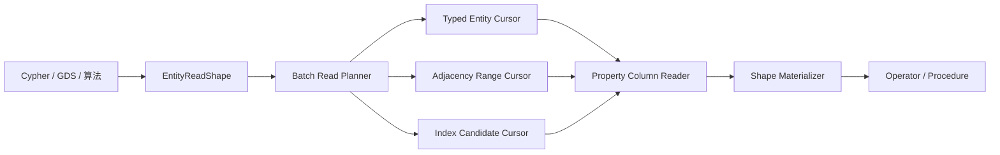

> **当前实施入口：** [当前局部读取优化实施计划](targeted-read-optimization-plan)。该计划明确首批范围、源码入口、正确性边界、定向测试、性能验收及 L0–L3 进度。本文下方为历史阶段和结果，其中的完成率不代表新一轮优化进度。

本次任务已按用户最新验收范围完成：仅要求 macOS 验证，Linux/Windows 后续由用户自行测试，不再阻塞本次收口。当前源码 macOS 读取与执行定向测试 1296/1296 通过；Release 九格矩阵 108 项对照、1080 个优化版本样本已核验，资源和结构指标证据已保存。性能回退完整披露，不设覆盖率或统一性能提升门禁。冻结性能 binary 早于最后的 CsvReader 字符串容量修复，但基准使用独立 CSV reader、没有 LOAD CSV 工作负载；该修复已由当前源码定向测试验证。结构对比的工作树参考范围与缺失指标限制保持不变。阶段 0–9 全部 100%，总计 50/50 = 100%。未执行全量单元测试，未提交或推送。

Linux 独立资源验收已完成 6/6 个样本：smoke/small/medium 数据库大小前后分别均为 1,441,792 / 35,913,728 / 349,569,024 字节；整进程峰值 RSS（含加载，单次样本）变化为 +1.82% / −0.10% / −0.01%，不作为查询内存分布。独立计数器 24 个样本、930 条事件通过，页 pin 完整性标记均为 0。Linux 共有结构指标保存 44 项配对与 2 项缺失，统计口径和限制见 structural-common-metrics.json；不能把局部指标等同于全局 I/O 或总解码字节。性能源码冻结的 561 个文件哈希复核一致。实际 Windows 验收尚缺失；阶段 0–9：80%、100%、100%、100%、100%、100%、100%、100%、100%、60%；总计 47/50 = 94%。未执行全量单元测试，未提交或推送。

Linux Release 耗时矩阵已完成：基准与优化版本各 9 组、108 条工作负载汇总、每条 10 个样本；108/108 对照通过相同数据集与环境核验。p50 有 100 项降低、8 项升高，所有退化均保留，不设置统一提升门禁。证据保存于 benchmarks/graphdb-comparison/results/stage9-release-linux/performance/latency-comparison.json。基准为已提交源码加直接包含 `<optional>` 的编译兼容修复，没有回填功能优化。独立 RSS 与数据库大小测量正在执行；Windows 实测仍缺失。阶段 0–9：80%、100%、100%、100%、100%、100%、100%、100%、100%、60%；总计 47/50 = 94%。未执行全量单元测试，未提交或推送。

Linux 写入与故障恢复定向选择 373/373 通过，覆盖 BTree/页池分配故障及事务、原子性、冲突、磁盘满、短写、同步失败边界；读取与执行选择此前 1296/1296 通过。同环境已提交源码 Release 对照正在构建，正式计时尚未开始，仍缺性能与实际 Windows 验收。阶段 0–9：80%、100%、100%、100%、100%、100%、100%、100%、100%、60%；总计 47/50 = 94%。未执行全量测试，未提交或推送。


最后四项实体排序/投影/过滤/UNWIND 定向回归在 Linux、macOS 均 4/4 通过。多个模块修改完成后，同一读取与执行模块选择在两平台均 1296/1296 通过；初始 Linux 30 个失败已全部复验。此次不是全量测试。阶段 0–9：80%、100%、100%、100%、100%、100%、100%、100%、100%、60%；总计 47/50 = 94%。剩余验收为 Linux 写入恢复边界及正式性能对比、实际 Windows 验证；未提交或推送。


可变属性载荷分批及提前停止定向回归在 Linux、macOS 均 1/1 通过。额度计入三条待处理引用行和有限载荷/输出暂存；完整路径保留三条有序载荷和多次批读，取消路径要求首次回调后没有新增属性读取，允许回调前预算重试。初始 Linux 失败已复验 26/30，剩余 4 个排序用例。阶段 0–9：80%、100%、100%、100%、100%、100%、100%、100%、100%、60%；总计 47/50 = 94%。仅定向测试，无提交或推送。


模式表达式命名属性列与损坏批次/请求大属性两个定向回归在 Linux、macOS 均 2/2 通过。额度计入结果映射和行槽位，且断言小于单个未请求的 8192 字节载荷；引用页/token 组合、缺失值、精确请求列和拒绝路径保持不变。初始 Linux 失败已复验 25/30，剩余 5。阶段 0–9：80%、100%、100%、100%、100%、100%、100%、100%、100%、60%；总计 47/50 = 94%。仅定向测试，无提交或推送。


属性预取向排序移交预算与访问者取消定向回归在 Linux、macOS 均 1/1 通过。额度按实际源/输出行槽位计算，并断言不足以持有两份完整行与载荷；正常及取消路径的单行完整载荷和无逐条回退检查保持不变。初始 Linux 失败已复验 24/30，剩余 6。阶段 0–9：80%、100%、100%、100%、100%、100%、100%、100%、100%、60%；总计 47/50 = 94%。生产逻辑与默认预算未变，仅定向测试，无提交或推送。


完整节点与边批量读取两个定向回归在 Linux、macOS 均 2/2 通过。测试按实际缓存容器分配及记录容量计算额度，工作窗口断言小于第二份完整缓存；300 条属性结果、多次批量读取和无逐条回退检查保持不变。初始 Linux 失败已复验 23/30，剩余 7。阶段 0–9：80%、100%、100%、100%、100%、100%、100%、100%、100%、60%；总计 47/50 = 94%。生产默认预算不变，仅定向测试，无提交或推送。


完整节点与边缓存共享预算及复用定向回归：Linux 1/1、macOS 1/1 通过。同预算要求两类实体独立查询成功、组合缓存在输出前超限；充足预算下重复 UNION ALL 的键数与每类实体一次批量读取保持不变。初始 Linux 失败已复验 21/30，剩余 9。阶段 0–9：80%、100%、100%、100%、100%、100%、100%、100%、100%、60%；总计 47/50 = 94%。生产默认预算不变，仅执行定向测试，未提交或推送。


嵌套排序行转移与排序分页定向回归：Linux 2/2、macOS 2/2 通过。额度按实际行对象与属性槽位大小计算，并断言低于四行双份所有权计账所需空间；保留排序、分页与提前取消结果检查。初始 Linux 失败已复验 20/30，剩余 10。阶段 0–9：80%、100%、100%、100%、100%、100%、100%、100%、100%、60%；总计 47/50 = 94%。未执行全量测试，未提交或推送。


Linux 原始节点发布/损坏属性与多批节点谓词的定向测试 2/2 通过，macOS 同选择 2/2 通过。损坏属性测试要求同预算下正常记录仍被结果发布额度拒绝、重复键报出明确损坏错误；保留充足预算的完整属性与别名独立所有权检查。初始 30 个 Linux 失败已复验 18 个，剩余 12 个。阶段 0–9：80%、100%、100%、100%、100%、100%、100%、100%、100%、60%；总计 47/50 = 94%。仅执行定向测试，无提交、无推送。


### Linux 预算回归收口检查点（2026-10-09）

首次 Linux 定向测试的 30 个失败中，**16 个已修复并重新验证，14 个仍开放**。聚合组向量增长、排序输出槽位和属性预取重试用例均在 Linux/macOS 通过；额度适配真实对象大小，保留目标拒绝点、行顺序和停止断言。模式表达式模块两平台各 **60/60** 通过：空边载荷对照同预算下完成目标解码，而保留大边载荷的查询在目标解码前拒绝；单页对照完成，而跨页查询在第二页拒绝。共享 fixture 和预算文件已拆分登记，原 60 个测试名称全部保留。此处不以对照查询后续结果发布的峰值替代目标读取阶段的验证。

生产默认预算不变，未运行全量测试，未提交、未推送。阶段 0–9：**80%、100%、100%、100%、100%、100%、100%、100%、100%、60%**；总体 **47/50（94%）**。Linux 平台与最终对比验收尚未闭合，Windows 实际执行仍缺环境。


### CSV 实际增长峰值与 Linux 回归推进（2026-10-09）

CSV 探针确认同一 1000 字符解码字段容量在 macOS 为 1119、Linux 为 1920：对旧字符串 reserve 叠加了标准库几何增长。生产 ensureStringCapacity 改为新缓冲 reserve，并在复制、交换前核对 retained+old+actual-new 的共存峰值，保持默认预算不变。相关 CsvReader/LOAD CSV Linux 定向 66/68 通过，先前转义字段、长 header 排序及分页增长失败消失。转换预检测试的固定额度仍先触及字段向量增长，因此改为有限额度搜索，必须找到 conversion 拒绝且交付零行，并保留充足额度正确输出；Linux 1/1 通过。剩余嵌套排序预算仍开放。

macOS range 同组 5/5 通过；CSV/读取执行器/聚合读取形状组合 194/194 通过，最新转换断言的 macOS 复验 1/1 通过。读取执行器超长文件已沿用共享 fixture 拆分并登记 SourceSets，原 98 个测试名称保留。首次 Linux 30 个失败中，19 个仍待处理；平台及最终基准验收不宣称完成。阶段 0–9：**80%、100%、100%、100%、100%、100%、100%、100%、100%、60%**；总体 **47/50（94%）**。不运行全量测试，不提交、不推送。


### Linux 定向测试与对象布局差异（2026-10-09）

Ubuntu/GCC Release 目标构建成功。另修复 metadata 测试中 ULL 数组推导类型与 Linux uint64_t span 不一致的问题，显式使用 `std::array<uint64_t, 1>`，保持 ID 和断言不变。首次读取/执行定向组合 1296 项中 1266 通过、30 失败，失败 XML 保存在 stage9-release-linux/functional/read-execution.xml，未隐藏失败。

同一最小程序实测 PropertyValue 在 macOS 为 48 字节、Linux 为 64 字节。五个 range 保留预算回归原固定额度在 Linux 上不足以容纳单个列表；额度改为 128 个真实对象槽位、100 个整数载荷及有限标量开销，保留单列表成功、同时保留两个列表时拒绝及充足额度下正确输出的断言。Linux 定向 5/5 通过，macOS 同组复验进行中；其余 25 个首次失败仍待根因分析。生产默认预算未改变，不执行全量测试，不提交、不推送。

阶段 0–9：**80%、100%、100%、100%、100%、100%、100%、100%、100%、60%**。总体 **47/50（94%）**；Linux 和 Windows 验收未闭合。


### Linux GCC 编译兼容性修复（2026-10-09）

实际 Ubuntu 24.04 / GCC 13 Release 构建发现并修复两处问题：StorageIO.hpp 缺少 std::optional 所需的直接 `<optional>` 包含；SharedPagePoolAllocator 测试的指定初始化字段顺序不符合 C++20 声明顺序。后者只调整字段排列，数据和断言保持原样。两处修复均已通过对应编译位置，完整目标仍在增量构建；Linux 定向测试及基准验收尚未完成，不增加任务百分比。只读挂载源码，复用容器依赖；不执行全量测试，不提交、不推送。

阶段 0–9：**80%、100%、100%、100%、100%、100%、100%、100%、100%、60%**。总体 **47/50（94%）**。


### 最新检查点：macOS 正式配对通过，Linux 实例启动（2026-10-09）

隔离 medium control 三单元均完成，360 个样本全部成功，进程退出 0。最终 macOS 108 组配对通过规模、模式、种子、线程、平台、数据集及样本校验；保留全部 10 组 p50 回退。medium/warm 关系类型扫描为对照的约 1.503 倍。延迟、资源和结构参考保存在 `benchmarks/graphdb-comparison/results/stage9-final-release-macos/final-macos-comparison.json`。旧提交缺少新统一结构计数，修复前工作树参考单独标注，缺失事件保持 null。benchmark 与冻结旧提交的差异仅为诊断开关及输出，查询、校验、准备和计时边界未变。

独立 Colima 实例已确认运行 Linux/aarch64、4 CPU、8 GiB；默认实例仍停止。Ubuntu 24.04 容器只读挂载项目，依赖安装及 Release 构建正在执行，尚不能声称 Linux 验证通过。实际 Windows 环境仍缺失。阶段 0–9：**80%、100%、100%、100%、100%、100%、100%、100%、100%、60%**；总体 **47/50 项闭合 = 94%**。未运行全量测试，未提交、未推送。


### 最新检查点：资源对比及最终结构计数完成（2026-10-09）

六个顺序资源探针均退出 0，全部 scan workloads 校验通过。smoke/small/medium 最终数据库文件大小与 committed-source control 完全一致：1441792、35913728、349569024 bytes。small 全 profile 进程 RSS 为 530939904 → 525795328 bytes；medium 为 2714845184 → 3113762816 bytes（增加约 14.69%），不能声称所有资源指标改善。RSS 包含加载及全部工作负载，是单次进程峰值，不是单查询预算或稳定统计分布。证据：`benchmarks/graphdb-comparison/results/stage9-final-release-macos/resources/paired-summary.json`，逐探针 argv/hash/raw/验证保留在 `comparison.json`。

最新冻结程序的 smoke/warm/seed42/warmup0/iterations2 counter-only 采样通过 24/24，930 个数值事件，内部 timer calls/time 全为零，distinct pin 计数无 incomplete。证据：`final-counter-validation.json` 及 `final-smoke-counters.jsonl`；不以诊断延迟替代无诊断矩阵。资源和计数采样全部结束后，隔离 medium control 三单元补测已启动，输出到 `stage0-release-control-macos/isolated-medium-runs`；期间不编译、不执行测试或资源探针。实际 Linux/Windows 验证仍缺失。阶段 0–9：**80%、100%、100%、100%、100%、100%、100%、100%、100%、60%**；总体 **47/50 项闭合 = 94%**。


### 最新检查点：最终 macOS 九格矩阵通过（2026-10-09）

最新冻结 Release 的九个 smoke/small/medium × cold-ish/opened/warm 单元全部完成，1080 个样本全部成功，108 行汇总均为 10 samples/ok，全部环境确认诊断关闭、seed 42、warmup 0、iterations 10。进程退出 0；程序 SHA-256 与冻结配置一致。证据：`benchmarks/graphdb-comparison/results/stage9-final-release-macos/validated-macos-matrix.json`。

矩阵结束后开始顺序测量全 scan-profile 进程峰值 RSS 和最终数据库文件大小。首次沙箱调用无法读取 macOS `kern.clockrate`，没有有效 RSS；允许本地系统资源统计后重新执行资源探针，未重跑延迟矩阵。资源结果及 medium 对照的隔离补测仍未完成；Linux/Windows 实际执行仍缺失。阶段 0–9：**80%、100%、100%、100%、100%、100%、100%、100%、100%、60%**；总体 **47/50 项闭合 = 94%**。


### 最新检查点：smoke/small 最终对比完成（2026-10-09）

最新冻结 Release 的 smoke/small 六个无诊断单元均完成，72 组有效配对，无执行或校验失败。small/warm 12 个工作负载中 11 个 p50 低于 committed-source control：aggregation_group_by 为 53.138 ms 对照 121.394 ms（降低 56.22%），two_hop_expand 为 6.405 ms 对照 23.872 ms（降低 73.17%）。relationship_type_scan 为 37.392 ms 对照 32.129 ms，仍慢约 16.38%；不隐藏此回退，不以增加预算或关闭校验换取速度。medium 矩阵仍在运行。

资源测量计划已保存到 `benchmarks/graphdb-comparison/results/stage9-final-release-macos/resource-measurement-plan.json`，将在延迟矩阵结束后顺序运行；其 RSS 包含数据加载及整个 scan profile，不能当成单个查询内存，也不能用其延迟替换既定矩阵。阶段 0–9：**80%、100%、100%、100%、100%、100%、100%、100%、100%、60%**；总体 **47/50 项闭合 = 94%**。


### 最新检查点：最终 Release 矩阵启动（2026-10-09）

最新 Release 构建成功并冻结到 `/tmp/zyx-stage9-final-no-diagnostics-bench`，SHA-256 `8bfbb4389f824ceb3cb4d5b60f6868211cb315b40e5491af81e91c83260570b4`。使用既定 smoke/small/medium × cold-ish/opened/warm、seed 42、warmup 0、iterations 10、诊断关闭契约。测量期间停止项目编译和测试。

截至本检查点五个单元完成，60 组与有效 control 配对，均无执行/校验失败；small relationship_type_scan 的 cold-ish p50 为 41.1205 ms，对照 38.5717 ms；opened 为 36.9606 ms，对照 32.2727 ms。完整矩阵仍在执行，不能据部分结果关闭性能验收。证据：`benchmarks/graphdb-comparison/results/stage9-final-release-macos/configuration.json` 和 `partial-latency-comparison.json`。阶段 0–9：**80%、100%、100%、100%、100%、100%、100%、100%、100%、60%**；总体 **47/50 项闭合 = 94%**。


### 最新检查点：最终功能定向回归闭合（2026-10-09）

有预算的组合属性读取释放此前可选的 owned 页缓存；数量补读在调用范围内借用已认证页面，无 BufferPool pin 时保留原 owned fallback。借用 pin 不跨调用保留，owner/generation/slot/codec 校验保持有效。原范围测试把额外页复制导致的 4 KiB 拒绝当成预期，现改为验证 4 KiB 下标量/复合候选完整结果、字段及行顺序、缓存后重试和 early-stop，同时保留 256-byte 拒绝及零交付。恢复既有结果预算错误消息，临时数值诊断留在日志作为测试预算校准证据。

最新读取/执行、Property 校验/缓存、snapshot、取消、损坏及共享资源模块筛选 **1296/1296 通过，10030 ms**。此前写入/恢复筛选 815 项中的 813 项通过；其中两个读取预算失败已修复，并纳入上述最新 selection 通过。证据：`benchmarks/graphdb-comparison/results/stage9-route-batch-macos/functional-closure.json`。仅关闭 Stage 9 第 5 项必要功能定向回归，不声称全量测试通过或跨平台验收完成。

阶段 0–9：**80%、100%、100%、100%、100%、100%、100%、100%、100%、60%**；总体 **47/50 项闭合 = 94%**。剩余三项为 Stage 0 基线/平台收口、Stage 9 实际跨平台运行和正式性能/结构/内存/文件大小对比。控制矩阵进程已成功退出，medium 单元因与修复工作并发不能作为正式延迟验收。未运行全量测试，未提交、未推送。


### 最新检查点：小预算读取修复（2026-10-09）

精确索引候选验证在借用 BufferPool 页面完成解码后，原本还强制复制整页以填充可选会话缓存。有瞬时缓冲预算的组合属性读取现在跳过该缓存复制；无预算调用仍保留原有缓存行为，不保留跨调用页面 pin。保持 2200 字节预算的候选生产与 7000 字节运行时重试用例已通过。

`count(n.payload)` 的结果构造诊断确认结果行需要 381 字节、输出槽需要 200 字节，另有列存储和中间行同时存活；原 512 字节测试假设不足。测试预算调整至 1024 字节，仍低于 8192 字节属性，并保留存在性探测及禁止选中/全量属性解码断言。默认生产预算未调整。

本次组合属性缓存、属性校验、聚合及两个原失败用例定向测试 **64/64 通过**；日志 `/tmp/zyx-stage9-budget-repair-targeted-test.log`。此前最终写入/恢复模块筛选测试为 813/815，通过本次定位修复了其中两个失败；尚不能据此声称所有最终验收完成。扫描 Catalog 复用相关测试此前 162/162、腐坏验证 6/6、读取/执行模块筛选 1255/1255 通过。小规模计数样本的元数据请求由路由修复前 108452 降至 Catalog 复用后 18514，降低 82.93%；并发下的延迟样本仅供探索，不作为正式验收。

阶段 0–9：**80%、100%、100%、100%、100%、100%、100%、100%、100%、40%**；总体 **46/50 项闭合 = 92%**。本检查点关闭具体缺陷，但阶段 9 的最终回归、正式性能对比及实际跨平台验证尚未整体闭合，因此不增加阶段百分比。不运行全量测试，不提交、不推送。


### 当前检查点：批量路由修复通过定向验证，重复元数据读取减少 72.58%

Debug 和 Release 构建通过。仅运行元数据路由、元数据页、目录扫描和实体扫描四个对应 suite，**57/57** 通过（75 ms）。新增生产入口断言证明 64 个稀疏子页槽位总共读取父页、bootstrap、路由根和路由叶四页；同叶批量 lookup 只读取根/叶两页。乱序、重复、多层 reopen、缺失/零身份、跨度/最大 fanout、未来叶 LSN 和错误路由类型检查通过。

冻结修复前计数二进制 `/tmp/zyx-stage9-route-before-bench`（SHA256 `6ae033fb9988ecb2bbce77ecac97994f52e76fb2d1a436100988e2c7029d01c1`），使用相同 small 数据、warm 模式、关系类型计数，各执行一次 counter-only 查询。两次结果均通过 native workload 校验；元数据页请求 **108452 → 29734（减少 72.58%）**。实体页访问均 789、边扫描/记录解码均 86000、唯一 pin 均 1619。该证据确认生产路径减少重复路由读取，没有跳过输入；不证明所有延迟回退已解决。原始输出、数据哈希、二进制身份和校验保存于 `benchmarks/graphdb-comparison/results/stage9-route-batch-macos/`。

构建/诊断与对照矩阵 medium/cold-ish、medium/opened 单元重叠，已单独保存 `route-repair-build-overlap.json`，这些单元现有延迟不得用于正式验收，后续独立补测；已完成 smoke/small 对照未受本次影响。本轮采集的单样本延迟也不作性能验收。剩余回退、独立延迟比较和阶段 9 原有平台/综合验收继续开放，不扩大固定交付清单。

阶段 0–9：80%、100%、100%、100%、100%、100%、100%、100%、100%、40%；整体 **46/50（92%）**。本次关闭路由修复的功能验证检查点，尚不足关闭整项阶段 9 比较验收。未运行全量测试、commit 或 push。


### 当前检查点：批量解析逻辑元数据子页（待验证）

检查关系类型计数生产调用链：仍使用原生 Edge reference/type token，端点存在性在扫描结束后统一验证；尚无证据证明共享字节预算导致 small 的 5–6 倍回退。已确认 `MetadataPageFile::resolveLogicalRadixChildren` 对同一 radix 页的每个逻辑子页调用独立 `MetadataPageRouteDirectory::find`，每次重读路由根和相关叶页。新增单页 fanout 有界的 `findMany`，按身份排序并共享所需分支/叶读取，结果散射回原顺序；保留 bootstrap/COW 上下文、路由类型、可见性、缺失身份校验，并验证内部层级连续性。未恢复通用物理 Page Directory 实体扫描。

补充定向测试：64 个同叶身份应只请求根/叶两页，乱序及重复身份、多层路由 reopen、缺失/零身份/跨度不匹配、未来或错误类型路由拒绝。代码与测试已写入，`git diff --check` 通过；尚未构建、运行或证明性能改善。对照矩阵 session 97841 再次确认仍运行，避免并发重构建干扰其延迟测量；后续需运行元数据路由、元数据页、实体扫描对应模块并测量关系计数。

阶段 0–9：80%、100%、100%、100%、100%、100%、100%、100%、100%、40%；整体 46/50（92%）。本修复仍属阶段 9 开放比较项，未新增关闭项。未执行全量测试、commit 或 push。


### 2026-10-09：small 对照发现实质性能回退

基线 smoke/small 六格完整通过，720 样本成功；matrix-progress.json 保存逐格验证，原 medium 进程仍运行。匹配候选与对照的 72 个 workload/mode 行，24 行 p50 回退超过 10%，全部为 small；relationship_type_scan 比例 cold-ish 4.96、warm 5.87、opened 6.13。partial-latency-comparison.json 保存完整数值，不将回退归为普通噪声或宣称优化达标。Stage 9 比较验收保持开放，下一工作优先定位关系类型扫描的结构工作与执行路径，并修复实际根因。

跨平台能力核对：Docker/Colima 已安装但 daemon 停止，无本地 Windows VM；ATC 只读工具查询需要登录，已停止等待登录的进程，未上传源码或更改长期配置。已向用户询问可用 Windows 环境，其他工作继续。阶段 0–9：80%、100%、100%、100%、100%、100%、100%、100%、100%、40%；整体 46/50（92%）。未运行全量测试、commit 或 push。


### 2026-10-09：阶段 0 Release 基线冻结闭合

隔离对照 Release 编译成功。三个 smoke 执行模式各 12 负载、10 样本，共 360 样本全部成功，quality failure_count=0，raw 中无 profile 事件。frozen-control.json 保存已提交源码归档、二进制 SHA256 d8b6cf7bd41ce824630464e17c4881ec6f8ad576ac058063bc38eac883d4cc5d、编译/依赖、硬件、seed/warmup/iterations/mode 与验证清单。environment 的 git 字段仍描述 runner checkout；追加 engine_source_commit/dirty/binary_sha256 明确区分隔离 engine 身份，未篡改 runner 来源。此基线是本次未提交优化前的最新 committed source，对照范围明确。

与已冻结候选九格矩阵二进制的 smoke 结果匹配 36 个 workload/mode 行，p50 超过 10% 回退的行数为零；smoke-latency-comparison.json 保存逐项值。此比较不代表新诊断源码二进制或跨平台/资源验收完成。small/medium 六格对照矩阵已启动，不重复已完成候选矩阵。

阶段 0 第 2 项闭合。阶段 0–9：80%、100%、100%、100%、100%、100%、100%、100%、100%、40%；整体 46/50（92%）。平台、完整对比与最终回归仍开放。未运行全量测试、commit 或 push。


### 2026-10-09：隔离 Release 对照配置验证完成

审核已有 9 月历史结果：其 legacy 诊断开启/未明示，warmup=1、iterations=3，不适合作为当前无诊断 warmup=0、iterations=10 的提速对照。通过 git archive 导出当前未提交优化前的最新已提交源码 f9574d371a804f3edf656321b44a636ccb49e7b5 至临时隔离目录；未改变当前 checkout、未创建 commit 或推送。此对照只代表本次未提交工作前的状态，不宣称重建所有历史优化前版本。核对编译器、Release 参数、coverage/tests 关闭及 7 项系统依赖配置路径一致。source-configuration.json 保存源码归档 SHA256、对照范围和配置。对照 benchmark 编译已启动，二进制及实测尚未完成，阶段 0 基线冻结项保持开放。

阶段 0–9：60%、100%、100%、100%、100%、100%、100%、100%、100%、40%；整体 45/50（90%）。未运行全量测试、commit 或 push。


### 2026-10-09：阶段 0 同次运行结构解释验收闭合

补齐原生属性 materialized_bytes（成功外层 PropertyValue 解码消耗的 canonical 编码字节，嵌套不重复计数）和 selected_values_decoded（实际命中值数，缺失为零；旧 owner-attempt 计数保留）。完整、selected、缺失、嵌套、失败及关闭诊断回归通过，最终属性与 LargeValue 定向组合 37/37。物化字节用于解码工作量，不代表 RSS、capacity、cache-copy 或执行器 batch 内存，不叠加旧 batch/payload 计数。

最终 Release smoke/warm 的 12 个负载各 2 个样本全部成功，内部 timer 全零，唯一页计数完整，九项指标以实际采样和审计口径统一解释。多属性筛选：200 个命中值、2600 个物化编码字节、50 个唯一 pin；全节点属性筛选：250 次实体 decode、220 个存在的选定值、3080 个编码字节、48 个唯一 pin，零完整实体物化。shortest path 有 5 次完整物化。此 smoke 数据没有 LargeValue chunk 读取，不冒充大属性 benchmark；chunk 的范围/完整/空范围计数已有独立定向验证。final-raw.jsonl、final-validation.json 和 metric-semantics-audit.json 保存原始样本、二进制身份及全部指标定义。计数诊断有开销，不宣称优化前后提速。

阶段 0 第 4 项闭合，阶段 0–9：60%、100%、100%、100%、100%、100%、100%、100%、100%、40%；整体 45/50（90%）。Release 基线冻结与平台证据仍开放，未运行全量测试、commit 或 push。


### 2026-10-09：唯一页边界修正与新 Release 证据

新 Release 实测及调用链核对发现 StorageIO::pinTypedPage 未覆盖 scalar copy read 在 BufferPool 内部的 pin。计数移至 BufferPool::pin 成功位置，保留 IO/offset/generation 身份，直接 pin 和 scalar copy 内部 pin 共用去重；不把无 pin 的 coalesced copy 当成 pin。增加真实复制读取验证，定向组合 124/124 通过。重建后 12 个 smoke/warm 扫描负载各 2 样本全部成功，全部 incomplete=0，内部 timer 为零。unified-raw.jsonl 与 unified-validation.json 保存实际输出及二进制 SHA256。属性筛选两次均有 48 个唯一 pin、250 次实体 decode、1 个 directory range 和 2 次 range root descent；metadata 页请求 877/635，latency 2.15146/1.44767 ms。先前仅计直接 pin 的值不代表完整 BufferPool pin 数；本记录修正该证据范围。剩余物化字节口径仍待闭合。

阶段 0–9：40%、100%、100%、100%、100%、100%、100%、100%、100%、40%；整体 44/50（88%）。未运行全量测试、commit 或 push。


### 2026-10-09：range 与 metadata 计数统一验证完成

所有 typed LocationDirectory cursor 成功打开时统一记录 directory_range_calls；LocationDirectory cursor 与 BTree scan/cursor 记录 range root_descents。MetadataPageFile 完整页读取成功后统一记录 metadata_pages_read，包含 route 解析和缓存服务的读取请求，不等于磁盘 miss。不能再累加 Property cursor 的重叠页面 delta。测试发现 BTree 传统 scan 入口遗漏，补齐生产计数而保留各路径一次下降的断言；range 模块最终 13/13 通过，diff 检查通过。统一指标仍有明确范围：root_descents 为 range 下降，非所有 point lookup；目录打开可保持 lazy。Release 重建已启动，完成后核对同一运行的结构输出，当前不提前闭合第 4 项。

阶段 0–9：40%、100%、100%、100%、100%、100%、100%、100%、100%、40%；整体 44/50（88%）。未运行全量测试、commit 或 push。


### 2026-10-09：有界精确唯一物理 pin 计数验证完成

StorageIO::pinTypedPage 成功后向 PerfTrace 提交 IO 实例、物理页偏移和 generation；跨线程在 reset 间隔内去重，输出 distinct_page_pins 及 distinct_page_pins_incomplete。最多保存 65536 个身份，超限或分配失败只标记不完整，不拒绝查询；incomplete=1 时不得视为精确值。该值统计实际 typed pin，不统计仅复制页面的读取，采样窗口必须隔离无关操作。新增跨线程重复、IO/generation/offset 区分、reset、上限与真实 StorageIO pin 回归；诊断、IO、benchmark 和物化定向组合 125/125 通过。更新指标审计。还需新 Release 样本及剩余 range 口径，阶段 0 第 4 项保持开放。

阶段 0–9：40%、100%、100%、100%、100%、100%、100%、100%、100%、40%；整体 44/50（88%）。未运行全量测试、commit 或 push。


### 2026-10-09：实体解码计数统一完成

Node/Edge codec 成功校验后统一记录 native_graph.read.records_decoded，覆盖实际 point/batch/scan 解码调用；encode 与失败 decode 不计数。该指标统计工作次数，包含页认证重复解码和采样操作中的写侧解码，不是唯一逻辑行数，也不能与 scan.records 或 BTree page decode 相加。新增 codec 成功/失败/encode 回归，并验证同一 session 第二次 Node/Edge record 读取缓存命中不再产生解码计数。实体页及 adapter 定向组合 54/54 通过，diff 检查通过。更新指标审计；此前 Release 样本仍不证明新计数。唯一页与其余 range 口径未闭合，阶段 0 第 4 项继续推进。

阶段 0–9：40%、100%、100%、100%、100%、100%、100%、100%、100%、40%；整体 44/50（88%）。未运行全量测试、commit 或 push。


### 2026-10-09：完整逻辑实体物化计数验证完成

在 PageBackedLogicalGraphReadAdapter 的 Node/Edge 完整转换成功处记录 native_graph.read.full_materializations，统一覆盖 point、完整 shaped batch、scan 和完整 adjacency；不在下层重复统计。新增独立小型测试，验证无属性 Node/Edge 的 point/batch 及 Node/Edge scan 计数，selected/topology 和无效 ID 失败路径不产生完整物化计数。最终定向组合 40/40 通过，diff 检查通过，指标审计已更新。此前 Release 原始样本不作为新增计数运行证据。唯一页与其他未覆盖指标仍待核对，阶段 0 第 4 项保持开放。

阶段 0–9：40%、100%、100%、100%、100%、100%、100%、100%、100%、40%；整体 44/50（88%）。未运行全量测试、commit 或 push。


### 2026-10-09：九项结构指标口径审计

逐项核对阶段 0 要求的九项指标，保存 metric-semantics-audit.json 至 stage0-counter-only-release-macos。确认 selected_decode 与 column_decode 有重叠，不能相加；BTree page decode 与实体 record decode 单位不同；现有 pin 操作及批次页分组不证明整次查询的 distinct_page_pins；Property root 完整解码不能替代无属性实体在内的完整 Node/Edge 物化次数。缺失事件不假定为零。后续实现范围收敛为完整实体物化计数、唯一页口径及 point/batch record 和其他 range 覆盖，不扩展预算机制。阶段 0 第 4 项因此仍开放。

阶段 0–9：40%、100%、100%、100%、100%、100%、100%、100%、100%、40%；整体 44/50（88%）。本次为指标审计，未重新跑测试、全量测试、commit 或 push。


### 2026-10-09：补齐 LargeValue chunk 读取计数

核对阶段 0 指标发现 LargeValueStore 缺少 chunk 计数。现仅在 readRawChunk 完成数据身份、存储 CRC、解压后 CRC 和 admission 校验后记录 native_graph.read.large_value_chunks_read；未改变返回值、读取范围或错误处理。新增独立小型测试文件，验证命中第二块的单字节读取计为 1、空范围不产生计数、完整读取计数等于 manifest 块数。新测试及现有 range/checksum 定向组合 8/8 通过。首次失败来自新夹具遗漏必填 media type，补齐合法输入后验证通过，未削弱断言。原 Release 样本生成于此改动之前，不作为新计数的运行证据。

阶段 0–9：40%、100%、100%、100%、100%、100%、100%、100%、100%、40%；整体 44/50（88%）。第 4 项还需其余指标口径核对，保持开放。未运行全量测试、commit 或 push。


### 2026-10-09：Release 仅计数扫描实测完成

Release 重建成功；warm / smoke 的 12 个扫描负载各运行 2 个样本，共 24 个样本全部成功，输出 722 个数值计数事件，内部计时器 calls 与 total_time_ms 均为零。原始输出、数据集 manifest 和二进制 SHA256 保存至 benchmarks/graphdb-comparison/results/stage0-counter-only-release-macos。独立属性筛选验证中，两次均扫描 250 条记录、解码 250 个选定属性值、读取 4 个实体页和 9 个选定属性批次页；外层延迟为 7.76596 / 1.52017 ms。页计数表示对应操作次数，不等于全局唯一页数；数值收集也有开销，因此不能用这些样本替代关闭诊断的九格矩阵或声称优化前后提升。阶段 0 第 4 项仍需完成指标口径与全部结构解释核对，未提前闭合。

阶段 0–9：40%、100%、100%、100%、100%、100%、100%、100%、100%、40%；整体 44/50（88%）。本次未执行全量单元测试、commit 或 push。


### 2026-10-09：仅结构计数入口模块验证

新增 --emit-counters，measureOperation 在同一采样中保留外层 latency 与数值计数，内部 ScopedPerfTimer 关闭；正常返回和异常路径均清空并关闭收集器。CompareBenchmarkTest 模块 32/32 通过，包括参数解析、实际输出值、无 timer 事件及异常清理。输出断言改为捕获 std::cout streambuf，因为项目监听器已重定向该流；不修改预期值或生产行为来掩盖失败。此入口尚需 Release 实测与结构解释，阶段 0 第 4 项仍开放。阶段 0–9：40%、100%、100%、100%、100%、100%、100%、100%、100%、40%；整体 44/50（88%）。未执行全量测试、commit 或 push。


### 2026-10-09：macOS Release 九格矩阵验收完成

原矩阵进程退出码 0。核对 smoke/small/medium × cold-ish/opened/warm 共九个唯一维度组合；每格 12 个工作负载各 10 个样本，合计 108 个工作负载结果、1080 个有效样本。全部状态 ok，quality failure_count=0，seed=42、warmup=0、iterations=10、zyx_emit_profile=false。validated-macos-matrix.json 与全部原始证据已保存；矩阵结束后重验 binary hash，并在 /tmp 保留该二进制供复核。

关闭阶段 9 第 3 项；三平台执行第 2 项仍开放，不以 macOS 代替 Linux/Windows。没有优化前对照、结构/内存/文件大小综合对比仍开放。计数入口的对应模块构建已开始，尚未提前宣称测试通过。阶段 0–9：40%、100%、100%、100%、100%、100%、100%、100%、100%、40%；整体 44/50（88%）。未执行全量测试、commit 或 push。


### 2026-10-09：medium opened Release 验证通过

medium opened 完整通过：12 个工作负载各 10 个样本，全部 ok，工作负载及质量 failure_count 为 0，diagnostics 明确关闭。原始数据及汇总保存至 stage9-release-macos。macOS 矩阵已有八格通过，原进程已进入最后的 medium warm；完整矩阵项尚未关闭。待验证的 --emit-counters 入口只改源码，当前矩阵二进制未重建。阶段 0–9：40%、100%、100%、100%、100%、100%、100%、100%、100%、20%；整体 43/50（86%）。未执行全量测试、commit 或 push。


### 2026-10-09：medium cold-ish Release 验证通过

medium cold-ish 第一格完成：12 个工作负载各 10 个样本，状态全部 ok，quality/run failure_count 为 0，诊断关闭。原始数据和汇总已保存至 stage9-release-macos。当前 macOS smoke/small/medium 九格中七格通过；原进程继续执行 medium opened/warm。此为当前代码测量，没有优化前对照，不将绝对时长表述为性能提升；矩阵验收项尚未闭合。阶段 0–9：40%、100%、100%、100%、100%、100%、100%、100%、100%、20%；整体 43/50（86%）。未执行全量测试、commit 或 push。


### 2026-10-09：small Release 矩阵验证完成

small 的 cold-ish/opened/warm 三格均完成，每格 12 个工作负载、每个工作负载 10 个样本；所有状态为 ok，质量检查 failure_count=0，environment 的 zyx_emit_profile 为 false。已完成结果保存到 stage9-release-macos，medium 当前仍由原进程执行。三种规模矩阵未完全闭合，不提前关闭验收项。阶段 0–9：40%、100%、100%、100%、100%、100%、100%、100%、100%、20%；整体 43/50（86%）。未执行全量测试、commit 或 push。


### 2026-10-09：Release 基线诊断口径隔离

基线 provenance 比较现在拒绝不同的 zyx_emit_profile 模式和非布尔开关。旧 manifest 没有该字段时按旧 runner 总开启诊断处理，不能与新无诊断结果混用。summary 模块 13/13 通过，覆盖同模式接受、混合模式/无字段旧基线拒绝；保留样本数量和工作负载检查。small/medium 六格 Release 矩阵已启动，当前仍运行第一格，尚无完整验收证据，不提前关闭阶段项。阶段 0–9：40%、100%、100%、100%、100%、100%、100%、100%、100%、20%；整体 43/50（86%）。未执行全量测试、commit 或 push。


### 2026-10-09：无诊断 Release 配置与 smoke 验证

当前源码已在 buildRelease 构建 Release benchmark，coverage/tests 关闭。runner 原先无条件传 --emit-profile，现增加 ZYX_COMPARE_EMIT_PROFILE=0 明确关闭诊断，默认 1 保留已有诊断运行；environment 记录开关，汇总器仅对布尔 false 跳过 profile coverage，样本数和工作负载失败检查继续生效。跨平台 workflow 使用同一关闭开关。adapter/matrix 定向 26/26、summary 定向 12/12 通过；既有 timeout 回归不再依赖 Python 在 0.5 秒内启动，直接注入 TimeoutExpired，保留成功首项、失败第二项及超时参数断言。

macOS smoke × cold-ish/opened/warm，各 10 iterations、warmup=0、seed=42，全部工作负载及质量检查通过。原始数据、配置、编译器、binary/source hash 保存在 benchmarks/graphdb-comparison/results/stage9-release-macos/；汇总器修复后由原始样本重新汇总，未重复运行 benchmark。硬件 sysctl 读取受本地权限限制，错误已记录；此为当前实现的候选测量，不宣称优化前基线或 Linux/Windows 验收。

阶段 9 第 1 项关闭；small/medium、跨平台、对比及最终回归仍开放。阶段 0–9：40%、100%、100%、100%、100%、100%、100%、100%、100%、20%；整体 43/50（86%）。未执行全量测试、commit 或 push。


### 2026-10-09：阶段 8 写入综合验收完成

检查实际断言并运行五个对应 suite 的定向选择：shared-pool replacement/control/evacuation failure 保护原 route 与 candidate reuse；streamed bulk entity/Property/LargeValue/manifest/adjacency/metadata/allocator/private scratch 的短写、ENOSPC、sync failure 保留旧图并允许 retry；planner disjoint writer rebase 同时保留双向 adjacency、同 Edge 修改冲突拒绝；process-crash scratch staging 的 kill/reopen 不暴露半条 Edge 并验证 integrity。组合 156/156 通过（40.28 秒），与此前 BTree/online/bulk/rebuild 178/178、codec/metadata 66/66 证据合并关闭第 5 项。本地执行平台为 macOS，不代替阶段 9 Linux/Windows 运行证据。

阶段 8 完成。阶段 0–9：40%、100%、100%、100%、100%、100%、100%、100%、100%、0%；整体 42/50（84%）。下一步阶段 0/9 Release 基线与评估矩阵收口。未执行全量测试、commit 或 push。


### 2026-10-09：阶段 8 online/bulk/rebuild 共享路径验收

核对通用 page builder：online/overlay 的 makeLeafPage/makeInternalPage、BulkBTreeBuilder 的 leaf/internal materializer、InitialBTreeBuilder 的 rebuild materialize 均调用 BTreePage::createWithEntries，共享 packed codec 与最终 layout 校验。Bulk build 经 materializeAndPublishTreeAcrossPools，transaction/rebuild 通过原生 mutation plan，streamed Edge 将 entity/Property/catalog/index 计划汇入同一 metadata publication；均由 MetadataWriteBatch/metadata 发布协调器处理可见性和 snapshot-aware 回收，不将私有 scratch 当持久图 root。跨 pool tree retirement 测试明确旧 snapshot 可读、pin 释放前不回收、释放后可复用；exhausted overlay rebuild、dense bulk reopen 和 streamed Edge 原子双向 topology/LargeValue 同代发布测试通过。定向 BTree/streamed bulk 组合 178/178。阶段 8 第 4 项关闭，第 5 项 conflict/rebase/I/O/ENOSPC/中断/恢复综合验收仍开放。阶段 0–9：40%、100%、100%、100%、100%、100%、100%、100%、80%、0%；整体 41/50（82%）。未执行全量测试、commit 或 push。


### 2026-10-09：阶段 8 写入放大测量与决策项关闭

新增 scratch fragment 解码 timer 和成功解码字节/记录值，以及 metadata publication timer（calls 代表该边界发布尝试，不与语句数等同）。codec/metadata batch 定向 66/66 通过。当前 Debug/profile smoke operational_dynamic batch_create_edges_10000 成功：completed writes=6462918 bytes/572 calls，即 646.29 bytes/新增 Edge；publication=4 calls/3.40 ms，scratch fragment decode=18 calls/23.69 ms、2281152 bytes/40000 records（包含多次遍历，不是唯一记录量）。COW mutation boundary replacement=2、append=18、retirement=4，directory publication pages=182；fresh pool/private scratch 不全在 COW mutation 计数内，不能将这些页数当全部物理写入。原始 bulk-accounting.jsonl 已保存。

结合此前 point mutation、generic target-page grouping、sorted Directory batch 和 BTree mutation overlay 证据，第 3 项决策：保留已有通用批处理，采用已验证的通用叶分裂预览优化；测量不支持额外 COW/WriteBatch 重构，按文档条件不新增该重构。Debug 诊断不充当阶段 9 Release/跨平台基线。阶段 8 第 3 项关闭，第 4/5 项共享 publication/reclaim 与写入异常/并发/恢复验收仍开放。阶段 0–9：40%、100%、100%、100%、100%、100%、100%、100%、60%、0%；整体 40/50（80%）。未执行全量测试、commit 或 push。


### 2026-10-09：阶段 8 成功写入字节 profile 接入

复用 StorageIO::recordWrite 的成功写入边界，新增可选 storage_io.completed_write_bytes/calls profile 值，统计口径与现有 saturating StorageIOStats 一致；profiling 关闭时不新增值收集，诊断异常不能改变已完成写入结果。该值是存储层完成的写入请求字节，包含页/control 等写入，不是设备 NAND/文件系统实际写放大，也不是 COW payload bytes。补充 native-fd 写入 profile 与现有 I/O stats 一致性断言，StorageIO 模块 71/71 通过。

当前 Debug/profile smoke point_create_edge 两次均成功，每次 completed_write_bytes=223616、calls=82；原始 io-profile.jsonl 已保存，可结合 mutation=1 得到该 workload 的 bytes-per-mutation。测量边界包含该 operation 的 API 附带写入，不误标为仅 adjacency 页。阶段 8 第 3 项仍需 scratch decode/publication 口径及最后决策记录；不扩大当前功能范围。阶段 0–9：40%、100%、100%、100%、100%、100%、100%、100%、40%、0%；整体 39/50（78%）。未执行全量测试、commit 或 push。


### 2026-10-09：阶段 8 通用叶分裂候选物化优化

findBalancedLeafSplitIndex 原先对每个切分候选构造、重写并完整校验两张 Slotted/BTree 页；现使用现有 PackedBTreePageCodec 编码得到确切载荷大小，以 page header + 两个 slot + Slotted header 推导容量，并按相同 live-byte skew/首次平局规则选取候选。固定 header 在两页相同，skew 等于 packed payload 大小差；只对最终选中两页完整构造校验。通用 helper 的 online/overlay/direct split 路径同时受益，不修改页格式或跳过最终校验。

BTreePageStore 模块 170/170 通过，包含宽键、压缩、不同 leaf value layout、跨页 split、merge/rebalance、旧 snapshot 和失败路径。相同 Debug/profile smoke 两次 point_create_edge：apply 平均从 476.14 降至 198.25 ms，adjacency_plan 从 481.37 降至 203.63 ms，当前操作耗时平均 412.11 ms；此为诊断，不能作为跨平台 Release 性能结论。原始结果 split-preview.jsonl 已保存。第 3 项仍需物理 bytes-per-mutation 等测量口径收口，未提前关闭。阶段 0–9：40%、100%、100%、100%、100%、100%、100%、100%、40%、0%；整体 39/50（78%）。未执行全量测试、commit 或 push。


### 2026-10-09：阶段 8 BTree 写入规划成本定位

为通用 planScalarIndexTransactionMutation 增加 initialize/apply/build 三个互不重叠的 timer（嵌套调用的外层时间仍不可累加）。重链当前 Debug benchmark，smoke point_create_edge、warmup=0、2 iterations：adjacency_plan 平均 481.37 ms；通用 BTree initialize 4.22 ms、apply 476.14 ms、build 2.83 ms。通用 timer 汇总该操作涉及的所有索引，不将其误标为仅邻接索引。证据将下一工作范围收敛到 overlay apply 的查找/重平衡成本，而非发布层的大规模改造。原始数据保存于 benchmarks/graphdb-comparison/results/stage8-write-diagnostic/btree-phases.jsonl。BTree overlay 模块定向 36/36、构建及 diff 检查通过。物理 I/O 已有 StorageIOStats 计数，尚需接入此次测量，不能用 payload 代替。阶段 8 第 3 项仍开放；阶段 0–9：40%、100%、100%、100%、100%、100%、100%、100%、40%、0%；整体 39/50（78%）。未执行全量测试、commit 或 push。


### 2026-10-09：阶段 8 smoke 写入结构诊断

从当前源码重链 zyx-compare-bench，生成 seed=42 smoke 数据（100 User、120 Post、30 Tag、660 Edge），执行 write profile、warm、warmup=0、2 iterations，各 workload 均成功。原始 profile 和汇总保存于 benchmarks/graphdb-comparison/results/stage8-write-diagnostic/。此构建为 Debug 且开启 profile，仅作成本归因，不作为 Release 性能基线。创建 Node 平均 144.03 ms，3 replacement pages/12096 payload bytes、30 directory publication pages；创建 Edge 平均 666.38 ms，5 replacement pages/20160 payload bytes、22 directory publication pages，adjacency_plan 平均 469.26 ms（约总耗时 70%）；Node 属性更新平均 155.53 ms，2 replacement pages/8064 payload bytes、20 directory publication pages。嵌套 timer 不能相加，载荷字节不能当物理写入字节。

证据不支持将 COW 认定为主要成本，暂不新增通用 COW/WriteBatch 改造。第 3 项仍需物理 bytes-per-mutation/publication/scratch-decode 口径及更充分验证；下一步有限范围是已有 adjacency planning 主成本的调用链和测量缺口。阶段 0–9：40%、100%、100%、100%、100%、100%、100%、100%、40%、0%；整体 39/50（78%）。未执行全量测试、commit 或 push。


### 2026-10-09：阶段 8 写入测量口径回归

核对发现通用 entity target-page grouping、sorted Directory batch 和 shared-pool COW 计数已经存在，不重复新增实现。为 prepareMutationPages 的正常 replacement/append/retirement 组合补充精确断言：各一页，replacement/append payload bytes 等于输入实际载荷；明确这些是载荷字节，不是物理磁盘写入字节。结合 publication validation 连续帧合并、600 Node grouping、sorted mutation Directory batch 定向 4/4 通过。此证据验证计数和已有通用批处理契约，尚不能证明 COW 是主要耗时，阶段 8 第 3 项仍需 publication/scratch decode/物理 bytes-per-mutation 的测量和决策。阶段 0–9：40%、100%、100%、100%、100%、100%、100%、100%、40%、0%；整体 39/50（78%）。未执行全量测试、commit 或 push。


### 2026-10-09：阶段 7 综合生命周期验收完成

按关闭条件逐项核对并执行对应模块：shared pool 的 durable generation keys、COW old/new pin 隔离、跨 pool evacuation、pin 释放后 retired frame 回收复用及 reopen；EntityPageStore 的 typed owner/checksum/slot generation 拒绝、原子 replacement、最终 Property page 延迟回收；metadata routed pool relocation churn/reclaim/reopen；logical reader 的 Property presence 和 adjacency old/current snapshot 隔离；SlottedPage 的 owner/view、stale slot、checksum-valid mutation 检查；Property cursor 的 foreign/newer/released snapshot 和取消拒绝。定向实体/共享页/reader/metadata 组合 180/180，slot/Property/无效 pin 组合 64/64 通过。此前消费者与缓存上限证据保持有效。本项验收限定阶段 7 读取缓存和校验，不代替阶段 8 写入综合验收或阶段 9 跨平台评估。

阶段 7 第 5 项关闭，阶段 7 完成。阶段 0–9：40%、100%、100%、100%、100%、100%、100%、100%、40%、0%；整体 39/50（78%）。下一步阶段 8 写入放大测量及通用批处理决策，按原文证据条件推进。未执行全量测试、commit 或 push。


### 2026-10-09：阶段 7 缓存与 continuation 上限收口

必要 continuation 转换现在在插入前检查每张 map 的条目上限：2 × staged Edge 数量；两张表合计最多 4 × staged Edge 数量，记录只含固定大小逻辑 ID，不保留属性或类型字符串。出边/入边分别对应 staged Edge 的两个端点；普通分页不保存转换，revision 变化清空状态。使用除法比较避免上限乘法溢出，已有 key 更新仍可回放。千边回归补充双向扫描，999 页/方向仅保留两个 gap 映射，完成后旧 token 与不同 page size 回放仍正确。

读取缓存清单核对：Buffer Pool 按配置字节容量淘汰；NativeReadSession 的实体/存在性/Property presence/名称有条目上限，Property、标签、schema 另有载荷上限；schema spare capacity 已修复；Property cursor 仅保留当前页和 directory cursor；Location cursor 保留 radix 路径及一个 leaf；BTree range cursor 保留 traversal、当前 leaf 与边界 key；顺序邻接/实体/索引叶通过 transient hints 防止驻留污染，批次结果由 record/byte admission 约束。写入 placement/free-space cache 属阶段 8，不将写入工作混入本项。缓存/overlay/cursor 定向组合 147/147、构建及 diff 检查通过。阶段 7 第 4 项关闭，第 5 项综合隔离/搬迁/reopen/损坏/reclaim 验收仍开放。阶段 0–9：40%、100%、100%、100%、100%、100%、100%、80%、40%、0%；整体 38/50（76%）。未执行全量测试、commit 或 push。


### 2026-10-09：阶段 7 continuation 稀疏保留修复

普通分页的 token 已包含准确恢复位置，现不再重复保存映射；topology 仅保留 visible/raw token 不同的删除间隙转换，created-edge 转换继续保留。未引入分页次数上限或淘汰回放状态。新增普通/vector snapshot 千边回归：删除一条边，连续读取 999 个单行页，只保留一个删除间隙映射，完成扫描后仍能回放首个及跨间隙 token 并改变 page size。overlay 模块 67/67、构建及 diff 检查通过。

第 4 项仍需必要 gap/created 状态上限及剩余 cache/cursor 清单收口，第 5 项综合生命周期验收仍开放。阶段 0–9：40%、100%、100%、100%、100%、100%、100%、60%、40%、0%；整体 37/50（74%）。未执行全量测试、commit 或 push。


### 2026-10-09：阶段 7 schema 缓存实际容量修复

NativeReadSession 的 schema cache 原先只计 name/property name 的 size，遗漏 definition vector、property_names vector 的槽位容量、字符串 spare capacity 及 IndexDefinition.vector_metric。现以实际 capacity 叠加检查，并在乘法前用剩余预算除法验证，避免溢出；超限定义不进入缓存，正常小定义仍可缓存。新增 index/constraint 的四类 spare-capacity 拒绝和正常重试，以及 vector metric 容量回归。相关 session/index-session/constraint builder 模块 44/44、构建及 diff 检查通过。

阶段 7 第 4 项仍开放：核对发现普通 overlay 的 continuations_ 与 topology_continuations_ 仅在 revision 改变时清除，同一 revision 内可以随分页增长；下一步限定为这个 continuation 状态上限，同时保留现有回放和删除间隙语义。阶段 0–9：40%、100%、100%、100%、100%、100%、100%、60%、40%、0%；整体 37/50（74%）。未执行全量测试、commit 或 push。


### 2026-10-09：阶段 7 消费者生命周期清单闭合

核对所有生产 NativeReadSession 使用文件及上层调用链：

| 消费者 | 生命周期与隔离证据 |
|---|---|
| query/executor 与 Node/adjacency cursor | 单次执行或 cursor 持有一个 logical snapshot；ExecutionState 引用它，finalizer 结束后才释放；输出回调前后检查 mutation fence。 |
| GDS/procedure | procedure 持有 snapshot 贯穿 projection 和下游输出；projection 构建检查 fence；catalog 以完整 revision 隔离投影。 |
| 普通/vector overlay | active transaction 检查及 revision checkpoint；vector 按 revision 刷新 delegate，调用期间 shared_ptr 保留旧 delegate。 |
| 原生 shaped/columns/labels/topology/index | logical snapshot 成员 read_session_ 统一传递；adapter/cache 查询前 bind；database/generation 不匹配及已释放 pin 拒绝。 |
| 约束树构建/写入旧状态校验 | builder 每次构建创建 session 并绑定固定 pin；mutation executor 创建局部 oldStateReads，只读 transaction.baseSnapshot()，不跨 publication 复用。 |
| route/Buffer Pool | route 来自 pinned metadata；known-location 验证 snapshot ownership，物理页按 durable generation 缓存；COW 旧、新 pin 读取各自载荷。 |

消费者/overlay/GDS/cursor/index-session 定向组合 125/125、约束构建 23/23、mutation validation 30/30 通过；前一检查点缓存/session/route 106/106 已通过。阶段 7 第 3 项关闭；第 4 项内存上限及第 5 项综合 relocation/reopen/corruption/reclaim 验收仍开放，不由本项测试代替。阶段 0–9：40%、100%、100%、100%、100%、100%、100%、60%、40%、0%；整体 37/50（74%）。未执行全量测试、commit 或 push。


### 2026-10-09：阶段 7 已命中缓存的 snapshot 释放验收

补充原生 reader 生命周期回归：先填入实体缓存，再释放 snapshot，点读记录、完整 Node 和批量记录读取均必须拒绝；拒绝后，同 generation 的独立有效 pin 仍可复用 session 并得到原结果。现有生产入口已在缓存查询前调用 bind，不需额外改变缓存策略。缓存/session/route 模块定向组合 106/106 通过，diff 检查通过。

本次关闭该生命周期子任务；阶段 7 第 3 项全消费者生命周期清单及第 4/5 项综合验收仍开放，不能凭单项回归关闭整项。阶段 0–9：40%、100%、100%、100%、100%、100%、100%、40%、40%、0%；整体 36/50（72%）。未执行全量测试、commit 或 push。


### 2026-10-09：阶段 6 综合验收完成

reference pending 已有分配前槽位接纳，补实际 capacity 校正；direct-edge 在类型筛选后只保留身份、端点及 token，不复制无用类型字符串。结合 selection、排序数组及 pending 预分配修复，最终执行预算/取消定向组合 443/443 通过，覆盖批次拆分、NULL/重复、JOIN/UNION、CSV 源/Sort/Aggregate、procedure 下游输出共享与提前停止。阶段 6 第 5 项关闭。阶段 0–9：40%、100%、100%、100%、100%、100%、100%、40%、40%、0%；整体 36/50（72%）。下一步阶段 7 session/cache 生命周期与校验分层。未执行全量测试、commit 或 push。


### 2026-10-09：阶段 6 traversal 临时数组接纳

direct-edge 排列序号、去重序号、Edge ID 在分配前接纳；reference traversal 的原有排序数组额度前移，移除后置重复计费并覆盖 NULL 谓词。direct-edge pending 槽位使用共享预算 PMR，批次容量同时受可用字节数约束，保留严格逐条 early-stop 路径。完整 Edge 批读回归的预算明确补入一个 pending 槽位的结构成本；其余额度及输出断言不变。最新 direct-edge 168/168 通过，前一轮综合预算/取消组合 443/443 通过。阶段 6 综合验收仍开放；下一步核对 pending 的动态 type 载荷和 reference pending 槽位，限定在既定临时批次范围。阶段 0–9：40%、100%、100%、100%、100%、100%、80%、40%、40%、0%；整体 35/50（70%）。未执行全量测试、commit 或 push。

### 2026-10-09：阶段 6 消费者清单关闭

核对 scan/filter/project/aggregate/JOIN/OPTIONAL/UNION/LIMIT/SKIP 的需求收集、BoundedBatch/SelectionVector 与流式 visitor 入口；LOAD CSV 有界源接入同一执行预算；procedure 使用选列批次、受预算约束缓冲或适用形状的 top-K。复杂 Sort/DISTINCT 的有界缓冲属于既定实现，不要求所有形状强制 top-K。消费者定向组合 225/225 通过，结合 direct-edge/变长 202/202，阶段 6 第 4 项关闭，第 5 项综合资源/取消验收仍开放。阶段 0–9：40%、100%、100%、100%、100%、100%、80%、40%、40%、0%；整体 35/50（70%）。未执行全量测试、commit 或 push。


### 2026-10-09：阶段 6 selection 位图计费补齐

direct-edge traversal 与 reference traversal 的 SelectionVector 在构造前按 requiredStorageBytes 接纳，共用已有物化预算；预留持续到位图释放。核对 LogicalPlanReadRuntime 所有 SelectionVector 构造点均有预算预留。direct-edge 单模块 168/168、合并变长路径定向组合 202/202 通过。阶段 6 消费者清单及统一资源/取消验收仍开放，保持 3/5。阶段 0–9：40%、100%、100%、100%、100%、100%、60%、40%、40%、0%；整体 34/50（68%）。未执行全量测试、commit 或 push。

### 2026-10-09：阶段 5 生命周期验收完成

导入实体回归的 3000 字节小于三个刷新实体的最终载荷，拆批无法消除最终保留内存；改为验证小预算拒绝及同 snapshot 足够预算完整重试，不要求固定拆分次数。snapshot/执行器契约组合 21/21 通过，覆盖缺失/NULL、异常列、generation 契约、资源拒绝及旧 snapshot root publication/removal；原生索引生命周期组合 50/50、源分配组合 28/28 已通过。阶段 5 第 5 项关闭。阶段 0–9：40%、100%、100%、100%、100%、100%、60%、40%、40%、0%；整体 34/50（68%）。下一步阶段 6 剩余批处理交付。未执行全量测试、commit 或 push。


### 2026-10-09：阶段 5 生命周期验收检查点

原生索引候选生命周期定向组合 50/50 通过，覆盖 owner/checksum 损坏、persisted key/value 不一致、stale label、候选流边界及 overlay 可见性。补充 snapshot/执行器契约组合 20 通过、1 失败：ImportedEntityBatchesSplitAtTheSharedByteAdmissionBoundary 的 3000 字节共享预算发生拒绝。旧 snapshot root publication/removal 与直接索引失败后重试测试通过。下一步限定为定位该导入实体批次的共存计费/重试行为；阶段 5 第 5 项不关闭。阶段 0–9：40%、100%、100%、100%、100%、80%、60%、40%、40%、0%；整体 33/50（66%）。未执行全量测试、commit 或 push。

### 2026-10-09：阶段 5 去重/scatter 与源分配关闭

核对 exact 输出容量及 payload 分配前检查、scalar/composite range 的 pending 整批存活缓冲计费、ID/排列分配前接纳、局部排序及原地列/行重排；去重分配器已在分配前合并 pending 与边界键。修正重试测试旧预算假设：保留 4 KiB 零交付拒绝，成功重试分别设置物化/候选预算，并保留单候选顺序及提前停止；解码计数包含拆分重试，不能要求等于唯一输出字节。最终定向组合 28/28 通过，阶段 5 第 4 项关闭，第 5 项生命周期验收仍开放。阶段 0–9：40%、100%、100%、100%、100%、80%、60%、40%、40%、0%；整体 33/50（66%）。未执行全量测试、commit 或 push。


### 2026-10-09：range 去重分配与低预算回归

scalar/composite range 的去重分配前接纳现在合并当前 pending slots、键和 cursor 边界占用，避免分配器只检查自身预算。核对现有低预算回归：1 KiB 低于共存页缓冲需求，不能要求输出名称分配前已完成 liveness probe；修正测试名称及这一错误断言，保留零交付、同 snapshot 两次预算拒绝与高预算成功重试。相关去重、列排列、重复值、标签资源回归 5/5 通过。阶段 5 第 4 项仍需其余源分配核对，第 5 项生命周期验收未关闭。阶段 0–9：40%、100%、100%、100%、100%、60%、60%、40%、40%、0%；整体 32/50（64%）。未执行全量测试、commit 或 push。


### 2026-10-08：阶段 4 综合验收完成

核对原生 257/513 Edge 跨批次读取、物理多 leaf 的 transient 流式读取、cache eviction/continuation、提前停止、旧 snapshot、overlay 删除间隙与创建 continuation、预算拒绝及重试的现有回归。原生读取、adjacency cache、overlay 和 snapshot 定向组合 108/108 通过；消费者定向组合 514/514 覆盖 self-loop、parallel Edge、projection/GDS/Leiden 取消及执行预算。阶段 4 第 5 项关闭，阶段完成。阶段 0–9：40%、100%、100%、100%、100%、60%、60%、40%、40%、0%；整体 32/50（64%）。下一步是阶段 5 第 4 项有界 value-major 去重/scatter 与源分配。不执行全量测试、不 commit、不 push。


### 2026-10-08：阶段 4 过滤顺序交付项关闭

源码核对确认 reference traversal 在收集批次前筛选 type token，目标标签和谓词通过后输出 EntityRef，完整属性由下游按需求读取；global/direct-edge 在 consumeTopology/visitEdgeRefs 入口筛选类型，批次验证源端点，并在输出引用前处理目标条件。projection 在权重列读取前筛选端点和关系类型，GDS/Leiden 共享已过滤 CSR；degree/count/shortest-path 的 topology-only 读取不物化无关完整属性。结合此前 executor、topology/reference pattern 和 traversal 回退修复，最终消费者定向组合 514/514 通过，阶段 4 第 4 项关闭。第 5 项仍按原定 supernode、取消、生命周期及资源验收开放。阶段 0–9：40%、100%、100%、100%、80%、60%、60%、40%、40%、0%；整体 31/50（62%）。未执行全量测试、commit 或 push。


### 2026-10-08：reference pattern 端点先于属性

reference pattern 在类型及方向筛选后、标签和属性读取前，对去重端点执行有界存在性批次；检查返回长度及缺失端点，临时 ID 和结果使用已有物化预算。强化既有缺失端点回归分别经过 topology/reference 路径，reference 分支明确验证实际扫描发生，且两条路径均报错并保持零 Edge 读取。pattern expression、direct-edge 和变长路径定向组合 262/262 通过。阶段 4 第 4 项剩余核对缩减为 reference traversal 目标筛选和全局/direct-edge 候选读取；第 5 项综合验收仍开放。阶段 0–9：40%、100%、100%、100%、60%、60%、60%、40%、40%、0%；整体 30/50（60%）。未执行全量测试、commit 或 push。

### 2026-10-08：pattern topology 目标标签先于属性

pattern topology 路径现在先筛选目标标签，再收集 Edge/Node 属性物化 ID。原生路径使用轻量标签批次；兼容路径只读标签并校验 Node 身份，保留损坏身份报错语义。强化已有回归，确认目标标签不匹配时零 Edge shaped batch；错误身份回归继续通过。pattern expression、direct-edge、变长路径及执行器定向组合 387/387 通过。阶段 4 第 4 项剩余核对：reference pattern 端点验证顺序、reference traversal 目标筛选、全局/direct-edge 候选读取；第 5 项按原定 supernode、continuation、取消和资源验收推进。阶段 0–9：40%、100%、100%、100%、60%、60%、60%、40%、40%、0%；整体 30/50（60%）。未执行全量测试、commit 或 push。

### 2026-10-08：pattern topology 缺失端点先于属性物化

pattern comprehension 的 topology 批次此前虽已取得端点存在性结果，却在读取 Edge/Node payload 后才处理缺失端点。现在在 cardinality 校验之后、任何 shaped payload 批次之前拒绝缺失端点，保持原有错误语义。强化现有完整 topology 端点回归，同时保留合法查询的批量存在性检查；损坏图查询报错且 Edge 读取次数为零。pattern expression、direct-edge 和变长路径定向组合 262/262 通过。阶段 4 全路径过滤顺序及综合验收仍开放，保持 3/5（60%）。阶段 0–9：40%、100%、100%、100%、60%、60%、60%、40%、40%、0%；整体 30/50（60%）。未执行全量测试、commit 或 push。


### 2026-10-08：执行器关系类型先于属性列

LogicalGraphReadExecutor 的 selected-property adjacency 路径现在先执行 identity/type-only 批次，再读取匹配关系的谓词属性列；保留原始页 ordinal、拓扑一致性校验和扫描计数。整页类型不匹配时不调用属性列读取。新增回归执行两次，确认零属性列读取及正确扫描计数；执行器 125/125、相关消费者定向组合 514/514 通过。阶段 4 第 4、5 项仍需全路径及综合验收，保持 3/5（60%）。阶段 0–9：40%、100%、100%、100%、60%、60%、60%、40%、40%、0%；整体 30/50（60%）。未执行全量测试、commit 或 push。


### 2026-10-08：reference traversal 端点先于属性列

reference-page traversal 对可能匹配的 Edge 属性谓词，在列读取前按有界批次验证去重端点；临时 ID 使用已有预算内存资源，存在性结果按 capacity 接纳并校验 cardinality，后续不重复查询。NULL 谓词可直接拒绝整批，继续保持零端点/属性 I/O 快速路径。新增回归确认实际 reference 扫描、缺失端点时零 Edge 属性列读取和恢复后两次重试。最终消费者定向组合 513/513 通过。阶段 4 全路径过滤顺序及综合验收仍开放，保持 60%。阶段 0–9：40%、100%、100%、100%、60%、60%、60%、40%、40%、0%；整体 30/50（60%）。未执行全量测试、commit 或 push。


### 2026-10-08：复用 topology 顺序校验并补损坏回归

核对确认 readTopologyPageBudgeted 已在返回页前校验方向、ID 顺序、重复及 continuation；移除物化 ID 收集处的重复方向检查，保留该共享入口。新增实际原生 topology 回退的重复 ID 回归，验证错误发生前零 Edge shaped batch，以及修复数据后两次重试成功。最终消费者定向组合 512/512 通过。阶段 4 的全路径过滤顺序与综合验收仍开放，保持 60%。阶段 0–9：40%、100%、100%、100%、60%、60%、60%、40%、40%、0%；整体 30/50（60%）。未执行全量测试、commit 或 push。


### 2026-10-08：任意关系类型 traversal 使用 topology 预筛选

带 Edge 属性谓词的 traversal 回退现在在具备原生 topology page 能力时使用拓扑预筛选，不再要求显式关系类型；任意类型也先校验方向、已有端点存在性及目标匹配，再物化必要 Edge 属性。既有小回归扩展到指定类型和空类型，每种均两次执行并确认实际 topology 扫描和零无效 Edge shaped batch。消费者定向组合 511/511 通过。阶段 4 全路径验收尚未完成，保持 60%。阶段 0–9：40%、100%、100%、100%、60%、60%、60%、40%、40%、0%；整体 30/50（60%）。未执行全量测试、commit 或 push。


### 2026-10-08：typed topology 端点检查先于 Edge 属性

typed topology 回退在建立完整 Edge 物化 ID 前校验邻接方向，利用已有批量端点存在性结果拒绝匹配类型的悬空端点。新增回归确认实际 topology 扫描、悬空端点错误发生前零 Edge shaped batch，以及恢复端点后两次成功重试。最终消费者定向组合 511/511 通过。阶段 4 第 4/5 项仍需全路径核对与综合验收，保持 60%。阶段 0–9：40%、100%、100%、100%、60%、60%、60%、40%、40%、0%；整体 30/50（60%）。未执行全量测试、commit 或 push。


### 2026-10-08：typed topology traversal 先筛选目标再物化 Edge

traversal 的 typed topology 回退分支利用已计算的目标匹配结果筛选 Edge 物化 ID，processEdge 在属性匹配前跳过已拒绝目标，同时保留扫描计数、身份、方向、排序检查。新增独立小测试文件并登记 CMake 原生测试源集；夹具提供默认关闭的 topology 能力开关。回归通过显式输入 source 避免其他优化分支，确认实际 topology 扫描及两次执行零 Edge shaped batch。最终消费者定向组合 510/510 通过。阶段 4 第 4/5 项尚未全路径闭合，保持 60%。阶段 0–9：40%、100%、100%、100%、60%、60%、60%、40%、40%、0%；整体 30/50（60%）。未执行全量测试、commit 或 push。


### 2026-10-08：shortest-path 端点存在性批次校验

procedure shortest-path 起终点及 BFS 端点存在性返回值必须与请求 ID 数量相同。修复入口将异常长度当作无路径以及 BFS 对过短返回值索引越界的缺口；合法缺失端点仍返回无路径。新增入口/BFS 分别过短、过长返回与恢复后两次重试回归，最终 procedure、GDS、projection、算法、catalog 和变长路径定向测试 100/100 通过。阶段 4 第 4/5 项仍开放，保持 60%。阶段 0–9：40%、100%、100%、100%、60%、60%、60%、40%、40%、0%；整体 30/50（60%）。未执行全量测试、commit 或 push。


### 2026-10-08：阶段 4 消费者迁移清单关闭

核对生产入口：traversal/direct-edge/变长路径使用 LogicalPlanReadRuntime 的 reference/topology page helper；degree/count 使用 native adjacent reference visitors；shortestPath 表达式使用 reference/topology page，procedure BFS 使用 scanAdjacentEdgeTopologies；projection 使用 topology page 并先筛选端点/类型再读取权重列；Leiden 与其他 GDS 算法消费 projection.csr()，无需再访问完整邻接属性。无原生能力后端的兼容完整读取回退继续保留，不算原生路径遗漏。上述消费者的定向验收 508/508 通过，阶段 4 第 3 项迁移清单关闭。第 4、5 项全路径 type/endpoint-before-Property 及 supernode/取消/生命周期/资源验收仍开放。阶段 0–9：40%、100%、100%、100%、60%、60%、60%、40%、40%、0%；整体 30/50（60%）。未执行全量测试、commit 或 push。


### 2026-10-08：阶段 4 projection 实际页请求上限

projection 已在权重属性读取前筛选端点和类型，但返回页的资源检查此前仅比较每 Node 总预算。现在比较实际请求的 pageRecords（最多 256），避免宽松总预算掩盖超大页。将已有畸形页回归强化为总预算 512、返回 257 条，旧实现明确失败，修复后 projection、算法、catalog 和执行器定向组合 171/171 通过。阶段 4 全消费者迁移与验收未全部完成，保持 40%。阶段 0–9：40%、100%、100%、100%、40%、60%、60%、40%、40%、0%；整体 29/50（58%）。未执行全量测试、commit 或 push。


### 2026-10-08：阶段 4 关系类型先于目标标签读取

LogicalGraphReadExecutor topology page 路径在构造目标标签读取 ID 时先过滤关系类型，整页类型不匹配时跳过空标签批次。所有 Edge 的身份、方向、排序、重复及 continuation 校验继续执行。新增无匹配类型回归，验证零目标标签批次、零完整 adjacency 扫描及正确扫描计数。执行器定向测试 124/124 通过。阶段 4 全消费者迁移与验收尚未闭合，保持 2/5（40%）。阶段 0–9：40%、100%、100%、100%、40%、60%、60%、40%、40%、0%；整体 29/50（58%）。未执行全量测试、commit 或 push。


### 2026-10-08：阶段 3 资源与生命周期验收完成

补齐 data-page 页载荷获取前及解码载荷分配前接纳，按实际 capacity 校正，读取直接取得带 owner 校验的 page，避免序列化副本。新增损坏头优先拒绝、预算拒绝后重试及 data-page 同时存活缓冲区回归。读取组合 200/200、Property/LargeValue 生命周期定向组合 518/518 通过；结合已完成的 reader/session 消费者复用、选中 token、范围读取、页复用及 cursor/manifest 分配接纳证据，阶段 3 第 5 项关闭。跨调用缓存和下游算子总内存仍属于阶段 6/7。阶段 0–9：40%、100%、100%、100%、40%、60%、60%、40%、40%、0%；整体 29/50（58%）。未执行全量测试、commit 或 push。


### 2026-10-08：资源验收发现 data-page 复制遗漏

综合核对发现 readRawChunk 从临时 LargeValueDataFrame 的 page() 再复制一次解码载荷。改为保留 frame 并借用其 page 引用，消除这份冗余载荷复制，保持 owner、chunk identity、CRC 和内容校验。最终 LargeValue、Property root、读取适配器、会话及 mutation 定向组合 199/199 通过。data-page 的 allocator 页载荷与 frame 分配前接纳仍需完成；这属于既定资源验收，不据现有成功回归关闭阶段 3。阶段 0–9：40%、100%、100%、80%、40%、60%、60%、40%、40%、0%；整体 28/50（56%）。未执行全量测试、commit 或 push。


### 2026-10-08：首次 pinned combined 读取后的页复用

combined cursor 保持批次内 pinned 零复制读取，在释放最后一个 pin 前接纳并保存一个 owned 页副本；后续同页调用无需再次获取 Property 页。保存副本失败时清空本次 values/counts 并保留原异常。新增真实 Buffer Pool 回归覆盖副本预算拒绝、重试及两次后续调用零页获取。最终相关定向测试 200/200 通过。完整资源、损坏及 LargeValue 生命周期验收仍待综合核对，阶段 3 保持 4/5（80%）。阶段 0–9：40%、100%、100%、80%、40%、60%、60%、40%、40%、0%；整体 28/50（56%）。未执行全量测试、commit 或 push。


### 2026-10-08：combined cursor 复用已认证页

选中字段与计数 combined cursor 复用当前 cursor 已认证的 Property 页，fallback 读取的页保留到 cursor 中供后续调用复用。新增跨 API 及两次 combined 调用回归，验证零 Property 页再次获取、无额外磁盘读取以及正确的 selected/count 输出。Buffer Pool 总命中包含目录查询，因此采用专用 Property 页获取计数验证。最终相关定向测试 199/199 通过。首次 pinned 读取仍使用局部 pin，跨调用复用及完整生命周期验收未全部闭合，阶段 3 保持 80%。阶段 0–9：40%、100%、100%、80%、40%、60%、60%、40%、40%、0%；整体 28/50（56%）。未执行全量测试、commit 或 push。


### 2026-10-08：选中字段与计数 cursor fallback 接纳

combined cursor 在 fallback 页获取与槽位复制前接纳，并在选中解码期间计入 owner 数组、页及槽位副本。新增真实 Property 页预算拒绝后两次重试回归。首轮测试因新增回调在页锁内查询容量发生锁重入而停止；已将容量查询移到回调外，最终相关定向测试 198/198 通过。阶段 3 的 session 页认证复用及完整生命周期收口仍需核对，未凭此局部回归关闭阶段。阶段 0–9：40%、100%、100%、80%、40%、60%、60%、40%、40%、0%；整体 28/50（56%）。未执行全量测试、commit 或 push。


### 2026-10-08：完整解码 cursor 临时内存接纳

完整读取 cursor 在页获取、槽位复制前检查预算，并在解码期间计入页及槽位副本；槽位释放后恢复结果 entries capacity 计量。新增拒绝后两次重试回归。旧回归首次检查断言按新的页与槽位副本接纳点修正，保留最终结果 capacity 和重试验证。相关定向测试 136/136 通过。选中字段 cursor 路径尚未贯通，阶段 3 保持 80%，整体 28/50（56%）。阶段 0–9：40%、100%、100%、80%、40%、60%、60%、40%、40%、0%。未执行全量测试、commit 或 push。


### 2026-10-08：计数 cursor 页与槽位缓冲区接纳

SlottedPage 读取支持复制前接纳和 capacity 校正，暴露实际持页缓冲区 capacity。Property 计数 cursor 在获取新页前计入旧页与新页同时存活的副本，在槽位复制和解码期间计入 owner 数组、页副本及槽位缓冲区；已有页复用同样计量。新增槽位复制拒绝后重试和真实 Property count cursor 拒绝后两次重试回归，相关定向测试 105/105 通过。该回调保持每次操作的 transient 语义，跨调用缓存归属仍按会话内存工作处理；选中字段和完整解码 cursor 路径尚待贯通。阶段 0–9：40%、100%、100%、80%、40%、60%、60%、40%、40%、0%；整体 28/50（56%）。未执行全量测试、commit 或 push。


### 2026-10-08：完整 LargeValue 读取预算贯通

完整读取入口将 root manifest 获取接入现有预算回调，并在范围读取、chunk 处理和内容哈希校验期间计入 root 数组；root 释放后回落到返回缓冲区 capacity。范围读取已有 size_t 上界检查，移除入口提前窄化转换。回归验证首次 root 页拒绝、同时存活的 root 与 payload/chunk 计量及两次成功重试。相关定向测试 163/163 通过。Property cursor 持页副本及槽位缓冲区接纳仍未完成。阶段 0–9：40%、100%、100%、80%、40%、60%、60%、40%、40%、0%；整体 28/50（56%）。未执行全量测试、commit 或 push。


### 2026-10-08：选中属性 root manifest 预算贯通

manifest 获取接口接入现有接纳回调，在 root 页载荷及解码数组分配前检查预算。Property LargeValue 目录、位置数组和选中字段读取持续计入仍存活的 root manifest 数组。新增 root 页与数组分别拒绝后两次重试回归；LargeValue、属性 root store、读取适配器和 NativeReadSession 定向测试 163/163 通过。完整 LargeValue 读取入口和 Property cursor 持页预算仍未完成。阶段 0–9：40%、100%、100%、80%、40%、60%、60%、40%、40%、0%；整体 28/50（56%）。未执行全量测试、commit 或 push。


### 2026-10-08：递归子级 manifest 内存接纳

LargeValue 范围读取对子级 manifest 页载荷、解码数组以及递归过程中同时存活的子级数组执行接纳，并将其计入 chunk 读取的临时缓冲区总量；加法溢出显式拒绝。真实多页 manifest 的预算拒绝与两次重试回归通过，相关定向测试 115/115 通过。外部传入的 root manifest 仍由调用方持有，其获取及 Property cursor 持页预算贯通尚未完成。阶段 0–9：40%、100%、100%、80%、40%、60%、60%、40%、40%、0%；整体 28/50（56%）。未执行全量测试、commit 或 push。


### 2026-10-08：manifest 读取去除冗余副本

LargeValue store 的 root/child manifest 读取改用带 owner 校验的直接解码，避免序列化页副本及解码数组的再次复制。直接解码支持已有接纳回调，验证预算拒绝后重试与错误 owner 拒绝；相关定向测试 114/114 通过。页缓冲区和递归读取的预算贯通仍未完成，阶段 3 保持 4/5（80%），整体 28/50（56%）。未执行全量测试、commit 或 push。


### Stage 3 第 5 项：manifest decoded-array admission 前置接口（2026-10-08）

LargeValueManifestPageCodec::decode 新增可选 bufferAdmission（默认保持现有调用兼容）。固定 page size、header checksum、字段尺寸和 padding 验证之后，media_type/child/chunk 分配之前，报告预期 aggregate 字节；字符串分配后、数组 reserve 前按实际 media capacity 校正，解码结束报告实际字符串和 vector capacity，并检查加法/乘法溢出。此 callback 使用绝对保留量，未增加新阈值。

新增 root leaf 和 internal-child 两种 layout 回归：首个接纳拒绝且只调用一次；同输入两次重试完整等价；末次接纳量精确等于返回对象 capacity；损坏 checksum 在零接纳回调下拒绝。manifest codec、Property root validation/cache **45/45** 定向通过，目标构建及 diff 检查通过。公共头文件触发相关目标重编译，未执行全量测试，未 commit/push。测试文件 672 行。

本次只完成底层 decoder 接纳能力。LargeValueStore 的 manifest root/child page 获取、decoder 回调贯通及 cursor Property page 仍未全部接入调用方预算，不能声称生产预算已覆盖这些分配。下一步沿现有 store/readRange 回调接通该接口并验证 reader 生命周期，保持固定范围。阶段 0–9：40%、100%、100%、80%、40%、60%、60%、40%、40%、0%；总体 28/50（56%）。


### Stage 3 第 5 项：LargeValue manifest 范围读取生命周期修复（2026-10-08）

readRangeFromManifest 过去仅检查 manifest root/range，零长度在访问底层 store 前直接返回，因此 released/foreign snapshot 可绕过生命周期校验；非空读取也先接纳/分配输出再由后续 IO 发现 snapshot 无效。现在入口先验证 metadata_.ownsSnapshot，再验证范围及 size_t 可寻址长度，之后才调用 buffer admission 或分配。已有 authenticated manifest 仍复用，不新增目录点查或校验缓存。

新增回归同时覆盖 foreign metadata domain 和 released snapshot，零/一字节范围均要求 FERR_INVALID_STATE 且 admission 调用为零；有效 snapshot 重新打开后零范围及完整小值两次读取成功。地址空间溢出在 size_t 转换之前拒绝，保留 macOS/Linux/Windows 及较窄地址空间的安全边界。

现有 Property/LargeValue 与 metadata 定向组合 **508/508** 通过；修复后 root cache/validation/生命周期 **41/41**，LargeValue 文件具名 **75/75** 通过，包含范围、codec、checksum/owner、搬迁、reopen、retirement/reclaim 和旧 snapshot。构建/diff 检查通过。无全量测试、commit 或 push。

第 5 项尚不闭合：已确认 manifest root/child 的获取、解码数组及 cursor 持有 Property page 并未全部进入现有 transient buffer admission，不能把 payload 和 selected directory 测试当作这些分配的证据。下一步限定为这些 reader 内部已有临时对象的接纳边界，再做最终组合验收；下游 operator/cache 的统一总内存仍归 Stage 6/7，不增加新预算阈值。阶段 0–9：40%、100%、100%、80%、40%、60%、60%、40%、40%、0%；总体 28/50（56%）。


### Stage 3 第 4 项闭合：生产 reader/session 复用（2026-10-08）

NativeGraphMutationExecutor 四处必要完整旧状态读取现在共用 execution-local NativeReadSession，绑定 transaction.baseSnapshot；session 不跨提交、不保存到下一事务。节点/关系 replacement 与删除、索引退休、vector delta 仍读取完整旧状态。exact candidate validateNodeExactPropertiesSorted 的 combined count/selected read 也改用已有 session Property cursor，避免每批独立调用 root store。新增 property_full_cursor_pages 计数记录 full cursor 实际换页读取，供复用回归验证。

新增 native executor 回归确认两个 owner 共享一个 Property page，mutation 只读取一次该页，发布后旧 snapshot 保留 1/2、新 snapshot 均为 3；两个连续 exact candidate 批次共一次 Property directory refill。此前 scan、point count、selected point/batch/reference 的字段/NULL/缺失、FIFO 和 session 重试回归保持通过。

生产入口清单闭合：query/GDS/procedure 均通过 snapshot-owned read_session_ 的 logical adapter；overlay 转发其 pinned base snapshot 或 staged 逻辑值；constraint adapter/support-tree 使用本地共同 session；scalar/vector schema build 显式传 readSession；native mutation 旧状态现共享 execution-local session。logical point/batch/ref、named columns、count、scan 和 exact verification 均进入已有 Property cursor。EntityPageStore 的固定 Node/Edge metadata 认证与写入规划不属于 Property payload 重复解码；无 session 的公共一次性调用保持局部 session 兼容。

最终 adapter、root cache、query kernel/runtime、GDS、constraint/support-tree、native mutation 模块组合 **314/314** 通过（约 2 秒）；写入/schema/constraint/mutation 组合此前 **310/310** 通过。构建和 diff 检查通过；无全量测试、commit 或 push。Stage 3 第 4 项闭合，第 5 项完整资源/损坏/LargeValue 生命周期仍开放，不用本次复用证据替代。

阶段 0–9：**40%、100%、100%、80%、40%、60%、60%、40%、40%、0%**；总体 **28/50（56%）**。


### Stage 3：selected entity reader 不重复发布缓存及复制载荷（2026-10-08）

PageBackedLogicalGraphReadAdapter 的 Node/Edge point、batch 和 reference 读取在底层 column reader 已发布缓存后再次 putProperty，重复复制并刷新 FIFO。现移除六处冗余发布；point/batch 的 selected columns payload 移动到独立输出，cache 仍由底层 reader 保存独立副本。cardinality、Entity identity、名称验证、NULL/缺失语义与 trace 统计保持。

新增回归在修改前复现 Node/Edge FIFO 失真：预热字段及填满 512 项缓存后，point 命中刷新了插入顺序，下一次插入错误淘汰另一条记录。修复后同一回归覆盖 point/batch/reference 连续命中、512 字节载荷、stored NULL、缺失 token、修改输出不污染 cache，以及正确淘汰最旧记录。adapter/session/native/runtime **110/110**，executor/projection/constraint adapter **146/146** 定向通过；构建及 diff 检查通过，测试文件 475 行。未执行全量测试、未提交或推送。

Stage 3 第 4 项的扫描、count 与 selected entity 重复发布缺口已关闭。剩余 reader/session 调用清单中已确认 NativeGraphMutationExecutor 四处必要 old-state 读取尚未传递共同 session，下一步核对并收口该维护调用方，不删除必要完整旧状态。阶段 0–9：40%、100%、100%、60%、40%、60%、60%、40%、40%、0%；总体 27/50（54%）。


### Stage 3：point Property count 接入 snapshot session cursor（2026-10-08）

PageBackedGraphReadAdapter::nodePropertyCount 原来 bind 了调用方 NativeReadSession 后仍直接调用 root store 点读，每次独立获取 Property page。现在使用该 session 的 Property cursor 和既有 count batch API（一个 owner），与 selected/count/full reader 共享认证页状态。保留零 ID 拒绝、无 Property 返回 0、显式 NULL 计入字段数和 snapshot 绑定。

新增回归验证首次 count 仅一页读取，同 snapshot 第二次 count 零新增 count 页读取，count 零 full/selected payload decode；随后 selected columns 保留普通值与显式 NULL；replacement 发布后旧 snapshot count=2、新 snapshot count=1，无字段 owner count=0。adapter/session **46/46** 定向通过，构建及 diff 检查通过。未执行全量测试，未提交或推送。

Stage 3 第 4 项当前已关闭 Node scan 逐 token 解码与单点 count 绕开 session 两个具体缺口。核对还发现 LogicalGraphReadAdapter 的 selected point Node/Edge 在底层 columns 已缓存后重复 putProperty 并复制输出值；下一步限定于该重复发布/复制及剩余调用方复用验收，不扩展新预算体系。阶段 0–9：40%、100%、100%、60%、40%、60%、60%、40%、40%、0%；总体 27/50（54%）。


### Stage 3：shaped Node scan 合并 selected columns（2026-10-08）

PageBackedGraphReadAdapter 的 shaped Node scan 原来对 shape.property_tokens 逐 token 调用单属性读取，导致同一 owner 的 Property 多次解析。现改为一次 readNodePropertyColumnsSorted，复用扫描已有 NativeReadSession，验证列/行 cardinality，按原 Node ID 和 token 顺序 scatter 并移动值；缺失字段不生成 entry，显式 NULL 保留。metadata-only 空 token 请求仍不读取 Property，COMPLETE 路径保持原契约。

新增 native 回归：两个 owner、两项 selected tokens、16 KiB 无关字段，首次恰好两次 selected-column owner decode，零 full decode；同 snapshot 第二次扫描零 selected decode，保持 ID、字段、缺失/NULL 结果。构建及相关 adapter/session/projection/read-runtime **124/124** 定向测试通过。模块验收发现两个旧 fixture 契约错误：字符串 logical length 不等于平台分配 capacity，缓存淘汰回归改用确定尺寸 Bytes；预算回调 0 字节通知不属于首次分配，拒绝测试改为首次正字节拒绝，仍要求 128 字节预接纳及 retry。未弱化淘汰或分配前拒绝断言。

Stage 3 第 4 项内的逐 token Node scan 缺口已关闭；其余调用方 reader/session 复用清单及第 5 项资源/损坏/LargeValue 生命周期仍待完成。阶段 0–9：40%、100%、100%、60%、40%、60%、60%、40%、40%、0%；总体 27/50（54%）。未执行全量测试，未提交、未推送。


### Stage 2 最终验收闭合：5/5（2026-10-08）

完成 fixed-hop anchored count 的最后一个 nullable 缺口：有 cheap presence probe 时读取选中列并验证 NULL 字段存在性，不再为 NULL target predicate 完整读取 Node。新增 native overlay 回归在 16 KiB 无关字段、8 KiB 预算下分别验证显式 NULL count=1、缺失字段 count=0，重复执行及零完整属性解码。legacy reader 无该能力时保留兼容 fallback。

| 调用方 | 已核对的读取边界与验收证据 |
| --- | --- |
| query | ID/labels/type、predicate columns、count 与 traversal 使用窄 shape；公开完整实体、properties/keys 及完整 path 结果保留 COMPLETE。ReadRuntime、DirectEdge、VarLength、PatternExpression、ReadExecutor、boundary 及 native selected-before-complete 回归覆盖顺序、重复、NULL、limit 与停止。 |
| GDS | Projection Node ID/labels、Edge topology 及选中 weight columns；shaped/complete projection 等价、权重 NULL/类型、分页顺序、边界及 revision 回归。Database shortest-path 仅最终 path Nodes 请求完整属性。 |
| procedure | 身份验证使用 ID-only；selected/batched Property 与拓扑路径；Identity、VectorPropertyBatch 及 query boundary 回归验证 NULL/缺失、重复端点和完整输出。 |
| overlay | 普通/vector point、batch、scan、topology visitor 保持 selected-token 字段和可见性；ReferenceAdmission 与 OverlaySelection 验证删除/替换、顺序、停止、重入、rollback、budget retry。 |
| constraint | 两个生产入口显式选择 constraint 字段；adapter bounded columns 和 support-tree selected scan 保留 absent/NULL 与复合 key 顺序。Adapter、Validator、SupportTree 及 native violations 回归。 |
| maintenance | scalar/vector DDL 使用 required-key union 和 selected columns；schema source admission/cancellation 与 SupportTree 验证。Native mutation 四处完整 old-state 用于索引退休、vector delta、属性 replacement，属于必要读取。 |

最终具名模块组合 **1011/1011** 通过（约 32.3 秒）。组合验收曾出现并发目录测试崩溃，系统 crash report 和单用例重复运行确认其共享模拟 snapshot 的 mutable scan instrumentation vector 存在数据竞争；各 creator 改用相同 immutable graph/revision 的独立 reader，保留目录并发发布/观察断言。修复后单用例 **100 次连续通过**，最终组合亦通过。没有忽略失败或修改预期使其通过。无全量测试、commit 或 push；diff 检查通过。

Stage 2 第 5 项闭合，阶段 0–9：**40%、100%、100%、60%、40%、60%、60%、40%、40%、0%**；总体 **27/50（54%）**。完整源分配/缓存内存核算、后续 operator 清单和跨平台最终运行仍分别属于 Stage 3/6/7/9，不由本次验收替代。


### Stage 2：nullable presence、overlay token 选择与拓扑遍历收敛（2026-10-08）

完成三项已有读取缺口：支持低成本 presence probe 的 snapshot 现在用按名列读取 nullable 遍历谓词，区分显式 NULL 与字段缺失；native token dictionary 下的 overlay selected-token shape 不再复制尚无 token 的无关 staged 字段；读取执行器的未解析谓词按名补齐选定列。普通及 vector overlay 的全局/邻接 topology visitor 现在使用无 Property shape 或拓扑分页，避免继承的完整关系读取。分页保持顺序、端点、continuation 和回调修改/rollback 校验，提前停止仍有效。兼容 backend 保留必要 fallback，完整实体输出仍保留属性。

验证：194 项 overlay、读取执行器、身份与 native 回归通过；384 项相关查询运行时及 native guard 回归通过。新 native 用例验证 16 KiB 无关字段、8 KiB 遍历预算、源/目标筛选、NULL/缺失区别、普通/vector snapshot、拓扑提前停止和无完整 Property 解码。未执行全量测试，未提交或推送。

Stage 2 第 5 项的这三个具体缺口已关闭，但六类 consumer 的最终语义验收仍未完成，因此阶段百分比暂不增加。Stage 0–9 为 40%、100%、80%、60%、40%、60%、60%、40%、40%、0%；总进度 26/50（52%）。


### Stage 2：未解析 token 的非 NULL 遍历谓词按名读取（2026-10-08）

Variable-length traversal 的 target predicate shape 在任一 Property 名未解析到 token 时原来退回 all_properties。这可能读取无关大字段，也不能有效处理尚未进入 base catalog 的 staged 字段。生产路径现在对支持 Property admission 的 backend 且全部 equality 值非 NULL 的条件，使用 identity/labels shaped batch 加按名 selected columns。单条 source/target 与 page endpoint batch 共用同一实现；按 snapshot 逻辑 ID 顺序读列，去重 key，检查 row/column cardinality 和 Entity identity，属性源在读取前进入现有 MaterializedByteBudget，并在 payload move 到记录时移交费用。没有新增阈值或另建预算 owner。

非 NULL equality 下，缺失字段和显式 NULL 均不匹配，因而无需制造 NULL entry。含 NULL 值的条件仍走原来的 presence-preserving shape fallback，保持“显式 NULL 可匹配、字段缺失不可匹配”的现有逻辑谓词语义。此处没有把 nullable columns 误当成字段存在性证据，也没有宣称 NULL fallback 已物理优化。

新增回归在无 token resolver、支持 named-column admission 的 backend 上验证：16 KiB 无关字段不出现在 point/batch shape，8 KiB 预算内源零跳及目标匹配成功；缺失字段和实际 NULL 不匹配非 NULL 条件；必需大值在 source admission 时拒绝，后续小值查询恢复。QueryResult batch 模式包含两个相同端点和一个缺失字段端点，实际读取两项 unique batch，输出保留两个匹配关系及顺序，两次重试。较大预算下的 NULL 回归验证显式 NULL 与缺失字段仍不同。

构建、diff 检查及 identity/variable traversal/pattern expression/direct edge/read runtime/QueryEngine boundary 六模块 **384/384** 定向测试通过（约 0.90 秒）。测试文件 191 行。未运行全量测试，未提交、未推送。

Stage 2 第 5 项后续范围：nullable/unresolved-field presence 读取；overlay selected token shape 对无关、未解析 token staged 字段的处理；六类消费者最终语义矩阵。源码已确认 ordinary/vector overlay 的 staged shape fallback 在请求非空 tokens 且 entry 名无法解析时会复制该 entry，不能仅凭本次 named-column 回归就称其无提前完整物化。本次关闭 non-null traversal name fallback，继续处理这些真实缺口，不扩展源容器计费。

阶段 0–9：**40%、100%、80%、60%、40%、60%、60%、40%、40%、0%**；总体 **26/50（52%）**。第 5 项未完成，固定交付项闭合分不变。


### Stage 2：无 existence probe 的遍历身份校验（2026-10-08）

生产审计找到一类真正的提前完整物化：pattern source、shortestPath 端点/BFS、relationship count 与 variable-length/adjacent endpoint 在没有 existence probe 时，使用 readNodeCached 确認实体存在。这些调用只需要身份，原路径却解码并保留完整 Node。统一改用 validateNodeIdentity：在同一 snapshot 调用 readNodeShaped(id, {})，检查 guard、非零身份并验证返回 ID 与请求 ID 一致。正常完整结果、已有 target 绑定、nullable predicate 和写入维护所需旧状态仍保留各自原有语义；旧 backend 的默认 shaped 实现可能仍读取完整实体，不把兼容默认算作物理优化。

新增回归使用无 existence probe、支持 shaped point read 的 backend。三个节点各有 16 KiB 无关属性，仅返回 variable traversal target ID 的查询在 8 KiB 预算下成功；覆盖零跳/一跳起始、两次重试、early-stop 的 input-row API 原有异常约定，以及删除端点后拒绝、恢复后重试。断言实际所有 point shapes 均为 identity-only。首次回归证明仅修端点不够：source fallback 仍会超预算，随后修复生产 source 路径，没有提高运行预算。

既有 shortestPath retained-node/edge admission 回归的 11 KiB 限额在去掉 BFS 完整副本后不再足以触发预期的 Edge-copy 前拒绝。测试限额调整为 9 KiB，实际验证 Node completed read > 0、Edge admission > 0、Edge batch copy = 0；16 KiB 放宽后的完整路径仍验证三个实体 payload。调整依据是实际生命周期变化，不是放宽生产门禁。未改 input-row early-stop 行为。

构建及 diff 检查通过。identity、variable traversal、pattern expression、direct edge、read runtime、QueryEngine boundary 六模块最终 **383/383** 定向测试通过（约 0.93 秒）。没有全量测试、commit 或 push。测试文件分别 118、1999 行，不再向后者追加新用例。

Stage 2 第 5 项仍开放：后续重点是未解析 Property token 的 predicate fallback、缺失字段与显式 NULL 的选中读取语义，以及六类消费者最终语义组合证据。不要把存在性校验优化等同于这些不同需求全部闭合，也不扩展本次预算核算范围。

阶段 0–9：**40%、100%、80%、60%、40%、60%、60%、40%、40%、0%**；总体 **26/50（52%）**。本次闭合的是第 5 项内的 identity-authentication 子任务，原定交付项尚未完全验收，因此不增加整个阶段的闭合分。


### Stage 2：普通 mutation 控制贯通及六类消费者契约验收（2026-10-08）

LogicalGraphMutationReadControl 提供同步 checkpoint 和单批选中属性源绝对编码字节 admission。CREATE、SET/REMOVE、DELETE、MERGE 的 autocommit 发布入口传递已有 QueryContext guard 与 maximum_materialized_bytes；native backend、mutation executor、constraint adapter 贯通控制，vector bootstrap 也接入 checkpoint。最终检查在 catalog staging 后、durable commit 前执行，避免成功发布后再抛取消。旧 API 不变；兼容 backend 默认仅检查入口。回调不保存在事务中，因此不把已经结束的语句上下文借给未来显式事务 commit。

新增运行时回归覆盖上述五种语句的 backend 内 RSS 增长和属性源超限：零发布，恢复后成功。原生 Node/Edge UNIQUE 回归逐一取消实际 checkpoint，验证旧属性和 16 KiB 无关 payload 均保留，两次成功重试；8 字节源上限拒绝，4096 字节允许 512 字节必需字段，不把无关字段纳入 constraint 读取。executor 后续用于旧索引退役、vector delta、完整属性替换的旧状态读取仍存在；本检查点不声称消除了这些写入维护读取或覆盖其全部分配。

核对 overlay 的 selected/shaped/adjacency admission：base 与 staged 走同一调用方回调，现有回归验证精确合计编码费用、source/staged 拒绝、普通/vector revision 及两次重试。没有必要增加重复生产修改。B 的既有属性源接纳及 overlay 共同预算已闭合。

| 消费者 | 本次组合验收证据 |
| --- | --- |
| query | LogicalPlanReadRuntimeTest、QueryEngineLogicalBackendBoundaryTest 与原生最终输出/异常清理回归：同 snapshot、guard/fence、边界/顺序与预算。 |
| GDS | LogicalGraphProjectionTest、LogicalProjectionCatalogTest、LogicalGraphAlgorithmsTest 与原生 weighted projection 回归：reference/selected 源、固定 revision、取消、权重预算。 |
| procedure | LogicalProcedureIdentityTest、LogicalVectorPropertyBatchTest：ID-only fallback、selected 输出、源/结果同时存活预算及流水线顺序。 |
| overlay | LogicalGraphTransactionOverlayTest 与原生 ordinary/vector admission/visitor 回归：base/staged 合计、revision、停止/取消、continuation 与重试。 |
| constraint | PageBackedConstraintMutationAdapterTest、ConstraintMutationValidatorTest、NativeConstraintSupportTreeBuilderTest 与原生 DDL/data mutation 回归：固定 snapshot/session、选中列、批次顺序与取消/源接纳。 |
| maintenance | LogicalPlanSchemaRuntimeTest、NativeGraphWritePlannerTest 与原生 scalar/vector/constraint schema 回归：共享 session、选中源接纳、scan/build/commit 前取消与零发布。 |

构建通过；六类消费者相关模块及本 reference-admission 文件具名测试组合 **627/627** 通过（15 suites，约 30.7 秒）。先前写入/schema/overlay 小范围组合 **348/348** 通过。均使用 gtest_filter，没有全量测试；diff 检查通过，测试文件 1923 行，未提交、未推送。A/B/C 固定清单 **3/3（100%）**，Stage 2 第 4 项闭合。这里验收已有读取接口的 snapshot/session、编码属性源预算、协作取消与逻辑顺序；全容器/缓存/下游分配核算仍属于 Stage 6，跨平台最终运行仍属于 Stage 9。

阶段 0–9：**40%、100%、80%、60%、40%、60%、60%、40%、40%、0%**；总体 **26/50（52%）**。Stage 2 第 5 项全消费者语义及无提前完整物化仍开放；下一步逐类区分必要完整输出/写入旧状态和筛选前的多余完整读取，不能用本次控制契约验收代替。


### Stage 2：schema 属性源 admission 与现有查询预算贯通（2026-10-08）

四个 native schema checkpoint 创建入口增加可选 propertyAdmission，报告一次有界选中读取中累计的编码 entry 字节数。公共请求值类型与旧创建入口不变，默认无 callback。makeSelectedPropertyBatchAdmission 把底层逐 entry 的增量 charge 转成单批绝对量，并检查加法溢出；每次读列重新创建，前一批已释放的源不会永久累计。这个契约不声称覆盖容器 capacity、decoded-object overhead 或所有同时存活的缓存/建树输出；那些仍属于 Stage 6 的完整资源验收。

scalar single/batch DDL 的 required-column union、vector bootstrap 的选中列、DDL constraint adapter、support-tree 首次 source 与 cached canonical validation 都传入同一调用方 admission。vector source 改用支持 admission 的单列接口，并把 label scan 与 selected read 接到同一 session，避免重新验证已经扫描的 Entity 时丢失缓存。QueryEngine 将已有 logicalReadOptions.bounds.maximum_materialized_bytes 传给 LogicalPlanSchemaRuntime，后者在 native 源读取前校验单批 charge；没有新增固定阈值。旧 backend 默认仍只做入口 checkpoint，不据此宣称它们实现了原生源接纳；普通数据 mutation 的 constraint caller 尚未传入这一 admission。

新增原生回归覆盖 single/batch scalar、vector、Node/Edge UNIQUE 的源拒绝、零发布、两次成功重试和 16 KiB 无关字段不完整解码；两字段 batch 还验证各字段单独可容纳但合计必须拒绝。QueryEngine 配置 8 字节拒绝 native schema 创建，4096 字节重试成功。1025 Node 的三批读取在单批编码上限内成功且累计量至少回落两次；测试上限由 token + canonical encoding 推导，避免漏算 wire header。独立 support-tree 回归在首次源列和 cached canonical copy 时拒绝，验证缓存复制不绕过 admission，同 snapshot 两次恢复成功。

最终 native source/取消回归、schema runtime、QueryEngine boundary、schema、constraint adapter/validator/support-tree、vector planner 定向 **302/302** 通过，构建与 diff 检查通过；测试源分别 1858、937 行。本次关闭 B 中 schema 创建属性源贯通子任务；普通 data mutation 的 constraint caller 和 overlay 共同预算仍需核对，C 六类消费者组合验收仍开放。下一步限定于这些既有调用方控制，不扩展本次 wire 编码/容器计费范围。

阶段 0–9：**40%、100%、60%、60%、40%、60%、60%、40%、40%、0%**；总体 **25/50（50%）**。第 4 项 A/B/C 仍 **1/3（33%）**，不把 B 的部分完成计为整个交付项闭合。未运行全量测试，未提交、未推送。


### Stage 2：constraint support-tree 首次建树使用选中字段（2026-10-08）

NativeConstraintSupportTreeBuilder 首次生成 entry 不再 visit 完整 Node/Edge。Node 用 label-token reference scan，Edge 用带 type token 的 reference scan，先筛选约束 scope，再以不超过 256 项且受 validation_batch_entries 限制的 ID 批次读取必需 Property columns。读取 token 排序并拒绝重复；canonical key 仍按 definition.property_names 原顺序生成。引用扫描、选中列及 canonical 校验复用同一 NativeReadSession；原有 nullable UNIQUE、Node KEY 完整性、digest collision 和排序/取消规则保留。

另外修复有界扫描的完整性：底层 visitor 到达 record bound 即返回 false，即使刚好扫描完也如此，不能直接据返回值判超限。建树多探测一条 reference，在实际第 maximum_entries + 1 个实体时拒绝，既允许恰好达到上限，也禁止用部分扫描结果生成完整支持树。最大 host bound 不作溢出加一。新回归验证上限 2 拒绝三个实体、上限 3 在同一 snapshot 两次重试成功且没有发布 root。

原生 Node 复合 KEY（声明字段顺序与 token 顺序相反）及 Edge 单字段 UNIQUE 回归包含两个匹配实体、scope 外重复值、缺失字段和 16 KiB 无关 Property，验证无完整 Property 解码、现有重复值拒绝规则及两次 DDL 重试。selected-column owner 总量为 Node **6**、Edge **7**：普通 constraint validation 各读四个实体，首次建树只读匹配实体，canonical 校验复用缓存，不再重复读这些属性源。首次失败中的复合 UNIQUE fixture 已按现有 kind-specific schema 合同改为复合 Node KEY，生产规则未放宽。

最终 native 回归、schema、constraint adapter/validator/support-tree 五模块定向 **197/197** 通过，构建及 diff 检查通过。测试源分别 1772、901 行。本次明确关闭首次 support-tree entry 的提前完整物化与扫描边界子任务；第 4 项 B 的选中属性源字节接纳及 overlay 合并预算仍开放，C 组合验收仍开放。下一步处理 B 的既有属性源接纳入口，不重新扩展本次建树逻辑。

阶段 0–9：**40%、100%、60%、60%、40%、60%、60%、40%、40%、0%**；总体 **25/50（50%）**。第 4 项内部 A/B/C 为 **1/3（33%）**，预算贯通未完成前不增加闭合分。未运行全量测试，未提交、未推送。


### Stage 2：native schema 创建取消贯通（2026-10-08）

LogicalGraphSchemaBackend 增加四个可选 checkpoint 创建入口（单个/批量 scalar index、vector index、constraint），请求值类型和旧入口保持兼容。LogicalPlanSchemaRuntime 将有 guard 的 QueryContext 接入这些入口；无 guard 不创建额外回调。旧 backend 的默认实现仅检查入口，不能据此声称其长操作可取消。RelocatableStorageBackend 在扫描批次、建树游标、vector bootstrap 计划边界、constraint validation/support-tree 构建及 catalog staging 完成后的持久提交前检查。取消异常原样传播；没有提交后的检查，避免向调用方报告失败却已发布 schema。

检查按现有 batch/构建阶段执行：constraint selected scan 每批最多 128 ID，scalar/constraint 建树流和 vector bootstrap 按 256 项检查；vector label scan 包括不匹配 label 的记录。未配置 checkpoint 时排序源保持原路径，避免空回调包装开销。这里的协作取消不承诺打断正在执行的单次存储读取、排序或持久 commit。

原生回归逐个检查点取消五类创建（single/batch scalar、vector、UNIQUE、NOT NULL），验证索引/约束目录均无失败条目、完整 batch 原子性、两次重试及 reopen 后目录/原节点一致。运行时回归在成功进入 backend 后将 RSS 从 0 提升到 2 MiB，验证 1 MiB guard 通过创建 checkpoint 拒绝发布，恢复后成功。最终 schema、constraint adapter/validator/support-tree、vector planner 及新增 native 回归定向 **235/235** 通过，构建及 diff 检查通过；测试源 1731 行。

第 4 项有限收口清单现在为：**A（native schema 创建及其 constraint 校验取消）完成；B（constraint/maintenance 属性源与 overlay 合并预算）开放；C（六类消费者组合验收）开放，即 1/3（33%）**。这是内部检查点进度，不改变原定每阶段五项的权重。普通数据 mutation 内的 constraint 校验与完整消费者取消证据仍由 C 核对，不能用 DDL 回归替代。

进一步核对 NativeConstraintSupportTreeBuilder 发现：canonical 校验阶段已用 selected columns，但首次 support-tree entry 生成仍经完整 Node/Edge visitor；它不是早先普通 constraint validation adapter 的 selected 路径。此生产入口明确纳入下一轮 B/C 的属性源收口，先消除无关属性提前解码并接纳必需源数据，不能因为校验阶段已优化就跳过它。下一步按 B 推进，不重新扩展本次已验证的 schema checkpoint。

阶段 0–9：**40%、100%、60%、60%、40%、60%、60%、40%、40%、0%**；总体 **25/50（50%）**。Stage 2 第 4 项尚未整体闭合。未运行全量测试，未提交、未推送。


### Stage 2：schema 入口 guard 修复与有限契约矩阵（2026-10-08）

LogicalPlanSchemaRuntime 的入口改为 checkGuardNow：首次 schema 调用也必须验证已经超时或超出查询 RSS 增长限制的 guard，不能等待第 1024 次周期检查后才拒绝。此前首次调用可能进入 backend 并创建/删除持久 schema。回归覆盖 scalar/vector index 创建、constraint 创建、按名字/按 schema 删除 index、删除 constraint、两个 SHOW 入口共八条路径；超时和内存拒绝均要求零 backend 调用，内存恢复后同一 guard 两次执行成功。相关 schema、constraint adapter/validator 和原生约束回归 **186/186** 通过，构建及 diff 检查通过。入口修复不等于后台长操作取消已贯通。

以下矩阵固定为 Stage 2 第 4 项的六类消费者验收范围；只记录当前源码可以证明的边界，不把既有通过测试当成全契约完成。

| 消费者 | Session / snapshot 证据 | 字节预算证据 | 取消与顺序证据 / 缺口 |
| --- | --- | --- | --- |
| query | RelocatableLogicalGraphRead 的 shaped/selected/ref 方法复用 snapshot-owned read_session_。 | LogicalPlanReadRuntime 对选中读取和输出缓存接纳，异常路径在预算 owner 存活时释放。 | 公共输出前后立即 guard/fence 检查；ID/batch 校验及模块回归。仍须最终按具体调用链验收。 |
| GDS | Projection 使用传入 snapshot；原生读取复用其 session，构建固定 fence。 | selected weight column 接纳与现有 maximum_property_bytes 限制；不代表整个投影/算法内存。 | 构建及目录准备取消/revision 回归已闭合；Node ID、Edge topology 和列 cardinality 有验证。 |
| procedure | 使用 QueryContext 和同一逻辑 snapshot 的 topology/selected 路径。 | Procedure runtime 的既有 materialized budget；按 batch / 输出路径接纳。 | 最短路径 ID-only fallback、入口取消和结果流水线已定向验证；最终矩阵验收仍需合并这些证据。 |
| overlay | 普通/vector snapshot 的 revision、active state 和 pinned delegate 已验证。 | 传递底层 admission；staged/source 合并路径仍需统一预算验收。 | 九条 visitor 与 Property/adjacency admission 回调修改、停止、取消和重试已验证。 |
| constraint | 两个生产调用方传入显式 property selection；adapter 复用 read_session_，scan 每批最多 128 ID。 | materializeSelected 的列读取未传入 admission，当前仅有限 entity/collision 数。 | 固定 MetadataSnapshotPin；EntityPageStore 校验目录顺序。adapter 没有查询取消回调，不能认定长扫描已可取消。 |
| maintenance | scalar DDL 的 Node refs/labels/selected columns 共用 session；vector selected batches 使用 session。 | scalar sorter 有既有 run 字节限制；scalar/vector 属性源读取未接纳调用方字节预算。 | schema 入口 guard 本次修复；backend 创建接口无 query checkpoint，scan/build/发布前仍未贯通取消。 |

核对 vector DDL 时曾尝试把标签扫描传入选中属性读取的 session；进一步检查 readNodePropertiesSorted 不再次读 Entity record，无法证明减少了重复读取，因此撤回该修改。保持必要工作范围，不能为了“统一”字样增加无收益改动。

第 4 项剩余实施范围固定为：**A. 查询取消传入 native schema 创建与 constraint 验证的扫描/构建/发布前边界；B. constraint/maintenance 的选中属性源接纳及 overlay 合并预算按现有调用方限额统一；C. 六类消费者矩阵的定向组合验收**。后续先实施 A，不继续扩展已闭合 GDS/output/visitor 回调，也不逐个扩展容器容量计费。Stage 6 的完整源分配/缓存预算仍按原交付项单独验收，不能用本矩阵取代。

阶段 0–9：**40%、100%、60%、60%、40%、60%、60%、40%、40%、0%**；总体 **25/50（50%）**。第 4 项仍开放；本次入口修复和矩阵核对不增加其完整交付分。未运行全量测试，未提交、未推送。


### Stage 2：GDS 投影构建与目录准备的 revision/取消边界（2026-10-08）

LogicalGraphProjection 在构建入口固定 mutation fence，并在已有扫描检查点、选中权重属性的分配接纳回调、属性批读返回和最终返回时验证同一 revision。外部 checkpoint 修改 overlay 或取消时，不再允许混合 revision 的投影返回。没有 mutation fence 能力的旧快照保持兼容，不能据此宣称其 revision 隔离已经证明。LogicalProjectionCatalog 的构建后与取得目录写锁后两个 checkpoint 也验证原 revision，避免构建成功后回调修改数据却以旧 revision 准备目录条目。

原生回归覆盖普通/vector overlay、每个构建与目录准备检查点的取消、构建入口/最终返回/两个目录准备边界的修改与嵌套刷新、失败后目录不可见及两次新 revision 重试。带 16 KiB 无关属性的 Edge 只读取数值 weight，在 1 KiB 权重预算内成功且没有完整 Property 解码。GDS projection/catalog/algorithms、QueryEngine backend boundary 和新增原生回归定向 **110/110** 通过，构建与 diff 检查通过；测试源为 1673 行。

本次关闭 GDS 构建与目录准备子任务；没有增加预算计费范围，也没有重新打开已完成的 overlay/query 输出回调任务。Stage 2 第 4 项仍须对既有六类消费者统一验收 session、预算、取消和顺序；下一步限定为该契约矩阵及 constraint/maintenance 的生产调用链证据，先明确真实缺口再实施，不继续扩展 GDS 回调。

阶段 0–9：**40%、100%、60%、60%、40%、60%、60%、40%、40%、0%**；总体 **25/50（50%）**。这是原定交付项内部的实际缺陷修复，尚不足以关闭整个第 4 项，因此阶段比例不增加。未运行全量测试，未提交、未推送。


### Stage 2：公开查询输出回调与异常清理边界（2026-10-08）

`LogicalPlanReadRuntime` 的公开 RowVisitor 边界现在在回调前后立即检查 QueryGuard，并在 snapshot 提供 mutation fence 时比对回调前后的 fence。即使最后一行或 visitor 返回 false，回调内变更/rollback/内存限制也不会被查询正常结束掩盖。统一覆盖两个 backend execute overload、executeWithSnapshot 和 input-row execution；内部 QueryResult 行转换不属于外部回调，不额外执行逐行 fence 比对。

同时修复必要的异常清理：输出缓冲的 MaterializedByteReservation 位于 executeOnSnapshot 的 ExecutionState 生命周期之外，原 reset 保留了 budget 指针，异常时尚有正费用。finalizer 现在区分正常完成与失败；失败不再 flush 未交付行，而是在 ExecutionState budget 仍存活时释放并 detach 预约，最终 flush 自身异常也执行同样清理并保留原异常。正常零费用预约也 detach，避免 state 销毁后的访问。

新增原生回归验证普通/vector snapshot，四种公开执行边界，单行聚合与 selected/input-row 输出，返回继续/停止，回调内修改+嵌套读取、rollback、QueryGuard RSS 从 0 变到 2 MiB 触发 1 MiB 限制，恢复后两次执行。另一个 UNION 回归在首分支缓存完整 Node 输出引用后让第二分支除零，核对原错误不变、失败清理无 16 KiB Property full decode，随后成功完整输出。六个相关模块最终 **284/284**、构建/diff 检查通过；测试文件 1601 行。

本次查询输出回调和缓冲异常清理子任务闭合。Stage 2 第 4 项尚需把其余消费者的 session/admission/取消/顺序证据统一验收；下一步形成该项的有限契约矩阵，按已经核对的 query/GDS/procedure/overlay/constraint/maintenance 清单逐类确定实际缺口，避免继续扩展已完成回调路径。

阶段 0–9：**40%、100%、60%、60%、40%、60%、60%、40%、40%、0%**；总体 **25/50（50%）**。未运行全量测试，未提交、未推送。

### Stage 2：overlay visitor 的 revision 与对象生命周期（2026-10-08）

本轮闭合 overlay visitor 生命周期范围：七个直接入口（Node refs、label matches、Edge refs、完整 Node、完整 Edge、完整 adjacency、多 Node adjacency refs）及两个继承 topology visitor 的转发链，共 **9/9（100%）** 可调用路径。普通/vector wrapper 在 visitor 前后检查 active transaction 和捕获的 revision；即使 visitor 返回 false，回调内修改/rollback 也不会被提前停止掩盖。vector 使用本地 shared_ptr 保留活动 delegate，重入刷新不会释放当前读取对象。admission 和 visitor 复用同一 revision checkpoint。无 staged 修改的多 Node refs 转发原生 base/derived 批量接口；有修改时保留 overlay 可见性合并。

新增原生回归覆盖 9 种路径 × 普通/vector × 基础/staged × 返回继续/停止。回调替换属性并嵌套读取新值时，外层只交付第一条就拒绝；正常完整遍历顺序、early-stop、两次修改后重试、原样取消异常、rollback 后拒绝均验证。overlay 模块 **78/78**，读取 kernel/变长遍历/pattern expression 三个对应模块 **217/217**，构建/diff 检查通过。测试文件 1493 行。

本次只关闭 Stage 2 第 4 项中的 overlay visitor 子任务；第 4 项仍包含其他消费者 session/取消/顺序契约，不能凭 overlay 模块通过宣布全部完成。实际调用链核对发现 query 的 `executeWithBatchedOutputMaterialization` 还有最终 flush/finalizer 输出边界；该边界可能位于 source visitor 生命周期之外，下一步限定为此查询输出回调边界的 snapshot/revision 与取消验证，不重复扩大已完成 overlay visitor 范围。

阶段 0–9：**40%、100%、60%、60%、40%、60%、60%、40%、40%、0%**；总体 **25/50（50%）**。未运行全量测试，未提交、未推送。

### Stage 2：overlay admission 重入与 delegate 生命周期修复（2026-10-08）

先核对实际调用链，确认 point read 没有独立 admission API，sorted batch 已将基础 ID 与 staged ID 分开，基础批读回调透传正确；没有为这个初始猜测修改代码。实际缺口是 admission 回调可改变事务并重入 vector snapshot，刷新并释放正在执行的 overlay delegate，或让同一次读取混合多个 logical revision。

本轮固定的八个 admission 入口 **8/8（100%）** 修复：Node/Edge shaped sorted batch、Node/Edge selected columns，以及 adjacency combined/Property/reference buffer/topology buffer。普通和 vector wrapper 都在调用外部回调前后检查 active transaction 与捕获的 logical revision；变更后立即拒绝，回调自身的取消/预算异常原样传播。vector 转发持有本次 delegate 的 shared_ptr，重入刷新不能释放活动调用对象；revision=0 的 derived 分支也检查回调后变更。

新增两个原生回归：16 KiB Node/Edge 属性，普通/vector、基础/staged、shaped/selected batch；五种 adjacency callback 分支（combined 的两个回调分别验证）及同一 continuation。回调内替换属性并嵌套读取新值，外层必须只调用一次回调就拒绝；修改后的结果可重复读取，取消后仍可重试，rollback 后拒绝读取。overlay 定向模块 **77/77**、构建/diff 检查通过，测试文件为 1427 行。

这是 Stage 2 第 4 项中的 overlay 回调生命周期子任务闭合，不代表全消费者 session/预算/取消/顺序已验收。下一步按现有消费者清单继续核对 visitor 与查询输出回调的取消、revision 和 snapshot 生命周期边界，不扩展内存容量细枝末节。

阶段 0–9：**40%、100%、60%、60%、40%、60%、60%、40%、40%、0%**；总体 **25/50（50%）**。未运行全量测试，未提交、未推送。

### Stage 2 消费者清单收口：六个验收失败修复，进度 50%（2026-10-08）

六个上轮失败已解决，保留其原验证含义。通用 `native_btree.read.range_cursor_root_descent` 包含 SystemCatalog 的 reverse-name cursor（`SystemCatalog::findReverseName`），因此不能直接代表候选索引重复下降。exact/scalar/composite 候选生产入口现在报告独立的 `native_graph.read.index_candidate_root_descent`；五个 schema 断言和同类集成断言使用该指标，单次下降/两次调用的数值要求仍为 1/2，通用 B+Tree 计数没有删除。内存策略测试的 UNWIND 输入缩小为 65537 行，避免同时触发独立 64 MiB materialization 上限；生产预算不变，仍验证 1 MiB query.max_memory_mb 拒绝、关闭策略后成功。

六个失败定向 **6/6** 通过；query kernel、projection、原生 selected consumer、constraint/validator、schema maintenance、Node scan 集成模块最终 **332/332** 通过，构建/diff 检查通过。此前已完成的 procedure **79/79** 和 overlay **75/75** 验证与本次入口核对一起，关闭 Stage 2 第 3 项“query/GDS/procedure/overlay/constraint/maintenance 消费者清单收口”。这不是对全平台、所有取消/预算/损坏或全部无提前物化场景的完成声明；这些仍归第 4/5 项。

| 生产消费者 | 已核对的读取边界 | 保留的完整读取用途 |
| --- | --- | --- |
| LogicalPlanReadRuntime / LogicalGraphReadExecutor | 原生 reference、标签、selected predicate/column、输出 shaped batch；扩展先过滤 target 后完整 hydration | 完整表达式/公开对象输出；能力不足的兼容回退；其余完整语义归第 5 项 |
| LogicalPlanProcedureRuntime | BFS topology/existence；无 existence probe 的 endpoint 改 ID-only；YIELD/filter/project 按需求读列，完整最终 Node 批量输出 | 明确返回 Node 或完整属性 map 的输出 |
| GDS projection / DatabaseImpl algorithms | Node ID/labels、Edge topology/选中权重；路径确定后批量返回完整 Node | 公共路径中的完整 Node |
| LogicalGraphTransactionOverlay / vector delegate | shaped point/batch/scan、merged references/candidates；完整 Edge visit 与 adjacency 先合并可见性 | staged 完整输出、必要 compatibility complete API |
| PageBackedConstraintMutationAdapter | 两个生产入口均传 constraint field selection，metadata/selected columns | 显式旧 adapter 的 complete compatibility 模式 |
| NativeGraphMutationExecutor / mutation planner / index DDL | scalar/vector DDL reference 和所需列，MERGE selected 匹配；删除/替换保留所需旧状态 | 索引移除、vector delta、replacement 和完整输出 |
| LogicalGraphNodeCursor / LogicalGraphAdjacencyCursor | 当前只在测试使用，公开 API 返回完整实体页 | 完整页契约；不把它们当作 topology-only 内部消费者 |

阶段 0–9：**40%、100%、60%、60%、40%、60%、60%、40%、40%、0%**；总体 **25/50（50%）**。Stage 2 第 4 项统一 session/预算/取消/顺序和第 5 项全面消费者语义仍开放。后续按这两个既定交付项推进，不重新打开已收口的接口迁移清单。未运行全量测试，未提交、未推送。

### Stage 2：最短路径 endpoint fallback 使用 ID-only，消费者验收发现六个失败（2026-10-08）

本轮核对 query/read kernel、mutation planner、GDS/procedure、overlay、constraint 和 maintenance 的读取入口。修复 `LogicalPlanProcedureRuntime` 中三处 shortest-path endpoint fallback：后端没有 sorted existence probe 时，仅验证 Node identity，不请求完整标签/属性。普通路径、self path、缺失中间端点、恢复后重试和 16 KiB 无关载荷的新回归通过；共享 procedure fixture 现在记录并遵守 point shape，existence probe 能力可显式关闭。procedure 对应模块 **79/79** 通过，构建/diff 检查通过。

消费者核对结论：原生 scan/filter/project 使用 reference/selected shape；需要完整值的表达式和公开实体输出为 COMPLETE 边界。两个 pull cursor 的公开返回值为完整实体页，目前无生产内部调用者。GDS projection 使用 ID/labels、topology 和权重列；DatabaseImpl 算法对最终返回路径才批量物化完整 Node。约束两个生产入口均传入字段 selection；scalar/vector index DDL 使用 reference 和所需列。NativeGraphMutationExecutor 的四类完整旧状态读取服务于索引移除、vector delta 和 replacement；mutation planner 的完整匹配/输出读取保留原状态与完整值语义。能力不足时的完整兼容回退单独保留，不将其当作原生无关 decode 已消除的证据。

进一步执行消费者/maintenance 模块验收，共 **309/315 通过，6 个失败**，日志 `/tmp/zyx-shaped-consumer-acceptance-test.log`。失败为 schema 模块的 `AppliesDurableQueryMemoryPolicyToTheEngineDefaultGuard`，以及 scalar/composite session reuse 和 exact/scalar/composite early-stop 的五个 root-descent 计数断言。前者在关闭 query.max_memory_mb 后仍遇到独立 materialization byte bound；后五项总 root-descent 数分别为 6/3/3/4/8，预期为 2/1/1/1/2。这些是当前工作树的真实未解决验收结果，不能因其他模块通过而忽略或关闭消费者交付项。下一步限定为这六个失败的根因核对与必要修复，保留原断言含义，区分候选索引和底层目录工作的计数范围。

阶段 0–9：**40%、100%、40%、60%、40%、60%、60%、40%、40%、0%**；总体 **24/50（48%）**。Stage 2 第 3 项尚未关闭。未运行全量测试，未提交、未推送。

### Stage 2：overlay 完整 Edge 消费者先过滤可见性（2026-10-08）

本轮既定范围为完整 Edge visit 与完整 adjacency 分页，两条路径 **2/2（100%）** 完成。存在事务变更且 base 支持原生引用时，visit 先复用 merged Edge references，仅在 visitor 回调中读取完整 shape，删除/替换基础行不再提前读取属性，early-stop 不读取后续属性。完整 adjacency 改为 merged topology page 后按排序 ID 批量读取 complete Edge，校验 ID/端点/type 并保留原 continuation；普通、Property admission、combined admission 接口统一此路径。无事务变更或能力不足保留既有兼容实现。

新增原生 16 KiB payload 回归覆盖普通/vector snapshot、替换/删除/端点删除/新建/self-loop、完整值与顺序、visit bound/early-stop/replay、出入方向、1/8 条分页、三种 admission 以及 buffer 拒绝后重试。原生基础完整属性 decode 仅发生于可见未变更行，outgoing 全为 staged 行时为零。定向 overlay 模块 **75/75**、构建和 diff 检查通过。扩大模块检查发现旧列费用断言包含零字节 cancellation checkpoint；按已有生产契约仅收集非零费用，原正费用断言不变，没有删除生产取消检查。

本次关闭消费者表中的 overlay 完整 Edge visit/原生 adjacency 子任务；非原生完整对象兼容回退仍存在。query/GDS/procedure/constraint/maintenance 全入口清单的最终验收、统一 session/预算/取消/顺序属于原有未完成交付项。本轮不声称它们已经全部通过，也不继续扩展本次两条路径。下一步核对最终消费者清单并区分必要 COMPLETE 输出/旧写入状态与无效完整读取。

阶段 0–9：**40%、100%、40%、60%、40%、60%、60%、40%、40%、0%**；总体 **24/50（48%）**。未运行全量测试，未提交、未推送。

### Stage 2：执行内核在过滤后读取完整输出，残余 ID 改为窗口分配（2026-10-08）

LogicalGraphReadExecutor 的原生 source reference/selected-filter 路径在有 expansion 时只保留已匹配 ID；第一次真正输出行时才按 COMPLETE shape 读取 source，并在该 source 的后续输出中复用。没有邻边或所有 target 被拒绝的 source 不完整读取。selected Edge 路径从已验证 reference 推导 distinct target，先过滤 target 标签和选中字段，再排除被拒绝 target 对应的 Edge，最后读取完整 Edge/target；通用 topology fallback 的单点 Edge 完整读取也移到 target 过滤后。保留行结构、source/Edge/target 身份及端点校验、原有计数和邻接输出顺序。

原生 16 KiB source/Edge/target payload 回归覆盖 label-only/selected source、target 属性全拒绝、标签全拒绝、无 incoming 邻边和一次成功输出，各重读两次。零结果 trace 无 property_full_decode；成功结果三个对象都保留完整 payload，full decode 数为 3。

首次相关共享组 122/123：其中 LogicalPlanReadRuntime 的既有 residual batch 性能回归实际读取列 30 次而断言 3 次。原因是读取属性前复制整个 600-ID 数组，占用 8 KiB materialized budget 并触发反复拆批/重复列读取。生产 residual reader 现在按当前 batch 分配 ID 和所需 label bitset；全批次 reference 顺序/重复检查仍在交付前执行，窗口槽位与标签计费保留。原测试预算及 3 次列读取断言不变，修复后通过。最终共享执行模块及原生新增回归 **124/124**、构建及 diff 检查通过；无全量测试、提交或推送。

这两个已定位执行子任务闭合。Stage 2 全消费者交付项仍开放：下一步限定为 overlay 完整 Edge visit 在删除/替换过滤前的基础 hydration，随后收口消费者清单；不继续扩展已完成的执行内核修改。阶段 0–9：**40%、100%、40%、60%、40%、60%、60%、40%、40%、0%**；总体 **24/50（48%）**。

### Stage 2：约束校验使用所需字段集合（2026-10-08）

PageBackedConstraintMutationAdapter 新增显式 Property selection，按 Node/Edge 分离 token 集合；单点与扫描只读取标签/类型 metadata 及所选属性列，复用一个 snapshot-bound NativeReadSession。扫描通过 reference cursor 收集最多 128 个 ID，统一列式读取，再按原顺序交付；最大行数边界拒绝仍保留，超过边界的额外节点不会进入属性解码。未指定 selection 的显式完整 adapter 契约保持兼容。

两个生产调用点已接通：NativeGraphMutationExecutor 按已有 constraint definitions 构造 selection；RelocatableStorageBackend 的 createLogicalConstraint 按 existing + new definition 构造 selection，新约束字段使用 catalog write session 已分配 token。新增但未发布的 token 在 pinned base 中没有值时，不解析不存在的基础目录名称，保持字段缺失交由约束语义判断。读取结果仍保留 Node 标签/Edge 类型，unique support-tree 的候选再次验证使用同一选中字段 reader。

适配器回归覆盖 Node/Edge 字段分离、去重、缺失 token、空 metadata-only selection、130 节点跨批次顺序、129 行上限拒绝与重试，并证明无 full decode。生产回归使用 16 KiB 无关 Node/Edge payload，NOT NULL/TYPE 创建、重复键/缺失/类型错误/Edge 缺失写入拒绝均无 property_full_decode；新增目录字段的失败创建确认报告 Constraint violation，随后合法写入成功且未发布失败约束。最终适配器、validator 和原生 constraint 模块 **45/45**、构建与 diff 检查通过。未运行全量测试、提交或推送。

Stage 2 消费者表中的 constraint 两个生产入口子任务关闭。整体消费者项仍开放，下一步限定为 LogicalGraphReadExecutor 在完整输出行之前的属性过滤与 hydration 顺序。阶段 0–9：**40%、100%、40%、60%、40%、60%、60%、40%、40%、0%**；总体 **24/50（48%）**。没有增加完整交付项闭合数。

### Stage 2：overlay shaped scan 先过滤事务可见性（2026-10-08）

生产消费者核对发现 overlay 分页扫描先按请求 shape 读取基础节点，然后丢弃事务中删除/替换的节点。现在对存在 staged Node 状态的原生 snapshot，先以 ID-only shape 扫描和验证基础页顺序/元数据页成本，再筛选 visible IDs 并复用 overlay shaped sorted batch：替换行来自事务状态，只有仍可见且未变更的基础行读取标签/选中或完整属性。无 staged Node 状态、纯 ID shape 和非原生兼容路径保留原路径，避免增加无收益的批量读取。base 续页、累计 metadata budget、created Node 顺序和 may_have_more 规则不变。

新增普通/vector snapshot、selected/full/labels/ID 四种 shape、每页 1/8 行和两次重读的回归。基础三节点中一个替换、一个删除、一个保留，另新建一节点；结果 ID 顺序、标签、替换值、列范围及分页限制正确。完整 shape 的 trace 每次仅一次 property_full_decode；其余 shape 无完整解码。overlay 模块及原生专用扫描/vector 回归 **68/68**、构建与 diff 检查通过。未运行全量测试、提交或推送。

当前 Stage 2 消费者核对记录：

| 消费者 | 所需数据与当前状态 | 仍需处理 |
| --- | --- | --- |
| LogicalPlanReadRuntime | scan/filter/project 收集 shape；索引已用 candidate stream；完整实体在需要的输出/运算边界读取。 | 完整表达式与 fallback 清单尚待最终验收。 |
| GDS LogicalGraphProjection / DatabaseImpl | Node projection 用 ID/labels shape；算法 point lookup 使用显式 shape；关系使用 topology/选中权重路径。 | 统一 session/预算与全路径验收仍开放。 |
| LogicalGraphReadExecutor | 已有 reference/selected filter 和 topology batch；公开返回完整 source/Edge/target 对象。 | 完整行输出前的属性拒绝顺序仍需核对。 |
| LogicalGraphTransactionOverlay | point/batch/vector shape 与候选接口已存在；本次关闭 shaped scan 中删除/替换基础节点的无效读取。 | 完整 Edge visit/兼容 adjacency 与全消费者验收仍待核对。 |
| PageBackedConstraintMutationAdapter | 两个生产调用点均知道 constraint definitions/request；当前 materialize/visit 仍读取所有属性。 | 将约束需要的字段集合传入 adapter，保留 metadata 与约束语义。 |
| NativeGraphMutationExecutor / write planner | 更新/删除需要旧字段用于索引移除、vector delta 和 replacement；EntityPageStore read 是固定 metadata record。 | 不将这些必要的旧状态读取误判为无关属性读取；其余维护入口仍待核对。 |

本次扫描子任务完成，不关闭 Stage 2 的全消费者交付项。下一步范围为 constraint adapter 的两个生产调用点及必要模块回归。阶段 0–9：**40%、100%、40%、60%、40%、60%、60%、40%、40%、0%**；总体 **24/50（48%）**。

### Overlay range/composite 候选流完成，Stage 5 消费者项闭合（2026-10-08）

普通/vector overlay 补齐 scalar range 与 composite range 的两个 stream 重载和完整 candidate API，复用 exact 的事务合并、选中列输出、generation/revision、行/字节边界和停止契约。基础候选排除已变更 ID，事务最终节点按查询一致的范围比较、标签和 equality prefix 判断，缺失/NULL range 字段不命中。range 仅要求 predicate/label proof，不误要求 exact proof；完整 candidate API 独立恢复全局 ID 顺序和属性列对齐。vector stream 保留 shared reader 所有权，回调中修改并再次读取导致 delegate 刷新时，旧 reader 保持存活至 revision 拒绝。

原生回归覆盖两类 snapshot × scalar/composite × 四种开闭边界 × 两次重读，包含重复范围值、修改进入/退出范围、删除、标签移除、前缀修改、新增匹配/错误前缀/NULL/缺失字段、窄预算零交付拒绝、重试、提前停止、完整候选列对齐与回调修改后的嵌套读取/重试。实际 rank 投影使用候选路径且无 property_full_decode。最终 overlay 模块与原生 Exact/Range 相关模块 **87/87** 通过，构建和 diff 检查通过，无全量测试、提交或推送。

生产调用清单核对：LogicalPlanReadRuntime scan 对 exact/scalar/composite 首选 stream，剩余 complete 调用仅是兼容回退；反向剪枝首选 exact stream；LogicalGraphTransactionOverlay 的普通/vector snapshot 提供三类接口；RelocatableLogicalGraphRead 是 dispatch，RelocatableStorageBackend 是源实现与显式完整实体 API，使用统一候选验证及 sorted shaped batch 完整读取。其他 query/GDS/procedure/constraint/maintenance 源码没有独立 exact/range/composite 查找消费者。此核对关闭 Stage 5 第 3 项“全消费者统一 candidate stream/按页分组”；不代表第 4 项全部 source/cache 分配或第 5 项全面生命周期/资源验收完成。

阶段 0–9：**40%、100%、40%、60%、40%、60%、60%、40%、40%、0%**；总体 **24/50（48%）**。Stage 5 从 2/5 增至 3/5，保持原定五项和权重。后续功能工作转向 Stage 2 的 shaped 消费者清单，不继续扩展已经闭合的候选流接口任务。

### 事务覆盖层向查询提供 exact candidate stream（2026-10-08）

基础 overlay 与 vector overlay 现提供 native exact 能力、两个 stream 重载及完整 candidate API。基础候选先过滤所有事务内已变更 ID，再加入符合谓词/标签的事务最终节点；仅复制已验证的谓词列，不复制无关属性。输出按批次排序，完整 candidate API 另按全局 ID 排序并保持属性列对齐。基础 producer 使用共享字节上限的一半，输出槽位和选中 payload 检查剩余额度；提前停止直接传播到 producer。generation 由 pinned base generation 与事务 revision 组成，交付前后检查 active/revision，拒绝回调期间发生修改后继续使用旧候选。基础 generation/proof/行上限/列长度和请求字段校验仍保留；不支持或未验证的基础流在未交付结果时回退。

新增普通/vector snapshot 的新增、改为命中、改为不命中、删除、反复重读、窄字节预算零交付拒绝、成功重试、提前停止及 callback mutation 拒绝回归；公开完整候选 API 验证全局排序/列对齐。实际 LogicalPlanReadRuntime 的 id 投影得到三行，trace 确认使用 index candidate 且无 property_full_decode。补充坏 generation/缺失列/重复列/列长度不符拒绝、producer tail 不被提前读取、空 batch 无谓词列合法且零交付。最终相关模块 **68/68**、构建与 diff 检查通过。无全量测试、提交或推送。

本次 exact overlay 接口任务已完成。Stage 5 全消费者交付项仍开放：scalar range/composite range 在 overlay 上尚未提供 candidate stream，仍使用扫描回退；下一步限定为这两个接口的事务可见性迁移。源分配/缓存全部计费及全面生命周期验收仍属其他开放项，本次不宣称闭合。阶段 0–9：**40%、100%、40%、60%、40%、40%、60%、40%、40%、0%**；总体 **23/50（46%）**。

### 事务覆盖层 exact 查找先过滤再完整读取（2026-10-08）

LogicalGraphTransactionOverlay 的完整 exact API 原先先物化所有基础索引命中，再根据事务状态丢弃删除或替换节点。现在优先消费基础 snapshot 的 native exact candidate stream，校验 pinned generation、exact/predicate/label proof、严格 ID 顺序、Node reference 和累计行上限；先排除 overlay 中已变更节点，再通过一次 shaped sorted batch 读取仍可见基础节点。最终状态合并和结果顺序不变；不支持 stream 或缺少 proof 时保留完整 API 兼容回退。未完成 stream、非法 generation、重复 ID 和越界均在完整读取前拒绝。

原生回归包含三个带 16 KiB payload 的基础命中节点，事务中修改一个、删除一个、创建一个；普通和 vector snapshot 各重读两次，结果保留一个基础节点及新建节点，PerfTrace 每次仅一次 property_full_decode。另验证修改后重新命中、未命中、跨批次坏 generation/零 generation/重复/零 ID/Edge ref/累计越界/未完成 stream、拒绝后成功重试及三种缺失 proof/不支持 stream 的回退。最终相关模块 **66/66**、构建与 diff 检查通过；新测试单独分文件并登记 CMake 源清单，无全量测试、提交或推送。

此完整读取消费者子任务闭合。Stage 5 第 3 项仍开放：overlay 本身尚未向查询层提供 native candidate stream，查询可继续经完整实体兼容路径读取；此外第 4 项源分配与第 5 项完整生命周期/资源验收仍开放。阶段 0–9：**40%、100%、40%、60%、40%、40%、60%、40%、40%、0%**；总体 **23/50（46%）**。下一步以 overlay 候选接口和事务可见性作为有限工作范围，不继续扩展本次已完成的完整读取优化。

### 变长遍历反向剪枝迁移 exact candidate stream（2026-10-08）

生产消费者清单核对发现 LogicalPlanReadRuntime 的反向 reachability seed 原先调用完整 findNodesByExactProperties，仅需 ID 却物化目标全部属性。现优先消费 native exact candidate stream，验证 snapshot generation、exact/predicate/label proof、Node reference 和行/字节上限，仅保留 ID stub；候选批次与 seed 容量扩容（含新旧数组共存）接入 materialized budget。stream 不可用或 proof 未完全验证时保留完整读取兼容回退，异常或未完成 stream 不静默建立剪枝结果。

新增原生后端 16 KiB 无关 target payload 回归：投影 target.id 两次命中/未命中读取，命中 trace 确认 candidate seed 数为 1 且无 property_full_decode。最初 count 夹具走已有拓扑计数快捷路径，已改为真正触发反向剪枝的单属性投影。变长遍历原模块 34/34、原生专用回归 1/1、构建及 diff 检查通过。此消费者迁移闭合。剩余 exact 调用点包括 LogicalGraphTransactionOverlay 的基础 overlay 和 derived snapshot 完整读取路径；旧后端兼容 fallback 与显式完整实体 API 仍保留。Stage 5 全消费者项暂不关闭。

阶段 0–9：40%、100%、40%、60%、40%、40%、60%、40%、40%、0%；总体 23/50（46%）。未运行全量测试、未提交、未推送。

### B+Tree 叶页解码结果复用与完整键一次预留（2026-10-08）

BTreePage::entries 原先先通过 validateLayout 解码、再 packedEntries 解码返回；现只返回一次 packedEntries，其包含完全相同的 owner/slot/header/顺序/child 校验。descendToLeaf 可转移已校验叶条目给 scan/cursor，scan 后继叶也复用用于边界校验的条目，不再为输出解码第二次；扫描输出转移条目键。新增 packed_page_decodes 诊断及单次 entries 解码回归；三内部页、四叶 fixture 的 scan/cursor 均实测 14 次解码（每页 open 认证及 entries 一次），同时核对输出顺序。

首次四模块定向 59/60，窄预算复合 runtime 失败：此前取消条目复制后，decodeOne 的前缀 vector 插入后缀自动扩容，保留近双倍容量。已修复生产解码器为完整重建键一次 reserve，保留原 7000 字节 runtime 成功预算，未调整测试预算掩盖退化。最终 codec/index/cursor 全模块及该 runtime 定向 48/48、构建及 diff 检查通过。重复叶 decode 与键扩容子任务闭合，不代表完整 cursor 内存接纳及其他阶段交付项完成。

阶段 0–9：40%、100%、40%、60%、40%、40%、60%、40%、40%、0%；总体 23/50（46%）。未运行全量测试、未提交、未推送。

### B+Tree 解码与游标路由条目转移所有权（2026-10-08）

packed decode 将已校验临时条目移动到结果数组，消除每条键的再次复制；root descent 及 routed successor 将内部页条目数组移动到 traversal，后续上界从已拥有条目读取，消除整页键的第二份 route 副本。新增跨 restart group 解码键独立性及释放编码输入后的所有权回归，并在已有多层树 fixture 补齐两次 cursor 跨子树读取。索引模块首次 41/42，旧 boundary 拒绝回调将新增零容量释放报告也作为分配拒绝；已按现有回调契约只拒绝正容量，保留拒绝后当前位置及分配次数断言。最终 page codec/index/cursor 三模块定向 42/42、构建及 diff 检查通过。此处关闭重复复制子任务，不代表 cursor 页、解码和 route 的完整分配前共享接纳已完成。

阶段 0–9：40%、100%、40%、60%、40%、40%、60%、40%、40%、0%；总体 23/50（46%）。未运行全量测试、未提交、未推送。

### 范围边界构造消除重复编码和前缀复制（2026-10-08）

标量下界直接以 inclusive/exclusive Entity-ID sentinel 调用 tryEncodeEntryKey，一次编码即完成可表示性检查与边界构造。复合前缀数组按字段数预留，上下界构造共用 push/pop 工作区，消除两份前缀 PropertyValue（含字符串）的深复制；上下界完成后释放前缀工作区。新增标量/复合四种开闭边界组合、重复分值、带 NUL 的字符串前缀及两次同 snapshot 读取回归。Range 模块加两项边界 schema 定向测试 15/15、构建及 diff 检查通过。边界冗余编码/复制消除子任务完成；encoded bounds 的共享接纳、cursor decoded leaf/page/traversal 等完整资源验收仍开放。

阶段 0–9：40%、100%、40%、60%、40%、40%、60%、40%、40%、0%；总体 23/50（46%）。未运行全量测试、未提交、未推送。

### 范围游标边界键接入共享预算（2026-10-08）

scalar/composite range 将已有 cursor boundary admission 接入去重、pending 槽位/键的共享剩余额度，并在候选 emit 时保留 boundary key 容量费用。cursor 回调现报告当前保留容量及跨页释放后的零值；新 boundary copy 仍先接纳再修改 emission 位置。零容量报告发生在下一循环、叶状态切换完成后，避免回调拒绝破坏跨页重试位置。新增游标连续两次 boundary 拒绝后仍返回 a/b/c/d、最终释放为零的回归。游标/范围两个模块定向测试 15/15、构建及 diff 检查通过。两类消费者 boundary 接入 2/2（100%）；decoded leaf、page/traversal、外部 range bounds、校验编码临时键及完整输出排序仍是原开放资源验收范围，不将 boundary 回调当作完整 cursor 内存预算。

阶段 0–9：40%、100%、40%、60%、40%、40%、60%、40%、40%、0%；总体 23/50（46%）。未运行全量测试、未提交、未推送。

### 流式范围输出分配前接纳闭合（2026-10-08）

scalar/composite 流式输出的候选槽位、属性列容器、键名称和 PropertyValue 槽位在 reserve/copy 前接纳，并按实际 capacity 校正，叠加存活读取缓冲及候选源。复合逐行 actual 数组改为一份复用工作区，分配前及实际容量也计入同一预算。新增最大合法长度 1024 字节属性名回归：两条路径各两次暖缓存读取，1024 字节预算在 property liveness probes 之后拒绝且零 visitor 交付；64 KiB 重试保留 ID/键/值对齐并允许 early-stop。初始 3000 字节名称夹具违反 System Catalog 1024 字节上限，已修正；1536 字节足以接纳标量输出，拒绝预算改为仅名称就占满的 1024 字节，未放宽生产行为。专用回归 1/1 通过，同一生产改动此前 Range 模块 11/11 通过，构建及 diff 检查通过。生产默认 16 MiB candidate/64 MiB materialization 未修改。

流式输出增长接纳两条路径 2/2（100%）；完整交付项仍开放：cursor/边界工作区、编码校验临时键、完整输出排序及其他 candidate 消费者的资源验收。阶段 0–9：40%、100%、40%、60%、40%、40%、60%、40%、40%、0%；总体 23/50（46%）。未运行全量测试、未提交、未推送。

### pending 候选键所有权与共享预算（2026-10-08）

两条 range 路径将 cursor 返回键移动到 pending，消除额外键复制。候选处理的共享基数计入整个 pending vector 实际槽位容量与所有键 capacity；递归拆分仅借用 subspan，整批仍存活，不能只计当前子段。原 1800 字节成功预算遗漏约 1 KiB 键及 pending 槽位，本次首轮因此两项失败、其余 9 项通过；核对新增存活容量后将成功预算改为仍只有单候选批次的 4096 字节，保留 256 字节拒绝、复合 64 KiB 成功及 runtime 预算。最终 Range 模块 11/11、构建及 diff 检查通过。pending 处理期计费接入 2/2（100%）；cursor 产生键/内部工作区的分配前接纳、边界与输出增长、完整排序预算仍开放。

阶段 0–9：40%、100%、40%、60%、40%、40%、60%、40%、40%、0%；总体 23/50（46%）。未运行全量测试、未提交、未推送。

### 范围跨批次去重内存预算（2026-10-08）

scalar/composite 的全游标去重集合改用专用 PMR memory_resource，实际节点/桶分配在执行前检查最大候选字节，释放扣减；rehash 新旧桶共存峰值也检查。每次候选 emit 的共享基数包含仍存活去重容量，不能将该跨批次状态误作零费用。新增 512 节点两类范围、各两次同 snapshot 的 16 KiB 多批次拒绝、256 KiB 完整重试及 16 KiB 提前停止回归，专用 1/1 通过；此前同一生产修改的 Range 模块 10/10 通过，构建及 diff 检查通过。去重接入 2/2（100%），输出增长、pending key、cursor/bound 与完整结果 order 等共享资源仍开放，不关闭阶段 5 全源分配交付项。

阶段 0–9：40%、100%、40%、60%、40%、40%、60%、40%、40%、0%；总体 23/50（46%）。未运行全量测试、未提交、未推送。

### 完整范围候选移除上层重复排序（2026-10-08）

两类完整 range source 已完成候选及属性列排序，上层候选包装接口现以 is_sorted 验证契约，不再重新分配 order 或重复移动属性列。标量原有未排序 fallback 删除，源顺序违反契约时明确拒绝，避免上层掩盖生产者错误。新增六节点标量循环排列、过滤子集、空结果和重复读取的 ID/属性对齐回归；与完整复合顺序及两项 schema 属性批次/选择列测试合计 12/12 通过，构建及 diff 检查通过。上层重复排序移除 2/2（100%）；底层完整结果 order 与输出增长、去重和 cursor/bound 总资源验收仍开放。

阶段 0–9：40%、100%、40%、60%、40%、40%、60%、40%、40%、0%；总体 23/50（46%）。未运行全量测试、未提交、未推送。

### 流式范围输出复用行映射与属性值（2026-10-08）

scalar/composite 流式输出排序复用已计费的 propertyOrder；输出行数不超过输入候选数，resize 仅缩短，不新增容量。标量属性在 canonical/边界校验完成后移动到候选列，消除已校验属性的再次深复制。现有字符串属性窄预算拒绝/重复读取和复合行列换序/取消回归覆盖修改，Range 模块 9/9、构建及 diff 检查通过。流式排序重复数组移除 2/2（100%）；完整输出的 order 数组、输出增长、去重与 cursor/bound 预算仍开放。

阶段 0–9：40%、100%、40%、60%、40%、40%、60%、40%、40%、0%；总体 23/50（46%）。未运行全量测试、未提交、未推送。

### 范围候选输出原地重排（2026-10-08）

标量/复合范围的流式及完整候选结果共用原地行置换，候选和全部属性列同时旋转排列循环，复用现有 order 记录已处理位置。移除第二份候选数组、属性槽位及 stream batch 列容器；保留输出容量检查及列长度验证。新增完整复合结果两次读取的 ID/tenant/rank 对齐断言，与既有三节点循环换序、窄预算重试和取消测试共同验证。Range 模块 9/9、构建及 diff 检查通过；测试文件 1995 行。标量/复合输出重复数组消除 2/2（100%）；order 数组、输出增长、去重及 cursor/bound 共享资源验收仍开放。

阶段 0–9：40%、100%、40%、60%、40%、40%、60%、40%、40%、0%；总体 23/50（46%）。未运行全量测试、未提交、未推送。

### 范围属性重排复用原数组（2026-10-08）

scalar range 不再分配第二个 optional PropertyValue 数组；composite range 不再分配第二个属性矩阵。复用已计费的 propertyOrder 做原地循环置换，再复用 tokenOrder 对 composite 属性列原地换序。保留列长度校验、索引 canonical 验证和输出顺序。既有复合三节点循环、字段换序、窄预算拒绝后重试和取消回归覆盖此改动；Range 模块 9/9、构建及 diff 检查通过。两条路径属性 scatter 中间分配消除子任务 2/2（100%）。候选输出、去重和 cursor/bound 等资源仍开放，完整 Stage 5 交付项不计闭合。

阶段 0–9：40%、100%、40%、60%、40%、40%、60%、40%、40%、0%；总体 23/50（46%）。未运行全量测试、未提交、未推送。

### 范围候选源数组预算检查点（2026-10-08）

scalar/composite range 的节点 ID、排序映射和排序后 ID 数组现加入共享候选字节预算；composite 另计 token 排序映射及排序后 token。分配前检查并按实际 capacity 校正，与存活标签及属性缓冲共同计费。两条候选源接入子任务完成 2/2（100%），不代表全部候选源内存闭合。复合顺序/重试/early-stop 用例的原 1600 字节预算不足以承担新增数组，成功预算调整到仍为单候选批次的 1800 字节，保留 256 字节拒绝及 64 KiB 成功验证。最终 Range 定向测试 9/9、构建通过；未重新运行全量测试。

阶段 0–9：40%、100%、40%、60%、40%、40%、60%、40%、40%、0%；总体 23/50（46%）。Stage 5 的 Property scatter、候选输出、去重及 cursor/bound 内存仍需收口，因此本次不增加完整交付项闭合率。未提交、未推送。

### 标签 session 字节上限与超额替换失效（2026-10-05）

标签数组以实际 capacity 计费，增加 64 KiB 总上限及 FIFO 字节淘汰；替换通过新数组 swap 释放旧容量。单个标签集长度改按字节上限判断，避免误用 256 条缓存项数量限制。新值过大无法缓存时删除同 id 旧缓存和 FIFO 项并扣减容量，避免返回过期标签；插入异常回滚 FIFO。新增字节淘汰、较大标签接纳、超额跳过/失效及两次重新缓存回归。graph/range **45/45**、构建及 diff 检查通过。map/FIFO 元数据、临时 replacement 峰值和完整 session 总预算仍开放。

阶段 0–9：**40%、100%、40%、60%、40%、40%、60%、40%、40%、0%**；总体 **23/50（46%）**。未运行全量测试、未提交、未推送。


### scalar/composite stale 标签先于 Property 的回归闭合（2026-10-05）

fixture 创建 scalar 和 composite 索引后，通过 EntityLabelSetStore 删除节点全部标签并保留旧索引项，再 reopen backend。两条 range 路径在同一 snapshot 各重试两次，均拒绝且零结果交付；PerfTrace 确认未进入 property_combined_batch_owners。专用回归 **1/1**、构建及 diff 检查通过。此前专用损坏候选顺序验证缺口已补齐，不代表 Stage 5 全候选损坏/并发/资源验收完成。

阶段 0–9：**40%、100%、40%、60%、40%、40%、60%、40%、40%、0%**；总体 **23/50（46%）**。未运行全量测试、未提交、未推送。


### scalar range 在 Property 读取前校验标签（2026-10-05）

scalar range 原先读取 Property 后才检查 labelMatches；现与 composite 一致，在标签批量返回后立即校验 cardinality 和全部匹配，再进入 Property 校验，减少无效候选提前物化。range 定向模块 **8/8**、构建及 diff 检查通过；这些回归覆盖正常结果、边界预算和重试，尚未新增人为制造错误索引标签且确认零 Property 读取的专用回归，因此不关闭完整损坏验收项。

阶段 0–9：**40%、100%、40%、60%、40%、40%、60%、40%、40%、0%**；总体 **23/50（46%）**。未运行全量测试、未提交、未推送。


### scalar/composite range 标签预算接入及独立回归（2026-10-05）

两类 range 消费者将 graph 标签预算回调接入最大候选字节约束，标签返回 bitset 在 Property 校验时持续计费，与属性缓冲相加。批量缓存命中已改为 nodeLabelsView 短期借用，消除 vector 复制；视图不得跨 session 修改使用，相关 graph 回归 34/34 通过。此前 range/graph 组 41/41 通过。本次使用仅小 tenant/rank 属性、四标签 overflow 的独立回归，scalar/composite 各两次 fresh snapshot 验证 2048 字节拒绝且零交付、65536 字节成功，**1/1**、构建及 diff 检查通过。session 缓存自身预算、allocator 工作空间和其余候选源数组仍开放。

阶段 0–9：**40%、100%、40%、60%、40%、40%、60%、40%、40%、0%**；总体 **23/50（46%）**。未运行全量测试、未提交、未推送。


### graph 标签结果 bitset 保留预算（2026-10-05）

返回 bitset 在分配前按每 bit 一个 uint64_t 的保守上界接纳，再以实际 capacity bits 换算字节校正。临时 Entity/overflow 数组释放后仅保留输出 bitset 费用，不再将存活结果误报为零。重复读取回归核对实际输出容量，graph 模块 **33/33**、构建及 diff 检查通过。缓存标签复制及 range 消费者传递仍开放；此前 Entity 回调现已包含返回 bitset，需要消费者保持此输出费用到释放。

阶段 0–9：**40%、100%、40%、60%、40%、40%、60%、40%、40%、0%**；总体 **23/50（46%）**。未运行全量测试、未提交、未推送。


### graph 批量标签 overflow 缓冲共享接纳（2026-10-05）

overflow record/ordinal staging 按实际 overflow 节点数预留并接纳容量，graph 的存活 Entity staging 叠加到标签 store 的页、map、codec 及合并结果预算。返回前释放 overflow staging 并归零。新增从 graph 拒绝标签页预算后重复读取回归；graph/contract **42/42**、构建及 diff 检查通过。结果 bitset、缓存标签复制和 range 消费者传递仍开放，当前回调尚非完整消费者预算。

阶段 0–9：**40%、100%、40%、60%、40%、40%、60%、40%、40%、0%**；总体 **23/50（46%）**。未运行全量测试、未提交、未推送。


### graph 标签 Entity staging 与对齐数组预算（2026-10-05）

批量标签接口增加可选 Entity 缓冲回调，缺失 ID 和底层 readNodesSorted 数组接纳已接通；本次加入 resolved record/对齐 flag 的分配前及实际容量计费。释放缺失 ID/读取结果时仅扣对应容量，存活对齐数组持续计费，返回前释放归零。flag 使用 byte 数组明确计费。新增首次分配拒绝、两次读取峰值及最终归零回归，graph 模块 **33/33**、构建及 diff 检查通过。结果 bitset、overflow staging/cache及 range 消费者传递仍开放。

阶段 0–9：**40%、100%、40%、60%、40%、40%、60%、40%、40%、0%**；总体 **23/50（46%）**。未运行全量测试、未提交、未推送。


### 标签点读损坏预检与消费者接入口核对（2026-10-05）

完整标签点读在页预算/数组分配前验证 inline canonical 标签、overflow 固定前缀和引用结构，补齐与批量接口一致的损坏优先拒绝。新增零 token 与 partial prefix 搭配抛异常预算回调回归，确认 FormatException 且零回调。相关模块 **54/54**、构建及 diff 检查通过。已定位 scalar/composite range 的 readNodeLabelMatchesSorted 尚未转发预算，下一接入需连同 graph 临时数组一起计费；allocator 内部工作空间仍开放。

阶段 0–9：**40%、100%、40%、60%、40%、40%、60%、40%、40%、0%**；总体 **23/50（46%）**。未运行全量测试、未提交、未推送。


### 标签点读页与解码共享预算（2026-10-05）

点读在页获取前接纳一页容量，获取后按 pin frame 或 fallback payload 实际容量与 codec 数组叠加计费。pin/payload 生命周期包在解码作用域内，释放后报告仅结果容量；现有 containsNodeLabel/exact 回调链自动覆盖此页开销。新增点读首个接纳为页容量的拒绝回归；合并、重试、最终容量及 exact 定向组 **59/59**、构建及 diff 检查通过。allocator 内部工作空间及其他 query 标签消费者预算传递仍开放。

阶段 0–9：**40%、100%、40%、60%、40%、40%、60%、40%、40%、0%**；总体 **23/50（46%）**。未运行全量测试、未提交、未推送。


### 批量标签持有页字节预算（2026-10-05）

每个唯一 overflow 页获取前接纳一页容量，获取后按 pin frame span 或 fallback payload 实际容量计入累计预算，codec/结果数组与持有页共享计费。返回前释放页及 pin 并归还计数。新增页预算拒绝、峰值至少一页及最终结果容量回归，相关模块 **54/54**、构建及 diff 检查通过。allocator 内部读取工作空间、点读页计费及 query 消费者传递仍开放，不宣称完整源分配预算闭合。

阶段 0–9：**40%、100%、40%、60%、40%、40%、60%、40%、40%、0%**；总体 **23/50（46%）**。未运行全量测试、未提交、未推送。


### 标签页索引实际分配预算（2026-10-05）

批量页索引改用 PMR unordered_map，预算资源按实际 node/bucket 分配请求接纳，覆盖 rehash 新旧桶共存。释放仅调整计数、不调用可能抛异常的用户回调，避免拒绝后的容器析构异常；返回前释放 map 后报告结果容量。既有首个缓存分配拒绝、两次重试、多页/pin 及最终容量回归 **54/54**、构建及 diff 检查通过。页 frame/payload 及消费者传递仍开放。

阶段 0–9：**40%、100%、40%、60%、40%、40%、60%、40%、40%、0%**；总体 **23/50（46%）**。未运行全量测试、未提交、未推送。


### 批量标签页缓存槽位预算（2026-10-05）

owner/pin/view 数组采用显式受控增长，分配前接纳新旧容量共存，按实际容量更新累计预算。返回前释放三个临时数组及 pin，最终仅报告结果容量。新增首个 view 数组分配拒绝回归，既有多页、最大标签、重试及最终容量回归保持通过。相关模块 **54/54**、构建及 diff 检查通过。overflow 引用/前缀预检也在预算前完成。unordered_map 元数据、页 frame/payload 和消费者传递仍开放，不宣称完整资源预算完成。

阶段 0–9：**40%、100%、40%、60%、40%、40%、60%、40%、40%、0%**；总体 **23/50（46%）**。未运行全量测试、未提交、未推送。


### inline 标签 canonical 预检优先于预算（2026-10-05）

无 overflow 的批量记录在结果数组分配前直接校验完整 inline 标签，覆盖零 token、重复及乱序；校验后不再重复检查同一结果数组。新增后部损坏记录搭配会抛异常的预算回调，确认 FormatException 优先且回调零次。相关模块 **54/54**、构建及 diff 检查通过。overflow 仍完整解码后验证，页缓存/pin 预算与消费者传递仍开放。

阶段 0–9：**40%、100%、40%、60%、40%、40%、60%、40%、40%、0%**；总体 **23/50（46%）**。未运行全量测试、未提交、未推送。


### 批量标签结果预算及输入预检（2026-10-05）

批量结果接口接入外层槽位、已完成标签、当前 codec 和合并数组的绝对预算回调；最终报告保留结果容量。预先检查全部 inline 数量，损坏后部记录在任何结果接纳前拒绝。新增外层槽位拒绝、inline 数组分配前拒绝、损坏输入零回调、两次重试及最终容量验证。前次相关模块 53/53，本次 store 模块 **21/21**、构建及 diff 检查通过。页缓存/pin 的预算和消费者传递仍开放。

阶段 0–9：**40%、100%、40%、60%、40%、40%、60%、40%、40%、0%**；总体 **23/50（46%）**。未运行全量测试、未提交、未推送。


### overflow 标签批量结果一次预留（2026-10-05）

批量 overflow 读取先解码，再按完整标签数量一次 reserve，取消 inline 前缀数组先分配再扩容的路径。inline 仍仅按实际数量构造。最大标签节点与另一 overflow 页的混合/重复记录，在 fallback 两次读取和 Buffer Pool pin 模式下均验证结果一致，覆盖 owner 数组增长后 view 字节稳定性。相关模块 **53/53**、构建及 diff 检查通过。完整批量资源预算仍开放。

阶段 0–9：**40%、100%、40%、60%、40%、40%、60%、40%、40%、0%**；总体 **23/50（46%）**。未运行全量测试、未提交、未推送。


### 标签批次按实际 overflow 页增长缓存（2026-10-05）

移除页 map、拥有页数组、pin 数组及 view 数组按全部节点数量的预留，只在遇到唯一 overflow 页时增长。全 inline 批次不再预分配这四类页缓存；少量 overflow 大批次避免按节点数放大页元数据。view 借用 payload 或 pin 的底层字节，移动 owner 不改变借用目标。新增 1024 条记录、仅三处同页 overflow 的混合批次回归。相关模块 **53/53**、构建及 diff 检查通过。增长峰值预算及 pin 总上限仍开放。

阶段 0–9：**40%、100%、40%、60%、40%、40%、60%、40%、40%、0%**；总体 **23/50（46%）**。未运行全量测试、未提交、未推送。


### 批量 overflow 标签页借用 Buffer Pool pin（2026-10-05）

每个唯一 overflow 页优先通过 readPinned 获取，pin 和只读 view 保留至批次完成；禁用 Buffer Pool 时使用拥有 payload 的 fallback。页索引使用统一 view ordinal，避免 pinned/fallback 存储数组不同导致错位。启用 Buffer Pool 后同页多记录两次读取和 stale slot 回归通过，相关模块 **53/53**、构建及 diff 检查通过。批量 staging、pin 上限及 fallback 源分配预算仍开放。

阶段 0–9：**40%、100%、40%、60%、40%、40%、60%、40%、40%、0%**；总体 **23/50（46%）**。未运行全量测试、未提交、未推送。


### overflow 标签点读借用 Buffer Pool pin（2026-10-05）

启用 Buffer Pool 时，标签点读使用 allocator.readPinned 并持有 pin 到 codec 解码完成，消除 allocator payload 复制。通用 owner/pool/snapshot 校验同时支持拥有 payload 和 pin 两种结果；Buffer Pool 禁用时保留既有 fallback。新增启用 Buffer Pool 后完整标签和尾标签存在性两次读取回归，相关模块 **53/53**、构建及 diff 检查通过。批量 pin 接入、禁用 Buffer Pool 的源分配预算仍开放。

阶段 0–9：**40%、100%、40%、60%、40%、40%、60%、40%、40%、0%**；总体 **23/50（46%）**。未运行全量测试、未提交、未推送。


### 批量 overflow 标签页复用只读 view（2026-10-05）

批量读取保留每个唯一页的 payload 和已验证只读 view，避免可变 SlottedPage 的整页复制及每次 slot 记录复制。view 仅每页创建一次，不增加逐节点整页校验；预留页数组保证持有期间地址稳定。新增同页重复记录两次读取及已读取正常记录后 stale slot 拒绝回归。相关模块 **53/53**、构建及 diff 检查通过。批量缓存及页加载预算仍开放。

阶段 0–9：**40%、100%、40%、60%、40%、40%、60%、40%、40%、0%**；总体 **23/50（46%）**。未运行全量测试、未提交、未推送。


### overflow 标签点读使用只读页 view（2026-10-05）

store.read 保留 allocator 返回的页 payload，使用 SlottedPageReadView 校验并借用 slot span，避免 SlottedPage::open 的整页复制和 SlottedPage::read 的记录复制。owner/snapshot/slot generation 与 codec 完整校验继续执行。现有损坏、stale、snapshot、预算拒绝和重试回归与 graph/exact 相关模块 **66/66**、构建及 diff 检查通过。页加载预算及批量标签页持有仍开放。

阶段 0–9：**40%、100%、40%、60%、40%、40%、60%、40%、40%、0%**；总体 **23/50（46%）**。未运行全量测试、未提交、未推送。


### 完整标签合并预算及 exact 接入验证（2026-10-05）

readNodeLabels 将 overflow 解码回调、合并前预期容量、合并后实际共存容量及释放 overflow 后结果容量统一报告。containsNodeLabel 在释放完整标签数组后归还至零；exact 校验将此回调叠加到现有 staging 预算。此前相关定向测试 66/66 通过。本次额外验证 overflow 解码成功后在合并分配前拒绝、两次重试、共存峰值及最终保留容量，contract 模块 **8/8**、构建及 diff 检查通过。页加载及其他消费者完整预算仍开放。

阶段 0–9：**40%、100%、40%、60%、40%、40%、60%、40%、40%、0%**；总体 **23/50（46%）**。未运行全量测试、未提交、未推送。


### 标签解码及 store overflow 预算接口（2026-10-05）

codec 在 checksum 字节数组及标签结果数组分配前调用可选绝对预算回调，报告实际容量，并在结果构造前释放 checksum 缓冲。store.read 将回调传递给 codec，默认参数兼容既有调用。新增两类分配拒绝及重复解码、store overflow 拒绝及两次重试、最终结果容量计费回归。此前 codec/store 标签模块 28/28 通过；本次 store 变更验证结果见执行日志。页加载、完整标签合并及 query 共享预算仍开放，不能视为端到端完成。

阶段 0–9：**40%、100%、40%、60%、40%、40%、60%、40%、40%、0%**；总体 **23/50（46%）**。未运行全量测试、未提交、未推送。


### 标签结果按实际数量预留容量（2026-10-05）

标签点读及批量读取不再无条件 reserve 最大标签数量。点读先获取 overflow 再按 inline+overflow 实际数量预留，批量 inline 仅预留记录数量，overflow 合并前按实际数量扩容。新增 inline/overflow 点读和批量结果容量回归，保留完整排序、重复、损坏校验。相关模块 **58/58**、构建及 diff 检查通过。完整预算回调与页缓冲计费仍开放，本次关闭最大数量预留造成的内存放大子任务。

阶段 0–9：**40%、100%、40%、60%、40%、40%、60%、40%、40%、0%**；总体 **23/50（46%）**。未运行全量测试、未提交、未推送。


### 标签扫描损坏 overflow 回归闭合（2026-10-05）

新增结构合法但引用不存在页的 overflow 实体，命中 inline 标签时扫描仍拒绝，并验证异常前零结果交付、未写入标签缓存。同一 session 重试两次，同时验证标量及批量谓词均拒绝。fixture 最初使用零 generation，被 Entity 写入合法性校验提前拒绝；改为非零 generation 后才真正覆盖读取不存在页。定向测试 **10/10**、构建及 diff 检查通过。此前专用扫描回归缺口已补齐，完整标签预算仍开放。

阶段 0–9：**40%、100%、40%、60%、40%、40%、60%、40%、40%、0%**；总体 **23/50（46%）**。未运行全量测试、未提交、未推送。


### 标签扫描复用存在性校验（2026-10-05）

inline 标签扫描直接使用记录校验和存在性查找，移除临时标签 vector 及标签缓存插入。overflow 路径在首次读取时完整校验后缓存，取消原来命中 inline 前缀即跳过 overflow 读取的分支；缓存命中仍复用 snapshot session。混合节点回归增加扫描与批量谓词逐项一致性及重复读取，包含空谓词、多标签和 overflow 尾标签。相关模块 **52/52**、构建及 diff 检查通过。扫描 overflow 损坏专用回归及完整预算仍待补齐，不宣称全生命周期验收完成。

阶段 0–9：**40%、100%、40%、60%、40%、40%、60%、40%、40%、0%**；总体 **23/50（46%）**。未运行全量测试、未提交、未推送。


### 批量标签谓词移除中间标签数组（2026-10-05）

批量标签判断直接计算结果：inline 使用记录中的标签，已缓存标签直接判断，未缓存 overflow 仍按页批量读取。移除全批次 decodedLabels/hasLabels 数组、inline 标签 vector/cache 构造以及 overflow 解码后的中间复制；临时 overflow 记录只为实际需要的节点构造。新增 inline/overflow/无标签混合节点、空谓词、多标签、overflow 尾标签及重复读取回归。相关模块 **57/57**，最后单例 **1/1**，构建及 diff 检查通过。源数组/overflow/缓存完整预算仍开放，不关闭整个阶段交付项。

阶段 0–9：**40%、100%、40%、60%、40%、40%、60%、40%、40%、0%**；总体 **23/50（46%）**。未运行全量测试、未提交、未推送。


### 标量 inline 标签谓词免数组物化（2026-10-05）

nodeHasLabelTokens 复用已读取 Entity record，对无 overflow 的标签使用存在性接口，避免再次读取 record 和构造标签 vector。保留空谓词、重复/乱序谓词及零 token 的原有语义，overflow 路径继续复用完整标签缓存。新增重复谓词、缺失、零 token、空谓词和同 session 重试回归。相关模块 **51/51**、构建及 diff 检查通过。批量标签数组和 overflow 预算仍开放。

阶段 0–9：**40%、100%、40%、60%、40%、40%、60%、40%、40%、0%**；总体 **23/50（46%）**。本次完成标量 inline 子任务；未运行全量测试、未提交、未推送。


### exact 查询 inline 标签存在性校验（2026-10-05）

exact 残余校验改用 containsNodeLabel：inline 标签直接在记录数组上验证并查找，消除为单个标签判断构造 vector 的分配。overflow 路径仍完整读取并校验，即使命中 inline 标签也不会跳过损坏或 stale overflow 检查。新增空标签、首尾命中、缺失、重复标签、损坏与 stale overflow 回归；相关模块定向测试 **56/56** 通过。overflow 标签缓冲预算及其他标签消费者仍开放，本次不关闭整个阶段交付项。

阶段 0–9：**40%、100%、40%、60%、40%、40%、60%、40%、40%、0%**；总体 **23/50（46%）**。已完成子任务单独记录，阶段百分比只在完整交付项闭合时更新。未运行全量测试，未提交、未推送。


### overlay 邻接预算增量计费（2026-10-05）

消除完整邻接合并与新建边追加中的逐边全量元数据扫描。输出维护增量元数据总量，基础页只初始化一次，并在移动后计入源对象剩余容量；扩容仍覆盖新旧数组共存。新增 40 条新建边的扩容、最终实际容量、预算拒绝及重复读取回归。overlay 模块 **63/63** 通过，构建及 diff 检查通过。该子任务已完成；continuation/session、嵌套值元数据及跨页属性收费仍开放。

阶段 0–9：**40%、100%、40%、60%、40%、40%、60%、40%、40%、0%**；总体 **23/50（46%）**。百分比按关闭的阶段交付项计算，本次关闭的是开放交付项内部的性能子任务。未运行全量测试，未提交、未推送。


### LargeValue 选择与计数复用目录（2026-10-05）

选择属性并计数的 codec 原先先解析目录，再调用选择接口重新解析同一目录。现统一为一次解析、一次目录数组构造，计数与选择共享已校验位置，普通选择也复用同一实现。新增乱序/重复/缺失 token、只计数及损坏目录回归；codec 14/14 通过，相关存储层定向测试 46/46 通过，构建及 diff 检查通过。此性能子任务完成，不代表阶段 3 的全消费者及生命周期交付项关闭。

阶段 0–9：**40%、100%、40%、60%、40%、40%、60%、40%、40%、0%**；总体 **23/50（46%）**。未运行全量测试，未提交、未推送。


### 约束校验临时属性所有权转移（2026-10-05）

核对约束消费者后，保留其完整属性读取要求：校验实体需要全部属性。点读返回的临时 Node/Edge 现在将属性值、属性名及 Node schema token 转移到校验对象，消除再次深复制；扫描借用 const 实体，仍只复制必要结果，不增加中间数组复制。新增嵌套属性结果修改后重复点读和扫描独立性回归，Node/Edge 均覆盖。fixture 未配置 LargeValue placement，因此使用其支持的 inline 嵌套属性。模块 4/4、构建及 diff 检查通过。全消费者 shape/session/预算清单仍开放，不关闭阶段 2。

阶段 0–9：**40%、100%、40%、60%、40%、40%、60%、40%、40%、0%**；总体 **23/50（46%）**。未运行全量测试，未提交、未推送。


### 必需 Property 点读缓冲预算（2026-10-05）

为 store/cursor 的 readEntity 增加可选的绝对缓冲预算回调，转发至现有完整 root 解码路径。必需与可选点读现在都能在 inline root 槽位及 LargeValue payload/chunk/directory/root 分配前拒绝，并在返回时报告保留 root 容量。原有调用参数兼容。补充 store/cursor 的 inline 拒绝及两次重试，以及 LargeValue 临时缓冲峰值、拒绝和两次重试验证。相关三 suite 52/52，最后加强边界 2/2、构建及 diff 检查通过。selected directory 路径和全消费者资源生命周期仍开放。

阶段 0–9：**40%、100%、40%、60%、40%、40%、60%、40%、40%、0%**；总体 **23/50（46%）**。未运行全量测试，未提交、未推送。


### LargeValue selected codec 槽位接纳（2026-10-05）

为目录、selected 和 selected/count codec 增加可选绝对缓冲预算回调。目录先验证后接纳其数组；选择结果 reserve 前接纳目录与结果共存容量，返回前释放目录并校正结果容量。目录解析继续复用一次。新增目录/结果分配拒绝时零值解码、两次重试、峰值共存容量及损坏优先拒绝回归。三个相关 suite 53/53、构建及 diff 检查通过。本次完成 codec 层契约；store/session/query 的选择路径预算传递尚未接通，不宣称端到端完成。

阶段 0–9：**40%、100%、40%、60%、40%、40%、60%、40%、40%、0%**；总体 **23/50（46%）**。未运行全量测试，未提交、未推送。


### cursor 联合选择与计数单目录读取（2026-10-05）

发现生产 cursor 的联合选择/计数先读取目录计数，再重新读取同一目录选择属性。抽取 store 已有联合解码为共享 helper，cursor 复用一次已校验目录；inline 同样共享 selected/count codec，保留 owner/page/content 验证、列顺序与取消后发布边界。新增 LargeValue 目录读取结构计数，并在 store/cursor 联合读取重试回归中断言每次恰好一次。三个相关 suite 53/53、构建及 diff 检查通过。生产重复目录读取已消除；选择路径端到端绝对缓冲预算仍开放。

阶段 0–9：**40%、100%、40%、60%、40%、40%、60%、40%、40%、0%**；总体 **23/50（46%）**。未运行全量测试，未提交、未推送。


### store/cursor 联合读取 LargeValue 缓冲接纳（2026-10-05）

联合选择/计数接口新增可选 LargeValue 绝对缓冲回调，store 与 cursor 均转发至共享 decoder。头部与目录范围读取覆盖 chunk/result 临时缓冲，目录数组分配前与头部/目录容量合并接纳；选择结果 reserve 前接纳目录与结果共存，条目范围读取追加 result 槽位，目录释放后校正 result 容量。保留属性 payload 独立累加接纳。新增拒绝后结果/计数未发布、两次同 cursor 重试和峰值回归。三个相关 suite 53/53，构建及 diff 检查通过。manifest 元数据、owner 批次数组及 graph/session/query 上层预算传递仍开放；此回调范围已在接口注释说明。

阶段 0–9：**40%、100%、40%、60%、40%、40%、60%、40%、40%、0%**；总体 **23/50（46%）**。未运行全量测试，未提交、未推送。


### graph/session 联合列读取 LargeValue 缓冲传递（2026-10-05）

graph 联合 Node 属性列/计数接口新增可选 LargeValue 缓冲回调，缓存缺失分支传给 session 持有的 Property cursor；缓存命中后的 count-only 分支同样转发到目录读取，并在目录销毁后报告零临时容量。删除未使用的 owner×token entry 数组。新增 graph 层拒绝后无缓存填入、两次读取、缓存命中仍能拒绝 count-only 目录且不清除属性缓存的回归。三个相关 suite 68/68、构建及 diff 检查通过。查询/索引消费者接入、manifest/owner 批次数组和缓存副本预算仍开放，不关闭整体生命周期项。

阶段 0–9：**40%、100%、40%、60%、40%、40%、60%、40%、40%、0%**；总体 **23/50（46%）**。未运行全量测试，未提交、未推送。


### 标量范围候选 LargeValue 共享预算（2026-10-05）

范围索引候选将 graph/session 联合读取的 LargeValue 绝对缓冲接入 maximumCandidateBytes，与累加 selected payload 相加检查；任一方向预算变化都检查共享剩余容量。超预算保留既有拆批/单候选拒绝机制，未交付候选。新增小 rank 索引值与 16 KiB 无关 payload 同 root 的回归：4 KiB 拒绝、64 KiB 成功，重复读取包含缓存命中 count-only 路径。标量边界 2/2，所有具名 Range 相关用例 6/6、构建及 diff 检查通过。复合/exact 消费者及 owner/manifest/cache 元数据仍开放，不关闭整个阶段 5。

阶段 0–9：**40%、100%、40%、60%、40%、40%、60%、40%、40%、0%**；总体 **23/50（46%）**。未运行全量测试，未提交、未推送。


### 复合范围候选联合读取与 LargeValue 共享预算（2026-10-05）

复合范围候选从独立 count + selected 改为 graph/session 联合列/计数读取，消除重复目录读取并接入 LargeValue 临时缓冲共享额度。保留 label 在 Property 读取前验证、Property 数量上限、token 去重、列/行重排和拆批拒绝。新增小 tenant/rank 索引字段与 16 KiB 无关 payload 的 4 KiB 拒绝、64 KiB 重试及缓存命中计数路径回归。具名 Range 用例 7/7、构建及 diff 检查通过。exact 路径、owner/manifest/cache 元数据以及全消费者验收仍开放。

阶段 0–9：**40%、100%、40%、60%、40%、40%、60%、40%、40%、0%**；总体 **23/50（46%）**。未运行全量测试，未提交、未推送。


### exact 候选 LargeValue 共享预算（2026-10-05）

标量与复合 exact 验证新增 LargeValue 缓冲回调，经 graph adapter 转发联合 selected/count store 读取。候选输出初始容量、累加 payload 与绝对临时缓冲共用 maximumCandidateBytes；两类回调变化均校验剩余额度，保留既有资源拒绝及批次边界。新增小索引值与 16 KiB 无关属性共 root 的 scalar/composite 4 KiB 零交付拒绝和 64 KiB 两次重试。具名 Exact/Range 回归 11/11、构建及 diff 检查通过。已接通的索引类别子任务为标量范围、复合范围、exact 三类 3/3（100%），仅表示 LargeValue 回调传递；owner/manifest/cache 元数据和其他消费者资源验收仍开放，阶段 5 不关闭。

阶段 0–9：**40%、100%、40%、60%、40%、40%、60%、40%、40%、0%**；总体 **23/50（46%）**。未运行全量测试，未提交、未推送。


### 联合 Property owner/location/order 数组预算（2026-10-05）

store/cursor 联合选择与计数在 owner location 分配前接纳槽位，按实际容量校正；propertyPageOrder 新增可选 reserve 前/后接纳，合并存活 location 与 order 槽位；decoder 临时缓冲回调继续加上 owner 数组容量。返回前释放 owner/order 并报告零临时容量。原 largeValueBufferAdmission 名称调整为 transientBufferAdmission，接口注释区分 caller-owned output、page 副本和 manifest 元数据。新增 sparse order 拒绝及两次重试/实际容量回归，更新联合读取释放边界断言。相关定向 52/52、构建及 diff 检查通过。count-only owner 数组、inline selected 槽位、graph staging、page/manifest/cache 元数据仍开放。

阶段 0–9：**40%、100%、40%、60%、40%、40%、60%、40%、40%、0%**；总体 **23/50（46%）**。未运行全量测试，未提交、未推送。


### count-only cursor owner 数组预算（2026-10-05）

缓存命中后的 count-only cursor 在 owner location 分配前接纳并校正实际容量，排序数组接纳合并已存活 location；LargeValue 目录回调继续加上 owner/order 容量。返回前释放数组并报告零临时容量。新增 location/order 分配拒绝时计数未发布、同 cursor 两次重试和容量释放回归。相关 store/cursor 及 Exact/Range 定向 50/50、构建及 diff 检查通过。联合读取和缓存命中 count-only 的这两组 owner 数组已接通；inline selected、graph staging、page/manifest/cache 元数据仍开放。

阶段 0–9：**40%、100%、40%、60%、40%、40%、60%、40%、40%、0%**；总体 **23/50（46%）**。未运行全量测试，未提交、未推送。


### inline selected 槽位接纳（2026-10-05）

inline selected 与 selected/count codec 增加可选槽位回调，结果数组分配前检查平台算术边界并接纳预期槽位，分配后按实际 capacity 校正。联合 store/cursor decoder 转发同一 transient 回调，与 owner/order 数组以及候选 payload 共享预算，inline 与 LargeValue 返回均校正结果槽位。新增拒绝时零值解码、两次重试及实际容量回归。相关 codec/store/cursor/Exact/Range 定向 66/66、构建及 diff 检查通过。graph staging、page/manifest/cache 元数据及非联合选择消费者仍开放。

阶段 0–9：**40%、100%、40%、60%、40%、40%、60%、40%、40%、0%**；总体 **23/50（46%）**。未运行全量测试，未提交、未推送。


### graph 联合属性列暂存槽位预算（2026-10-05）

graph 联合属性列/计数读取在 keys/counts/columns/owner ordinals、missing keys/entries/counts 及 cached count 数组分配前接纳，并按实际 capacity 校正；底层 cursor 回调加上 graph 存活槽位，临时分支退出后减去释放数组，返回只报告 columns/counts 槽位。columns 改为逐列 reserve/resize，消除 fill constructor 的中间列副本；空 token 的 count 返回也接纳。新增 graph 首次 keys 分配拒绝、空 token 拒绝、冷热读取最终实际容量回归。原 scalar range 成功预算 1200 只容纳旧 payload，增加槽位后改为 1800，保留 256 拒绝与解码字节断言。相关定向 64/64，最后容量边界 1/1、构建及 diff 检查通过。exact graph 验证暂存、page/manifest/cache 元数据及其他消费者仍开放。

阶段 0–9：**40%、100%、40%、60%、40%、40%、60%、40%、40%、0%**；总体 **23/50（46%）**。未运行全量测试，未提交、未推送。


### exact graph 验证暂存预算与借用预期值（2026-10-05）

exact graph 验证接纳 predicate ordinal、排序 token、owner keys、返回 Entity record 槽位、counts/selected 数组；底层联合 Property 回调加上存活 graph 槽位，完成后释放数组并报告零。Entity reader 内部及标签数组仍独立开放。删除 sortedExpected 的 PropertyValue 深复制，直接通过原始谓词序号比较借用值。新增首次 ordinal 分配拒绝、乱序 token 两次同 session 重试、原始值保持及最终释放回归。graph/Exact/Range 定向 42/42、构建及 diff 检查通过。page/manifest/cache、Entity reader 内部及其他消费者资源闭环仍开放。

阶段 0–9：**40%、100%、40%、60%、40%、40%、60%、40%、40%、0%**；总体 **23/50（46%）**。未运行全量测试，未提交、未推送。


### Entity Node batch 内部数组预算（2026-10-05）

EntityPageStore::readNodesSorted 增加可选绝对缓冲接纳，沿用 Edge batch 的结果/location/present ordinal 分配前及实际容量检查。输入 ID 验证先于结果分配；稀疏结果只为 present owner 保留排序槽位；释放 page/location/order 后报告结果容量。exact graph 验证传入存活 graph 槽位回调，内部数组峰值纳入同一候选额度。新增 Node 结果/目录分配拒绝、缺失 ID 与实际容量/峰值以及乱序输入零接纳回归。Entity sorted/graph/Exact/Range 定向 46/46、构建及 diff 检查通过。Directory cursor、decoded page、标签数组、manifest/cache 元数据及其他消费者仍开放。

阶段 0–9：**40%、100%、40%、60%、40%、40%、60%、40%、40%、0%**；总体 **23/50（46%）**。未运行全量测试，未提交、未推送。

# 优化策略

### 已修改 overlay 完整邻接联合预算（2026-10-05）

普通/vector 修改视图现支持完整邻接属性与缓冲联合接纳。基础读取回调加上已合并输出，数组扩容前覆盖新旧槽位共存；暂存替换与新建边复制前接纳属性槽位和类型/键名称，移动后校正保留容量；新建 continuation 路径同样保留该回调。新增合并缓冲拒绝、暂存属性语义、新建 continuation 拒绝后两次重试与输出独立性回归；先前修改后撤回能力的断言按新实现更新。四模块 **141/141**，最后避免无回调路径多余扫描后边界 **2/2**，构建与 diff 检查通过。continuation/session 缓存、嵌套值元数据及跨多页累加 Property 的保守收费仍开放；不关闭阶段 6 全生命周期项。

阶段 0–9：**40%、100%、40%、60%、40%、40%、60%、40%、40%、0%**；总体 **23/50（46%）**。未运行全量测试，未提交、未推送。


### overlay selected 属性分块复制（2026-10-05）

暂存 Node/Edge selected-column 值和 selected shape 属性条目改用分块复制，接纳后通过零字节回调检查取消。新增 256 KiB 属性列复制途中取消、两次重试及输出修改不影响源回归，并覆盖 selected shape 的键/值复制取消重试。对应模块 **110/110**，补充 shape 后单例 **1/1**，构建及 diff 检查通过。已修改 overlay 联合缓冲预算及完整缓存生命周期仍开放。

阶段 0–9：**40%、100%、40%、60%、40%、40%、60%、40%、40%、0%**；总体 **23/50（46%）**。未运行全量测试，未提交、未推送。


### 新建 Edge continuation 分块复制（2026-10-05）

新建边追加改为单独复制身份、分块复制类型名称与已接纳属性，再移动完整边到输出。增强 continuation 回归为 256 KiB 字符串，在复制途中取消后使用相同 continuation 重试，身份、属性及结束标记保持正确。相关定向 **109/109**、构建及 diff 检查通过。selected-column 复制及已修改 overlay 联合预算仍开放。

阶段 0–9：**40%、100%、40%、60%、40%、40%、60%、40%、40%、0%**；总体 **23/50（46%）**。未运行全量测试，未提交、未推送。


### overlay 暂存完整属性分块取消复制（2026-10-05）

GuardedPropertyCopy 实现下移到 core，查询保留兼容导出。overlay 暂存 Node/Edge 完整属性接纳后分块复制键和值；零字节回调检查取消，不增加收费。新增普通/vector 暂存列表复制途中取消、同 snapshot 重试和源值保持回归。相关模块 **109/109**、构建及 diff 检查通过。selected-column、新建边追加、联合缓冲预算和 session/manifest 生命周期仍开放。

阶段 0–9：**40%、100%、40%、60%、40%、40%、60%、40%、40%、0%**；总体 **23/50（46%）**。未运行全量测试，未提交、未推送。


### overlay 基础邻接页消费后释放槽位（2026-10-05）

基础邻接页记录合并完毕且没有基础 continuation 时，在进入新建边追加/continuation 检查前释放已消费的页槽位数组，缩短基础暂存与输出的共存生命周期。保留已移动输出、暂存替换、方向及 continuation 语义；对应 overlay/遍历定向 **102/102**，构建及 diff 检查通过。已修改 overlay 联合接纳仍未实现，本次不撤销该待办。

阶段 0–9：**40%、100%、40%、60%、40%、40%、60%、40%、40%、0%**；总体 **23/50（46%）**。未运行全量测试，未提交、未推送。


### 未修改 overlay 完整邻接联合接纳（2026-10-05）

普通 overlay 在逻辑 revision 为零时透传基础 snapshot 的属性/缓冲联合接纳。vector overlay 优先使用派生视图能力，派生视图缺少该能力时委托同一 overlay 的基础图读取。两个回调均检查非空；发生暂存修改后撤回能力，继续使用既有属性接纳，不宣称修改页缓冲已覆盖。新增普通/vector 回调转发标记、缓冲拒绝、两次重试和修改后能力撤回回归。三个相关模块 **132/132**，构建与 diff 检查通过。标记测试只证明委托，不作为完整内存模型证据；修改 overlay、manifest、嵌套值和 session 共享预算仍开放。

阶段 0–9：**40%、100%、40%、60%、40%、40%、60%、40%、40%、0%**；总体 **23/50（46%）**。未运行全量测试，未提交、未推送。


### RAW LargeValue 块转移避免重复复制（2026-10-05）

readRawChunk 的 RAW 路径直接转移已验证存储块向量，避免 decompressPayload 再复制完整未压缩块；公共未压缩长度/CRC 校验继续执行，压缩编码仍覆盖存储块与解压块峰值。增强 8 KiB RAW 读取预算峰值上限回归，确保最终输出与一个块共存，而非两个块副本。LargeValue 存储/范围/预算定向 **56/56**，构建与 diff 检查通过。manifest、页读取/codec 内部工作区、嵌套值及 session/overlay 共享预算仍开放。

阶段 0–9：**40%、100%、40%、60%、40%、40%、60%、40%、40%、0%**；总体 **23/50（46%）**。未运行全量测试，未提交、未推送。


### LargeValue 分块读取与解压缓冲接纳（2026-10-05）

完整读取将缓冲接纳传入 readRangeFromManifest 和 readRawChunk，最终输出数组、存储块及解压块按实际共存量计费：存储块 reserve 前检查，解压输出前接纳两个块峰值，随后校正实际 capacity，并在返回边界只保留最终输出。相加检查溢出；Property root 的现有回调将这些峰值传入邻接/查询共享预算。新增仅够最终输出、不够临时块时拒绝及同 snapshot 重试、峰值大于输出容量断言。LargeValue/属性/store/邻接/overlay/遍历相关定向 **215/215**，构建与 diff 检查通过。manifest、页读取与 codec 内部工作区、嵌套值及 session/overlay 共享预算仍开放，不声称全部 LargeValue 内存已覆盖。

阶段 0–9：**40%、100%、40%、60%、40%、40%、60%、40%、40%、0%**；总体 **23/50（46%）**。未运行全量测试，未提交、未推送。


### LargeValue 完整读取复用已认证 manifest（2026-10-05）

LargeValueStore.read 原先先 readManifest，再调用 readRange 重复解析同一 root manifest；现直接传入已认证 root 的 readRangeFromManifest，减少一次目录查找/root 解码及重复 manifest 对象，同时保留 immutable reference 匹配、子 manifest 校验、分块读取及完整 SHA-256 校验。LargeValue 对应存储/范围/预算拒绝与重试回归 **56/56**，构建与 diff 检查通过。此修改移除重复工作，不证明 manifest 暂存预算、分块解压、嵌套值及 session/overlay 完整生命周期已闭合。

阶段 0–9：**40%、100%、40%、60%、40%、40%、60%、40%、40%、0%**；总体 **23/50（46%）**。未运行全量测试，未提交、未推送。


### LargeValue 属性目录暂存接纳（2026-10-05）

完整 LargeValue Property 解码将目录暂存纳入原有绝对槽位回调：提供回调时先无分配验证全部 token/offset，再接纳目录数组 reserve 和实际容量；目录与输出 Property 槽位共存时合计计费，目录释放后回调归还额度。无回调路径仍只扫描一次。容量相加防溢出；新增损坏目录在预算拒绝前报格式错误且零回调回归，更新目录/输出容量和原会话重试证据。五模块 **158/158**，追加 codec 回归后 **13/13**，构建及 diff 检查通过。manifest、分块解压、嵌套值及 session/overlay 共享预算继续开放。

阶段 0–9：**40%、100%、40%、60%、40%、40%、60%、40%、40%、0%**；总体 **23/50（46%）**。未运行全量测试，未提交、未推送。


### LargeValue 完整载荷分配前预算（2026-10-05）

LargeValueStore.read 增加可选绝对缓冲接纳：认证 manifest 后先验证平台可物化长度并接纳逻辑字节数，再开始完整字节读取，返回后按实际 capacity 校正。Property root 将载荷和原生 Property 槽位共存量转发到完整邻接缓冲预算，载荷释放后归还该临时额度。新增 8 KiB 载荷拒绝与同 snapshot 两次重试回归；读取链路定向 **215/215**，LargeValue 存储/范围兼容定向 **55/55**，构建与 diff 检查通过。manifest、分块解压、LargeValue 目录暂存及嵌套值内存仍未全部接纳，session/overlay 共享预算继续开放。

阶段 0–9：**40%、100%、40%、60%、40%、40%、60%、40%、40%、0%**；总体 **23/50（46%）**。未运行全量测试，未提交、未推送。


### 原生邻接 Property 槽位接纳贯通（2026-10-05）

完整邻接扫描将绝对槽位回调传入 Edge 物化、readProperties、store/cursor optional root 读取及 inline/LargeValue 解码，在 reserve 前接纳原生 Property 数组；已完成边的槽位与 ID/record/output 临时缓冲一起保留，返回时报告输出框架与全部 Property 槽位。仅槽位接纳时也先验证 inline root owner，避免预算拒绝掩盖 owner 错误。store/cursor 增加缺失 owner 不触发回调、拒绝后两次原 snapshot/cursor 重试及实际 capacity 回归；六模块 **214/214**，构建及 diff 检查通过。该邻接链路不再只在原生数组返回后计费；LargeValue directory/原始字节缓冲、嵌套值元数据和 session/overlay 共享预算仍开放。

阶段 0–9：**40%、100%、40%、60%、40%、40%、60%、40%、40%、0%**；总体 **23/50（46%）**。未运行全量测试，未提交、未推送。


### Property root 解码槽位接纳接口（2026-10-05）

inline EntityPropertyCollectionRootCodec 与 EntityPropertyLargeValuePayloadCodec 的完整解码新增独立绝对槽位回调，检查乘法溢出并在 PropertyCollectionRootEntry 数组 reserve 前接纳，之后按实际 capacity 校正。inline token 全序验证在槽位拒绝前完成；不改变原属性 wire payload 的累加回调语义。增强 inline/LargeValue 回归：首值编码损坏时槽位回调拒绝仍先于值解码，恢复输入后两次重试和实际容量匹配。三个相关模块 **98/98**，构建与 diff 检查通过。store/cursor/邻接读取尚未传入该槽位回调；LargeValue directory 与原始字节读取、嵌套值、session/overlay 共享预算继续开放，本接口检查点不声称读取链路完成。

阶段 0–9：**40%、100%、40%、60%、40%、40%、60%、40%、40%、0%**；总体 **23/50（46%）**。未运行全量测试，未提交、未推送。


### 完整 Edge 去重集合按实际分配接纳（2026-10-05）

完整 Edge 属性去重集合改用 PMR 临时资源，bucket/node 分配前按上游实际请求检查绝对存活量，覆盖 rehash 共存峰值；释放不调用可能抛异常的用户回调，helper 返回后再由调用方校正并归还临时额度。名称与 Property 槽位回调保留当前去重集合额度。增强完整邻接峰值断言，并新增允许输出和原生槽位、拒绝额外去重峰值的资源边界回归；五模块 **194/194**，新增边界单例 **1/1**，构建与 diff 检查通过。原生 Property 数组分配前接纳、嵌套值元数据、session 与 overlay 共享预算仍开放。

阶段 0–9：**40%、100%、40%、60%、40%、40%、60%、40%、40%、0%**；总体 **23/50（46%）**。未运行全量测试，未提交、未推送。


### 完整邻接属性键名与 catalog 接纳（2026-10-05）

新增属性键名接纳契约，逻辑 session 命中在复制前检查并移动返回副本；原生 resolver 将回调传递到 SystemCatalog.findPropertyName。catalog 复用反向名称 cursor 接纳并覆盖名称与正向验证 key 共存峰值，验证后回调归还临时 key 额度；返回名称移动避免额外副本。完整邻接转换累计保留关系类型及属性键名容量，后续 Property 槽位回调保留这些名称。增强最终页容量断言，catalog 新增拒绝与同 snapshot 两次重试及正向 key 峰值回归。五模块 **194/194**、构建与 diff 检查通过。兼容 resolver 内部生成名称仍只能事后校正；去重集合、原生属性数组分配前接纳、嵌套值元数据与 session/overlay 共享预算仍开放。

阶段 0–9：**40%、100%、40%、60%、40%、40%、60%、40%、40%、0%**；总体 **23/50（46%）**。未运行全量测试，未提交、未推送。


### 完整邻接 Property 转换槽位预算（2026-10-05）

完整邻接逻辑转换计入所有原生 PropertyCollectionRootEntry 数组 capacity，并在每条边逻辑 Property 数组 reserve 前接纳 LogicalGraphPropertyEntry 槽位，reserve 后校正实际 capacity。此前边输出的槽位、类型名称、当前正在转换的类型名和当前 Property 数组与原生页共同存活，均保留在绝对缓冲预算中；返回边界只保留逻辑槽位与类型名称。增强返回容量回归，四模块 **138/138**、构建及 diff 检查通过。原生 Property 数组本身的分配前接纳、嵌套值元数据、属性键名和去重集合及 session/overlay 共享预算仍开放。

阶段 0–9：**40%、100%、40%、60%、40%、40%、60%、40%、40%、0%**；总体 **23/50（46%）**。未运行全量测试，未提交、未推送。


### 完整 Edge 属性去重借用输出键（2026-10-05）

materializeEdgeImpl 的属性名称去重集合改为 string_view，借用预先 reserve 的输出 Property 键；每次先检查重复，再移动/复制属性到稳定槽位，最后登记输出键视图，避免借用临时 key 的 SSO 缓冲。移除每属性一份去重字符串副本，仍保留零 token、空名称与重复名称拒绝。增强完整 shaped batch 的重复属性名拒绝回归，覆盖移动原生结果路径；现有 scalar 重复拒绝及输出独立性回归保留。四模块 **138/138**，构建与 diff 检查通过。原生完整根尚不填充 session，所以逻辑层缓存插入仍保留；去重集合的 bucket/node、键名解析、Property 槽位及 session 共享预算仍开放。

阶段 0–9：**40%、100%、40%、60%、40%、40%、60%、40%、40%、0%**；总体 **23/50（46%）**。未运行全量测试，未提交、未推送。


### 完整邻接关系类型名称预算（2026-10-05）

完整邻接逻辑转换通过 materializeEdgeImpl 复用关系类型名称解析接纳接口。缓存命中复制与支持接纳的 resolver 在生成字符串前检查当前转换缓冲加既有类型名称及新名称容量，随后按实际返回字符串 capacity 校正；返回页缓冲量保留非空关系类型名称。增强最终容量断言，四模块 **138/138**、构建及 diff 检查通过。基础 resolver 的兼容回退不能保证内部生成名称前接纳；属性键名、去重集合、Property 容器、session 共享预算及 overlay 联合接纳仍开放。

阶段 0–9：**40%、100%、40%、60%、40%、40%、60%、40%、40%、0%**；总体 **23/50（46%）**。未运行全量测试，未提交、未推送。


### 完整邻接 snapshot 与运行时联合接纳（2026-10-05）

新增可选 scanAdjacentEdgesWithAdmission 契约，分别提供属性累加与绝对存活缓冲回调；原生 snapshot 转发逻辑适配器，通用 traversal 按两者之和更新同一共享预算，回调立即检查取消。返回后沿用实际完整页容量校正。新增两部分分别 4 KiB、6 KiB 总额度下在完整边读取前拒绝且零交付，64 KiB 重试成功回归；测试使用属性谓词确保执行完整属性路径。四模块 **138/138**、构建及 diff 检查通过。overlay 尚未提供此联合能力，保留其既有属性接纳；名称、Property 容器元数据和 session 共享预算仍开放，不关闭阶段 6 完整生命周期项。

阶段 0–9：**40%、100%、40%、60%、40%、40%、60%、40%、40%、0%**；总体 **23/50（46%）**。未运行全量测试，未提交、未推送。


### 完整邻接逻辑转换槽位预算（2026-10-05）

逻辑适配器转发原生完整邻接缓冲接纳回调，并在 reserve 前计入原生 PageBackedGraphEdge 数组与逻辑 LogicalGraphEdge 数组同时存活的槽位峰值；实际 capacity 校正及返回边界保留槽位报告使用防溢出运算。增加逻辑转换峰值、最终容量与拒绝回归。适配器/session **37/37**、overlay/遍历 **100/100** 定向通过，构建与 diff 检查通过。该接口尚未接入 snapshot/查询运行时；类型名、属性键名及 Property 容器元数据不在本槽位预算范围内，仍需继续完成。

阶段 0–9：**40%、100%、40%、60%、40%、40%、60%、40%、40%、0%**；总体 **23/50（46%）**。未运行全量测试，未提交、未推送。


### 完整邻接页缓冲接纳与缓存驱逐修复（2026-10-05）

原生完整邻接读取新增独立的绝对缓冲预算回调：ID 扫描、输出槽位、缓存命中副本、缺失 ID 和 Entity reader 临时缓冲在分配前接纳，并在返回边界报告输出槽位容量。属性 payload 仍使用独立的累加回调。超 session 容量的混合命中测试发现插入 miss 会驱逐本页后续 hit，已在插入前保存命中记录，避免错误报告丢失 Edge ID。拒绝后同 session 两次重试及峰值计费回归通过；四模块 **137/137**，构建及 diff 检查通过。逻辑适配器/查询层预算传递、Property 容器元数据及 session 共享预算仍开放，此检查点不关闭阶段级交付项。

阶段 0–9：**40%、100%、40%、60%、40%、40%、60%、40%、40%、0%**；总体 **23/50（46%）**。未运行全量测试，未提交、未推送。


### session 缓存副本实际容量与 map bucket 计费（2026-10-05）

缓存插入后重新估算实际副本，容量扩张超上限时丢弃该缓存项，否则按实际保留量更新并处理必要驱逐，避免源列表 reserve 大而副本缩容时记账无法正确退款。map 估算加入 bucket_count 槽位与 key capacity，并在乘法前按上限检查。新增大 reserve 列表 lvalue 不导致后续近上限字符串虚假驱逐，以及空 map 大 bucket rvalue 拒绝且源 bucket 不变回归。相关四模块 **137/137** 通过，构建及 diff 检查通过。map 实现特有 node/allocator 元数据、查询共享预算和原生页级缓冲仍开放。

阶段 0–9：**40%、100%、40%、60%、40%、40%、60%、40%、40%、0%**；总体 **23/50（46%）**。未运行全量测试，未提交、未推送。

### NativeReadSession 计入预留列表与字节容量（2026-10-05）

属性缓存 size 估算改为 string/bytes capacity，列表以 capacity 乘槽位大小并递归累计活跃元素载荷，避免小 size 大 reserve 的移动值绕过缓存上限。新增仅一元素但容量超限的 list/bytes rvalue 回归，验证未缓存且源 size/data 保留。相关四模块 **136/136** 通过，构建及 diff 检查通过。map bucket/node 元数据及查询共享预算仍开放；lvalue 以源容量预判可能保守跳过缓存，不影响读取语义。

阶段 0–9：**40%、100%、40%、60%、40%、40%、60%、40%、40%、0%**；总体 **23/50（46%）**。未运行全量测试，未提交、未推送。

### NativeReadSession 直接属性接纳避免 optional 临时副本（2026-10-05）

putProperty 新增 PropertyValue lvalue/rvalue 重载，估算与缓存容量检查借用源值，避免调用前隐式构造 optional 导致先复制/移动载荷；仅接纳后构建缓存项。新增超预算 rvalue 不被消耗（字符串 size/data 不变）、small lvalue 独立副本及显式 NULL 缓存语义回归。相关四模块 **135/135** 通过，构建及 diff 检查通过。此项使用 session 既有缓存上限，不等同接入查询共享预算；session 元数据/容量、resolver 及邻接页缓冲预算仍开放。

阶段 0–9：**40%、100%、40%、60%、40%、40%、60%、40%、40%、0%**；总体 **23/50（46%）**。未运行全量测试，未提交、未推送。

### 修改既有 Edge 的邻接 admission 回归（2026-10-05）

新增普通与 vector 派生 overlay 双路径回归：既有 Edge 替换为 4096 元素嵌套属性，允许基底 marker 后仅在 staged 载荷接纳处拒绝，确认两个回调。两次重试验证 canonical 载荷收费、Edge 身份及输出完整性；修改输出后基底原始属性仍不变，下次重试 staged 属性也不受影响。overlay 模块定向 **59/59** 通过，构建和 diff 检查通过。17 字节是 fixture 的转发 marker，staged 费用按真实 canonical 编码计算；此项不验收页级缓冲或 resolver/session 分配。

阶段 0–9：**40%、100%、40%、60%、40%、40%、60%、40%、40%、0%**；总体 **23/50（46%）**。未运行全量测试，未提交、未推送。

### staged overlay 完整邻接 Property admission（2026-10-05）

完整邻接合并抽取统一实现并传递 admission：基底页通过新增接口读取，staged 修改 Edge 通过 readEdgeShapedImpl 接纳属性副本，新建 Edge 在 append/continuation 复制前接纳属性。普通 overlay 不再因 revision 变化撤回该能力，vector 派生视图在有变更时转发 overlay。回归替代此前撤回能力断言，验证基底页到新建 Edge continuation、拒绝后同 continuation 重试、载荷相等和终止。相关三组 **100/100** 通过，构建及 diff 检查通过。该回归单独覆盖创建 continuation，不单独覆盖修改既有 Edge 的 admission 阈值；页级缓冲与 resolver/session 仍开放。

阶段 0–9：**40%、100%、40%、60%、40%、40%、60%、40%、40%、0%**；总体 **23/50（46%）**。未运行全量测试，未提交、未推送。

### 未修改 overlay 转发邻接 Property admission（2026-10-05）

未修改的普通 overlay 将新增能力及回调透明转发基底；vector 派生视图按当前 revision 查询能力，未修改时转发派生快照。加入回调拒绝后重试和同一 overlay 修改后撤回能力的回归，防止合并路径未接入却错误宣称支持。相关三组 **100/100** 通过，构建及 diff 检查通过。fixture 的 17 字节仅用于证明转发，不是实际载荷收费证明；有 staged 变更的完整邻接合并 admission 仍需实现，不能据此关闭 overlay 全部入口。

阶段 0–9：**40%、100%、40%、60%、40%、40%、60%、40%、40%、0%**；总体 **23/50（46%）**。未运行全量测试，未提交、未推送。

### 完整邻接 Property admission 接通生产读取（2026-10-05）

新增可选 supportsAdjacencyPropertyReadAdmission/scanAdjacentEdgesWithPropertyAdmission 能力，Relocatable snapshot 将回调经逻辑/页适配器传至 Property root 解码；通用 traversal 累计接纳，返回后按实际页容量校正并保留预约。逻辑邻接转换移动 raw 属性，避免新增完整副本。增强原生适配器用例：拒绝后同 session 两次重试，536 字节载荷、Edge 身份与 continuation 保持。相关五模块 **329/329** 通过，构建及 diff 检查通过。该能力只覆盖 Property payload，页级 ID/record/output buffers、resolver/session 分配与 overlay 能力转发仍开放，不关闭全部源分配前验收。

阶段 0–9：**40%、100%、40%、60%、40%、40%、60%、40%、40%、0%**；总体 **23/50（46%）**。未运行全量测试，未提交、未推送。

### 原生 Property admission 路径定向核验（2026-10-05）

核验 RelocatableLogicalGraphReadSnapshot 将 shaped admission 传入 PageBackedLogicalGraphReadAdapter，再传至完整 Property root/selected column 读取；rvalue 实体物化移动已解码属性，未重复实施。现有生产适配器完整 Node/Edge root、冷读/缓存命中、组合列、精确验证及大目标回归定向 **5/5** 通过。此证据覆盖 Property payload admission，不覆盖所有 Entity/label/name/session-cache 分配；完整邻接页入口仍只有 scanAdjacentEdges，无对应 admission 回调，是后续需要修改的接口缺口。

阶段 0–9：**40%、100%、40%、60%、40%、40%、60%、40%、40%、0%**；总体 **23/50（46%）**。未运行全量测试，未提交、未推送。

### 大目标分配前拒绝的可观察回归（2026-10-05）

增强 5 MiB 大目标回归：2 MiB 预算触发 shaped admission 且零交付，明确断言 admission 调用发生、目标 ID 未进入实体读取记录，区分读取前拒绝与读取后收费失败。随后同一 snapshot/runtime 在 8 MiB 验证源/输出共存拒绝，在 32 MiB 完整重试成功。仅增强案例定向 **1/1** 通过，构建及 diff 检查通过。该证据基于 admission 测试后端，不替代原生存储实现与完整邻接页的分配前验收。

阶段 0–9：**40%、100%、40%、60%、40%、40%、60%、40%、40%、0%**；总体 **23/50（46%）**。未运行全量测试，未提交、未推送。

### 通用目标读取复用 shaped admission（2026-10-05）

borrowed target 缓存未命中且后端支持 shaped property admission 时，使用单 ID 完整 shape 批次读取，回调在分配前接纳载荷并立即检查 guard，验证批次 cardinality 与逻辑身份。返回记录移动进缓存或有预约的旁路 optional，不生成额外副本。5 MiB 大目标回归启用 admission 能力，低预算共存拒绝与充足预算重试保留。相关四模块 **272/272** 通过，构建及 diff 检查通过。无 admission 后端仍使用旧单实体读取；完整邻接页分配前接纳和全消费者生命周期仍开放。

阶段 0–9：**40%、100%、40%、60%、40%、40%、60%、40%、40%、0%**；总体 **23/50（46%）**。未运行全量测试，未提交、未推送。

### 通用目标实体借用缓存及有预算的旁路保留（2026-10-05）

通用 traversal 在输出构建期间借用已收费的完整 Node 缓存，缓存未命中时将读取记录移动入缓存，避免常规路径的额外完整临时副本。缓存达到记录/4 MiB 上限会跳过插入，因此保留独立预约长于 optional 的旁路实体，而非假定缓存必存在。新增 5 MiB 目标属性超过缓存上限的回归：8 MiB 因源与输出副本共存零交付拒绝，32 MiB 正常重试。六模块 **310/310** 通过；追加低预算断言后单案例 **1/1** 通过，构建及 diff 检查通过。完整源分配前接纳及全消费者验收仍开放。

阶段 0–9：**40%、100%、40%、60%、40%、40%、60%、40%、40%、0%**；总体 **23/50（46%）**。未运行全量测试，未提交、未推送。

### 页级 boolean 结果保留与消除默认标签数组（2026-10-05）

目标存在性和标签匹配返回数组建立独立预约，读取前接纳请求 bit 数，返回后按 capacity 的打包字节校正，预约生命周期长于结果容器。无标签谓词时直接视为匹配，不构建默认全 true 数组；有标签谓词时只读取返回数组，消除旧默认数组与返回数组的替换峰值。相关五模块既有标签/存在性/cardinality/资源回归 **302/302** 通过，构建及 diff 检查通过。源 API 的内部实际 allocator 请求仍无回调，此估算不包括不可观测 allocator 元数据；目标临时实体和源页分配前接纳仍开放。

阶段 0–9：**40%、100%、40%、60%、40%、40%、60%、40%、40%、0%**；总体 **23/50（46%）**。未运行全量测试，未提交、未推送。

### 通用目标谓词借用与去除重复 ID 收费（2026-10-05）

目标谓词使用计划内 string_view/PropertyValue 指针，排序索引和 key views 由页级 PMR resource 管理；直接比较返回列与谓词，不再复制 expected 嵌套载荷或逐目标构建 selectedProperties map。propertyColumnBytes 的 key 参数改为 span。修正 targetIds 已由 PMR 收费后旧 targetFixedBytes 再计 ID capacity 的重复收费。既有目标谓词/NULL/类型和资源回归五模块 **302/302** 通过，构建及 diff 检查通过。boolean 返回数组、目标临时实体与源页分配前接纳仍开放；当前测试未单独隔离此借用实现的复制数量。

阶段 0–9：**40%、100%、40%、60%、40%、40%、60%、40%、40%、0%**；总体 **23/50（46%）**。未运行全量测试，未提交、未推送。

### 页级目标匹配与存在性 scratch 接入共享预算（2026-10-04）

通用 traversal 的 pageTargetMatches/pageTargetPresence 改为 pmr::unordered_map，pageTargetIds/targetIds 改为 pmr::vector，共用生命周期长于各容器的页级 BudgetMemoryResource。实际节点、bucket、ID 槽位及 rehash 重叠请求在分配前接纳，容器释放时退款。既有目标存在性/属性/类型语义和 BudgetMemoryResource 失败、重叠、退款回归所在五模块 **302/302** 通过，构建及 diff 检查通过。未新增单独隔离此四容器阈值的案例；boolean 返回数组、predicate scratch、目标临时副本和源页分配前接纳仍开放。

阶段 0–9：**40%、100%、40%、60%、40%、40%、60%、40%、40%、0%**；总体 **23/50（46%）**。未运行全量测试，未提交、未推送。

### 类型预筛选 matchingIds 使用共享预算 allocator（2026-10-04）

通用 traversal 的 matchingIds 改为 pmr::vector，BudgetMemoryResource 生命周期长于容器，reserve 的实际 allocator 请求在分配前接纳，释放时退款；类型收集循环增加立即 guard 检查。沿用明确进入通用类型预筛选的语义回归，以及 resource 分配失败/增长重叠/退款测试，相关五模块 **302/302** 通过，构建和 diff 检查通过。未新增单独隔离 matchingIds 阈值的端到端案例，因此不据此关闭所有 scratch 容器或源页分配前接纳。

阶段 0–9：**40%、100%、40%、60%、40%、40%、60%、40%、40%、0%**；总体 **23/50（46%）**。未运行全量测试，未提交、未推送。

### 通用邻接源页与类型筛选批次保留预约（2026-10-04）

完整邻接页返回后验证 Edge 身份及属性键，并按实际 vector capacity 和实体载荷收费，预约生命周期长于页对象并覆盖下游消费。类型预筛选后的 matchingEdges 接收 shaped-read 预约，返回后实际容量校正，保留至批次销毁。匿名 Edge 回归由此前仅约束输出改为同时约束源保留量：8 KiB 拒绝 64 KiB 源载荷且零交付，256 KiB 重试交付目标，无空 alias。相关五模块 **268/268** 通过，构建和 diff 检查通过。完整邻接页 API 尚无分配前字节回调，因此当前是返回后接纳；目标临时副本、scratch 容器及完整消费者验收仍开放。

阶段 0–9：**40%、100%、40%、60%、40%、40%、60%、40%、40%、0%**；总体 **23/50（46%）**。未运行全量测试，未提交、未推送。

### 匿名 Edge 不构建无用输出副本（2026-10-04）

通用 traversal 输出预算和实体绑定遵循 Edge alias 是否为空：匿名 Edge 不预测输出绑定载荷、不构建完整 Edge 副本，源 Edge 仍参与类型及属性谓词验证。新增明确启用通用完整邻接页的回归，64 KiB Edge 属性在 8 KiB 输出预算下交付目标 Node，输出无空 alias。相关四模块 **245/245** 通过，构建及 diff 检查通过。此预算针对输出副本；源邻接页预分配与保留量收费仍开放，不能据此宣称整个读取受 8 KiB 约束。

阶段 0–9：**40%、100%、40%、60%、40%、40%、60%、40%、40%、0%**；总体 **23/50（46%）**。未运行全量测试，未提交、未推送。

### 通用单跳输出预算接纳与预约交接（2026-10-04）

通用 adjacency fallback 在复制输入行与实体绑定前预约输出载荷，构建后按实际行容量校正；支持 charged receiver 时转移同一预约，并将 Traversal 加入交接能力清单。旧 2500 字节完整中间行案例现在按真实载荷零交付拒绝，未提高预算；12000 字节完整结果和损坏断言保留。新增 Sort 消费嵌套实体并 early-stop 回归；输入行执行 API 按既有契约抛出 visitor-stop 错误，交付一行且载荷完整。相关五模块 **267/267** 通过，构建和 diff 检查通过。源页/目标临时实体的预算、重复 alias 保守预测和容器元数据仍开放，不据此关闭全部 traversal 生命周期。

阶段 0–9：**40%、100%、40%、60%、40%、40%、60%、40%、40%、0%**；总体 **23/50（46%）**。未运行全量测试，未提交、未推送。

### 通用单跳 traversal 实体绑定 guarded 复制（2026-10-04）

通用 adjacency fallback 构建 Edge/目标 Node 绑定时使用 guarded entity helper，并移动到 bindValue，移除随后的一次完整实体复制。新增禁用原生邻接引用页、导入 source 的 4096 元素嵌套属性回归，验证 Edge/目标 Node 载荷、独立存储、出边数量和源不变。相关四模块 **244/244** 通过，构建及 diff 检查通过。多行 guarded 回调审计确认已使用立即检查，无需修改。此项不证明 fallback 的完整源/输出预算接纳与 charged 交接；这些仍开放。

阶段 0–9：**40%、100%、40%、60%、40%、40%、60%、40%、40%、0%**；总体 **23/50（46%）**。未运行全量测试，未提交、未推送。

### guarded 复制边界避免重复 guard 节流（2026-10-04）

guarded 复制和保留量估算的单行 checkpoint 回调改用 checkGuardNow，避免固定块边界再次受到 QueryGuard 每 1024 次调用采样的节流。覆盖 Project、JOIN/OPTIONAL、CALL 导入/输出、SingleRow、UNWIND、CSV、路径及 traversal 副本。子查询嵌套列表回归增加第 32 次 RSS 采样拒绝、零交付、源不变及无 guard 重试。相关六模块 **294/294** 通过，构建和 diff 检查通过；该端到端案例验证取消/重试，不单独证明每个算子的取消位置。其余多行回调、消费者生命周期及元数据预算仍待审计。

阶段 0–9：**40%、100%、40%、60%、40%、40%、60%、40%、40%、0%**；总体 **23/50（46%）**。未运行全量测试，未提交、未推送。

### CALL 子查询导入 guarded 副本与容量校正（2026-10-04）

CALL 导入值、Property/metadata map 和 path 改用 guarded helpers，沿用复制前共享预算接纳，复制后按副本实际保留容量校正预约，替代源/副本容量必须相等的假设。新增带 spare capacity 的 4096 元素列表回归，验证 1 KiB 零交付拒绝、16 MiB 独立副本重试及源容量保留。相关五模块 **266/266** 通过，构建及 diff 检查通过。guarded helper 取消回归随组通过，但新端到端案例未单独定位取消发生于 CALL 导入内部；完整消费者、容器元数据与需求裁剪仍开放。

阶段 0–9：**40%、100%、40%、60%、40%、40%、60%、40%、40%、0%**；总体 **23/50（46%）**。未运行全量测试，未提交、未推送。

### 多别名投影缓存可取消复制（2026-10-04）

propagateProjectedEntityCaches 的 Property/metadata 嵌套副本改用 guarded map helper，正常和中间 Project 均传入执行状态。新增导入实体多别名回归，验证 4096 元素属性、128 个标签及两份独立 metadata 列表。相关四模块定向 **231/231** 通过，构建和 diff 检查通过。此项完成投影缓存的可取消复制，不代表容器元数据预算及全部消费者生命周期已关闭。

阶段 0–9：**40%、100%、40%、60%、40%、40%、60%、40%、40%、0%**；总体 **23/50（46%）**。该比例统计已关闭大项，不能表示开放大项内部的实现量。未运行全量测试，未提交、未推送。

### 导入缓存裁剪的保留语义回归（2026-10-04）

新增同一输入的 Project 和 SingleRow 双路径回归：Project 从 EntityRef selected cache 读取 sentinel rank 999，公开交付后按既有契约清除 selected cache；SingleRow 保留 primitive 缓存、完整标记和完整实体 alias 下的 path。两路径验证 EntityRef metadata 保留、完整实体 stale 缓存排除、实体身份与源输入不变。仅导入相关定向 **8/8** 通过，diff 检查通过。投影本身裁剪 primitive/path 缓存，不以最终 Project 输出要求这些缓存存在。完整消费者清单与资源生命周期仍开放。

阶段 0–9：**40%、100%、40%、60%、40%、40%、60%、40%、40%、0%**；总体 **23/50（46%）**。未运行全量测试，未提交、未推送。

### 导入完整实体跳过失效缓存复制（2026-10-04）

缓存预估和复制按完整 Node/Edge 绑定排除必定失效的 Property/metadata 缓存及完整属性标记，EntityRef/primitive 缓存和所有 path 保留；外层仅 reserve 有效 alias 数量。移除后续重复清除及退款重算，替代此前“先复制再删除”实现。回归增强为 1 MiB stale 缓存、512 KiB fresh 属性，在 768 KiB 预算成功且输入不变。相关三模块 **203/203** 通过，diff 检查通过。其他算子字段需求裁剪、容器元数据与完整消费者验收仍开放。

阶段 0–9：**40%、100%、40%、60%、40%、40%、60%、40%、40%、0%**；总体 **23/50（46%）**。未运行全量测试，未提交、未推送。

### 实体导入清除旧缓存后退款（2026-10-04）

executeWithSnapshotAndInputRow 清除被实体刷新失效的旧缓存后，立即按当前缓存保留量校正 importedCacheBytes，再读取源实体。新增 512 KiB stale 缓存与 512 KiB fresh 属性在 768 KiB 预算下成功且源不变的回归。负向检查仅去掉该退款校正时错误超预算拒绝；恢复后相关三模块 **203/203** 通过，diff 检查通过。避免无用旧缓存复制、map 元数据和全消费者生命周期仍开放。

阶段 0–9：**40%、100%、40%、60%、40%、40%、60%、40%、40%、0%**；总体 **23/50（46%）**。未运行全量测试，未提交、未推送。

### 重复刷新副本预算的负向验收（2026-10-04）

新增八个 Node alias、4096 元素列表与 count-only 下游案例，低预算按两个列表槽位容量加 64 KiB 设置，源实体可读但重复刷新副本拒绝且零交付，16 MiB 重试计数为 1。负向检查仅撤去刷新副本预约，案例错误交付一行并失败；恢复生产实现后相关四模块 **209/209** 通过，diff 检查通过。第一版实体缓存共存假设经执行被否定并替换，不作为证据。完整字段需求裁剪与消费者生命周期仍开放。

阶段 0–9：**40%、100%、40%、60%、40%、40%、60%、40%、40%、0%**；总体 **23/50（46%）**。未运行全量测试，未提交、未推送。

### 导入刷新实体副本载荷预约与转移（2026-10-04）

刷新行增加生命周期长于行的独立实体预约。Node/Edge 非末次副本复制前接纳完整实体估算，复制后按实际容量校正；末次将源 payload 预约转移，再移动记录，源 frame 仍持有。失败回退当前预约及转移，consumer remaining 仅成功后递减。沿用双 alias 嵌套载荷、导入及预算回归，五模块 **287/287** 通过，diff 检查通过。该组合未负向隔离新增预约的阈值；字段需求裁剪、容器元数据和完整消费者生命周期仍开放。

阶段 0–9：**40%、100%、40%、60%、40%、40%、60%、40%、40%、0%**；总体 **23/50（46%）**。未运行全量测试，未提交、未推送。

### 重复导入实体刷新副本可取消复制（2026-10-04）

refreshNodeBatch/refreshEdgeBatch 在非末次 alias 使用 GuardedEntityCopy，末次保留移动源记录。新增 Node/Edge 双 alias、4096 元素列表回归：1 KiB 零交付拒绝，4 MiB 重试载荷相等且各 alias 独立存储，源不变。五模块 **287/287** 通过，diff 检查通过。源批次有预约，但现有 consumer 费用仅覆盖索引 scratch；重复实体副本载荷的完整预约及交接仍开放，不据此关闭资源生命周期验收。

阶段 0–9：**40%、100%、40%、60%、40%、40%、60%、40%、40%、0%**；总体 **23/50（46%）**。未运行全量测试，未提交、未推送。

### 导入 primitive 与 SingleRow guarded 复制（2026-10-04）

导入 primitive/ref 值和 SingleRow 注入行复用 guarded value/row helpers。导入回归增加 4096 NULL primitive，验证完整重试相等且独立存储。尝试无条件复制前预约发现 COUNT(*) 未使用 4 KiB 绑定却在 2 KiB 预算被拒绝；撤回该收费而保留取消复制，未扩大预算或修改 count-only/子查询断言。最终五模块 **286/286** 通过，diff 检查通过。导入值按实际字段需求的前置接纳、SingleRow charged 交接与实体刷新副本仍开放。

阶段 0–9：**40%、100%、40%、60%、40%、40%、60%、40%、40%、0%**；总体 **23/50（46%）**。未运行全量测试，未提交、未推送。

### 导入缓存复制前预算和 guarded 生命周期（2026-10-04）

executeWithSnapshotAndInputRow 在缓存复制前建立 ExecutionState 和预约，Property/metadata map、完整属性标记及 path 使用 guarded helpers；缓存费用复制前接纳、完成后按实际保留量校正，预约生命周期长于 refreshed 行。新增 4096 NULL 嵌套缓存及 spare-reference 输入：1 KiB 零交付拒绝，4 MiB 完整独立副本重试，源内容与 capacity 不变。相关五模块 **297/297** 通过，diff 检查通过。该组合未单独隔离 spare-slot 阈值；complete marker/map 元数据、导入 primitive 值和刷新副本等其他入口仍开放。

阶段 0–9：**40%、100%、40%、60%、40%、40%、60%、40%、40%、0%**；总体 **23/50（46%）**。未运行全量测试，未提交、未推送。

### 路径行外层保留槽位容量（2026-10-04）

logicalReadRowBytesIncluding 对 path_cache 的 Node/Edge 容器补计 capacity-size 的 spare slots，避免与实体估算中的活跃对象重复收费；node_refs/edge_refs 按 capacity 计费。既有路径预算、取消、排序交接及语义回归四模块 **132/132** 通过，diff 检查通过。当前未新增单独隔离 spare-slot 阈值的端到端案例，因此不以该组合证明全部容量边界已验收。容器 map 元数据、搜索状态源分配与完整消费者验收仍开放。

阶段 0–9：**40%、100%、40%、60%、40%、40%、60%、40%、40%、0%**；总体 **23/50（46%）**。未运行全量测试，未提交、未推送。

### 可变长路径输出 charged-row 预约交接（2026-10-04）

可变长输出有 chargedReceiver 时转移既有 outputReservation，不再先退款再由接收批次重新接纳；普通 visitor 分支保留原交付契约。新增 Sort 消费二跳路径的回归，验证三 Node、两 Edge、端点身份和正常/early-stop 两种交付。相关四模块 **132/132** 通过，diff 检查通过。搜索状态源分配、容器元数据及完整消费者生命周期验收仍开放。

阶段 0–9：**40%、100%、40%、60%、40%、40%、60%、40%、40%、0%**；总体 **23/50（46%）**。未运行全量测试，未提交、未推送。

### 可变长输出复制前载荷预约（2026-10-04）

可变长 traversal 输出在整行复制前预约输入副本、目标绑定、路径 Node/Edge 和引用载荷，构建后按实际行估算校正。已物化目标 Node 使用 guarded 实体副本并移动到 bindValue，避免该绑定的第二次完整复制。既有路径取消/重试、预算、路径语义所在四模块 **131/131** 通过，diff 检查通过。当前普通 visitor 交付前仍释放预约；完整 charged-row 交接、搜索状态源分配及容器元数据精确接纳仍开放。

阶段 0–9：**40%、100%、40%、60%、40%、40%、60%、40%、40%、0%**；总体 **23/50（46%）**。未运行全量测试，未提交、未推送。

### 可变长路径输出 guarded 复制（2026-10-04）

LOAD CSV 复核确认现有 outputBytes 已包含输入行且在整行复制前预约，不重复改动。GuardedRowCopy 的路径 helper 增加 span 输入，直接从搜索状态逐实体/逐引用复制，替代可变长输出的整体路径容器聚合复制，避免构造临时完整源路径。新增路径 Node 的 4096 NULL 嵌套载荷第十二次 checkpoint 取消及源不变、引用保留、独立副本重试回归。相关四模块 **131/131** 通过，diff 检查通过。路径输出分配前完整预算、其他实体绑定复制和资源验收仍开放。

阶段 0–9：**40%、100%、40%、60%、40%、40%、60%、40%、40%、0%**；总体 **23/50（46%）**。未运行全量测试，未提交、未推送。

### UNWIND 复制前输出载荷接纳（2026-10-04）

UNWIND 在整行复制前预约输入副本及新 alias/value 槽位，再通过 copyReservedPropertyValue 接纳并 guarded 复制展开值；交付 charged receiver 时转移同一预约。既有 8 KiB JOIN/OPTIONAL 案例现在可在 UNWIND 复制前共享预算拒绝；测试仅接受该明确预算错误或原接收缓冲预算错误，20 KiB 成功、顺序和零交付断言不变。修正接纳时点对应的错误文本断言后，五模块 **284/284** 通过，diff 检查通过。容器精确元数据、其他算子复制接纳及完整生命周期仍开放。

阶段 0–9：**40%、100%、40%、60%、40%、40%、60%、40%、40%、0%**；总体 **23/50（46%）**。未运行全量测试，未提交、未推送。

### JOIN/OPTIONAL 合并前载荷预算接纳（2026-10-04）

两种算子在构建 combined 行之前建立输出预约，覆盖非末次输入副本与右侧载荷共存。末次消费将输入预约转移至输出，单独保留 probe key；合并后按实际行估算校正。Optional 预估遵循 excluded-alias 规则。既有嵌套缓冲、超预算、顺序和冲突回归所在五模块 **284/284** 通过，diff 检查通过。JOIN 右侧预估可能保守包含重复 alias；容器元数据、复制时实际 allocator 请求及其他算子接纳仍开放，不关闭完整资源验收。

阶段 0–9：**40%、100%、40%、60%、40%、40%、60%、40%、40%、0%**；总体 **23/50（46%）**。未运行全量测试，未提交、未推送。

### JOIN/OPTIONAL 右侧值与缓存 guarded 合并（2026-10-04）

GuardedRowCopy 抽取可复用的 value/path helpers。JOIN/OPTIONAL MATCH 右侧值、PropertyMap、元数据值和路径合并使用 guarded 复制，兼容项先查找再复制，避免已存在项产生无用副本；保留冲突拒绝和 excluded-alias 规则。沿用全字段取消/重试及 JOIN/OPTIONAL 语义回归，五模块 **284/284** 通过，diff 检查通过。完整合并前预算接纳及缓存容器元数据仍开放，不关闭阶段 6 完整生命周期项。

阶段 0–9：**40%、100%、40%、60%、40%、40%、60%、40%、40%、0%**；总体 **23/50（46%）**。未运行全量测试，未提交、未推送。

### 七处算子整体行复制接入 guarded helper（2026-10-04）

CallSubquery、UNWIND、LOAD CSV、可变长和普通遍历的五处整体行复制，以及 JOIN/OPTIONAL MATCH 非末次复用分支，统一使用 GuardedRowCopy。末次消费保留移动语义。沿用全字段复制取消/重试回归和受影响算子模块，定向七模块 **345/345** 通过，diff 检查通过。JOIN/OPTIONAL 右侧值及缓存合并仍有普通复制；部分路径预算仍分配后检查。该检查点关闭七处整体复制取消缺口，不关闭全消费者预算与生命周期验收。

阶段 0–9：**40%、100%、40%、60%、40%、40%、60%、40%、40%、0%**；总体 **23/50（46%）**。未运行全量测试，未提交、未推送。

### 扩展行整体 guarded 复制（2026-10-04）

新增 GuardedRowCopy，覆盖值变体、属性/元数据缓存、完整属性标记、路径实体与延迟引用；标签、类型、键和嵌套载荷复用 guarded helpers。直接遍历 cached source 和 adjacency input row 两处整体复制在预约行费用后接入，完成后按副本估算校正。新增混合实体/primitive/ref/cache/path 回归，验证第十二次 checkpoint 取消不改变源行，重试全字段相等且存储独立。四模块 **205/205** 通过，diff 检查通过。行内 map 元数据精确预算及其余算子整体复制入口仍开放，不关闭完整消费者/生命周期项。

阶段 0–9：**40%、100%、40%、60%、40%、40%、60%、40%、40%、0%**；总体 **23/50（46%）**。未运行全量测试，未提交、未推送。

### 预取缓存 lvalue 嵌套复制取消（2026-10-04）

putCacheValue 在已有预算接纳之后，lvalue 使用 GuardedPropertyCopy 构建副本再移动入缓存，rvalue 保留移动路径；原异常预约回退和实际容量校正继续生效。新增 4096 元素嵌套列表投影回归，验证一次列批读、载荷相等及独立存储。相关四模块 **204/204** 通过，diff 检查通过。复制中取消机制由 GuardedPropertyCopy 定向回归覆盖，本案例未隔离运行时取消点。输入行整体复制、缓存 map 元数据及其余入口生命周期仍开放。

阶段 0–9：**40%、100%、40%、60%、40%、40%、60%、40%、40%、0%**；总体 **23/50（46%）**。未运行全量测试，未提交、未推送。

### 扩展行 selected Property 的预算可取消复制（2026-10-04）

新增 copyReservedPropertyValue：复制前预约嵌套 retained 载荷，guarded 复制后校正副本实际容量，异常回退原预约。直接遍历 Edge 缓存和 adjacency 扩展行 Edge/target 缓存接入；预约分别覆盖 targets 集合及当前扩展行生命周期。遍历回归增加目标 Node 的嵌套列表条件，与原 Edge 条件分别验证低预算拒绝和完整重试。相关四模块 **203/203** 通过，diff 检查通过。原输入行整体复制、缓存 map 元数据与其他源/目标复制入口仍开放，未据此关闭完整生命周期项。

阶段 0–9：**40%、100%、40%、60%、40%、40%、60%、40%、40%、0%**；总体 **23/50（46%）**。未运行全量测试，未提交、未推送。

### selected Property 源销毁后的预约释放（2026-10-04）

直接遍历在排序列离开作用域后释放 selectedPropertyBytes，重排列继续由独立预约持有。adjacency 在排序列及重排 scratch 销毁后按实际输出列重算保留费用；其预约移到输出列声明之前，保证载荷先销毁再退款。沿用嵌套列表、spare slots、遍历及 guard/allocator 定向回归，四模块 **203/203** 通过，diff 检查通过。本检查点覆盖静态生命周期顺序及既有功能回归，未新增专门隔离退款阈值的案例。重排列写入扩展行缓存仍有普通嵌套复制，源分配前接纳及完整生命周期继续开放。

阶段 0–9：**40%、100%、40%、60%、40%、40%、60%、40%、40%、0%**；总体 **23/50（46%）**。未运行全量测试，未提交、未推送。

### 直接遍历 selected Property 重排复制预算（2026-10-04）

直接遍历独立预约重排列外层和实际槽位容量；每次复制前预约源嵌套 retained 载荷，以 GuardedPropertyCopy 构建副本，再校正实际保留量。源排序列与副本共存时分别持有费用，预约先于重排列声明以确保销毁顺序。adjacency 移动重排逐项检查 guard。新增嵌套列表 Edge 属性遍历低预算拒绝与高预算完整重试；相关四模块 **203/203** 通过，diff 检查通过。该回归未通过旧实现负向检查隔离复制峰值；源预约当前保守保留至 flush 结束。完整源分配前接纳、包装列及其他复制入口生命周期仍开放。

阶段 0–9：**40%、100%、40%、60%、40%、40%、60%、40%、40%、0%**；总体 **23/50（46%）**。未运行全量测试，未提交、未推送。

### selected Property 列实际槽位容量与移动交接（2026-10-04）

propertyColumnBytes 计入外层列容器与每列 PropertyValue 的实际 capacity。adjacency Edge 和两个 target 路径在保留量校正时替换已有 frame 估算，避免重复收费。Node scan 与 indexed residual 将嵌套 retained 值费用从列预约转入行预约。新增返回 4096 个 spare slots 的 selected Node 计数回归：64 KiB 拒绝，4 MiB 完整重试；相关模块 **215/215** 通过，diff 检查通过。源分配前接纳、重排列复制峰值、包装列元数据及完整生命周期仍开放。

阶段 0–9：**40%、100%、40%、60%、40%、40%、60%、40%、40%、0%**；总体 **23/50（46%）**。未运行全量测试，未提交、未推送。

### selected Property 列嵌套载荷计费与 guard（2026-10-04）

propertyColumnBytes 显式接收当前 QueryContext，九处调用传递上下文；值估算使用可取消的 retainedPropertyValueBytes，覆盖嵌套容器保留容量。新增 128 个 NULL 列表属性的 selected Node 计数回归：4 KiB 拒绝，1 MiB 重试得到完整计数。相关四个模块定向 **214/214** 通过，diff 检查通过。该案例证明预算拒绝与重试行为，尚未通过旧实现负向检查隔离此 helper 的贡献。列槽位在各调用方存在不同预约口径，尚需统一；源分配前接纳与完整生命周期仍开放。

阶段 0–9：**40%、100%、40%、60%、40%、40%、60%、40%、40%、0%**；总体 **23/50（46%）**。未运行全量测试，未提交、未推送。

### 索引候选验证列嵌套容量与 guard (2026-10-04)

logicalIndexCandidateBatchBytes 显式接收 QueryContext，计入 verified_property_columns 外层 capacity、键动态缓冲及每列嵌套值保留容量。新增 exact verified 候选含 128 个 NULL 的列表属性，1 KiB 候选预算拒绝且零交付，64 KiB 完整重试。负向检查仅恢复旧嵌套值估算时，案例错误交付一行并失败；恢复实现后相关定向 **213/213** 通过，diff 检查通过。候选源分配前接纳、其余 index 生命周期与阶段 5 完整结构验收仍开放。

阶段 0–9：**40%、100%、40%、60%、40%、40%、60%、40%、40%、0%**；总体 **23/50（46%）**。未运行全量测试，未提交、未推送。

### Node/Edge 缓存外层 PMR 预算 (2026-10-04)

ExecutionState 的 Node/Edge 缓存改用 pmr::unordered_map，共用先于缓存声明的 BudgetMemoryResource。bucket、节点及 rehash 旧/新共存请求分配前接纳、释放退款；载荷预约扣除 PMR 节点已包含的实体对象，缓存记录上限计数保持完整实体口径。两个 Sort 交接和完整 Edge 批次案例按当前平台测得的外层元数据加一个 bucket 数组的共存余量校准，排序、结果、批次次数及点读断言不变。相关定向 **316/316** 通过，diff 检查通过。缓存内层载荷分配、源读取与其余批次复制峰值仍开放。

阶段 0–9：**40%、100%、40%、60%、40%、40%、60%、40%、40%、0%**；总体 **23/50（46%）**。未运行全量测试，未提交、未推送。

### 实体缓存插入可取消复制与实际容量校正 (2026-10-04)

cacheEntityRecord 在已有预约之后对 lvalue 使用 GuardedEntityCopy，rvalue 保留移动语义。构建副本后按实际 Node/Edge capacity 校正预约与缓存字节，检查缓存上限，再移动入缓存；异常恢复原预约，不将副本 capacity 当作源 capacity。现有实体副本取消/重试、spare-slot 导入、结果/模式等定向组合 **316/316** 通过，diff 检查通过。缓存外层分配、其余批次复制和完整源峰值验收仍开放。

阶段 0–9：**40%、100%、40%、60%、40%、40%、60%、40%、40%、0%**；总体 **23/50（46%）**。未运行全量测试，未提交、未推送。

### 实体缓存命中与绑定物化可取消复制 (2026-10-04)

新增 GuardedEntityCopy，复制 Node/Edge 身份、标签/类型、属性键及嵌套值，保留源对象不变。readNodeCached/readEdgeCached 命中返回和 materializeNodeValue/materializeEdgeValue 的已有实体绑定分支接入当前 guard。新增 Node 4096 元素列表与 Edge 512 KiB bytes 的中途取消和独立副本重试，验证身份/端点/载荷相等。相关定向 **316/316** 通过，diff 检查通过。缓存插入、其余批次复制及复制峰值预算仍开放。

阶段 0–9：**40%、100%、40%、60%、40%、40%、60%、40%、40%、0%**；总体 **23/50（46%）**。未运行全量测试，未提交、未推送。

### 实体结果标签/类型可取消复制 (2026-10-04)

materializeResultValue 的引用、单次与重复实体结果分支使用 copyPropertyStringsGuarded 复制 Node 标签，使用分块 string helper 复制 Edge 类型。string helper 在 reserve 前检查 guard，包含空字符串入口。新增 4096 标签集合取消与独立副本顺序重试回归；嵌套 map/list 案例将取消点延至第八次，避免新增键检查使其在进入嵌套列表前提前拒绝。相关定向 **315/315** 通过，diff 检查通过。其他源/表达式复制入口和分配预算接纳仍开放。

阶段 0–9：**40%、100%、40%、60%、40%、40%、60%、40%、40%、0%**；总体 **23/50（46%）**。未运行全量测试，未提交、未推送。

### 实体结果借用 PropertyMap 的可取消副本 (2026-10-04)

materializeUniqueEntityProperties 对输入行缓存的借用 map，以及重复 Node/Edge 输出对辅助缓存 map 的结果副本，统一使用 copyResultPropertyMap/copyPropertyMapGuarded，避免结果生成时再次整体复制嵌套值。结果保持独立副本所有权，辅助缓存预约与输出预约仍独立。已有双别名、嵌套复制取消/重试、结果预算、NamedPath、Unwind 等定向组合 **314/314** 通过，diff 检查通过。结果标签/类型字符串复制入口、容器分配前接纳及完整源生命周期仍开放。

阶段 0–9：**40%、100%、40%、60%、40%、40%、60%、40%、40%、0%**；总体 **23/50（46%）**。未运行全量测试，未提交、未推送。

### primitive 结果与 Map 属性缓存可取消复制 (2026-10-04)

最终 primitive 结果使用 GuardedPropertyCopy；Map 绑定的 readBindingProperties 使用直接返回 MapType 的 copyPropertyMapGuarded，避免包装副本后再次整体复制。新增含嵌入 NUL 的 512 KiB map 键回归，第四次 checkpoint 取消，源值保留，重试相等且键存储独立。相关定向 **291/291** 通过，diff 检查通过。其余复制入口及容器分配前预算接纳仍开放，不据此关闭完整生命周期验收。

阶段 0–9：**40%、100%、40%、60%、40%、40%、60%、40%、40%、0%**；总体 **23/50（46%）**。未运行全量测试，未提交、未推送。

### 大字符串/bytes 分块复制取消 (2026-10-04)

GuardedPropertyCopy 的 string、bytes 和嵌套 map 键使用 64 KiB 分块复制，每块前 checkpoint，先 reserve 最终容量以避免逐块扩容。新增 512 KiB 字符串与二进制载荷回归，第四次 checkpoint 中途取消，重试得到相等且独立副本；原嵌套 map/list 回归保留。相关定向 **290/290** 通过，diff 检查通过。当前两个实体属性转换入口获得此行为，其他复制入口与 reserve 分配预算仍开放。

阶段 0–9：**40%、100%、40%、60%、40%、40%、60%、40%、40%、0%**；总体 **23/50（46%）**。未运行全量测试，未提交、未推送。

### 嵌套属性复制期间取消 (2026-10-04)

新增 GuardedPropertyCopy，list/map 逐元素复制，每 256 个值及入口/出口执行 checkpoint，异常销毁部分副本而不修改源值。readInlineProperties 与 materializeCompleteEntityProperties 接入当前查询 guard。新增嵌套 map/list 4096 元素复制取消及独立副本重试回归，并登记 native test source set。相关定向 **289/289** 通过，diff 检查通过。单个 string/bytes 保持普通复制，其他复制入口和内层容器分配接纳仍开放，未声称所有复制已可取消。

阶段 0–9：**40%、100%、40%、60%、40%、40%、60%、40%、40%、0%**；总体 **23/50（46%）**。未运行全量测试，未提交、未推送。

### Node 标签校验 scratch 共享预算 (2026-10-04)

validateNode 与 nodeBindingId 显式接收 ExecutionState，所有调用使用当前共享预算和上下文。标签去重集合改用 BudgetMemoryResource/pmr::unordered_set，bucket/节点及 rehash 请求分配前接纳，校验退出退款。导入执行提前建立同一 ExecutionState，使存储刷新前校验也受预算约束。新增 4096 标签导入回归：1 KiB 在任何存储读取前拒绝且零交付，4 MiB 完整重试，输入不变。相关定向 **288/288** 通过，diff 检查通过。内层 PropertyMap 分配接纳、复制内取消及完整源生命周期仍开放。

阶段 0–9：**40%、100%、40%、60%、40%、40%、60%、40%、40%、0%**；总体 **23/50（46%）**。未运行全量测试，未提交、未推送。

### 全部运行时 Node 校验上下文入口迁移 (2026-10-04)

validateNode 移除默认上下文参数，LogicalPlanReadRuntime 全部校验调用显式传入当前 QueryContext。nodeBindingId 同步接收并转发上下文，覆盖扫描、引用物化、模式、路径、聚合和导入调用；编译检查不允许遗漏实参。沿用宽标签前置校验取消回归及相关功能模块，定向 **287/287** 通过，diff 检查通过。标签校验 scratch 预算、内层 map 分配前接纳和完整源生命周期仍开放。

阶段 0–9：**40%、100%、40%、60%、40%、40%、60%、40%、40%、0%**；总体 **23/50（46%）**。未运行全量测试，未提交、未推送。

### 导入/结果实体校验与完整 Property 转换 guard (2026-10-04)

validateNode 接收可选 QueryContext，入口和每 256 个标签检查立即 guard；导入实体及结果物化/预测相关调用传递上下文。materializeCompleteEntityProperties 显式接收 ExecutionState，逐属性执行 guard。扩展宽标签回归验证导入 4096 标签有效 Node 在存储刷新前取消，零交付且输入不变；原路径缓存取消/重试仍保留。相关定向 **287/287** 通过，diff 检查通过。其他校验入口、校验 scratch 预算、单值复制内取消和内层 map 分配接纳仍开放。

阶段 0–9：**40%、100%、40%、60%、40%、40%、60%、40%、40%、0%**；总体 **23/50（46%）**。未运行全量测试，未提交、未推送。

### 结果预测属性去重 scratch 分配预算 (2026-10-04)

completeResultPropertyBytes 与 inlineResultPropertyBytes 的去重 string_view 集合改用 BudgetMemoryResource/pmr::unordered_set。预测阶段 bucket、节点和 rehash 峰值在上游分配前计费，返回或异常时自动退款；借用键字符无需复制。原有重复完整 Node/Edge 属性拒绝、非法 direct Property、结果预算与 allocator 组合 **287/287** 通过，diff 检查通过。内层 PropertyMap 的构建分配前接纳仍未完成，本检查点只关闭预测临时集合预算缺口。

阶段 0–9：**40%、100%、40%、60%、40%、40%、60%、40%、40%、0%**；总体 **23/50（46%）**。未运行全量测试，未提交、未推送。

### 辅助缓存使用 typed 实体键 (2026-10-04)

MaterializedPropertyCache 键改为 uint64 ID 与 is_edge 结构，删除 N:/E: 字符串格式化、动态键复制及键容量补偿。结构键由 PMR 节点分配前接纳，Node 与 Edge 的相同 ID 仍隔离。新增命名路径回归令 Node/Edge ID 同为 1，分别保留 node/edge 属性标识，逐路径位置验证缓存不串值。相关定向 **287/287** 通过，diff 检查通过。辅助缓存键分配子项完成；内层 PropertyMap、源读取峰值及其他消费者仍开放。

阶段 0–9：**40%、100%、40%、60%、40%、40%、60%、40%、40%、0%**；总体 **23/50（46%）**。未运行全量测试，未提交、未推送。

### 辅助 Property 缓存 PMR 分配前接纳 (2026-10-04)

MaterializedPropertyCache 改为 pmr::unordered_map，最终结果与 NamedPath 两个生命周期使用 BudgetMemoryResource。bucket/节点请求在上游分配前接纳，rehash 旧/新 bucket 共存峰值纳入共享预算，释放退款；删除先前 bucket 增量与节点估算，PropertyMap 对象由 PMR 节点计费，载荷预约扣除该对象，避免重复收费。预约和 resource 均先于缓存声明。新增平台自校准 rehash 回归：最终 bucket 可容纳，但共存峰值拒绝且不调用上游分配器，旧元素/预算不变，析构归零。相关定向 **286/286** 通过，diff 检查通过。内层 PropertyMap 和键字符串仍非 PMR，源读取峰值及其他消费者验收仍开放。

阶段 0–9：**40%、100%、40%、60%、40%、40%、60%、40%、40%、0%**；总体 **23/50（46%）**。未运行全量测试，未提交、未推送。

### 辅助 Property 缓存 bucket 与键容量 (2026-10-04)

materializeEntityProperties 插入后按 bucket_count 增量预约外层 bucket 指针空间，首个插入从零计算，并纳入实际键动态容量超出预测长度的部分。不扫描全部缓存，命中不重复收费；实际载荷预约与先前 map 校正继续保留。NamedPath 预算拒绝/重试、重复实体双别名及相关定向组合 **282/282** 通过，diff 检查通过。此项覆盖保留容量，rehash 分配时旧/新 bucket 共存峰值、分配前接纳和其余源生命周期仍开放。

阶段 0–9：**40%、100%、40%、60%、40%、40%、60%、40%、40%、0%**；总体 **23/50（46%）**。未运行全量测试，未提交、未推送。

### 重复实体输出辅助 Property 缓存预约 (2026-10-04)

重复 Node/Edge 输出的 materializeEntityProperties 现在传入独立 propertyCacheReservation，复用源 map 预测、构建后实际 map 校正和条目费用预约；缓存命中不重复计费，借用输入行缓存不新增自有载荷。预约先于缓存声明，缓存先销毁。新增 Node/Edge 双别名、128 元素列表属性的 8 KiB 拒绝与 1 MiB 重试回归，逐别名验证完整载荷。相关定向组合 **282/282** 通过，diff 检查通过。缓存外层实际 bucket 容量、源读取峰值和完整生命周期验收仍开放。

阶段 0–9：**40%、100%、40%、60%、40%、40%、60%、40%、40%、0%**；总体 **23/50（46%）**。未运行全量测试，未提交、未推送。

### 不可预测结果逐列复制预约 (2026-10-04)

无法整体预检的结果现在逐列预约：primitive 与已绑定实体在复制前计费，EntityRef 在加载记录后接纳，预约包括已构建行前缀与当前值，构建后校正至实际字节。接纳函数直接更新当前预约，避免将已预约前缀再次与剩余余额比较而重复拒绝；最终继续吸收转移至结果预约。现有多列/重复实体、实体引用、结果预算、NamedPath 和模式定向组合 **281/281** 通过，diff 检查通过。重复实体辅助 Property 缓存、完整源读取峰值与外层容器元数据仍开放。

阶段 0–9：**40%、100%、40%、60%、40%、40%、60%、40%、40%、0%**；总体 **23/50（46%）**。未运行全量测试，未提交、未推送。

### 可预测结果复制期间持有并转移预约 (2026-10-04)

可预测结果预检由仅检查余额改为复制前持有 outputReservation，构建每列后保留预测值与实际构建字节的较大值。appendMaterializedResultRow 吸收该预约后更新最终结果计费，不先返还仍存活复制结果的费用，也不重复收费。预约声明早于输出行，异常时输出先销毁。现有结果预算、Sort 交接、NamedPath 和模式定向组合 **281/281** 通过，diff 检查通过。不可预测结果、重复实体缓存及源读取峰值仍开放。

阶段 0–9：**40%、100%、40%、60%、40%、40%、60%、40%、40%、0%**；总体 **23/50（46%）**。未运行全量测试，未提交、未推送。

### 结果预接纳纳入标签槽位与嵌套容量 (2026-10-04)

完整实体与已绑定实体的结果预测纳入标签槽位 capacity、动态标签/类型字符串；primitive、inline Property 与完整 Property 预测使用带 guard 的保留容量。缓存 Property map 预测传递上下文，标签预测循环每 256 项检查 guard。源 capacity 预测可高于副本 capacity，属于保守预检，最终实际计费继续校正。已有多行结果标签预算拒绝/重试、NamedPath、Sort 交接及模式回归定向 **281/281** 通过，diff 检查通过。map 分配前精确接纳、外层元数据和全复制峰值仍开放。

阶段 0–9：**40%、100%、40%、60%、40%、40%、60%、40%、40%、0%**；总体 **23/50（46%）**。未运行全量测试，未提交、未推送。

### 最终实体结果标签槽位与字符串容量 (2026-10-04)

最终 LogicalNodeResult 计费纳入 labels.capacity 槽位以及标签动态字符串容量；LogicalEdgeResult 纳入类型字符串动态容量，保留原长度下界。新增跨 64 轮留存 Node 结果的回归，每个 Node 含 128 个独立标签：256 KiB 拒绝，4 MiB 重试完整返回并校验标签数。两个紧预算 Sort 交接测试按结果标签副本实际槽位增加校准差额，语义断言不变。Union、DirectEdge、VarLength 定向组合 **221/221** 通过，diff 检查通过。结果预测预接纳与最终实际容量的一致性仍须收口。

阶段 0–9：**40%、100%、40%、60%、40%、40%、60%、40%、40%、0%**；总体 **23/50（46%）**。未运行全量测试，未提交、未推送。

### NamedPath Property map 预测与复制后校正 (2026-10-04)

NamedPath Property map 源预约预测改用带 guard 的嵌套值保留容量。构建 PropertyMap 后，以实际 retainedPropertyMapBytes 替换预测 map 部分，再移入缓存；外层缓存条目预约继续保留。现有 NamedPath 源缓存预算拒绝、结果复制预算拒绝及高预算正确路径回归所在 VarLength suite **33/33** 通过，其他相关组合 **298/298** 通过，diff 检查通过。标准 map 分配前精确接纳、外层缓存 bucket/字符串实际容量及完整源复制峰值仍开放。

阶段 0–9：**40%、100%、40%、60%、40%、40%、60%、40%、40%、0%**；总体 **23/50（46%）**。未运行全量测试，未提交、未推送。

### 最终结果与预取缓存容量核算 guard (2026-10-04)

resultValueBytes 显式接收 QueryContext，primitive 嵌套容量与 Node/Edge Property map 计费传递 guard，结果 Node 标签循环每 256 项检查。预取缓存替换旧值、插入预估及复制后容量校正改用带 guard 的 retainedExpressionValueBytes。沿用已有嵌套值取消/重试、预取交接、结果物化和 QueryGuard 模块回归，定向组合 **298/298** 通过，diff 检查通过。尚未据此关闭 NamedPath Property map 预测计费或所有容器外层元数据验收。

阶段 0–9：**40%、100%、40%、60%、40%、40%、60%、40%、40%、0%**；总体 **23/50（46%）**。未运行全量测试，未提交、未推送。

### Node/Edge 源计费上下文迁移 (2026-10-04)

LogicalPlanReadRuntime 的所有直接 Node/Edge 容量计费调用现在显式传递当前 QueryContext，覆盖 shaped batch、引用物化、模式表达式、扫描及导入实体刷新。retainShapedBatchBytes 同步传递上下文，两个实体计费函数移除默认参数，防止新增调用静默遗漏。现有宽标签取消/重试及模式、DirectEdge、Union、Unwind、BoundedBatch 定向组合 **287/287** 通过，diff 检查通过。本检查点证明实体计费调用链迁移，不代表所有其他类型计费入口已完成取消审计。

阶段 0–9：**40%、100%、40%、60%、40%、40%、60%、40%、40%、0%**；总体 **23/50（46%）**。源分配峰值、其他消费者和完整生命周期验收仍开放。未运行全量测试，未提交、未推送。

### 完整实体标签计费取消检查 (2026-10-04)

Node 标签计费每 256 个标签检查 QueryContext guard；Node/Edge 缓存插入与临时绑定载荷计费传递当前上下文。新增路径缓存中保留 4096 个独立标签的有效 Node 回归，验证计费期间取消、不交付行、原输入不变以及去除 guard 后完整重试。导入实体会刷新存储记录，因此测试使用路径缓存隔离保留实体计费，不依赖 NoGraphSnapshot 的读取能力。相关四个 suite **227/227** 通过，diff 检查通过。

阶段 0–9：**40%、100%、40%、60%、40%、40%、60%、40%、40%、0%**；总体 **23/50（46%）**。其余源计费上下文入口和完整生命周期验收仍开放。未运行全量测试，未提交、未推送。

### Sort 键槽位实际 capacity 核算 (2026-10-04)

Sort 在所有键向量分配前预约请求槽位；每行 reserve 后用实际 capacity 校正额外槽位，并在共享预算和算子预算下验证。输出时按对应行实际 capacity 释放槽位费用，不再统一扣减请求槽位。额外容量只能在标准容器分配后获知，源分配峰值验收仍开放。复用已有键槽位拒绝/重试、大键临时值共享预算、LIMIT/SKIP 交接和相关模块回归，**226/226** 通过，diff 检查通过。

阶段 0–9：**40%、100%、40%、60%、40%、40%、60%、40%、40%、0%**；总体 **23/50（46%）**。完成阶段 6 的键槽位实际容量子项，未运行全量测试，未提交、未推送。

### Sort 行缓存增量预约 (2026-10-04)

Sort 每个键求值后同时预约键载荷和当前行新增缓存字节，最终一次转移预约并校正；不逐键扫描整个批次。新增 keys(m) 缓存扩充与后续 size 参数临时值共享预算的隔离回归。临时禁用缓存增量计费后，回归失败且错误交付两行；恢复实现后四个相关 suite **226/226** 通过，diff 检查通过。此前关于额外参数复制的解释未经证实，不作为结论。

阶段 0–9：**40%、100%、40%、60%、40%、40%、60%、40%、40%、0%**；总体 **23/50（46%）**。完成阶段 6 的 Sort 缓存增量子项；源分配/复制峰值、其余消费者和完整生命周期验收仍开放。未运行全量测试，未提交、未推送。

### Sort 键的嵌套容量与求值期间共享预约 (2026-10-04)

Sort 键预检与 decorated-row estimator 使用带 guard 的 retainedExpressionValueBytes。每个键求值后即时保留 keyPayload 预约，后续键表达式看到扣除该载荷的真实共享余额。BoundedBatch 新增吸收 enrichment 预约后校正字节的入口，Sort 最终一次校正转移 keyPayload，不先返还仍存活值、不重复收费，也未改为每个键重新扫描全部行。键 slots 与 payload 预约保持分离，完整 source/cache 扩充和比较递归取消仍须核对。

新增大列表参数键/小输出行的 4 KiB 拒绝与 64 KiB 正确排序重试；新增 6 KiB 下最终键存储能放下但已有键与后续 size 参数临时值不能共存的拒绝与重试。BoundedBatch 回归在恰好 6 bytes 的共享额度下吸收 3 bytes enrichment，验证总计费始终 6、移交 charge 正确及析构释放为零。四个相关 suite **225/225** 通过，diff 检查通过。

阶段 0–9：**40%、100%、40%、60%、40%、40%、60%、40%、40%、0%**；总体 **23/50（46%）**。源分配/复制峰值、其余消费者及完整生命周期验收仍开放。未运行全量测试，未提交、未推送。


### 通用行计费与批次交接的 QueryContext guard (2026-10-04)

logicalReadValueBytes、logicalReadRowBytesIncluding/logicalReadRowBytes 及其中 Node/Edge 属性递归估算接受 QueryContext。行变量/缓存别名/路径外层每 256 项检查，嵌套 PropertyValue 使用带 guard 的单次遍历。预取、Join/OptionalMatch、子查询含 import 子集、Sort、UNWIND、CSV 及输出 batch 的相关 estimator/交接传递当前 context，修改 lambda 捕获以保持同一计费契约；未更改行 charge 金额或放宽 stale 校验。未传 context 的兼容调用、实体标签扫描的完整周期检查及其他源/结果计费仍须核对。

新增生产路径回归：输入行 property_cache/entity_metadata_cache 含 4096 值，QueryGuard 的可控 RSS sampler 第八次检查超限，递归行计费拒绝且零交付、输入保持；清除 guard 后同 snapshot 重试验证完整缓存。读取/Union/Unwind/DirectEdge/PatternExpression/LoadCsv 六个 suite **417/417** 通过，diff 检查通过。源分配/复制峰值、其余入口及全消费者生命周期验收仍开放。

阶段 0–9：**40%、100%、40%、60%、40%、40%、60%、40%、40%、0%**；总体 **23/50（46%）**。未运行全量测试，未提交、未推送。


### 覆盖临时变量时旧 map 缓存的取消计费 (2026-10-04)

新增 retainedPropertyMapBytes，直接对原 map 一次遍历计算既有逐值计费下限及 map 对象、bucket、估计节点和载荷容量下限；不再为 map 计费执行两次递归。propertyMapBytes 使用该 helper，ScopedRowBinding 在保存同名 property_cache 与 entity_metadata_cache 时传递 QueryContext，开始/结束及每 256 个嵌套值检查取消。其他未传 context 的 map 计费调用仍无取消接纳，实体临时绑定与通用行缓存计费仍须迁移。

新增 map 含 4096 元素列表的计费回归，验证第三次 checkpoint 取消后输入保持、重试成功，并逐项比较旧逐值下限与 heap 下限的较大值。CSV/Union/Unwind/DirectEdge/PatternExpression **305/305** 通过，diff 检查通过。复制前峰值、其余入口和全消费者生命周期验收仍开放。

阶段 0–9：**40%、100%、40%、60%、40%、40%、60%、40%、40%、0%**；总体 **23/50（46%）**。未运行全量测试，未提交、未推送。


### 列表源与映射临时值共用带 guard 的遍历 (2026-10-04)

propertyBufferEstimates 的 checkpoint 入口返回同一遍历中的逻辑/heap 两种估算。materializedListStorageBytes 使用该结果保留原逻辑加槽位下限，避免先执行无 guard 的 getPropertyValueSize。静态列表复制、slice/comprehension/REDUCE/quantifier 源及 expression UNWIND 的 owned list 接入；切片选中/结果值、comprehension 映射、REDUCE 累加值、pattern 映射与 ScopedRowBinding 的 PropertyValue 分支也使用带 guard 计费。实体临时绑定、通用行/cache/map estimator 和属性比较操作尚未全部接入。

4096 元素嵌套 map/list 回归除中途取消/输入保持/重试外，还逐项验证 guarded logicalBytes 与 getPropertyValueSize 相同、heapBytes 与既有 heap estimator 相同。CSV/Union/Unwind/DirectEdge/PatternExpression 五个 suite **304/304** 通过，diff 检查通过。复制前峰值、其余计费入口及全消费者生命周期验收仍开放。

阶段 0–9：**40%、100%、40%、60%、40%、40%、60%、40%、40%、0%**；总体 **23/50（46%）**。未运行全量测试，未提交、未推送。


### 表达式临时值递归计费的取消入口 (2026-10-04)

新增 retainedPropertyValueBytes 的 checkpoint 版本，一次遍历同时计算逻辑与 heap 估计，开始/结束及每 256 个嵌套值检查 callback，避免逻辑 fallback 引入第二次无检查的递归扫描。动态列表字面量元素、scalar function 参数、binary/IN operand 与 simple CASE comparison/WHEN 接入 QueryContext::checkGuardNow。默认行 estimator、Property map helper 和其余临时值尚未全部接入；递归深度也没有在本检查点新增上限。

新增 map 包含 4096 元素列表的中途取消/重试回归：第三次 checkpoint 抛出，输入保留；无取消重试与既有估算相同并检查周期性回调。CSV/Union/Unwind/DirectEdge **244/244** 通过，diff 检查通过。源复制峰值、其他递归操作/计费入口及完整消费者生命周期验收仍开放。

阶段 0–9：**40%、100%、40%、60%、40%、40%、60%、40%、40%、0%**；总体 **23/50（46%）**。未运行全量测试，未提交、未推送。


### 列表结果扩容时旧/新槽位峰值 (2026-10-04)

普通 list comprehension 与 pattern comprehension 在 reserve 前接纳现有槽位与目标新槽位共存的峰值；reserve 完成后退回实际新 capacity 的保留计费。pattern 映射载荷同步使用递归 retainedPropertyValueBytes。槽位搬迁按 move，不再次复制整份载荷；实现计费不包含分配器内部开销，其他列表/表达式分配仍须逐项核对。

新增 128 个整数的 comprehension 回归：预算可容纳源列表和最终结果，却不足以容纳 64-to-128 扩容时额外存活的旧槽位，因而拒绝且零交付；提升至 64 KiB 后重试返回完整 size 128。模式命名列回归补入两份结果 map 相对序列化估算的容量差额及旧槽位，保留 unknown/missing/NULL、selected-column 与不读取未请求 8 KiB payload 的断言。四个 suite **265/265** 通过，diff 检查通过。

阶段 0–9：**40%、100%、40%、60%、40%、40%、60%、40%、40%、0%**；总体 **23/50（46%）**。递归取消、源复制峰值及全消费者生命周期仍开放。未运行全量测试，未提交、未推送。


### 列表源与结果中的嵌套容量 (2026-10-04)

materializedListStorageBytes 保留既有逻辑值加外层槽位计费下限，并与递归 retainedPropertyValueBytes 取较大值，覆盖内层 list/map/Bytes 的实际容量。动态列表字面量元素、切片选中值及结果元素、comprehension 映射结果、REDUCE 初始及下一累加值也使用保留容量估算。结果外层槽位预约保持独立，未把槽位简单重复加入递归值。

新增空切片源回归：外层仅一个元素、内层 128 个 NULL，size($nested[0..0]) 输出虽为 0，1 KiB 下仍因源保留容量拒绝且不交付、不改变参数；提升至 64 KiB 后重试返回 0。Union/Unwind/DirectEdge/PatternExpression 四个 suite **264/264** 通过，diff 检查通过。源复制前的峰值、递归估算取消检查、列表结果扩容旧/新槽位共存及全消费者生命周期仍开放。

阶段 0–9：**40%、100%、40%、60%、40%、40%、60%、40%、40%、0%**；总体 **23/50（46%）**。未运行全量测试，未提交、未推送。


### CASE 分支预约释放与函数参数容量 (2026-10-04)

scalar function 参数载荷、simple CASE 比较值和 WHEN 值使用 retainedPropertyValueBytes。CASE 的 WHEN 预约改为每个分支独立作用域，不再向比较值预约累加已结束分支的字节；当前比较值和 WHEN 共存时仍共享接纳，下一分支开始前释放上一分支预约。

新增 size($values) 与三个不匹配 WHEN 的 CASE 回归。128 元素参数列表在 1 KiB 下拒绝且零交付；预算仅够两份列表加 1 KiB 帧空间时，size 返回 128，CASE 遍历全部分支返回 0，参数不变。该预算不足以同时保留三个 WHEN，可验证已结束分支的预约确实释放。Union/Unwind/DirectEdge **203/203** 通过，diff 检查通过。复制峰值接纳、其他临时值与全消费者生命周期仍开放。

阶段 0–9：**40%、100%、40%、60%、40%、40%、60%、40%、40%、0%**；总体 **23/50（46%）**。未运行全量测试，未提交、未推送。


### 比较、IN 与临时绑定的保留容量 (2026-10-04)

二元运算的 left/right、IN 的 actual/candidates 及 ScopedRowBinding 的 PropertyValue 保留预约使用 retainedPropertyValueBytes，补齐嵌套容器槽位和载荷容量。短路、NULL、运算结果与临时变量恢复行为不变。此检查点是值保留计费；参数/表达式复制前的峰值、其余临时值及大型值递归计费/比较的取消边界仍开放。

新增参数列表比较与 IN 回归：128 个 NULL 的 list 在 1 KiB 下拒绝且不交付、不改变参数，提升至 64 KiB 后重试；比较返回 true，7 IN 列表返回 NULL。Union/Unwind/DirectEdge **202/202**，PatternExpression/VarLength **93/93** 通过，diff 检查通过。

阶段 0–9：**40%、100%、40%、60%、40%、40%、60%、40%、40%、0%**；总体 **23/50（46%）**。全消费者与统一资源生命周期验收仍未完成。未运行全量测试，未提交、未推送。


### Property map 外层计费与结果值容量 (2026-10-04)

抽出 propertyMapHeapBufferBytes，直接读取原 map 的 bucket_count、估计节点空间、key 动态 buffer 与嵌套载荷，避免为了计费创建会改变容量的临时 PropertyValue。propertyMapBytes 取既有逻辑计费与 map 对象加 heap 估计的较大值，避免把同一 PropertyValue 槽位重复相加。QueryResult primitive 输出使用 retainedPropertyValueBytes。节点及分配器元数据仍为估计，未宣称精确 RSS 或源分配前完整接纳。

新增空 map reserve 1024 bucket 与嵌套 reserve 256 list 槽位的容量回归。两个嵌套 Sort 的 3200-byte 边界补入其实际输出 Property map 的新增计费差额，排序顺序、行交接及一次 selected-column 批读断言保留。CSV/Union/Read/DirectEdge **339/339**，VarLength/PatternExpression/Unwind/LoadCsv **144/144** 通过，diff 检查通过。

阶段 0–9：**40%、100%、40%、60%、40%、40%、60%、40%、40%、0%**；总体 **23/50（46%）**。源分配前接纳、缓存外层容器、临时表达式与完整消费者生命周期仍开放。未运行全量测试，未提交、未推送。


### 完整实体外层槽位与字符串容量 (2026-10-04)

logicalNodeCacheBytes 按 labels/properties 实际 vector capacity 计费，logicalEdgeCacheBytes 按 properties capacity 计费。标签、属性 key 和关系 type 按既有逻辑长度与动态字符串 buffer 容量的较大值计费，保留小字符串原计费契约并覆盖保留的外部 buffer。读取源批次、完整实体缓存与路径共用这些 estimator；未重复加上外层 record 槽位。

新增 source snapshot 回归，Node labels/properties、Edge properties 均 reserve 512 槽但仅包含一个属性。输入实体刷新在 4 KiB 下拒绝且零交付，提升至 1 MiB 后同一 snapshot 重试验证单行及值。读取/DirectEdge/Union **301/301**，VarLength/PatternExpression **93/93** 通过，diff 检查通过。源分配前容量接纳、Property map 外层元数据及全消费者生命周期仍开放。

阶段 0–9：**40%、100%、40%、60%、40%、40%、60%、40%、40%、0%**；总体 **23/50（46%）**。未运行全量测试，未提交、未推送。


### 完整实体与 Property map 的嵌套容量计费 (2026-10-04)

logicalNodeCacheBytes、logicalEdgeCacheBytes 及 propertyMapBytes 的属性值统一使用 retainedPropertyValueBytes。完整实体缓存、完整实体行、路径中的实体及 QueryResult Property map 不再仅按嵌套值的序列化长度计费。此检查点只统一属性值；实体外层 vector、字符串、map 的全部容量与元数据计费仍需继续核对。

新增 Node/Edge 完整输出回归：每个实体含 128 个 NULL 的 list 属性，4 KiB 下拒绝且不交付，提升至 1 MiB 后重试并验证全部实体及属性值。读取/DirectEdge/Union 三模块 **300/300**，VarLength/PatternExpression/Unwind 三模块 **116/116** 通过，diff 检查通过。源复制前的峰值接纳、外层容器及全消费者生命周期验收仍开放。

阶段 0–9：**40%、100%、40%、60%、40%、40%、60%、40%、40%、0%**；总体 **23/50（46%）**。未运行全量测试，未提交、未推送。


### 预取缓存复制后的容量校正 (2026-10-04)

putCacheValue 在预接纳、复制/移动写入之后，按缓存实际持有的 PropertyValue 容量校正预约，再允许后续拆批转移行 charge。复制后容量减少则返还差额；若复制意外增加并超出共享预算，直接拒绝并退出，不将已变更但预约不足的行交给拆批流程。此路径仍是复制后校正，不能证明复制分配前的全部峰值接纳已完成。

新增回归验证 list 预留 512 槽、仅含一个整数时，原值与副本相等，各自的计费仍按实际 capacity 计算。CSV、Union 和 DirectEdge 三个 suite **213/213** 通过，diff 检查通过。阶段 0–9：**40%、100%、40%、60%、40%、40%、60%、40%、40%、0%**；总体 **23/50（46%）**。缓存容器元数据、所有复制峰值和全消费者生命周期验收仍开放。未运行全量测试，未提交、未推送。


### 行缓存与预取容量计费一致性 (2026-10-04)

logical row 的 property_cache 和 entity_metadata_cache 值改用 retainedPropertyValueBytes，包含嵌套 list 槽位及载荷容量。预取 putCacheValue 的旧值扣除和新值接纳使用同一估算，避免缓存已附加到行、发生预算压力并拆分批次时，pending reservation 比实际行 charge 小而 splitOff 失败。未通过放宽预约转移校验规避问题。

新增属性/元数据两条输入行缓存回归：128 个 NULL 的 list 在 1 KiB 预算下拒绝且不交付、不改变原输入，提升至 64 KiB 后同一 snapshot 重试并验证完整值。既有 2 KiB 标签预取在 10 KiB 下拆批成功的测试保持不变。三个相关 suite **299/299** 通过，diff 检查通过。该检查点统一缓存值计费；缓存容器自身元数据、临时表达式、底层固定页及全消费者生命周期仍未完整验收。

阶段 0–9：**40%、100%、40%、60%、40%、40%、60%、40%、40%、0%**；总体 **23/50（46%）**。未运行全量测试，未提交、未推送。


### Property 实际容量随执行行保留 (2026-10-04)

通用 logical row estimator 的 PropertyValue 分支现在纳入字符串及 Bytes 实际容量、list 已分配槽位和嵌套载荷、map bucket 和估计的节点空间。CSV 行移交给 BoundedBatch 后，值内的容器容量继续随行预约保留，不再仅由当前 CSV receiver 调用期间的临时预约覆盖。新增嵌套 list/字符串与 Bytes spare-capacity 回归。map 节点元数据仍为估计；行缓存、临时表达式、底层固定页以及全消费者的完整生命周期验收仍开放。

受影响的八个 suite 定向组合 **434/434** 通过，`git diff --check` 通过。DISTINCT/Sort 回归原来的 6000-byte 额度不足以覆盖 Project 的输入行、投影行与两个去重键共存峰值；按实际行和键的组成计算额度后，单独执行通过、组合 Sort 拒绝、提高预算后 early-stop/完整重试通过的断言全部保留。该测试中的 1500-byte 字符串新旧估算相同，失败不能归因于字面量 UNWIND 列表容量：列表由计划持有，未计入执行预算。

阶段 0–9：**40%、100%、40%、60%、40%、40%、60%、40%、40%、0%**；总体 **23/50（46%）**。本检查点完成容量随行交付的子项，尚未关闭阶段 6 的全消费者与统一预算验收。未运行全量测试，未提交、未推送。

### LOAD CSV 宽行转换 guard 与预算重试 (2026-10-04)

CSV valueBytes/输出容量统计、表头 map 构建及无表头 list 转换循环现在每 256 个字段检查立即 guard。新增 512 列带表头集成回归，16 KiB 下拒绝，提升到 2 MiB 后完整返回 map 并逐列校验 40-byte 值。CSV 定向组合 **63/63** 通过，diff 检查通过。BoundedBatch 依赖行 estimator 的精确 charge；CSV 额外 capacity 在 receiver 返回后的 ownership 仍须连同行估算及接收方迁移，未通过放宽 stale 校验规避。该完整生命周期问题和 B+Tree 页/路由预算仍开放。阶段 0–9: **40%、100%、40%、60%、40%、40%、60%、40%、40%、0%**，总体 **23/50（46%）**。未运行全量测试，未提交、未推送。

### LOAD CSV 当前交付调用保留额外 capacity (2026-10-04)

CSV 行转换完成后，预约不再立即从已计算的 outputBytes 降至通用 logical row 估计。先保留两者较大值，再将超出 logical row 的容量 split 到独立预约，持续至 charged receiver/visitor 返回。BoundedBatch 的精确行 charge 与 stale-charge 校验不变；最初直接提高传递 charge 的尝试被两条语义回归拒绝，已修复预约传递方式而未改测试。CSV 定向组合 **62/62** 通过，diff 检查通过。该预约只覆盖当前交付调用；receiver 缓冲行在返回后的完整 capacity ownership 仍须显式迁移，不能因此关闭生命周期验收。阶段 0–9: **40%、100%、40%、60%、40%、40%、60%、40%、40%、0%**，总体 **23/50（46%）**。未运行全量测试，未提交、未推送。

### QueryResult/procedure 小型堆名称容量迁移 (2026-10-04)

QueryResult 列名、procedure 返回列名、Vector request index_name 和 DISTINCT output variable 四处旧 capacity > sizeof(string) 判断已迁移到共享 StringBufferBytes。对象槽位计费保持原有位置，外部字符缓冲按真实 capacity+1 独立计费；execution 目录内已无该旧启发式。共享小型外部/保留容量测试及既有 procedure 空输出列名、预算边界回归覆盖该迁移，Vector property batch、graph read executor、CSV 定向组合 **233/233** 通过，diff 检查通过。其他深层 payload/容器预算及完整消费者生命周期仍开放，Linux/Windows 尚未实际执行。阶段 0–9: **40%、100%、40%、60%、40%、40%、60%、40%、40%、0%**，总体 **23/50（46%）**。未运行全量测试，未提交、未推送。

### LOAD CSV 执行层共享字符串动态容量计费 (2026-10-04)

新增 StringBufferBytes 工具，解析器与 runtime csvStringCapacityBytes 统一检查外部 data 缓冲并计 capacity+1，移除执行层遗漏的小型堆缓冲判定。工具检查溢出；新增回归覆盖 23-byte 外部字符串及 resize 后仍保留 128-byte 容量，确认按 capacity 而非 size 计费。CsvReader/LOAD CSV 定向组合 **62/62** 通过，diff 检查通过。QueryResult column 及 procedure 中同类判定尚未迁移，Linux/Windows 执行证据和完整消费者预算验收仍开放。阶段 0–9: **40%、100%、40%、60%、40%、40%、60%、40%、40%、0%**，总体 **23/50（46%）**。未运行全量测试，未提交、未推送。

### CSV 小型堆字符串容量跨平台修正 (2026-10-04)

dynamicStringCapacity 不再用 capacity > sizeof(string) 判断 SSO。libstdc++/MSVC 的小型堆缓冲可能不满足该条件，现检查 data 是否落在字符串对象内，外部缓冲按 capacity+1 计费；越过当前 capacity 的 reserve 前始终预约新外部缓冲，避免同类低估。新增 23-byte 字段回归验证 80-byte allowance 拒绝、256-byte allowance 完整读取。当前 macOS 的 CsvReader/LOAD CSV 定向组合 **61/61** 通过，diff 检查通过；Linux/Windows 标准库执行证据仍待取得，不宣称跨平台验收完成。完整消费者生命周期及 B+Tree 页/路由预算仍开放。阶段 0–9: **40%、100%、40%、60%、40%、40%、60%、40%、40%、0%**，总体 **23/50（46%）**。未运行全量测试，未提交、未推送。

### CSV 宽行容量复核取消 (2026-10-04)

字段 vector relocation 后的 capacity 汇总与最终完整容量校验现在每 256 个字段检查 checkpoint。新增 1024 列回归，在最后容量检查处取消，hasNext 不发布预读行；reset 后重试完整返回全部字段。保留先前增量计费及分配前峰值检查。CsvReader/LOAD CSV 定向组合 **60/60** 通过，diff 检查通过。该检查点关闭宽行容量扫描 guard 缺口，完整消费者生命周期及 B+Tree 页/路由预算仍开放。阶段 0–9: **40%、100%、40%、60%、40%、40%、60%、40%、40%、0%**，总体 **23/50（46%）**。未运行全量测试，未提交、未推送。

### CSV 宽行增量容量计费 (2026-10-04)

parseLine 不再在每个字符追加及每个字段完成后扫描全部既有字段。维护已完成字段动态 capacity 总额，当前 raw/vector/active field 使用常数时间计费；vector relocate 后复核各字符串实际 capacity，最终仍执行完整容量校验。分配前新旧缓冲峰值与预算拒绝保持有效，未按 size 替代实际容量。新增 512 列、每列 80-byte heap field 回归，验证扩容后结果完整和小预算拒绝。CsvReader/LOAD CSV 定向组合 **59/59** 通过，diff 检查通过。此项移除宽行重复遍历，不代表完整消费者生命周期及底层游标预算已验收。阶段 0–9: **40%、100%、40%、60%、40%、40%、60%、40%、40%、0%**，总体 **23/50（46%）**。未运行全量测试，未提交、未推送。

### LOAD CSV 预读缓存取消边界 (2026-10-04)

CsvReader 的预读缓存 hasNext 和 nextRow 分支现在先执行 checkpoint；取消抛出发生在 peeked 状态改变与 row swap 之前。新增回归先预读首行，取消后两个入口均拒绝，撤销取消后仍消费原首行与下一行，确认没有跳过缓存数据。CsvReader/LOAD CSV 定向组合 **58/58** 通过，diff 检查通过。此项关闭缓存入口 guard 缺口，不代表全部 CSV/算子源及下游生命周期或 B+Tree 解码预算已验收；此前邻接计费工作仍保留。阶段 0–9: **40%、100%、40%、60%、40%、40%、60%、40%、40%、0%**，总体 **23/50（46%）**。未运行全量测试，未提交、未推送。

### Multi-Node adjacency 根下降取消贯通 (2026-10-04)

多节点 adjacency 的 openRangeCursor 现通过本地 CancellationCheckpoint 将源 admission/guard 连接到 B+Tree 根到叶下降与后续页切换。检查重发当前 boundary-owned 字节，不新增重复预算；无 admission 的既有调用保持空 checkpoint。新增回归在游标打开的首个检查抛出取消，确认一次检查、零 key 交付，既有同 snapshot 完整重试继续通过。相关 adjacency、native batch reference、COUNT 和适配器定向组合 **50/50** 通过，diff 检查通过。本项关闭根下降 guard 透传，不证明 decoded leaf、route/page 和 session 分配已在预算前接纳。阶段 0–9: **40%、100%、40%、60%、40%、40%、60%、40%、40%、0%**，总体 **23/50（46%）**。未运行全量测试，未提交、未推送。

### Multi-Node adjacency 固定 lower-bound 与返回 key 容量 (2026-10-04)

新增 lowerBoundFixed 返回固定 17-byte array，多节点 range scan 不再为 lower-bound 分配 vector。既有 lowerBound vector API 委托固定编码，保留字节格式及非零 Node 校验；回归验证方向、big-endian Node 42 和零 Edge suffix。游标移出的返回 key 在交付引用前与 boundary key 容量合并 admission，并检查算术溢出；首个 key 拒绝现在在零交付时发生，显式同 snapshot 重试完整有序返回。相关 codec、adjacency、batch reference、COUNT 和适配器定向组合 **54/54** 通过，diff 检查通过。返回 key 是已有解码存储的移动结果，此处是存活容量接纳，不代表解码页分配前接纳；cursor 页/路由及 session cache 仍开放。阶段 0–9: **40%、100%、40%、60%、40%、40%、60%、40%、40%、0%**，总体 **23/50（46%）**。未运行全量测试，未提交、未推送。

### Multi-Node adjacency 游标边界 key admission (2026-10-04)

GlobalAdjacencyIndex::visitForNodes 透传 BTree RangeCursor 的边界 key admission。物理批量邻接适配器将该 key 的存活字节与 keys/gather/record 计费相加；游标返回并销毁后清除其贡献，再执行尾批 flush，溢出使用明确检查。新增跨叶原生 adjacency 回归：边界 key 拒绝时只交付此前一条边，显式同 snapshot 重试完整得到 1/2/3，确认 key 容量回调发生。原生 batch reference、COUNT、适配器和 adjacency 定向组合 **50/50** 通过，diff 检查通过。本项仅关闭跨叶校验 key 的透传；decoded leaf entries、cursor route/page、lower-bound/returned key 及 session cache 完整计费仍开放。阶段 0–9: **40%、100%、40%、60%、40%、40%、60%、40%、40%、0%**，总体 **23/50（46%）**。未运行全量测试，未提交、未推送。

### Pressure flush 异常传播与共存预估修正 (2026-10-04)

key 增长的未来 gather/record frame 预估不再叠加已在 reserve 后释放的旧 key 缓冲；reserve 新旧 key 共存仍独立接纳，避免不同时存在的缓冲重复计费。新增高扇出回归在压力 flush 的 visitor 内分别抛普通 runtime_error 与专用预算压力异常，两者均只调用 visitor 一次并直接传播，同 snapshot 显式重试均完整返回 102 条有序唯一边。这证明仅增长 admission 的专用压力可适应，visitor 失败不会被源捕获重放。相关定向组合 **199/199** 通过，diff 检查通过。固定 cursor/session 缓冲和完整消费者验收仍开放。阶段 0–9: **40%、100%、40%、60%、40%、40%、60%、40%、40%、0%**，总体 **23/50（46%）**。未运行全量测试，未提交、未推送。

### 源预算压力触发 batch flush (2026-10-04)

新增专用 LogicalGraphBufferPressure，two-hop 源 admission 仅在预算不足时抛出该类型。key 扩容前预估共存 key、Edge ID、record、location 和 ordinal 数组；压力时先 flush 已有 keys，复用原容量继续读取。只捕获该预算异常，取消、损坏和 visitor 失败不重放。新回归在 4 KiB 源 allowance 下读取 102 条边，确认确实触发压力且输出有序、不重复、不漏边；测试首先暴露 location/ordinal 预估遗漏，已修复生产代码而未调整预算。相关定向组合 **198/198** 通过，diff 检查通过。record 来源实际 capacity 异常增大及下游消费期间压力仍失败关闭，固定 cursor/session 和完整消费者验收仍开放。阶段 0–9: **40%、100%、40%、60%、40%、40%、60%、40%、40%、0%**，总体 **23/50（46%）**。未运行全量测试，未提交、未推送。

### 原生 two-hop COUNT 预算失败后重试集成回归 (2026-10-04)

新增真实原生 backend 回归，创建独立 Seed/Mid/End 标签和 100 条并行首跳边及一条末跳，执行两跳标签 COUNT。512-byte 查询预算失败时不输出结果，提升到 32 KiB 后同一计划重试正确计数 100。此回归补充此前内存 fixture 和直接 snapshot admission 的证据，验证原生读写与查询执行集成；不证明全部预算边界或跨平台验收已完成。定向 **1/1** 通过，diff 检查通过。预算压力自适应、固定 cursor/session 缓冲、未声明能力来源及完整消费者生命周期仍开放。阶段 0–9 依次 **40%、100%、40%、60%、40%、40%、60%、40%、40%、0%**，总体 **23/50（46%）**。未运行全量测试，未提交、未推送。

### 原生 batch adjacency key 缓冲按需增长 (2026-10-04)

key 数组移除按配置 batch limit 提前 reserve，首次实际 Edge 仅分配一个槽，后续有界倍增。每次扩容先接纳新旧缓冲共存峰值，之后保留实际 capacity；达到实际 keyLimit 时 flush，继续复用容量。新增原生快照回归在 4096 条配置上限与 4 KiB 源 allowance 下读取实际两条边，顺序正确，记录全部 admission 峰值不超限。相关原生引用、适配器及直接边定向组合 **196/196** 通过，diff 检查通过；选取范围与上次不同，数量不直接比较。预算压力下主动 flush/缩小 record 批次、固定 cursor/session 缓冲及完整消费者生命周期仍开放。阶段 0–9 依次 **40%、100%、40%、60%、40%、40%、60%、40%、40%、0%**，总体 **23/50（46%）**。未运行全量测试，未提交、未推送。

### Native batch adjacency admission -> two-hop COUNT (2026-10-04)

原生批量邻接源预算已贯通逻辑适配器、快照和 two-hop COUNT。源缓冲与下游容器共用查询预算，回调检查取消。定向组合 **197/197** 通过。固定 cursor/session 缓冲、未声明能力来源、自适应批次及完整生命周期仍开放。阶段 0-9: **40%, 100%, 40%, 60%, 40%, 40%, 60%, 40%, 40%, 0%**。总体 **23/50 (46%)**。未运行全量测试，未提交、未推送。

### 原生 multi-Node adjacency 源缓冲 admission 基础 (2026-10-04)

PageBackedGraphReadAdapter::visitAdjacentEdgeRefsForNodesUntil 新增可选绝对 retained-buffer admission 回调。keys reserve、edgeIds reserve、Edge record 输出及 readEdgesSorted 内部临时存储在分配前接纳并按实际 capacity 保留；sort 和逐引用消费期间重新发布共存字节以支持取消检查。批次切换恢复 keys-only 计费，正常结束及 early-stop 在释放 keys 后发布零。新增回归覆盖首次及 gather 前拒绝不交付引用、同 snapshot 重试顺序正确、early-stop 一次交付及归零。适配器定向模块 **30/30** 通过，diff 检查通过。当前只是物理源 admission 能力，逻辑适配器/快照/执行层尚未贯通；底层 adjacency cursor 固定缓冲和 session cache 完整统一预算仍开放。阶段 0–9 依次 **40%、100%、40%、60%、40%、40%、60%、40%、40%、0%**，总体 **23/50（46%）**。未运行全量测试，未提交、未推送。

### Two-hop 源缓冲审计与分配前拒绝证据 (2026-10-04)

核实 PageBackedGraphReadAdapter::visitAdjacentEdgeRefsForNodesUntil 当前内部持有 keys（按 MULTI_NODE_ADJACENCY_BATCH_ENTRIES 提前 reserve）、每次 flush 的 edgeIds，以及 entities_.readEdgesSorted 返回 records。此接口尚无源预算回调，故执行层 PMR 不能证明源峰值受约束。下一步需在物理适配器、逻辑适配器、快照 API 与执行层贯通 admission，覆盖 key 扩容、排序 gather、record 读取及下游消费期间的共存容量。allocator 回归新增上游计数 resource，直接证明 80-byte 分配后拒绝超预算的 49-byte 请求不调用上游第二次分配，释放调用恰为一次；**3/3** 定向测试通过，diff 检查通过。此次是证据补强和源缺口定位，不计为新的完整验收项。阶段 0–9 依次 **40%、100%、40%、60%、40%、40%、60%、40%、40%、0%**，总体 **23/50（46%）**。未运行全量测试，未提交、未推送。

### Two-hop COUNT 汇合目标、标签与行数边界 (2026-10-04)

新增汇合目标回归：两组首跳 multiplicity 为 2 和 3，末跳到同一 End 目标分别有两条和一条边，标签筛选排除 Other 目标后应为 7。行数上限 6 时不交付结果，提升到 7 后重试成功，确认行数按保留的路径 multiplicity 而非唯一目标数或筛选前路径数计算。source set 构造、中间标签压缩和中间 ID 收集四处循环补充 guard 检查。直接边定向测试 **164/164** 通过，diff 检查通过。此回归支持前一目标聚合优化，不关闭源内部分配或完整消费者取消/生命周期验收。阶段 0–9 依次 **40%、100%、40%、60%、40%、40%、60%、40%、40%、0%**，总体 **23/50（46%）**。未运行全量测试，未提交、未推送。

### Two-hop COUNT 最终候选按目标聚合 (2026-10-04)

末跳候选改为共享预算 PMR map，按目标累加路径 multiplicity，最终目标 ID 仅首次插入时保存。重复末跳边不再分别占用候选槽，目标存在性与标签筛选后仍按聚合 multiplicity 计数；累加检查溢出，最终消费检查取消。新增回归验证 1 KiB 查询预算下 100 条重复末跳边、目标标签筛选正确计数 100；先前并行首跳和两跳乘积回归保持通过。直接边模块 **163/163** 通过，diff 检查通过。该优化减少重复目标存储，不代表全部不同目标或源内部缓冲已完成统一接纳。阶段 0–9 依次 **40%、100%、40%、60%、40%、40%、60%、40%、40%、0%**，总体 **23/50（46%）**。未运行全量测试，未提交、未推送。

### Two-hop COUNT 首跳重复端点收集优化 (2026-10-04)

首跳 targetIds 仅在目标首次进入 multiplicity map 时追加；并行边仍逐条累加路径 multiplicity，不再按每条边重复保存相同 endpoint ID。存在性及标签 probe 的排序/去重语义不变。新增回归在 1 KiB 查询预算下处理 100 条指向同一中间目标的并行边，再接一条末跳，带中间标签筛选正确计数 100，确认使用 batch adjacency reference 路径。直接边模块 **162/162** 通过，diff 检查通过。源内部缓冲、最终候选规模和全部消费者生命周期仍需验收。阶段 0–9 依次 **40%、100%、40%、60%、40%、40%、60%、40%、40%、0%**，总体 **23/50（46%）**。未运行全量测试，未提交、未推送。

### Two-hop COUNT 返回位图预算与标签重试 (2026-10-04)

首跳及最终存在性位图、首跳及最终标签位图现在在 probe 前预约含机器字尾部的槽位，返回后保留实际 capacity，并检查取消。预约声明早于返回容器以覆盖其存活期；最终目标没有标签条件时不再分配全 true 位图，计数条件仅在标签位图存在时筛选。新增回归分别验证首跳和最终标签返回错误 cardinality 时没有结果输出，修复来源后同一计划重试计数正确，且使用 batch adjacency reference 路径。allocator/gather/直接边定向组合 **166/166** 通过，diff 检查通过。返回位图与前序数组/hash 分配缺口已关闭；源内部实际分配接纳、消费者迁移清单及完整取消/生命周期验收仍开放。阶段 0–9 依次 **40%、100%、40%、60%、40%、40%、60%、40%、40%、0%**，总体 **23/50（46%）**。未执行全量测试、未提交、未推送。

### Two-hop COUNT 中间数组预算与排序取消 (2026-10-04)

源 ID、首跳目标 ID、中间 ID、最终候选和最终目标 ID 五个数组现通过共享预算 PMR allocator 接纳实际分配及扩容共存峰值，生命周期结束返还预算。移除源 ID 按配置上限提前 reserve；源/中间/最终 ID 排序去重使用带取消检查的通用 allocator helper。新增回归验证 vector 扩容超限后旧元素及预算不变，释放后预算归零。allocator、gather、直接边定向组合 **165/165** 通过，包括并行边 multiplicity 和低预算失败后重试。返回存在性/标签位图、源内部缓冲与完整消费者生命周期仍开放；此记录不代表 two-hop 全部内存已经闭合。阶段 0–9 依次 **40%、100%、40%、60%、40%、40%、60%、40%、40%、0%**，总体 **23/50（46%）**。未运行全量测试，未提交、未推送。

### Two-hop COUNT 哈希容器分配预算与重试回归 (2026-10-04)

two-hop COUNT 的五处哈希容器改用共享预算支持的 PMR allocator，桶、节点和扩容期间共存分配在上游分配前接纳，释放时返还预算；上游分配失败回滚预约。新增 allocator 回归覆盖超限、上游失败和容器释放；集成回归验证低预算失败不输出结果，增加预算重试后两段各两条并行边正确计数四，且确实使用 batch adjacency reference 路径。定向 allocator/直接边模块 **162/162** 通过。此检查点只关闭哈希容器分配缺口，two-hop ID/candidate 数组、源内部缓冲及完整消费者生命周期仍开放。Stage 6 **3/5（60%）**，总体 **23/50（46%）**。未执行全量测试、未提交、未推送。

### Anchored COUNT 借用 Property key 与实际列容量 (2026-10-04)

Property 批读将 targetPropertyKeys 改为借用计划内稳定名称的 string_view 数组，移除名称复制及第二份 keyViews 数组。所有 key 在分配前校验；view 槽位在 reserve 前预约并保留实际 capacity，重复谓词仍只请求一列。cold owner IDs 先统计 cache miss 再按实际数量 reserve，分配前接纳并保留 capacity。返回列按外层 vector、各列实际 capacity 和既有 payload 估计计费，删除借用 key 长度收费，列形状校验仍先于后接纳。新回归验证 8 KiB 名称与重复谓词在 4 KiB 查询预算下正确计数两个目标且每批只有一个 Property key。直接边模块 **159/159** 通过，diff 检查通过。此入口主要 gather/key/column 容量已接纳；源内部辅助缓冲、深层 payload capacity、two-hop 中间容器及完整消费者生命周期仍开放。Stage 6 **3/5（60%）**，总体 **23/50（46%）**。未执行全量测试、未提交、未推送。

### Anchored COUNT Property 缓存容器接纳 (2026-10-04)

Property cache 从 eager reserve hash map 改为最多 64 个 owner 的 PropertyCacheEntry vector，按需增长并独立保留外层实际 capacity。optional insert 前共同检查内部值数组/既有 payload 计费与外层新旧数组扩容峰值，共享预算及本地缓存 byte cap 均纳入；内部值数组按实际 capacity 保留，预约先于缓存声明以覆盖其生命周期。缓存满或预算不足时仍使用当前 resolved columns，不影响谓词匹配。新回归覆盖 70 个不同目标及缓存外重复目标，跨八行批次正确计数 45，并通过 fixture 的 column batch IDs 证明最后目标为 singleton cold Property probe。直接边模块 **158/158** 通过，diff 检查通过。关闭缓存容器/值槽未计费缺口；深层 Property payload 沿用 getPropertyValueSize 计费，批读辅助数组、源内部缓冲、two-hop 中间容器与完整消费者生命周期仍开放。Stage 6 **3/5（60%）**，总体 **23/50（46%）**。未执行全量测试、未提交、未推送。

### Anchored COUNT 标签缓存可选接纳与批次回填 (2026-10-04)

targetLabelCache 从 eager reserve 的 hash map 改为最多 64 项的 LabelMatch vector。仅实际插入时增长，扩容前接纳旧/新数组峰值，之后保留实际 capacity 至 source 结束。warm 标签直接写入 labelsMatch，cold 标签先按 sorted ID 回填当前批次，再尝试可选缓存；容量已满或共享预算不足时跳过插入，当前结果不依赖缓存成功。新增 anchored_label_cache_capacity 结构指标。新回归覆盖 70 个不同目标和超出缓存上限的重复目标，跨八行分页正确计数 45；最后未缓存目标仍通过 singleton cold label probe 正确处理。直接边模块 **157/157** 通过，diff 检查通过。标签缓存计费和缓存满时当前批次语义已关闭；Property cache、two-hop 中间容器、源内部缓冲及完整消费者预算/生命周期仍开放。Stage 6 **3/5（60%）**，总体 **23/50（46%）**。未执行全量测试、未提交、未推送。

### Anchored COUNT 标签与存在性位图接纳 (2026-10-04)

anchored COUNT 的当前标签位图、cold label result 位图和存在性位图现在在 resize/批读前预约包含机器字尾部的容量，返回后保留实际 capacity 并检查取消；cold label IDs 在 reserve 前接纳并保留实际容量。无标签条件时不再创建全 true labelsMatch 数组，消费阶段仅在位图存在时筛选。新增引用页回归验证 malformed label cardinality 不输出部分 count，修复 probe 来源后重试正确得到两个 Person 目标。直接边模块 **156/156** 通过，diff 检查通过。该 fixture 禁止 fallback adjacency visitor，因此新回归不证明 fallback；标签/Property cache、源内部缓冲及 two-hop 中间容器完整预算/生命周期仍开放。Stage 6 **3/5（60%）**，总体 **23/50（46%）**。未执行全量测试、未提交、未推送。

### Anchored COUNT pending 与端点 gather 按需接纳 (2026-10-04)

anchored relationship count 移除按配置页上限 eager reserve 的 pendingTargets。首次实际候选才分配，后续有界增长，扩容前接纳新旧数组共存峰值、扩容后保留实际 capacity；增长预算不足且已有候选时先 flush 并复用旧缓冲，首次不足时只尝试单槽。端点 targetIds 在分配前预约并保留实际容量，去重不降额。新增结构指标 anchored_pending_capacity；小图回归在配置 256 行、4 KiB 下正确计数三条边，仅两个非空 source 各分配 16 槽，总计 32 槽，空 source 零分配。直接边/模式定向组合 **215/215** 通过，diff 检查通过。标签/存在性位图、标签与 Property cache、two-hop 中间容器及完整消费者源/下游预算生命周期仍开放；Stage 6 **3/5（60%）**，总体 **23/50（46%）**。未执行全量测试、未提交、未推送。

### 模式拓扑 fallback gather 与存在性位图预算 (2026-10-04)

模式表达式 topology fallback 的端点 ID 和 Edge ID gather 在 reserve 前预约、reserve 后保留实际 capacity；排序去重不释放仍存活的容量。可用 batch existence 时在 probe 前预约位图及机器字尾部，返回后按实际 capacity 计费并检查取消；三个数组与拓扑源页、Edge/target shaped payload 共用 materialized budget，预约与数组生命周期一致。模式模块 **60/60** 通过，包括引用/fallback retained Edge/target 预算、方向、类型、重复、空结果和 batch probe 回归；diff 检查通过。该 fallback 的 gather/位图收费缺口关闭；源内部固定缓冲及完整消费者资源/生命周期验收仍开放。Stage 6 **3/5（60%）**，总体 **23/50（46%）**。未执行全量测试、未提交、未推送。

### 十三处运行时 ID gather 排序去重取消 (2026-10-03)

新增内部 sortUniqueIdsGuarded，排序比较及原地去重每 256 个工作单元检查取消，并在开始、排序结束与最终 resize 前检查。LogicalPlanReadRuntime 的十三处 target/Edge gather 排序去重迁移到该 helper，直接调用 checkGuardNow，避免叠加 sampled guard 拉长取消间隔。helper 保持容量与原预约；取消可能修改私有数组内容，但完成前不进入 snapshot 批读或发布结果，重试从 snapshot 重建 gather。新测试覆盖排序/去重期间取消、容量不变、未提前 resize、空输入、排序唯一结果与重建重试。helper、模式、直接边、变长及原生跨页标签组合 **250/250** 通过；显式 std::size_t 可移植性调整后 helper **2/2** 再验证通过。diff 检查通过。固定源页、其他辅助缓冲与完整消费者资源/生命周期验收仍开放；Stage 6 **3/5（60%）**，总体 **23/50（46%）**。未执行全量测试、未提交、未推送。

### 模式标签探测与跨页缓存容量收口 (2026-10-03)

native-reference 模式标签过滤保留 sorted target IDs 与 bit vector 到候选原地压缩结束，不再复制为页内 hash map；两个数组在分配/批读前预约，返回后保留实际 capacity，筛选结束释放后再读取 Edge/target payload。跨页缓存改为最多 64 项的 LabelMatch vector，按实际 capacity 预约，增长前计入新旧数组共存峰值；预算不足时放弃可选缓存插入，当前页仍从 probe 数组获取结果。筛选字符串逐项原地构造并接纳实际 vector/string capacity，移除 initializer-list 临时复制。新增原生跨页回归验证重复目标、无标签拒绝、Edge 顺序、低预算失败和同 snapshot 重试。两个相关模块 **61/61** 通过，diff 检查通过。该路径标签数组/cache 收费缺口关闭；源内部缓冲、CPU 排序取消与完整消费者资源/生命周期验收仍开放。Stage 6 **3/5（60%）**，总体 **23/50（46%）**。未执行全量测试、未提交、未推送。

### 模式批读候选原地压缩与 gather 预约 (2026-10-03)

模式表达式 native reference 批读将标签筛选结果原地压缩到候选指针数组，移除 matchingCandidates 的第二份 allocation，保持原 Edge 顺序及重复语义。候选数组在分配前预约槽位、分配后按 capacity 保留，筛选后不按 size 提前降额。Edge ID 和目标 Node ID gather 各按匹配数量 reserve，分配前接纳两个数组共存峰值、分配后保留实际总 capacity；排序去重不释放仍存活的空间。已有标签/方向/重复/空匹配、selected/complete 及 retained Edge/target 预算回归所在模式模块 **60/60** 通过，diff 检查通过。标签 hash cache、标签 probe 临时数组、固定源页及其他消费者完整资源/生命周期仍开放；Stage 6 **3/5（60%）**，总体 **23/50（46%）**。未执行全量测试、未提交、未推送。

### EXISTS 引用候选与端点临时数组共用预算 (2026-10-03)

findPatternReferenceMatch 的候选指针与端点 ID 数组现在在 reserve 前预约槽位，reserve 后保留实际 capacity；排序去重不提前释放仍存活的容量。存在性位图在 batch probe 前预留包含机器字尾部的预算，并在返回后按实际 capacity 计费及检查取消。新回归验证引用页缩到一条后候选占满预算，端点数组在调用批读前被拒绝（probe 次数为零）；同 snapshot 提高预算后正确返回存在且只批读一次。模式表达式模块 **60/60** 通过。该入口的三类临时数组已纳入共享预算，其他入口辅助数组、固定源页与完整生命周期验收仍开放；Stage 6 **3/5（60%）**，总体 **23/50（46%）**。未执行全量测试、未提交、未推送。

### Overlay 引用页 CPU 整理取消与重试 (2026-10-03)

引用转换在 ordinal 填充、type 排序比较和输出回填每 256 个工作单元重新接纳同一 live-byte 峰值，并在各阶段结束再次接纳；运行时 admission 中的取消 guard 因而覆盖 CPU-only 工作，预算收费不会累加。新回归在同 continuation 的 601 条引用页中分别于排序比较和回填期间抛出取消，再重试验证所有 Edge ID/type token 和分页终止一致。引用页相关定向模块 **9/9** 通过，diff 检查通过。此项关闭上一检查点的引用转换 CPU 取消缺口；固定源页、cache 与其余消费者的完整资源/生命周期验收仍开放。Stage 6 **3/5（60%）**，总体 **23/50（46%）**。未执行全量测试、未提交、未推送。

### 事务 overlay 引用页源端接纳 (2026-10-03)

普通 overlay 与 vector overlay snapshot 接入引用页 buffer admission。未修改的普通 overlay 在原生引用源支持时直接委托；修改后的视图先通过已接纳的拓扑分页处理可见性与 continuation，再在输出引用数组和排序索引分配前接纳共存峰值。类型分组使用拓扑页名称视图与 ordinal 排序，移除复制名称的 hash cache；输出按原 Edge ordinal 回填，新增边仍保留既有关系 token（未知类型保持零）。释放拓扑页与索引后最终接纳仅输出实际 capacity。新增回归覆盖普通/vector 两类视图、原生委托后修改同 snapshot、删除旧边、不同类型新增边、排序后恢复 Edge 顺序、源/转换/最终接纳拒绝及同 continuation 重试。三个相关模块定向组合 **100/100** 通过，diff 检查通过。固定源页、session cache、CPU 整理期间取消及其余消费者完整生命周期仍开放；Stage 6 **3/5（60%）**，总体 **23/50（46%）**。未执行全量测试、未提交、未推送。

### 原生引用页源接纳与七个运行时消费者迁移 (2026-10-03)

原生 snapshot 新增引用页 buffer admission，复用 ID/Edge record 源接纳，在分配输出引用数组前计入转换共存峰值；释放原始数组后保留实际输出 capacity。运行时七个引用分页入口统一共享预算和缩页重试，覆盖模式表达式、shortestPath、anchored count（含边界 probe）、变长与普通遍历。shortestPath 引用和拓扑投影分别预约，移除重复收费及 size-only 降额，保留实际 vector/type capacity。回归覆盖拒绝、continuation 重试/重放、峰值释放及 202 出边在 8 KiB 下原生最短路多页完成且不解码完整 Property。四模块 **253/253** 通过，diff 检查通过。overlay 仅返回后检查，固定源页、session cache 与其他消费者生命周期仍开放。Stage 6 **3/5（60%）**，总体 **23/50（46%）**。未执行全量测试、未提交、未推送。

### 四个运行时拓扑分页入口共享预算与缩页重试 (2026-10-03)

模式表达式、shortestPath、变长遍历及遍历类型预筛选四个 fallback 入口统一使用 readTopologyPageBudgeted。支持源接纳的 snapshot 在源分配前接受共享预算检查；返回页按实际 vector/type capacity 保持预约直至消费结束。仅预算压力缩小请求并从同一 continuation 重试，取消、数据校验及其他异常直接传播。统一检查页大小、递增 ID、端点和 continuation；不支持源接纳的 snapshot 仍只能在返回后检查。新增回归验证源临时缓冲拒绝后缩页且 shortestPath 结果不重复；既有 Edge/target 预算回归计入新增保留拓扑帧后仍验证目标 payload 解码前拒绝。三个相关模块 **246/246** 通过。引用页、固定源缓冲及其余消费者的完整资源/生命周期验收仍开放，Stage 6 **3/5（60%）**，总体 **23/50（46%）**。未执行全量测试、未提交、未推送。

### 七条 Property 批读共享可取消的页排序 (2026-10-03)

PropertyCollectionRootStore 与 scan cursor 的七条 selected/count/combined 批读改用共享 propertyPageOrder。索引数组按实际存在的 owner 数量预留；计数、索引填充和排序比较期间每 256 个工作单元检查取消，排序结束再次检查，覆盖此前仅在 I/O 边界检查的 CPU 整理阶段。helper 只产生物理页/slot 顺序及逻辑 ordinal，不修改输入；缺失 owner 的零计数仍由相应调用路径明确保留。新增回归覆盖稀疏跨页/slot 顺序、全缺失零分配、整理和排序期间取消、输入不变及重试。四个 property/order/adapter 模块 **69/69** 通过。源辅助缓冲共用峰值及其他消费者生命周期仍开放；Stage 6 **3/5（60%）**，总体 **23/50（46%）**。未执行全量测试、未提交、未推送。

### Property 解码后取消检查与当前 owner 发布边界 (2026-10-03)

Property scan cursor 的完整 root、单 token 和多 token 读取现在在解码返回后再次检查 cancellation，避免取消在 admission 回调期间到达而最后一个 owner 仍返回成功。cursor 与非 cursor combined selected/count 读取先验证解码结果，再检查取消，之后才发布当前 owner 的 count 和 selected values。新增回归在 admission 中设置取消但不直接抛异常，验证 selected cursor、combined cursor、combined store 均拒绝并不留下当前 owner 输出；清除取消后复用同一 snapshot/cursor 正确重试，并验证完整 root 重试。property cache/graph adapter/native admission 三模块定向组合 **45/45** 通过。此检查点关闭该解码发布缺口，其他消费者、共用缓冲峰值与完整生命周期验收仍开放；Stage 6 **3/5（60%）**，总体 **23/50（46%）**。未执行全量测试、未提交、未推送。

### 原生 token-column 按实际缺失数分配 gather (2026-10-03)

Node/Edge token-column 读取在创建 optional-result 矩阵前完成 ID/token 校验，各列分别构造以移除整行临时数组。先统计需要解码的 owner，再按实际数量预留 missingIds；移除 missingOrdinals，利用已认证的递增 ID 在返回阶段线性恢复输出位置。命中值先转入输出，再进行 cold-owner 读取，保持混合 cache 命中及 snapshot 语义。新增结构计数 property_column_gather_capacity，原生 Node/Edge 回归验证五个 owner 中三个 warm 时只保留两个 gather 槽，第二次全命中为零槽，并检查交错位置和显式 NULL。adapter/native admission/overlay 定向组合 **33/33** 通过。既有 payload admission 与调用方 result-frame 预约不能简单叠加为重复收费；全部辅助数组、固定页和生命周期的共用峰值接纳仍开放。Stage 6 **3/5（60%）**，总体 **23/50（46%）**。未执行全量测试、未提交、未推送。

### 原生命名列请求提前校验并精简暂存 (2026-10-03)

Node/Edge named Property columns 在结果数组创建和名称解析前统一校验非零、严格递增 ID 与非空 key，修复全部 key 未知时跳过 ID 校验。结果列逐个构造，不再创建并复制整行 NULL 临时数组；零 key 请求也不再创建 row-sized 临时值数组。重复 token 的别名通过已有排序 resolved 数组的连续区间重排，移除每 token 的嵌套 outputColumns 数组，tokens 按实际唯一数量预留；最后别名移动载荷，其他别名保持独立值。新增回归覆盖 Node/Edge 零 ID、逆序、重复 ID、空 key、未知 key、零 key，以及交错 token/未知字段/重复别名的顺序与独立性。原生 admission/presence 和 pattern 两模块定向组合 **69/69** 通过。现有接纳仍主要覆盖解码载荷，所有内部数组的统一峰值接纳尚未闭环，不能据此关闭资源交付项。Stage 6 **3/5（60%）**，总体 **23/50（46%）**。未执行全量测试、未提交、未推送。

### 执行器单项 selected Property 源接纳 (2026-10-03)

新增 readSelectedPropertyBudgeted，EntityRef 属性缓存 miss 和 shortestPath length 的已存在 _type marker 读取共用此入口。支持接纳的 snapshot 使用单 ID/单 key column API：先预留 column/value frame，源回调累加解码容量并检查 guard，返回后验证列/行 cardinality，按实际容量校正后移动值；不支持源接纳时保持原 point-read 兼容路径。缺失 marker 仍由 presence probe 区分，unsupported presence 保留原完整读取语义，显式 NULL 不变。新增 Node/Edge 8 KiB 值在 4 KiB 预算下复制前拒绝、失败不污染缓存、提高预算后重试、NULL、畸形列回归；既有 marker 覆盖测试扩展到接纳路径。pattern/direct-edge 两模块 **212/212** 通过。其他消费者清单、固定源缓冲和生命周期总体验收仍开放；Stage 6 **3/5（60%）**，总体 **23/50（46%）**。未执行全量测试、未提交、未推送。

### 邻接页尾校验键接入共用预算 (2026-10-03)

GlobalAdjacencyIndex 将页尾校验键与 ID 数组共同计费，ID 扩容峰值包含存活的校验键；返回前先析构游标，再校正为实际 ID-array 容量。两叶页回归覆盖预算拒绝、同 snapshot 重试、跨页顺序、continuation 和最终额度，adjacency/native topology 定向组合 **17/17** 通过。Stage 6 仍要求全部 operator/expression/procedure 清单，以及含 LOAD CSV 的源/下游预算与生命周期验收。代码核对仍发现 LogicalPlanReadRuntime::readProperty 的 EntityRef 缓存 miss 逐条 selected Property 路径，以及 shortestPath length 的 _type marker presence/read 路径，需要源接纳和 NULL/缺失语义验证。固定 cursor 页、解码 key 暂存和 continuation 索引仍开放。Stage 6 **3/5（60%）**，总体 **23/50（46%）**。未执行全量测试、未提交、未推送。

### overlay continuation 只保留位置元数据 (2026-10-03)

topology continuation state 不再保存 owned pending 行和关系类型字符串，只保存 lookahead 之前的 raw continuation。恢复时重新使用有界 topology source 和 visibility 验证，避免每个已签发 continuation 累积类型载荷，同时取消 cached pending + tail 双数组合并；已签发的旧 continuation 仍可重放并改变 page size。代价是恢复时重新读取探测项，沿用 native page/session 缓存且不物化完整 Edge。新增普通/Vector 回归覆盖删除间隙、base/created 过渡、4 KiB 类型、分页大小变化及旧 token 重放，并扩展原生预算路径的重放/最终容量断言。overlay/native topology 定向组合 **60/60** 通过。continuation 索引自身的固定元数据和底层固定读取页/路由预算仍开放；Stage 6 **3/5（60%）**，总体 **23/50（46%）**。未执行全量测试、未提交、未推送。

### 修改后 overlay topology 合并暂存接入字节接纳 (2026-10-03)

当 base snapshot 支持 topology buffer admission 时，修改后的普通/Vector overlay 现在也提供此能力。合并接纳累加当前输出与 native source 缓冲；输出扩容预留新旧数组共存容量，移动类型时更新源/目标容量；created Edge 与已缓存 pending 行的类型复制在分配前接纳。tail 和 lookahead 读取计入保留结果容量，返回时校正为输出数组与类型的实际容量，空回调被拒绝。不支持源接纳的 base 保留原兼容路径。新增原生回归覆盖 256 字节拒绝后的重试、普通/Vector continuation 拒绝重试、base+created 顺序、tail/lookahead 峰值、128 字节名称，以及全新 Node 的类型复制拒绝/重试。overlay/native topology 定向组合 **59/59** 通过。snapshot continuation 缓存、固定读取页/路由及 resolver/Entity 内部预算仍是独立开放项，不能据此关闭 Stage 6；Stage 6 **3/5（60%）**，总体 **23/50（46%）**。未执行全量测试，未提交、未推送。

### overlay 邻接合并按可见结果增长容量 (2026-10-03)

修改后的普通/Vector overlay 在 topology 和 complete-Edge 邻接合并中不再 reserve(maximumRecords)：仅在可见行到来时预留最多 16 项起始容量，按几何方式增长且请求容量不超过记录上限；全部拒绝时输出数组不分配。base page、续页 tail 与 topology lookahead 通过移动交接，visibility 检查不复制关系类型。新增回归使用 size_t 最大记录上限读取稀疏结果、4 KiB 类型、21 项跨起始容量增长与 detach 后全拒绝，并验证 base 内容保留。overlay/native topology 定向组合 **58/58** 通过。修改后 overlay 的完整字节接纳与持久 continuation 缓冲核算仍未完成，能力声明保持保守；Stage 6 **3/5（60%）**，总体 **23/50（46%）**。未执行全量测试、未提交、未推送。

### 游标页尾校验键减少复制并接入接纳 (2026-10-03)

RangeCursor 不再为每个返回记录复制 previous_leaf_last_key，仅在存在后继叶页的当前页最后一项保留校验键；复制前接纳容量，实际容量校正完成后才移动记录并推进位置。预算拒绝保留当前项供同一游标重试，跨页校验完成后释放键额度。SystemCatalog 将此回调与已保留的反向 key 容量相加，纳入名称解析共用预算。定向测试覆盖非页尾零预约、页尾拒绝后的同游标重试、跨页顺序和释放，BTreeIndex/SystemCatalog/adjacency/native topology 组合 **92/92** 通过。首次叶页与路由解码仍未覆盖；Stage 6 **3/5（60%）**，总体 **23/50（46%）**。未执行全量测试，未提交、未推送。

### 反向名称查找释放探测暂存并接纳共存容量（2026-10-03）

SystemCatalog 反向名称查找改用最多读取两项的 RangeCursor，在名称分配前释放游标与歧义探测记录，避免保留 scan 结果数组。接纳回调覆盖仍存活的编码 key 与名称容量之和，随后释放 key 并校正为最终名称容量；定向断言检查 key/name 共存接纳。底层游标首次解码仍未接入此回调，不能据此关闭整个读取预算边界。 定向测试 **58/58** 通过；未执行全量测试、未提交或推送。 Stage 6 **3/5 (60%)**; total **23/50 (46%)**.

### 原生类型名称首次解码与 forward-key 接入预算（2026-10-03）

SystemCatalog 的 Token-ID schema lookup 新增 nameAdmission：先验证持久化名称的长度范围，再在 owned string 创建前接纳名称容量；forward-key 校验也在构造 key 前接纳名称与 key 的共存字节，按实际容量校正，校验结束后返还 key 额度。名称通过 optional/token/resolver 链移动交接，移除额外复制。原生 relationship-type resolver 将该接纳传入逻辑 topology 共用预算；自定义 resolver 的兼容默认仍只在既有解析返回后校正，不虚报其分配前能力。新增 128 字节 schema 名称回归验证首次分配拒绝、同 snapshot 重试、forward-key 峰值、最终名称容量及缺失 Token 零预约。System Catalog、token cache、原生 graph adapter 与原生 snapshot/shortest-path 定向组合通过 **91/91**，目标构建及 `git diff --check` 通过。编码 catalog key 暂存、目录/Entity 解码页及写入 overlay 合并仍是独立开放边界，Stage 6 **3/5（60%）**，总体 **23/50（46%）**。未运行全量测试、未 commit、未 push。

### topology 类型名称缓存复制前接纳并移除重复复制（2026-10-03）

NativeReadSession::tokenName 新增可选 copyAdmission，在缓存命中名称复制前报告原字符串 capacity；拒绝不修改缓存内容或缓存保留额度。逻辑 topology 类型解析把该回调接入原生数组、逻辑输出和前序名称的共享预算；缓存 optional 中的 owned string 随后移动返回，消除原来的第二次复制。未缓存名称在 resolver 返回后、写入缓存前检查保留容量，但首次 resolver 分配仍需底层契约。新增 4 KiB 名称回归覆盖 Property/Label/Relationship 三个 namespace、拒绝后缓存不变、重试返回独立 owned copy 和缺失 token 零预约。token budget、原生 graph adapter 和原生 snapshot/shortest-path 定向组合通过 **35/35**，目标构建及 `git diff --check` 通过。目录 cursor/解码页、首次名称解析和写入 overlay 的源预算仍开放，Stage 6 **3/5（60%）**，总体 **23/50（46%）**。未运行全量测试、未 commit、未 push。

### topology 共享预算覆盖 Entity sorted-Edge 批读暂存（2026-10-03）

EntityPageStore::readEdgesSorted 新增绝对存活缓冲接纳，结果 optional-record、目录 location 和 present ordinal vector 均在分配前预约并按实际 capacity 校正。目录中缺失的 ID 不再导致 ordinal 缓冲按全部输入预分配，而是按实际存在数 reserve；返回前释放 location、ordinal 和当前页对象，回调最终值只保留返回记录数组。严格递增、非零 ID 校验提前到任何结果预约之前。topology adapter 将 Entity 回调接入现有源 ID/缓存记录/gather 共用额度，原生 shortest-path 重试因此包含这些内部批读数组。新增独立小测试文件，覆盖结果与 location 分配拒绝、同 snapshot 重试、稀疏输入顺序与缺失值、最终容量返还和非法输入零预约；既有 COW/搬迁/reopen/损坏、原生 topology 与低预算 shortest-path 定向组合通过 **34/34**。目标构建及 `git diff --check` 通过。directory cursor/decoded page、名称 resolver 和写入 overlay 源预算仍开放，Stage 6 **3/5（60%）**，总体 **23/50（46%）**。未运行全量测试、未 commit、未 push。

### topology 缓冲预算贯通逻辑 snapshot 与 shortest-path（2026-10-03）

逻辑 topology 转换现在将原生缓冲接纳回调传到底层，并在逻辑 Edge array reserve 前同时计入仍存活的原生数组；实际输出 capacity 和保留 type-name capacity 会持续校正，原生数组释放后返还其额度。LogicalGraphReadSnapshot 新增显式 buffer-admission 能力，原生 snapshot 实现该接口；未写入的普通/Vector overlay 转发，发生写入后不虚报支持。shortest-path 调用此接口，将原生源缓冲与 BFS 状态共享预算；专用压力路径释放预约并至少减半重试同一 continuation，不吞掉格式或 guard 异常。新增原生 snapshot 拒绝/重试、最终逻辑容量、overlay 转发与写入后能力关闭，以及真实原生存储中 200 条边、8 KiB 预算的跨页 shortest-path 回归。五个相关 suite 定向选择通过 **47/47**，目标构建及 `git diff --check` 通过。已贯通数组预算主链，但写入 overlay 合并、Entity 批读内部、cursor 页及名称 resolver 内部的分配前接纳仍开放；名称容量在 resolver 返回后才已知，不宣称完整源峰值验收关闭。Stage 6 **3/5（60%）**，总体 **23/50（46%）**。未运行全量测试、未 commit、未 push。

### 原生 topology 页缓冲接入分配前预算回调（2026-10-03）

PageBackedGraphReadAdapter::scanAdjacentEdgeTopologies 新增 retainedBufferAdmission，并传入 GlobalAdjacencyIndex 的 ID 扩容接纳。原生层按绝对存活字节接纳源 ID、缓存记录数组、按 miss 数分配的 ID、批读返回数组和最终 Edge ID/record 数组；分配后按实际 capacity 校正，暂存释放后返还额度。最终输出数组改到缺失批读暂存释放后再分配，返回前释放源 ID 和缓存记录，回调最终值只保留返回数组。145 条边回归新增初次 ID 分配拒绝、相同 snapshot/session 重试、峰值大于最终载荷及最终容量计费验证。adjacency index、缓存及原生 graph adapter 三个定向 suite 通过 **43/43**，目标构建与 `git diff --check` 通过。此接口尚需传过 logical topology、snapshot、执行器；Entity 读取内部、cursor 页和 session/type-name 预算仍独立开放，不能关闭端到端源预算交付项。Stage 6 **3/5（60%）**，总体 **23/50（46%）**。未运行全量测试、未 commit、未 push。

### adjacency index 单范围扫描改用 cursor 与 ID 扩容前接纳（2026-10-03）

GlobalAdjacencyIndex::scan 不再先物化 maximumEntries+1 个 BTreePageEntry，而是通过 RangeCursor 逐条校验 key、收集本 Node 的 Edge ID，并在范围结束或匹配 lookahead 时停止。Edge ID vector 从至多 16 个槽位开始有界扩容；新增可选 retainedIdAdmission 接口，在 reserve 前报告旧加新 buffer 的峰值，旧缓冲释放后报告实际 capacity，避免用 size 掩盖容量。新增回归验证 16→32 扩容的 48-ID 峰值拒绝、同 snapshot 重试、32→40 峰值和最终容量，以及百万行上限的稀疏范围仅分配少量槽位。adjacency index、缓存与原生 graph adapter 三个定向 suite 通过 **43/43**，目标构建及 `git diff --check` 通过。默认生产读取已获得 cursor 流式优化；新 ID admission 尚需沿 topology、逻辑 snapshot 和执行器传递，cursor page 与 Entity/type 分配也仍开放，不宣称端到端源预算完成。Stage 6 **3/5（60%）**，总体 **23/50（46%）**。未运行全量测试、未 commit、未 push。

### 原生 topology 暂存移除可推导的序号和存在标记（2026-10-03）

PageBackedGraphReadAdapter 的 topology 页读取现在先保存 session 命中的记录，按实际 miss 数预分配缺失 ID，批读返回后按原顺序填充缺口。移除 missingOrdinals 和 wasMissing 两组缓冲；缺失记录数组及 ID 缓冲在结果发布前销毁，不再全程伴随输出。先保存缓存命中仍避免新记录插入淘汰后续命中时丢失批次数据。新增 145 条边回归覆盖交替命中/缺失、超过 128 条 session cache 容量、第二次读取及 73+72 行 continuation；测试夹具抽到共享 header，原测试文件保持小于 2000 行。原生 graph adapter 模块通过 **29/29**，目标构建及 `git diff --check` 通过。此项降低原生源暂存峰值，但 topology 源侧预算仍需要覆盖 adjacency index、Entity 批读和 type-name 转换的完整分配链；Stage 6 **3/5（60%）**，总体 **23/50（46%）**，不宣称源侧 admission 已闭合。未运行全量测试、未 commit、未 push。

### shortest-path topology 页按共享预算缩小重试（2026-10-03）

`algo.shortestPath` 现在在处理任何 Edge 和探测 endpoint 前，按实际 topology vector/type 容量及预定 endpoint/presence 缓冲检查共享额度。整页容不下时释放该页，用相同 continuation 至少减半重读；单记录仍容不下则失败关闭，不重放已处理 Edge。页 cardinality、continuation、Edge identity、顺序及方向端点先校验，损坏页不进入预算重试。新增 200 条邻接边、8 KiB 预算回归，验证首条目标可以返回两行 scalar 路径；再用 199 个自环把目标移到后续页，验证续接和 endpoint 去重，最后确认非单调页仍拒绝。shortest-path 与路径预算三个相关 suite 的定向选择通过 **11/11**，目标构建及 `git diff --check` 通过。存储返回前的 topology 源分配峰值仍需要源侧 admission 契约，此项只闭合消费者页重试行为；Stage 6 **3/5（60%）**，总体 **23/50（46%）**。未运行全量测试、未 commit、未 push。

### Dijkstra 路径认证与存活路径容量共享预算（2026-10-03）

`gds.shortestPath.dijkstra.stream` 的路径认证现在先按实际 capacity 接纳路径 Node ID 和 step-weight 数组，再用剩余额度计算 probe 批次容量。排序 ID 缓冲在 reserve 前预约并按实际容量保持计费，存在性结果在调用前保留 flag 存储和 packed-word 裕量，返回后按 `vector<bool>` 实际 bit capacity 校正；去重不缩减 ID allocation 计费。认证缓冲在构建输出行前离开作用域，避免无用的存储继续重叠。新增 20-Node 降序路径回归验证 3+3+3+3+3+3+2 个有界认证批次、原路径顺序、累计成本、零完整 Node 读取，以及中途缺失 Node 时拒绝。GDS path 与 procedure 相关定向组合通过 **18/18**，目标构建及 `git diff --check` 通过。此项推进 Stage 6 第 5 项的 procedure 生命周期边界；其他消费者仍开放，Stage 6 **3/5（60%）**，总体 **23/50（46%）**。未运行全量测试、未 commit、未 push。

### Vector Project/Filter 原地压实与丢弃载荷即时释放（2026-10-03）

缓冲 Vector 的 Project 和 Filter 现在在原行 vector 内按输入顺序压实，不再 reserve 第二组完整行缓冲。DISTINCT 或 Filter 丢弃的行立即清空 BufferedProcedureRow，后续行处理期间不继续持有被丢弃的 Property/cache 载荷；保留行仅在位置变化时移动，避免自移动。Project 继续保留未处理源行与已完成输出的共享表达式预算，Filter 补齐逐行 guard 检查。新增 9 行、每行 1 KiB body 的回归验证头尾及连续行过滤、score/body 对应关系，以及后续 DISTINCT 正确保留一行；跨批 DISTINCT/SKIP/LIMIT 和现有预算回归继续通过。三个相关 Vector suite 定向组合通过 **87/87**，目标构建及 `git diff --check` 通过。此项移除了重复输出数组，但不代表所有消费者的空槽位容量和源分配峰值已验收；Stage 6 第 4、5 项仍开放，Stage 6 **3/5（60%）**，总体 **23/50（46%）**。未运行全量测试、未 commit、未 push。

### Vector selected-Property ID gather 预分配与容量保留（2026-10-03）

selected-Property 预取现在先统计未缓存 Entity 引用，接纳 ID 缓冲额度后再 reserve，并在填充后排序去重；去重不缩减仍存活的 vector capacity 预约。实际 key-view vector 容量也计入同一预算。精确预分配消除逐个 push 的几何扩容，保留原来的缓存跳过、Node/Edge 分类、零 ID 拒绝和 cancellation 检查。新增 300 行完整排序/投影回归，在 512 KiB 下验证两个 selected-column 批次（256+44）、所有 rank/score 配对和零完整 Node 读取；256 KiB 仍因源与最终双列结果共享额度而拒绝。受精确 ID 分配影响，一项窄预算 top-K 回归批读由 7 次降至 6 次，结果不变。三个相关 Vector suite 定向组合通过 **86/86**；目标构建和 `git diff --check` 通过。Stage 6 第 4、5 项的其他消费者和生命周期验收仍开放：Stage 6 **3/5（60%）**，总体 **23/50（46%）**。未运行全量测试、未 commit、未 push。

### Vector 完整排序改用索引排列与原地行轮转（2026-10-03）

Vector 完整排序回退现在只保留排序键和原始行索引，不再把完整 BufferedProcedureRow 搬入第二组排序数组。比较器用原始索引打破相等键，随后按排列环原地轮转行；轮转前释放排序键，只需一个临时行 frame。排序索引、key vector 和原行 vector 的实际 capacity 裕量均纳入共享预算，轮转临时 frame 也在接纳后创建，环内检查 cancellation。新增独立小文件回归覆盖两个三行环、两行环、固定行、稳定相等键、升降序及 1 KiB Entity 属性载荷和 score 的对应关系；已有字符串 key/row 共享预算拒绝与重试测试继续通过。Vector 三个相关 suite 定向组合通过 **85/85**，目标构建及 `git diff --check` 通过。归属 Stage 6 第 5 项，完整消费者及生命周期验收仍开放：Stage 6 **3/5（60%）**，总体 **23/50（46%）**。未运行全量测试、未 commit、未 push。

### Vector top-K 堆容量与输出交接共享预算（2026-10-03）

Vector top-K 现在按实际 capacity 保留堆槽位额度，并在扩容时同时计入新旧缓冲；额度不足时释放尚未处理的预读后重试，不重放已进入堆的候选。候选载荷和已分配槽位通过 reservation 转移交接，避免短暂重复计费。排序结束后先释放排序键和 DISTINCT 成员记录，再为输出行缓冲预留空间。回归保留原有窄预算，并验证更严格的扩容峰值拒绝及充足额度下的正确结果；两项批读次数断言随预读释放行为更新。Vector procedure 与 logical-backend boundary 定向组合通过 **84/84**；目标构建及 `git diff --check` 通过。此检查点推进 Stage 6 共享生命周期工作，但剩余消费者验收尚未关闭：Stage 6 **3/5（60%）**，总体 **23/50（46%）**。未运行全量测试、未 commit、未 push。

### Vector 最终 Node 输出的引用 gather 按容量预算（2026-10-03）

最终 QueryResult bare-Node 物化现在会在分配前统计输出 Entity 引用数，并为引用 vector 预留空间；引用排序后再统计唯一 Node ID，为 ID vector 预留空间。两组 reservation 均按实际 vector capacity 计费，并在批量 Node 读取和结果发布期间保持有效，重复别名不会让去重后的 ID 额度掩盖仍存活的引用缓冲。新增 300 个 Node、每行输出两个相同实体别名的回归，验证原搜索顺序、两个结果载荷独立持有、分批读取和零 point read。Vector procedure 与 logical-backend boundary 定向组合通过 **84/84**；目标构建及 `git diff --check` 通过。Stage 6 仍为 **3/5（60%）**，总体 **23/50（46%）**；其余消费者和端到端共享生命周期验收仍开放。未运行全量测试、未 commit、未 push。

### Vector procedure complete/metadata ID gather 按实际容量计费（2026-10-03）

`keys(entity)`/`properties(entity)` 的 complete-Entity 预取和 `labels(entity)` metadata 预取，现在会先统计未缓存的 Entity 引用，再为 ID gather vector 预留存储，并按分配后的实际 capacity 计入共享预算。ID 去重后 vector 仍持有原 capacity，因此 reservation 会保留该实际容量，直到相应的有界读取批次完成，不再错误缩减为唯一 ID 数量。新增 300-hit 回归分别验证 complete-Entity 与 metadata 两条路径分批读取并保持所有结果，且不执行 point read。Vector procedure 和 logical-backend boundary 定向组合通过 **83/83**，目标构建及 `git diff --check` 通过。Stage 6 仍为 **3/5（60%）**，总体 **23/50（46%）**；其他 procedure/GDS/overlay/maintenance 消费者和共享生命周期验收仍开放。未运行全量测试、未 commit、未 push。

### Sort-first Vector DISTINCT top-K 支持等价标量表达式（2026-10-03）

Sort-first Vector 的 `Sort -> DISTINCT Project -> Skip/Limit` 快速路径现在不仅支持直接变量引用，也支持排序表达式与 DISTINCT 投影表达式在结构上完全一致的标量树（变量/属性引用、字面量、一元和二元运算）。结构不匹配或含未支持表达式类型时仍回退完整排序，避免用不等价的键提前截断候选。新增回归使用 `node.rank + 1` 同时作为排序和去重投影表达式，并把 `maximum_distinct_rows` 限制为窗口实际需要的两行；快速路径返回准确结果，而完整排序回退会超出该 distinct 行限额。`LogicalVectorPropertyBatchTest` 定向 suite 通过 **73/73**，目标构建与 `git diff --check` 通过。Stage 6 仍为 **3/5（60%）**，总体 **23/50（46%）**；其余消费者和共享生命周期验收仍开放。未运行全量测试、未 commit、未 push。

### 增加 LOAD CSV map 节点转换的可移植预算裕量（2026-10-03）

带 header 的 LOAD CSV 转换现在会为每个 unordered-map 节点计入 key/value 对象、链接指针、可能存在的
缓存 hash 字段及对齐裕量；bucket 数组仍按 map 实际报告的 bucket_count 计费。共享预算集成回归限额调整为
10 KiB，确认 selected Property 预取与仍存活的 CSV header 同时存在时会在交付行前失败，而独立路径及充足额度重试仍成功。
CsvReader 与 LOAD CSV 两个 suite 通过 **57/57**；目标构建和 `git diff --check` 通过。此改动增强可移植转换估算，
不声称覆盖 allocator 私有元数据或 RSS。LOAD CSV 字节预算工作包仍为 **2/3**；Stage 6 保持 **3/5（60%）**，总体 **23/50（46%）**。
未运行全量测试、未 commit、未 push。

### 完整 Entity 引用 gather buffer 在分配前计入预算（2026-10-03）

跨行 `properties(entity)`/`keys(entity)` collector 现在会先统计待处理的 Node/Edge
引用，并在分配 gather buffer 前将两组 vector 的合计空间预留到共享物化预算；随后按 vector
实际容量校准预留，再收集引用并启动完整 Entity 读取。Node/Edge shaped materializer 在 source/result
预留超出共享额度时，会先释放失败批次，再将 chunk 减半重试。新增 300 个 Node 和 300 个 Edge 的
`properties(entity)` 回归，在 112 KiB 限额下各执行多于三次 shaped read，证明预算反馈重试超出初始的单个
512 行 chunk；所有结果完整且不执行 point read。96 KiB 限额会按预期失败。
direct-edge 与 read-runtime 定向 suite 通过 **215/215**；目标构建及 `git diff --check` 通过。
由于其他临时所有者和 lifecycle/source-peak 验收仍开放，Stage 6 保持 **3/5（60%）**，总体 **23/50（46%）**。
未运行全量测试、未 commit、未 push。

### 计入批量 Entity metadata 的 source/result 所有者（2026-10-03）

`labels()`/`type()` 预取现在会先统计未缓存 Entity ID，再为 gather vector 预留空间；shaped read 前预留结果记录帧，返回的每批 shaped 结果在验证期间持续计费，并移动标签/类型到保留的 metadata 批次，避免复制。填充输出行 metadata cache 时，source 所有者仍计入额度，组合工作集超限会触发现有行拆分。新增 2 KiB 标签回归，验证合并工作集超限时仍返回正确结果并拆成多个有界 shaped read。direct-edge 与 read-runtime 两个 suite 通过 **213/213**，构建及 `git diff --check` 通过。Stage 6 保持 **3/5（60%）**，总体 **23/50（46%）**；其他临时所有者及生命周期/source peak 验收仍开放。未运行全量测试、未 commit、未 push。

### 跨行 selected-Property gather 与列工作集计费（2026-10-03）

跨行 Filter/Project 预取现在会在构造向量前预留 Node/Edge ID gather 缓冲和 key view，再在调用 reader 前将预留更新为实际 ID 存储及 Node/Edge 列帧。属性载荷与这些结构共同计费，兼容且不支持预准入的 reader 也会执行读取后预算校验。值移入输出行缓存后会释放临时列和 gather vector，再检查下游行预算。最后一个消费者现在会把属性值真正移动到缓存，避免大载荷重复复制；重复行仍保留各自副本。拆批与 Sort charge 转移回归限额从 1,024 调至 1,152 字节，以纳入验证过的单行工作集，多行载荷仍会拆批。新增缺失属性回归确认列帧超预算时 reader 不会启动。direct-edge 和 read-runtime 两个 suite 通过 **212/212**，构建及 `git diff --check` 通过。Stage 6 保持 **3/5（60%）**，总体 **23/50（46%）**；其余 source/output owner 与生命周期验收仍开放。未运行全量测试、未 commit、未 push。

### 直接邻接 Property 列读取前计入列帧预算（2026-10-02）

邻接页遍历现在会在调用 selected-Property reader 前，将排序后的 Edge/Node ID 数组、列帧和 Edge 临时重排列计入共享物化额度。这样即使整批属性都缺失或为 NULL、admission 不会上报载荷字节，列结构本身也受预算约束。带约束源扫描的引用页路径也会为 pending EntityRef 缓冲区预留额度，并根据当前共享额度限制批大小。新增三项小预算回归，验证 target Node 列、Edge 谓词列和受约束源扫描的超限工作集均会在复制前失败。direct-edge suite 通过 **150/150**，构建及 `git diff --check` 通过。Stage 6 保持 **3/5（60%）**，总体仍为 **23/50（46%）**；其他消费者和生命周期检查仍开放。未运行全量测试、未 commit、未 push。

### 直接遍历源属性列在复制载荷前准入（2026-10-02）

带约束的直接遍历现在会先将源属性列结构和排序 ID 计入共享物化预算。支持 selected-Property admission 的 snapshot 会在复制超限值前拒绝请求；兼容 reader 仍执行读取后的列基数和实际大小校验。4 KiB 源属性/1 KiB 预算回归确认 admission 已调用，且列 reader 未进入。`LogicalPlanDirectEdgeRuntimeTest` 通过 **147/147**，构建及 `git diff --check` 通过。Stage 6 保持 **3/5（60%）**，总体 **23/50（46%）**；其他 Stage 6 消费路径及共享生命周期验收仍开放。未运行全量测试、未 commit、未 push。

### MERGE 关系身份列在载荷复制前准入（2026-10-02）

MERGE 按拓扑筛出候选关系后读取身份 Property 列，现在会先计入属性名并调用 snapshot 的 selected-Property admission；支持准入的后端会在复制超限值前失败，兼容 reader 仍在读取后执行原有列基数和字节校验。4 KiB 关系属性/1 KiB 预算回归确认 admission 被调用、列结果 reader 未进入，且 mutation batch 不会发布。`LogicalPlanMutationRuntimeTest`、`LogicalPlanDirectEdgeRuntimeTest`、`LogicalPlanPatternExpressionRuntimeTest` 三个 suite 通过 **366/366**，构建及 `git diff --check` 通过。Stage 6 保持 **3/5（60%）**，总体 **23/50（46%）**；remaining procedure/GDS/overlay/maintenance consumers 和共享生命周期验收仍开放。未运行全量测试、未 commit、未 push。

### 锚定关系 COUNT 的目标属性列准入与缓存计费（2026-10-02）

锚定关系 `COUNT` 现在会在后端读取非 NULL selected target Property 列前，预留列结构及共享物化额度，并使用 snapshot admission 在复制载荷前拒绝超限请求；兼容 reader 仍会在读取后按实际列大小校验。匹配时直接从排序列或已缓存值取属性，移除了逐目标 map 与完整列矩阵的重复载荷副本；跨页属性缓存也会计入共享额度，额度不足时跳过缓存但仍完成当前有界页。4 KiB 目标属性/1 KiB 预算回归确认准入被调用且列 reader 未进入。`LogicalPlanDirectEdgeRuntimeTest` 与 `LogicalPlanPatternExpressionRuntimeTest` 合计通过 **202/202**，构建及 `git diff --check` 通过。Stage 6 仍为 **3/5（60%）**，总体 **23/50（46%）**；procedure/GDS、overlay、maintenance 其余消费者及统一生命周期验收仍开放。未运行全量测试、未 commit、未 push。

### 完整邻接页准入及 shortestPath 结果物化峰值（2026-10-02）

完整邻接页上的可批处理目标谓词现在会在读取 selected Property 列前预留共享额度，并在读取后核对实际列大小；支持准入的后端可在复制载荷前拒绝超限请求。新增普通 Traversal 回归确认拒绝发生在列读取前。单条 shortestPath 在确定按既有排序规则选择的首条路径后，会释放 BFS 距离表、parent DAG 和 frontier，再读取完整 Node/Edge 结果载荷，降低搜索状态与结果物化的峰值叠加；`ShortestPathRetainsNodesWhileAdmittingEdgeBatch` 覆盖共享预算拒绝及成功重试。另两项预算回归限额调整为能越过固定记录帧预留并实际覆盖目标边界的值。`LogicalPlanPatternExpressionRuntimeTest` 通过 **56/56**，`LogicalPlanDirectEdgeRuntimeTest` 通过 **145/145**，构建及 `git diff --check` 通过。Stage 6 仍为 **3/5（60%）**，总体 **23/50（46%）**；其他消费者和生命周期验收仍开放。未运行全量测试、未 commit、未 push。

### 直接遍历谓词列在后端复制前准入（2026-10-02）

直接遍历的 Edge 谓词列与目标 Node 谓词列现在使用 snapshot 的 selected-Property admission 接口；共享字节额度不足时，在 reader 构造列载荷前拒绝。兼容 reader 仍保留读取后的大小校验。新增大载荷回归验证 Edge/target 两条路径都会先触发 admission，且拒绝前不进入列结果读取。`LogicalPlanDirectEdgeRuntimeTest` 通过 **143/143**，`git diff --check` 通过。Stage 6 保持 **3/5（60%）**，总体 **23/50（46%）**。未运行全量测试、未 commit、未 push。

### 直接遍历转交源谓词列缓存值（2026-10-02）

带源属性谓词的直接遍历在确认 source row 命中后，现在把临时排序属性列中的值移动到行缓存，而非复制一份并让列缓冲继续持有原载荷。4 KiB 属性回归验证 source predicate 命中后下游投影仍能复用缓存，属性列只读取一次。`LogicalPlanDirectEdgeRuntimeTest` 通过 **141/141**，`git diff --check` 通过。Stage 6 保持 **3/5（60%）**，总体 **23/50（46%）**。未运行全量测试、未 commit、未 push。

### NativeReadSession 实体缓存发布保持 FIFO 一致性（2026-10-02）

Node/Edge record 与 Node existence 缓存现在先成功插入缓存 map，再发布 FIFO 顺序项；若顺序项分配失败，会回滚新缓存项，只有两者都成功后才淘汰最旧记录。新增回归覆盖缓存满额时更新旧记录不刷新 FIFO 顺序、下一次插入仍淘汰最旧 ID。`NativeReadSessionTest` 通过 **9/9**，`NativeReadSessionTokenBudgetTest` 通过 **3/3**，`git diff --check` 通过。此异常路径修复不关闭 Stage 7 的缓存预算或全消费者生命周期交付项；Stage 7 保持 **2/5（40%）**，总体 **23/50（46%）**。未运行全量测试、未 commit、未 push。

### 跳过所有 Entity 行均已缓存的 procedure 属性列（2026-10-02）

Buffered procedure 预取现在会在每个待处理 Entity 行都已缓存某个 selected Property 时，从批量请求中移除该列。
因此 Filter 已读取的列在后续 Project 同时请求它和新列时不会再次读取；行间缓存内容不一致时仍走原有批处理路径。
Vector property-batch、GDS procedure 和 Vector backend-boundary 定向组通过 **96/96**。Stage 6 仍为 **3/5（60%）**，
审计交付项仍为 **23/50（46%）**。未运行全量测试、未 commit、未 push。

### 验证 GDS 权重准入经过事务 Overlay（2026-10-02）

事务 Overlay 回归会在一次按序列读取请求中同时读取 base Edge 与 staged Edge，并分别计入底层 reader 和 Overlay 的
payload 准入成本，同时保持结果值与 ID 顺序。Overlay、GDS Projection、GDS procedure 和 backend-boundary 四个 suite
通过 **149/149**。Stage 6 仍为 **3/5（60%）**，审计交付项仍为 **23/50（46%）**。未运行全量测试、未 commit、未 push。

### GDS Projection 权重列在复制 payload 前准入（2026-10-02）

加权 logical graph projection 在 snapshot 支持 selected-Property admission 时，现在会先按剩余属性字节额度检查 source
payload，再让后端复制；不支持该能力的 reader 保留原有读取后校验 fallback。回归覆盖 300 个值分成 256/44 两批读取，以及
预算仅容纳 280 个值时，在第 281 个值复制前拒绝。Projection suite 通过 **17/17**；Projection、logical GDS procedure
和 backend-boundary 三个 suite 共通过 **94/94**。Stage 6 仍为 **3/5（60%）**，审计交付项仍为 **23/50（46%）**。
未运行全量测试、未 commit、未 push。

### 改名 Entity 投影直接转交，避免复制 payload（2026-10-02）

单项 Project 对裸 Entity 引用改名时，现在会直接转交其值，并同步改名保留选中属性、完整 Entity、metadata
和 path 缓存。受限额度下的 Node 与 Edge 回归验证结果在改名后发布，且不再保留原变量 binding。Node/Edge 用例通过
**2/2**，受影响的四个测试 suite 通过 **343/343**，其中包含改名 binding 上 selected Property 与 metadata cache 的转交回归。Stage 6 仍为 **3/5（60%）**，审计交付项仍为
**23/50（46%）**。未运行全量测试、未 commit、未 push。

### 同名 Entity 身份投影直接转交，避免复制 payload（2026-10-02）

单项 Project 在将 Entity 投影到其原变量名时，会先裁剪无关 binding 和 cache，再计费输出行并将原 Node、Edge 或
`EntityRef` 转交给下游；属于该 binding 的选中列缓存会保留。这避免复制完整 Entity。受限额度下完整 Node 和 Edge
发布回归通过 **2/2**。Stage 6 仍为 **3/5（60%）**，审计交付项仍为 **23/50（46%）**。未运行全量测试、未 commit、未 push。

### 限制 Aggregate group 向量扩容峰值（2026-10-02）

分组聚合现在会单独计费 `AggregateGroup` 向量容量与各组的 accumulator/key 状态。向量扩容前，运行时会在旧缓冲仍存活时
为新缓冲预留预算；扩容后再按 allocator 实际容量校准。新增 9 组回归跨越 8 到 16 个槽位的扩容边界，验证额度不足时按峰值拒绝，
额度充足时返回全部分组。Aggregate executor 与 direct-edge 定向测试通过 **5/5**。Stage 6 仍为 **3/5（60%）**，审计交付项仍为
**23/50（46%）**。未运行全量测试、未 commit、未 push。

### Vector top-K 保留多个 SKIP 后置 Filter（2026-10-02）

Sort-first Vector top-K 现在会在 SKIP 后连续多个 Filter 时保留有界路径，也支持安全的
`DISTINCT Project` 计划。候选扩展会持续到整条按序 Filter 链得到 LIMIT 所需行数，同时遵守 distinct 行数上限。
新增回归在 SKIP 后放置两个谓词，验证只在需要时扩展唯一候选前缀。Vector procedure 与 backend-boundary
定向组通过 **80/80**。Stage 6 仍为 **3/5（60%）**，审计交付项仍为 **23/50（46%）**。未运行全量测试、未 commit、未 push。

### Sort-first Vector DISTINCT 扩展至 SKIP 后置 Filter（2026-10-02）

当排序键直接匹配投影变量引用时，有界 Vector top-K 现在也支持安全的
`Sort -> DISTINCT Project` 之后接 SKIP 后置 Filter。运行时几何级数地扩大保留的唯一行数，直到 Filter
得到 `SKIP + LIMIT` 行或达到配置的 distinct 行数上限；不支持的表达式形状仍走完整排序回退路径。
Vector procedure 与 backend-boundary 定向组通过 **80/80**。Stage 6 仍为 **3/5（60%）**，审计交付项仍为
**23/50（46%）**。未运行全量测试、未 commit、未 push。

### Sort-first Vector DISTINCT 使用计费的唯一 top-K（2026-10-02）

Sort-first Vector 快速路径现在支持 `Sort -> DISTINCT Project -> Skip/Limit`，前提是每个排序键都与某个投影表达式
使用相同的变量引用。运行时维护稳定的唯一投影行 top-K 堆，对保留的编码 key 及集合/索引节点计费；淘汰堆行时同步
释放对应 key 状态。其他 DISTINCT 表达式形状仍走原完整排序路径。回归覆盖重复排序值、等于 `SKIP + LIMIT` 的
distinct 行上限、降序时淘汰已保留 key，以及低字节额度下失败关闭。Vector procedure 与 backend-boundary 定向组
在该检查点通过 **79/79**。Stage 6 仍为 **3/5（60%）**，审计交付项仍为 **23/50（46%）**。未运行全量测试、未 commit、未 push。

### LOAD CSV 在配置行数上限处停止解析（2026-10-02）

达到配置的数据行上限后，LOAD CSV 现在通过 reader 的无分配 EOF 探测判断是否仍有下一条记录。
若还有记录，运行时会在缓冲或解析这条禁止读取的记录前报告行数超限。新增回归使用未闭合引号的下一行，
确认先报告行数上限错误且不解析该行；新增测试通过 **1/1**。首次运行 LOAD CSV 定向组时，既有测试
`NestedSortTransfersRowsWithoutDuplicatingSharedCharges` 揭示了相邻的两处计费问题。无侧缓存的
identity scalar 投影现在直接转交现有行，避免不必要的同时存活副本；输出批次对预留的行向量槽位只计费一次，
行本身按 payload 计费。nested-sort 回归额度现覆盖 QueryResult 扩容时旧、新容量同时存活的峰值，仍能拒绝
重复行计费。LOAD CSV 模块通过 **27/27**；read-executor 与 read-runtime 定向组通过 **184/184**。LOAD CSV
字节预算工作包仍为 **2/3**，Stage 6 仍为 **3/5（60%）**，审计交付项仍为 **23/50（46%）**。未运行全量测试、
未 commit、未 push。

### 验证 Sort-first Vector 后置 Filter top-K 检查点（2026-10-02）

重新构建受影响目标并重跑 Vector procedure 与 backend-boundary 定向测试：**77/77 通过**。
这确认当前工作树下现有的 `SKIP -> [非 DISTINCT Project] -> Filter -> LIMIT` 有界路径。
Sort-first DISTINCT 仍走原回退路径：安全支持需要有界的唯一投影行堆、保留 DISTINCT key 的预算计费和淘汰处理。
只允许 DISTINCT Project 进入候选前缀会让堆保留重复项，并可能导致返回的唯一行数不足。Stage 6
仍为 **3/5（60%）**，审计交付项仍为 **23/50（46%）**。未运行全量测试、未 commit、未 push。

### Vector top-K 覆盖 SKIP 后置 Filter（2026-10-01）

Sort-first Vector 管线现在会在 `SKIP -> [非 DISTINCT Project] -> Filter -> LIMIT` 顺序下保留有界 top-K 路径。
由于 SKIP 后的 Filter 不能前移到窗口之前，运行时先取 `SKIP + LIMIT` 个候选；若通过
Filter 的行不足，就按几何级数扩大前缀，并在同一 snapshot 上重新读取排序和过滤列。
回归验证 4 KiB 额度会拒绝、8 KiB 返回准确的排序结果；扩展路径读取选定列，不会完整
物化 Node。Vector procedure 与相关 backend-boundary 定向测试通过 **77/77**。Stage 6
第 4、5 项仍开放；审计交付项仍为 **23/50（46%）**。本次未运行全量测试、未 commit、未
push。

### 空排序 Vector top-K 发布结果校验（2026-10-01）

有界 Sort/top-K 路径现在会在扣除来源与堆状态占用后，按剩余额度校验最终
`QueryResult`。当前置 Filter 淘汰所有保留候选、最终只剩输出列名时，也会执行校验。
回归验证低额度会拒绝、额度充足时保持空有序结果。Vector procedure 与相关
backend-boundary 定向测试通过 **76/76**。Stage 6 第 4、5 项仍开放；审计交付项仍为
**23/50（46%）**。本次未运行全量测试、未 commit、未 push。

### 空 buffered procedure 结果的列名计入预算（2026-10-01）

Buffered procedure 现在会在最终发布时，将保留的 `QueryResult` 与共享字节上限核对；
因此 `LIMIT 0`、`topK = 0` 或空数据源即使不产生结果行，列名存储也不会绕过预算。动态
输出列名按实际分配容量计费；Vector、catalog 和 administration 结果路径共用最终校验。
长别名空 Vector 结果回归验证额度充足时可成功、额度不足时会拒绝。Vector procedure 与相关
backend-boundary 定向测试通过 **75/75**。Stage 6 第 4、5 项仍开放；审计交付项仍为
**23/50（46%）**。本次未运行全量测试、未 commit、未 push。

### Logical-read 输出列存储计入预算（2026-10-01）

`executeToQueryResult` 现在会将可见输出列名直接保留在返回的 `QueryResult` 中，并把
列 vector 和字符串的实际 capacity 计入执行批次与结果行共用的物化字节额度。即使计划
没有返回任何行（例如 `LIMIT 0`），这部分存储也会计费。长输出别名回归验证 1 KiB
额度会被拒绝，16 KiB 则可成功执行。logical graph-read executor 与 backend-boundary
定向测试通过 **185/185**。Stage 6 更广泛的消费者和生命周期审计仍开放；审计交付项仍为
**23/50（46%）**。本次未运行全量测试、未 commit、未 push。

### Logical-read 的 QueryResult 行 vector 扩容计费（2026-09-30）

普通 `executeToQueryResult` 路径现在会把保留的 `QueryResult` 行 vector capacity
计入共享读取预算。扩容前同时准入当前存储、下一档请求容量、待追加行和已有行
payload；reserve 后、追加前再按实际 capacity 对账。新增 16 行 UNWIND 回归验证
2.5 KiB 额度会在共享边界拒绝，16 KiB 可完整返回所有行。logical graph-read executor
与 backend-boundary 模块通过 **184/184**。Stage 6 第 5 项仍开放；审计交付项仍为
**23/50（46%）**。本次未运行全量测试、未 commit、未 push。

### Procedure 实参解析避免深拷贝 payload（2026-09-30）

`LogicalCallProcedure` 现在通过参数视图直接读取计划持有的值或 query 参数表中的
值。Procedure runtime 会在入口验证绑定名称，不再先把 List、Map 或 String 深拷贝到
临时实参 vector。GDS graph-project codec 现在也能接收有界引用 span，procedure 路径
不再为解码复制 payload；原有 owning-vector API 仍供其他调用方使用。回归验证直接
实参和绑定参数引用原值地址，且两个 decoder 入口产生相同投影定义。Vector procedure、
GDS procedure、projection codec 和所选 administration/GDS/Vector backend 边界模块共
通过 **113/113**。Stage 6 第 4、5 项仍开放；审计交付项仍为 **23/50（46%）**。本次未
运行全量测试、未 commit、未 push。

### Vector 查询缓冲区持续计入结果发布预算（2026-09-30）

`db.index.vector.queryNodes` 现在会在物化命中缓冲、top-K 状态、输出批次和公开
`QueryResult` 期间，持续计入转换后的 float 查询向量及动态索引名存储。所有执行
分支都使用相同的保留源预算。新增回归验证 4 KiB 上限会在源数据与结果交接边界
拒绝；Sort/top-K 工作集测试也会在查询向量仍存活、预算不足时拒绝，预算充足时仍返回
原有结果。Vector 属性批处理与 logical-backend Vector 边界定向测试通过 **82/82**。
Stage 6 第 5 项及更广泛的 procedure 生命周期审计仍未
关闭，因此审计清单仍为 **23/50（46%）**。本次未运行全量测试、未 commit、未 push。

### Procedure 结果行 vector 扩容计费检查点（2026-09-30）

Procedure 发布结果前现在会计算并显式预留 `QueryResult` 行 vector 的下一档容量。
扩容准入会同时计入旧、新行存储在扩容期间并存的字节，以及仍存活的 procedure
输入、缓冲源行和待发布结果；reserve 后还会按实际容量重新检查。QueryResult
容量回归及三个缓冲 procedure 发布边界测试定向通过 **4/4**。这补强了 Stage 6
结果生命周期计费，但尚未关闭消费者清点和物理分配审计；审计交付项仍为
**23/50（46%）**。本次未运行全量测试、未 commit、未 push。

### Dijkstra 路径校验复用 scratch 缓冲区检查点（2026-09-30）

Dijkstra 有界路径分片的快照身份校验现在为每条返回路径只预留一个
Node ID 临时 vector，并在后续分片中复用其容量。记录数和字节上限、排序去重及
快照校验语义均保持不变。定向重建后，
`LogicalVectorPropertyBatchTest.GdsDijkstraProcedureForwardsMaterializedByteBudget`
通过 1/1。这是一个执行路径分配优化检查点，不代表阶段关闭；审计交付项仍为
23/50（46%）。本次未运行全量测试、未 commit、未 push。

### Vector train 直接结果预算检查点（2026-09-30）

没有后续管线的 `db.index.vector.train` 现在会把标量 `status` 行通过与其他缓冲
procedure 结果相同的“源行 + 保留结果”字节预算交接。1 字节预算会在 prepared
maintenance operation 提交前拒绝；4 KiB 预算可返回预期状态。定向重新构建后，
`QueryEngineLogicalBackendBoundaryTest.VectorTraining*` 通过 6/6。这只关闭了
Stage 6 消费者审计中的一条路径；阶段清单仍为 3/5（60%），整体审计交付项仍为
23/50（46%）。本次未运行全量测试、未 commit、未 push。

本文是 ZYX 新架构性能优化的唯一执行文档。它描述如何把当前实现收敛为通用的批量读取和执行框架，不针对任何一个 benchmark、Cypher 文本或数据集添加特例。持久化布局、页格式、Catalog、Page Directory、恢复、搬迁和空间回收以[原生单文件存储重构方案](native-single-file-storage-plan)为准；功能迁移与遗留实现状态以[原生能力验收矩阵](native-capability-acceptance-matrix)为准。

当前目标是让查询和图算法声明所需的数据形状，由统一执行框架按 snapshot、逻辑页和批次组织读取。优化必须同时保持快照隔离、损坏检测、资源上限、取消、结果顺序、重复行、`NULL`、`LIMIT` 和 `SKIP` 语义。

## 当前判断

历史诊断基准并不能得出统一结论：索引加载构建曾快于旧架构，点查接近旧架构，但较大的差距集中在全量实体扫描、属性过滤、索引候选验证和短路径遍历。由于这些运行带有特定日期、workload 和 instrumentation 上下文，不能把它们当作最终性能结论。

当前回归的共同原因是读取路径重复执行以下工作：

```text
通用 Page Directory 路由
  -> Entity Map 定位
  -> Entity page 校验
  -> Property Directory 定位
  -> Property page 校验
  -> 完整对象物化
```

这条链路在每个实体或每个候选上重复执行时，会抵消新架构的空间、快照和可搬迁优势。后续工作必须优先消除重复工作，再根据结构计数器决定是否需要调整页粒度或写入布局。

当前代码中可复用的基础包括：

- `EntityReadShape`：描述 identity、topology、type、label、selected Property 和完整对象需求；
- `NativeReadSession`：绑定一个 snapshot，保存路由、实体、token 和 Property 读取状态；
- `BoundedBatch`、`SelectionVector`：提供有界批次、选择和结果重排；
- `BTreeIndex::RangeCursor`：在一个 pinned snapshot 中保持 B+Tree 路由；
- selected-column Property API；
- Node/Edge 有序批量读取和 adjacency topology/reference API；
- LargeValue manifest、chunk、压缩和范围读取基础。

这些基础已经存在不代表所有消费者已经迁移完成。每个阶段都要完成消费者审计、必要测试和生命周期验证后才能关闭。

### 已实现内容与规划内容的边界

本文描述的目标设计尚未全部实现。当前工作树已经包含若干生产检查点，但
任何一个检查点都不能被理解为整条路线已经完成：

- Stage 1 typed Entity cursor 已实现，并已有生命周期和损坏页定向证据；
- Stage 2/3 已形成并验证 shape-aware Node scan 检查点：native
  page-backed adapter 和 GDS projection 在保持 continuation 与顺序的同时，
  不再打开未请求的 label/Property root。projection/adapter 定向运行通过
  `15/15`；单次 staging、weight-column 批读和 shape/complete-scan 等价回归后的
  当前 projection suite 为 `16/16`；这些结果都不是 Stage 2/3 的关闭结果；
- Stage 6 已形成历史 runtime/executor 定向检查点（`306/306`，当时的
  direct-edge suite 为 `77/77`），覆盖已列出的 mixed-expression、complete-Entity、
  deferred-`EntityRef` 和跨行 NamedPath 路径。加入只读 correlated subquery 的
  complete-Entity 检查点后、当前 Vector 改动之前，direct-edge suite 为 `78/78`。两者都没有覆盖所有
  JOIN、procedure、GDS、overlay 或 maintenance consumer；
- 当前工作树重新编译后，`QueryEngineLogicalBackendBoundaryTest.*` 通过 `58/58`，
  `VectorProcedure*` 子组通过 `9/9`。它验证了 lazy-`EntityRef` 输出、score-only + LIMIT
  不触发完整 Node batch read，以及最终 Node 输出仍批读并校验身份；这是 logical-backend
  定向证据，不是完整回归结果；
- Stage 0 和 Stage 2-8 在 consumer、结构计数器、生命周期或错误路径证据尚未
  完整的部分仍是 partial，Stage 9 尚未开始。

2026-09-29 在 procedure DISTINCT 批处理、表达式型及 correlated-subquery UNWIND、
JOIN/OPTIONAL MATCH 与 CALL SUBQUERY 行缓存传递、Vector procedure Filter/DISTINCT/SKIP/LIMIT
批处理，以及混合 aggregate expression 检查点后，重新执行
`./scripts/run_tests.sh --quick`，run ID `native-20260929T132431-79811` 串行通过
全部 7,947 项测试及 CTest 注册检查。此前的双 shard 尝试中 shard 1 收到 signal 10；
本次单 shard 运行通过。新增 Vector 组合定向组为 22/22，Aggregate direct-edge 子组为 7/7；相关 direct-edge/read/union/var-length suites 也通过
159/159。此后新增的 complete-Entity 需求逐表达式筛选改动，通过五-suite 定向组
201/201；全量回归待后续相关模块成批后再运行。冻结的无诊断 benchmark 仍未执行，因此没有最终性能结论。
历史 coverage、benchmark 和定向测试数量只能作为审计记录，不能把 partial
阶段提升为已完成，也不能证明全局性能已经提升。

随后一次完整 quick 尝试 `native-20260929T135824-10567` 覆盖 compound-expression
complete-Entity 和 Vector top-K 检查点。shard 0 的 3,975 项测试通过，但 shard 1 超过配置的
1,800 秒超时，终止后仍未退出；因此没有全量或 coverage 结果，隔离 shard 工作目录已保留供诊断。
在定位这个 crash-recovery 测试停滞原因前，不重复运行同一耗时的全量测试；期间继续使用模块定向测试。

### 当前工作树验证边界（2026-09-29）

下面记录当前工作树中 Stage 6 Vector procedure 检查点及验证边界：

- 搜索 hit 在验证、过滤、投影、`SKIP` 和 `LIMIT` 阶段保持轻量的 `EntityRef`，不提前打开完整 Node payload。
  hit 顺序、重复 hit、finite score、Node identity 和 cancellation 仍需在这一层验证。
- selected Property expression 使用 selected-column cache；`properties(node)`、`keys(node)`、`node{.*}` 或裸 Node
  输出使用独立的 complete-property fallback，不能把 selected cache 误当成完整缓存。
- 只有最终输出列仍然需要 Node 时才进行完整物化。存活的 Node ID 先排序后有界批读，再散回原始 row 和 search-score
  顺序；同一 Node 的重复引用复用第一次物化结果。
- 只有 scalar 或 Property 的输出不应触发完整 Node batch read；过滤淘汰的 hit 不应计入 materialized-byte 上限。

当前实现已完成构建；Vector procedure 与 logical-backend boundary 的组合定向组通过
`25/25`（两个 suite）。这只关闭 Vector procedure 的延迟物化检查点，不改变约 34% 的
production-read 估计；Stage 6 的其他消费者仍开放。已执行验证命令：

```bash
cmake --build buildDir --target zyx_test_suite -j 4
./buildDir/zyx_test_suite --gtest_filter='LogicalVectorPropertyBatchTest.*:QueryEngineLogicalBackendBoundaryTest.VectorProcedure*'
```

本检查点没有运行六-suite 回归或全量测试，只运行了相关 Vector 定向 suite。

### Procedure selected-Property batching checkpoint（2026-09-29）

缓冲 procedure 的 Sort、Project 和 Filter 复用 logical read runtime 的安全表达式收集器，按
Entity ID 对 selected Property 做有界列批读；无 Sort 的 Vector 查询按有界行批执行 Project/Filter/DISTINCT。
不支持预取的表达式保留原求值路径。对于不含 Filter、Sort、DISTINCT 的 Vector Project/Skip/Limit
组合，运行时按算子顺序计算 LIMIT 所需输入前缀，批量预取时不越过 early-stop；现在无 Sort 的
Filter/Project/DISTINCT/SKIP/LIMIT 管线也会按有界 hit 批处理，并跨批保留 distinct key 和每个
SKIP/LIMIT 计数，达到 LIMIT 后停止请求后续批次。Sort-first 管线在下游 LIMIT 前只有非 DISTINCT Project 和窗口算子时，会用稳定的有界 top-K 保留所需排序前缀。现在还支持紧跟 Sort、且位于任何窗口算子之前的 Filter：先筛选再保留足够的匹配候选；堆和排序键 payload 仍受 materialized-byte bound 约束。窗口之后的 Filter、Filter 前存在 Project，以及 DISTINCT 仍走完整排序 fallback。
selected cache 会跟随重命名后的 `EntityRef`；完整 Property
map 回填时会丢弃 selected read 中表示“字段不存在”的 NULL sentinel。

当前定向证据为 `LogicalVectorPropertyBatchTest.*` 与 logical-backend boundary suite 合并运行
69/69；相关 procedure/GDS/runtime 定向回归为 404/404（10 个 suite）。新增用例
`BatchesFilterDistinctSkipLimitAcrossHitBoundaryAndStopsAtLimit` 使用 600 个 hit，验证 Filter、DISTINCT、
跨 256 行边界的 SKIP/LIMIT 保持顺序和状态，并在 LIMIT 满足后不读取第三批。包含
`LogicalVectorPropertyBatchTest.*` 与 `QueryEngineLogicalBackendBoundaryTest.VectorProcedure*` 的定向运行通过 22/22，
也验证了无搜索命中时仍拒绝负数 SKIP/LIMIT。
`UsesBoundedTopKForSortSkipLimitPipeline` 验证升序稳定并列、降序、SKIP/LIMIT 语义，以及十个 hit 下的受限
byte budget；`UsesBoundedTopKWhenFilterPrecedesSkipAndLimitAfterSort` 验证 Sort 后 Filter、SKIP、LIMIT 的结果顺序和选列读取。DISTINCT、其他位置的 Filter，以及其他 procedure、GDS、overlay 和 maintenance 消费者仍待推进。最新 Vector/boundary 定向组通过 25/25，包含 Filter 前推优化及 SKIP 后 Filter 顺序语义回归。这个检查点没有关闭 Stage 6；overall
production-read 估计仍是约 34%，本项功能检查点约 94%。覆盖率只作诊断，不作功能完成门禁。

### Mixed selected-Property / complete-Entity aggregate checkpoint（2026-09-29）

一个 aggregate argument 可以在同一 expression 中同时需要 selected Property 和完整 Entity map，
例如 `n.rank + size(keys(n))`。read runtime 会合并两类需求，在有界批次中每个 Entity 只物化一次，
再使用填充后的 cache 执行原始 expression。新增的
`LogicalPlanDirectEdgeRuntimeTest.BatchesSelectedPropertyAndCompleteEntityWithinOneAggregateExpression`
检查结果，并确认只发生一次 shaped complete-Property batch 且没有逐项 Property 读取；Aggregate
相关 direct-edge 定向子组通过 7/7。Stage 6 仍部分完成，其余 expression consumer 和生命周期路径仍需审计。

### Complete-Entity safe-subset checkpoint（2026-09-29）

Filter、Project、Aggregate、Sort 和只读 correlated-subquery consumer 现在逐个顶层 expression 收集
complete-Entity 需求。某个表达式包含此 collector 不支持的 nested graph scope 时，不会再清空其兄弟表达式
发现的安全需求；现在还会在 CASE、函数参数等 compound expression 内继续收集不跨入 nested graph scope 的安全
sibling。`LogicalPlanDirectEdgeRuntimeTest.KeepsSafeCompleteEntityAggregateBatchBesideExistsExpression` 与
`LogicalPlanDirectEdgeRuntimeTest.BatchesCompleteEntityInsideCaseBesideNestedExistsScope` 分别验证独立表达式及
单一 CASE expression 中的 `EXISTS` 仍走原 evaluator，而安全的 `keys(n)` 只进行一次 shaped batch read。
direct-edge、pattern-expression、read-runtime、UNION 和 variable-length 五个 suite 通过 202/202。上文的
7,947 项全量 run 早于本改动；待更多相关模块完成后再运行全量回归。

### UNWIND selected-Property checkpoint（2026-09-29）

表达式型 `UNWIND` 在允许跨行 Entity batch 的 QueryResult 路径中，先对其 child 的有界行批预取安全的
selected Property，再逐行计算列表表达式并展开，保持列表元素顺序、重复项和每个输入行对应的展开语义。只读
correlated subquery 的 unary body 收集器也会纳入表达式型 UNWIND 的列表表达式，使 imported Entity 属性能跨
outer rows 批读。字面量 UNWIND 不需要存储读取，因此不经过该路径。公开逐行 visitor 仍直接逐行求值，避免为
后续输入行预读属性，保留 LIMIT/cancellation 的 early-stop 边界。

`LogicalPlanDirectEdgeRuntimeTest.BatchesNodeListPropertiesBeforeUnwindExpansion` 和
`BatchesImportedListPropertiesForCorrelatedSubqueryUnwind` 验证普通与 correlated-subquery 两种输入边界；
`PublicVisitorKeepsUnwindPropertyReadAheadDisabled` 验证逐行 visitor 只读取首个实际访问行。direct-edge、
UNWIND 和 read-runtime 三个 suite 在该检查点通过 144/144。上一批跨 Vector、procedure、GDS、runtime 的 475/475
完整定向组合以及 `native-20260929T122403-22424` 全量 quick run 都早于 correlated-subquery 新改动；后续全量 quick run
`native-20260929T132431-79811` 已通过全部 7,947 项测试并覆盖此检查点。这只是 Stage 6 的一个 consumer 检查点，不改变约 34% 的总体估计；其他
query/procedure/GDS/overlay/maintenance consumer 仍需逐项迁移和验证。

### JOIN / OPTIONAL MATCH row-cache checkpoint（2026-09-29）

JOIN 与 OPTIONAL MATCH 组合输入行时，现在会一并合并右侧/可选侧的 selected Property、complete-Entity、
Entity metadata 和 deferred path cache。冲突缓存仍会明确报错；OPTIONAL MATCH 不会覆盖输入侧同名 binding 的
缓存。这样后续 Project、`labels()`/`type()` 或 NamedPath consumer 可以继续复用同一 snapshot 已解析的数据，
避免 metadata 重读，并保留 variable-length traversal 的 deferred route。

`LogicalPlanDirectEdgeRuntimeTest.JoinAndOptionalMatchRetainEntityMetadataCaches` 验证 labels cache 在 join 后复用，
且只发出一次 shaped metadata batch；`LogicalPlanVarLengthRuntimeTest.JoinAndOptionalMatchPreserveDeferredVariableLengthPathCaches`
验证 NamedPath 在 join/optional 边界后仍保持路径顺序和内容。相关 direct-edge、var-length、read-runtime、UNION 四个
suite 通过 159/159。最新全量 quick run `native-20260929T132431-79811` 已串行通过全部 7,947 项测试，
覆盖本项改动；本检查点不改变约 34% 的 overall
production-read 估计。

### CALL SUBQUERY cache checkpoint（2026-09-29）

只读 CALL SUBQUERY 现在会把 imported variable 的 Property、complete-Entity、Entity metadata 和 path cache
注入 unary body；返回变量的缓存也会通过统一兼容性合并回外层行。这让 body 可复用外层已经读取的 `labels()`/
`type()` 等 metadata，别名返回的 Entity 也能把 body 中得到的 metadata 带回后续算子；冲突缓存仍显式报错。

`LogicalPlanDirectEdgeRuntimeTest.CallSubqueryCarriesEntityMetadataCachesAcrossImportedAndReturnedAliases` 覆盖
外层读取 metadata、导入 body、返回 Entity alias、再读取 metadata 的完整链，并断言只发生一次 shaped metadata batch。
`LogicalPlanVarLengthRuntimeTest.CallSubqueryImportsDeferredVariableLengthPathCache` 验证 imported path cache 可在 body 中构造 NamedPath。含既有 imported Property、complete-Entity 和 correlated UNWIND 用例的 direct-edge、var-length、read-runtime、UNION 四个 suite 当前通过 159/159。最新全量 quick run `native-20260929T132431-79811` 已串行通过全部 7,947 项测试，覆盖本项改动。

## 当前实现进度

本文同时承担目标设计和执行计划的职责。代码中存在某个 class 或 API，不能
直接说明对应阶段已经完成。只有所有相关消费者都使用统一契约，并且结构计数器
和必要测试满足该阶段的关闭条件，阶段才能标记为完成。

需要明确的是：本文的目标设计当前还没有被完整实现。下面的状态表是当前实现台账：`implemented` 只表示该阶段边界及其定向正确性证据已经完成；`partial` 表示共享基础已经存在，但仍有消费者族使用旧的访问方式，或生命周期证据尚未闭合。benchmark 结果不能把 `partial` 阶段提升为 `implemented`，单独存在的可复用 API 也不能作为阶段完成证据。

本文的 Stage 0–9 是读取执行性能优化路线，不等同于[原生架构剩余工作总清单](native-remaining-work-roadmap)
中的存储核心 Stage 0–10。后者标记“native core 已完成”时，含义是对应的格式、持久化、恢复和公开行为 owner
已经存在，并且必要的正确性证据已经具备；这不表示所有 query、procedure、GDS 或 maintenance 消费者都已经采用本文的
统一 read shape 和 batch execution 路径。只有本文对应的消费者审计、结构计数器和生命周期测试全部关闭后，才能称为
`production-read complete`，不能把两个阶段体系的状态混用。

事务 Vector 快照现在整批转发 shaped Node/Edge 读取：没有暂存修改时委托给 pinned
derived snapshot，有暂存修改时为整批打开一次 overlay 读取快照，保留底层原生批读，
避免回退为逐个 ID 的 shaped point read。定向 `LogicalGraphTransactionOverlayTest.*`
通过 33/33，覆盖 base/staged 混合行、shape 投影、顺序、空批次、非法 ID 顺序和事务
结束后的读取拒绝。这只是 Stage 2 的消费者检查点，阶段估算仍为 40%，总体路线图
估算仍约 34%。本检查点没有执行全量单元测试。

随后补齐 Vector-overlay 的单属性和多属性列 sorted Node/Edge 批读转发，同样使用
pinned derived snapshot 或为整批打开一次 overlay snapshot。最新定向 overlay suite
通过 34/34，结构调用计数验证暂存修改前后的批量转发，并覆盖缺失值、重复 key、
base/staged 混合实体、空批次、非法输入、已删除 Edge 和事务生命周期。该检查点消除
wrapper 的逐实体回退，不建立源读取分配预算，也不关闭 Stage 2/3 剩余消费者审计。
阶段估算保持不变；没有执行全量测试、commit 或 push。

下一项 overlay 检查点贯通了可续接 Node scan 的显式 shape。普通 overlay 将 shape
传给 base page，并以同一 shape 投影暂存替换及新建行；完整扫描用 complete Node
shape 复用该路径。Vector wrapper 转发 shaped scan，两种 wrapper 都提供 pinned schema
的 Property token 解析。metadata-page 总预算和删除过滤仍使用共享逻辑。最新 overlay
定向 suite 为 35/35，加上六项 query-boundary transaction-overlay 测试，选定运行通过
41/41。回归覆盖 identity、label-only、selected-token 页、暂存替换/创建/删除、续扫
顺序、没有额外 base point read，以及事务生命周期。这证明 shape 转发，不代表通用
backend fallback 已消除完整读取；剩余消费者审计和阶段估算保持不变。

Vector-overlay 生命周期检查点修复了邻接 continuation 状态丢失：此前每次调用都打开
新的 overlay snapshot，导致暂存 Node 的第二页读取抛出 unknown-continuation 错误。
wrapper 现在在同一 logical revision 内保留一个 overlay 读取快照，revision 变化后重建。
回归覆盖完整 Edge 和 topology 邻接分页、暂存 Node、base/staged 混合 Edge，以及随后
的创建和删除更新；旧 revision 的暂存 Node continuation 在新映射建立前被拒绝。
该回归在修复前已复现失败。最新 overlay suite 为 36/36，选定的 query-boundary
transaction-overlay 组为 6/6，合计 42/42。这证明 wrapper continuation 的生命周期，
不建立通用跨 revision cursor 契约，也不关闭 snapshot-cache 路线图。阶段估算保持
不变；没有执行全量测试、commit 或 push。

overlay Edge visitor 检查点修复了 base 行到 staged 行之间的 early-stop 传递。此前
visitor 在 base Edge 上返回 false 后，仍可能收到 staged Edge，或遭遇错误的行数
超限异常。overlay 现在记录停止状态，并在遍历暂存实体前直接返回。该回归在修复前
复现失败，覆盖普通及 Vector wrapper、第一/最后一条 base 行停止、恰好或更大的
行数预算，以及随后完整重读。最新定向 overlay suite 为 37/37，选定 transaction-overlay
query-boundary 组为 6/6，合计 43/43。剩余消费者迁移仍开放，阶段估算保持不变；
没有执行全量测试、commit 或 push。

overlay Node page 校验检查点拒绝超过剩余行数预算的 base page，以及零、重复、倒序
或未推进的 ID。校验先于可见性过滤和暂存行替换执行，完整及 shaped scan 共享相同
检查。新回归在修复前已复现失败，覆盖普通及 Vector wrapper，并验证移除异常 page
响应后可正常读取。最新定向 overlay suite 为 38/38，加上六项 transaction-overlay
query-boundary 测试，合计 44/44。这里只关闭本项 Node page 校验检查点，总体消费者
审计仍开放，阶段估算保持不变；没有执行全量测试、commit 或 push。

原生 constraint adapter 扫描检查点直接复用 typed scan 已返回的完整 Node/Edge 行，
不再按 logical ID 重读。点读与扫描行共享验证转换，保留 schema token、完整属性、
非法名称拒绝和有限扫描预算。constraint adapter/validator 定向组通过 29/29，三项
约束相关 native write-planner 测试通过 3/3。强化后的 adapter 扫描回归独立通过，
确认扫描两条 Node 和一条 Edge，且没有 Entity-record 点读 cache miss。这消除了
约束语义需要完整属性时的重复物化，不引入 selected-property 约束验证，也不关闭
Stage 2。阶段估算保持不变；没有执行全量测试、commit 或 push。

公开 C++ BFS 和 shortest-path 邻接检查点改为消费 topology page，不再请求完整 Edge
page。outgoing 端点校验、logical Edge 顺序、continuation 校验、深度限制和 visitor
early-stop 仍使用共享逻辑；公开 Node 结果仍物化调用方需要的标签和属性。公开算法
定向组通过 14/14，包含独立 directed BFS oracle 和错误路径。原生结构回归使用
16 KiB Edge 属性、平行边和 self-loop，确认 topology scan 且没有完整 Property decode，
同时返回预期 BFS 顺序和路径。通用 backend 仍可能使用默认 topology fallback；本项
不关闭所有 Stage 4 消费者或 shortest-path Node 物化审计。阶段估算保持不变；没有
执行全量测试、commit 或 push。

公开 shortest-path Node 检查点在起点查找和搜索身份验证中使用显式 identity-only
读取，只对返回的 Node 请求完整标签和属性；起终点相同时仍返回完整 Node。最终路径
每批最多收集 512 个 ID，排序后用 complete shape 批读，校验数量及身份，再恢复路径
顺序。公开算法定向组通过 16/16。回归确认三节点路径仅解码三份 Property root，未返回
的大属性旁支不被解码；不可达/零深度结果无 Property decode；同节点结果完整；513
节点路径跨批后仍保持降序 logical ID 的路径顺序、标签和属性。fixed-record batch
计数只包含 snapshot session 缺失的 ID，搜索阶段已缓存的身份不会重复计费。512 行
上限不建立源分配的字节预算。通用 backend fallback 和总体消费者审计仍开放，阶段
估算保持不变；没有执行全量测试、commit 或 push。

overlay topology page 校验检查点验证 direction、剩余行数预算、严格递增的非零 Edge
ID、非零且匹配的端点、base continuation 指定的精确续扫起点，以及推进元数据。
检查先于可见性过滤执行，已删除 Edge 的异常记录也不能被过滤掩盖。回归覆盖普通及
Vector wrapper，并确认 topology scan 不增加完整 Edge 点读；删除暂存本身仍需读取
持久化记录。定向 overlay suite 为 39/39，加上六项 transaction-overlay query-boundary
测试，合计 45/45。该校验检查点当时尚未声明 native topology-page capability：删除过滤后必须
先提供指向下一条可见记录的 continuation，才能启用执行器的更强契约。阶段估算保持
不变；没有执行全量测试、commit 或 push。

后续 overlay topology 检查点通过预读一条可见 topology 记录并为下一页保留它，规范
continuation 元数据。删除的 base/staged 间隙不会再让 `next_edge_id` 指向隐藏记录；
revision 变化会使映射失效。仅在 base 支持 native topology page 时声明 topology/reference
page capability；reference page 从拓扑投影，不读取 Property，也不声明 type token
能力。执行器集成验证混合持久化/暂存关系使用一次 Edge batch 和一次去重 target Node
batch；同时发现并修复 Node scan 恰好达到已耗尽行数边界时错误报告非终止的问题。
最新 overlay/executor/transaction-boundary 定向组在三个 suite 中通过 166/166。
continuation-map 内存上限及其余生命周期/消费者审计仍开放。阶段估算保持不变；没有
执行全量测试、commit 或 push。

暂存邻接分页检查点改为通过有序 overlay map 的 `upper_bound` 从 Edge-ID 阈值续扫，
不再每次收集所有 created Edge 后按 offset 截取。完整页和 topology 页都只构造返回
记录，并跳过已消费前缀。共享 revision refresh 在暂存修改后清除两种 continuation
状态。64 条 Edge 回归覆盖双向、删除间隙、每页三行和完整属性，并将每次遍历的候选
检查次数限制在暂存记录数的三倍以内。最新 overlay/executor/transaction-boundary
定向组在三个 suite 中通过 167/167。该项消除重复前缀遍历和逐页全量 staging vector；
continuation-map 内存上限及其余消费者审计仍需推进。阶段估算保持不变；没有执行
全量测试、commit 或 push。

Vector exact-overlay candidate 检查点增加由 scorer 声明的
`exactOverlayCandidateReadShape`：默认请求完整 Node 以保留通用 scorer 语义；原生
scorer 在 token 可解析时只选择标签和索引向量 Property。overlay 回退现在按最多
512 个候选的 shaped Node page 读取，页读取前及评分前检查 cancellation，并保留
总体 mapping 上限。回归覆盖 selected/complete 候选 payload、稳定 hit、取消重试、
恰好及超出候选预算、原生 token 解析/fallback，以及已删除的暂存尾部不能造成错误
非终止页。相关 overlay、native snapshot、Vector metric 和 query-boundary 定向组在
四个 suite 中通过 80/80。该检查点当时尚未建立源分配的字节预算，也未将保留 hit
集合限制在 top-K。阶段估算保持不变；没有执行全量测试、commit
或 push。

后续 Vector exact-overlay 结果缓冲检查点改用堆，最多保留 K 个 hit，按 score 再按
Node ID 排序，避免先收集所有 hit 再截断。K=0 不保留 hit；候选评分及 mapping 上限
保持原有语义。回归将 K=0/1/3/20 与完整排序结果比较，验证保留槽位数量，并在部分
评分被取消后重试。原有 42 项 overlay 测试完整保留，共享 fixture 和七项 Vector
测试拆到独立文件，各文件均低于 2000 行。加入新回归后，相关四个 suite 定向组通过
81/81。源读取字节上限、continuation-map 内存上限和剩余消费者仍未完成；阶段估算
保持不变。没有执行全量测试、commit 或 push。

完整 adjacency 校验检查点修复 overlay 源校验缺口：完整 Edge page 与 topology
page 共用校验，检查源行数上限、非零有序 ID、端点/方向、精确 continuation 恢复和
前向推进，并在 overlay 可见性过滤前执行，已删除暂存记录也不能掩盖源错误。
无效方向在 created-Node 分发前拒绝。新增回归先复现普通及 Vector snapshot 接受
畸形完整页的问题；修复源代码后，overlay、read-executor 和 transaction-boundary
定向组在三个 suite 中通过 171/171。continuation-cache 内存上限和全面生命周期
审计仍未关闭。阶段估算保持不变；没有执行全量测试、commit 或 push。

overlay visitor 分页检查点将 Node 和完整 adjacency 页请求限制为最多 512 行，
不再按剩余访问上限一次读取。普通及 Vector-overlay snapshot 跨页保持行序、完整
payload、删除过滤、精确访问上限和回调 early-stop。1025 条含 Property 的记录回归
验证源请求行数、跨页结果、首个回调停止后不请求下一输出页，以及存在额外记录时
在交付精确允许前缀后失败。最新 overlay、read-executor 和 transaction-boundary
定向组在三个 suite 中通过 172/172。该项约束页行数，不代表源 payload 字节或
continuation-map 内存已有上限。阶段估算保持不变；没有执行全量测试、commit 或 push。

overlay snapshot 生命周期检查点为其已实现读取入口增加事务状态检查，包括仅含
暂存记录的 shaped read、存在性检查及空 shaped/Property batch。此前这些路径可能
绕过 base snapshot，在提交或回滚后仍返回暂存数据；Vector wrapper 已拒绝这类
过期读取。新增回归先复现普通 snapshot 缺口，再验证两个 wrapper 在提交、回滚后
对暂存 Node/Edge、identity shape、排序批次、Property 列、schema token、mutation
fence 和 scan 入口的拒绝行为。相关 overlay、read-executor 和 transaction-boundary
定向组在三个 suite 中通过 173/173。该项关闭过期读取缺口，不代表 continuation-cache
内存上限或全面生命周期审计已完成。阶段估算保持不变；没有执行全量测试、commit 或 push。

overlay 存在性批次检查点只在底层 snapshot 支持时声明 Node existence probe 能力。
排序批次在本地判断暂存新增/删除 Node，其余 ID 一次交给 base batch，校验返回数量
并恢复输入顺序，不读取 Node payload。Vector wrapper 在 overlay revision 变化前后
转发能力与批次。回归覆盖支持/不支持能力、原始及暂存 revision、缺失 Node、纯暂存
及空批次、非法 ID/返回数量、重试和过期 snapshot。相关 overlay、read-executor 和
transaction-boundary 定向组在三个 suite 中通过 174/174。通用后端保留原有完整读取
能力 fallback；全面消费者与资源审计仍开放。阶段估算保持不变；没有执行全量测试、
commit 或 push。

### Stage 6 工作包：有界 LOAD CSV 源读取（2026-09-29）

本工作包已完成：**3/3 项交付物，100%**。范围是源读取边界，不代表整个 Stage 6
或总体路线图完成。

| 交付物 | 验证证据 | 状态 |
| --- | --- | --- |
| 读取期间拒绝超长物理记录，避免先分配整行 | 源读取只在剩余 logical-record 上限内追加；64 KiB 行在 16-byte 上限下于下个读取检查点前被拒绝；恰好上限的 CRLF/EOF 和多行语义通过 | 完成 |
| 长记录读取及解析中检查 query guard | 可选检查点覆盖源读取、引号扫描和字段解析；runtime 使用即时 guard；确定性 guard 失败时交付零行，重新执行成功 | 完成 |
| 保持 LIMIT 和 visitor 停止后不读取下一记录 | 既有 early-stop 及 LIMIT 在下一畸形行前停止的回归通过 | 完成 |

CSV/parser 与 LOAD CSV 模块定向组通过 36/36。本项限制逻辑记录缓冲增长，不代表
分配器 capacity 或 decoded-field/map 合计峰值已受同一预算约束；执行字节预算统一
和下游消费者批处理仍开放。没有执行全量测试、commit 或 push。

### Stage 6 工作包：LOAD CSV 执行字节预算（2026-09-29）

当前子任务进度：**2/3，67%**；Stage 6 第 5 项交付物仍开放。

1. 完成：reader 源缓冲使用执行额度。物理行追加计入同时存在的 physical/logical
   record；解析在增长前计入原始记录、已解码字段字节及 string 槽位。
2. 完成：runtime 从 reader 额度扣减保留输入行及表头，并按剩余额度检查输出行。
   回归覆盖恰好/不足额度、空字段槽位成本、消费当前行后调整额度、header/list 源在
   交付前被拒绝，以及充分预算下重试。
3. 部分完成：list/map 转换在 reserve/emplace 前预检仍存活的字段字节、字段槽位、
   目标 value 槽位及复制的 header key。复制输入行前估算输出 payload，并计入临时
   PropertyValue。已移动字段槽位及未使用的额外列在复制输入前释放。宽 list/map
   回归验证转换预算不足时零行交付，充分额度下重试；此前的 CSV/LOAD CSV 定向组通过
   40/40。runtime 现在按 byte cap 限制输出行批次，并在开始读取数据源前，从共享执行额度中
   扣除输出行槽位的实际预留 capacity。Header validation 与 CSV/Property 同时存活的回归
   已计入这些常驻槽位。
   parser 会检查仍存活的 raw-record 与 decoded-field capacity；runtime 会计入 header/field vector
   capacity、list capacity、map bucket 数以及保守估算的 map-node 空间。string 和 field vector 扩容前
   会预检旧/新请求容量同时存活的成本，并在 reserve 后检查 allocator 实际 capacity。新增回归验证
   逻辑字节数可容纳但扩容峰值仍应拒绝。当前 CSV parser、CLI import、LOAD CSV、logical-read 与
   direct-edge 定向组共通过 **327/327**。allocator 超出请求容量的额外分配及实现相关 map-node
   精确开销仍开放；本项仍为部分完成。

   本次复核当前 CSV reader、CLI import 与 LOAD CSV runtime 代码重新构建后，三个
   对应模块定向测试通过 **128/128**。此前 327/327 的五模块结果仍作为更广定向组证据；
   字符串容量的 terminator 字节计算也改为溢出检查。本次没有重跑全量测试，也没有改变此
   工作包 2/3 或 Stage 6/总体百分比。

CSV、LOAD CSV 及共享 CLI-import 模块定向组通过 113/113。该检查点时固定阶段清单为
22/50（44%）：该项推进开放交付物，但尚未关闭其完整范围。没有执行全量测试、
commit 或 push。

### Stage 6 检查点：已有输出行的所有权转移（2026-09-29）

本规范化工作包为 **4/4 类消费者，100%**：JOIN、OPTIONAL MATCH、CALL SUBQUERY
和 UNION 向共享 normalizer 转移已拥有的输入行。normalizer 对输出 value、selected
Property cache、complete-cache 标记、metadata 及 path 使用现有容器节点的 extract/
insert，避免规范化时重复复制 payload。未声明 binding 被丢弃；缺失声明 binding
仍失败；重复请求列保持原行为；complete-cache 标记仍要求对应属性缓存存在。
这不消除 JOIN fan-out 或 subquery 外部行合并所需的复制，也不关闭完整 Stage 6
消费者清单。

最初怀疑 SKIP 绕过 JOIN 行预算，但回归证伪：现有 BoundedBatch 已拒绝超限合并行。
保留的新回归验证 JOIN/OPTIONAL MATCH 在有/无 SKIP 及充分预算下的保护，不增加
重复生产检查。direct-edge、read-runtime 和 UNION 模块定向组通过 145/145，含既有
缓存传递及 payload 语义。固定清单仍为 23/50（46%）；LOAD CSV 峰值计费仍为
2/3，保持开放。没有执行全量测试、commit 或 push。

### Stage 6 检查点：已消费子查询返回行合并（2026-09-29）

返回转移子任务为 **2/2，100%**：CALL SUBQUERY 将规范化返回 value 节点转移到
合并行，再转移已消费的 Property、complete-cache、metadata 和 path 节点。缓存
冲突在转移前校验；兼容 metadata 条目合并时不复制 payload。外部变量 rebind 仍
被拒绝；JOIN/OPTIONAL MATCH 可复用行保留原合并行为。多条子查询返回仍需复制外部
输入，这不证明整个管线分配峰值已有上限。新增 8 KiB 返回值回归覆盖多条外部输入、
重复返回和 visitor early-stop；既有缓存/契约回归仍在三个模块定向组内，共通过
146/146。阶段清单仍为 23/50（46%），Stage 6 为 3/5（60%），LOAD CSV 预算为
2/3（67%）。没有执行全量测试、commit 或 push。

### Stage 6 检查点：UNWIND 列表所有权（2026-09-29）

输入复制子任务为 **3/3 类模式，100%**。字面量 UNWIND 使用计划已有列表的 span；
表达式 UNWIND 保留本次求值结果，在本次调用内借用其列表；标量展开借用单个求值
结果。实体表达式仍按既有语义转为标量 ID，并保留禁止标量展开的行为。交付行仍
拥有自己的值，不从 plan/context 移走数据，因此 early-stop 后重复执行仍保持输入。
回归覆盖 8 KiB 嵌套 map、重复值、NULL、early-stop、字面量/参数的重复执行以及实体
转换/禁止标量展开。UNWIND/read-runtime/direct-edge/UNION 四个模块通过 161/161。
表达式求值及每个输出行仍会分配；源字节计费和全面消费者清单仍开放。阶段清单
保持 23/50（46%），Stage 6 为 3/5（60%），LOAD CSV 预算为 2/3（67%）。
没有执行全量测试、commit 或 push。

### Stage 6 检查点：CSV 表头校验存储（2026-09-29）

LOAD CSV 表头去重改用借用名称的排序 string-view 数组，消除复制名称的 hash set。
表头 payload/槽位及校验数组共用扣除输入行后的字节额度；溢出和预算检查发生在
数组分配之前，排序前后检查 guard。只排序 view，原列与值的对应关系保持不变；
读取数据行前释放校验数组。多行源拼接直接 append 分隔符和物理行，消除额外的
整行拼接临时字符串。

CSV reader/LOAD CSV 定向模块通过 **42/42**，共用 reader 的 CLI 导入模块通过
**74/74**。新增回归覆盖表头校验少一字节/恰好足够、非相邻重复表头、未排序列对应、
有界多行引号转义及 reset/replay。边界测试包含已有行计费要求的空输入行对象大小。
容器 capacity 和源/下游同时存活的存储尚未完整约束，因此 LOAD CSV 仍为 2/3（67%），
Stage 6 为 3/5（60%），阶段清单为 23/50（46%）。没有执行全量测试、commit 或 push。

### Stage 6 检查点：表达式作用域读取需求（2026-09-29）

selected Property、metadata 和完整 Entity 需求收集器，现将列表推导、REDUCE 元素/
累加器及量词的局部遮蔽与 pattern shape 资格分开跟踪。局部重绑定名称不再向同名
外部实体请求读取；列表源和 REDUCE 初始值保留外部作用域，嵌套作用域继承排除项。
pattern 外部名称收集同时遵守父级允许集合，并传递 metadata 及作用域排除项。

新增结构回归覆盖局部 Property、keys()、选列/完整 map projection、REDUCE 元素及
累加器遮蔽、量词和嵌套列表；验证结果精确、仅一次 rank-column batch、无 point/
完整实体读取。另一个回归验证列表源和初始值中的外部读取仍能批处理。
direct-edge/read-runtime/UNWIND/Vector Property batch 模块通过 **175/175**。
本检查点关闭作用域需求缺陷，不代表全面消费者清单或统一分配预算闭合；Stage 6
保持 3/5（60%），清单保持 23/50（46%）。没有执行全量测试、commit 或 push。

### Stage 6 检查点：COUNT 非 NULL 探测契约（2026-09-29）

未分组、非 DISTINCT、直接 Property COUNT 的快速路径，现使用可选的
nodePropertyIsNonNull/edgePropertyIsNonNull 探测。键存在与值非 NULL 分开：存储的
NULL 保留键存在语义，但 COUNT 排除它。不支持探测的 reader 返回 nullopt，再由
普通 Property evaluator 求值，避免此前额外的完整实体存在性 fallback。

原生探测检查已认证的 canonical value header，不物化值 payload。内联 root 使用
选中 token entry；LargeValue root 只读取定位 entry 的 token/value-header 前缀。
编码头验证 kind、reserved flags、声明长度及类型长度；完整 payload 语义仍在值读取
路径解码。NULL 结果不会缓存为键缺失；已缓存的 NULL 值也分别保持两个契约。

事务 overlay 转发未修改的 base 探测，暂存值在本地检查；Vector snapshot 按当前
revision 转发。删除 Edge/endpoint 及已结束事务仍被拒绝。runtime/overlay/codec/root
定向模块及四项原生 presence/COUNT 集成用例通过 **165/165**。新增回归覆盖 Node/
Edge 的 NULL、缺失、零/false、内联/LargeValue、缓存复用、事务包装及非法编码头。
兼容 Edge reader 的属性点读内部读取其 Edge，因此回归验证没有额外实体读取，而
不宣称该后端物理读取为零。

分组/混合聚合、全面消费者迁移及源/下游统一分配预算仍开放。Stage 6 保持
3/5（60%），阶段清单保持 23/50（46%）。没有执行全量测试、commit 或 push。

### Stage 6 检查点：分组和混合直接属性 COUNT（2026-09-29）

snapshot 通过 supportsPropertyNonNullProbes 独立声明非 NULL 探测能力。支持该能力
时，分组/混合聚合不再把非 DISTINCT、直接 Property COUNT 参数加入 payload 预取，
消费行时使用非 NULL 探测。分组键及其他聚合表达式仍收集实际列需求；不支持能力的
snapshot 保留原列批读 fallback。已投影的精确列优先于实体探测，与普通 Property
求值器保持一致。

集成回归发现事务包装仍触发完整物化。未修改的 Node/Edge 源现转发原生引用 visitor
及 label-match visitor，Vector 包装按 revision 转发。未修改 Edge 状态同时转发
关系类型 token 能力和查询；存在暂存新类型时不声明原生 token 能力，防止只查询
base catalog 而错误丢弃新关系。受暂存修改影响的源继续保持原语义 fallback，仍待迁移。

直接边/read-runtime/overlay/Vector 定向模块及五项原生 COUNT/presence 集成用例通过
**217/217**。新增回归验证分组与 SUM 结果、重复输入倍数、NULL/缺失、能力支持与否
对应的列选择、投影列优先级、visitor early-stop 和事务结束保护。原生 Node/Edge
分组 COUNT/SUM 在 4 KiB 执行额度下处理 8 KiB COUNT 专用属性，直接读取和只读事务
均通过，完整 Property decode 为零。新暂存关系类型通过 fallback 保持正确计数。

本检查点关闭已验证源的分组/混合直接属性 COUNT 优化。暂存源引用迁移、复合/完整
Entity 表达式消费者和源/下游统一预算仍开放。Stage 6 保持 3/5（60%），阶段清单
保持 23/50（46%）。没有执行全量测试、commit 或 push。

### Stage 6 检查点：暂存 Node 原生引用合并（2026-09-29）

事务 overlay 在有暂存 Node 修改时也保留底层原生 Node 引用扫描能力。扫描直接归并
有序暂存 map 与 base 引用流，跳过已删除 Node，保留修改后的属性读取语义；新增
Node 的标签匹配在本地计算，包含 base catalog 尚不存在的标签。Vector 包装继续
按 revision 转发同一合并路径，不建立图规模引用数组，也不复制属性 payload。

可见记录仍使用调用方原始上限。底层记录额度仅为已删除的持久化 Node 增加 allowance，
已删除的新建 Node 不增加额度；归并在任一来源的 visitor 返回 false 后立即停止。
零 ID、Edge 引用、非严格递增来源、与新建 ID 冲突及忽略停止的底层来源均报错。
底层不支持原生引用扫描时保留原 fallback。

新增两项 overlay 回归和一项原生查询集成；对应 overlay/Vector/执行器模块及三项
具名原生集成共 **217/217** 通过。验证重复执行、ID 交错、删除额度、引用源和新建源
停止、无额外完整 Node 点读、新暂存标签，以及 COUNT/SUM 在 4 KiB 执行额度下
读取含 8 KiB 属性的暂存修改/新增 Node，完整 Property decode 为零。

本子任务已完成。Stage 6 第 4 项仍需暂存 Edge 引用及其余消费者清单收口，第 5 项
仍需源/下游统一资源预算验收，因此阶段保持 3/5（60%），总体保持 23/50（46%）。
没有执行全量单元测试、commit 或 push；当前验证平台为 macOS。

### Stage 6 检查点：暂存 Edge 原生引用合并（2026-09-29）

事务 overlay 现在直接归并 base Edge 引用和有序暂存 Edge map，保留 ID 顺序、端点、
已有类型 token，并跳过删除状态。属性替换不会要求扫描读取完整 Edge；新增 Edge
从暂存状态生成引用。端点的暂存删除在本地检查，不为扫描另建持久化端点存在性缓存。
只对已删除持久化 Edge 增加 base 记录 allowance，可见输出仍遵守原记录上限。
任一来源 visitor 停止后不继续发出引用；非法 ID、端点、引用种类、重复/倒退 ID、
新建 ID 冲突及忽略停止的来源均拒绝。

使用已有关系类型的新建 Edge、属性替换及删除继续保留原生类型 token 能力。
暂存新类型尚不属于 base catalog，此时不声明类型 token 能力，类型过滤保留字符串
路径；无类型过滤仍可使用原生引用。Vector 包装转发当前 revision 的同一合并行为。

新增两项 overlay 回归和一项原生 COUNT/SUM 集成。相关 overlay/Vector/执行器模块
及四项具名原生集成 **220/220** 通过。回归验证合并、重复执行、可见记录上限、
新建来源停止、类型能力切换、detach 删除、malformed source 和无额外完整 Edge 点读。
真实数据库的有类型/无类型 COUNT/SUM 查询在 4 KiB 执行额度下处理 8 KiB 暂存属性，
完整 Property decode 为零。验证平台为 macOS；未执行全量测试、commit 或 push。

本轮暂存 Edge 子任务完成，与上一检查点合计 Node/Edge 两种暂存引用扫描入口
**2/2 已完成**。Stage 6 第 4 项的其他消费者迁移及第 5 项统一预算仍未闭合，
阶段仍为 3/5（60%），总体仍为 23/50（46%）。下一步需审核剩余消费者清单，
据具体未迁移入口收口，不能以这两个扫描入口替代整个消费者范围的验收。

### Stage 6 检查点：procedure 完整属性表达式批读及消费者清单（2026-09-29）

procedure 的 Project/Filter/Sort 原先只预取 selected Property。properties(node)、
keys(node)、`node{.*}` 的完整需求现在复用 LogicalPlanReadRuntime 的作用域感知
collector，对未完成缓存的 Node ID 排序去重后，以最多 256 行及调用方 byte/record
额度约束的批次调用完整 shape 读取。完整 Property map 存入行缓存并标记 complete；
selected 缺失字段的 NULL 哨兵不会被加入完整 map。同一行的后续层可复用该缓存，
只有输出裸 Node 时才在既有结果边界批量读取其完整对象。

新增四项回归，覆盖无 Sort/有 Sort 的 properties、keys、all-Property map projection，
完整与 selected 混合、selected 缺失缓存升级及 Filter→Sort→Project 复用。异常回归
覆盖 Node/Property/byte 上限、错误 cardinality、ID 顺序和重复 Property key。
Vector procedure、logical-backend boundary、direct-edge/read-runtime 定向模块
**226/226** 通过。三个命中行的纯完整属性投影只执行一次三行 Node batch，完整
Node 点读和 selected-column 读取均为零。该模块验证不证明存储源峰值预算已统一。
没有执行全量单元测试、commit 或 push；验证平台为 macOS。

以下清单按当前代码入口核对，明确已实现路径和下一步缺口；不是全部消费者已验收声明。

| 消费者入口 | 当前证据/实现 | 尚未闭合的边界 |
| --- | --- | --- |
| Node scan / direct Edge scan / transaction overlay | 原生引用源；暂存 Node/Edge 有序合并；具名扫描与 COUNT 集成已验证。 | 新暂存关系类型仍使用字符串类型过滤；源/下游统一预算。 |
| read-runtime Filter / Project / Aggregate / Sort | selected、metadata、complete 需求收集及 batch 路径；本轮对应模块通过。 | 复合 pattern/EXISTS 的内部图作用域及全部 fallback 入口需逐项验收。 |
| JOIN / OPTIONAL MATCH / UNION / CALL SUBQUERY | 已有行缓存传递、owned row 合并及 correlated body batch 检查点。 | 全组合的生命周期及共享资源计费；本轮未重跑这些独立模块。 |
| UNWIND / LOAD CSV | owned 列表和 CSV 逐字符有界读取已有检查点。 | CSV 容量、map/hash 节点及源/下游同时存活峰值，归 Stage 6 第 5 项。 |
| procedure Project / Filter / Sort | selected 列与本轮 complete Node 表达式批读，共用 scoped collector。 | labels() 已由后续检查点接入 metadata batch；当前 Node-producing procedure 不构造 Edge/type() 输出。 |
| algo.shortestPath / gds.shortestPath.dijkstra.stream | 路径 Node 已按 ID 排序批读。 | 后续检查点已将两条路径入口改为引用和按需读取；其余内部图作用域及统一资源预算仍需验收。 |
| GDS projection / constraint / maintenance | projection shape、weight 列及 constraint adapter 复用已有检查点，见 Stage 2/4。 | 各入口的 session、取消、资源及生命周期审计仍开放，不能因 query/procedure 模块通过而关闭。 |

本轮关闭 procedure 完整属性表达式这一具体缺口。Stage 6 第 4 项仍按上述未迁移
入口收口，第 5 项统一预算仍开放；阶段保持 3/5（60%），总体保持 23/50（46%）。
下一工作包先处理 procedure 元数据批读，再处理路径 procedure 的提前完整物化。

### Stage 6 检查点：procedure Node 元数据批读（2026-09-29）

当前 Node-producing procedure 的 labels(node) 已接入共享作用域感知 collector。
Project/Filter/Sort 将未缓存 ID 排序去重，以 label-only shape 批读并填充
entity_metadata_cache。完整 Property batch 同时缓存已返回的标签，不再为同一
Node 再做 metadata 读取；Entity alias projection 按逻辑 ID 传递元数据缓存。
元数据缓存的 alias、key 和 payload 字节计入 procedure 行预算。

共享 selected collector 不再因为同一表达式包含 metadata 就丢弃安全 Property
需求，size(labels(node)) + node.rank 可分别执行一次 label-only batch 和一次
selected-column batch。错误 Entity 类型保留 evaluator 的类型错误；当前
procedure 只生产 Node/scalar，没有 Edge type() 输出路径，未新增该功能。

新增四项回归覆盖 buffered/streaming 混合表达式、重命名后 Filter/Sort/Project
缓存复用、complete+metadata 共用读取、错误 batch cardinality/ID order、重复
标签及超大标签。对应四个 procedure/boundary/read-runtime 模块 **230/230**
通过。含每 Node 4 KiB 属性的元数据/selected 查询在 4 KiB 行额度下通过，
只请求 label-only shape，Node 完整点读为零。本证据是执行器 shape/调用契约
回归，不替代原生 reader 或统一源峰值预算的完整验收。

本具体元数据入口已完成；下一项是路径 procedure 的纯标量输出提前物化。
Stage 6 第 4 项其余消费者及第 5 项统一资源预算仍开放，阶段保持 3/5（60%），
总体保持 23/50（46%）。验证平台 macOS；未运行全量测试、commit 或 push。

### Stage 6 检查点：路径 procedure 延迟 Node 物化（2026-09-29）

algo.shortestPath 的搜索现在返回路径顺序的 Node ID，行入口构造 EntityRef；
gds.shortestPath.dijkstra.stream 同样先构造引用及 cost/totalCost 标量。
Project/Filter/Sort 按已有 selected、metadata、complete 需求批读；裸 Node 只在
结果边界通过既有排序 batch 物化。LIMIT 裁剪先于裸 Node 输出读取，纯 step/
path_length/nodeId/cost 输出不读取 Node 属性。原提前完整物化和 scatter helper
已删除，两条入口共享现有行管线及输出边界。

Dijkstra 仍在当前 pinned snapshot 对路径 ID 排序去重并检查存在性，避免缓存
projection 指向已删除 Node 时因纯标量输出而绕过校验；搜索路径顺序和累计成本
不变。缺少批量存在性能力的通用 reader 保留其原有兼容读取语义。

新增三项 procedure 单元回归及一项原生集成，验证 8 KiB Node 属性在 4 KiB
额度下的纯标量路径输出、selected 列按路径顺序返回、LIMIT 只物化一个 Node、
自路径，以及原生两条 procedure 的完整和 selected Property decode 均为零。
procedure/boundary/read-runtime/GDS 四个定向模块 **150/150** 通过；补充
删除路径 Node 的断言后，仅重跑该集成用例 **1/1** 通过，确认纯标量 Dijkstra
仍拒绝失效路径。原始完整 Node 输出、cost 和 filtered/sorted 输出由模块既有
回归继续覆盖。未运行全量测试、commit 或 push；验证平台 macOS。

这关闭两条路径 procedure 提前完整物化缺口。Stage 6 第 4 项仍需内部 pattern/
EXISTS 等其余消费者验收，第 5 项源/下游统一预算仍开放；阶段保持 3/5（60%），
总体保持 23/50（46%）。

### Stage 6 检查点：pattern scoped shape 与源身份（2026-09-29）

pattern comprehension 与 EXISTS 的源 EntityRef 不再为了启动遍历读取完整 Node。
支持批量存在性探测时，源 ID 在 pinned snapshot 中认证后仅作为身份传给遍历，
外部行绑定仍保留原语义；不支持能力的 reader 保持既有 fallback。

comprehension 的 scoped shape 现在合并 selected 与完整属性需求：properties(m)、
keys(m)、`m{.*}` 只使目标 Node 请求 complete，properties(r) 只使关系请求 complete。
元数据和常量映射没有 selected Property 时也可进入 shaped page batch。
匿名目标的 label predicate 强制保留 label shape，引用页和 topology 页结果一致。
EXISTS 的 complete-map WHERE 保留 lazy fallback，避免第一项命中后读取后续候选。

新增四项执行回归、一项具名原生集成，并扩展原完整 map 回归的批次断言。
对应 direct-edge/read-runtime/UNWIND 模块及该原生集成 **167/167** 通过。
原生 selected、metadata comprehension 和 selected WHERE EXISTS 在 4 KiB
额度下处理含 8 KiB 无关属性的源、目标及关系，完整 Property decode 为零。
完整 Node/Edge map 分别批读且另一实体不请求完整属性；complete-map EXISTS
提前停止回归确认不会读取第二个候选的 8 KiB payload。

本轮关闭上述具体 scoped shape 缺口。EXISTS 元数据谓词的 lazy shaped 路径、
更深内部图作用域和统一资源预算仍需收口，因此 Stage 6 保持 3/5（60%），
总体保持 23/50（46%）。未执行全量测试、commit 或 push；验证平台 macOS。

### Stage 6 检查点：EXISTS lazy shaped candidate（2026-09-29）

EXISTS 现在把可规划的 scoped shape 传给目标遍历，引用页和 topology 页每次
只请求一个候选。metadata WHERE 只读取目标标签；complete-map WHERE 只读取
目标完整属性，关系保持 topology/type shape。首个匹配停止后不读取后续候选
payload；未匹配时按 continuation 继续。comprehension 保留原有多记录页批次。
不支持的表达式/未解析 token 保持语义 fallback，仍逐候选停止。

候选交给谓词前校验 Node、Edge、属性条目上限及两种实体合计字节额度。
此检查发生在 storage API 返回后，不代表底层分配峰值和外部行预算已经统一。
旧 has_selected_property 开关已移除，metadata 和 complete 需求不再被错误排除。

新增一项回归、扩展原 complete-map 提前停止断言及原生集成的 metadata WHERE
用例。direct-edge/read-runtime/UNWIND 模块与具名原生集成 **168/168** 通过。
回归覆盖两种来源、首个匹配后不读取第二个候选的 8 KiB 标签、真正读取的首个
超大标签仍被拒绝，以及 complete 目标只读取一次而关系不请求完整属性。
原生 metadata WHERE EXISTS 在 4 KiB 额度下读取含 8 KiB 无关属性的实体，
完整 Property decode 为零。验证平台 macOS；未运行全量测试、commit 或 push。

本具体 EXISTS 缺口已完成。更深图作用域及其余消费者验收、源/下游统一预算仍
开放，Stage 6 保持 3/5（60%），总体保持 23/50（46%）。

### Stage 6 检查点：拓扑变长遍历起点延迟读取（2026-09-29）

没有目标标签/属性谓词的变长遍历，现在通过 pinned snapshot 存在性探针验证
起点身份，不再提前读取完整起点 Node。路径缓存保留对齐的起点引用，包括零跳
路径；NamedPath 和公开实体输出仍在输出边界物化完整数据。原生批量变长 COUNT
的零跳分支也复用该身份路径。不支持存在性探针的 reader 和带目标谓词的起点
保留现有完整读取兼容路径。

新增两项回归，覆盖 id(target) 标量输出的零跳/正跳下限、原生引用与普通 topology
来源、visitor 提前停止以及零跳原生 COUNT。标量遍历的完整 Node/Edge point read
均为零；COUNT 正确返回一，完整起点读取和邻接请求均为零。已有 NamedPath、
UNION 路径批量输出、目标谓词及无效端点回归继续通过。公开回调按契约物化实体
输出，因此使用标量投影隔离遍历内部读取。变长遍历/read-runtime 模块 **74/74**
通过，验证平台 macOS；未运行全量测试、commit 或 push。

本次识别的两个纯拓扑起点缺口已关闭（2/2，100%）。完整消费者清单仍未收口：
带谓词变长遍历的起点/目标仍需 shaped-read 验收，更深图作用域及统一预算仍
开放。Stage 6 为 3/5（60%），总体为 23/50（46%）。

### Stage 6 检查点：变长遍历谓词 shaped 读取（2026-09-29）

变长遍历现在根据所需标签及排序/去重后的属性 token 规划目标 shape；未知 token
保留完整属性 fallback。零跳谓词使用此 shape，正跳遍历只认证起点身份，不提前
对起点应用目标谓词。引用页和普通 topology 路径均按 shape 读取目标，校验身份、
单记录属性条目和字节上限，并保留 Node 引用供实体/NamedPath 输出使用。谓词
读取的部分 Node 不进入完整 Node 缓存，也不作为完整实体输出。原生批量变长
COUNT 的零跳谓词起点同样使用 singleton shaped batch，并验证基数、身份和额度。

新增原生回归：标签、selected Property、零跳标量查询及零跳 COUNT 在 4 KiB
额度下处理含 8 KiB 无关属性的 Node/Edge，完整属性解码均为零。返回完整目标
仍在此额度下失败；额度提高至 64 KiB 后正确返回完整的 8 KiB 属性。变长遍历、
read-runtime 模块及具名原生回归 **75/75** 通过，平台 macOS。没有运行全量测试、
commit 或 push。

已关闭本次识别的变长谓词起点/目标提前完整读取缺口。普通遍历的谓词目标仍为
shaped point read；按邻接页批量读取/session 复用、更深表达式作用域以及源/路径/
下游统一峰值计费仍开放。Stage 6 为 3/5（60%），总体为 23/50（46%）。

### Stage 6 检查点：邻接页谓词目标批量读取（2026-09-29）

在 QueryResult 边界允许有界预读时，变长遍历从引用/topology 邻接页收集已通过
类型筛选的目标 ID，排序去重后执行一次 shaped batch，并按 Node ID 查找恢复
原始边顺序和路径重复次数。校验批量返回基数、ID 顺序、Node 有效性、节点数、
属性数及目标保留字节额度。公开回调保留 lazy shaped point read，首行停止后不
读取后续谓词候选。引用页存在性探针结果也增加基数校验，再执行查找。

新增两项回归，均覆盖两种页来源：端点序列 3、2、2 通过一个严格递增、去重的
批次读取，拒绝目标 3 后仍保留到目标 2 的两条路径；回调停止只读取候选 3 和 2。
故障注入拒绝缺项、逆序、错误 ID 及超大标签批次。变长遍历/read-runtime 模块
和原生大属性谓词集成 **77/77** 通过，平台 macOS。未执行全量测试、commit 或 push。

上一检查点开放的按邻接页批量读取入口已实现并验证。更深图表达式作用域、跨
入口 session 复用和统一分配/生命周期验收仍开放；目标字节校验发生在 storage
返回后，不证明整个流水线的分配峰值已受统一限制。Stage 6 为 3/5（60%），
总体为 23/50（46%）。

### Stage 6 检查点：嵌套图表达式需求收集（2026-09-29）

complete、selected 和 metadata 需求收集现在进入嵌套 pattern/EXISTS，并按作用域
排除局部目标和关系绑定；外层自由变量的需求仍归属于其实体 shape，不会因局部
重名而预读外层实体。此前 complete collector 对图作用域直接失败，导致外层
pattern 完整读取；该缺口已修复。keys()/properties()/完整 map 需求仍归到实际
所属的外层或内层实体，不将部分 Node 误当完整属性 map。

新增两项回归，覆盖两层 pattern selected 字段、嵌套 EXISTS、EXISTS 内 EXISTS、
复用已绑定目标别名，以及内外图作用域各自的完整属性需求。引用页和 topology
来源均能在 4 KiB 额度下处理 8 KiB 无关 payload，不请求完整 Node/Edge 属性。
原生集成扩展 nested pattern 和 nested EXISTS，完整属性解码为零。
direct-edge/read-runtime/原生检查 156/156，受影响 procedure batch/GDS 模块
42/42，合计 **198/198** 通过，平台 macOS。未运行全量测试、commit 或 push。

具体剩余入口：① inspectPatternBindingReadShape 遇到未解析 selected token 仍
返回无 shape，将完整读取扩大到两种实体；② SHORTEST_PATH 尚未成为 selected
collector 的叶子，其 materializePath 在调用者只观察列表大小时仍构造完整 map；
③ JOIN/OPTIONAL/UNION/subquery/CSV 组合的源到输出预算和生命周期仍待验收。
这些是已定位的代码路径，不再只用“更深作用域”概括。Stage 6 为 3/5（60%），
总体为 23/50（46%）。

### Stage 6 检查点：未解析 token 的 pattern 命名属性列（2026-09-29）

pattern 属性 token 无法解析时，不再丢弃整个 shape。已知字段继续使用 selected
shape；未解析 key 按实体排序去重，通过 readNodePropertyColumnsSorted/
readEdgePropertyColumnsSorted 补读。scatter 前验证列维度和记录顺序，随后校验
保留属性条目和字节额度。缺失字段成为 selected NULL；显式完整 map 需求不注入
这些缺失字段。兼容 reader 已返回的字段直接复用，不额外读列；没有原生命名
读取能力的后端仍使用接口现有 fallback。

新增三项回归：Node/Edge 未解析但存在及缺失字段、两种邻接来源、有/无 token
后端、列缺项、4 KiB 下拒绝真正请求的 8 KiB 值，以及完整 map 不出现伪造的缺失
key。原生集成验证未注册 Node/Edge key 在 4 KiB 下返回 NULL，含 8 KiB 无关
payload 时完整属性解码为零。相关模块 158/158，最后新增完整 map 用例 1/1，
合计 **159 个不同用例**通过，平台 macOS。未执行全量测试、commit 或 push。
已关闭定位出的未解析 token 缺口；shortestPath 标量消费和组合流水线预算/
生命周期仍待完成。返回后额度校验不证明底层分配峰值已受限。Stage 6 保持
3/5（60%），总体保持 23/50（46%）。

### Stage 6 检查点：shortestPath size 拓扑标量消费（2026-09-29）

直接 size(shortestPath(...)) 现在向已有 BFS 请求标量结果，使用最短距离乘二加一，
保留 Node/Edge 交替列表大小的语义。直接 size(allShortestPaths(...)) 使用带缓存的
父节点 DAG 计数，保留平行边造成的路径重复，不枚举路径列表或物化实体 map。
端点认证、遍历/父节点/结果额度、NULL/无路径、零跳和深度语义继续生效，计数
缓存条目也计入遍历状态额度。selected collector 将 SHORTEST_PATH 识别为由
自身 runtime 管理读取需求的叶子，外层 pattern 不必因此完整读取。

新增三项单元回归：原生/普通拓扑在 4 KiB 下处理 8 KiB 无关属性、平行路径、
零跳、NULL/深度、输入列表上限，以及按结果额度接受/拒绝含 16 条路径的 DAG。
新增原生集成验证标量大小 5 和 2，完整和 selected 属性解码均为零；完整路径
输出仍受额度限制，并保留 Node/Edge 的所有 8 KiB 属性。pattern、direct-edge
和具名原生检查 **152/152** 通过，平台 macOS。未运行全量测试、commit 或 push。
直接 size 消费已完成；length() 的路径标记语义、通过别名传递的路径，以及组合
流水线预算/生命周期仍待完成。Stage 6 为 3/5（60%），总体为 23/50（46%）。

### Stage 6 检查点：直接 shortestPath length 消费（2026-09-29）

直接 length(shortestPath(...)) 现在沿确定的父节点链计算跳数，不构造路径实体 map。
仅检查 _type 属性的存在性和值，以保留用户属性覆盖生成标记后的普通列表语义，
包括显式 NULL。不支持存在性探针时保留完整 reader fallback；真正读取的标记值
仍有字节额度校验，原生后端标记缺失时不解码属性 payload。
length(allShortestPaths(...)) 复用有界父节点 DAG 路径计数，保持已有外层列表语义。
NULL、自身路径、深度及输入列表上限继续生效。

单元回归扩展至 size/length，并新增 Node/Edge 标记覆盖、有/无存在性探针及超大
请求标记测试。原生集成扩展 size/length × 单条/全部路径四种组合和持久化 NULL
标记，同时保留完整路径输出验证。相关模块 153/153，最后新增/扩展的标记检查
3/3，合计 154 个不同用例通过，平台 macOS。没有执行全量测试、commit 或 push。
直接 size 和 length 消费已完成；通过 WITH/Project 别名传递的路径仍提前物化，
组合流水线预算/生命周期也仍待验收。Stage 6 保持 3/5（60%），总体保持
23/50（46%）。返回后标记额度校验不证明存储分配峰值已受统一限制。

### Stage 6 检查点：相邻 Project 的 shortestPath 标量别名消费（2026-09-29）

相邻且内层非 DISTINCT 的 Project，在外层仅以 size(p)/length(p) 消费路径别名时，
内层直接计算标量并在行缓存传递，避免提前构造完整路径实体 map。其他投影列及
实体缓存继续传递，缓存字节计入行额度。直接返回路径、路径 DISTINCT、CASE、
AND/OR 及未支持的表达式保留普通执行，避免内部 NULL 槽泄漏或改变惰性语义。
同时请求 size 和 length 时仍分别遍历，不声称共享 BFS。

新增别名标量/NULL/完整路径及条件分支回归，原生集成验证 4 KiB 额度下处理含
8 KiB 无关属性的路径且不完整解码，路径 DISTINCT 继续执行完整物化额度校验。
pattern、direct-edge 和具名原生检查 **156/156** 通过，平台 macOS；编译及
差异格式检查通过。没有运行全量测试、commit 或 push。

这关闭了已定位的相邻 Project 别名缺口，属于 Stage 6 第 4 项的子任务。
跨其他算子边界的路径消费者、完整消费者清单及源到下游统一预算/取消/生命周期
仍未验收，不能据此关闭交付项。Stage 6 保持 3/5（60%），总体保持 23/50（46%）。
后续汇报须同时注明具体子任务完成证据及交付项剩余范围，避免仅重复百分比。

### Stage 6 检查点：CSV 物理行与逻辑记录共用缓冲（2026-09-29）

CsvReader 的物理行读取现在直接追加到逻辑记录，不再保留整条物理行 scratch
字符串，也不再将其复制/append 到另一个记录字符串。引号状态只扫描新增片段；
记录/源缓冲额度在追加前检查，CRLF、转义引号、多行字段、peek/reset 和取消检查
继续生效。原始记录与解码字段/槽位仍共用 maximum_buffered_bytes。

新增 reader 回归验证 2,002 字节的引号密集记录在 raw + decoded + 字段槽位额度
内成功，少一字节拒绝，覆盖 LF/CRLF/EOF/reset 和多行字段。LOAD CSV 集成在
3,500 字节执行额度下验证带/不带表头的 1,000 字节解码值；原方案的两个原始行
副本无法在该额度内读取。CSV reader、LOAD CSV、CLI import **118/118** 通过，
平台 macOS，编译及差异格式检查通过；没有运行全量测试、commit 或 push。

这是 Stage 6 第 5 项的源缓冲子任务，尚未关闭交付项。std::string/vector 容量、
map hash 分配及扩容瞬时峰值不是当前逻辑字节计费的证明范围；源与下游 Sort/
DISTINCT/JOIN 缓冲同时存活的统一预算也仍待实现和验收。Stage 6 保持 3/5
（60%），总体保持 23/50（46%）。

### Stage 6 检查点：CSV 持久源数据与 Sort 共享逻辑字节额度（2026-09-29）

新增 MaterializedByteBudget/Reservation，为同时存活的 owner 提供共同额度。
BoundedBatch 可选接入该额度；追加失败回退预留，重计费/清空/析构返还相应字节。
CSV input/headers 持续占用共同额度；每次读取及转换按当前余量检查，包含 Sort
已经保留的行。无需分配记录的 atEnd 探针避免在 EOF 因余量为零误读新记录。
Sort 行及键接入共同额度，输出按排序顺序 pop 交接并释放无用键，避免嵌套 Sort
在接收移动行时继续扣除原 owner 的同一行。

新增四项组件回归验证多 owner、失败插入、重计费、移交及 SIZE_MAX 边界；新增
EOF probe 和两项组合回归。5,000 字节下 CSV 流式输出及同样标量行单独排序各自
通过，组合因同时保留 input/header/Sort 行而拒绝，交付零结果；16,000 字节下
十行顺序正确。当时嵌套 Sort 用例未证明内层排序：后续发现 WITH 排序未生成，
该嵌套验收声明撤回，并由下方修复 WITH 后的组合回归重新验证。
相关五个模块 168/168，额外 read-runtime 模块 50/50，合计 **218 个不同用例**
通过，平台 macOS；编译及差异格式检查通过。没有全量测试、commit 或 push。

接入范围：CSV 持久 input/headers、Sort 行和排序键。CSV raw/decoded/conversion
仍以共同余量做预检，尚不是逐分配 allocator 跟踪。下一批 owner 为 property
prefetch、Aggregate、JOIN/OPTIONAL、NamedPath、SKIP/LIMIT 及最终输出缓冲；
DISTINCT/hash index/cache 也仍需接入。Project 临时对象、容器容量和分配峰值尚未
统一验收。这完成 Stage 6 第 5 项的首个共享 owner 组合，未关闭完整交付项。
Stage 6 保持 3/5（60%），总体保持 23/50（46%）。

### Stage 6 检查点：分页共享预算与 WITH 窗口语义修复（2026-09-29）

SKIP/LIMIT 行批次接入共同逻辑额度，并在追加前预留选择位图字节。接收下一行
时若剩余额度不足，先 flush 已有批次；选择位图继续执行前缀选择，按原顺序
pop/移交选中行并释放丢弃行，避免向下游移交后原批次仍重复计费。

组合回归暴露并修复两个生产问题：buildWith 原先仅生成 Project/Aggregate，
丢失 ORDER BY/SKIP/LIMIT；现复用已分析的投影构建路径，支持别名、DISTINCT、
聚合和 star 的窗口，star RETURN 也保留排序。LIMIT 到达自身上限时，虽然停止
物理 child，但其逻辑窗口已穷尽；现在可供后续 Sort/Aggregate 完成，消费者
取消仍传播不完整状态，LIMIT 0 不访问 child 并报告空窗口完成。
WITH 后续子句前的排序分页依据 [Cypher WITH 语义](https://neo4j.com/docs/cypher-manual/current/clauses/with/)。

新增回归覆盖 1,000 字节下分页分批 flush、2,000 字节下实际的
Sort→SKIP→LIMIT→Sort 顺序与取消、别名/star/DISTINCT/聚合窗口，以及 LIMIT
0/1/2 后的 Sort/Aggregate。CSV 与分页在 5,000 字节下拒绝共同保留超限，
16,000 字节下结果正确且不解析上限之后的坏记录。旧嵌套 Sort 用例改为外层
常量排序键，验证内层 WITH 排序确实生效；上方原验收声明已纠正。
相关七个模块 **247/247** 通过，平台 macOS；编译及差异格式检查通过。
没有全量测试、commit 或 push。

共享 owner 当前覆盖 CSV 持久 input/headers、Sort、SKIP/LIMIT 行批次及分页
位图。property prefetch、Aggregate、JOIN/OPTIONAL、NamedPath、最终输出、
DISTINCT/hash/cache、Project 临时对象和容器容量仍需接入/验收。CSV 在读取或
转换时额度已不足的情况下仍会拒绝，不声明完整的源与下游压力反馈协议已实现。
Stage 6 第 4/5 项仍开放：3/5（60%），总体 23/50（46%）。

### Stage 6 检查点：Aggregate 共享状态与结果所有权交接（2026-09-29）

Aggregate 分组/去重 key/累加器 payload 的现有逻辑估算接入共同字节额度，输入
BoundedBatch 及选择位图也共享该额度。flush 按输入顺序 pop，再更新分组，避免
旧批次继续扣除已移交行。额度不足时先 flush，保留 COUNT 不强制缓冲大 transient
输入的既有行为；该分支不声明 transient 输入已逐分配计费。

新增 takeResult() 供已完成分组做破坏性终结，getResult() 的可重复快照契约保留。
collect/min/max（含 collect DISTINCT）移交载荷；其他累加器使用 getResult +
reset。输入穷尽后先释放查找 key；输出每组后释放其容器和累加器，再以当前共同
余量检查结果行并移交。groups vector 的空槽仍计费到 owner 生命周期结束，不能
将已空分组误当已释放 vector 存储。

新增两项累加器回归覆盖 8 KiB/4 KiB 字符串、NULL/重复、移交后清空/复用和
结果在累加器析构后的有效性。新增 CSV/Aggregate 组合：5,000 字节下独立聚合
通过，保留 CSV 输入/表头后的组合在交付前拒绝；16,000 字节下 Aggregate→Sort
返回十组正确结果。相关 runtime/CSV/direct-edge/累加器模块 **272/272** 通过，
平台 macOS；编译和差异格式检查通过。没有全量测试、commit 或 push。

接入了 Aggregate 的持久逻辑估算和输入批次；累加器对象、hash bucket、容器
容量、更新/结果转换的分配峰值仍未完整计费，不声明物理内存门禁已关闭。
属性预取、JOIN/OPTIONAL、NamedPath、最终输出、其他 DISTINCT/hash/cache 和
Project transient 仍需迁移。属性预取的 splitBufferedRowsAndFlush 临时 vector
必须保留 pending 行的共同预留，再按移交逐行返还；不能仅接入主批次后漏掉拆分
缓冲。Stage 6 第 4/5 项仍开放：3/5（60%），总体 23/50（46%）。

### Stage 6 检查点：预取完成批次的共享计费与下游交接（2026-09-29）

属性预取完成并通过行字节校验后，待交付行和 SelectionVector 位图接入共同额度。
校验使用当前共享余量扣除位图大小；多行超限沿用拆分重试，单行超限在交付前拒绝。
选择谓词执行后重新核算可能增长的行缓存。行按原始顺序 pop，移交给下游前返还
对应计费；拒绝行及时销毁，visitor 停止后清空余下批次并释放额度。

新增 Property→Sort 回归：1,024 字节下交付 400 字节 payload，覆盖 visitor 停止和
后续重新执行。新增 live CSV 表头/属性预取组合：5,000 字节下独立属性投影与独立
CSV 投影均通过，组合在实际读取 Property 列后、交付前拒绝；16,000 字节下组合
返回正确的 900 字节 payload。direct-edge、读取 runtime、LOAD CSV 三个相关
模块 **185/185** 通过，编译和差异格式检查通过；验证平台 macOS。

此检查点仅关闭“预取完成批次的交接计费”子任务。输入收集期间的行、拆分重试
pending vector、Property 列临时容器、完整 Entity 缓存及分配峰值仍未统一计费。
这些缺口不能用成功批次的预留替代。Stage 6 第 4/5 项仍开放，阶段保持 3/5
（60%），总体保持 23/50（46%）。没有执行全量测试、commit 或 push。

### Stage 6 检查点：完整 Node/Edge 缓存共享额度（2026-09-29）

ExecutionState 的完整 Node/Edge 缓存现在将现有 logicalNodeCacheBytes / logicalEdgeCacheBytes
估算计入共同 materialized_budget；两个缓存共享同一预留，与已接入的批次、Sort、
分页、Aggregate、CSV owner 同时计费。缓存 admission 仍受原有记录数量和 4 MiB
上限限制；可缓存记录在复制前申请额度，插入异常或未插入时返还，成功后发布字节数。
重复实体不重复计费。成员析构顺序保证缓存先销毁，再释放预留，最后销毁预算。

新增回归使用各含 2,000 字节 payload 的 Node 和 Edge：3,000 字节下独立完整
读取各自通过，组合因共同额度不足在交付前拒绝；16,000 字节下 UNION ALL 的两行
返回正确 key 数量，且一次执行只各读取一批完整 Node/Edge。再次执行重新读取，
验证缓存不跨执行沿用。六个相关执行模块 **263/263** 通过，编译及差异检查通过。
验证平台 macOS；未执行全量测试、commit 或 push。

此项迁移的是持久缓存的已有逻辑估算。缓存 admission 尚无主动驱逐；hash bucket、
容器容量、读取批次与返回对象副本、Property 临时列及分配峰值尚未完整统一计费。
输入批次和拆分 pending owner 仍待迁移，不能声明统一资源验收闭合。Stage 6 保持
3/5（60%），Stage 7 保持 2/5（40%），总体保持 23/50（46%）。

### Stage 6 检查点：JOIN/OPTIONAL 缓冲和输入交接共享额度（2026-09-29）

JOIN 的 rightRows、OPTIONAL 的 patternRows 接入 materialized_budget；哈希索引的
现有 key/entry/match-position 估算使用独立预留，并在写入索引前申请额度。当前
normalized 左侧/输入行及 probe key 也保留预留，避免嵌套连接的多个缓冲各自
使用整个额度。索引/行容器销毁后才释放对应预留。

最后一个候选/匹配输出通过移动 normalized 输入构造；无匹配的 OPTIONAL
null extension 也移动输入。之后返还输入 payload 计费，仍保留 probe key 计费。
有后续候选时仍复制并保留输入，以维持重复候选及原始输出顺序。该交接消除了
最后一次输出与下游 SKIP 缓冲之间不必要的输入副本。

新增 JOIN/OPTIONAL 双分支回归：4,000 字节下独立连接通过，嵌套保留侧因共同
额度不足在交付前拒绝；12,000 字节下按 ca/cb/da/db 返回四组结果，提前停止只
交付 ca，后续重新执行返回完整结果。原有 3,000 字节左右输入 payload 的 SKIP
回归在 12,000 字节下继续通过；5,000 字节下现在由右侧/输入共同预留提前拒绝，
因此错误来源由 SKIP 本地 batch 校验变为 shared allowance，拒绝语义保持。
六个相关执行模块 **264/264** 通过；编译及差异检查通过，平台 macOS。

迁移范围是保留行、现有索引估算和当前输入。hash bucket、match vector capacity、
规范化/复制/merge 的临时分配、输出临时对象尚未逐分配计费。预取输入/pending、
临时 Property 列、子查询及其他 DISTINCT/hash/path owner 仍开放。Stage 6 保持
3/5（60%），总体保持 23/50（46%）。未执行全量测试、commit 或 push。

### Stage 6 检查点：相关子查询外层/导入行共享额度与释放（2026-09-29）

CALL SUBQUERY 为 retained 外层输入和 injected 导入副本分别申请共同字节预留，
按现有 logicalReadRowBytes 计费，覆盖值及随导入复制的属性/元数据/path 缓存。
预留生命周期跨越 body 执行及正常 body 输出回调，外层输入仍供后续 body 行复用。
body 结束或取消后先恢复上层 injected_row，再清空导入行并返还额度。无 body 行且
无返回变量的 passthrough 将外层输入移交给下游前返还其预留，避免与 Sort 重复占用。

新增外层/导入行回归：3,000 字节 payload 的独立输入在 5,000 字节下通过，相关
子查询的两个保留副本因共同额度不足在交付前拒绝；16,000 字节下 size 结果和
原 payload 正确，覆盖取消和后续执行。新增 unit-subquery→Sort 回归：导入
3,000 字节 payload、无 body 行、2,000 字节排序 key，在 7,500 字节下两次执行
均交付正确一行，证明 body 后不再保留无用导入副本。

六个相关执行模块 **266/266** 通过；编译及差异格式检查通过，验证平台 macOS。
导入构造期间的复制峰值、SingleRow 的导入行副本、normal body 输出的 normalized /
combined 临时对象、其他源/输出生命周期仍未逐分配计费。预取 pending、临时列、
其他 DISTINCT/hash/path owner 仍待收口。Stage 6 保持 3/5（60%），总体保持
23/50（46%）。未执行全量测试、commit 或 push。

### Stage 6 检查点：Project/UNION DISTINCT key 共享额度（2026-09-29）

Project DISTINCT 和 UNION DISTINCT 的保留 key 与现有 hash-node 元数据估算接入
共同 materialized_budget；预留先于集合声明，保证集合销毁后返还。新 key 插入前
申请额度，异常或未插入时恢复旧预留，成功后发布 retainedBytes。将临时 key 移入
集合，避免插入时再复制其载荷。重复 key 不追加计费；普通 Project / UNION ALL
不申请去重状态额度。原有 DISTINCT 本地字节和行数校验仍保留。

新增双分支组合回归覆盖 Project DISTINCT 和 UNION DISTINCT：去重与两行 Sort
各自在 5,000 字节下通过，组合因共同额度不足在 Sort 交付前拒绝；16,000 字节下
输出首次出现的 a/b，取消只输出 a，后续重新执行返回两行。新增 UNION DISTINCT
取消回归将第二分支设为缺失参数，取消后不执行该分支，两次执行均正确交付一行。
六个相关执行模块 **268/268** 通过，编译及差异检查通过；验证平台 macOS。

迁移范围为已有 key/hash-node 逻辑估算。hash bucket、string capacity、key 编码
分配峰值及当前 Project/UNION 输出临时对象仍未逐分配计费。预取输入/pending、
临时 Property 列和其他 path/source owner 仍开放。Stage 6 保持 3/5（60%），
总体保持 23/50（46%）。未执行全量测试、commit 或 push。

### Stage 6 检查点：属性预取输入与拆分 pending 行共享预留（2026-09-29）

属性预取在接收输入行时即按 logicalReadRowBytes 申请共同额度。缓存赋值先计算
alias/key/value 的字节变化，再校验并预留新额度后写入；元数据查询不再通过 []
提前创建未计费的空 alias。输入 admission 为后续填充留出按最大输入行大小计算的
headroom，不按固定比例削减所有预算；原有 grouped COUNT 的六行输入仍一次读列。

缓存填充遇到 byte pressure 时，在读取临时容器析构后重试。拆分先重算当前行大小，
把行预留移入 pending owner；pending vector 按原输入顺序逐行 pop，返还该行在
pending 的额度后由当前批次接收。已填充的缓存保留，尚未填充的字段继续读取。
嵌套重试、正常完成和取消均维持 pending 行的预留直到实际交接/销毁。

新增回归以六行 500/1,500 字节 payload 覆盖部分缓存填充后重试、整列过大后
嵌套重试、输出顺序和提前停止。新增 pending-owner 回归：4,096 字节下单行
3,000 字节 payload 通过，六行的 pending 行与单行填充并存时在交付前拒绝；
16,000 字节下返回全部六行。未回退到 Property point 或 complete Node 读取。
原完整 Node/Edge 缓存回归的独立允许额度更新为 4,000 字节，因为输入行现在
也计费；小预算取消现在只做一次 fitting column read，而不是先读取后重试。
这些变化由新的共同保留状态与更早停止解释，未放宽资源拒绝或语义断言。

六个相关执行模块 **270/270** 通过；编译及差异检查通过，验证平台 macOS。
输入与 pending 行的已有逻辑估算已接入；Property/metadata 读取临时容器、缓存
赋值的分配峰值、vector/string capacity 和源端分配前反馈仍待完成。此项不证明
所有物理分配峰值已受统一限制。其他 path/source/output 消费者仍开放。Stage 6
保持 3/5（60%），总体保持 23/50（46%）。未执行全量测试、commit 或 push。

### Stage 6 检查点：属性列载荷所有权交接（2026-09-29）

本次载荷交接子任务已完成。原生 Node/Edge selected-column reader 把拥有所有权的
缓存查询结果及解码 entry 移入输出，不再在解码后从 session 重取、复制全部单元格；
session 仍保留独立缓存值。逻辑列对重复请求 key 的较早输出保留副本，在最后一个
输出移交载荷。执行器预取对相同 Entity 的较早绑定保留副本，在最后一行通过额度
预留后移交所选属性。完整 Entity 缓存读取也消除了中间载荷副本，缓存自身所有权
保持独立。

存储/session 模块 **30/30** 定向测试通过；六个相关执行 suite **212/212** 通过，
新增重复绑定回归在补充 Edge 覆盖后单独通过。覆盖堆上字符串、重复 key、缺失属性、
持久化 NULL、缓存独立复用、snapshot/session 销毁后结果有效、重复绑定的顺序、
取消及再次执行。编译和差异检查通过，验证平台 macOS。未执行全量测试、commit 或 push。

此次减少了冗余载荷分配，不等于完成源端分配前反馈，也没有为所有解码列/元数据
临时容器接入共同预留。有界的最后消费者索引、容器 capacity 与分配峰值仍不计入
已有逻辑字节估算。原有这些任务与剩余消费者清单继续保留，不跳过。Stage 6 保持
**3/5（60%）**，总体保持 **23/50（46%）**。

### Stage 3/6 检查点：所选属性载荷读取前的 admission 入口（2026-09-29）

所选属性读取的 admission 入口已实现。页内多 token 及 owner-neutral codec 在解码
可变长度值前，把编码 entry 长度传给调用方拥有的 SelectedPropertyReadAdmission
回调。snapshot-bound Property cursor 跨 owner 传递同一回调。LargeValue reader
在 owner/reference/directory 校验后、调用所选 entry 的 readRangeFromManifest 前
调用该回调。缺失 token 不触发 admission。cursor 将解码后的 owner 单元格移入输出，
进一步去掉临时载荷复制。回调异常直接传播；重试会重置输出并复用已认证 cursor。
调用方须在失败时丢弃部分结果，并负责其回调额度的记账及回退策略。

五个相关存储/session suite **76/76** 定向测试通过，包含三项新增回归。损坏的
所选值验证页内及 owner-neutral codec 在值解码前拒绝；cursor 拒绝/重试覆盖多个
owner 与缺失 token；原生 LargeValue 用例覆盖 16,000 字节所选字符串。macOS 编译
及差异检查通过。未执行全量测试、commit 或 push。

回调衡量编码 entry 字节，不代表已解码保留字节或物理分配量。metadata/directory
读取及结果容器分配仍早于此回调。生产执行器尚未通过 logical snapshot、native adapter
及缓存命中路径传入共享 admission；该集成、逻辑大小转换、共同生命周期预留及剩余
消费者仍待完成。此入口是后续工作的依赖，不等于端到端预算已闭合。各阶段百分比
保持不变，总体 **23/50（46%）**。

### Stage 3/6 检查点：属性列适配器与缓存 admission（2026-09-29）

原生 Node/Edge 列 reader 及其逻辑适配器现接受并传递调用方拥有的所选 entry
admission 回调。NativeReadSession 在复制已缓存属性前触发 admission，通过
canonical encodedSize 加 token 字节取得精确编码长度，无需创建编码临时缓冲。
缓存的缺失值不触发载荷 admission，持久化 NULL 会触发。逻辑适配器在重复 key
的额外载荷复制前触发 admission；最后一个输出移交所有权，无额外载荷复制。
部分缓存 owner 先通过无复制查询识别；需要矩形 token 解码时，不再先复制缓存
单元格、再重复解码并覆盖它，避免重复 admission 和载荷工作。解码、缓存命中及
重复输出的拒绝异常均直接传播。

五个相关存储/session suite **77/77** 定向测试通过。新增回归覆盖 Node/Edge 的
冷读、完整缓存与部分缓存：零额度拒绝；2,000 字节返回重复载荷及 NULL；1,000
字节允许 unique cells，却拒绝额外载荷副本；重试保持值与缺失列。冷读和缓存
命中均 admission 一个 10 字节 NULL entry 与两个 526 字节字符串 entry。
初始测试误写为 522 字节；检查 canonical 格式后修正为 token（4）+ value header
（6）+ string length（4）+ payload（512），未放宽生产校验。macOS 编译及差异
检查通过；未执行全量测试、commit 或 push。

logical snapshot 转发与执行级共同预留尚未接入回调。编码 entry 字节不等同于
解码后保留字节或物理 capacity；结果容器分配、metadata/directory 缓冲、session
缓存发布副本及其他读路径仍不在此 admission 契约内。原有这些任务继续保留。
各阶段百分比保持不变，总体 **23/50（46%）**。

### Stage 6 检查点：执行器到原生属性列的 admission 接通（2026-09-29）

生产预取路径现已通过 logical snapshot、原生逻辑列适配器、原生列 reader 传入
共享 admission，并到达解码及缓存入口。逻辑契约显式声明 admission 能力；不支持
的 admission 调用会拒绝，避免静默声称具备读取前保证。原生 snapshot 转发 Node
和 Edge 回调并拒绝空回调。其他 snapshot 保留现有读取行为，在此预取路径中新增
读取后的列预留。

共同列预留从源端 admission 保持至列销毁。完整基数校验后，从 canonical entry
估算协调为已有逻辑列估算。较早的重复 Entity 行复制值时保持源列预留；最后一个
消费者先把值额度转给行缓存，再移动载荷。交接失败会在展开前恢复源端记账。
作用域顺序确保重试/取消时先销毁列，再归还其额度。新增源端 admitted-byte 诊断
验证真实原生执行器调用 admission；统计包含重试中的成功 admission，不代表 RSS。

七个相关 suite **215/215** 定向测试通过。新增原生集成覆盖 Node/Edge snapshot
admission 拒绝、重复 key 冷读/缓存复用、空回调拒绝，以及 4,096 字节预算下六行
重复绑定的顺序、取消及再次执行。现有 COUNT/presence 回归保持通过。一项不支持
源端 admission 的后端在 500 字节 early-stop 用例中的读取次数由一次改为两次：
首次返回整列后，列与输入行共享额度，必须在交付前拆小重试。结果、顺序、pending
owner 拒绝及无 point/full 读取断言保留。macOS 编译及差异检查通过；未执行全量
测试、commit 或 push。

此次完成 selected-column prefetch 的执行器接入，不代表 Stage 6 整个预算项目
闭合。事务 overlay 和其他读取入口仍缺少读取前 admission；元数据、directory/
结果容器 capacity、session 缓存发布副本、物理峰值和剩余消费者仍待收口。当前
估算从源端编码字节切换为保留逻辑字节，不是所有 decoded size 或物理内存上限。
Stage 6 保持 **3/5（60%）**，总体保持 **23/50（46%）**。

### Stage 6 检查点：事务 overlay 属性列 admission（2026-09-29）

事务 overlay 列读取现根据所持有 base reader 的能力声明 admission 支持。未修改
Node/Edge 的列把 admission 转发给 base reader，再将其拥有的单元格移动到合并
输出。事务内替换/新增的属性通过 canonical encodedSize 计算精确 entry 长度，
无需编码临时缓冲，并在复制值前触发 admission。重复 key 分别为输出载荷执行
admission；缺失值没有载荷 admission，持久化 NULL 会触发。原活动状态、ID/key
顺序、删除及 base 基数校验保留。不支持此能力的 base reader 在调用回调前拒绝
显式 admission 请求；普通兼容读取仍可使用。

vector 派生 overlay snapshot 沿既有 clean/dirty 路由转发能力及 admitted reads。
revision 变化后读取当前 overlay snapshot，避免使用旧的派生视图。没有新增持久化发布。

两个相关模块 **55/55** 定向测试通过。新增原生混合来源测试覆盖 base/替换/新增
Node 和 Edge、重复列、NULL/缺失、事务属性复制额度拒绝及重试、clean/dirty vector
派生转发、4,096 字节下六行顺序与取消、rollback 后失效以及持久化值不变。另有
非原生 base 回归验证不支持的 admission 调用在回调执行前拒绝。macOS 编译及
差异检查通过；未执行全量测试、commit 或 push。

原生事务 overlay 的 selected-column prefetch 也已接通 admission。其他所选属性
读取入口、metadata/directory/结果 capacity、缓存发布副本、源分配峰值及剩余
消费者清单仍待收口。本检查点不代表 Stage 6 全部资源/生命周期要求闭合。
Stage 6 保持 **3/5（60%）**，总体保持 **23/50（46%）**。

### Stage 6 检查点：直接过滤关系 COUNT 的工作集（2026-09-29）

直接关系 COUNT 路径现以共同预算 BoundedBatch 保存 pending topology，在下一条
拓扑超过额度前 flush。端点 key 估算、端点校验 ID/presence 临时数据、排序 ordinal、
所选 Edge ID 及筛选位图也申请共同额度。端点 key 在校验后、COUNT 结果交付给
下游前释放。哈希桶与物理 capacity 仍不计入这些逻辑估算。

所选关系属性列通过支持此能力的 snapshot 执行源端 admission，包括原生事务
overlay。比较期间保持列预留，在基数校验后协调为保留逻辑列大小。byte pressure
先销毁列及 ID 临时数据，再递归读取较小 ID 范围；保持原始 selection 映射，全部
范围校验后才计数。单个属性过大时在 COUNT 输出前拒绝。不支持 admission 的
reader 保留读取后限制。新增源字节与拆批诊断，不改变计数语义、不转为完整 Entity 读取。

两个相关 suite **121/121** 定向测试通过。新增回归覆盖打乱 Edge 顺序、2,000
字节下拆批读取 1,000 字节属性、拒绝 4,000 字节单元格、重复执行及 visitor 取消。
原生及 overlay 集成都验证源端 admission 与拆批，返回 count 2，且无完整 Property
解码。损坏的列基数在原始读取时拒绝，不被资源重试掩盖。现有 direct-edge runtime
回归保持通过。macOS 编译及差异检查通过；未执行全量测试、commit 或 push。

此项迁移这些直接 COUNT 工作集估算，不代表所有执行分配均闭合。predicate 构造
副本、allocator capacity/峰值、metadata/缓存发布、其他所选属性入口及剩余消费者
清单仍待完成。范围重试时 pending topology 与累计端点 key 继续计费；很小的
额度仍可能拒绝它们共同存活的工作集。Stage 6 保持 **3/5（60%）**，总体保持
**23/50（46%）**。

### Stage 6 检查点：直接 COUNT 引用谓词载荷（2026-09-29）

直接关系 COUNT 的 predicate 副本子任务已完成。过滤条件检查先收集计划中常量
载荷的引用；COUNT 将这些引用与关系内联 predicate 引用合并。字符串、列表、
MAP 比较值不再经过字面量求值、检查结果赋值、COUNT 谓词合并时的载荷复制。
小型基本常量保存在 scalar slot。比较保持 PropertyValue variant 语义，字符串引用
直接与实际值的字符串 alternative 比较。引用仅在同步执行期间存在，其所属计划保持有效。

普通 traversal 检查复用同一已验证字面量遍历，再一次性构造所需独立 predicate。
COUNT 正常扫描路径为 predicate/key 引用槽申请共同逻辑额度，在 COUNT 结果交付
下游前销毁相关 vector 并归还额度。零结果/不支持路径的提前检查和引用 vector 组装
分配峰值不在该预留内；物理 capacity 仍不包含。

两个相关 suite **122/122** 定向测试通过。新增覆盖 1,000 字节字符串、bool/int/
double 常量、嵌套 list/MAP PropertyValue 常量、重复正反向等式、与内联 predicate
一致/冲突、取消及重复执行。匹配用例继续使用直接 reference scan，无 Property point
读取；矛盾条件不扫描即返回零。原生及 overlay 的源 admission/COUNT 回归保持通过。
macOS 编译及差异检查通过；未执行全量测试、commit 或 push。

此次消除了上一检查点列出的直接 COUNT 载荷副本。其他所选读取入口、普通 traversal
谓词持有、零结果/组装峰值、capacity、metadata/缓存发布及剩余消费者仍待收口。
Stage 6 保持 **3/5（60%）**，总体保持 **23/50（46%）**。

### Stage 6 检查点：原生 Node 谓词读取前 admission 与载荷持有（2026-09-29）

原生 reference scan 的所选属性谓词子任务已完成。pending Node 引用、排序 ID/序号
临时数组、所选载荷与当前行共同使用执行字节额度。引用批次容量为查找与载荷保留余量。
支持 admission 的 snapshot 在属性载荷解码/复制之前申请源额度；其他后端保留读取后
大小检查。交付前出现字节压力时先销毁临时属性列并归还查找额度，再按原扫描顺序的连续
范围拆批。排序只用于存储查找，乱序扫描在分发及重试后保持原顺序；一个范围已经交付行
之后不会因字节压力重新执行该范围。

通过逆向序号映射直接将属性列移动到行缓存，消除扫描顺序中间矩阵和逐行载荷副本。
Node 等值/范围/复合检查引用已缓存值；复合等式也不再构造复制的 key/value pair。
属性单元移动时将逻辑额度从源转移到行。缺失值保持 NULL；列形状错误在读取后字节
压力重试之前报告。

两个相关 suite **125/125** 定向测试通过。新增覆盖乱序引用、1,000 字节载荷、缺失
属性、超大单值拒绝、错误列形状、取消/重复执行，以及 2,000 字节额度下的 51 节点。
真实原生存储与事务 overlay 执行验证源 admission、拆批诊断，且无完整 Property 解码。
macOS 编译及差异检查通过；未执行全量测试、commit 或 push。

本次只闭合此扫描子任务。索引候选校验、其他所选属性读取入口、metadata/缓存发布、
行模板/key 组装、allocator capacity 与分配峰值仍待完成。预留记录提供的逻辑大小，
不代表所有物理内存分配均受限。Stage 6 保持 **3/5（60%）**，总体保持
**23/50（46%）**；不拆分或修改固定交付项权重来计入部分完成范围。

### Stage 6 检查点：未验证索引残余谓词 admission 与下游余量（2026-09-29）

未验证原生索引候选的所选属性残余谓词子任务已完成。候选 ID/标签临时数据、属性列
与当前行共同使用执行额度。支持 admission 的 reader 在载荷复制/解码之前申请源额度；
兼容 reader 保留读取后检查。交付前的字节压力先销毁临时属性列与行，再拆分连续候选
范围。错误列形状在读取后压力重试之前拒绝；一个范围已经交付行后不再因压力重试。
所选单元移动到行缓存，Node 谓词比较复用已缓存值。

回归发现下游 prefetch 持有首个缓存丰富的行，下一次上游所选属性读取又需要同一
额度。现在首行占用预留余量时立即 flush，不再等第二行到达才触发释放。测试保留
2,000 字节额度，四个候选包含两个匹配的 1,000 字节载荷、一个不匹配值和一个缺失
NULL，结果保持顺序。分别在支持/不支持源 admission 时验证取消及同一计划重复执行。
4,000 字节单值在支持 admission 的 fixture 复制之前拒绝；兼容后端的错误列形状
不重试。既有 64 字节守卫测试现在因行结构本身超额，在读取载荷前即拒绝。

四个相关 suite **257/257** 定向测试通过，包括既有 exact/range/composite 候选
协议、executor/direct-edge 语义，以及四个原生/overlay admission 集成回归。
未验证候选的源 admission 专项测试使用能力可切换的 fixture，不代表原生生产者返回
未验证属性列。macOS 编译及差异检查通过；未执行全量测试、commit 或 push。

已验证候选列的持有、候选源 admission、seen-ID 集合预算、完整 Node 临时持有、
metadata/key 组装及 allocator 峰值仍待完成。候选批次继续保留独立 candidate-byte
限制，本次未将所有候选分配统一到行额度。Stage 6 保持 **3/5（60%）**，总体
保持 **23/50（46%）**。

### Stage 6 检查点：已验证候选持有与已消费 ID 预留（2026-09-29）

已验证候选持有及 seen-ID 逻辑 key 子任务已完成。消费者引用不可变的已验证批次时，
其 candidate-byte 估算同时申请共同执行额度；已验证/未验证路径都为 ID/packed-label
临时数据预留额度。独立行缓存在复制之前预留 key/value 估算，重复 key 替换旧估算，
不重复累计。交付前移交行额度，源批次在 callback 期间持续计费。保持既有 const visitor
协议，不移动生产者的已验证字段。

跨批次 seen-ID 集合在插入每个 uint64 逻辑 key 前申请额度，插入异常时回退；集合
销毁后再归还执行预留。批次校验仍在读取前检查严格顺序及已出现的 ID。只有真正检查
候选时才插入 ID，下游 LIMIT 不保留未消费尾部。既有 600 候选/8 KiB 的 LIMIT 回归
继续以三次所选读取返回 Node 250，未放宽额度或读取次数断言。

四个相关 suite **259/259** 定向测试通过。新增验证三个 1,000 字节已验证字段在
2,400 字节下批次本身超额，在 4,000 字节下共同源/行工作集超额；7,000 字节允许
完整/取消/重复执行。另一回归验证跨 200 个单候选批次的 seen-ID 限制，失败后重跑
在相同位置停止，充足额度下顺序返回全部结果。既有 exact/range/composite 损坏、
重复、提前停止及原生/overlay 源回归保持通过。macOS 编译及差异检查通过；未执行
全量测试、commit 或 push。

此次是生产者构造批次之后的消费者持有计费。源分配 admission、callback 外生产者
持有批次、hash bucket/node capacity、metadata/缓存组装、完整 Node 临时持有和
分配峰值仍待完成。独立 candidate-byte 限制继续生效。Stage 6 保持 **3/5（60%）**，
总体保持 **23/50（46%）**；这些测试不证明所有源/下游共同预算均已闭合。

### Stage 6 检查点：exact 候选属性列构造前守卫（2026-09-29）

普通 exact 索引及 unique support-tree 的已验证输出属性列构造子任务已完成。
Exact 谓词提供将复制到候选列的已知载荷。生产者在预留结果数组或复制载荷之前计算
溢出安全的行/key/slot 估算，显式 reserve 容量，并在复制前再次检查标准库实际容量。
普通 exact 流批次容量同时受已知载荷大小限制，保留原有保守 staging 上限。两个 exact
路径都在所选 Property 校验批次之前检查此边界；零字节限制保持 invalid-header 错误
协议。执行端向支持 Property admission 的 exact 流传入最多当前可用执行额度的一半，
并继续受候选独立上限限制，为下游行留余量；兼容路径保留已有候选限制。

五个相关 suite **296/296** 定向测试通过，包括既有 exact/unique、range、
composite-range 生产者协议及查询执行回归。真实原生索引有三个 1,000 字节值，
256 字节输出额度在所选 Property 解码及 verified-row 诊断之前拒绝。同一 snapshot
在充足额度下重试成功；查询在 7,000 字节额度下返回三值，保持取消/重复执行。
保留零额度错误类型后，新增原生集成及既有普通/unique 生产者字节边界用例再次
**3/3** 通过。macOS 编译及差异检查通过；未执行全量测试、commit 或 push。

本次约束已知的输出数组/属性载荷复制，不代表所有源分配均闭合。谓词规划副本、
索引/support-tree key 和目录、校验时实际载荷、range/composite-range 所选解码及
分发、生产者缓存/metadata 和 allocator 峰值仍待完成。实际存储值的源 admission
仍需接入这些路径。Stage 6 保持 **3/5（60%）**，总体保持 **23/50（46%）**。

### Stage 6 检查点：所选属性/计数联合 admission 与标量范围源（2026-09-29）

Snapshot cursor 的所选 Property/计数联合路径现在在可变载荷解码前转发可选
admission，解码单元移动到结果 span。原始 graph adapter 转发 callback，以不复制
方式检查 owner 缓存完整性，完整缓存值在复制前 admission，冷读取解码值移动到列。
部分缓存 owner 不再先复制随后被矩形冷读取覆盖的值。独立 session 缓存发布副本仍存在；
结果数组/计数/目录 metadata 不在载荷 hook 的范围内。

标量范围候选校验通过联合 reader 使用每次尝试的所选源额度，缓存及冷载荷遵守同一
admission 边界。交付前源压力销毁临时列后拆分原 entry 范围，单值超额使用既有候选
字节错误。排序列到索引顺序的转移改为移动。执行端向支持 Property admission 的
scalar-range 生产者传入最多可用执行额度的一半，同时受独立候选上限限制，与 exact
流一致。兼容分发及既有源/结果守卫保持有效。

存储模块选择 **109/109** 通过；受影响 executor/index 协议选择及扩展的原生范围
集成 **135/135** 通过（一个原生测试在两组中复验）。新增覆盖冷/完整/部分缓存、
持久化 NULL/缺失单元、认证计数、拒绝及 warm 重试，以及真实标量索引在载荷获准/
liveness 校验前拒绝、获准源字节、查询取消和重复执行。selected-decode 诊断在
admission 前进入流程时计数，其出现不能证明可变载荷已经解码。多 entry 源压力拆分
分支已实现，但新增回归未直接强制触发；仍需纳入完整资源验收。macOS 编译及差异
检查通过；未执行全量测试、commit 或 push。

复合范围源 admission/分发副本、exact 校验实际值 admission、非 cursor 联合读取、
缓存发布、索引 key、输出排序/复制峰值以及剩余消费者/资源验收仍开放。hook 字节
估算不包含 allocator capacity 或全部源分配。Stage 6 保持 **3/5（60%）**，总体
保持 **23/50（46%）**。

### Stage 6 检查点：复合范围源 admission 与载荷移动（2026-09-29）

复合范围所选属性校验现在将 admission 转发到原生 sorted Property reader，每次
尝试限制获准的所选 entry 字节，包括缓存副本。交付前压力先释放临时列，再递归拆分
原 entry 范围；单值超额使用既有候选字节错误。载荷从 token 排序列移动到索引顺序
列，再移动到校验行及候选输出。保留规范 key、owner/count、token 顺序、范围和
输出检查。执行端向支持 Property admission 的复合流传入与 exact/scalar 相同的
可用额度一半，兼容分发继续使用配置的候选上限。

四个相关 suite **176/176** 定向测试通过。原生复合索引使用 1,000 字节前缀，rank
按 3/1/2 插入，验证源拒绝、冷/热缓存重试、逻辑字段映射、单行批的 value-major
顺序及大批的 ID 排序。visitor 取消在批次边界停止；执行集成使用明确的等值前缀/
范围逻辑扫描，同时验证源诊断及完整/取消/重复执行的投影结果。直接 parser 输出
未选择此入口，因此不将它作为复合消费者迁移的证据。既有索引损坏、范围上界先于
预算和 executor 协议保持通过。macOS 编译及差异检查通过；未执行全量测试、
commit 或 push。

新增回归未直接强制触发多 entry 源压力拆分分支。Exact 校验实际值 admission、
非 cursor 联合读取、生产者 seen 集合/metadata 预算、缓存发布、索引 key 编码/
输出容量、parser/optimizer 消费者选择及完整分配/生命周期验收仍开放。此检查点
闭合复合所选源转发和载荷移动子任务，不代表 Stage 6 共同预算交付项已闭合。
Stage 6 保持 **3/5（60%）**，总体保持 **23/50（46%）**。

### Stage 6 检查点：非 cursor 联合读取与 exact 实际值 admission（2026-09-29）

非 cursor 所选属性/计数联合 store 读取及两个 combined codec 现在接受可选
admission。Inline 所选 entry 在可变载荷解码前调用；LargeValue 所选 range 通过
既有所选范围 helper 在范围读取/解码前调用。Store 结果改为移动解码 entry。
保留 owner、root 目录、framing、计数及取消检查，默认参数保持已有调用兼容。

Exact 批校验通过非 cursor 联合 reader 转发 admission，约束实际存储值，不仅是
预期谓词/输出载荷。普通 exact 索引及 unique support-tree 的实际值额度从已预留
输出槽估算开始，将所选解码字节与剩余候选额度比较。实际所选值在校验返回时销毁，
之后才构造输出载荷副本。谓词规划副本、Node/标签 metadata 和 key buffer 不在此
计费内。

六个相关 suite **116/116** 定向测试通过。新增覆盖 combined inline/owner-neutral
codec 在损坏所选值解码前拒绝、非 cursor NULL/缺失/计数重试，以及 exact 校验在
存储的 heap 字符串与错误 scalar 预期值比较之前拒绝。放行后仍报告 stale-value
错误，正确预期值则成功。真实 16,000 字节 LargeValue 回归又扩展到 cursor/非
cursor 联合读取；新增后四个相关边界用例复验 **4/4** 通过。既有普通/unique/
range/composite 协议保持通过。macOS 编译及差异检查通过；未执行全量测试、
commit 或 push。

上一检查点列出的非 cursor 联合及 exact 实际值转发缺口已消除。Metadata/root
目录、缓存发布、生产者 seen 集合/key/capacity 预算、分配峰值、源压力拆分验收、
optimizer 消费者选择及完整生命周期/资源验收仍开放。Stage 6 保持 **3/5（60%）**，
总体保持 **23/50（46%）**。

### Stage 6/7 检查点：属性缓存发布与替换上限（2026-09-29）

NativeReadSession 的 Property 发布现在在缓存接纳前引用 const optional 左值，
仅在保留值时消耗 optional 右值。超大值先估算，再绕过缓存载荷复制/移动，并清除
同 key 的旧值。允许的替换先移除旧载荷，再按与新增相同的持有字节/条数限制淘汰。
这修复了已有 key 替换后可能增长到 Property 缓存总字节上限之外，却不淘汰其他值
的实际缺陷。替换刷新 FIFO 插入顺序。先插入拥有的值，再插入顺序记录；顺序插入
失败时移除新值，两步成功后才增加字节计数。分配异常前发生的淘汰可能保留，但缓存
可退回源读取，不破坏字节/顺序计费。

五个相关 suite **94/94** 定向测试通过。新增将两个各占半额度的载荷之一替换成
完整额度值，确认另一 key 被淘汰，再验证后续小值/缺失值插入与字节淘汰。超大
optional 右值绕过缓存后仍保留调用方载荷，同 key 旧缓存被清除。允许的借用值及
缓存返回值保持独立持有。既有冷/部分/热 Property admission、exact/scalar/
composite 候选、原生/overlay 重试和取消回归保持通过。macOS 编译及差异检查
通过；未执行全量测试、commit 或 push。

本次闭合 Property 缓存复制前绕过及替换持有上限缺陷，不代表所有缓存预算均完成。
Session Property 上限仍独立于共同执行额度；metadata/token/entity 缓存、hash/
order 容器容量、发布分配峰值及完整缓存生命周期/资源验收仍开放。Stage 6 保持
**3/5（60%）**，Stage 7 保持 **2/5（40%）**，总体 **23/50（46%）**。

### Stage 6/7 检查点：token 名称发布前的持有预算（2026-09-29）

NativeReadSession 的四个 token 名称命名空间现在除 128 条限制外，各自还限制为
512 KiB 的逻辑持有字符串载荷。名称到 token 缓存计入 map 和 FIFO 各自拥有的
key 副本。发布接口借用 string_view，在构造任一副本前检查接纳；逻辑适配器及
原生关系类型解析器不再在发布前构造临时字符串。超大名称绕过缓存，调用方仍可
使用本次解析的 token。命中及缓存缺失的更新保留原 FIFO 位置。token 到名称的
替换退还旧载荷，必要时淘汰其他 key；超大替换移除同 key 的旧值，允许的替换
保留 FIFO 顺序。插入顺序记录异常时回滚新 map 项，两步成功后再计入字节数。

macOS 上六个相关 session/adapter/cache/candidate suite 的 **97/97** 定向测试
通过。三个新增测试覆盖所有名称到 token 命名空间、双份 key 持有、命中/缺失
更新、超大绕过、淘汰退款、独立命名空间预算、替换增长/缩小/拒绝/重试、token
种类隔离及条数上限/FIFO 语义。编译及差异检查通过。未执行全量测试、commit
或 push，覆盖率不作门禁。

本次闭合 Stage 7 第 4 项中的 token 名称载荷无界子任务。这些命名空间上限仍
独立于共同执行额度，未计入分配器/容器容量及源 metadata 分配峰值。Schema/
entity/continuation 预算、完整消费者迁移及生命周期/资源验收仍开放。Stage 6
保持 **3/5（60%）**，Stage 7 **2/5（40%）**，总体 **23/50（46%）**；本次
尚未完全闭合新的固定交付项。

### Stage 6 检查点：过程选列与已保留行共享额度（2026-09-29）

共同的 prefetchProcedureProperties 消费路径现在把已保留行、逻辑 ID 暂存、每 ID
消费者计数及临时列槽位计入同一个 MaterializedByteBudget。支持 admission 的
snapshot 在可变 Property 解码/缓存复制前收到接纳回调；兼容 snapshot 仍在返回
后计费。列基数先于返回后压力处理验证。仅源/临时列压力会拆分排序 ID 区间，
并先析构临时列、释放 reservation，再进行较小读取；单条超额则拒绝。行发布及
其他 backend/guard 异常不重放已处理前缀。重复绑定的独立载荷复制先接纳，最后
一个消费者接收移动后的列值，将计费转移到行缓存。命中/结果顺序仍由原缓冲行
顺序决定，不受排序读取顺序影响。

macOS 上两个过程/边界 suite 的 **87/87** 定向测试通过。新增用例验证允许载荷
复制前拒绝、源端中断不重试及随后重新执行、实际压力拆分、排序读取与原命中
顺序、NULL/缺失格及 admission/兼容两条路径。拆分测试返回 size(body) 和 score，
隔离预取持有契约；直接投影大字符串还会保留 Node-property map，需要另外的
下游额度。已有 malformed-column、资源、窗口/DISTINCT/top-K、完整属性及取消
边界用例保持通过。另有定向 malformed admission 源检查，要求压力重试前明确
报告基数错误。未执行全量测试、commit 或 push；覆盖率不作门禁。

本次完成选列源/行边界，不代表 Stage 6 的完整预算或消费者清单闭合。下一批
过程边界明确如下：

| 消费者 | 未完成边界 |
| --- | --- |
| prefetchProcedureCompleteNodes / prefetchProcedureNodeMetadata | 完整实体/metadata 源接纳，以及源与缓存发布的联合预算。 |
| applyProjection / applyFilter | evaluation-row 副本、持久 Node-property map 与拥有的表达式输出共享额度。 |
| 缓冲 Sort / top-K | 已保留行、排序 key、被拒绝候选及源暂存共享额度。 |
| materializeProcedureNodeOutputs / 最终 QueryResult | 完整 Node 源批次、重复绑定及结果持有生命周期。 |

以上及其他 execution/GDS/overlay 消费者、实际分配峰值和完整生命周期验收仍
开放。Stage 6 保持 **3/5（60%）**，总体 **23/50（46%）**。本检查点缩小了
明确的未完成范围，没有闭合或跳过这些原始任务。

### Stage 6 检查点：过程表达式原位保留行缓存（2026-09-29）

Project、Filter、缓冲 Sort 及有界 top-K 现在直接使用原行的可变缓存求值，不再
按每个表达式复制整行。投影输出仍与源绑定分离，输出别名不会遮蔽后续投影项的
源作用域。求值输出和排序 key 移动到最终持有者。Filter/Sort 不再把每个已解析
Property 复制到持久的、按实体 ID 索引的 Node map。Project 仅为仍出现在输出中
的 Node ID 一次性解析该 map，并清除离开作用域的 ID；纯标量输出不保留被丢弃
实体的 Property map。实体别名重命名后的 metadata、完整/选列缓存传播保持不变。
缓存一致性比较借用找到的值，消除了条件表达式中的载荷复制。单条 Property 源
超额错误包含已保留行/ID 字节数及额度，便于定位真实的联合预算拒绝。

macOS 上过程及逻辑后端边界模块 **90/90** 定向测试通过。三个新增回归验证联合
额度下直接投影 1 KiB 字符串，不保留第二份已丢弃 Node map；Filter 后接选列
Project，保留一份行缓存；以及原始源别名作用域、NULL、返回载荷独立持有。前
两项仍要求实际源压力拆分，Filter 用例额度包含后续 rank 字段及编码 entry 的
源接纳余量。既有完整/选列/metadata 别名复用、缺失值、稳定顺序、DISTINCT/
窗口/top-K、异常及取消用例保持通过。编译、差异检查通过；未执行全量测试、
commit 或 push，覆盖率不作门禁。

本次闭合这四条过程消费者中不必要的整行/实体 ID map 表达式复制子任务，不代表
源到表达式分配接纳、排序 key 与保留输入的联合预算、完整实体/metadata 源接纳、
重复实体输出持有、最终 QueryResult 生命周期或实际峰值均已完成。嵌套表达式
局部行及其他 execution/GDS/overlay/maintenance 消费者和生命周期清单仍开放。
Stage 6 保持 **3/5（60%）**，总体 **23/50（46%）**，未跳过这些原始交付项。

### Stage 6 检查点：缓冲过程 Sort 的行与 key 共同预算（2026-09-29）

缓冲过程 Sort 消费者现在通过同一个 MaterializedByteBudget 计入所有已保留行
载荷、排序包装记录额外空间、每个 key 槽位及拥有的 key 载荷。包装/key 槽位先
接纳，再 reserve vector；行从输入缓冲移动到排序记录时只计费一次。表达式补充
缓存后先重新核算行 reservation，再发布 key；key 移入已接纳的槽位。以原输入
序号作为最终 tie breaker，原地 std::sort 保持等值项稳定语义，避免 stable_sort
额外的缓冲行分配。比较器仍保留 guard 检查。

macOS 上两个过程/边界模块 **92/92** 定向测试通过。新增三个 1 KiB 字符串用例，
验证行缓存与独立排序 key 各自可放入额度、合计超过 6 KiB 时拒绝，重复拒绝后在
12 KiB 下正常执行，属性排序正确且不读取完整 Node。多 key 的升/降序及 64 个
相同缺失/NULL key 保持原命中顺序，超出小数组排序阈值。已有标量/大载荷投影、
metadata/完整属性别名复用、源拒绝/拆分、窗口/DISTINCT/top-K 及取消边界回归
通过。编译、差异检查通过。未执行全量测试、commit 或 push，覆盖率不作门禁。

缓冲 Sort 的行/key 持有子任务已闭合。key 表达式仍先生成返回值，再核算额度；
尚未建立完整表达式/源分配接纳及分配器容量/RSS 上限。top-K 是下一条独立消费
路径：保留堆、待处理源行和新到达/被拒绝候选需要共享额度；其 decoratedBytes
目前通过 sizeof(DecoratedRow) 和 bufferedProcedureRowBytes 重复计入 Buffered
行对象。共同模型应只计入该行一次，同时保留窗口有界性及稳定 tie 语义。完整
实体/metadata 源接纳、最终结果生命周期及其他消费者/生命周期清单仍开放。
Stage 6 保持 **3/5（60%）**，总体 **23/50（46%）**；本次定向范围不代表
原任务已跳过或广泛闭合。

### Stage 6 检查点：top-K 堆/源/候选共同持有额度（2026-09-29）

top-K 过程消费者现在通过一个 MaterializedByteBudget 计入保留堆、待处理输入
行和当前候选/key 槽位/载荷。decoratedBytes 只计入一次 Buffered 行对象，另外
加包装记录额外空间。源预取使用扣除保留堆后的剩余额度；后续 key 槽位不在更早
的临时列阶段提前计费，源批容量随额度调整。仅明确的过程字节压力异常重试更小
的未处理源前缀；基数、backend、溢出及 guard 异常直接传播。行/ID/缓存
reservation 明确报告该压力，不捕获泛化异常。计算 key 需要更多余量时，消费者
析构未读预取行，处理当前候选后再从相应命中后缀继续，不重放已处理堆候选。
候选向堆转移及被替换/拒绝/过滤候选清理会释放相应计费。将行交给后续 pipeline
前先销毁保留的 key。

macOS 上两个过程/边界模块 **95/95** 定向测试通过。三个新增回归覆盖堆与下个
大载荷候选合计拒绝及干净重跑、基数错误/源中断不重试、admission/兼容 snapshot
上 40 行等值 key 跨压力批次的稳定窗口，以及 1 KiB 源生成 10 KiB 计算 key 时
释放未读行。均不读取完整 Node。原 1800 字节 SKIP/LIMIT 用例仍通过；保留两行
后，第一批三行之外的七个 rank 需逐行读取，再读保留行的 tag，因此经检查的
结构性读取预期从 5 次变为 9 次，字节额度及结果断言保持不变。编译、差异检查
通过；未执行全量测试、commit 或 push，覆盖率不作门禁。

本次闭合 top-K 的逻辑堆/待处理行/候选持有及选列源额度转发。源 metadata/
完整实体载荷仍需分配时接纳；泛化表达式仍先生成返回值，再核算持有大小。
独立 session 缓存上限、分配器容量/RSS、保留的 Vector 命中/search/验证数据、
最终 QueryResult 生命周期及完整消费者/生命周期验收仍开放。Stage 6 保持
**3/5（60%）**，总体 **23/50（46%）**；本次定向过程证据不代表新的固定
交付项已广泛闭合。

### Stage 6 检查点：过程完整预取与缓存发布持有预算（2026-09-30）

prefetchProcedureCompleteNodes 现在共同计入已保留行、逻辑 ID 暂存、消费者计数
及返回的临时 Node 批次。源 Node 按 Node 计量，不再按假想输出行计量。所有
Node/基数/顺序/Property key/条数限制检查先于资源拆分。发布预检在修改行前
模拟每次源/缓存同时持有的峰值；压力下先析构临时 Node，再按较小排序区间
读取。选列/NULL 缓存项替换成已校验的完整 map。重复绑定的独立复制先接纳，
最后一个消费者移动 Property key/值及标签字符串到缓存，并转移计费。已完整的
别名跳过。消费者计数在预检和发布时复用，不再新增一份计数数组。

macOS 上两个过程/边界模块 **97/97** 定向测试通过。新增在 5000 字节额度下
发布三个 1 KiB body 及标签，实际拆分完整批次，保持 rank/命中顺序与标签，不
使用选列/单点读取，重跑时源载荷完整。同一压力额度下，源 Node 顺序错误及
重复 Property key 均在首次读取报错，修正数据后可执行。已有选列缺失 sentinel
到完整 map 的替换、完整/metadata 别名复用、稳定 Sort/top-K、源异常及取消
边界保持通过。编译、差异检查通过；未执行全量测试、commit 或 push，覆盖率
不作门禁。

本次闭合完整预取返回后的联合持有/缓存发布子任务。当前 shaped Node API 返回
时，Node 已分配并解码，因此完整实体源的分配时接纳仍明确开放。仅 metadata
源/发布、直接 Node 输出物化、最终 QueryResult 持有、泛化表达式分配、独立
session 缓存，以及完整消费者/生命周期/实际峰值验收仍开放。Stage 6 保持
**3/5（60%）**，总体 **23/50（46%）**；本检查点不替代或跳过上述原始要求。

### 阶段 6 检查点：完整 Property 解码接纳贯通 Store 与 Cursor（2026-09-30）

内联及 owner-neutral LargeValue 完整 Property 解码器现在接受已有的编码 entry 接纳回调。
先验证目录结构与 token 顺序，再对全部 entry 接纳，随后才预留解码 entry 容器和构造属性值。
Store 与扫描 Cursor 的必需、可选点读取均传递回调；内联 owner 验证先于接纳。
缺失 owner 的可选读取不调用回调。未提供回调时保留原有行为，内联解码也避免新增 token 预扫描。

macOS 上三个 Property 编解码及 Store/Cursor 模块的定向测试 **49/49 通过**。
新增测试损坏首个属性值、在第三个 entry 拒绝，证明整组接纳发生在任何值解码之前；
非法内联 token 顺序先于回调报错。普通属性页和真实 LargeValue 的 Store/Cursor 读取均验证
拒绝后重试及数据完整性。编译与 diff 检查通过；未运行全量测试、commit、push，也未使用覆盖率门禁。

本次完成存储完整值解码回调子任务，尚未完成完整实体源的端到端接纳。
LargeValue 编码输入仍先于回调读取；目录分配、解码 entry 容器容量、token 名称复制，
以及查询层完整 Node 读取的回调传递仍待处理。阶段 6 仍为 **3/5（60%）**，
总体 **23/50（46%）**；这些剩余要求继续保留，不跳过。

### 阶段 6 检查点：页适配器完整 Property 接纳（2026-09-30）

页适配器 Node/Edge 完整 Property 的点读取与有序批量读取现已将编码 entry 接纳回调
传递到 Store/Cursor。完整批量结果移动解码 root 的 entry，去掉原先第二份属性载荷复制。
全部输入 ID 在任何属性读取、接纳之前验证，末尾的零 ID 或乱序不会被较早的预算拒绝掩盖。

macOS 页适配器定向测试 **28/28 通过**。新增用例起初少算字符串的 4 字节长度字段；
核对编码后修正预期，512 字节字符串加 NULL 的两条 entry 合计接纳 536 字节。
本次验证中的三个 Property 模块 **49/49 通过**。新增 Node/Edge 用例覆盖拒绝、
多次成功读取、缺失属性 root、点读取回调传递及末尾非法 ID 先于回调报错。
编译和 diff 检查通过；未执行全量测试、commit、push 或覆盖率门禁，生产改动无平台专用依赖。

本次完成页适配器完整 Property 回调传递及冗余复制子任务。逻辑 shaped materialization、
snapshot/procedure 完整读取 API 的回调传递与所有权计费仍待完成；LargeValue 编码输入、
标签和名称复制、entry/vector 容量及全链路共享生命周期预算也继续保留。
阶段 6 仍为 **3/5（60%）**，总体 **23/50（46%）**。

### 阶段 6 检查点：逻辑 shaped 属性接纳与载荷所有权转移（2026-09-30）

逻辑 Node/Edge 有序 shaped 批量读取已将可选编码 entry 接纳回调传递到完整属性 root
和选定属性列的页读取。完整 root 移动到原始记录，再由拥有输入所有权的 materialization
移动属性值到逻辑记录；Node 标签 token 向量也从对齐批次移动。借用 const 输入的路径
保留复制语义，两种路径共用身份、名称验证与有界会话缓存发布逻辑。

macOS 适配器模块定向测试 **28/28 通过**。扩展的 Node/Edge 用例验证逻辑完整读取
在解码前拒绝、两次重试的数据完整性与精确 536 字节接纳；修改结果后，会话缓存值仍独立。
另有四个 backend snapshot、邻接与完整输出定向用例 **4/4 通过**。
编译及 diff 检查通过；未运行全量测试、commit、push 或覆盖率门禁，无平台专用代码。

本次完成逻辑 shaped 属性回调传递及两处冗余载荷复制移除。公开 snapshot WithAdmission
接口及 procedure 调用者仍需接入回调。名称、标签分配、容器容量、独立有界会话缓存复制
及 LargeValue 编码输入尚不在此回调计费范围。完整源端到端接纳及全链路共享预算、生命周期
验收继续保留。阶段 6 仍为 **3/5（60%）**，总体 **23/50（46%）**。

### 阶段 6 检查点：原生 snapshot 与 procedure 完整源属性接纳（2026-09-30）

公开 snapshot 接口将 shaped 属性接纳能力与选定属性列能力分开。未支持的 reader 返回 false，
直接调用 WithAdmission 会明确报错。原生 snapshot 声明支持 shaped 接纳，验证非空回调并将
Node/Edge 请求传到逻辑适配器。procedure 完整预取已使用此能力：Node 容器帧与编码 entry
在属性解码前共用既有行、ID、消费计数额度；返回后经过记录验证再校准实际逻辑占用。
只有内部预算压力标记触发拆分，重试前临时额度先释放；guard 和源异常继续直接传播。
未支持 shaped 接纳的 reader 保留既有返回后验证、压力处理路径。

macOS procedure、边界模块及新增原生 snapshot 集成用例共 **99/99 定向测试通过**。
5000 字节额度下，10 KiB 单个属性两次均在完整 Node 复制前拒绝；源 domain_error 只调用一次，
异常原样传播，随后 1 KiB 属性多次成功。原生 Node/Edge WithAdmission 验证冷、热读取的拒绝、
重试及值完整性，空回调明确失败。编译与 diff 检查通过；未运行全量测试、commit、push 或覆盖率门禁。

本次完成原生 snapshot/procedure 属性解码回调消费。事务 overlay 的 shaped 能力声明、base 转发
及暂存属性复制接纳仍待处理，目前未声明支持 shaped 接纳。LargeValue 编码输入、名称与标签分配、
容器容量、会话缓存复制、裸 Node 输出、最终 QueryResult 保留及全链路消费者、生命周期验收
仍继续保留。阶段 6 为 **3/5（60%）**，总体 **23/50（46%）**；此回调不代表通用物理分配/RSS 上限。

### 阶段 6 检查点：事务 overlay shaped 属性接纳（2026-09-30）

逻辑 overlay snapshot 已同步 base 的 shaped 接纳能力，并转发 base WithAdmission 批量请求。
暂存完整属性会先全部接纳，再复制集合；暂存投影属性只对实际复制的 entry 接纳，包括存在的 NULL。
base 拥有的 Node/Edge 移动到合并结果，去掉再次复制。vector/derived snapshot 在 revision 为零时
转发 derived 的能力与接口，暂存修改后转到 overlay。未支持的 base、空回调、失效事务明确报错，
整组输入与已删除暂存状态验证先于 base 读取。

macOS overlay、procedure、边界模块定向测试 **152/152 通过**。补充 NULL 投影与缺失 token 的
精确计费、已删除 owner 检查后，最终 overlay 模块 **54/54 通过**。用例覆盖两类 snapshot、
base 与暂存拒绝和重试、revision 路由、结果独立、编码 entry 计费、NULL、缺失投影 token、
非法 ID、空回调、未支持 reader 和回滚。编译及 diff 检查通过；未运行全量测试、commit、push
或覆盖率门禁，生产改动使用可移植 C++20。

此次完成 shaped 属性回调在 codec、Store/Cursor、页及逻辑适配器、原生 snapshot、事务 overlay
与 procedure 完整预取中的传递。阶段 6 的共享预算整项尚未闭合：LargeValue 编码输入、名称与标签、
容器容量、独立会话缓存复制、纯元数据预取、裸 Node 输出、最终结果、通用表达式及全链路消费者、
生命周期计费仍待完成。阶段 6 保持 **3/5（60%）**，总体 **23/50（46%）**；这些原始要求继续推进。

### 阶段 6 检查点：procedure 纯元数据联合占用与发布（2026-09-30）

procedure 标签预取现在共同计算保留行、有序去重 ID、消费计数与返回临时 Node 的占用。
源按 Node 计费，去掉假想输出行成本。返回数量、顺序、标签合法性全部验证后才处理预算拆分。
写入任何行缓存前先检查整个发布过程的峰值；内部压力会先释放临时 Node 和额度，再缩小批次读取。
已缓存行跳过，多个消费者的独立副本在构造前计费，最后一个消费者移动标签字符串并转移载荷额度。
只有预算压力标记触发重试。

macOS procedure 与边界模块定向测试 **100/100 通过**。三个 Node 各含二十个堆标签，
6000 字节额度下发生真实批次拆分，结果保持 score 顺序和完整标签，多次执行源数据仍完整，
没有属性或点读取。同样额度下非法 Node 顺序与重复标签都在首次读取报错。合法的三份
1500 字节标签与保留行在 6000 字节下仍超限；用例明确期待拒绝，再验证 8000 字节下成功，
不再假设拆分能消除保留行成本。原有别名复用、完整属性与元数据缓存复用、源格式错误、
Sort/top-K 及 procedure 行为继续通过。编译与 diff 检查通过；未运行全量测试、commit、push 或覆盖率门禁。

本次完成纯元数据返回后的联合占用、发布计费。标签、名称仍在源返回前分配，尚无源分配前接纳；
容器容量、裸 Node 输出与最终结果、通用表达式分配、独立缓存及通用生命周期验收仍继续保留。
阶段 6 保持 **3/5（60%）**，总体 **23/50（46%）**，此检查点没有省略原始剩余要求。

### 阶段 6 检查点：procedure 裸 Node 输出联合占用（2026-09-30）

裸 Node 输出物化现在共同计算保留行、有序输出引用索引、去重 ID 与返回完整 Node 批次。
原生 shaped 接纳在属性解码前计算源容器帧和编码 entry，兼容 reader 返回后校准 Node 占用。
Node 身份、数量、顺序、属性 key 与 entry 上限全部验证后才处理预算重试。发布前先检查整批
引用替换的峰值，多个输出别名的独立副本先计费，最后一个别名移动源 Node 并转移其容器、载荷额度。
只有内部资源压力标记触发拆分，临时数据先释放；单节点超限诊断包含阶段、请求字节数、行占用、
引用索引占用和额度。

macOS procedure、边界模块定向测试 **102/102 通过**。显式声明 Node/score 输出的用例按公开
类型大小推导额度，计入源返回前仍存在的 EntityRef，触发真实有序批次拆分，多次执行仍保持命中顺序
和 1 KiB 属性。初始测试漏算这份活跃引用，诊断定位到当前平台的额外 40 字节，最终使用
sizeof(EntityRef) 保持跨平台。超大原生接纳源在 Node 复制前拒绝；两个 1 KiB 别名输出在额度不足时
拒绝，提高额度后独立重试成功。既有纯标量、prefix/top-K、最短路径及 300-hit 有界读取用例保持通过。
编译及 diff 检查通过；未运行全量测试、commit、push 或覆盖率门禁。

本次完成引用转为缓冲 Node 输出的逻辑联合计费。ResultValue 属性映射、缓存构造和 QueryResult
保留仍需处理；标签、名称源分配、编码输入、容量、通用表达式及通用生命周期、消费者验收继续保留。
阶段 6 为 **3/5（60%）**，总体 **23/50（46%）**，此检查点没有替代这些剩余原始要求。

### 阶段 6 检查点：procedure ResultValue 消费式所有权转移（2026-09-30）

procedure 最终行转换现在直接消费 PropertyValue 载荷。完整 Node 在转移前验证，释放同身份的
临时属性缓存，将属性 key、value 移入结果映射，再把标签移入 LogicalNodeResult，去掉原先
Node 到映射、映射到身份缓存、缓存到结果的连续载荷复制。属性 key 验证临时集合在结果映射构造
前释放，消费后的属性 entry 向量也释放。剩余 EntityRef 回退路径先验证 shaped Node，再走相同
消费式转换。不同输出别名仍拥有独立 Node 载荷。

macOS procedure、边界模块定向测试 **102/102 通过**。扩展别名回归记录源批次中堆字符串的地址，
验证最后一个别名一直保留该分配到 ResultValue，前一个别名地址不同；重复执行的值保持完整。
三个 GDS 算法结果、空流、加权 Dijkstra 定向用例 **3/3 通过**，结果列、类型、Node 属性、
标量输出与顺序保持通过。编译及 diff 检查通过；未运行全量测试、commit、push 或覆盖率门禁。

本次完成结果转换中可避免的载荷复制移除，尚未证明 unordered_map 节点、桶分配接纳、
最终 QueryResult 总保留、通用表达式、名称与标签、编码源缓冲和独立会话缓存的统一额度。
通用消费者、生命周期及共享预算验收继续保留。阶段 6 为 **3/5（60%）**，总体 **23/50（46%）**；
此次所有权优化不替代这些剩余原始要求。

### 阶段 6 检查点：BoundedBatch 移动生命周期（2026-09-30）

BoundedBatch 移动时现在一起转移行和共享预算预留，清零源对象的字节计数，并让源对象保留
可用的大小估算器及原预算绑定，以便继续复用。移动赋值先销毁目标的旧行再退还原预留；
如果估算器复制抛错，两个 batch 及其预留均保持原状。自移动安全。此前源 batch 移动后
字节计数陈旧、估算器和预算绑定丢失的问题已修复。

BoundedBatch 模块定向测试 **12/12 通过**，覆盖同预算和不同预算、复用、自移动和估算器
复制失败；受影响的三个执行模块定向测试 **218/218 通过**。编译及 diff 检查通过；未运行
全量测试、commit、push 或覆盖率门禁。
LOAD CSV 运行时模块另有 **22/22** 项定向测试通过；源到下游的峰值分配契约仍未闭合。

这是阶段 6 剩余消费者及共享预算生命周期验收中的子任务。源物理分配、最终 QueryResult
保留、其余算子和 LOAD CSV 尚未闭合。阶段 6 保持 **3/5（60%）**，总体保持 **23/50（46%）**。

### 阶段 6 检查点：输出批次与 LOAD CSV 共享预算（2026-09-30）

公共输出物化批次现将保留的行字节预留在执行级共享预算中。LOAD CSV 读取下一条记录前
会看到这笔预留，因此源缓冲、存活的表头与输入行、输出缓冲行共用同一逻辑额度。EntityRef
物化后重新计算批次占用；行销毁后才退还预算，包含 visitor 提前停止的路径。行槽的预分配
也受字节额度限制。

新增 LOAD CSV 回归验证：十条各 100 字节的记录可在 1500 字节预算下由逐行 visitor
消费，而需要保留多行的 QueryResult 路径被拒绝；提高额度后十行完整返回。JOIN 与
OPTIONAL MATCH 回归现在计入右侧行仍存活时复制出的输出行：三条 4 KiB 右侧行加一条
输出行及行/索引开销无法放入 16 KiB。低额度拒绝用例继续保留。受影响的六个执行及
边界模块定向测试 **420/420 通过**；编译、diff 检查通过，未运行全量测试、commit、
push 或覆盖率门禁。

此检查点关闭输出批次预留缺口，但最终 QueryResult 保留、物理分配/RSS 计量，以及其他
消费者和生命周期路径仍属阶段 6 开放项。阶段 6 保持 **3/5（60%）**，总体 **23/50（46%）**。

### 阶段 6 检查点：最终 QueryResult 行保留（2026-09-30）

公共 QueryResult 路径现在将每条物化结果行预留在与上游源及输出批次共用的执行预算中。
追加结果失败会退还其预留。输出批次交付每行后即释放对应占用；新行无法与已有行共存时
先冲刷旧行，避免已发布结果仍被批次重复保留。结果预留在本次执行期间持续生效，并随执行
状态结束而释放。

分页回归现在验证：原 1000 字节额度不足以容纳同时存活的分页缓冲、输出批次和结果行，
而 1500 字节可返回正确的最后两行。受影响的八个执行及边界模块定向测试 **452/452 通过**；
编译及 diff 检查通过，未运行全量测试、commit、push 或覆盖率门禁。

逻辑结果保留已经计费，但每个结果值分配前的接纳、vector/hash 容量、源编码缓冲、独立
会话缓存和分配器/RSS 峰值仍需阶段 6 的完整验收。阶段 6 保持 **3/5（60%）**，
总体保持 **23/50（46%）**。

### 阶段 6 检查点：标量结果复制前接纳（2026-09-30）

当 QueryResult 行声明的列全为 PropertyValue 标量时，运行时现在从源值计算准确的结果行
逻辑大小，并在分配输出 map 或复制载荷之前检查共享执行额度。两个 QueryResult 重载共用
同一个发布函数；Entity 结果仍使用既有 shaped 物化及构造后计费。新增回归覆盖 500 字节
标量：1000 字节额度允许逐行 visitor 消费，但不足以让源行与公共结果副本共存；提高额度后
结果值保持完整。

八个相关执行及边界模块定向测试 **453/453 通过**；编译及 diff 检查通过，未运行全量
测试、commit、push 或覆盖率门禁。Entity 结果的分配前接纳和 map/vector 物理容量仍开放。
Entity 属性缓存查找现在直接以 const 引用比较已有 Node/Edge，避免每次结果发布前把完整
实体复制到临时 variant；此改动后的三个直接相关边界及运行时模块定向测试 **234/234 通过**。
阶段 6 保持 **3/5（60%）**，总体 **23/50（46%）**。

### 阶段 6 检查点：行内 Entity 结果接纳（2026-09-30）

对于只含标量及不同身份、已物化 Node/Edge 的结果行，运行时现在借用行缓存中的匹配
属性映射或实体内联属性条目，在分配输出 map 和复制载荷之前计算完整公开结果的逻辑大小。
内联条目的数量、空键和重复键先于预算压力验证。同一实体重复输出及延迟 EntityRef 继续
使用既有物化路径，因为不能独立预测各列最终采用的属性映射来源。

新增原始 Node/Edge 定向回归覆盖非引用读取路径：紧额度逐行消费、同额度结果复制拒绝、
高额度完整结果和无效键错误优先。Node 回归还验证双别名拥有独立堆载荷。八个相关执行及
边界模块定向测试 **455/455 通过**；编译、diff 检查通过，未运行全量测试、commit、push
或覆盖率门禁。

延迟引用结果的分配前接纳、属性映射临时内存/容量以及分配器/RSS 峰值仍开放。阶段 6
保持 **3/5（60%）**，总体 **23/50（46%）**。

### 阶段 6 检查点：缓存 EntityRef 的结果接纳（2026-09-30）

公开结果行中的不同身份延迟 Node/Edge 引用，现在直接利用已预取的完整实体缓存记录，
在复制标签、类型或 Property 值之前计算结果字节数。预检查会验证 Edge 拓扑及完整
Property 重复键，并保持与结果物化相同的错误。缓存缺失或实体身份重复时仍走原路径；
属性临时内存、容器容量及 RSS 峰值计量尚未关闭。

新增两个定向回归覆盖原生引用的 shaped 批量读取、完整结果载荷及重复 Property 键拒绝。
四个相关执行及边界模块定向测试 **261/261 通过**。阶段进度保持 **3/5（60%）**，
总体 **23/50（46%）**。

### 阶段 6 检查点：预取时避免丢弃的 Entity 副本（2026-09-30）

实体引用预取路径现在只执行验证与缓存预热，不再构建随即丢弃的结果向量。只有共享缓存
未保留的完整 shaped 记录才移动到回退缓冲区；其余记录直接移入共享缓存，避免再复制
一份完整实体。后续结果发布直接借用已保留记录，
不再先把完整缓存实体复制到临时对象。
Edge 引用仍逐条验证拓扑。八个相关执行及边界模块定向测试 **354/354 通过**。
物理容量及 RSS 峰值计量仍开放，阶段 6 为 **3/5（60%）**，总体为 **23/50（46%）**。

### 阶段 6 检查点：延迟引用 ID 临时缓冲计费（2026-09-30）

延迟 Node/Edge 物化不再按全部引用预留缺失 ID 槽位，也不再按全部缺失 ID 预留
Node 回退槽位。缺失 ID 向量仅随实际缓存未命中增长，并在扩容前把已分配槽位计入
共享执行字节预算。重复的原生 Node 别名仍以一次 shaped 批量读取返回完整值。
八个相关执行及边界模块定向测试 **354/354 通过**；编译和 diff 检查通过。
这只关闭一个临时缓冲所有者，尚未完成源端和下游的分配器或 RSS 审计。
阶段 6 保持 **3/5（60%）**，总体 **23/50（46%）**。

### 阶段 6 检查点：完整 Entity 回退缓冲计费（2026-09-30）

完整 shaped Node/Edge 超过共享缓存的接纳上限时，引用物化现在会在移动记录前，
把回退向量槽位及实体堆载荷计入共享执行预算。Edge 回退仍逐条核对引用与 shaped
拓扑。新增回归覆盖超过 4 MiB、绕过缓存的 Edge，并验证重复执行均返回完整
Property 载荷。八个相关模块定向测试 **355/355 通过**。源端返回时的分配及公开
结果临时副本仍需做物理峰值计量，故阶段 6 保持 **3/5（60%）**，总体
**23/50（46%）**。

### 阶段 6 检查点：未缓存 Entity 结果复制前接纳（2026-09-30）

未缓存的延迟 Node/Edge 结果现在为完整 shaped 记录保留字节额度，并在复制 Property
条目进公开结果映射之前，检查原记录与即将生成的结果值能否同时落在共享执行预算内。
无法整行预检查时，已缓存或重复的引用也使用已构造结果行前缀逐列检查。完整引用的
Property 映射现在直接移入公开结果，不再经过额外的逐行临时映射；已完成整行预检查
的常见路径也避免再次扫描 Property。

超过 4 MiB 的未缓存 Edge 回归现在验证：5 MiB 额度在到达 shaped 单点读取后拒绝，
较大额度连续两次返回完整载荷；原生 Node 双别名仍各自拥有独立字符串。
八个相关执行及边界模块定向测试 **355/355 通过**。存储 API 返回时的分配、重复身份
的原始 Entity 临时映射以及容器容量/RSS 仍开放。阶段 6 为 **3/5（60%）**，总体
**23/50（46%）**。

### 阶段 6 检查点：唯一身份原始 Entity 的结果所有权（2026-09-30）

公开输出中身份只出现一次的原始 Node/Edge，现在把 Property 映射直接物化并移入
结果值。重复身份仍使用逐行共享映射路径，保持别名独立且不重复读取存储。
原始 Node/Edge 的低预算与重复键回归、原生引用别名以及超大未缓存 Edge 均通过；
八个相关执行及边界模块定向测试 **355/355 通过**。重复身份临时映射、存储返回
时的分配及容器容量/RSS 审计仍开放，阶段 6 为 **3/5（60%）**，总体
**23/50（46%）**。

### 阶段 6 检查点：完整引用批次的源端接纳（2026-09-30）

延迟 Node/Edge 引用物化现在会在快照支持时使用 shaped Property 读取接纳回调。
源端逐项上报的 Property 编码字节增量在构建批次期间计入共享执行预算，使紧额度
能够在后端复制完整属性载荷前拒绝。不支持 shaped 接纳的读取器保持既有路径。
批次返回后释放源端临时额度，解码记录继续由已有缓存或回退缓冲计费。原生接纳
目前只覆盖规范化 token 与 value 的线格式字节，不含标签、容器容量或 RSS，
因此阶段 6 的完整生命周期审计仍开放。

Node 与 Edge 运行时回归验证了源端提前拒绝及较大额度的正确结果；原生后端的
shaped 接纳测试也通过。八个相关执行及边界模块定向测试 **356/356 通过**。
阶段 6 保持 **3/5（60%）**，总体 **23/50（46%）**。

### 阶段 6 检查点：读取消费者共用 shaped 源端接纳（2026-09-30）

逻辑计划读取运行时内的全部排序 shaped Node/Edge 批量读取现在共用一个源端预算
辅助函数。支持该能力的原生快照在复制属性载荷前执行线格式字节接纳回调；其他
快照保持既有读取路径。接入的消费者包括延迟结果引用、模式表达式绑定、最短路径
物化、元数据批次、变长遍历目标检查、遍历谓词及按类型过滤的关系批次。
最短路径的 Node/Edge 记录也从源批次移入保留的查找映射，不再复制整条记录。

新增最短路径回归验证：过大的 Edge Property 在完整 Edge 批次返回前被源端接纳
拒绝；提高额度后路径载荷保持完整。八个相关执行及边界模块定向测试 **357/357
通过**。这关闭了该运行时的 shaped 批量调用点缺口；单点读取、其他消费者以及
解码后容器容量/RSS 计量仍开放。阶段 6 保持 **3/5（60%）**，总体
**23/50（46%）**。

### 阶段 6 检查点：独立读取执行器的批次所有权（2026-09-30）

独立的 `LogicalGraphReadExecutor` 现在把 shaped 结果向量中的完整 Edge 和目标
Node 记录移入有界页缓存。组装输出行时直接借用缓存记录，避免在构造访问器行之前
再次复制整条记录；单点读取回退行为保持不变。该执行器的两个定向测试模块在
macOS 上 **134/134 通过**。过程运行时的完整 Node 批次已使用 shaped 源端接纳，
但这个独立执行器仍缺少共享的物化字节上限。这只是消费者复制优化检查点，
不代表阶段 6 剩余消费者和生命周期要求已经闭合。阶段 6 保持 **3/5（60%）**，
总体 **23/50（46%）**。

### 阶段 6 检查点：公开最短路径的路径缓冲区容量（2026-09-30）

公开最短路径 API 不再按全部已访问 Node 数量预留逆序路径 ID 缓冲区，而是随着
实际返回的父节点链增长；最终路径可能远小于探索范围。原有路径顺序、环检测和
排序后的完整 Node 批量读取均保持不变。macOS 上 C++ API 最短路径的七项定向
测试通过。公开 API 的源端字节接纳与生命周期审计仍未闭合；阶段 6 保持
**3/5（60%）**，总体 **23/50（46%）**。

### 阶段 6 检查点：引用批次从源端到缓存的预算交接（2026-09-30）

完整 Node/Edge 引用批次现在会保留返回记录的预算预约，直到每条记录移入查询
缓存或有界回退缓冲。源端预约先计入记录框架；原生后端支持时再通过接纳回调
逐项计入编码 Property 字节，返回并验证后对齐到解码记录大小。转移的堆载荷
从源端计费中释放，向量框架则持续计费直到批次结束。这补上了 shaped 读取
辅助函数返回后源端与缓存同时存活的计费缺口。五个相关执行模块定向测试
**262/262 通过**，LOAD CSV 与 GDS 两个相关模块 **38/38 通过**（macOS）。
其他 shaped 消费者以及分配器容量/RSS 计量仍开放，因此阶段 6 保持
**3/5（60%）**，总体 **23/50（46%）**。

### 阶段 6 检查点：模式 Edge 与目标批次同时存活（2026-09-30）

模式表达式的引用页和拓扑页路径现在会在接纳并访问目标 Node 批次期间继续计费
shaped Edge 批次。两个解码批次都按保留记录大小对齐预算，包含向量框架容量；
补入命名 Property 列后也会更新计费。新增定向回归覆盖两种页路径：紧预算在
Edge 批次返回后，于目标源端接纳阶段拒绝；提高预算则保持表达式结果正确。
macOS 上三个相关执行模块 **202/202 通过**。其他消费者以及 Property 列临时
缓冲与容量计量仍开放；阶段 6 保持 **3/5（60%）**，总体 **23/50（46%）**。

### 阶段 6 检查点：模式命名 Property 列的预算交接（2026-09-30）

模式绑定的 shaped 记录缺少命名 Node/Edge Property 时，列读取现在先预约值
框架；原生读取器还会在复制前接纳编码 Property 字节。返回后将列容量与解码
值对齐到共享预算。每个移入页记录的值都会把计费从列缓冲转交到保留记录，
列框架则持续计费直到缓冲销毁。新增回归覆盖引用页与拓扑页：Edge 列返回后，
紧预算在目标 Node 列复制前拒绝；提高预算后结果正确。macOS 上四个相关执行
模块 **226/226 通过**。其余源端/消费者清单及分配器容量/RSS 计量仍未闭合，
阶段 6 保持 **3/5（60%）**，总体 **23/50（46%）**。

### 阶段 6 检查点：最短路径保留记录的预算交接（2026-09-30）

`shortestPath` 表达式现在将完整 Node 和 Edge 记录直接保存在 shaped 批量读取
所得的排序向量中，按 ID 二分查找以恢复路径顺序，省去额外的哈希查找表。源批次
框架持续计费直到批次销毁，移动的 Property 载荷则转交给保留 Node/Edge 向量的
预约。读取 Edge 源批次时，保留 Node 的计费仍然有效；记录暂存完成后及时释放
排序 ID 临时向量。新增回归验证低预算在复制 Edge 批次前拒绝，而较大预算能返回
完整路径。macOS 上四个相关执行/GDS 模块 **248/248 通过**。父节点 DAG、结果
构造和其他消费者仍需统一生命周期计费，因此阶段 6 保持 **3/5（60%）**，总体
**23/50（46%）**。

### 阶段 6 检查点：最短路径 DAG 与保留结果的共享预算（2026-09-30）

最短路径 BFS 的父节点、距离和队列状态现在与 shaped 读取及保留记录共用执行
预算。已完成的路径在构造下一条路径时也持续占用结果字节额度，使后续源批次
能看到搜索状态和先前结果。确认共享 DAG 计费使低预算拒绝位置提前后，定向
回归相应调整额度，继续验证 Node 批次完成、随后 Edge 在源端接纳时拒绝。
macOS 上四个相关模块 **248/248 定向测试通过**。正在构造的结果、临时向量容量
及向调用方交接仍开放；阶段 6 保持 **3/5（60%）**，总体 **23/50（46%）**。

### 阶段 6 检查点：最短路径结果构造预算（2026-09-30）

`shortestPath` 表达式现在会在复制 Property 值前，为正在构造的路径 list 槽位和
各实体 map 的载荷预留共享执行预算。它直接校验 Property 键，不再构造中间
Property 值 map；重复键拒绝及 `_type`/`_id` 覆盖语义保持不变，同时省去一次
完整的 Property 复制。构造期预约持续有效，直到已完成路径的预约接管；
已完成路径向量也会在扩容前预留元素槽位的字节额度。
macOS 上四个相关执行/GDS 模块 **249/249 定向测试通过**，包含新增的重复键
回归。其他临时容量、源端分配峰值、剩余消费者及向调用方交接仍待审计；阶段 6
保持 **3/5（60%）**，总体 **23/50（46%）**。

### 阶段 6 检查点：最短路径父记录与临时缓冲接纳（2026-09-30）

最短路径 BFS 现在会在插入前计入 frontier 和父节点 DAG 记录，包括每条父记录
复制的关系类型载荷。收集结果时，先为仍存活的反向路径容量和类型载荷预约额度，
随后在复制正向路径以及排序 Node/Edge ID 缓冲区前预留空间。递归回退期间，反向
路径预约继续覆盖已分配槽位，并在 Edge 离开路径时释放类型载荷额度。新增回归
验证长关系类型会在完整 Edge 结果物化前被低预算拒绝，较大预算仍返回正确路径。
macOS 上四个相关执行/GDS 模块 **250/250 定向测试通过**。邻接源页分配峰值、
其他消费者和向调用方交接仍待处理；阶段 6 保持 **3/5（60%）**，总体
**23/50（46%）**。

### 阶段 6 检查点：最短路径邻接页所有权（2026-09-30）

最短路径 BFS 现在将返回的拓扑页移动到工作向量，不再复制整页 Edge 拓扑和
关系名称。页保留期间，其记录槽位与解码后的类型载荷同父节点 DAG、路径结果
共用执行字节预算。原生引用分支在构造投影页时也同时计入源引用和投影拓扑，
完成后只保留投影页额度。长类型回归确认：读取拓扑页后、完整 Edge 结果
物化前会拒绝低预算请求，较大预算仍返回路径。macOS 上四个相关执行/GDS
模块 **250/250 定向测试通过**。存储接口仍缺邻接页返回前的分配接纳能力，
因此源端分配峰值和更广的消费者审计仍开放；阶段 6 保持 **3/5（60%）**，
总体 **23/50（46%）**。

### 阶段 6 检查点：Pattern comprehension 已收集值（2026-09-30）

Pattern comprehension 现在会在读取后续邻接页和计算映射表达式期间，持续把
已收集元素载荷及 list 槽位容量计入共享执行字节预算。向量扩容前先预约容量，
结果上限仍包括集合外壳。新增双页回归验证：即使最终结果载荷单独低于额度，
已保留的首项与下一页合计超额仍会拒绝；较大额度按序返回两项。macOS 上三个
相关执行模块 **236/236 定向测试通过**。嵌套表达式返回值前的分配、源页接纳
及向公开结果的交接仍开放；阶段 6 保持 **3/5（60%）**，总体 **23/50（46%）**。

### 阶段 6 检查点：List comprehension 结果有界增长（2026-09-30）

List comprehension 不再于过滤前按源 list 的全部元素预留结果槽位，而是仅随
实际输出元素增长容量。迭代期间，复制的源 list 与已累积结果的载荷和槽位
持续共用执行字节预算。新增回归确认最终结果本身虽低于字节限额，源和输出
同时存活超额时仍会拒绝；较大额度保持两项结果不变。macOS 上三个相关执行
模块 **237/237 定向测试通过**。源表达式返回前的分配、嵌套映射表达式峰值、
REDUCE/量词生命周期和公开结果交接仍待审计；阶段 6 保持 **3/5（60%）**，
总体 **23/50（46%）**。

### 阶段 6 检查点：REDUCE 与量词保留值（2026-09-30）

REDUCE 现在会在迭代期间持续计入当前累加器和复制的源 List。替换累加器时，
旧值和新值短时同时占用预算，完成移动后再交接额度；临时变量绑定在替换前
结束。量词表达式计算谓词时也持续计入复制的源 List，同时保留原有提前返回
语义。新增两个低/高预算回归覆盖这些生命周期。macOS 上三个相关执行模块
**239/239 定向测试通过**。临时绑定副本、嵌套表达式返回前的分配及向公开结果
的交接仍需纳入阶段 6 的广泛审计。阶段 6 保持 **3/5（60%）**，总体
**23/50（46%）**。

### 阶段 6 检查点：表达式临时绑定接纳（2026-09-30）

`ScopedRowBinding` 的七处调用现在按引用传值，并在构造临时行绑定前为复制的
Property、Node 或 Edge 载荷预留共享预算。如果变量名遮蔽外层行的值，旧值及
Property/metadata 缓存副本也会在复制前计费。预约持续到嵌套表达式结束并
恢复外层绑定。新增回归验证低预算在替换大型外层值前拒绝、较大预算正确恢复；
原有外层 map 恢复回归也继续通过。macOS 上四个相关运行时/执行器模块
**360/360 定向测试通过**。嵌套表达式返回前的分配、源页接纳及公开结果交接
仍开放；阶段 6 保持 **3/5（60%）**，总体 **23/50（46%）**。

### 阶段 6 检查点：List literal 与 slice 构造预算（2026-09-30）

动态 List literal 现在会在扩容前预约元素槽位，并在计算后续元素期间持续计入
已求值元素的载荷；静态 List literal 的复制也会先接纳。List slice 计算索引时
保留源 List 额度，单元素复制及部分区间输出会在复制前接纳。覆盖整个 List 的
区间直接返回已物化的源值，不再新建重复向量。新增回归覆盖 literal 的低预算
构造、部分区间拒绝以及完整区间在较低预算下成功交接。macOS 上三个相关执行
模块 **241/241 定向测试通过**。子表达式返回前的分配和调用方结果所有权仍待
审计；阶段 6 保持 **3/5（60%）**，总体 **23/50（46%）**。

### 阶段 6 检查点：Map Projection 结果复制接纳（2026-09-30）

Map Projection 和 map literal 现在逐项插入 Property 时，持续为已构造的 map
占用共享预算。选择器及 literal 值在复制进结果期间计费，`.*` 通过引用读取
源 map 并在展开时保留其额度。结果计费按最终唯一键数计算；同名键替换会在旧值仍存活时
计入新值，随后释放旧值的结果额度。展开过程中逐项检查配置的 Property 数量上限，
原有的投影项目数上限仍保留。普通 `map.key` 也直接读取绑定的 map；
`properties(map)` 保持原有缓存及作用域恢复行为。新增
回归覆盖低字节预算下的两个大型字段、重复键替换语义，以及超过数量上限的
`.*` 展开，以及直接访问路径不额外建立 map 缓存。macOS 上四个相关运行时/执行器模块 **362/362 定向测试通过**。
源 map 返回前的分配和调用方结果所有权仍开放；阶段 6 保持 **3/5（60%）**，
总体 **23/50（46%）**。

### 阶段 6 检查点：NamedPath 输出 map 接纳（2026-09-30）

NamedPath 现在会在预留输出 List 的元素槽位前接纳预算。对每个 Node 或关系
map，先计算最终唯一 Property 数量与载荷，纳入 `_type`、`_id` 的覆盖语义，
然后才在共享预算下复制 Property。已有的行 Property map 会直接借用，不再
复制到结果局部缓存；确实新建的缓存 map 现在会根据内联 Property 条目在
复制前接纳，并在构造结果期间占用共享额度。预约持续到下游行访问结束。
新增定向回归验证展开后的 Property 数量上限、分别由源缓存与输出 map 构造
拒绝的字节预算，以及成功生成五元素路径的原有结果契约。跨行 NamedPath 输入
批次现在与引用预取、结果构造共用预算；逐行按原顺序移出时，输入行的预算
所有权随行转移，并在路径构造和交付过程中持续有效。新增 `LIMIT 1` 回归将最终
输出限制为一行，验证两行源数据共同持有时会超过共享额度，而同一预算下单条
路径成功；较大预算仍返回原有五元素路径。共享引用预取器现在会在扩容或插入前
接纳 Node/Edge 引用向量槽位及去重 ID hash 存储；rehash 时同时计入旧、新桶，
重复 ID 仍保留首次遇到的引用。定向回归还会命中临时存储专属的低预算拒绝。
NamedPath 局部的 Node/Edge 指针、延迟引用及记录槽位向量现在会在 reserve
前接纳容量。延迟引用向量仅在确有引用时增长；捕获路径的 Edge 记录槽位仅为
实际要复制的引用预留。固定长度路径直接转移已收集的 Node 指针向量，不再分配并复制
第二份向量。批量物化的 Node/Edge 记录在验证后移动到路径本地记录区，避免再持有
一份堆载荷副本。捕获路径中的内联 Node 也不再增加本地记录槽位的预留量。
NamedPath 现在会在从缓存复制批量 Node/Edge 引用结果前，对结果槽位容量和
堆载荷使用调用方持有的共享预算预留；记录移动到路径本地存储后，预算仍保持有效。
新增携带 4 KiB Node/Edge 属性的原生引用回归，分别命中两类结果的预算拒绝，
并验证较大预算下的路径值。完整 Node/Edge 绑定进入 NamedPath 本地记录前，
现在会先接纳复制的堆载荷；注入输入行的回归分别命中两类内联预算拒绝及
输入行预算拒绝，
并验证属性保留。macOS 上四个相关执行模块 **264/264 定向测试通过**。
其他输入所有者、存储读取峰值和完整的源/结果预算交接仍开放；
阶段 6 保持 **3/5（60%）**，总体
**23/50（46%）**。

`BoundedBatch::popBackCharged` 现在会将移出的值及已有共享预算额度一起转移，
原有 `popBack` 退还额度的契约保持可用。NamedPath 和 Aggregate 的缓冲行
使用该接口，直接输入行仍自行接纳额度。新增批次测试验证移出行存活期间额度
不会被其他行重复使用。`MaterializedByteReservation::splitOff` 现在直接拆分
额度，不再经历“退还后重新申请”的间隔；组件回归验证共享总量不变、两份额度
独立释放，以及超额转移被拒绝。Aggregate 在分组和累加器状态增长期间继续持有额度。
COUNT-only 不保留输入载荷，继续使用原有流式例外。新增注入
4 KiB 标量行的回归，验证分组聚合在低预算下拒绝、同一预算下 COUNT-only
仍成功，以及较大预算下分组结果正确。macOS 上四个相关 Aggregate/运行时
模块及 NamedPath、BoundedBatch 共 **376/376 定向测试通过**。其他批次交接仍开放；上面的阶段 6 和总体
百分比不变。Sort 向下游缓冲算子交付行时需要转移预算所有权：再次为输出行
计费会使现有低预算 Sort/UNION 回归误拒绝有效管线。在完成该所有权交接前，
Sort 行为保持不变。

### 阶段 6 检查点：投影后的 Vector top-K 筛选（2026-09-30）

Vector procedure 的稳定、有界 top-K 路径现在支持 Sort 与窗口前 Filter 之间
恰好一个非 DISTINCT Project。排序键先在原始行上求值，再执行 Project，随后
在新绑定上执行 Filter，最后才将候选行留在堆中。selected-Property 预取覆盖
排序和 Project 表达式，但不会错误地在原始行上求值引用投影别名的 Filter。
窗口后的 Filter 和 DISTINCT 仍走缓冲路径。新增回归覆盖标量及 Entity 别名、
低字节预算下的 SKIP/LIMIT 结果，以及 LIMIT 前的 DISTINCT 语义。macOS 上
Vector procedure 与 logical-backend boundary 两个模块 **105/105 定向测试通过**。
其他 procedure 消费者和源分配峰值约束仍未收口，阶段 6 的第 4、5 项保持开放；
阶段 6 仍为 **3/5（60%）**，总进度仍为 **23/50（46%）**。未运行全量测试，
也未 commit 或 push。

对 Project 中直接重命名的 Entity，窗口前 Filter 的 selected-Property 需求现在会
映射回源变量，并在读取源批次前预取。排序键与 Filter 使用的不同 Property 因而
可以共用按 ID 排序的列读取；缓存随 Entity 进入投影结果，Filter 仍在新别名上
求值。新增低字节预算回归验证每次列请求同时包含两种 Property，且不读取完整
Node。两个定向模块现为 **106/106 通过**。其他表达式形式和源分配峰值仍开放，
阶段 6 与总体百分比不变。

稳定、有界的 top-K 选择器现在也支持源 Filter、一个非 DISTINCT Project、
再接窗口前 Filter 的管线。它先在源行上求排序键并执行第一个 Filter，再投影、
对新绑定执行第二个 Filter，最后保留堆候选；两次 Filter 的 Property 需求可加入
同一次源属性列预取。低字节预算回归验证筛选顺序及 SKIP/LIMIT 结果，并确认
每批请求同时包含两项 Property。Vector procedure 与 logical-backend boundary
两个模块现为 **107/107 定向测试通过**。DISTINCT 与窗口后的 Filter 仍回退至
缓冲执行；阶段 6 保持 **3/5（60%）**，总体保持 **23/50（46%）**。

### 阶段 6 检查点：LOAD CSV 表头 map 结构预算（2026-09-30）

`LOAD CSV WITH HEADERS` 现在会在预留、插入输出 map 之前，将 unordered-map
节点链接与桶指针槽位纳入转换预检。新增十列回归在过去可以接受转换的字节额度下，
现在会于交付行之前拒绝；临时去掉新增计费会使该回归失败，较大额度仍返回完整
十字段结果。macOS 上 CSV Reader 与 LOAD CSV 两个模块 **52/52 定向测试通过**。
这里计算的是逻辑 map 结构估值，不证明具体标准库的 bucket capacity 或整条
管线的分配峰值已受约束。LOAD CSV 预算工作包仍为 **2/3（67%）**，阶段 6
**3/5（60%）**，总体 **23/50（46%）**。未执行全量测试，也未 commit 或 push。

### 阶段 6 检查点：属性预取重试的原子交接（2026-09-30）

selected-Property 预取因预算压力拆分批次时，每条待处理行现在会把仍存活的共享
预算额度直接转移给重建批次。`absorb` 将同一预算的持有者合并，不再经历先退还、
后重新申请的间隔；错误预算的转移不会改变任一持有者，自合并不改变状态。这修复了
重试插入已移动行期间的临时漏计。macOS 上 BoundedBatch 与 direct-edge 相关模块
**144/144 定向测试通过**，包括预取重试、部分缓存、顺序和 early-stop 回归。
Sort 经通用行 visitor 向下游交接，以及更广的源/下游峰值审计仍开放。阶段 6
保持 **3/5（60%）**，总体 **23/50（46%）**。未运行全量测试，未 commit 或 push。

### 阶段 6 检查点：Sort 排序键槽位接纳（2026-09-30）

逻辑 Sort 现在会在为保留行预留 `PropertyValue` 键向量槽位前，对全部槽位
先计入共享预算。原有键载荷检查同时纳入槽位费用；输出行销毁不再需要的键后，
逐行退还对应槽位额度。按当前平台对象大小计算的双行边界回归验证：比槽位
额度少一字节时，在交付前拒绝；较大额度下仍按序输出。macOS 上 Sort/UNION、
LOAD CSV 和 direct-edge 相关模块 **160/160 定向测试通过**。Sort 经通用 visitor
传递行预算所有权，以及其他源分配峰值仍开放。阶段 6 保持 **3/5（60%）**，
总体 **23/50（46%）**。未执行全量测试，未 commit 或 push。

### 阶段 6 检查点：Sort 直接交付行的预算（2026-09-30）

Sort 直接连接 `LIMIT`、`SKIP`，或直接连接不经过 Property 预取层的另一层 Sort
时，排序行现在会带着原有共享预算预约移出批次。下游有界批次先计入可能存在的
selection 存储，再接管同一份
行预约，使仍
存活的行不会在交接前退还额度，也不会被重复计费。排序键在交接前销毁并退还
费用。新增四行 4 KiB 载荷回归验证较紧预算下的排序 `LIMIT 1` 与 `SKIP 3`
结果；已有的嵌套 Sort 回归验证低预算下的排序顺序。macOS 上 BoundedBatch、
direct-edge、LOAD CSV 与 UNION 相关模块
**177/177 定向测试通过**。中间算子、经过预取的嵌套 Sort 和其他缓冲消费者仍
需要显式的所有权通道。
阶段 6 保持 **3/5（60%）**，总体 **23/50（46%）**。未运行全量测试，未
commit 或 push。

### 阶段 6 检查点：经过属性预取层的 Sort 行预算交接（2026-09-30）

selected-Property 预取现在可接收直接上游 Sort 的已有行预算预约。预取批次在
补齐缓存、重算行大小时持续持有预约，再将选中行的额度拆分交给下游 Sort，
不经历退还或重复计费；被拒绝的行仍释放额度。新增嵌套 Sort 回归在 3000 字节
额度下按外层 Property 键排序三个延迟 Node，验证一次按 ID 排序的属性列读取、
输出顺序以及无逐点 Property 读取。Filter 也能接收并转交带预约的 Sort 行，
筛除行时释放额度；其 selected-Property 预取可把保留行继续交给外层 Sort。
Sort–Filter–Sort 回归在同一额度下验证筛选后的顺序和一次批量属性读取。
macOS 上 BoundedBatch、direct-edge、LOAD CSV 与 UNION 相关模块
**179/179 定向测试通过**。其他改变行内容的
中间算子与缓冲消费者仍开放。阶段 6 保持 **3/5（60%）**，总体
**23/50（46%）**。未运行全量测试，未 commit 或 push。

### 阶段 6 检查点：Project 行预算交接（2026-09-30）

Project 现在可接收缓冲子算子的带预约行，计算输出后释放输入 payload，
再按投影后行大小调整预约并交给下游。普通路径和 selected-Property 预取
路径都保留这一交接；预取层也能接收经过 Project 和 Filter 的带预约行，
使 Sort–Project–预取–Sort 管线跨这些边界维持一份行预约。新增延迟 Node
回归在 3000 字节额度下验证改名投影、外层 Property 排序以及一次批量属性
读取。另有 DISTINCT 投影回归验证被丢弃的重复行释放预约。macOS 上六个相关
suite **293/293 定向测试通过**。其他行转换与源/
下游峰值预算验收仍开放。阶段 6 保持 **3/5（60%）**，总体 **23/50（46%）**；
未运行全量测试，未 commit 或 push。

### 阶段 6 检查点：外层无需预取时的 Sort 预算交接（2026-09-30）

普通 Sort 收集路径现在会向中间的 Filter、Project、LIMIT 和 SKIP 请求
带预约行，而不只处理直接相连的 Sort。即使外层 Sort 没有 Property 表达式、
不会触发预取，Sort–Project–Filter–Sort 仍能跨这些边界转交预约。新增回归
在有界额度下验证投影后的 Node 别名、selected-Property Filter、稳定的
外层顺序及批量属性读取。macOS 上六个相关 suite **294/294 定向测试通过**。
Project 求值期间临时输入/输出副本的峰值计费仍需保持语义的分配策略，当前
没有把它变成保留行预算的门禁。阶段 6 保持 **3/5（60%）**，总体
**23/50（46%）**。未运行全量测试，未 commit 或 push。

### 阶段 6 检查点：SKIP/LIMIT 输出行预算交接（2026-09-30）

SKIP 和 LIMIT 现在会在下游支持带预约行时，把批次中的每条选中行连同预约
一并交出；被丢弃的行释放额度，LIMIT 的提前停止与取消语义保持区分。输入
路径也能从其他受支持的一元算子接收带预约行，使 Sort–SKIP–LIMIT–Sort
跨两个窗口持续持有行预算。新增回归在有界额度下验证选中结果；macOS 上八个
相关执行 suite **339/339 定向测试通过**。其余算子清单及源/下游峰值预算
生命周期工作仍开放。阶段 6 保持 **3/5（60%）**，总体 **23/50（46%）**。
未运行全量测试，未 commit 或 push。

### 阶段 6 检查点：SKIP 即时丢弃前缀与 LOAD CSV 别名校验（2026-09-30）

SKIP 现在逐行接收时直接丢弃已确定跳过的前缀，不再把这些行留在随后必然
拒绝它们的选择批次中；丢弃计数和取消检查仍保留，并为向 LIMIT 等下游
缓冲算子转交行预约留出空间。1500 字节分页回归再次返回选中行；带表头的
CSV 回归在 SKIP 8/LIMIT 2 下现在能以 5000 字节返回结果，因为已跳过行
不再占批次预算，而无 SKIP 时的预算拒绝仍成立。LOAD CSV 还会在打开来源
前拒绝已存在的 `AS` 变量，即使旧值恰好与 CSV 行相同；此前通用路径绑定
函数会允许这种冲突。macOS 上七个相关 CSV/读取执行 suite
**389/389 定向测试通过**。一对多 UNWIND 若要转交每条输出行的预约，仍需
下游反压协议，避免改变有效分页行为；阶段 6 的完整消费者清单和峰值预算
验收仍开放。阶段 6 保持 **3/5（60%）**，总体 **23/50（46%）**，LOAD CSV
预算工作包保持 **2/3（67%）**。未运行全量测试，未 commit 或 push。

### 阶段 6 检查点：一对多 UNWIND 行预约交接（2026-09-30）

UNWIND 现在会在整个列表展开期间保留已预约的输入行，而把每条新产生的
输出行连同空预约交给接收缓冲层。接收方可先清空或丢弃已有行，再接纳新
输出；此前在 UNWIND 内预先扣费，会使有效的 1500 字节分页管线在 SKIP
释放前缀前失败。Filter 和 Project 现在只重算已有预约，并把未预约行继续
交给下游接纳。新增 Sort–UNWIND–Sort 回归验证六条输出的顺序；已有低预算
分页及 Sort/窗口回归继续覆盖提前停止。macOS 上八个相关执行 suite
**432/432 定向测试通过**。输入列表表达式的分配、其他一对多消费者以及完整
源/下游峰值预算生命周期仍开放。阶段 6 保持 **3/5（60%）**，总体
**23/50（46%）**。未运行全量测试，未 commit 或 push。

### 阶段 6 检查点：LOAD CSV 输入行预约交接（2026-09-30）

LOAD CSV 现在会接收上游支持交接的行预约，并在求 URI、打开来源和转换记录期间继续持有该额度。
这避免 buffered UNWIND 输入行被重复计费，并在 URI 求值前接纳输入行。URI 与 path 存储也会在 CSV 解析前
并入源端 reservation，包括 filesystem path 存储和转换后的 path 字符串。回归测试同时覆盖已移交的 UNWIND
预约与存活表头，并确认 URI/path/header 存储共用同一额度。10 KiB 的 UNWIND 输入接 LOAD CSV 在 23 KiB
共享上限下成功；LOAD CSV 与 UNWIND 两个定向 suite 通过 **48/48**。LOAD CSV 工作包仍为 **2/3（67%）**，
分配器峰值和完整源/下游生命周期
验收仍开放。Stage 6 仍为 **3/5（60%）**，总进度仍为 **23/50（46%）**。未运行全量测试、commit 或 push。

### 阶段 6 检查点：计入 Project 输入/输出行重叠（2026-09-30）

Project 现在会在计算投影表达式前预约输入行；输入与已构建的部分输出同时存活时，按两者字节数之和计费。
输入行销毁后，再将预约缩减为要交付的输出行大小。10 KiB 的 UNWIND→Project→LOAD CSV 回归在 23 KiB
预算下拒绝、在 36 KiB 下返回正确行；独立的 UNWIND→LOAD CSV 直接 visitor 路径仍能在 23 KiB 下成功，验证
来源不会重复收取已持有的输入预约。LOAD CSV 与 UNWIND 定向 suite 通过 **49/49**；CSV/输出以及属性预取
阈值回归也验证了新的重叠计费。阶段 6 保持 **3/5（60%）**，总体 **23/50（46%）**；分配器容量与完整
消费者/生命周期验收仍开放。未运行全量测试、commit 或 push。

### 阶段 6 检查点：接纳 Vector procedure hit 缓冲区（2026-09-30）

Vector 搜索返回后，runtime 会在排序 hits 或读取任何 Node 之前，按 hit vector 实际 capacity 计入保留字节。
如果源缓冲本身超过 materialized-byte 上限，就在来源边界失败。新增三条 hit、预算仅容纳两条 hit 的回归，
确认没有开始 Node 点读或批读。procedure 行管线现在会在接纳下一批输出前，扣除已保留的 source 字节和已发布的
`QueryResult` 存储（行 vector capacity、map buckets/entries 及保留值）；hit capacity 会贯穿分批、top-K 和直接结果路径。
100-hit 回归在 12 KiB 下经过多个单独受限的批次后失败，在 64 KiB 下返回全部 100 行且顺序正确。Vector
procedure suite 通过 **56/56**，GDS 与 call-procedure suites 通过 **21/21**。其他 procedure source 及完整物理
分配器峰值契约仍开放。阶段 6 保持 **3/5（60%）**，总体 **23/50（46%）**。未运行全量测试、commit 或 push。

### 阶段 6 检查点：UNION 分支行预算交接（2026-09-30）

UNION ALL 和 UNION DISTINCT 现在会在输出归一化时保留缓冲分支已有的
行预约，并传给下游缓冲算子。归一化移动声明的值与缓存，只重算非空预约；
未预约分支行仍由下游接纳。DISTINCT 的保留键单独计费，重复行释放预算。
Sort–UNION–Sort 回归验证保留重复与去重后的顺序，LIMIT 回归验证带预约
路径在左分支满足数量后不会求值右分支。macOS 上八个相关 suite
**372/372 定向测试通过**。其他二元消费者与完整源/下游峰值预算验收仍开放。
阶段 6 保持 **3/5（60%）**，总体 **23/50（46%）**。未运行全量测试，
未 commit 或 push。

### 阶段 6 检查点：即时丢弃前缀后的流式 SKIP（2026-09-30）

SKIP 改为接收时丢弃前缀后，其剩余批次最多只含一条选中行，SelectionVector
已不可能再拒绝任何行。SKIP 现在直接转发选中行：有已有预约时一并转交，
未预约行由下游缓冲层接纳。逐行上限、丢弃计数、取消检查以及下游停止
语义仍保留。新增精确字节预算回归验证 SKIP 0 无需额外选择向量分配即可
交付一行。macOS 上九个相关执行 suite **493/493 定向测试通过**，包含
分页、CSV 和 Sort/窗口路径。阶段 6 的其他消费者及完整源/下游峰值预算
验收仍开放；阶段 6 保持 **3/5（60%）**，总体 **23/50（46%）**。
未运行全量测试，未 commit 或 push。

### 阶段 6 检查点：无需选择向量存储的流式 LIMIT（2026-09-30）

LIMIT 现在逐行转发已接纳的行，不再保留单行 `BoundedBatch` 和
`SelectionVector`。已有行预约会一并转交，同时保留逐行上限、守卫检查、
交付计数和提前停止诊断。达到 LIMIT 窗口时，对阻塞型父算子视为逻辑输出
完成；下游取消仍视为未完成。新增精确字节预算回归，验证一个较大的 UNWIND
行无须选择向量存储即可交付。CSV 预算回归区分 2000 字节下交付前被拒绝和
5000 字节下成功流式交付，并验证窗口后的错误记录不会被读取。macOS 上
九个相关执行 suite **494/494 定向测试通过**。阶段 6 的其他消费者及
完整源/下游峰值预算验收仍开放；阶段 6 保持 **3/5（60%）**，总体
**23/50（46%）**。未运行全量测试，未 commit 或 push。

### 阶段 6 检查点：Aggregate 直接消费输入（2026-09-30）

Aggregate 会消费每一条输入行，因此独立的全选中输入批次和 SelectionVector
并不执行筛选。现在它在行到达时立即累加，并接收上游算子或选定 Property 预取
层传来的行预算预约。纯计数路径仍可释放输入载荷预算；分组和需要值的聚合
在分组状态增长期间持有输入行预约。macOS 上八个相关执行 suite **335/335
定向测试通过**，覆盖分组聚合字节上限、选定 Property 预取、CSV、UNWIND
以及 Sort/窗口组合。阶段 6 的其余消费者与完整源/下游峰值预算验收尚未收口，
因此阶段 6 保持 **3/5（60%）**，总体 **23/50（46%）**。未运行全量测试，
未 commit 或 push。

### 阶段 6 检查点：JOIN/OPTIONAL MATCH 输出行接纳（2026-09-30）

JOIN 和 OPTIONAL MATCH 已为保留侧的右侧/模式行及绑定索引计费，但复制得到
的合并输出行尚未在相同的存活预算内接纳。现在保留侧仍存活时，每条合并或 NULL
扩展输出行会先预约空间，并将预约传给 Sort 等支持交接的下游算子。新增回归
分别验证两种算子的直接输出和 Sort 下游：两份 3 KiB 载荷在 8 KiB 共享上限
下交付前被拒绝，充足预算下正常交付。macOS 上六个相关执行 suite **317/317
定向测试通过**。阶段 6 的其他消费者及完整源/下游峰值预算验收仍开放；阶段 6
保持 **3/5（60%）**，总体 **23/50（46%）**。未运行全量测试，未 commit 或 push。

### 阶段 6 检查点：相关子查询输出行接纳（2026-09-30）

只读 CALL SUBQUERY 已为保留的外层输入和导入副本预约预算，但正常返回的
合并行尚未接入共享预算。现在运行时在复制外层行前先接纳副本，并在交付下游
前将预约增长到合并结果大小；支持预算交接的下游会接收该预约。空 body 透传
路径则转交已有的外层行预约。新增回归确认相关 3 KiB 导入加 3 KiB 返回在
10 KiB 预算下明确于输出接纳处被拒绝，充足预算下直接输出和 Sort 路径均
成功。macOS 上六个相关执行 suite **318/318 定向测试通过**。body 行归一化
和源分配峰值、阶段 6 其他消费者以及完整生命周期验收仍开放；阶段 6 保持
**3/5（60%）**，总体 **23/50（46%）**。未运行全量测试，未 commit 或 push。

### 阶段 6 检查点：相关 body 行预算交接（2026-09-30）

CALL SUBQUERY 现在会接收可交接的 body 行预约；没有上游预约时，也会在与
保留的外层输入合并前接纳 body 行。归一化后返还被丢弃列的预算，再将剩余行
预约并入合并输出预约，最后按实际输出行大小核对后交付下游。body 行在合并
期间保持预算归属，无须先释放再重新接纳。macOS 上六个相关执行 suite
**318/318 定向测试通过**，包含相关导入/输出字节上限回归和直接输出、Sort
交接路径。源分配峰值、构造导入副本时的瞬时内存、阶段 6 其他消费者与完整
生命周期验收仍开放；阶段 6 保持 **3/5（60%）**，总体 **23/50（46%）**。
未运行全量测试，未 commit 或 push。

### 阶段 6 检查点：相关导入副本预接纳（2026-09-30）

CALL SUBQUERY 现在会先验证导入绑定，按选中变量计算值、Property 缓存、
元数据缓存和路径缓存的行大小，在复制任何导入载荷前向共享预算预约该大小，
并在复制完成后核对实际逻辑大小。3 KiB 导入回归现在会在 5 KiB 共享上限
下明确于导入接纳处、交付前被拒绝；充足预算下的结果及导入选定 Property
批处理仍正确。macOS 上六个相关执行 suite **318/318 定向测试通过**。这补齐
了已知的导入复制接纳缺口；分配器容量与其他源/下游峰值分配仍需审计。
阶段 6 保持 **3/5（60%）**，总体 **23/50（46%）**。未运行全量测试，
未 commit 或 push。

### 阶段 6 检查点：LOAD CSV 输出行预约交接（2026-09-30）

LOAD CSV 已在共享字节预算内保留输入和表头。现在每条扩展输出行会在这些
源端持有者仍存活时取得预约，并在下游支持时一并交接；无预约交接的公共
visitor 路径仍先接纳该行，再于回调边界释放预约。macOS 上五个相关执行
suite **288/288 定向测试通过**，覆盖保留表头时的 CSV/Sort、分页、源端
预算和取消。解析字段分配及源/下游峰值核对仍开放；阶段 6 保持 **3/5
（60%）**，总体 **23/50（46%）**。未运行全量测试，未 commit 或 push。

### 阶段 6 检查点：CSV 转换过程的连续预算归属（2026-09-30）

`CsvReader` 返回字段向量后，LOAD CSV 现在会在共享预算内预约字段载荷和
槽位；同一预约在 map/list 构造前增长到预测的转换存储大小。字段被移动且
空槽释放后，它在复制输入行前调整到预测的输出行大小，再按实际行大小核对
并交接给支持预约的下游。这样字段、转换和输出三个阶段共用一位预算持有者，
避免仅对未预约的分配做独立余量比较。macOS 上五个相关 CSV reader/执行
suite **262/262 定向测试通过**，覆盖转换槽位及 map 结构拒绝、保留表头、
Sort、分页和提前停止。`CsvReader` 已限制逻辑行/字段大小，但分配器容量及
物理源端峰值仍开放；阶段 6 保持 **3/5（60%）**，总体 **23/50（46%）**。
未运行全量测试，未 commit 或 push。

### 阶段 6 检查点：可变长遍历谓词目标的持续预算归属（2026-09-30）

可变长遍历的两条分页路径现在会在整页遍历期间，为选定形状的谓词目标 Node
批次和端点 ID 槽位保留共享物化字节预算。端点 ID 在向量分配前预约，
并按实际容量核对。独立的目标批次预约传入批量读取，验证后按实际保留的
向量容量和 Node 载荷核对，目标记录离开页作用域时再释放。
macOS 上四个相关执行 suite **349/349 定向测试通过**。曾尝试编写紧预算
回归测试，但它无法区分修改前后的行为，因此已撤销；能区分并存持有者及
峰值分配的测试、其余消费者清单仍待完成。阶段 6 保持 **3/5（60%）**，
总体 **23/50（46%）**。未运行全量测试，未 commit 或 push。

### 阶段 6 检查点：单节点遍历谓词目标的持续预算归属（2026-09-30）

无法跨行批量读取目标时，可变长遍历现在会在 Edge 回调及递归路径访问期间，
持续将每个选定形状的谓词目标 Node 计入共享物化字节预算。零跳源节点的
谓词读取使用同样的预算持有者。批量路径直接引用已计费的页内目标向量，
不再为每条 Edge 复制一次目标 Node。新增定向用例验证递归单目标读取的
紧预算拒绝，并确认两种邻接路径在充足预算下输出正确。macOS 上四个相关
执行 suite **350/350 定向测试通过**。更早的源端分配、复制的路径记录，
以及完整的源/下游峰值核对仍需审计；阶段 6 保持 **3/5（60%）**，总体
**23/50（46%）**。未运行全量测试，未 commit 或 push。

### 阶段 6 检查点：UNWIND 表达式 List 的持续预算归属（2026-09-30）

表达式型 UNWIND 现在会让新求值产生的 List 或标量在所有展开输出行期间
持有共享字节预算预约。直接参数和静态 List literal 则借用 QueryContext
或计划中已有的值，避免冗余复制，并保留 count-like 聚合的低内存路径。
新的动态 List/LIMIT 回归可区分源端与首个输出行并存的峰值：10 KiB 预算
会拒绝三个元素的存活 List 加输出行；移除这次新增的预约则会错误通过。
macOS 上四个相关执行 suite **111/111 定向测试通过**，包含原有的 count
聚合预算用例。UNWIND 测试已用共享 fixture 拆分，单文件均低于 2000 行。
任意表达式分配前的接纳，以及阶段 6 其余消费者和生命周期审计仍开放；
阶段 6 保持 **3/5（60%）**，总体 **23/50（46%）**。未运行全量测试，
未 commit 或 push。

### 阶段 6 检查点：UNWIND 输入行与输出交接（2026-09-30）

当上游无法转交已有预约时，UNWIND 现在会在整个展开期间持续计入输入行的
动态绑定字节；空输入行的栈帧不额外计费。下游可接收预约时，每个展开输出行
在交接前取得共享预算预约；公共逐行 visitor 保留原有直接交付语义。
新增嵌套 UNWIND 回归验证大外层绑定与展开输出行共享预算：紧预算在新路径
被拒绝，移除输入持有则会错误通过。macOS 上四个相关执行 suite
**112/112 定向测试通过**，覆盖精确预算 LIMIT/SKIP 流式交付、Sort、
DISTINCT、CSV 和提前停止。完整的源端分配前接纳、其余消费者及生命周期
审计仍开放；阶段 6 保持 **3/5（60%）**，总体 **23/50（46%）**。
未运行全量测试，未 commit 或 push。

### 阶段 6 检查点：有界构造 range() List（2026-09-30）

逻辑 `range()` 求值器现在会在每次增长 List 容量前预约共享物化字节，
`reserve` 后按实际向量容量核对，并随元素加入计入整数载荷。初始容量
最多 16 个槽位，且按预测范围长度缩小，单元素和空范围不再多分配。
新增定向用例验证 `range(1, 100)` 在紧字节预算下由构造边界提前拒绝，
预算充足时仍返回完整序列，并在小预算下验证单元素与空范围。macOS 上
四个相关执行 suite **113/113 定向测试通过**。返回的 List 在其他表达式消费者中的
持续归属仍待审计；本次关闭的是构造接纳缺口，不代表阶段 6 消费者清单
全部完成。阶段 6 保持 **3/5（60%）**，总体 **23/50（46%）**。
未运行全量测试，未 commit 或 push。

### 阶段 6 检查点：后续表达式求值期间保留 Project 输出预算（2026-09-30）

Project 现在会在计算后续输出项时，继续为已完成的输出项保留物化字节预算。
带预算的输入行沿用现有预留并按需扩展；释放输入后，再把最终输出预算
移交下游，避免属性预取行在 Project 到 Sort 的交接处重复计费。
双 `range()` 投影回归测试确认：共享预算不足时，第二个 List 在构造边界
被拒绝；预算充足时正常返回。`range()` 构造 List 时现在会检查查询 guard；
确定性的 guard 回归测试确认长范围在输出行之前被取消。macOS 上六个相关
执行测试套件通过 **307/307** 个定向测试，包括属性预取、排序交接和
访问器提前停止。
其余表达式消费者和生命周期边界仍需审计。阶段 6 维持 **3/5（60%）**，
总进度维持 **23/50（46%）**。未运行全量测试，也未 commit 或 push。

### 阶段 6 检查点：标量函数参数的物化所有权（2026-09-30）

标量函数现在会为参数向量容量预留预算，并在函数返回前持续保留已求值
参数的载荷。这样后续参数求值时，先前生成的 List 仍计入共享预算，包含
嵌套 `range()` 调用。二元表达式也会在计算右操作数时保留左值，并在执行
运算前为两个操作数计费。回归测试使用可容纳单个 `range(1, 100)` 的预算：
两个投影 range 会在第二个 List 处被拒绝；`coalesce()` 持有第一个参数时会
拒绝第二个 range；相等比较和 `IN` 会在保留第一个 List 时拒绝第二个 List。
动态 `IN` 在计算候选列表时保留实际值，并在成员检查期间同时为两者计费。
简单 `CASE` 在计算 `WHEN` 时保留比较值。macOS 上六个相关执行套件通过
**311/311** 个定向测试。动态 List 字面量、切片和推导式在 `reserve()` 后
会按容器实际容量核对槽位预算。
阶段 6 维持 **3/5（60%）**，总进度维持 **23/50（46%）**；其余表达式和
procedure 消费者仍开放。未运行全量测试，也未 commit 或 push。

### 阶段 6 检查点：procedure Project 表达式间的存活值预算（2026-09-30）

普通缓冲式 Vector procedure Project 路径现在会从每个表达式的可用额度中扣除
当前行及已完成同批行中仍存活的先前投影输出，也会计入输入批次中尚未处理的源行。
回归测试验证：同一行内以及跨行保留输出时，两个投影 List 都会超过共享上限；增大
上限后两列均能返回。源行字节只汇总一次，随后在行从输入转为输出时增量更新，避免
每行都重新扫描整个批次。Top-K 和即时流式路径保持原有预算行为。macOS 上 Vector
procedure batching 与 procedure API boundary 两个定向套件通过 **59/59**。当前实现
尚未覆盖整个 procedure 批次源/输出峰值中的所有分配，其他 procedure 消费者也仍待审计。
阶段 6 维持 **3/5（60%）**，总进度 **23/50（46%）**。未运行全量测试，未 commit
或 push。

Vector 命中校验也不再为检查重复 Node ID 而按完整结果大小分配哈希集合。它先检查
要求的 score 顺序，再对自有命中数组按 Node ID 原地排序以检查重复，随后恢复 score/ID
顺序再执行。这样在小 byte cap 下仍可分批处理命中结果，同时避免额外 O(n) 身份集合。
同一组 59/59 定向测试覆盖重复/乱序后端命中、大命中集、批处理和字节上限行为。

Logical graph executor 的原生拓扑回调回退路径现在即使没有目标 label 谓词，也会缓冲
有界邻接批次。匹配的 Edge 和 target Node 通过排序后的 shaped batch 读取；若可用则继续
先按选定 target 属性过滤，最后按原邻接顺序发出结果。`LogicalGraphReadExecutorTest.*`
通过 **121/121**；回归覆盖无 label 时的批读，以及不支持 topology-page API 的后端上的
target 选定属性批读。被选列属性拒绝的 target 不会进入完整 Node 批读，其关联 Edge 也
不会进入完整 Edge 批读。无 label 用例还通过两批处理 257 条新增平行 Edge，验证 256 行
批次上限、输出顺序和扫描统计值。

全局 direct relationship COUNT 不再根据配置的 adjacency page 大小提前 reserve 去重 endpoint
集合。现在会在插入前按 ID 和保守的 hash 节点/桶链接字节逐个计入预算，因此小型共享物化
上限会在下一次插入前拒绝超限。回归验证：同一个三 Edge 计数在 140 字节下拒绝，4096 字节
下返回正确结果。direct-count 契约及 anchored/pattern count 定向组在 macOS 通过 **19/19**。

### 阶段 4 检查点：可变长 COUNT frontier 字节计费（2026-09-30）

批量可变长 COUNT 不再按配置的 Node 记录上限预先 reserve 初始 frontier。现在会将外层
`FrontierPath` vector 的实际容量（包括扩容余量）与保留的 visited-Node 缓冲区一起计费，
初始和下一层 frontier 都遵循相同上限。新增定向回归验证多源 frontier 在较小物化字节上限
下失败，而足够额度下仍返回预期计数。

exact-target 反向可达性 traversal 也会将保留的目标 Node、距离 map 条目以及当前两层
frontier 容量纳入共享物化上限。双向扩展复用同一个下一层 vector，避免额外保留 incoming
临时 vector。回归验证紧额度会拒绝该 envelope，额度充足时 exact-target 结果不变。整个
variable-length runtime suite 在 macOS 通过定向测试 **33/33**。阶段 4 仍为 **2/5（40%）**，总进度仍为
**23/50（46%）**。

shortestPath 邻接页现在把 endpoint ID 缓冲区和存在性探测结果缓冲区与 topology 记录一起计入
同一个页面预约。定向回归验证共享 byte cap 会拒绝该页面和 BFS 状态的合计峰值，而较大额度仍
保留路径结果。variable-length 与 pattern-expression 两个运行时套件合计通过 **88/88**。
阶段 4 仍为 **2/5（40%）**，总进度仍为 **23/50（46%）**；topology、supernode 流式读取及
生命周期审计尚未完成。未运行全量测试，未 commit 或 push。

### 阶段 6 检查点：shortest-path procedure BFS 状态预算（2026-09-30）

`algo.shortestPath` procedure 现在会在加入每个新 Node 前，按 `maximum_materialized_bytes`
接纳 depth/parent 索引以及 frontier 历史峰值估算；hash map 只在接纳后为增长 reserve。
topology page、endpoint ID 缓冲区和存在性探测结果与 BFS 状态共享同一存活预算；额度不足时会
在页面 endpoint probe 前停止。重建路径的缓冲区也会在 BFS 状态仍存活时接纳。Vector procedure
定向回归覆盖初始状态拒绝、页面探测前拒绝及额度充足时 scalar 路径输出不变。macOS 上
`LogicalVectorPropertyBatchTest.*` 通过 **51/51**。阶段 6 仍为
**3/5（60%）**，总进度仍为 **23/50（46%）**；其他 procedure 消费者，以及完整 source/output
峰值和生命周期预算审计仍开放。未运行全量测试，未 commit 或 push。

### 阶段 6 检查点：GDS Dijkstra 搜索状态字节上限（2026-09-30）

`gds.shortestPath.dijkstra.stream` 现在会把查询的物化字节上限传入 projection 算法。Dijkstra
在分配前接纳 distance/parent 固定数组，插入前检查 priority queue 扩容，并在搜索状态仍存活时
计入重建路径的两个 vector。直接算法 API 为非查询调用者保留可选的零默认值。定向回归验证队列
超出额度时拒绝、额度充足时加权路径保持不变。macOS 上 GDS algorithm 与 Vector procedure 两个
suite 合计通过 **69/69**。后续复核发现并修正了调用点接线错误：byte limit 现在只出现在
Dijkstra 调用中，不再误传给 PageRank。新增 procedure-runtime 回归注入 80-byte 上限，确认 Dijkstra
会因搜索状态预算不足而拒绝，再验证额度充足时投影路径不变。与 `LogicalGdsProceduresTest.*`
（15/15）一起，三个定向 suite 在 macOS 合计通过 **85/85**。
runtime 现在按 adjacency page 记录上限和 query byte cap 分片校验路径 Node，避免再复制一份完整
路径 ID；集成回归把分片大小设为 1，确认三节点路径分三批探测。
阶段 6 仍为 **3/5（60%）**，总进度仍为 **23/50（46%）**；其他 GDS/procedure 消费者和完整输出
生命周期预算仍开放。未运行全量测试，未 commit 或 push。

### 阶段 6 检查点：GDS PageRank 与 WCC 状态字节上限（2026-09-30）

query runtime 现在会把物化 byte cap 传给 PageRank 和 WCC。分配保留状态前，PageRank 会核算同时
存活的两个 score 数组和返回 score vector；WCC 会核算 parent 索引及同时存活的返回 component
vector。direct algorithm 与 procedure runtime 定向回归分别验证略低于所需峰值时拒绝，并确认额度
充足时仍返回三行结果。阶段 6 仍为 **3/5（60%）**，总进度仍为 **23/50（46%）**：Betweenness、
Leiden 及完整 procedure 输出生命周期仍未完成。未运行全量测试，未 commit 或 push。

### 阶段 6 检查点：最短路径直接结果预算交接（2026-09-30）

不带后续算子的 `gds.shortestPath.dijkstra.stream` 和 `algo.shortestPath` 现在通过共享
buffered-procedure 发布边界组装结果。使用 `makeProcedureResult` 的标量 catalog procedure（包括
`gds.graph.list`）也复用同一逐行发布预算。发布期间，累计的 `QueryResult` 行会与 buffered rows 一起计入预算；裸
`CALL` root 没有 logical output list 时，也会保留 procedure 声明的输出列。macOS 上
`LogicalGdsProceduresTest.*` 通过 **15/15**，覆盖直接调用和 YIELD 调用的 Dijkstra 结果契约。
procedure runtime 回归确认：Dijkstra 在 16 KiB 时拒绝、24 KiB 时返回全部行；直接 shortest path
在 16 KiB 时拒绝、64 KiB 时保留 Node 顺序和标量列；catalog list 在 source/result 交接预算为 8 KiB
时拒绝、64 KiB 时按名称排序返回。Vector procedure 与 GDS procedure 两个 suite 合计通过 **73/73**。
这只完成一个消费者交接检查点；其余
procedure/GDS 输出生命周期审计仍开放。阶段 6 仍为 **3/5（60%）**，总进度仍为
**23/50（46%）**。未运行全量测试，未 commit 或 push。

### 阶段 6 检查点：Vector 直接结果发布（2026-09-30）

裸 `db.index.vector.queryNodes` 路径现在会在 Node 物化前验证完整 hit 集，并像直接
shortest-path 结果一样使用“源行 + 保留 QueryResult”的交接预算。低预算回归验证 hit buffer
超限时拒绝；4 KiB 回归验证源行与累计结果不能绕过合并预算；更大的预算则能保留全部结果。
300-hit 批处理回归现在分别检查 1 KiB 下的 hit buffer 拒绝，以及 1 MiB 下有界多批结果成功。
有界 top-K 后缀现在也使用同一发布交接；新增低/高预算回归验证堆中行与累计 QueryResult 行共同计费，
top-K 定向子组通过 **10/10**。重新构建后 Vector procedure 与 logical-backend boundary 合并定向组
通过 **70/70**，`git diff --check` 通过。阶段 6 保持 **3/5（60%）**，总进度 **23/50（46%）**。
其他 procedure 消费者及 source allocation/lifecycle 验收仍开放；未运行全量测试，未 commit 或 push。
GDS Dijkstra 的 YIELD 管线也会把仍存活的 path vector 字节带入共享发布边界，并核算源行与累计
QueryResult 行。新增回归使用三行 6 KiB 投影：20 KiB 时拒绝，64 KiB 时完整返回。
PageRank、WCC、Betweenness、Closeness 和 Leiden 的 YIELD 管线现在也统一经过缓冲行发布交接。
PageRank 回归验证三行 6 KiB 投影在 20 KiB 时拒绝、64 KiB 时成功。Vector、logical-backend boundary
与 GDS procedure 合并定向组通过 **86/86**；构建和 diff 检查通过。阶段 6 保持 **3/5（60%）**，
总进度 **23/50（46%）**；其他 procedure 消费者和通用生命周期验收仍开放。
剩余的 Vector 精确前缀到 LIMIT 路径，以及无 Sort 的分批 Project/Filter/DISTINCT/SKIP/LIMIT
现在也通过“源行 + QueryResult 行”交接预算。保留结果回归要求额度同时容纳完整缓冲行和公开结果；
错误源顺序及重复 Property 的语义错误仍先于预算拒绝。重新构建后同一 86 项定向组合通过。

### 阶段 6 检查点：GDS Closeness 状态字节上限（2026-09-30）

Closeness 现在会在构造数据前，检查其对称 adjacency、distance/queue 数组及 score 输出的保守
同时存活内存估算；query runtime 会转发相同的物化 byte cap。算法与 procedure 定向测试验证额度不足
时拒绝，并确认预算充足时仍返回预期三行结果。阶段 6 仍为 **3/5（60%）**，总进度仍为
**23/50（46%）**；其他 GDS/procedure 消费者及完整输出生命周期预算仍开放。
未运行全量测试，未 commit 或 push。

### 阶段 6 检查点：GDS Betweenness 状态字节上限（2026-09-30）

Betweenness 现在会在分配前核算保守峰值，包括 source 索引、无向邻接、逐源 distance/dependency
状态、前驱列表、工作栈和返回 score；估算也为 adjacency 与 predecessor vector 容量增长留出余量。
GDS procedure 会转发 query byte cap；算法及 procedure 定向回归验证预算不足时拒绝、额度充足时仍
返回三行结果。阶段 6 仍为 **3/5（60%）**，总进度仍为 **23/50（46%）**；其他 procedure 消费者
及完整输出生命周期预算仍未完成。未运行全量测试，未 commit 或 push。

### 阶段 6 检查点：GDS Leiden 状态字节上限（2026-09-30）

Leiden 现在会在构建 weighted adjacency、逐层 maps、refinement 分区和结果状态前接纳保守峰值
预算；query runtime 会转发相同的 byte cap。算法与 procedure 回归验证 1-byte 限额会拒绝，并确认
额度充足时仍返回三行结果。阶段 6 仍为 **3/5（60%）**，总进度仍为 **23/50（46%）**；剩余
procedure 消费者及从数据源到输出的完整生命周期预算仍开放。未运行全量测试，未 commit 或 push。

### 阶段 6 检查点：GDS 输出行预留上限（2026-09-30）

GDS 和 `algo.shortestPath` procedure 不再无条件按每个算法结果预留一个 `BufferedProcedureRow`；初始
输出槽位预留现在同时受配置的行数上限和物化 byte cap 限制。返回算法 vector 的 capacity 会先从可用
额度中扣除，随后逐行检查 buffered row 的字节数再插入。定向回归覆盖行数超限拒绝，以及 PageRank
算法状态本身可容纳、但 score vector 与输出行合计超出 byte cap 时拒绝。相关 procedure 与 projection
测试组合通过 **32/32**。QueryResult 发布阶段和完整 source-to-output 生命周期仍待审计，因此阶段 6
仍为 **3/5（60%）**，总进度 **23/50（46%）**。
未运行全量测试，未 commit 或 push。

### 阶段 6 检查点：有界 procedure 结果发布（2026-09-30）

缓冲行通过共享 byte cap 校验后，发布阶段现在会将 scalar `PropertyValue` 负载移动到
`QueryResult`，并在发布下一行前释放源行的值与缓存容器及其容量。这避免最终结果逐行累积时，源缓冲区
仍保留另一份值或缓存容器容量。重建后，procedure 和 Vector Property 定向测试通过 **68/68**；
`git diff --check` 通过。此改动完善了结果发布边界，但尚未覆盖每一种数据源分配峰值，也未完成剩余
消费者审计。阶段 6 仍为 **3/5（60%）**，总进度 **23/50（46%）**。未运行全量测试，未 commit 或 push。

### 阶段 6 检查点：输出批次槽位与数据源共享预算（2026-09-30）

runtime 现在按执行 byte cap 限制常驻输出行 vector capacity，并在开始遍历数据源之前，将实际预留槽位的
字节从共享额度中扣除。因此 LOAD CSV 记录解析和下游输出批次使用同一个额度，首行发出之前也已计入
输出槽位。精确边界回归覆盖 header validation、CSV header 与 selected Property 同时存活、scalar 发布及
读执行算子。parser/runtime 现在在 string 与 field vector 扩容前预检旧/新请求 capacity 的重叠，
并在 reserve 后复核实际 capacity；同时计入 raw/decoded string、header/field vector、list slots、map
buckets 和保守估算的 map-node 空间。扩容峰值回归已加入。CSV parser、CLI import、LOAD CSV、
logical-read 与 direct-edge 定向组共通过 **327/327**。allocator 超出请求容量的额外分配及 map-node
精确开销仍开放，因此尚未关闭 LOAD CSV 第三个子任务。阶段 6 仍为 **3/5（60%）**，总进度
**23/50（46%）**。未运行全量测试，未 commit 或 push。

### Stage 6 检查点：overlay 按关系类型选择 token 路径（2026-09-30）

事务 overlay 现在可按查询的关系类型声明原生 token 能力：基础目录中已有的类型继续使用
tokenized EntityRef 过滤，即使同一事务还创建了目录中尚不存在的新类型；新类型仍走字符串
回退，避免 token 缺失时漏掉暂存 Edge。逻辑运行时的 pattern、变长遍历、shortest-path 和
direct-edge 消费者均改用按类型能力判断；完整 token 能力接口仍保留全局语义。

暂存 Edge 的类型 token 现在在写入 overlay 时解析并保存在事务状态中。重复引用扫描直接
复用该 token，不再对每条暂存关系重新查询 pinned Catalog；无 token 的新类型仍保存 0 并
使用字符串回退。

overlay 回归覆盖混合已知/新类型时的能力判定与引用过滤。复核发现两项变长遍历旧回归的
前置条件已落后于当前预算契约：frontier 测试的 128 字节额度在进入算子前就被输出批次拒绝，
因此改为使用可通过输出批次预留的预算及足够多的源 Node，确认错误确实来自 frontier 超额；
共享目标测试现在确认额度在读取下一 Node 前耗尽，期望读取次数为 1。四个 direct-edge、
pattern-expression、var-length、overlay 模块组合通过 **227/227**，其中 var-length suite 为
**33/33**。新增计数回归确认重复 Edge reference scan 不再产生额外类型 token 查询。Stage 6
消费者清单或共享预算验收仍未闭合；Stage 6 保持 **3/5（60%）**，总体保持
**23/50（46%）**。未运行全量测试、commit 或 push。

### 阶段 6 检查点：邻接引用保留关系类型 token（2026-09-30）

事务 overlay 的原生邻接引用扫描现在会为已知关系类型保留 catalog token。没有 catalog token 的
新建类型仍输出无 token 引用，并继续走按查询类型选择的字符串回退。此前该入口对所有邻接引用
固定输出 token `0`，会导致已知类型在 token 过滤路径中被错误排除；本次修复了这一正确性缺口。
overlay 模块测试通过 **54/54**；overlay、direct-edge、pattern-expression、变长遍历四个 suite
组合通过 **228/228**，`git diff --check` 通过。剩余消费者清单和统一资源/生命周期验收仍未完成，
因此阶段 6 仍为 **3/5（60%）**，总进度仍为 **23/50（46%）**。未运行全量测试、commit 或 push。

每次原生邻接引用页扫描现在对每种基础关系类型最多解析一次 token，并供该页同类型 Edge 复用；
新建暂存 Edge 仍直接使用事务状态中缓存的 token。回归加入多条同类型基础 Edge，并断言 catalog
只查询一次。最新 overlay 模块测试通过 **54/54**，`git diff --check` 通过。Stage 6 和总体进度保持不变。

### 阶段 6 检查点：批量刷新导入行中的实体（2026-09-30）

`executeWithSnapshotAndInputRow` 准备输入行时会先将 Node 和 Edge 值转换为轻量引用，对 ID 去重后，
通过有界、排序的 shaped batch 刷新。同一实体的多个别名共用一次源读取，再分别获得完整值。刷新实体时
会清除该别名的 snapshot-local Property 和 metadata cache。刷新期间，批次源记录、consumer 计数器及
路由 ID 共用 materialization budget；导入行仍由下游算子按实际使用情况计费，因此 count-only streaming
语义保持不变。回归断言重复别名只触发一次 Node 和一次 Edge batch，并检查刷新结果及旧 cache 失效。
相关输入行、direct-edge、变长遍历三个 suite 通过 **186/186**。direct-count byte-bound 回归现在会先
越过输出批次 admission，再断言 endpoint-index admission，避免在更早的预算边界提前失败。Stage 6 仍为
**3/5（60%）**，总体仍为 **23/50（46%）**；其他消费者和生命周期验收仍开放。未运行全量测试、commit 或 push。

同一输入行入口的后续兼容回归覆盖 direct complete-Entity Filter、grouped Aggregate、相关表达式及变长路径：
IndexLookupContracts、direct-edge、var-length 三组通过 **186/186**。更宽的 PatternExpression/UNION/UNWIND
独立运行最初暴露 4 个预算边界回归；根因是三个测试前置预算没有计入输出/内部 slot，以及 Sort key-slot
预检没有检查共享 budget 的剩余额度。Sort 现在会在预留 key slot 前检查共享额度，并通过专属有界错误路径
拒绝。exact-row、distinct/sort、key-slot、range-growth 回归均通过；六个 suite 的合并定向组通过 **275/275**。
未运行全量测试。

### 阶段 6 检查点：Sort key-slot 纳入共享剩余额度（2026-09-30）

Sort 在共享额度不足以接纳 key slot 时，现在会先通过自身的预算路径拒绝，避免 reservation 再抛出无法区分
具体分配点的通用 shared-budget 错误。定向回归会先越过 output 和 Sort row-slot admission，再验证 key-slot
边界本身。Limit、UNION、Sort、range 四项预算回归计 **4/4**；PatternExpression、UNION、UNWIND 三个 suite
计 **89/89**。与相关 imported-row、direct-edge、变长遍历测试合并后，六个 suite 通过 **275/275**。Stage 6
仍为 **3/5（60%）**，总进度 **23/50（46%）**；剩余消费者和生命周期验收仍开放。未运行全量测试、commit 或 push。

### 阶段 6 检查点：导入行使用有界多实体 batch（2026-09-30）

导入实体刷新 batch 大小现在由实体记录上限、共享 materialization 额度和通用 512 行上限共同决定，
不再继承 scan page 上限；后者此前可能让 shaped batch 退化为每个绑定一次 point read。源 batch 超出共享
byte 额度时，runtime 会递归减半后再发布刷新值；当多个大输入实体不适合放进同一源批次时，这样可以
保持 count-only 行为。回归验证了 scan page size 为 1 时，3 个不同 Node 和 3 个 Edge 仍组成一次排序 batch，
重复 alias 只读取一次；3-Node 合批源超额后会拆成 `[1]` 与 `[2, 3]`。Edge 也有对应 payload 回归，
验证超额源批按相同上限拆分。导入行处理前及每次存储 batch 后立即检查取消状态，并在校验、路由和
别名发布循环中周期检查；定向 timeout 回归确认已取消请求不会触发 Node batch 读取。input-row、
direct-edge、变长遍历、pattern-expression、UNION、UNWIND 和 GDS procedure 七组通过 **292/292**。
Stage 6 仍为 **3/5（60%）**，
总进度 **23/50（46%）**；完整消费者清单和生命周期验收仍开放。未运行全量测试、commit 或 push。

### 阶段 6 检查点：procedure 读取 batch 的取消传递（2026-09-30）

procedure metadata、complete-Node 和 selected-Property batch 现在会在存储调用返回后立即检查
query guard，并在返回 Node 的校验过程中周期检查。查询超时后会在继续处理大型验证/缓存发布循环前停止。
`queryNodes` 也会在分配转换后的 `float` 查询向量前检查字节上限，并对大向量周期检查取消状态；
新增回归确认超限查询在启动 search 前失败。Vector 属性批处理、logical-backend boundary 和 GDS procedure
三个定向 suite 通过 **78/78**。
Stage 6 仍为 **3/5（60%）**，总进度仍为 **23/50（46%）**；其他 procedure 消费者和源/输出生命周期验收
仍开放。未运行全量测试、commit 或 push。

### 阶段 6 检查点：GDS 路由索引物化前预检（2026-09-30）

GDS 算法现在会先检查 projection 的 Node/Edge 上限，再构建延迟 CSR 缓存和 Node 索引哈希表。
路由表的保守保留大小既纳入分配前 admission，也并入各算法工作集估算，包括 Dijkstra frontier 预算。
CSR Node/Edge 校验现在会逐记录检查取消；新增回归在校验期间触发取消，并确认不可变 projection 仍可复用。
定向测试还确认 projection 超限或路由表预算不足时 CSR 缓存保持未物化。GDS algorithm 和 procedure
两个 suite 通过 **35/35**。Stage 6 仍为 **3/5（60%）**，总进度仍为 **23/50（46%）**；其他消费者和
端到端源/输出生命周期验收仍开放。未运行全量测试、commit 或 push。

### 阶段 6 检查点：排序 Vector procedure 结果留存（2026-09-30）

当 Sort 不符合 Top-K 快速路径条件时，通用缓冲 Vector 路径现在通过共享 procedure 结果发布 helper
逐行写入输出。预算同时计算仍存活的 hit 缓冲、尚未处理的缓冲行和已累计的 QueryResult，修复了排序
结果留存未进入逻辑字节额度的问题。低预算回归会拒绝执行；提高额度后可以重试，并验证 score 顺序、
selected/complete Property 值以及裸 Node 输出。Vector procedure batch 模块定向测试 **62/62** 通过。
Stage 6 仍为 **3/5（60%）**，总交付项仍为 **23/50（46%）**；其余 Stage 6 消费者和完整资源/生命周期验收
仍开放。未运行全量测试、commit 或 push。

### 阶段 6 检查点：shortestPath 路径 ID 数据源生命周期（2026-09-30）

`algo.shortestPath` 的投影结果和直接结果现在都会在 QueryResult 发布完成前，将仍存活的路径 ID 向量
计入共享字节额度。构建行时路径源和缓冲行已共同受限；之前缺少的是它们与已累计结果行同时存活时的
预算检查。新增标量投影回归验证 4 KiB 在结果交接处拒绝，8 KiB 可成功，且不读取完整 Node Property。
Vector procedure、shortest-path boundary 和 GDS procedure 合并定向测试通过 **81/81**；新回归单独运行也通过。
Stage 6 仍为 **3/5（60%）**，总进度 **23/50（46%）**；其他消费者及完整资源/生命周期验收仍开放。
未运行全量测试、commit 或 push。

### 阶段 6 检查点：管理过程结果留存（2026-09-30）

管理过程的两条管线路径现在都通过共享结果行交接发布；在配置、统计或慢查询记录的延迟变更提交前，
预算会同时计入保留的 procedure 行和已累计的 QueryResult。`dbms.setConfig` YIELD/RETURN 回归在 1 KiB
额度下于发布阶段拒绝，且配置未改变；提高到 4 KiB 后执行成功并提交配置。四个 administration boundary
定向测试全部通过，`git diff --check` 通过。Stage 6 仍为 **3/5（60%）**，总进度 **23/50（46%）**；完整消费者
及源/输出生命周期审计仍开放。未运行全量测试、commit 或 push。

### 阶段 6 检查点：GDS 目录管线结果留存（2026-09-30）

GDS 目录和投影过程管线现在也通过共享结果行交接发布；Dijkstra 仍同时计入保留的路径数据源。无操作符
目录调用原本已走 `makeProcedureResult`，本次补齐的是对应的 YIELD/Filter/Project/Sort 管线。新增
`gds.graph.exists` 投影回归验证 1 KiB 拒绝、4 KiB 成功。boundary 回归及全部 GDS procedure 测试通过
**17/17**，`git diff --check` 通过。Stage 6 仍为 **3/5（60%）**，总进度 **23/50（46%）**；其他消费者和完整
资源/生命周期验收仍开放。未运行全量测试、commit 或 push。

### 阶段 6 检查点：Vector Training 管线结果留存（2026-09-30）

`db.index.vector.train` 的 YIELD/Filter/Project 路径现在会在准备好的维护操作提交前，通过共享结果行交接
计费。1 KiB 预算会在结果发布处拒绝，训练提交计数保持不变；提高到 4 KiB 重试后返回状态并只提交一次。
Vector Training boundary 定向测试通过 **7/7**。Stage 6 仍为 **3/5（60%）**，总进度 **23/50（46%）**；其他
消费者和完整资源/生命周期验收仍开放。未运行全量测试、commit 或 push。

### 可核算的交付项进度（2026-09-29）

当前指标为 **47/50 项闭合 = 94%**。每阶段固定五项，来自该阶段实现要求及验收
条件，各项等权；部分完成或未验证项不计完成分。这是保守的交付项闭合率，不是
工时估算、性能分数、测试数量比例或发布验收。它替代历史 34% 计划估算，两种
指标不能直接比较。只有五项全部闭合，阶段才达到 100%；不得为提高进度而拆分、
删除或调整权重。必要的子任务修复归入开放项，直至完整范围验证后才记为闭合。

| 阶段 | 进度 | 已闭合 | 已闭合交付项 | 开放交付项 |
| --- | --- | --- | --- | --- |
| Stage 0 | 80% | 4/5 | 1. 独立时长/数值开关；2. 隔离 committed-source Release 基线 manifest 冻结并审核，360 样本验证；3. 饱和计数；4. 同次 Release 延迟/结构解释及定向测试。 | 5. 基线/平台证据及必需测试收口。 |
| Stage 1 | 100% | 5/5 | 1. typed Node/Edge directory cursor；2. route/已认证页复用；3. 有界顺序 cursor admission 和停止；4. 旧扫描 source 移除；5. 文档已记录搬迁/reopen/旧 snapshot/损坏/early-stop 验收闭合。 | 本已验收阶段无开放项；后续消费者迁移归属其他阶段。 |
| Stage 2 | 100% | 5/5 | 1. 显式 shape 契约；2. 原生 shaped point/batch/可续接 scan；3. 六类消费者清单；4. 统一 session/预算/取消/顺序；5. 全消费者语义及无提前完整物化（2026-10-08，1011/1011 定向验收）。 | 本阶段无开放交付项；后续资源/缓存/operator/platform 验收保留原归属。 |
| Stage 3 | 100% | 5/5 |1. 原生 gather/按页分组/scatter reader；2. selected/count/full 共享 cursor 与 token 选择；3. LargeValue offset 到 range 读取；4. 生产消费者 reader/session 复用（2026-10-08，314/314 定向验收）。 5. 资源/损坏/LargeValue 生命周期验收（200/200、518/518 定向通过）。 | — |
| Stage 4 | 100% | 5/5 | topology/reference 边界、原生批量 topology、消费者迁移、过滤顺序、supernode/取消/生命周期/资源验收全部闭合。 | 无。 |
| Stage 5 | 100% | 5/5 | candidate 实现、残余校验、消费者统一 stream、去重/scatter/源分配及生命周期/错误路径/资源验收全部闭合。 | 无。 |
| Stage 6 | 100% | 5/5 | 批次组件、mixed 需求、语义回归、消费者清单及统一预算/取消/生命周期验收闭合，含 LOAD CSV。 | 无。 |
| Stage 7 | 100% | 5/5 | 缓存基础设施、分层校验、消费者生命周期、内存上限及隔离/搬迁/reopen/损坏/reclaim 验收全部闭合。 | 无。 |
| Stage 8 | 100% | 5/5 | bulk planning、page-local batching、测量决策、共享发布/回收及写入综合验收全部闭合。 | 无。 |
| Stage 9 | 60% | 3/5 | 1. 无诊断 Release 配置及 runner 开关验证；3. macOS 九格规模/模式矩阵；5. 最终功能/生命周期/损坏/资源定向回归收口（2026-10-09，1296/1296）。 | 2. macOS/Linux/Windows 执行；4. 延迟/页/字节/内存/文件大小对比。 |

证据入口：`PerfTrace.cpp`、`NativeReadSession.hpp`、`PageBackedGraphReadAdapter.cpp`、
`PageBackedLogicalGraphReadAdapter.cpp`、`PropertyCollectionRootStore.cpp`（按页分组及
LargeValue range）、`LogicalGraphReadExecutor.cpp`、`LogicalPlanReadRuntime.cpp`、
`NativeBulkEdgeMaterializer.cpp`、`NativeBulkEdgeEntityPageBatcher.cpp`。上方阶段状态表
及具名定向检查点仍界定各闭合项证据范围。本次复核 native session/graph adapter/
Property cursor 模块通过 41/41，不证明开放的全面消费者及生命周期项已完成。
没有执行全量测试、commit 或 push。

下一实现工作针对 Stage 6 第 4、5 项，先统一 LOAD CSV 源和下游字节预算计费。
Stage 0 饱和计数现已由下方检查点关闭；Stage 6 消费者与预算收口仍是实现主线。

### Stage 0 检查点：诊断计数饱和聚合（2026-09-29）

Stage 0 第 3 项已闭合。PerfTrace 时长总量、batch/call 次数及有符号数值总量，在
线程 shard 更新及 snapshot 合并时均使用防溢出的饱和加法。有符号总量在每次更新/
合并时截到上下界；反向更新可离开边界，发生饱和后的混合符号累计并非无限精度和。
诊断仍可独立开关。PerfTrace 模块通过 18/18，覆盖无符号时长/次数上限、有符号
正负上下限、反向更新、工作线程聚合及 snapshot reset。阶段清单推进为 23/50（46%），
Stage 0 为 2/5（40%）；本改动未关闭其他交付项。没有执行全量测试、commit 或 push。

### 进度汇报纠正（2026-09-29）

反复汇报的 Stage 0–9 百分比及总体 34% 是沿用的计划估算，不是重新测算的当前
完成度。近期 overlay、公共算法及 constraint 检查点增加了已验证功能，但未对照
带权重的交付物清单核算贡献。重复旧值不能证明没有进展，也不能当作当前计算结果。
上方交付项清单现已替代历史估算；当前百分比以明确的分母和开放项为依据。保留阶段验收条件，
不得按测试数量虚构新百分比，也不得凭局部证据宣布整个阶段完成。

接下来的实现重心回到下文明确指定的 Stage 6 消费者审计，同时列出 Stage 2–5 的
依赖缺口。overlay 修复仍是有效检查点，但不能用连续局部修补替代文档要求的整体
消费者清单收口。后续每个工作包必须注明对应阶段交付物、完成证据和剩余边界。
按用户最新测试要求，只运行模块定向测试，当前工作不要求全量测试或覆盖率门禁。
没有 commit 或 push 授权。

当前真实进度如下：

| 阶段 | 状态 | 当前边界 |
| --- | --- | --- |
| Stage 0：可信基线和结构计数器 | 部分完成 | 计数器和 benchmark manifest 已存在，但最终的无 profile 基线契约尚未关闭。 |
| Stage 1：Typed Entity Cursor | 已实现 | 普通 Node/Edge 扫描使用 typed Entity directory cursor，并复用当前已解码的 Entity page；扫描、搬迁、reopen、损坏、early-stop 和旧 source 清理证据均已通过。 |
| Stage 2：统一 `EntityReadShape` | 部分完成 | 部分 native 和 topology 路径使用显式 shape，已包含目标 Property prefilter、topology-page 目标过滤，以及 GDS projection 使用的可续接 shape-aware Node scan；较早 projection/adapter 检查点为 15/15；单次 staging、weight-column 批读及 shape/complete-scan 等价回归后的当前 projection suite 为 16/16。query、procedure、overlay、maintenance 和其余 GDS 消费者还没有全部迁移。 |
| Stage 3：Property Page Batch Reader | 部分完成 | selected-column 和 LargeValue 范围读取路径已经存在；native index candidate、topology-page target、native Node scan 和 GDS projection weight column 已在 shape 允许时使用有界读取。当前 projection suite 为 16/16，但扫描和其他消费者仍需完成全面审计。 |
| Stage 4：Topology-first Adjacency | 部分完成 | topology/reference API 和 topology-page target prefilter 已存在。事务 overlay 已规范删除过滤后的 continuation，并在 base 支持 native topology page 时声明 topology/reference page 能力；执行器批量 Edge/target 物化集成的选定测试通过 166/166。但尚未迁移到 topology shape 的消费者仍会使用完整 adjacency/materialization 路径。 |
| Stage 5：Index Candidate Stream | 部分完成 | exact、range、composite candidate 路径已经存在；没有携带已验证 Property 列的 native candidate 现在按最多 512 行分批做 selected-column 残余校验，批次容量会随字节预算缩小，并检查实际 payload 字节；消费者审计和全部生命周期/错误路径仍未关闭。 |
| Stage 6：Batch Execution | 部分完成 | 多个算子已经使用 `BoundedBatch` 和 `SelectionVector`，包括混合 Project expression、Map Projection 属性选择、动态 list literal、表达式型 UNWIND 与 correlated-subquery UNWIND、list comprehension、reduce、quantifier、`labels()`/`type()` 元数据、pattern-local target/relationship Property 读取、跨行 NamedPath payload、JOIN/OPTIONAL MATCH 与 CALL SUBQUERY 缓存传递、只读 correlated subquery imported Property，以及公共 `QueryResult` 的 deferred `EntityRef` 边界。新增的 complete-Entity 需求收集器会为 Filter、Project、Aggregate、Sort 和只读 correlated subquery 一元 body 批量预取 `properties(entity)`、`keys(entity)` 和 `entity{.*}`，不会关闭同一算子中的安全 selected-column 批处理。native `algo.shortestPath` 与 `gds.shortestPath.dijkstra.stream` 共享有界、排序后的 path-Node 物化。Vector deferred Node materialization 已验证（Vector 9/9；logical-backend 58/58）。procedure selected-Property 批处理覆盖缓冲 Sort/Project/Filter，以及无 Sort 的有界 Project/Filter/DISTINCT/SKIP/LIMIT 管线和跨批状态；简单 LIMIT/SKIP 保留精确前缀路径；Sort-first 且 LIMIT 前只有非 DISTINCT Project/SKIP/LIMIT 的管线、直接引用变量的 `Sort -> DISTINCT Project -> Skip/Limit` 形状，以及安全的 pre-window Filter 和 `SKIP -> [非 DISTINCT Project] -> Filter -> LIMIT` 管线，使用稳定、有界且受 byte cap 限制的 top-K；post-SKIP Filter 通过几何级数扩大候选前缀。当前 Vector procedure/boundary 定向组通过 79/79；之前相关 10 个 procedure/GDS/runtime suite 为 404/404，JOIN/OPTIONAL MATCH/CALL SUBQUERY 行缓存组合组为 159/159。直接变量引用的 `Sort -> DISTINCT Project -> Skip/Limit` 形状现已使用有界 top-K 并计费唯一 key；其他 DISTINCT 表达式形状和超出 `SKIP -> [非 DISTINCT Project] -> Filter -> LIMIT` 的 post-window Filter Sort 路径、其他 procedure/GDS/overlay/maintenance consumer 及生命周期审计仍开放。公共逐行 visitor 仍按单行 flush 以保持严格 early-stop。跨行 selected-Property 预取在下一行超出输入 batch byte budget 前先 flush；读取后的属性列或缓存行合计超限时，每次重试至少减半，重试前释放超限列，单行仍超限则失败关闭。该处理保持原顺序和 visitor early-stop；Node/Edge 列数量及行数先校验，再判断预算和重试，异常列不允许被较小批次重试掩盖。存储 API 返回后的检查不代表源读取的峰值分配已受预算约束。原 direct-edge 的 87 项测试已无损拆分到三个小于 2000 行的文件，并新增变长 payload/early-stop 回归。JOIN 右侧物化已修复 payload 重复计费：行由 BoundedBatch 计费一次，hash index 仅计 key、entry 和 match-list position。JOIN/OPTIONAL MATCH 的同预算回归验证三条含重复的 4 KiB 字符串在 16 KiB 下完整返回，8 KiB 下仍在交付结果前失败。BoundedBatch 的 eager reserve 现在按行数及 `maximum_bytes / sizeof(T)` 限制槽位预分配，避免只按极大的 row bound 提前分配；这不改变由 size function 负责的 payload 计费，也不建立存储源读取的峰值预算。回归覆盖极大 reserve 请求、清空复用及不足一行的 byte budget。最新六个相关读取执行 suite（BoundedBatch、direct-edge、graph-read、read-runtime、UNION、var-length）通过 291/291。 |
| Stage 7：Snapshot Cache 和分层校验 | 部分完成 | snapshot-local route/page/session cache 和分层校验已经存在，但所有消费者的生命周期、搬迁、reopen、损坏和回收证据尚未闭合。 |
| Stage 8：通用写入批处理 | 部分完成 | bulk mutation planning 和部分批量写入已经存在；通用 write-batch/COW 决策仍需根据证据完成。 |
| Stage 9：最终评估和回归收口 | 暂缓（未开始） | 当前 benchmark 输出诊断事件，还不是要求的最终无诊断事件、跨平台评估；该阶段在功能迁移和必要测试稳定后启动。 |

**2026-09-24** 记录的历史总体计划估算约为 **34%**，不是经过当前审计的完成百分比。这只是按阶段交付物计算的计划指标，
不是代码行数或性能分数：Stage 1 核心已经实现，Stage 2–8 仍是部分迁移，Stage 9
按计划暂缓。阶段表中的状态仍是正式验收依据。该估计不会因为单个定向检查点或测试
数量而重新计算；只有路线图级消费者审计重新平衡阶段交付物时才会调整。

这个百分比只适用于本文的 production-read 优化路线，不是 native storage migration、
native correctness-core 功能工作包、单元测试套件或最终发布门禁的完成百分比。因此，
原生路线图可以把 Stage 0–10 和 C0–C7 的 correctness core 标记为功能完成，而本文
仍把 Stage 2–8 标记为部分完成；两者并不矛盾：前者描述存储和公开行为的 owner，后者
描述所有读取消费者是否已经采用统一的 shape 和 batch 契约。

### 证据和进度更新规则

每次更新状态时，必须明确证据属于以下哪一类：

- **最新已验证的定向证据**：当前工作树重新编译后，Vector 属性批处理与 logical-backend boundary
  suite 合计通过 `69/69`；相关 procedure/GDS/runtime 回归通过 `404/404`（10 个 suite）。新增 UNWIND
  consumer 后，direct-edge、UNWIND 和 read-runtime 三个 suite 通过 `143/143`，跨 Vector、procedure、GDS、
  runtime 的组合回归通过 `475/475`（12 个 suite）。2026-09-24 的六-suite 组合检查点是
  `LogicalGraphReadExecutorTest.*:LogicalPlanDirectEdgeRuntimeTest.*:LogicalPlanPatternExpressionRuntimeTest.*:LogicalPlanReadRuntimeTest.*:LogicalPlanUnionRuntimeTest.*:LogicalPlanVarLengthRuntimeTest.*`
  六个 suite 的组合运行，共通过 `306/306` 个测试；该组合运行早于 correlated-subquery
  complete-Entity 批处理和当前 lazy-`EntityRef` Vector procedure 改动。前一个
  direct-edge suite 在 subquery 改动后单独通过 `78/78`，上述 `306/306` 和 `78/78` 现在均为历史记录。
  该检查点包含 Filter、Project、
  Aggregate 和 Sort 的混合表达式 selector、complete-Entity 预取、完整表达式 fallback
  以及跨行 NamedPath path reference 批处理；它是定向证据，不是完整测试套件结果，不能
  把六个 suite 缩写成三个 suite，也不能把 `305/305` 当作仓库总测试数。
- **历史完整回归证据**：在当时工作树执行不带 filter 的
  `./scripts/run_tests.sh --quick`，run ID `native-20260929T132431-79811` 串行通过 7,947 项测试及 CTest 注册检查，覆盖 Vector procedure Filter/DISTINCT/SKIP/LIMIT 批处理和混合 aggregate expression 检查点。该运行早于后续 overlay、公开算法及 constraint adapter 改动，不能作为当前工作树的全量验证。它不替代 Stage 9 要求的无诊断性能基线。
- **历史证据**：来自更早工作树、benchmark manifest 或 coverage artifact 的结果。历史数字
  可以保留用于审计，但不能关闭当前阶段，也不能替代当前完整回归。

约 34% 的数字只有在路线图级阶段审计后才允许调整。定向测试数量、coverage 百分比、benchmark
延迟或某个可复用 API 的存在，都不能单独改变该数字。增加新检查点时，必须同时更新阶段表、证据
边界和仍开放的消费者清单；不能让旧句子继续与当前状态矛盾。

### 当前记录的统一解释

下面的规则用于消除此前进度和 benchmark 表述看起来相互矛盾的问题：

- `306/306` 是新增 correlated-subquery complete-Entity 批处理之前的 runtime/executor 检查点；
  当前改动后的 direct-edge suite 为 `78/78`。这些结果并不代表当前工作树中的每一处
  修改。它验证 deferred `EntityRef` 输出边界、已列出的 metadata/expression 路径和
  混合表达式 selector 和跨行 NamedPath path reference 批处理；它们不是完整测试套件结果，也不能关闭 Stage 6。
- `298/298`、`297/297` 和 `296/296` 现在属于历史定向检查点，只能用于回归审计，不能继续写成当前最新总数。
- `229/229`、`222/222`、`220/220`、`219/219`、`104/104` 以及更早的 `113/113`、`64/64` 都是带日期的定向
  记录，可以用于回归历史，但不能与 `306/306` 相加，也不能写成当前总测试数。此前的
  `297/297` 和 `296/296` 现在属于上一轮定向检查点。
- benchmark 文档中的本地 `medium` scan 结果只是 workload 编排的诊断检查点，不能关闭
  Stage 0、Stage 9 或跨平台/规模评估。只有冻结 manifest、关闭 profile 输出、审核 runner
  身份并记录结构计数器的 Release 运行，才能作为最终性能证据。
- 最近一次完整 `./scripts/run_tests.sh --quick` 为 `native-20260929T132431-79811`，在当时工作树通过 7,947 项测试，覆盖 Vector procedure 的 Filter/DISTINCT/SKIP/LIMIT 批处理及混合 aggregate expression 检查点。该结果不覆盖后续模块改动；遵循用户最新要求，后续只执行相关模块测试，不执行全量测试。
- 当前 metadata 检查点由
  `LogicalPlanDirectEdgeRuntimeTest.BatchesEntityMetadataForRepeatedIntrospectionExpressions`
  覆盖。它验证重复 introspection expression 只执行一次有界 Node label/Edge type 批量读取，
  不代表 aggregate、sort、join、procedure、GDS、overlay 或 maintenance 消费者都已经批处理。

### 状态和证据边界（2026-09-24）

上面的百分比不是正式加权完成率、性能提升百分比，也不能理解为新架构已经全面快于
已退休的旧架构。它只是路线图指标。当前证据边界如下：

- **已实现**：typed Node/Edge cursor，以及对应的生命周期和损坏场景定向证据
  （Stage 1）。
- **部分实现**：`LogicalGraphReadExecutor` 中 native source scan、拓扑目标和
  Edge batch 路径的 selected-before-complete 读取；这只是 Stage 2/3 的第一批
  检查点，不是全部消费者迁移完成。
- **Stage 2/3 新检查点**：`LogicalGraphReadSnapshot` 新增可续接的
  shape-aware Node scan。native page-backed adapter 能按 identity/label-only、
  selected-column 和 complete-property shape 读取，同时保持 continuation、Node ID
  顺序和 metadata-page 上限不变。`LogicalGraphProjection::build()` 现在仅在存在
  label filter 时请求 label，因此构建 projection 时不会在 adjacency 过滤前打开每个
  Node 的 Property root。通用 adapter 仍保留原 complete scan 作为兼容 fallback。定向的
  `LogicalGraphProjectionTest.*` 和
  `PageBackedGraphReadAdapterTest.ShapeAwareNodeScanAvoidsUnrequestedLabelsAndProperties`
  运行通过 `15/15`。这是独立的 shape-scan 检查点，不属于已记录的 `306/306` 结果，
  也不能关闭 Stage 2/3。
- **Stage 5 新检查点**：没有携带已验证 Property 列的 native index candidate，
  现在按最多 512 行、同时受配置的行数和 Node 上限约束，分批读取 selected columns
  并完成残余校验；容量还会随估算的最低字节占用缩小，实际 selected payload 字节在每次
  读取返回后、残余校验前检查。只有通过的 candidate 才进入完整结果物化；600 个候选的
  回归验证了有界列读取，8 KiB 用例验证了按 byte budget 缩批及 LIMIT 顺序；超限的变长 payload 会在传给 visitor 前失败。另一个 exact-index 结构测试验证 600 个候选跨多个批次返回时只执行一次 B+Tree root descent。
  `LogicalGraphReadExecutorTest.*` suite 通过 120/120。
- **Stage 2/3/4 新检查点**：topology page traversal 会在完整读取目标 Node 之前，
  按一个有界 page 批量读取目标 label 和非 NULL selected Property。没有投影目标
  变量时，匹配结果完全由 selected shape 决定；带显式 NULL 的谓词保留完整读取
  fallback。
- **Stage 6 新检查点**：Map Projection 的属性选择器和其中的嵌套 literal expression
  现在与普通 Project expression 共用 selected-column batch。`.*` 明确保留完整
  Property fallback，因为它要求完整属性 map。
- **Stage 6 新检查点**：裸 Entity 变量通过 Project 改名时，如果逻辑 Entity 身份
  没有变化，会同时转移 selected-field 和 metadata cache。后续 Project、Sort 或
  Aggregate 可以在同一 snapshot 中复用已读取字段，不会因为列名变化再次读取；
  两层 Project 的 Edge 回归已纳入 64/64 的 direct-edge suite。
- **Stage 6 新检查点**：`labels(entity)` 和 `type(entity)` 元数据表达式现在与
  selected Property 访问共用同一个有界表达式批次。不同 Node/Edge ID 会排序后以窄
  label/type shape 读取，重复元数据表达式复用一次批量读取，已经完整物化的实体继续
  使用行内 cache。实体类型校验、generation/topology 校验、行顺序和 byte bound 均保持不变。
- **Stage 6 新检查点**：动态 list literal 会递归收集其中支持批量读取的 Property
  expression，例如 `[n.rank, n.rank + 1]` 使用一次 selected-column batch，同时
  保持列表顺序和原有表达式语义。
- **Stage 6 新检查点**：list comprehension、reduce 和 quantifier expression 会递归
  收集外层实体的 Property 访问。作用域变量仍按普通 expression 输入处理；无法解析
  到子级 Entity binding 的请求保留原有逐行 fallback。
- **Stage 6 新检查点**：pattern comprehension 现在会批量预取外层 row 的实体
  Property，同时保留 target 和 relationship binding 作为作用域 evaluator 输入。
  pattern 内部的 Property 不会被误归类为外层实体；针对 target 和 relationship
  binding 的候选 adjacency page，现在也会按 page 使用有界 selected-column batch，
  同时覆盖 reference page 和 topology page。批量后会恢复原 adjacency 顺序，并保留
  duplicate edge、self-loop、continuation、缺失 endpoint 校验和 early-stop 语义；
  无法解析 Property token 或请求完整 map 时继续使用完整读取 fallback。direct-edge
  与 pattern-expression 定向回归在输出边界改动前最后一次记录中通过 104/104 个测试；
  历史六-suite runtime/executor 组合定向验证通过 306/306 个测试；当前 direct-edge
  suite 为 78/78，六-suite 尚未在最新 subquery 改动后重新运行。其中包含
  complete-Entity 预取、混合表达式 selector 和跨行 NamedPath 回归。该结果仍只是定向证据。
  这里只关闭候选页检查点，Stage 6 的其余消费者审计仍未关闭。
- **Stage 6 新检查点**：公共 `executeToQueryResult(...)` 边界现在按有界行/字节批次收集
  deferred Node/Edge 引用，按 ID 排序去重后执行一次 shaped batch read，再恢复原始行顺序。
  定向回归覆盖重复 Node/Edge 引用、重复输出行、完整 Property 物化和严格 visitor
  early-stop。公共逐行 visitor 刻意使用单行 flush，保证不提前读取后续行；这是语义约束，
  不是 benchmark 特例。
- **Stage 6 新检查点**：在允许有界 read-ahead 的 `QueryResult` 路径中，NamedPath 会在
  物化边界前跨行预取 `LogicalPlanReadPath` 中的 deferred Node/Edge reference。这样由
  JOIN、OPTIONAL MATCH 或 UNION 传递的 path payload 可以共享一次 shaped batch，同时保留
  行顺序和重复项；公共逐行 visitor 仍然使用单行 flush，不会在 cancellation 后读取后续行。
  `LogicalPlanVarLengthRuntimeTest.BatchesDeferredPathReferencesAcrossUnionRows` 验证跨 UNION
  行的一次批量读取，`LogicalPlanVarLengthRuntimeTest.PublicVisitorKeepsNamedPathReadAheadDisabled`
  验证严格 early-stop。
- **Stage 6 新检查点**：complete-Entity 需求现在与 selected-column 需求分开收集。
  `properties(entity)`、`keys(entity)` 和 `entity{.*}` 会在 Filter、Project、Aggregate
  和 Sort 的有界批次中一次预取完整 Node/Edge；同一算子中的安全 Property sibling 可以复用
  这份记录，不再额外执行逐行 point read。定向回归覆盖完整 Node projection、混合 complete-Entity
  Sort 和 count-only complete-Entity Aggregate；Filter 的 complete-Entity 定向契约已经覆盖
  rejected row、duplicate row、`NULL` predicate 和 visitor early-stop；这些算子之外的完整
  Entity 消费者仍待补齐。
- **Stage 6 新检查点**：直接 Cartesian `JOIN` 和直接 `OPTIONAL MATCH` 的外层 Project
  现在会通过同一个 complete-Entity batch boundary 读取 payload。定向回归验证了 9 行
  结果的顺序和重复项，并确认每个算子只执行一次 shaped Node batch；更复杂的 correlated
  join、path payload 以及 procedure/GDS/overlay/maintenance 消费者仍待审计。
- **Stage 6 新检查点**：只读 correlated subquery 的一元 expression pipeline 现在会在
  执行 body 前，跨 outer rows 预取可安全批处理的 imported Entity Property。body 仍逐行
  执行，因此 scope、基数、取消和 early-stop 语义不变；嵌套或带副作用的 shape 继续走
  原有 fallback。`LogicalPlanDirectEdgeRuntimeTest.BatchesImportedPropertiesAcrossReadOnlyCorrelatedSubqueryRows`
  覆盖该契约。
- **Stage 6 新检查点**：native `algo.shortestPath` procedure 现在通过一个有界的
  `readNodesShapedSorted(...)` batch 物化已找到路径的完整 Node payload，再按 logical ID
  恢复 traversal 顺序。BFS 仍使用 topology/existence read；不支持 existence probe 的
  adapter 继续保留完整 point-read fallback。`QueryEngineLogicalBackendBoundaryTest.ShortestPathProcedureUsesTheLogicalReadSnapshot`
  及其 `ShortestPath*` 定向边界组已在改动后通过 `3/3`；这只关闭最终 path-payload 物化边界，
  不代表所有 procedure、GDS、overlay 或 maintenance consumer 都已迁移。
- **Stage 6 新检查点**：`gds.shortestPath.dijkstra.stream` 使用同一个有界、按 ID 排序的
  `materializeProcedureNodes(...)` helper 物化返回路径 Node。它在满足存储排序契约后恢复算法的逻辑路径顺序，
  校验 batch cardinality 和 Node-ID 对齐，并在 materialized-byte 上限中分别计算重复路径位置。这样 Dijkstra
  与 `algo.shortestPath` 共享同一个 storage-neutral 物化契约；这不表示 procedure 内部任意 Property expression
  已经完成跨行批处理。
- **Stage 6 新检查点**：Vector procedure 的 hit 物化现在按排序后的逻辑 Node ID
  使用有界 batch 读取，并把每个 batch 的完整 Node payload 直接写回原始 score 顺序的
  slot，再移动到 buffered result row。不再同时保留按 ID 索引的 Node map、第二份 aligned
  vector 和第三份 row copy；byte bound 计算也直接检查已解码的 Node，不再为了计数复制到临时 row。
  procedure 仍校验 hit 顺序、logical identity、batch cardinality
  和 materialized-byte bound。定向的
  `QueryEngineLogicalBackendBoundaryTest.VectorProcedure*` group 通过 `8/8`，其中包含
  storage batch 顺序不同于 search 顺序的回归。这只降低 procedure 物化内存，不表示
  procedure Property expression 已经完成跨行批处理。
- **尚未关闭**：其余 logical-plan runtime、procedure、GDS、overlay、maintenance、
  索引候选校验、缓存生命周期和 write-batch 消费者审计。已有 API 只代表基础能力
  存在，不代表所有消费者都使用了统一契约。
- **暂缓**：最终无诊断 Release 对比、跨平台执行、规模矩阵和完整 coverage 收口
  （Stage 9）。

最近一次已记录的组合 runtime/executor 定向运行通过了 306/306 个测试；该运行时的
direct-edge 结果为 77/77，均属于新增 correlated-subquery complete-Entity 检查点之前的
历史证据。direct-edge 的 78/78 结果是在该改动后、当前 Vector 改动之前取得的；Vector
改动后尚未重跑。更早的
`LogicalGraphReadExecutorTest` 113/113、direct-edge 64/64 和 pattern-expression 104/104
仍保留为历史定向证据。截至 2026-09-24 的记录中，最近一次
macOS `./scripts/run_tests.sh --quick` 完整回归通过两个隔离 shard 和 CTest
注册检查（`native-20260923T211232-90355`）。但该完整 run 早于当时工作区的未提交
代码修改，因此它只是历史回归记录；当前工作树的全量验证见本文开头。该 run 的诊断
coverage 快照为 Region 94.33%、Function 99.11%、
Line 95.55%、Branch 89.13%。这些数字只是带日期的诊断快照，不是阶段关闭门禁，也不
表示所有低覆盖率文件都已经处理。定向测试只能证明所覆盖的路径，不能推导出所有消费
者都已覆盖。

### 当前工作树验证边界（2026-09-24）

当前工作树还包含上述 native shape-aware 可续接 Node scan 检查点。projection 和 page-backed
adapter 定向回归通过 `15/15`，覆盖 identity-only、label-only、selected-token、
complete-property、continuation、非法 token 顺序以及不打开 Property root 的行为。记录中的
`306/306` 和 `77/77` 早于该检查点；独立的 `15/15` 不能关闭 Stage 2/3，也不能替代当前
工作树的完整回归边界。

`LogicalGraphProjection::build()` 现在对该 scan 执行单次消费：逐页校验逻辑 Node-ID
顺序和 label 过滤，只保留被选中的逻辑 ID，不再在 adjacency 构建前保留一份完整的临时
Node payload 向量。已有的多页、乱序、边界和 cancellation 测试继续作为这项内存优化的
语义保护；该检查点的 `LogicalGraphProjectionTest.*` 通过 `14/14`。这只是同一
Stage 2/3 检查点内的 projection staging 优化，不是新的阶段完成声明，也不是 benchmark
结果。

加权 projection 现在只在当前 adjacency page 暂存关系元数据，对每个权重属性按 Edge ID 排序后每批最多读取
256 个值，并在赋值前跨整列累计字节 budget。这样不会同时保留图规模的待处理元数据、`PropertyValue` 向量和
Edge-ID 查找表。`ReadsLargeWeightColumnsInBoundedEdgeBatches` 验证 300 条 Edge 按 256+44 分批且权重不变，
并验证第二页触发整列预算超限；projection suite 通过 15/15。这只完成 weight-column batching 检查点，
Stage 2/3 和其余 GDS consumer 审计仍未关闭。

上一版快照记录的跨行输出物化生命周期问题已经修复。`executeOnSnapshot()` 和
`executeInternal()` 现在在 `ExecutionState` 仍然有效时调用 completion callback，
最后一批 flush 不再保存悬空状态指针。最近一次已验证的六个 suite
`LogicalGraphReadExecutorTest`、`LogicalPlanDirectEdgeRuntimeTest`、
`LogicalPlanPatternExpressionRuntimeTest`、`LogicalPlanReadRuntimeTest`、
`LogicalPlanUnionRuntimeTest` 和 `LogicalPlanVarLengthRuntimeTest` 组合定向验证通过
`306/306` 个测试，其中已经包含接入 Filter、Project、Aggregate 和 Sort 的通用混合表达式
selector、complete-Entity 预取、完整表达式 fallback 以及跨行 NamedPath path reference
批处理。新增的
`LogicalPlanDirectEdgeRuntimeTest.BatchesDeferredNodeSortKeysBeforeQueryResultMaterialization`
回归还验证 deferred Node sort key 使用有界 Property batch，并在 QueryResult 边界只执行一次
complete shaped read。

当前 Stage 6 检查点把只读 correlated subquery 的批处理边界扩展到 complete-Entity expression。
一元 subquery body 中发现的 `properties(n)`、`keys(n)` 和 `n{.*}` 需求，现在通过与 Filter、
Project、Aggregate 和 Sort 相同的 `tryVisitBatchedPropertyExpressions` 契约，在有界 outer row
批次中预取。body 仍逐行执行，因此 scope、基数、取消和 early-stop 语义不变。
`LogicalPlanDirectEdgeRuntimeTest.BatchesCompleteImportedEntityAcrossReadOnlyCorrelatedSubqueryRows`
和 Vector 改动前的 direct-edge `78/78` 运行验证了该边界；其他 procedure、GDS、overlay、maintenance
和生命周期审计仍未关闭。

这个新检查点只覆盖 `executeToQueryResult(...)` 边界，不代表 Stage 6 的全部消费者已经
迁移。公共逐行 visitor 使用单行有界 flush，保持严格 early-stop 和不提前读取后续数据的
行为。在这个 2026-09-24 检查点中，最近一次完整 quick run（`native-20260923T211232-90355`）
早于当时未提交的 runtime 改动；它仍是历史回归记录。当前工作树的完整验证记录在本文开头。

这也解释了最近 benchmark 没有整体提升的现象：read shape 和 batch 契约仍只完成了部分消费者迁移，因此当前优化工作还没有带来端到端的全局加速。这并不证明 native 存储设计劣于旧架构，也不表示本文目标设计已经全部落地。下一次性能结论必须使用 Stage 0 记录的结构计数器，并在冻结 manifest、关闭诊断事件的运行中得出。在此之前，唯一有效的进度口径是上面的阶段状态（本路线约 34%），不能把它解释为性能提升百分比。

Stage 1 的核心实现已经完成。`EntityPageStore` 的 Node 和 Edge visitor 现在直接
消费 typed Entity directory entry，并为连续 entry 复用已解码的 page，同时校验
logical ID、slot generation、page kind 和 snapshot。已有的 sorted multi-Entity
lookup API 仍然独立存在，因为它服务于按 ID 的点查或批量查找，不能替代连续的
typed scan。后续如果调整 scan continuation 或 prefetch，必须保持这个 typed
边界及其关闭条件测试。

截至该 2026-09-24 检查点，Stage 1 的 source-set 清理已经完成：已从头文件和实现中删除已废弃通用
physical-scan 路径中的未引用 helper `loadPhysicalScanReadPage()`。它不是
fallback，后续不能重新启用。最后一次有记录的定向 scan 测试通过 3 个 suite、共 108 个测试；
当时的完整 `./scripts/run_tests.sh --quick` 通过两个隔离 shard 和 CTest 注册检查，但早于
当时未提交的输出物化改动。当前工作树的完整 quick 验证记录在本文开头。

Stage 2/3 的第一个消费者检查点也已经实现于 `LogicalGraphReadExecutor`：当 pinned
backend 能将目标节点过滤条件中的所有 Property 名称解析为 token 时，拓扑扩展会先
只读取 selected columns，再完整物化通过过滤的目标节点。因此被拒绝的目标不会再
读取完整 Property root。无法解析 token 的 backend 仍使用显式的完整读取 fallback；
输出行的逻辑 shape 和顺序不变。同一规则现在也应用于 Edge Property 批处理路径和
native Node source scan：先批量过滤 selected rows，只对通过过滤的目标执行完整
读取，并通过页内 rejected/matched 集合避免重复读取。定向回归同时验证了 source、
点目标和批目标的 selected-read 先于 complete-read，既有 executor 测试继续覆盖
fallback。

Topology-page runtime 现在也使用同一边界：当 traversal target 带 label 或非 NULL
Property 条件时，会收集一个有界 page 中的去重 endpoint ID，只读取一次 label 和
selected columns，在完整物化之前拒绝不匹配目标；如果目标变量不在输出中，则
不会物化匹配目标。显式 NULL 谓词继续使用之前的完整读取路径，因为 selected
nullable column 无法区分缺失 Property 和显式存储的 NULL。定向 runtime 回归覆盖
了 label 加 Property 的组合，并确认输出语义保持不变。

当前 benchmark 也不能被解读为框架已经减少扫描工作。在 `scan` profile 中只会
创建 `User.id` 索引，`country`、`score` 和关系 `weight` 条件仍然执行全量
Entity scan。当前计数器仍显示每个扫描候选大致对应一次 Property decode。typed
scan 已经完成；剩余的每候选 decode 属于 Stage 2 和 Stage 3 尚未完成的通用
predicate access path。

benchmark runner 的 `--profile` 选项只是选择 workload profile（例如 `scan`），
不等于编译器或运行时 instrumentation。当前 ZYX adapter 会转发 `--emit-profile`
以输出每个阶段的诊断事件；这些事件由 `PerfTrace` 实现，并且每记录一次 value
都会在 mutex 下更新 shard map。因此这类运行适合归因，但不能直接作为最终延迟
结论。最终性能比较必须固定相同的数据集、seed、机器、线程契约、warmup 和
迭代策略，并关闭诊断事件输出。带诊断事件和不带诊断事件的结果必须作为两类
独立 artifact，不能混合作为同一个基线。

仓库中存在 `.github/workflows/optimization-benchmark.yml` 或本地 benchmark
artifact，也不代表 Stage 9 已关闭。该 workflow 只是可复现的评估入口；选择
正式基线前仍必须审核 runner 身份、配置、workload 以及 instrumentation 状态。

### 文档同步更正（2026-09-24）

此前部分进度记录把“优化已完成”用于描述某一个定向消费者检查点，这个说法过于宽泛，现统一更正。共享框架只在状态表明确列出的路径上完成了迁移；目标设计尚未全部实现，不能因为某个 API 已存在、某个消费者已迁移或某次定向测试通过，就关闭整个 production-read 阶段。

当前证据必须按以下时间边界解释：

| 证据 | 正确解释 |
| --- | --- |
| runtime/executor `306/306` 与历史 direct-edge `77/77` | 新增 correlated-subquery complete-Entity 之前记录的 Stage 6 定向运行时证据，只覆盖表中列出的路径，不是当前完整测试套件结果。 |
| Vector 改动前的 direct-edge `78/78` | 新增只读 correlated-subquery complete-Entity 预取后的定向 suite，覆盖该新增回归，但早于当前 Vector 改动，仍不是完整测试套件结果。 |
| projection/adapter `15/15` | 较早的 shape-aware Node scan 检查点，覆盖 selected/complete 等价性、continuation 和 adapter 行为；它早于最新的单次 projection staging 改动。 |
| `LogicalGraphProjectionTest.*` `14/14` | 单次 Node-ID 保留检查点的 projection 定向结果；当前 suite 后来扩展为有界 weight-column 批读后的 15/15。两者都不能关闭 Stage 2/3。 |
| 完整 quick run `native-20260923T211232-90355` | 历史 macOS 回归记录，早于当前未提交工作树，不能报告为当前完整验证。 |

最近 benchmark 几乎没有整体加速，说明的是共享读取框架仍未完成全部消费者迁移，而不是 native 存储架构已经被证明劣于旧架构。部分消费者仍执行通用的逐实体路径，带 profile 的运行还包含诊断开销。正式对比必须先冻结 workload manifest、seed、机器、编译器、线程契约、warmup、iterations、open mode 和诊断状态。覆盖率只作为功能迁移和 source-set 清理过程中的诊断数据，不是功能或发布完成门禁。

### 当前 benchmark 没有整体提升的原因

当前检查点只减少了已经接入它们的 source scan、topology target、Edge batch 和 native index candidate 路径中的重复读取，
还没有覆盖所有 logical-plan consumer；同时，`scan` profile 中没有匹配索引的谓词仍然会执行完整 Entity scan。因此端到端
benchmark 可能几乎没有变化，即使某个定向路径已经减少了完整对象物化。这说明实现迁移尚未完成，不意味着应当恢复旧架构，
也不意味着应该添加 benchmark 特例。

在宣称性能结果之前，剩余消费者必须在同一 snapshot 和 workload 下输出可比较的结构计数器，包括
`root_descents`、`distinct_page_pins`、selected decode、full materialization 和 materialized bytes。如果消费者迁移后这些
计数器仍未改善，应继续检查共享 session、page grouping 和 batch contract，而不是针对某个 Cypher 字符串或固定数据集调参。

### 下一检查点

下一项工作是继续审计 `LogicalPlanReadRuntime.cpp` 中剩余的 Stage 6 消费者。Filter 的
complete-Entity 直接 predicate 契约已经有 rejected row、duplicate、`NULL` 和 early-stop
定向证据，grouped Aggregate、deferred-EntityRef Sort 和只读 correlated subquery import
现在也已有定向回归。Vector procedure 的无 Sort Filter/Project/DISTINCT/SKIP/LIMIT
管线也已接入跨批状态；其 600-hit 边界回归及 Vector focused group 通过 22/22。
`LogicalPlanDirectEdgeRuntimeTest.BatchesSelectedPropertyAndCompleteEntityWithinOneAggregateExpression`
已验证单个 aggregate expression 同时读取 selected Property 与 `keys(n)` 时只做一次
shaped complete-Entity batch，Aggregate 定向子组通过 7/7。现在 complete-Entity 需求按顶层
expression 分别收集，并会在复合 expression 内跨过 nested graph scope 继续收集安全 sibling；
direct-edge、pattern-expression、read-runtime、UNION 和 variable-length 五-suite 回归为 202/202。
Sort-first Vector 管线的稳定 top-K 已覆盖非 DISTINCT 投影/窗口路径、安全的 pre-window Filter，以及排序键由投影
直接引用的 `Sort -> DISTINCT Project -> Skip/Limit`；SKIP 后 Filter 使用几何级数候选扩展，并支持 Filter 前一个非
DISTINCT Project。其他 DISTINCT 表达式形状和不支持的 post-window 形状仍使用完整排序。`LogicalPlanReadRuntime.cpp` 其他复杂 consumer 仍开放。下一步继续推进剩余 procedure/GDS、overlay、
maintenance consumer 和生命周期审计。
Pattern-local
target/relationship binding 的候选 adjacency page selected-column 批量读取检查点已经完成；
一个通用的 `selectBatchableExpressions(...)` helper 已接入 Filter、Project、Aggregate
和 Sort，使一个需要完整 Entity/path 求值的表达式不会关闭同组其他安全的 Property/metadata
批处理。当前 macOS 已完成编译并通过定向回归；新增的
`LogicalPlanDirectEdgeRuntimeTest.BatchesSafeSubsetOfMixedAggregateExpressions` 和
`LogicalPlanDirectEdgeRuntimeTest.BatchesSafeSubsetOfMixedSortKeys` 验证了 mixed
aggregate/sort 场景。完整审计还包括混合 Project expression、同时访问 Property
和 entity/path 值的复杂 aggregate expression、完整 Entity payload 以及 procedure 路径。
JOIN/OPTIONAL MATCH/UNION 的 NamedPath path payload
已经形成有界批处理检查点；其余 payload 仍需审计。应通过 `BoundedBatch` 和 `SelectionVector` 一次迁移一个共享路径，并为选中的
批处理子集和完整表达式 fallback 分别增加 ordering、duplicate、`NULL` 和 early-stop 定向回归，
新的 GDS projection scan 已增加 shape/complete-scan 等价性回归，定向 suite 为 16/16。
完成多个相关 consumer 模块后，再按用户要求集中执行一次 macOS 完整 quick suite。
不能仅依据 coverage 百分比或 benchmark 延迟宣称阶段完成。

Map Projection、alias-cache、动态 list、pattern comprehension、list comprehension、reduce 和 quantifier 检查点分别由
`LogicalPlanDirectEdgeRuntimeTest.BatchesMapProjectionPropertySelectorsWithNestedPropertyExpressions` 与
`LogicalPlanDirectEdgeRuntimeTest.ReusesSelectedPropertiesAcrossEntityAliasProjections`、
`LogicalPlanDirectEdgeRuntimeTest.BatchesDynamicListLiteralPropertyExpressions`、
`LogicalPlanDirectEdgeRuntimeTest.BatchesOuterPropertiesUsedByPatternComprehension`、
`LogicalPlanDirectEdgeRuntimeTest.BatchesOuterPropertyInsidePatternLocalMapProjection`、
`LogicalPlanDirectEdgeRuntimeTest.KeepsPatternLocalPropertiesOnSemanticFallback`、
`LogicalPlanDirectEdgeRuntimeTest.BatchesOuterPropertiesUsedByListComprehensions` 和
`LogicalPlanDirectEdgeRuntimeTest.BatchesOuterPropertiesUsedByReduceAndQuantifierExpressions` 覆盖；这一较早的
expression-shape 定向子组为 17 个测试通过。它由上文改动前最后一次记录的 104/104 相关 suite 回归补充，二者均是可复用的
expression-shape 扩展，不是 query-text 特例，也不代表 Stage 6 已关闭。新增的
`LogicalPlanDirectEdgeRuntimeTest.BatchesEntityMetadataForRepeatedIntrospectionExpressions`
回归属于历史 306/306 组合运行，不计入上述历史 17 个测试的子组；当前 direct-edge
suite 的 78/78 已覆盖新增的 complete-Entity correlated-subquery 回归。

### 当前执行范围

当前实现阶段只在现有 macOS 开发环境上推进功能级优化。Stage 9 的跨平台
benchmark 执行、smoke/small/medium 对比和完整四维 coverage 会等 Stage 2–8
及其必要测试完成后再执行。不能因为仓库中存在 CI workflow，或本机运行过带
profile 的 benchmark，就认为 Stage 9 已开始或性能门禁已经通过。每个完成的阶段
仍必须有定向测试并重新通过完整 `./scripts/run_tests.sh --quick`，但完整回归应在一批
相关改动完成后执行，不应每个小改动都重复执行。当前 coverage 百分比只用于诊断，
不作为阶段完成门禁；后续 coverage 改善不影响功能完成状态。

## 总体目标架构



读取框架分为五个边界：

1. **Shape**：调用方声明字段，不直接选择物理读取函数。
2. **Plan**：将逻辑 ID、Property token 和资源预算组织成有序批次。
3. **Execute**：按 typed directory、PageId 和 page slot 分组读取。
4. **Validate**：在 page admission、record decode 和语义交叉校验三个层次执行验证。
5. **Materialize**：只生成调用方声明的结果形状，并保持逻辑顺序。

任何新消费者都必须进入这五个边界，不能重新实现一套逐实体读取循环。

## 读取形状契约

所有 Node、Edge、adjacency 和索引读取都必须使用显式形状。形状至少支持：

| 形状 | 数据 |
| --- | --- |
| `IDENTITY` | NodeId 或 EdgeId、存在性和 state |
| `TOPOLOGY` | EdgeId、source、target、relationship type、state |
| `LABELS` | identity 加 label token |
| `SELECTED_PROPERTIES` | identity 加调用方声明的 Property token 列 |
| `COMPLETE` | 完整的逻辑 Node 或 Edge |

形状还必须携带：

- pinned snapshot；
- 最大记录数和最大临时字节数；
- cancellation checkpoint；
- 是否允许 sequential admission 和预取；
- 是否严格要求 early-stop；
- 结果顺序和重复项契约。

默认规则如下：

| 消费者 | 默认形状 |
| --- | --- |
| degree、count、BFS、DFS、shortest path、Leiden | `TOPOLOGY` |
| relationship type filter | `TOPOLOGY` |
| 只返回实体引用 | `IDENTITY` |
| Property predicate | `TOPOLOGY + SELECTED_PROPERTIES` |
| GDS 投影 | 由投影字段声明决定 |
| `RETURN n` 或 `RETURN r` | `COMPLETE` |

`COMPLETE` 只能由确实需要完整结果的消费者请求。拓扑算法不得因为通用 adapter 的方便而创建 Property cursor。

## 批量读取契约

批量读取必须采用 gather、execute、scatter 三阶段：

```text
Gather:
  收集逻辑 ID、shape、Property token 和资源预算

Execute:
  解析目录，按 PageId 分组，顺序 pin 物理 page，页内批量解码

Scatter:
  根据输入 ordinal 恢复调用方要求的顺序
```

物理读取可以排序和去重，但对外结果必须保持：

- 输入要求的逻辑顺序；
- 重复逻辑 ID；
- `NULL` 和缺失值位置；
- `LIMIT`、`SKIP` 和 visitor early-stop；
- pinned snapshot 下的可见性。

批次同时受记录数和字节数限制。任何变长 Property、LargeValue、label 集合或结果对象都必须在进入下游之前计费；不能先使用默认容量暂存，再在结果边界才失败。

`LOAD CSV` 是外部拉取数据源，在 visitor 边界保持逐行输出。它仍然使用
同一套行数/字节预算和 cancellation 检查，接收到 CSV 行的下游算子继续使用
批处理。CSV 实现不能在调用 visitor 之前预读整批数据，否则会改变 `LIMIT`、
取消和 fail-fast 语义。真正的 CSV 源批处理应等待所有外部数据源共用的通用
pull/batch 协议；不能为 CSV 单独增加 fast path。
`LogicalPlanLoadCsvRuntimeTest.LimitStopsBeforeParsingTheNextCsvRecord` 验证 `LIMIT 1`
只返回首行、不解析格式损坏的第二行；LOAD CSV 定向 suite 通过 `12/12`。

一个批次的物理成本应接近以下量，而不是输入记录数：

```text
Directory range calls
+ distinct metadata pages
+ distinct physical data pages
+ decoded records
+ selected values
```

## Typed Entity Page Cursor

Node 和 Edge 扫描必须直接使用按实体类型组织的目录入口。禁止先调用通用 `visitPageLocationsUntil()` 遍历全部 Page Directory，再按 segment 或 owner 过滤。

需要提供并统一复用：

```text
NodePageCursor
EdgePageCursor
PropertyPageCursor
IndexPageCursor
AdjacencyRangeCursor
```

每个 cursor 必须：

1. 绑定一个 `MetadataSnapshotPin`；
2. 只读取自己的 typed directory；
3. 缓存当前 pool route；
4. 一个 page 只执行一次 admission 和 pin；
5. 在页内扫描多个 record；
6. 使用有界 sequential admission 和预取；
7. 通过逻辑 continuation 恢复，不暴露物理 offset；
8. 在达到记录、字节、取消或 visitor 边界时立即停止。

一个 record 扫描不能触发一次 Page Directory root descent。一个 page 在同一个 read session 中不能因为多个 owner 被重复认证和 pin。

## Property Column Reader

Property page 是共享的 4 KiB slotted page。多个 Node 和 Edge 的 Property root 可以位于同一页。Property 读取必须以 page 为单位组织：

```text
EntityPropertyKey
  -> 一次 Property Directory range merge
  -> 按 Property PageId 分组
  -> 每个 Property page 只 pin 一次
  -> 页内解析多个 owner root
  -> 只解码所需 token
  -> 恢复 Entity 顺序
```

统一 reader 至少提供：

```text
readSelectedColumns(keys, tokens, budget)
readPropertyCounts(keys, budget)
readPropertyExists(keys, tokens, budget)
readFullRoots(keys, budget)
```

小属性只需要解析 root header、slot、token offset 和目标 value。一个 selected Property 请求不得因为调用方只需要一个 token 而解码整个 root。

Property reader 必须共享：

- Directory cursor；
- page route cache；
- 当前 page image；
- slot generation 和 owner 验证；
- token offset directory；
- snapshot generation；
- cancellation；
- record/byte budget。

## LargeValue 读取

无法放进 Property page 的属性集合在 Property page 中只保存 `LargeValueRef`。真实数据由通用 LargeValueStore 以 manifest、chunk 和 4 KiB data page 保存。它可用于代码、JSON、文本、图片和任意二进制数据，不增加场景专用 Store。

当前 LargeValue 的完整读取能力包括：

- immutable logical `LargeValueId`；
- manifest tree；
- 多个 chunk 和 data page；
- 每 chunk 的 `RAW`、`LZ4` 或 `ZSTD` codec；
- content hash 和有界 dedup；
- `read()` 和 `readRange()`；
- generation-aware retirement 和 snapshot-safe reclaim。

共享框架已经存在 selected Property 的范围读取路径，但只有所有 Property
消费者都使用该路径后，Stage 3 才能关闭。Property payload 的 offset directory
映射到 LargeValue chunk 范围，只读取目标 token 涉及的 chunk。读取单个小字段
不能无条件读取整个大型代码片段或二进制对象。

当前 selected 路径在解析 LargeValue directory 后会复用同一份已认证的 manifest 路由，再读取各个目标 entry 的重叠 chunk；不会为每个 token 重新执行 manifest directory lookup。完整 Property 读取仍使用完整内容校验，范围读取仍保留 chunk、codec、checksum 和 snapshot 校验。

压缩策略按 chunk 生效。压缩收益低于策略阈值时可以保留 RAW。不得为某种文件类型写固定压缩特例；codec、最低收益和 raw fallback 都由通用写入选项控制。

## Topology-first Adjacency

普通图 adjacency 是全局 Packed B+Tree 的 key-only access path：

```text
(direction, NodeId, EdgeId) -> empty
```

Edge Entity page 仍然是 endpoint、type 和 state 的权威来源。adjacency leaf 不保存完整 Edge、Property、另一端 endpoint 或物理位置。

应统一提供：

```text
scanTopology(node, direction)
scanReferences(node, direction)
scanSelected(node, direction, shape)
scanFull(node, direction, shape)
scanForNodes(nodes, direction, shape)
```

多 Node 扫描必须复用 `GlobalAdjacencyIndex::visitForNodes()` 的连续 range cursor，减少每个 Node 的 root descent。EdgeId 得到后按 Entity page 批量解析 topology，再根据 type 和其他轻量条件筛选，最后只为通过筛选的 Edge 读取 selected Property。

Topology-only 路径的强制不变量：

- 不 pin 无关 Property page；
- 不构造完整 `LogicalGraphEdge`；
- 不解析 Property token name；
- 不读取 LargeValue；
- endpoint 与 direction 必须在同一个 snapshot 中验证；
- self-loop、parallel Edge、continuation 和 early-stop 语义保持不变。

## Index Candidate Stream

索引使用 `(canonical value tuple, EntityId)` key。索引是 access path，权威 Property 仍在 Property Store。索引读取统一输出 generation-bound candidate batch：

```text
canonical key
EntityId
index definition/version
snapshot generation
```

Exact、scalar range 和 composite range 必须共享：

1. 一次 root descent 的 `BTreeIndex::RangeCursor`；
2. 有界 candidate batch；
3. Entity page 分组读取；
4. Property selected-column 分组读取；
5. candidate 与 Property column 的对齐和重排；
6. residual predicate 验证；
7. early-stop 和字节预算。

索引候选验证不能对每个候选独立执行 Entity Directory 和 Property Directory root lookup。索引和 Property 在同一 generation 原子发布后，查询只做必要的 liveness、shape 和 residual 验证；完整交叉校验由 index build、maintenance、recovery 和 integrity scanner 完成。

任何 candidate stream 都必须拒绝：

- 错误 snapshot 或 index definition；
- 零 ID、重复 ID 或非法 key；
- owner、generation、checksum、codec 不一致；
- 缺失 Property 或列长度不一致；
- 超过记录或字节预算；
- 无法恢复逻辑输出顺序的物理重排。

## Snapshot-local Cache

缓存只缓存物理读取结果和已认证的中间状态，不缓存某条查询的最终答案。分为三层：

1. **Buffer Pool**：缓存物理 4 KiB page；
2. **Snapshot route cache**：缓存逻辑 PageId 到当前物理 route 的解析；
3. **NativeReadSession**：缓存本次 snapshot 中的 typed page、Entity record、token 和 Property column。

缓存身份必须包含：

```text
logical identity
snapshot generation
page generation
owner kind
codec/layout version
```

Page relocation 只改变 Page Directory route。route generation 变化时，旧 route 自动失效；逻辑 PageId、EntityId、EdgeId、LargeValueRef 和 cursor continuation 不得变化。

同一 session 内，一个 page 的 owner、generation、LSN、checksum 和 layout 校验结果可以复用。跨 snapshot、跨 generation 或跨 owner kind 不得复用。

## 分层校验

校验分为三个层次：

| 层次 | 校验 |
| --- | --- |
| Page admission | magic、owner、kind、generation、LSN、checksum、layout |
| Page scan | slot bounds、bitmap/slot directory、record kind、page-local offset |
| Semantic read | logical ID、endpoint、direction、index key、Property token、snapshot visibility |

完整校验必须在 page admission、recovery 和 integrity scan 执行。已认证 page 在同一 session 内可以使用轻量 record 检查，但不能绕过语义校验，也不能因为 benchmark 模式关闭损坏检测。

## Batch Execution Primitives

`BoundedBatch`、typed columns 和 `SelectionVector` 必须成为 scan、filter、project、aggregate、JOIN、OPTIONAL MATCH、UNION、`LOAD CSV`、`LIMIT` 和 `SKIP` 的共同执行原语。

每个 batch 必须明确：

- row count；
- selected row count；
- materialized bytes；
- column validity/null mask；
- logical ordinal；
- cancellation state；
- downstream ownership。

Filter 应尽可能只修改 selection vector，不复制未选中的完整对象。Project 只有在列被保留时才复制 Property payload。Count、degree 和 existence 操作不得生成完整结果行。

所有算子必须保持原有 null、重复、排序、短路和异常语义。批处理只改变内部执行顺序，不改变 Cypher 可观察结果。

## 写入与维护

在线 mutation、bulk ingest、index build、adjacency rebuild 和后台 maintenance 共享：

```text
canonical sort order
byte-aware page builder
fill/split/merge policy
codec and checksum
COW publication
retirement and reclaim
```

批量 Edge 写入在一个 transaction-local sorted overlay 中同时规划：

```text
Edge Entity
OUT adjacency
IN adjacency
Property root
affected indexes
```

批量 Edge 写入的预检只解析 Property key/token 的 canonical 形状，不复制或排序 Property value；同一事务 snapshot 内的 token 命中和未命中结果会缓存，预检和物化不会为同一个 key 重复访问 Catalog/Index。真正的 Property root 在统一写入阶段只物化一次。这样可以避免大批量写入在验证阶段产生第二份完整 resolved payload。

标量 Index 写入规划还会按数据库和基准 snapshot generation 缓存已发布 root 的存在性。这样不同实体的 staging 不会重复查询同一个 Metadata Directory；进入新的 generation 后缓存会失效，再为下一个事务重新确认。

不能为每一条 Edge 单独执行 root-to-leaf insertion、page split 或 metadata publication。只有在结构计数器证明 COW amplification 仍是主要成本时，才增加通用 dirty-path COW、Directory merge 或共享 B+Tree WriteBatch；如果证据不成立，保留现有简单路径。

任何写入优化都必须验证：

- writer conflict 和 rebase；
- short write、ENOSPC 和中断；
- old snapshot 读取；
- reopen/recovery；
- retire queue 和 frame reclaim；
- 单文件 durability；
- mutation 前后索引、Property 和 adjacency 的原子可见性。

## 分阶段执行计划

下面是唯一执行顺序。阶段名称描述通用能力，不对应某个 benchmark。

### Stage 0：可信基线和结构计数器

关闭 profile 的诊断开销，固定 Release 编译、数据集、seed、warmup、iterations 和 execution mode。统一记录 `directory_range_calls`、`root_descents`、`metadata_pages_read`、`distinct_page_pins`、`records_decoded`、`selected_values_decoded`、`full_materializations`、`materialized_bytes` 和 `large_value_chunks_read`。计数器必须饱和且不能改变查询结果。

关闭条件：同一运行能够同时解释 latency 和结构工作量，必要测试通过。

### Stage 1：Typed Entity Cursor

Node/Edge 扫描改用 typed page-location cursor，移除通用 Page Directory 全量遍历和 segment 过滤，缓存 pool route 和已认证 page，接入 sequential admission、有界预取和 cancellation。

关闭条件：root descent 与 page pin 不再随每条 record 重复，废弃的
physical-scan helper 已从 source set 删除，并且 relocation、reopen、old snapshot、
corruption 和 early-stop 测试通过。当前关闭条件已经满足。

### Stage 2：统一 EntityReadShape

审计 query、GDS、procedure、overlay、constraint 和 maintenance 的 Node/Edge 入口，全部使用显式 shape；删除 field-by-field read 和 premature complete materialization，统一 session、budget、cancellation 和 logical order。

关闭条件：topology-only consumer 不创建 Property cursor，完整对象只由 `COMPLETE` 请求产生，null、duplicate、order、limit 和 snapshot 回归通过。

### Stage 3：Property Page Batch Reader

实现 gather/execute/scatter Property page batch；owner root 按 PageId 分组；selected token 使用 offset directory 定位；count、exists、selected、full root API 共享 page cursor；建立 LargeValue offset 到 chunk range 的映射。

关闭条件：一个 session 中一个 Property page 只认证和 pin 一次，selected read 不解码未请求 token，LargeValue selected read 不无条件读取完整 payload，大属性和损坏测试通过。

### Stage 4：Topology-first Adjacency

traversal、degree、count、shortest path、Leiden、GDS 和 procedure 使用 topology/reference shape；多 Node adjacency 使用连续 range cursor；按 Entity page 批量解析 Edge topology；type/endpoint 条件在完整 Property 读取前执行。

关闭条件：topology-only 无无关 Property pin/decode，supernode 可跨多个 leaf 流式读取，self-loop、parallel Edge、continuation、early-stop 和 cancellation 测试通过。

### Stage 5：Index Candidate Stream

exact、range、composite 统一 candidate stream；一次 root descent，按 Entity/Property page 分组验证；保留 generation、owner、checksum、codec、liveness 和 residual 验证；支持 value-major batch 的局部排序、去重和结果重排。

关闭条件：root descent 不随候选数量增长，candidate 不再逐条独立访问两个目录，stale、missing field、duplicate、corruption、concurrent snapshot 和 resource bound 测试通过。

### Stage 6：Batch Execution

将 `BoundedBatch`、typed columns、`SelectionVector` 接入 scan/filter/project/aggregate/JOIN/OPTIONAL MATCH/UNION/`LIMIT`/`SKIP`；在 `LOAD CSV` 源边界使用同一套行数/字节预算和 cancellation 契约，在不预读源数据的前提下让下游消费者批处理；selection 与 payload 分离；统一 byte budget 和 cancellation。

关闭条件：empty、all-selected、all-rejected、null、duplicate、unsorted、early-stop 和 aggregate-boundary 语义回归通过，count-like 操作不生成完整实体。

### Stage 7：Snapshot-local Cache 和校验分层

统一 Buffer Pool、route cache、NativeReadSession 生命周期；复用同一 session 内已认证 page；完整 page 校验集中到 admission/recovery/integrity scan，保留 record 和 semantic fail-closed 检查。

关闭条件：route generation 变化不会命中旧 route，跨 snapshot 不污染缓存，corruption、relocation、reopen 和 reclaim 测试通过。

### Stage 8：通用写入批处理

统计 replacement、append、retirement、publication、scratch decode 和 bytes-per-mutation；只有证据证明 COW amplification 是主要成本时，才实现通用 target-page grouping、sorted Directory merge 和 B+Tree WriteBatch。online、bulk、rebuild 共用 page builder 和 publication。

关闭条件：writer conflict、fault injection、ENOSPC、recovery、reclaim、old snapshot 和 concurrent write 测试通过；优化适用于一类 mutation，而不是某个 workload。

### Stage 9：最终评估和回归收口

使用无 profile 的 Release binary，在 macOS、Linux、Windows 执行 smoke、small、medium 以及 warm、opened、cold-ish 矩阵，对比 latency、page work、bytes、内存和文件大小。功能验收以必要的正确性、生命周期、损坏和资源边界测试为准；coverage 数字仅作诊断和后续改进参考，不是功能完成门禁。

可复现的跨平台入口是手动触发的
`.github/workflows/optimization-benchmark.yml`。它会在三个平台分别构建
Release `zyx-compare-bench`，运行相同的 ZYX-only 矩阵，并将原始 manifest 和
summary 作为 artifact 上传。CI 结果只用于比较证据，不会自动成为性能基线或
阈值；只有在审核硬件和 runner 身份之后，才能选择正式基线。

## 测试协议

按用户最新执行约束，当前只运行对应模块的必要定向单元测试，不执行全量单元测试；覆盖率不作为门禁。多个相关模块完成后，可以组合这些模块的 GoogleTest selection 验证共同调用链，不能省略 filter 而触发完整 suite。

```bash
./scripts/run_tests.sh --quick --gtest-filter "SuiteName.*" --file path/to/changed/source.cpp
```

`--file` 仅限制覆盖率展示，不限制测试范围；定向执行必须提供 `--gtest-filter`。也可直接构建后运行对应 suite：

```bash
cmake --build buildDir --target zyx_test_suite
./buildDir/zyx_test_suite --gtest_filter="SuiteName.*"
```

每个阶段的必要测试覆盖正常单页、跨页、空结果、满结果、early-stop、unsorted、duplicate、missing、malformed input、relocation、reopen、old snapshot、owner/generation/slot generation/checksum/codec corruption、cancellation、record budget、byte budget、LargeValue、压缩、范围读取和 reclaim。以具体改动所影响的路径选择测试，不为凑覆盖率重复扩展。历史完整回归记录不证明当前工作树通过完整 suite；不得宣称未执行的全量测试已通过。任何测试不得通过修改断言掩盖源代码问题。

## 结构验收指标

| 指标 | 目标 |
| --- | --- |
| root descents | 与 range/batch 数量相关 |
| directory range calls | 不随 record 数量线性增长 |
| distinct page pins | 不超过实际所需 page 的有界倍数 |
| full materializations | 不超过 shape 明确要求 |
| selected decodes | 只覆盖请求 token |
| LargeValue chunks | 只覆盖请求范围 |
| materialized bytes | 始终受 batch budget 控制 |
| result order | 与旧语义完全一致 |

如果性能改善无法由这些结构指标解释，阶段不能关闭，应回到共享框架查找重复工作。

## 禁止事项

- 针对 benchmark 名称、Cypher 文本、固定节点数或固定度数添加分支；
- 恢复旧 Segment Chain 或 Edge 双向链表；
- 在索引中复制完整 Property 作为 covering copy；
- 在查询层缓存最终结果；
- 通过关闭 owner、generation、checksum 或 snapshot 校验换取速度；
- 假设固定的每页实体数量；
- 为代码、图片或其他领域增加专用 Store；
- 增加第二个持久化数据库文件或外部 WAL；
- 先扩大 page 或 bitmap，再跳过读取路径归因。

完成定义是：所有消费者通过通用 shape、batch、typed cursor、Property column、topology cursor 和 snapshot cache 工作；所有必要功能、生命周期、损坏和资源测试通过；最后的无 profile 多平台 Release 评估能够由结构计数器解释。

## 相关文档

- [原生单文件存储重构方案](native-single-file-storage-plan)
- [原生架构剩余工作总清单](native-remaining-work-roadmap)
- [原生能力验收矩阵](native-capability-acceptance-matrix)
- [关系遍历](../algorithms/relationship-traversal)
- [属性索引](../algorithms/property-index)
- [Packed B+Tree 索引](../algorithms/btree-indexing)
