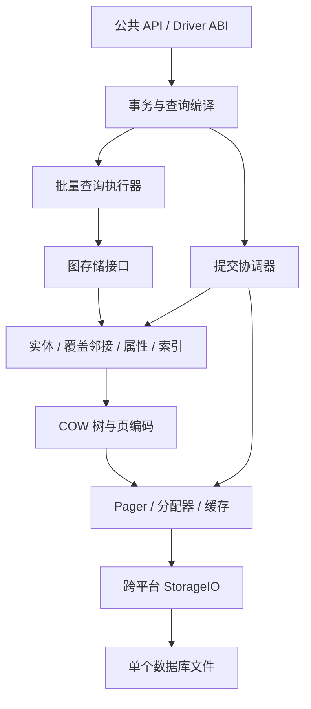

> **当前实施入口：** [当前局部读取优化实施计划](targeted-read-optimization-plan)。该计划明确首批范围、源码入口、正确性边界、定向测试、性能验收及 L0–L3 进度。本文的整套替代架构及 G0–G7 仅为研究备选，不是当前执行路线。

# 单文件图数据库下一代架构设计

日期：2026-10-09。状态：**完整替代架构的研究备选，不作为当前默认重构计划；优先实施第 0 节的局部改进。尚未实现替代引擎。**

本文按“事务读写、局部图遍历、属性扫描都重要”的均衡嵌入式负载设计。它是可实施的架构决策，不是对所有负载全局最优的证明。现有数据库仍遵守[当前格式规范](native-single-file-storage-plan)；本文列出的替代决策只在新格式中生效，不可静默改变现有文件的解释。

## 0. 收益复审：保留主体，缩小重构范围

重新核对当前源码与已有测量后，没有充分证据支持整体替换 Pager、页目录、事务引擎、属性存储和执行器。本文第 1–15 节保留为备选设计，其 G0–G7 账本不是当前已批准的实施路线。之前“设计完成”仅表示文档交付，不是选型已经通过工程验证。

**明确保留**：单文件和 A/B 发布、页级 COW、稳定实体/PageId 与快照隔离、统一分配/安全回收、显式编码与 StorageIO、现有 B+Tree 基础组件、按页实体扫描、按需属性读取、批量拓扑/属性接口、NativeReadSession、选择向量及查询计划缓存。这些组件已经存在，不能把它们重新包装成必须重写才能获得的能力。

| 优先项 | 当前证据 | 最小改动及收益合同 | 不需要做的重构 |
|---|---|---|---|
| P0 目录读取放大 | `MetadataPageFile.cpp` 解析当前 radix 页全部有效逻辑子引用；已有点查诊断 1 条实体对应 2823 次 metadata read、58 个 distinct page pin | 保留目录，增加所选子引用解析接口，按查询访问集合批量解析，并审查快照绑定的解析/解码复用；单次 seek 不解析无关兄弟引用 | 不删除 PageDirectory，不改变文件身份体系 |
| P1 精确索引验证复用 | 精确索引候选输出前调用 `validateNodeExactPropertiesSorted`；已有测试要求拒绝结构有效但与主属性不一致的索引 | 保留首次必要交叉核验；合并批量读取，并复用同一不可变快照中已验证的字段，避免后续算子重复校验/读取 | 不替换 B+Tree，不删除首次验证，不伪造 verified 标记；无回查 index-only 退出首批范围 |
| P1 类型计数 | 现有诊断为计数 50000 条目标类型而扫描 86000 条边；执行器使用全边引用扫描再按类型筛选 | 增加同 generation 的精确类型计数，覆盖创建/删除/类型变更/导入与事务 overlay；仅在无额外谓词且语义匹配时采用，Edge 解码数为零 | 不重写聚合引擎；全局 Node/Edge 计数已存在，不能说所有计数缺失 |
| P2 覆盖邻接 | key-only 树只有 EdgeId；拓扑专用接口仍需 `readEdgesSorted`，缓存仅减少部分回查 | 优先研究保留当前方向/节点/EdgeId 排序及游标语义、增加 NeighborId/TypeId 覆盖载荷的局部 codec 变更；普通扩展无需 Edge 主记录；测量额外写入和文件大小 | 不先改变全局排序、不先建立每节点树、不整体更换存储引擎 |

P0 是实现与内部读取接口改进；首批 P1 索引项只复用已验证结果，不改变读取可信度合同；P1 计数是增量维护元数据；P2 才是局部持久数据结构变更。覆盖邻接必须显式修订原 key-only 规范、格式版本/索引 codec、构建和回收协议，不能静默改变旧文件。保留 EdgeId 排序不会自动获得按类型直接定位能力；类型选择访问路径另行证明收益，不在本次顺带扩张。

实施前复审发现 `RejectsPersistedScalarIndexKeysThatDisagreeWithThePropertyRecord` 明确保护“结构及校验和有效，但与主属性不一致”的拒绝行为。因此，即使正常写入始终原子维护索引，也不能据此证明无回查路径保留了这项损坏检测能力。首批保留该合同与测试，只减少重复核验；今后若要实现无回查 index-only，必须单独设计等价验证机制，或显式评审完整性检测合同变化，不能将其描述为零语义影响的优化。类型计数同样不能替代带属性/端点谓词的真实查询，也不能悄悄取消现有端点存在性验证；计数维护可先设计，查询快路径在错误检测边界明确后才启用。

### 0.1 实施前约束（本节优先于后文备选设计）

- **首批允许范围**：保留文件格式与逻辑目录，新增按所选路径解析能力、必要的快照绑定复用，以及索引验证的批量化/已验证结果复用。不能假设当前没有缓存或批接口；先复用已有组件，只有计数证明重复工作时才增加新的缓存。
- **校验边界**：读取页的结构、校验和、owner、generation 和命中引用身份检查保留。原全子引用解析接口继续服务需要全解析的调用者；完整性扫描和搬迁校验不能误用单路径接口。按需访问不等于全图验证，必须明确未访问引用的检查时机，而不是悄悄删掉检查。
- **缓存一致性**：绑定数据库身份、快照及解释该引用的根；不得只按裸 PageId/EntityId 缓存位置。事务 overlay 修改相应实体/属性后失效或绕过已验证结果；不得让持久快照缓存覆盖自己的未提交写入。已存在的快照/ABI/恢复语义保持不变。
- **计数前置条件**：所有创建、删除、类型变化、批量导入、回滚、旧快照和 overlay 更新路径均覆盖；溢出/下溢有检查。优化器按逻辑计划匹配无额外谓词、方向及自环/平行边计数语义，不匹配 SQL/Cypher 文本。计数缺失或版本不支持时走原通用路径。若快速计数不再检测底层悬空端点，必须先解决或明确评审该合同变化，不能默认放宽。
- **邻接前置条件**：尚未批准直接改写现有 key-only codec。先提出局部 codec/版本、构建/升级、原子双方向维护、完整性、回收和游标方案，保留 Entity 真值、PageId 和全局分页结构；用读、写、空间三方面证据决定是否实施。不能因微型数组实验较快就宣称持久邻接方案已验收。
- **通用性**：生产路径不得识别 benchmark 名称、标签/类型名字、固定 ID、种子、数据规模或预期答案；允许依据语义和真实结构统计选择算法。必须在未用于调优的新种子/名称、不同度分布、类型选择率、删除后布局和读写组合上复验。
- **验收**：保留现有正确性与损坏测试，不为了优化删改失败断言。相同资源及持久性下报告运行时间、必要工作量和写/空间代价；不乘算预测收益，不将未测试的新架构标为已验证。只跑相关模块测试，macOS 为当前实测平台，覆盖率不设门禁，不 commit/push。

结论：可以开始首批保留合同的局部实现；四项原建议不能不加区分地直接实施。计数快路径和覆盖邻接属于后续有前置条件的工作，整套替代引擎仍不进入实施范围。

**暂不实施**：整套直接物理页引用、PAX 替换全部属性主存储、全新事务/OCC 协议、整套因子化执行器、默认列投影、统一更改页大小或人为增大缓存。属性布局可能存在长期瓶颈，但应先消除目录和回查放大，再测扫描解码/物理字节占比。现有写入较慢，仍需拆分数据写、目录写、复制页数、排序和同步耗时，才能决定是否改提交机制。

收益不是把四项预测加速倍数相乘。现有诊断计数包含缓存命中，计时开启了 profile；只能用于定位工作量，不能替代无诊断对照。当前架构内部之前已经实现 medium 属性过滤约 12.14 倍、标签过滤约 10.15 倍、一跳约 5.35 倍的 p50 改善，同时类型扫描退化；这证明局部优化能有效，也说明不能用一个总体数字掩盖问题。数据来自 `benchmarks/graphdb-comparison/results/20261009-user-performance/optimization-comparison.csv`，不是与最早架构的同义比较。

每项修改保留相同结果、快照/恢复语义和缓存预算，运行对应模块测试及受影响性能用例，报告耗时、读页/解码量、写放大和存储增长。只有 P0 修正后目录仍是主要成本，才启动“优化目录、一层映射、直接引用”三方原型对比；不会在分析阶段直接批准全量重构。

## 1. 完整替代方案（备选，不直接实施）

采用**直接页引用的 COW 存储核心 + 覆盖邻居信息的分页邻接 B+Tree + 实体页内 PAX 属性布局 + 可选择的事务性列投影 + 向量化、延迟物化的图查询执行器**。

| 层次 | 确定采用的方案 | 明确承担的代价 |
|---|---|---|
| 文件与恢复 | 单个文件，4 KiB 不可变已提交页，A/B 根发布，页级 COW | 小事务需要复制修改页及树路径；严格持久提交有两次持久化屏障 |
| 寻址 | 业务 ID 稳定；内部树边直接保存物理页号与页出生代 | 搬迁页需要重写所属树的祖先路径；不承诺任意页常数成本搬迁 |
| 邻接 | 一棵全局分页覆盖树，按节点、方向、类型、邻居、边 ID 排序 | 每条边有两个邻接项；启动遍历有树定位成本 |
| 实体与属性 | Node/Edge 各一棵主树，叶页内按列组织小属性，稀疏溢出属性独立树 | 多属性页的窄列扫描仍会读入整个物理页 |
| 分析加速 | 显式选择属性的、同步事务维护的列投影索引 | 被选列的写入和存储增加；不默认复制全库所有属性 |
| 并发 | 多个逻辑事务并行准备，一个提交协调器验证并发布；默认可串行化 OCC | 冲突事务必须重试；持久发布吞吐有上限 |
| 查询 | 类型化批次、选择向量、邻接直接扩展、延迟取属性、按需保留因子化结果 | 比逐行解释器复杂，但存储和执行保持独立边界 |

不采用全图不可变 CSR 作为唯一可写格式，不恢复边内双向链，不建立默认每节点一棵树，不使用无界 Base/Delta 链，也不把内嵌 WAL 与 COW 同时作为第一版核心。

选择 B+Tree 的理由是动态更新、范围读取、空间回收和实现复用的综合成本；**不是树天然比链表快**。第一页定位后连续读邻居、按类型跳过不相关关系，才是这里的关键收益。

## 2. 产品边界与不可破坏的语义

1. 数据、索引、大值、分配元数据、排序 spill、索引构建暂存都在同一个数据库文件内；普通运行不创建 WAL、SHM、锁文件或临时数据库旁文件。用户显式导出、备份的目标文件不属于运行旁文件。
2. 本地文件系统；跨 macOS、Linux、Windows 统一字节格式和错误语义。网络文件系统上的跨机器共享写入不在支持范围。
3. 第一版采用一个进程拥有可写数据库的模式，进程内多个 Database handle 共享一个内核实例。其他进程不能同时读取这个可写文件。多个只读进程可以共享一个没有写进程的文件。使用数据库文件本身的 OS 文件锁，不能以路径字符串作为唯一身份，必须识别硬链接/文件身份。
4. 稳定的 64 位 NodeId/EdgeId、平行边、自环、多标签、稀疏属性、异构属性类型、现有 NULL/缺失语义都必须保留。逻辑 ID 不编码磁盘位置。
5. 已提交快照不可变；读事务固定一个根集合。事务内读取覆盖自己的写入，语句失败不污染之前暂存的数据。
6. 默认持久提交成功表示 OS/设备持久化契约已完成。提交同步失败可能产生“提交结果不确定”，不能谎报已回滚后继续使用同一写句柄。
7. 默认不提供长期历史快照产品功能。活动事务和备份可以持有快照，其保留空间必须可观察。
8. 保留现有 C++/Driver ABI 的逻辑语义；任何新配置、隔离等级或迁移行为需要显式 API 版本评审，不能靠内部格式变化改变应用行为。

单文件不意味着必须单线程，也不意味着不能有日志。这里选择 COW 是为减少恢复状态和读路径复杂度；内嵌 redo log 是另一套完整存储协议，不能作为一个小补丁加入。

## 3. 依据与现有证据

### 3.1 当前系统的可确认问题

- 当前邻接键只有方向、节点、边 ID。邻居和关系类型必须回查 Edge Entity Store。
- 元数据 radix 读取会解析当前节点全部有效逻辑子引用，而非只解析命中的路径；这是实际实现中的放大来源之一。
- 已有诊断中，一次索引点查只解码 1 条记录，却记录 2823 次 metadata page read；类型计数扫描 86000 条边得到 50000 条目标类型。计数包含缓存命中，不等于物理磁盘 I/O。
- 旧架构使用逻辑 EdgeId 链接。不能以“物理搬迁一定要修改前后边”为理由否定它；真正的问题是依赖式访问和事务写集合耦合。
- 之前 Docker 比较没有统一两引擎的显式缓存容量，也没有逐项证明相同持久化边界，因此不能把所有倍数归因于架构。

项目内证据：`benchmarks/graphdb-comparison/results/20261009-root-cause/`、`20261009-paper-comparison/`、`20261009-docker-kuzu-zyx/`。它们是已有证据，不是本提案的新引擎结果。

### 3.2 外部依据及适用范围

- [Neo4j 存储格式](https://neo4j.com/docs/operations-manual/current/database-internals/store-formats/)说明 block 格式重视内联、局部性和按类型/方向组织高连接度关系。本提案不复制其每节点 dense root。
- [LiveGraph](https://www.vldb.org/pvldb/vol13/p1020-zhu.pdf)论证连续邻接扫描的价值；其事务边日志不是严格单文件 COW 协议的直接替代品。
- [Kuzu CIDR 2023](https://www.cidrdb.org/cidr2023/papers/p48-jin.pdf)支持列式访问、CSR 类邻接以及因子化执行的方向。其读优化定位不能证明 CSR 对频繁随机更新最优。
- [PAX 论文](https://www.vldb.org/conf/2001/P169.pdf)支持页内按属性组织数据以改善缓存访问；PAX 本身不会消除整页磁盘读取。
- [LMDB 官方源码文档](https://raw.githubusercontent.com/LMDB/lmdb/mdb.master/libraries/liblmdb/lmdb.h)展示 COW 与序列化写入的可行性。LMDB 的默认锁文件安排不符合这里更严格的单文件要求，不能原样套用。
- [SQLite 原子提交说明](https://www.sqlite.org/atomiccommit.html)用于审视同步顺序和设备假设；[SQLite WAL](https://www.sqlite.org/wal.html)用于识别 WAL 的版本定位与检查点成本。

这些来源支撑各项设计原理，不构成 ZYX 的性能承诺。

### 3.3 本次实际验证

新增并运行 `benchmarks/architecture-design/adjacency_layout_probe.cpp`：C++20，Apple clang 17，macOS arm64，优化等级 O3；1048576 条边，固定随机种子 42，度数 4/32/512，连续/打散两种边记录布局，2 次预热、7 次测量，轮换执行顺序，三个变体校验相同结果。

变体为边内链、邻接 ID 数组再读边、直接保存邻居/类型/边 ID 的数组。完整样本在同目录 `adjacency-layout-results.csv`，环境与源码散列在 `provenance.json`。

这是**读布局探针**，不包含树定位、压缩、磁盘读取、更新、事务、双向索引构建或持久化。它支持“减少逐边依赖和回查”的选择，不能用于预测新引擎比旧架构/Kuzu 快多少。写入与文件回收收益在实施 G1/G2 中验收，不以这份微测量代替。

每组查询重复访问最多 4096 个随机节点，度数不同意味着实际访问的工作集不同，因此只对同一度数/布局中的变体作比较。探针使用 24 字节 AoS 覆盖记录，并非提案的分组 16 字节 SoA codec。打散布局下实测中位 ns/边：度数 4 为链表 1.585、ID 回查 1.204、覆盖数组 0.616；度数 32 为 9.528、2.053、0.755；度数 512 为 94.506、4.657、0.892。没有固定 CPU 频率或进程隔离，不能据此推断生产 p95/p99。

## 4. 分层与所有权

图存储返回稳定实体 ID 和类型化列视图；执行器不读取物理页号。Pager 不理解 Cypher。提交协调器拥有验证、分配、发布顺序；各索引不能自行提交。所有图结构共用一套 COW 树、回收和故障注入核心，不为每种索引复制一个事务引擎。

## 5. 文件、页与寻址的实施规格

### 5.1 初始参数

| 项 | 第一版明确值 | 性质 |
|---|---|---|
| 普通页 | 4096 字节 | 新文件格式参数；更大页需要另建文件，不运行时切换 |
| 文件前缀 | 128 KiB | A/B 发布区及保留区，不放可回收用户页 |
| A/B 起点 | 0 与 64 KiB | 各自单独的发布区；不依赖单扇区写原子性 |
| 数据 PageRef | 64 位页号 + 64 位出生代 | 页号直接换算文件偏移；0 保留为空 |
| 通用页头 | 64 字节 | 明确 LE 编码，含 magic、codec、kind、owner、出生代、长度、校验和及保留位 |
| 叶页目标填充率 | 批量构建 80%，分裂约 50% | 运行参数，可测量调整，不改变语义 |
| 查询批次 | 1024 行上限，另受字节预算约束 | 运行参数，不能只按行数控制大值内存 |
| 主缓存默认 | 64 MiB，调用者可配置 | 不是性能宣称；正式对比必须统一预算 |
| 新内核总预算 | 初始默认 256 MiB，独立可配置 | 包含引擎拥有的缓存、事务、执行与暂存内存；不包含应用已接管的结果内存 |

A/B 分离不能修复不遵守 flush 的硬件。支持的 VFS 必须给出故障影响范围不超过发布区间隔、正确 flush/文件扩展语义的契约；不满足时拒绝宣称电源故障持久性。创建文件成功还需处理目录项持久性。文件格式与 I/O 能力检测分开。

普通页头偏移：0 magic/u32，4 codec/u16，6 kind/u16，8 flags/u32，12 payloadBytes/u32，16 physicalPageNo/u64，24 birthGeneration/u64，32 owner/u64，40 itemCount/u32，44 reserved/u32，48 checksum/u64，56 reserved/u64。所有字段为 LE；保留位必须为零。校验采用 CRC64-ECMA-182，对 checksum 字段置零后的整页计算；这用于检测意外损坏，不提供恶意篡改认证。G0 生成跨平台 golden bytes，不能把 C++ struct 直接写盘。

### 5.2 根集合和寻址

发布记录包含文件 UUID、格式版本、generation、根清单 PageRef、分配高水位、长度/校验及必需能力位。根清单是一个固定上限的普通页，包含 Node、Edge、Adjacency、OverflowProperty、LabelMembership、TypeMembership、Schema/IndexCatalog、FreeExtent、RetiredExtent、ScratchOwner 等根与全局计数。大量用户索引放 IndexCatalog 树，不让发布记录无限增长。

树内部直接持有子页 PageRef；Node/Edge 主树叶就是实体数据页。一次点查为根清单到主树的单次下降，**没有 EntityMap → PageDirectory → MetadataRouteDirectory 的串联解析**。变长大值的多级 extent 描述只在确实读取大值时出现。

各树拥有自己的页；不同逻辑树之间不共享可搬迁数据页。快照可以共享未修改的不可变页。第一版不做跨实体大值去重，以免引入全局引用计数和反向引用图。后续确有需求时，应以独立 BlobId 目录局部增加一次间接层，而非让每个普通页支付这项成本。

缓存键为文件 UUID、物理页号、出生代。页已通过边界检查后可以缓存 validated view；调用者仍必须持有页 pin，不能缓存悬空指针。新读入页校验 codec、owner、代、偏移、溢出和校验和；不在每次读字段时重复解码整页。

缓存、decoded view、事务 overlay、验证日志、算子 arena 和结果暂存共用总预算，子系统上限不是可同时额外占用的独立承诺。主缓存 64 MiB 包含根/元数据保留和解码缓存，执行器初始最多借用总预算的 50%，验证日志最多 min(64 MiB, 总预算的 25%)，余量支持写入和其他对象。分配失败先驱逐/缩批/spill，必要时返回资源错误；不得把预算记账放在每个属性标量的热路径。实际 RSS 还包括代码、线程栈、标准库和 OS 影响，必须另行测量，不能声称 256 MiB 配置等于 256 MiB RSS。

### 5.3 COW 树游标

第一版不持久化跨叶双向链，避免 COW 更新叶页时连带改写前驱。范围游标保留根快照和祖先栈，耗尽叶页后沿栈进入下一个子树。可预取父节点中接下来的物理子引用。恢复游标使用根快照和完整排序键，不暴露页槽位置。

只有查询所选子路径被访问；不能为解析一个孩子读取整个子路由目录。批量写入先按树和键排序，同一发布批次每个被修改页只复制一次，并合并共享祖先路径。

## 6. 邻接：覆盖、分组、分页

### 6.1 唯一正式表示

一棵全局邻接树，比较顺序为 `NodeId, Direction, TypeId, NeighborId, EdgeId`。第一版内部方向枚举采用带前缀名称，如 `ADIR_OUT`、`ADIR_IN`；磁盘值固定且必须校验。

叶页将相同节点/方向/类型的公共前缀放在组头，组内存储 NeighborId 和 EdgeId 两列，各为 64 位。一个组可以跨页；一个页可以容纳多个低度数节点的组。不需要为每个节点分配根或空尾页。第一版固定宽度编码，后续在叶 codec 版本内加入 delta/bit packing，不能改变排序与快照语义。

每条有向边维护 OUT 和 IN 两个邻接项。Edge 主树是端点/类型的权威来源；邻接是同一事务维护的覆盖索引，不是独立权威副本。普通扩展信任已发布且验证过格式的索引，不逐边执行全语义交叉核验；显式 integrity scan 才检查索引和实体的双向一致性。

### 6.2 操作契约

| 操作 | 实施路径 |
|---|---|
| 查全部出邻居 | 定位 NodeId/OUT 前缀，流式读取组和两个 ID 列；零 Edge 主树读取 |
| 查指定类型出邻居 | 定位 NodeId/OUT/TypeId 前缀；不扫描其他类型 |
| 检查指定类型连接 | 定位 NodeId/OUT/TypeId/NeighborId 范围；返回全部平行边 |
| 查相连边的属性 | 先收集有界 EdgeId 批次，按 EdgeId 排序批读，按选择向量恢复输出关联 |
| 按 EdgeId 查端点 | 一次 Edge 主树查找，无需邻接树 |
| 增加边 | 验证两端节点存在；Edge 主记录、OUT、IN、类型成员/计数同批提交 |
| 删除边 | 主记录给出两个完整邻接键；同批删除所有索引与属性 |
| 更改端点或类型 | 若 API 支持，作为原子删除旧覆盖键、插入新键；禁止就地只改主记录 |
| 删除节点 | 枚举该节点入/出范围；按 EdgeId 去重处理自环；一次逻辑事务处理全部关联删除 |

自环保留一入一出两个项。无方向、每条关系只出现一次的遍历，在 IN 分支跳过 NeighborId 等于当前 NodeId 的项；不能按 NeighborId 去重，否则会丢失平行边。入度/出度分别计数，合并关系数遵从 API 自环语义。

内部节点保存子树项数，可通过两次前缀 rank 定位取得方向/类型范围计数，避免逐边扫描。它是邻接项计数，不直接当成去重后的无方向关系数。

### 6.3 成本与明确局限

设树高为 h、目标范围含 d 个邻接项、每页有效容量为 b，则页访问约为 h 加上 d/b 个叶页以及游标前进所需的内部页；不再额外进行 d 次边实体寻址。物理页未必连续，不能宣称全程顺序磁盘 I/O。

不计前缀/页头，两方向覆盖项占 32 字节/边；旧链四个链接也占 32 字节/边，但这不是整库空间相等的证明。新方案仍有主边记录、组头、树内部节点、空闲空间和版本页。邻接缓存可以跳过重复树下降，但其容量必须计入统一预算，且与根快照绑定。

低度数热节点的第一次树定位可能仍比链头直接访问慢。选择共享树是用这项固定成本换取统一更新/回收和更好的大度数访问。第一版不为追逐这一个场景再加入第二种持久邻接格式。

## 7. 实体与属性：明确的混合布局

### 7.1 主树和页内 PAX

Node 主树按 NodeId 排序，Edge 主树按 EdgeId 排序，叶页既拥有实体固定字段，也拥有该页实体的小属性。每个实体保存最后修改版本；节点标签有少量内联位置和溢出表示；边保存源、目标、类型。标签、属性和行位置均不成为外部物理引用。

叶页是一个小行组，**第一版每页最多 64 行、64 个内联属性键**。固定元数据按列存放；属性键描述符定位 presence bitmap、类型信息和数值/变长偏移区。属性只有在该页出现才有描述符，不给所有可能键分配槽。

每个属性值只有一份主表示：页内值，或 OverflowProperty 树中的 `(EntityKind, EntityId, PropertyKeyId)` 项。页内描述符对溢出的同名值具有明确标记；行元数据还有“存在外部属性”标志。已知键查询先看页内描述符，无结果且该行有外部属性时查溢出树。完整对象读取合并页内值和该实体的溢出键范围。

内联候选值上限为编码后 64 字节。每次叶重建按键出现频率降序、PropertyKeyId 升序选择最多 64 个键；实际容量不足时先按 EntityId 中位点分裂，单行仍过宽时按上述优先级将后续值外移直到可编码。每行保留有界固定元数据，超大标签列表同样外移，必须保证单实体可表示。

这是第一版的确定编码策略，不是已经测得的最佳阈值。阈值在独立编码/读写探针通过 G3 后可调整一次，再冻结格式；不能在生产运行中以不同解释读取同一 codec。

### 7.2 更新和类型语义

单属性更新只重建所在叶页，或对应溢出树页及祖先；大值内容未变时复用原 extent 引用。禁止为更新一个属性复制全节点集合或整列。页分裂移动完整实体行及其内联列值，ID 不变。

动态类型采用列内统一类型的快速路径与显式 tagged union 的混合路径。NULL、缺失、NaN、整数与浮点比较、字符串排序、数组/嵌套值必须从现有语言语义提取测试，不由物理编码自行定义。若 Cypher 的赋 NULL 表示删除属性，持久层不额外制造一种可查询的显式 NULL 属性状态。

PAX 提高批量解码和 CPU 局部性，但窄属性扫描仍会读取含其他列的物理页；不得把它宣传为磁盘纯列存。

### 7.3 事务性列投影

宽实体上的大量属性扫描，使用显式配置的列投影索引。目录按 `EntityKind, ScopeId, PropertyKeyId, EntityIdRange` 路由；每个范围固定覆盖 1024 个 ID，每个物理数据块最多一普通页，超出则分片。ScopeId 可以是全体实体、指定节点标签或关系类型，不要求节点只有一个标签。

投影保存实体存在/属性存在 bitmap、类型信息和选中属性值，按实体 ID 顺序排列。小块稀疏时保存有序 slot/value，密集时保存 bitmap 与 packed values；当 bitmap 加密集值的实际编码字节数不大于稀疏编码时选密集表示。编码选择由块头标记，不依赖外部猜测。

选中列的变更与主记录在同一个 COW generation 内维护；没有异步陈旧窗口。只复制受影响块，不复制整个 1024-ID 范围。标签/类型迁移必须维护对应 ScopeId 的加入和删除。

超大值默认不完整复制到列投影，保存“需主值读取”的标记；含此类值的操作不能声称 index-only。第一版不自动创建投影、不后台猜测用户工作负载；优化器只能选择已就绪且语义匹配的投影。

在线构建采用固定快照扫描加同文件有界变更日志：启动时登记 BUILDING，写事务同步记录相关变更；构建末尾在提交协调器内追平并切换 READY。日志达到预算则取消构建或短暂限流，不让未追平索引参与查询。崩溃后 BUILDING 可重建，READY 必须完整。更简单的首个实现可在显式维护窗口阻塞写入构建，但不得伪装为在线构建。

## 8. 标签、类型、标量索引与统计

- LabelMembership 和 TypeMembership 使用按 65536-ID 区间分组的位图容器；稀疏容器存 16 位有序 offset，密集容器为 8192 字节位图、分成普通页。超过 4096 个 offset 时切为位图，低于 2048 时切回，避免来回抖动。
- 主树保证实体存在性；成员索引、标量索引及精确计数在同一发布中增删。类型 count 可读事务性计数，类型枚举先读成员 ID，不全扫 Edge 主树。
- 标量/复合索引键由作用域、属性的语义排序编码、实体 ID 构成。支持唯一性校验、范围查找和覆盖返回；前缀截断、哈希候选、近似向量匹配必须标记为需要 residual 验证。
- 精确索引若已满足谓词和作用域，可直接返回 ID/已覆盖值，不强制每个命中重新读取完整属性。完整性检查保留在读页边界、事务维护和显式核验工具中。
- 全局节点/边数量、每标签/类型数量是精确快照数据。直方图、NDV、度分布与相关性估计是可过期统计，不能用于返回精确查询结果。
- 统计至少区分节点方向/类型的度分布、重尾热点、属性选择率、多标签重叠；不能只用平均度优化多跳查询。

## 9. 事务与持久化协议

### 9.1 并发和隔离

多个写事务可以并行解析、读取快照和形成逻辑 mutation batch；**只有提交验证与页树修改/发布被序列化**。这不同于整个事务生命期只允许一个写事务。

默认目标为可串行化 OCC。验证覆盖点读、未找到的键、范围/谓词、写入基础版本和 schema epoch。只检查写写冲突不足以保证可串行化；[PostgreSQL 隔离文档](https://www.postgresql.org/docs/current/transaction-iso.html)解释了谓词依赖的重要性，本设计使用验证式 OCC，不声称实现 PostgreSQL SSI。

第一版逻辑读域：实体 ID；节点/方向/类型邻接范围；标签或类型作用域；标量索引键范围；无可细化谓词的全实体类型域。修改属性需标记实体及所属标签/类型的扫描域；创建边需验证端点存在并标记两端邻接域；节点删除与并发加边必须冲突。允许保守冲突，不允许漏掉 phantom 或 write skew。

提交协调器保存自最老活动读写事务以来的逻辑变更日志，初始上限 64 MiB。日志不足以继续验证的旧写事务被标记为需要重试，不能盲目接受；纯只读快照不需要保留该日志。物理同页、树根变化不是语义冲突；验证通过的逻辑写入重放到最新候选树上，不能提交旧物理页面覆盖新状态。

只读事务固定已提交快照，可序列化在其开始读取的时刻。写事务只有所有读依赖仍有效才在发布顺序中提交。唯一约束、引用存在、计数及索引修改在候选状态统一检查。语句结果里已经暴露的 ID 使用持久化号段预留，崩溃/回滚允许空洞，不逐 ID 发布；预留的耗时必须纳入冷启动和写入 benchmark。

### 9.2 严格提交步骤

1. 验证逻辑冲突与约束，合并同事务的最终态 mutation，分配尚未被任何保留快照使用的页。
2. 构造数据页、索引页、空闲/退休元数据与根清单；自底向上写入新位置。未发布页可以提前写，但不得覆盖仍可达页。
3. 执行第一次持久化屏障，确保所有被新根引用的页及文件扩展已落入持久化边界。
4. 写入非当前 A/B 发布区，包含新的 generation 和根清单引用以及完整校验。
5. 执行第二次持久化屏障；然后在进程内 release-publish 新根并返回成功。

同批提交可将多个经过串行验证的事务合并为一个物理 generation；generation 内另有提交序号用于变更验证。只要批中任一成员已成功返回，整个批的根必须持久。默认不人为等待凑批，只合并队列中已就绪事务；显式吞吐选项可增加最多 200 微秒等待，必须分别报告额外延迟。

macOS 严格模式通过 `F_FULLFSYNC` 契约处理设备缓存；Linux 使用正确的 fsync/文件扩展顺序；Windows 使用 FlushFileBuffers。具体 VFS 必须故障测试，不把一次进程 kill 等同于真实掉电实验。[Apple](https://developer.apple.com/library/archive/documentation/System/Conceptual/ManPages_iPhoneOS/man2/fcntl.2.html)与[Microsoft](https://learn.microsoft.com/en-us/windows/win32/api/fileapi/nf-fileapi-flushfilebuffers)给出平台接口语义。

### 9.3 恢复和失败

打开时读取两个发布区，验证 UUID、版本、校验及根清单格式，选择最新有效发布记录。发布记录撕裂时选另一个有效记录。**有效的最新发布根之下出现数据页损坏时报告损坏，不静默回退到旧 generation 丢失已确认提交。** 故障模型假设第一屏障完成的数据不会被之后无关写入破坏。

任何写入/同步错误使当前写内核进入必须恢复的状态。若第二屏障失败，返回提交结果不确定；由 reopen 后的根决定结果。失败前未发布的追加页可在独占恢复时截去或回收；从旧空闲集合分配但未发布的页仍视为空闲。

正常打开不扫描全数据库，也不按图大小重建目录。完整校验由用户显式触发。

## 10. 分配、回收、压缩与临时空间

FreeExtent 树保存空闲页区间，RetiredExtent 按退休 generation 保存区间。allocator 优先批量从相邻区间取页；不再为每种数据强制绑定一个 128 KiB segment 身份和位置目录。

页在 generation g 被替换后，只有最老活动快照 generation 和仍可能用于恢复的 A/B 根 generation 均不小于 g 时才可复用。所有直接引用都带出生代，缓存必须防止 ABA。分配/退休元数据本身也 COW；为完成它们的更新预留按当前树高计算的页数。预留不足且文件无法扩展时，在改动可见状态前返回 ENOSPC，不循环尝试从尚未提交的空闲树获取自己的元数据页。

释放替换叶页不能递归释放仍被新叶复用的大值页；提交批必须显式区分保留、新增和退休的所有权。不同快照共享旧页，由 epoch 负责生存期。

长读事务可以导致空间持续增长，单文件和 MVCC 都不能消除此事实。默认不偷偷终止读者：报告 oldest snapshot、retired bytes、free bytes 和 scratch bytes。达到用户磁盘上限时拒绝新写入并给出释放快照的原因；可选策略允许用户授权取消过旧事务。

文件缩小采用**按树、按键范围的增量重建**，把高地址页移动到低地址空闲区，重写祖先并发布新根。无法常数时间搬任意共享页是本设计接受的代价。只有两份发布根和活动快照都不再引用尾部后才能 truncate；必要时先完成两次根轮换。没有足够周转空间时停止压缩并报告需求，不能承诺零额外空间压缩。

scratch 使用同文件 extent，先在小型系统提交中登记 owner/进程 epoch 和预留区，再允许写入。事务查询 spill 不进入图快照语义，但分配不得与已提交页冲突。只读打开不允许写 scratch，内存不足时清楚报错。独占 reopen 将旧 epoch 的 owner 批量标记可回收，实际遍历释放可后台分批完成，不阻塞打开做全文件扫描。

## 11. 查询执行和优化器

1. 绑定阶段解析标签/类型/属性 token，计划缓存依赖 schema epoch；不能每行重复字符串查 token。
2. 存储接口返回最多 1024 行的类型化 batch，含 ID 列、选中属性列和 selection vector。拥有/借用的内存生存期明确，批次内不构建逐行字符串 map。
3. Expand 直接消费 NeighborId/EdgeId/TypeId。只在投影或过滤真正需要时读取节点/边属性；不能为了返回 ID 就物化完整对象。
4. 邻接结果保留输入行号与输出偏移，允许多跳结果因子化。DISTINCT、ORDER BY、路径唯一性、聚合 multiplicity 等语义需要时才展开；不能把去重误当通用优化。
5. 提供邻接嵌套循环、批量 hash join、半连接过滤三条基本路径；根据实际候选数量和度分布选择。大前沿切换到批量扫描/连接，小前沿定位邻接范围。
6. 排序、hash aggregate、hash join 都有字节预算和同文件 spill；预算在 arena/页/批次级记账，不能每个字段调用昂贵全局计账。
7. BFS/可达性复用连续邻接；visited 根据 ID 空间密度选择 bitmap 或 hash set。GDS 可在固定快照上构造内存/同文件临时 CSR，不能把它混成第二套权威图存储。
8. 并行读取按叶页/实体 ID 范围或前沿批次拆分，不让所有线程争用一个 cursor；首个正确实现可单线程，接口须支持独立 snapshot cursor。

向量索引继续作为派生索引共享页、事务、回收和 raw value 真值；不让 ANN 的近似语义进入精确属性索引。全文、空间索引通过同一 IndexCatalog 生命周期扩展，不增加新的根发布机制。

## 12. 必须测量的成本合同

| 操作 | 结构性验收要求 | 不承诺的事情 |
|---|---|---|
| 实体点查 | 一棵实体主树下降；不访问通用位置映射树 | 所有数据规模均一次物理 I/O |
| 只取邻居的 Expand | Edge 主树读取数为 0；无逐邻居属性读取 | 第一次树定位一定胜过链头 |
| 按类型 Expand | 访问目标类型范围，非目标类型值解码数为 0 | 分界页中没有任何非目标字节 |
| 类型总 count | 读精确快照计数；Edge 记录解码数为 0 | 任意复杂谓词都可用统计回答 |
| 精确索引仅返回 ID | 主属性重读数为 0，除非索引声明 residual | 截断/近似索引可以跳过验证 |
| 更新一个小属性 | 只修改所属实体叶/溢出叶和受影响索引/祖先 | 一定只写一个 4 KiB 页 |
| 批量写入 | 同发布批次每个被改页只克隆一次 | 小批和大批具有相同每条耗时 |
| 正常打开 | 不遍历全部实体/属性/邻接 | 数据损坏可以完全不读就发现 |
| 压缩 | 搬迁预算、保留页和释放空间可计量 | 有长快照时文件仍能立即缩小 |

发布成本按各树修改路径的**并集**计数，加分配/退休树、根清单与发布区；禁止只报告业务叶页而省略元数据写放大。报告逻辑字节、实际写字节、独立页数、同步次数、缓存缺失、解码值数、峰值 RSS 和文件大小。

作为成本演算而非测量：若单边插入涉及 3 页 Edge 路径、两条各 4 页邻接路径、3 页类型成员、3 页类型计数目录、各 3 页空闲/退休路径以及根清单/发布各 1 页，未考虑路径共享时合计 25 页，即约 100 KiB。分裂、空闲树多区间和属性索引可能进一步增加成本，路径合并可能降低成本。这个例子明确说明：去掉读放大不等于消除 COW 写放大，批量路径合并和提交屏障测量是选型成立的必要验收。

## 13. 公平的性能验收方案

G0 固定源码散列、构建参数、种子、语义和环境。当前版本、旧架构可构建版本、候选版本在同一 macOS 主机对比。旧 paper 数字只作历史参考。Kuzu 对照统一版本、线程、显式 buffer pool、数据/索引、事务边界和结果校验；无法统一的行为单独列出，不能混成总体倍数。

测试矩阵覆盖度数 0/1/4/32/512、重尾与超级节点，平行边/自环，1/8/64 种关系类型，顺序/随机插入以及 50% 删除后重建；属性窄/宽/稀疏/混合类型/大值；数据体量为缓存的约 0.25 倍、2 倍、8 倍；读写比例 100:0、95:5、50:50、5:95；事务规模 1/100/10000 操作。

不用对整个笛卡尔积逐项长跑。固定代表性组合：低度数热读、高度数冷读、随机单边写、批量加载、索引选择查询、窄列扫描、宽对象获取、混合读写、长读者与删除回收。结构实现阶段只跑所属组合，集成阶段再跑完整代表性矩阵。

首次读取、热缓存、显式持久提交、非持久临时导入分别计时。flush 只能算在实际发生的位置，不把 enqueue 时间当 commit。进程重开不等于清空 OS 缓存；冷读用受控环境或大于可用缓存的数据集，并标明方法。

常规分支比较至少 3 个独立进程运行，每组 3 次预热和 10 次测量，保存全部样本；p99 需要至少 1000 个事务样本，不能从 10 个样本推断。报告 p50/p95、吞吐、分布与资源，禁止只给几何平均加速比掩盖退化。

目标是上述结构成本合同全部成立，且相对同配置当前版本：核心扩展/点查/索引仅 ID 路径明显降低访问次数；任何代表性工作负载 p50 退化超过 10% 或 p95 超过 20%，需要重复确认并明确解释，不能默认为验收成功。这些百分比是工程评审阈值，不是已有结果或所有机器的性能承诺。

绝不承诺现在就追平/超过 Kuzu。若严格持久单边写仍受两屏障支配，报告同步下限并优先使用批量事务和 group commit；只有证据表明产品写入目标无法满足，才重新立项内嵌 WAL，不临时削弱持久性。

## 14. 重构路线与可审计进度

先在独立新格式 backend 中实施，保留当前 backend 作为基线；不直接大规模改写现有格式，也不同时维护两套长期生产引擎。所有新类名和磁盘枚举遵守跨平台前缀规则。源码可放在 `include/graph/storage/native_vnext/` 与对应 `src/`，由显式 SourceSets 纳入；这是拟新增目录，不表示已经存在。

每阶段 5 个独立验收项，每通过一项增加 20%。总进度为完成验收项/40；不能用“工作了多久”或“写了多少行”增加百分比。当前下表是**未来重构的起始账本**，本次设计完成不将它改成已实现。

| 阶段 | 五项交付与退出条件 | 当前实现进度 |
|---|---|---|
| G0 基线与合同 | API/语义清单；同配置可重跑基线；I/O/同步合同；目标成本计数器；新格式 codec/根清单冻结 | 0/5，0% |
| G1 存储核心 | 直接页引用树；A/B 故障恢复；分配退休与保留根；预算缓存；单文件锁/scratch/ENOSPC | 0/5，0% |
| G2 图拓扑 | Node/Edge 主树；覆盖邻接；类型/标签成员与计数；自环/平行边/删除原子性；拓扑读写性能矩阵 | 0/5，0% |
| G3 属性与索引 | PAX/溢出 codec；大值生命周期；精确/复合/唯一索引；事务性列投影；宽窄/稀疏属性性能矩阵 | 0/5，0% |
| G4 事务并发 | read-your-writes/语句原子性；OCC 点与范围验证；约束/节点删除冲突；group commit/不确定结果；长事务/冲突压力 | 0/5，0% |
| G5 执行引擎 | 类型化批次；无回查 Expand；延迟物化/index-only；批量连接/聚合/spill；因子化多跳语义与性能 | 0/5，0% |
| G6 生命周期 | 在线索引构建；增量压缩/尾部截断；完整性工具/备份；旧格式逻辑迁移；Vector/GDS/绑定兼容 | 0/5，0% |
| G7 集成验收 | 代表性同配置性能；故障组合；资源/回收稳定性；macOS 定向回归；文档/切换/回退演练 | 0/5，0% |

依赖：G0 → G1 → G2；G3 基于 G1/G2；G4 的单写事务正确性从 G1 就必须存在，G4 增加多逻辑事务验证，不能先交付不原子的 G2/G3；G5 基于 G2/G3 的批接口；G6/G7 后切换默认 backend。

保留 parser、公共 ABI、StorageIO 可复用部分和语义测试。替换多层页映射、key-only 邻接、逐实体属性目录的主路径和逐命中强制语义回查。当前大型 backend 中的行为按接口搬迁，不复制整个类。旧优化文档的完成百分比不用于这个新项目。

首次切换采用显式逻辑导出/导入到新文件并做结果/计数核验，不做原地破坏性格式转换。迁移需要临时同时保留两个文件，这是用户启动的迁移作业，不是正常运行旁文件；磁盘不足时分批外部导出或停止，绝不删除唯一旧库。备份/迁移产物由用户指定保留策略。

## 15. 测试与设计停止条件

只运行当前模块相关测试，不运行全量单元测试，不把覆盖率当门禁。第一轮实际平台为 macOS；代码保持 Linux/Windows 可移植，未实际验证的平台不得标记通过。没有生产代码变化的设计工作不触发单元测试。

必须有的正确性测试：撕裂发布记录、页校验损坏、短写、两次同步分别失败、磁盘满、复用 ABA、长快照跨回收、节点删除与加边竞态、write skew、范围 phantom、唯一性竞争、自环重复、平行边、索引构建追平、spill 取消、混合类型比较、只读进程锁冲突、同进程多 handle。

在 G1 若直接引用树的回收/故障协议不能闭合，停止上层扩张，修复协议。在 G2 若无 Edge 回查仍无法达到合理邻接吞吐，先区分树定位、叶扫描、预算和 API 物化成本，不能立刻加第三种存储。在 G3 若 PAX 对目标宽表扫描不足，使用已经设计的列投影并公开维护成本，不把整个主存储反复改成纯列存。在 G4 若逻辑验证成为热点，先细化读域与日志索引，不降低隔离等级来获得虚假性能。

以后有明确证据再增加压缩 codec、SIMD、更多读并行、细粒度 OCC 或专门的只读投影；这些扩展不改变一个文件、一个提交点和明确数据所有权的核心。持久化日志、多进程同时读写、历史时态库属于产品级新能力，需要独立协议设计。

## 16. 本次设计交付状态

需求与现状核对、资料与读布局验证、目标架构规格、实施与验收规划均已形成文档。读布局探针是已运行证据；新 Pager、图存储、事务和执行器均未实现。实现 G0–G7 各 0%，总计 0/40（0%）。

本次不修改生产格式、不提交、不推送、不创建 Docker 环境。后续每完成一个验收项，应更新本表及对应测试/性能证据路径，然后报告每阶段百分比。
