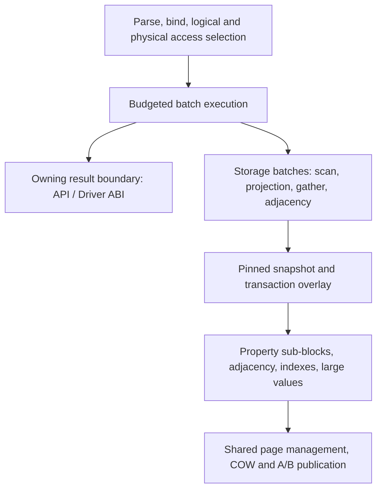

# COW Graph Database Performance Refactoring Plan

Updated: 2026-10-20. Plan ID: `cow-performance-20261019`. **This is the sole active optimization entry point. R0–R7 has 24 deliverables, with 13/24 accepted (54.2%). The latest request covers all unfinished deliverables. The earlier fixed five, R3.2/R3.3/R5.1/R5.2/R5.3, retain their existing contracts; performance acceptance is not counted early. R7.3 is still required for overall 100% closure.**

**Latest implementation boundary (2026-10-20):** Isolated format 32 now supports explicit durable ROW-to-hybrid-to-ROW commits, read-only reopen, old pins/A-B recovery and global integrity. Controlled inverse conversion restores ordinary ROW writes, with Retire Queue/pin protection before candidate-pool release/reuse; the file remains format 32. A maximal 64-owner/4096-member group passes both directions in the original 1 MiB conversion account. Explicit existing-column scalar COW, native transaction staging/conflicts, and forward empty-ROW-page/whole-pool retirement now work; three conversion/update/inverse rounds and five continuous native-column update rounds release and reuse physical slots after pins drain. Existing-column member removal and scalar type changes now update directories incrementally and demote by the merged final threshold. Existing inline-extension scalar updates/removals can also share a publication with column edits. Missing scalar/NULL insertion now merges with existing-column edits before the final threshold. Subsequent field writes retain extensions; only explicit ROW-to-hybrid conversion may create columns. Admitted general inline insertion/update/removal and per-field demotion now work; complete owner deletion, incremental multiple-group maps, controlled LargeValue SET/REMOVE and owner deletion now work; native-active GC coordination and full costs/comparison remain unfinished; fresh independent values and oversized ROW inverse carriers now publish atomically. Controlled native field-pool relocation/release/reuse now works behind pin barriers; directory root/child relocation and subsequent writes across physical epochs now pass; general maintenance remains. Controlled Node/Edge deletion now coordinates Entity/native fields and canonical bidirectional Edge adjacency; schema/statistics/label/value coordination remains.  Default production format 31 has not adopted the layout; acceptance remains 13/24.

The objective is to reduce positioning, decoding, conversion, materialization, and metadata work per query/update while preserving existing public capabilities. Retain the engine and make evidence-backed structural changes within it; do not replace the entire backend or promise to outperform Kuzu on every workload.

The completed S0–S6 cycle remains **34/34**, referring only to that cycle. Its bilingual plan, previous storage specification, release navigation, and machine progress are byte-preserved in `benchmarks/architecture-design/archive/20261019-completed-s0-s6/`; `manifest.json` records provenance and SHA-256. Old A/O/S task IDs, intermediate percentages, and then-outstanding work no longer drive implementation. Historical adoption/rejection records remain evidence, not automatic production admission for a new layout.

## 1. Fixed boundaries and execution rules

### 1.1 Product, persistence, and compatibility

- Preserve the general property graph, dynamic properties/types, multiple labels, stable logical IDs, and existing Cypher/QueryBuilder/GDS/Vector/Driver ABI/binding behavior. Internal representation changes must not silently remove capabilities or change query semantics.
- Preserve strict single-file operation: persistent data, recovery information, and supported query scratch remain in the same database file. Add no WAL/SHM/temporary sidecars.
- Retain COW and A/B superblocks, data-before-root ordering, and durable acknowledgement. Do not introduce WAL or cross-transaction group commit, disable synchronization, or weaken durability. If future small-transaction evidence warrants a protocol change, design commit and recovery separately.
- Preserve logical/physical identity separation, snapshots, read-your-writes, integrity authentication, shared allocation, relocation, and safe reclamation. Logical IDs are not reused; physical page/slot reuse must validate identity and generation.
- Public compatibility does not imply byte-format compatibility. The development policy remains new databases for new formats and explicit rejection of old formats, without automatic migration or user-file deletion. Update the [single-file specification](native-single-file-storage-plan) and compatibility matrix before introducing codecs/roots. Never reinterpret old version bytes silently. A migration tool is outside mandatory scope; migration and backup contracts remain prerequisites for a stable format release.
- Preserve macOS/Linux/Windows portability and the non-JIT WASM path. Report platforms actually exercised; Linux results do not prove execution on the other platforms.

Single-file packaging, COW/WAL persistence, and row/column access or batch execution are different choices. Kuzu 0.11 onward uses one main file but may create `.wal`, `.shadow`, and `.tmp` files ([official documentation](https://kuzudb.github.io/docs/developer-guide/files/)). File count does not explain scan gaps, and WAL alone does not establish query performance.

### 1.2 Implementation and documentation ownership

At implementation start, reconcile remote `work` with local changes; fast-forward or use an isolated worktree without resetting/stashing away user changes. Freeze actual source, not merely HEAD. Report accepted tasks, evidence, and remaining issues each round. Commit/push follows effective session authorization; historical approval does not authorize arbitrary new payloads.

Run only necessary affected-module unit tests, not the full unit suite; coverage is not a gate. During development use short correctness/mechanism checks rather than frequent benchmarks. Full-size correctness, long resource checks, and formal performance comparisons belong to the final window after implementation. Documentation changes need documentation checks only. `scripts/run_tests.sh --file` limits coverage presentation, not the tests executed.

This page owns ordering, status, and admission; the [single-file specification](native-single-file-storage-plan) owns current format rules; the [capability matrix](native-capability-acceptance-matrix) owns consumers and semantic evidence; [release follow-ups](native-remaining-work-roadmap) own independent release boundaries. Store decisions in `benchmarks/architecture-design/decisions/` and local raw results in ignored `benchmarks/architecture-design/results/`. Formal evidence must not exist only in ignored directories.

## 2. Existing foundations, remaining gaps, and evidence

### 2.1 Starting point and current increment

This documentation review uses repository commit `0427be26001073e3caf66621e1b8e62fd3da84dc`. The previous formal evaluation froze production source at `c28794a7c92434e809f9bbb17d48e8c457a70263`. R0 must recheck a different implementation starting point; the following table is not evidence for unknown future source.

The table records the R0 starting snapshot. Current increment: R1.1/R1.2 added direct property-cell production and continuous applicable native scans, numeric/string filters, single/multiple-key aggregation, and DISTINCT. Complex consumers/parameter residuals retain explicit bounded adapters; R1.3 adapter/semantic work is implemented, pending R7 performance admission. R2 adds authenticated immutable radix views and corrects mutable pool-control cache identity across handle publication.

| Area | Existing foundation to reuse | Actual remaining work |
|---|---|---|
| Execution | AST/Expression/logical optimization, bound slots/descriptors, batch identity, EntityRef, selection vectors, typed numeric filtering, budgeted fallback | Some typed batches are produced by converting generic values, and some consumers return to row property maps; connect producers and consumers directly |
| Properties | Selected decoding, sorted batched positioning, field staging, row/large-value handling, batched property names | Owner-level positioning and collection encoding can amplify scans/small updates; experimental hybrid layouts are not admitted |
| Metadata | Bounded decoded/route caches, immutable route branch reuse, batched lookup, amortized reclamation triggers | Measure and reduce repeated positioning, authentication, copying, and shared-path updates; do not rebuild equivalent caches |
| Graph access | Global key-only adjacency tree, authoritative Edge checks, snapshot-bound traversal batches and session reuse | First access generally still fetches the authoritative Edge; covering/segmented experiments cannot simply be enabled |
| Transactions | COW/A-B, snapshots, overlay, ordinary graph-root fence, bounded safe blind-patch rebase | General disjoint writes may still conflict; do not claim serializability or general multi-writer support |
| Resources/spill | Process/database accounts, QUERY/CACHE/WRITE/MAINT ownership, result lifetimes, in-file sort runs/merge and partitioned DISTINCT/UNION | Preserve these through batch changes; aggregate state/hash join do not already have general spill |
| Planning/diagnostics | Cardinality estimates, existing index/range selection and rewrites, EXPLAIN/PROFILE, PerfTrace | Extend cost, selection reasons, and actual work for new paths; do not describe this as building an optimizer from scratch |

Existing sort/DISTINCT implementations are `src/query/execution/ExternalQuerySort.hpp` and `ExternalQueryKeySet.hpp`; scope and budget boundaries are recorded in `20261016-s53-budget-and-spill-acceptance/en.md`. Existing capabilities are protection contracts, not newly completed deliverables.

### 2.2 Latest formal reference and limitations

Linux x86_64, medium with 225,000 nodes/860,000 edges, warm base window with three independent processes per source and three warm-ups/ten measurements per case. Values below are medians of process P50s in ms, not a new baseline or a claim of precise P95 estimation.

| Workload | Previously optimized ZYX | Kuzu 0.11.3 | ZYX/Kuzu |
|---|---:|---:|---:|
| Node point lookup | 2.285855 | 0.234714 | 9.7 |
| Two-hop traversal | 2.168795 | 0.824298 | 2.6 |
| Label/property filtering | 332.551 | 2.136180 | 155.7 |
| Actual country group/count | 440.596 | 3.644591 | 120.9 |
| All-node score filtering | 634.9675 | 0.873943 | 726.6 |

Exact values/process distributions are in `benchmarks/architecture-design/decisions/20261018-route-reuse-base-read-checkpoint/proof.json`; complete admission/resource costs are in `20261018-route-reuse-final-admission/`. Original `d09fc467` is a historical comparison only; the next before-source is the actual implementation starting point. Historical workload name `aggregation_group_by` means COUNT DISTINCT; actual grouped output is `aggregation_count_by_group`. Do not interchange them.

Retain these limitations: ZYX native IPC and Kuzu Python differ, and schema/index/commit semantics are not universally equivalent. Unsupported cases are N/A; actual failures/timeouts remain failures/timeouts. Previous whole-process preparation/index peaks increased approximately 7–11%, while scan peaks decreased approximately 55–57%; do not report only better query-phase peaks. Single diagnostic runs, cumulative materialization bytes, storage-layer read bytes, and nested timers are not formal latency, peak memory, physical device reads, or additive CPU shares respectively.

## 3. Target structure and shared contracts

These are responsibilities, not a requirement for additional wrapper objects or a second complete executor. Every stage follows these contracts:

1. **Identity/lifetime:** descriptors carry sufficient database/snapshot/layout/property identity. Row references validate batch owner/incarnation. Separate plan binding from execution pins and define schema/layout invalidation. Borrowed values cannot outlive page pins, batch reuse, or transactions; escaping values require owned data and budget transfer.
2. **Semantics:** retain internal missing/stored-NULL/value distinctions and existing Cypher mapping, comparison/hash rules, overflow, multiplicity, aliases, ORDER BY, OPTIONAL, paths, and correlated subqueries. Batching, retries, and pushdown must preserve volatile-expression and side-effect evaluation counts.
3. **Authority/atomic visibility:** properties, entities, derived indexes, adjacency, statistics, and retirement publish together according to the existing contract. Physical page-map changes do not replace semantic version advancement. The current graph fence omits some physical directories; new layouts must advance the appropriate semantic fence.
4. **Errors:** fall back only for predefined optional-optimization admission failures. Never treat corruption, cancellation, I/O errors, or post-output failures as empty data or replayable input. Pre-delivery batch splitting must preserve results and errors without duplicates.
5. **Resources:** charge capacity, nested payloads, indexes, buffers, pins, and escaped output through existing accounts. Avoid double charging and premature refunds. Accounted memory and RSS are distinct. Do not wait under a lock for resources whose release requires that lock.
6. **Bounded work:** specify limits for positioning, re-encoding, splitting, reclamation, and retries. Do not defer unbounded work to maintenance or rely on growing caches, delta chains, or logs.

## 4. Required implementation contracts

### 4.1 R1: Continuous storage production and batch consumption

Reuse `BoundNodeScanBatch`, batch identity, bound programs, and budgets; extend one internal batch contract. Define range scan and random gather separately, preserving ordinals, duplicate IDs, missing entities, and result order. Point reads must not scan a whole group. Bound batches by bytes and rows; wide/large values can reduce batch size rather than force large reservations.

Common integer/float/bool and string paths should directly produce consumable data. Initially use owned offsets/bytes or an equivalent bounded string representation. Dictionary encoding is conditional; codes from different dictionaries are not directly comparable. Dynamic complex values retain equivalent charged fallback. Copying a PropertyValue array into typed arrays alone does not eliminate conversion.

The first mandatory continuous path is scan → filter/project → aggregate → owning output, covering numeric/string filters, actual single/multiple-key group-by, COUNT DISTINCT, and empty input. Compare complete grouping tuples; retain existing NULL, numeric type, merge, and error semantics. Independently deduplicating columns and recombining them is incorrect.

Then connect applicable Top-K/sort and join/expand batch boundaries. Register batch paths or bounded adapters for UNWIND, procedures, subqueries, mutation read consumers, and other consumers. Every retained adapter records conditions, ownership, budget, cost counters, and removal conditions. Ordinary scan/filter/aggregate must not fall back wholesale to rows while claiming continuity; complex paths may retain explicit adapters. Existing sort/DISTINCT spill must remain usable.

Flat batches are mandatory. Factorized/grouped intermediates, parallel execution, SIMD, and JIT are not prerequisites. Future adoption must validate multiplicity, correlation, and task-local state; additional threads cannot disguise single-thread data-path costs.

### 4.2 R2: Lean metadata reads and authentication

For point lookup, scan, and adjacency gather, map token → owner/directory → route → page → value. Distinguish calls, unique pages, cache hits, codec decodes, checksum bytes, copies, and I/O. Audit existing caches and route reuse before adding anything equivalent.

Within a snapshot, group positioning by page and reuse cursors/authenticated immutable pages while restoring ordinals. Cache keys cover database identity, logical page/route identity, generation, and interpretation context. Cache absence only with a defined validity interval. Test file growth, publication by another valid handle, relocation, page reuse, and old snapshots. Amortize file-size checks only with equivalent bounds/concurrency guarantees; do not simply remove them.

First loads retain required format authentication. Cache hits must not lose owner/generation/range validation. Point access validates visited objects; full integrity scans validate global inconsistencies. Specify when later authentication/integrity checks detect external modification while data is cached; do not promise every logical read discovers all media changes.

Aim for sequential positioning work proportional to accessed groups/pages rather than repeated identical directory descents per value, while retaining bounded random lookup. R2 does not itself change the persistent format; necessary format changes follow R3/R4 version contracts.

### 4.3 R3: Bounded hybrid property sub-blocks and field updates

**Production adoption is conditional; full-lifecycle prototypes and cost validation are mandatory.** Reuse field set/remove, map merge/replacement, and overlay semantics. Address underlying collection-wide encoding rather than rebuilding field staging.

- Define logical groups, physical pages, compression blocks, and COW update units separately. The old A3 64-ID group is an existing candidate, not a new performance conclusion. R3.1 must decide group capacity, sub-block size, sparse thresholds, and per-operation work limits with a cost record before encoding them.
- Separate Node/Edge spaces; labels remain membership only. Dense suitable fields use compact columns; sparse/mixed fields use bounded extensions. Dynamic types do not become a permanent schema. Each owner/token has one snapshot authority; extensions do not retain a second complete row.
- Explicitly encode presence, NULL, type, and liveness. Provide actual-field enumeration per entity; full reads do not iterate global tokens or all group fields. Avoid a tree per entity/field and large private tail pages for sparse groups.
- Large values are separately stored and authenticated; small updates reuse unchanged references. Projection must not decode unrelated large values, and one changed value must not unconditionally rewrite a group/large collection. Do not rebuild unchanged indexes. Validate no-op, type change, REMOVE, and complete map replacement separately.
- Sub-blocks, ownership descriptors, enumeration, graph routes, indexes, semantic fences, allocation, and retirement switch under one publication protocol. Stable logical pages do not imply unchanged semantics. Old snapshots retain old layouts; reopen, relocation, deletion, and failed publication require precise reachability/reclamation rules.
- Start with a small set of explicit encodings and bounded explicit conversion. Do not introduce automatic layout oscillation, unbounded deltas, or whole-container rewriting as the default. Unsupported encoding/capacity shapes retain a working row representation without losing fields.

R3.1 must provide read/COW path and cost tables for single-entity/single-field reads, full entities, N entities/f selected fields, one-field updates, and deletion/reclamation. Include directories, owner enumeration, presence/type, partial fill, allocator, indexes, and old versions. State growth in actual fields F, entities E, groups G, and distinct group keys K, particularly avoiding O(E×K) sparse membership metadata.

Cover dense/sparse and singleton fields, randomly interleaved shapes, multiple labels, continuing type changes, sparse groups after deletion, wide/large values, and neighbor-property gather. Compare against current rows using the same batch executor; R1 gains are not layout gains. Missing graph routing, full lifecycle, retirement, or total costs preclude production admission. Rejection may complete R3.2 comparison, never automatically R3.3 production delivery.

### 4.4 R4: Bounded COW updates and maintenance

Reuse immutable branch sharing and reclamation batching. Coalesce same-page/shared-tree-path updates within a transaction, encoding final changes and updating only affected indexes. Never mutate published or reader-referenced pages in place. Measure field-interface work, actual page rewrites, and total publication separately.

Preserve candidate data/metadata writes → data fence → inactive A/B slot write → superblock fence → acknowledgement. Recovery selects the newest valid root and handles torn writes, failed syncs, and uncertain commits; root selection is not whole-database integrity. Count ID reservations, ordinary commits, and maintenance publications separately rather than hiding multiple internal publications as one cheap transaction.

Enumerate actual catalog, allocator, page-map, index, route, and retire-queue changes. Work should scale with changed pages and necessary shared paths, not unrelated stored data. Register any remaining global scan with its trigger, limit, and reason it cannot be incremental.

Give foreground and maintenance separate page/byte/time budgets; expose backlog, oldest pin, reusable free pages, and truncatable tail pages. Long snapshots require backpressure or explicit resource rejection rather than live-page reclamation/unbounded growth. Validate compaction, physical relocation, and tail truncation separately. File length is not live-data size. Do not increase resource caps, indefinitely defer cleanup, or invent a mandatory zero-retirement-at-every-close condition to claim gains.

Retain current isolation. Reuse verified bounded blind rebase, never merely remove the graph fence. Any later expansion needs separately documented read/absence/range/constraint/schema/endpoint dependencies, validation points, and retry limits. Disjoint writes sharing a page must rebuild against the latest version or conservatively conflict, never overwrite each other. Do not automatically replay side effects. General multi-writer execution and stronger isolation are not promised by this cycle.

### 4.5 R5: Adjacency and access planning

First define directly consumable EdgeId, NeighborId, TypeId, direction, visibility, and continuation batches. Retain parallel edges, self-loops, type filters, overlay, and ordering. The comparator is the current key-only tree plus existing batched authoritative-record reuse.

Compare a covering B+Tree with shared segmented adjacency without restoring retired per-node root/delta code. Edge records remain topology authority. Direct derived reads require atomic maintenance, authenticated identity, and a fault-detection contract. Specify whether reads, commits, or integrity scans detect valid-checksum wrong endpoint/type, missing reverse entries, duplicate/orphan entries, and stale generations. Keep authoritative-record checks until the replacement protocol passes.

Candidates must cover create/delete, both directions, authoritative records, type indexes, statistics, old snapshots, reopen, and retirement, not just reads. Prefer the smaller covering-tree change if it meets goals; segmentation must justify directory/update/space costs. Protect random insertion/deletion, hotspots/power-law degrees, supernodes, and multi-hop access.

Extend the existing optimizer with necessary label/type/property selectivity, degree distributions, or bounded estimates. Define statistics identity, maintenance/invalidation, error bounds, and fallback. Planning must not scan the graph to collect statistics. Price candidate counts, column widths, pages, materialization, and memory when choosing index/gather/scan, filter placement, joins, and expansion order. Unknown/stale statistics must still yield safe stable plans. Push down only proven semantic equivalents, protecting LIMIT, OPTIONAL, NULL, duplicates, and volatile expressions.

### 4.6 R6: Resources, lifetime, and observability

Reuse existing coordination/scratch; charge new batches, caches, operator state, and output to the same accounts. Bulk reservations may amortize accounting, but retained capacity stays charged and exceptions/cancellation release it. Results may outlive transactions. If zero-copy causes long pins, provide a bounded copying/rejection policy.

Preserve in-file sort and DISTINCT/UNION spill and specify compatibility of new consumers. Unsupported group-by/hash join spill must fail clearly on budget exhaustion; do not claim general external-memory execution. Adding those spill algorithms is a separate future extension, not implied by this cycle reaching 100%.

Logical read-only transactions may use scratch only under existing internal permissions on writable files; physical read-only never writes scratch. Temporary pages use query ownership and an independent lifetime, without retention by unrelated user snapshots. Scratch and user commits must not lose shared allocator updates. Test cancellation, disk-full, crash/reopen, concurrent aliases, and cleanup retry.

Extend existing EXPLAIN/PROFILE with actual access paths, batch/row adapters and reasons, estimated/actual rows, selectivity, read/decode/checksum work, materialization/budget peaks, spill, and publication stages. Specify units, cumulative/peak scope, inclusions, and nesting. Formal timing runs separately with instrumentation off.

Split oversized files by binding, operators, storage access, budgets, and publication responsibilities, with one implementation owner. File splitting is not a performance result and does not justify parallel long-lived backends. Remove adapters only after proving all consumers have replacements and preserving semantic tests.

## 5. Dependencies, deliverables, and progress

The main sequence is R0 → R1 → R2 → R3 → R4 → R5 → R6 → R7. Identity/resources and affected correctness tests apply from each stage, not only R6. Bounded R3/R5 prototypes may start once interfaces stabilize. Performance admission occurs in the R7 window; before that, completed code may be marked implemented/pending admission, not accepted. Subsequent stages depend on ready interfaces/correctness contracts rather than prior final performance acceptance, avoiding a circular wait for R7.

| Stage | Three independent deliverables and completion conditions | Accepted |
|---|---|---:|
| R0 Starting point/contracts | **R0.1** Source/capability/adapter audit; **R0.2** Comparable baseline and preregistered sampling, resources, success/protection metrics; **R0.3** Call paths/mechanism counters and interface/format decision register with owners for correctness-critical questions | 3/3 |
| R1 Batch execution | **R1.1** Storage producers, identity, ownership; **R1.2** Continuous numeric/string filters and actual aggregation; **R1.3** Other consumers or explicit bounded adapters, semantic protection, and R7 performance review (implemented/pending admission) | 2/3 |
| R2 Metadata reads | **R2.1** Actual paths/repeated-work attribution; **R2.2** Authentication/positioning/cursor reuse and invalidation tests; **R2.3** Point/scan/gather work and R7 performance admission (implemented/pending admission) | 2/3 |
| R3 Property sub-blocks | **R3.1** Byte layout, parameters, cost/lifecycle decision; **R3.2** Full-lifecycle prototype and same-executor comparison (in progress); **R3.3** Admitted production integration, format update, and R7 read/write/space admission | 1/3 |
| R4 COW updates | **R4.1** Incremental page/path coalescing and small-update implementation; **R4.2** Publication/fault/snapshot/reclamation/backpressure checks; **R4.3** R7 admission for mature-file small transactions, batches, and sustained updates | 2/3 |
| R5 Graph access/planning | **R5.1** Adjacency consistency protocol and full-lifecycle candidates (in progress); **R5.2** Admitted production access and R7 graph read/write/space admission; **R5.3** New access costs, plan selection, and holdout validation | 0/3 |
| R6 Engineering/resources | **R6.1** New-path budgets, result lifetime, existing spill compatibility; **R6.2** EXPLAIN/PROFILE and physical-work observability; **R6.3** Resource/cancellation/read-only faults, responsibility cleanup, and recorded platform-validation scope | 3/3 |
| R7 Final acceptance | **R7.1** Frozen final candidate, affected modules, full-size correctness; **R7.2** Comparable read/write/resources/steady-state and Kuzu comparison, per-task admission; **R7.3** Final capability/format/decision updates, evidence cleanup, remaining-gap report | 0/3 |

**Total: 13/24 (54.2%).** States are not started, in progress, implemented/pending admission, accepted, and blocked. Count each evidenced deliverable once. This page is the only manually maintained progress table; machine summaries must be derived. The old 34/34 in `decisions/current-progress.json` is explicitly historical and supplies no new denominator.

Resolve correctness-critical interfaces/codecs/protocols before their production implementation; performance decisions may wait until the final window. Candidates must be selectable/buildable in isolation for comparison and cannot become the sole default production format before admission. Reject failed candidates and retain existing production paths. Comparison work may complete while production tasks remain blocked. A rejection decision does not substitute for mandatory production capability; do not shrink the denominator to reach 100%. Explicit scope amendments require user agreement.

The preceding batch was limited to R0.1/R0.2/R0.3/R1.1/R1.2. R0 evidence is in `benchmarks/architecture-design/decisions/20261019-r0-five-item-start/`. R1.1/R1.2 are preregistered foundational capabilities; R1.3/R7 still determines performance benefit.

R1.1 evidence: `benchmarks/architecture-design/decisions/20261019-r1-direct-property-producer/`. Direct production, presence/mixed types, duplicate gather, old snapshots, cancellation, and budgets are accepted. R1.2 continuity is now accepted; see `benchmarks/architecture-design/decisions/20261019-r1-continuous-filter-aggregate/`. Final 75 targeted checks pass, including exact native cross-batch filtering, tuple grouping, and DISTINCT.

The second batch was fixed to **R1.3/R2.1/R2.2/R2.3/R3.1**; evidence: `benchmarks/architecture-design/decisions/20261019-r2-next-five/`. R2.1/R2.2/R3.1 are accepted. R1.3 adapter/semantic work and R2.3 mechanism evidence are implemented/pending admission under the existing stage dependencies; neither is counted early. The latest results cover 183 distinct necessary-module cases (the 182-case run had nine control-prewarming fixture failures; after correcting prewarming, all 22 affected checks passed, not one 183/183 run). The separate genuine cross-handle failure and its fix are retained. No full unit suite or new formal performance window was run.

R3.1 fixes one 64-ID candidate, 48-slot column eligibility, independent field subblocks, shared membership/column/extension/group maps, an explicit descriptor/additional semantic fence, complete cost admission and both lifecycle directions; see `r3-layout-en.md` in that directory. Isolated payload encoding checks have started; native file/lifecycle integration and production admission remain R3.2/R3.3.

This batch accepts **R4.1/R4.2/R6.1/R6.2/R6.3** under preregistered foundation/correctness/resource/observation contracts. Evidence: `benchmarks/architecture-design/decisions/20261019-r46-five/`. Ready COW and R1/R2 interfaces support this common-contract work; it does not substitute for the R3 format prototype, R5 adjacency candidate or R7 admission.

Existing-owner updates/no-ops/removals no longer enumerate property pools unconditionally. Reuse existing same-page COW coalescing and move owning plans/large-value buffers. Eight owner updates produce one 4032-byte replacement payload, exact old-pin/reopened values and no property-pool enumeration. PROFILE uses fixed, admitted thread-local observation for actual batches/adapters, both filter layers, reads/checksums, local-budget peaks, internal ID/graph publications and fences. Original columns retain order and summary columns are appended; existing Driver ABI map access is verified. EXPLAIN remains snapshot-free and describes candidates/adapter conditions; unavailable estimates are NULL, and diagnostics are not performance results.

Final necessary run: 245 passing cases; final PROFILE/ABI changes: 99 affected checks passing. Latest union: 263 distinct passing cases across runs, not one 263-case run. Preserve the initial 166-case run with three failures and their source/test causes. Checks cover publication/evacuation faults, pins/reclamation/file backpressure/tail truncation, quota/guard/result escape and existing sort/DISTINCT/UNION spill. Linux x86_64 only; no three-platform or complete binding-matrix claim. R6 contracts also constrain future R3/R5 integration, which must add its affected tests before R7. R4.3 still requires mature writes, steady resource/maintenance observations and admission; no new formal performance window ran.

R3.2 is in progress: column/group/192-byte descriptor, membership/locator codecs and complete-cost evidence gates are isolated payload experiments. Native shared maps reuse key-only B+Tree ordered-prefix/value-suffix records; compound transactions and fresh rebuilds retain EMPTY leaf layout. All 178 cases in nine necessary native modules pass, covering old pins/reopen, duplicate prefixes, pool exhaustion/rebuild, whole-tree retirement and A/B interruption. A pure kernel now handles one-field replacement/demotion below 48 slots or on type change, bounded column/group/descriptor generations and authoritative current group live. The combined codec/gate/transition checks pass 33 cases, including 144 no-op pairs against actual PropertyValue equality. ASan/UBSan pass with unsupported leak detection disabled; intermediate failures/review evidence are retained.

Evidence: `benchmarks/architecture-design/decisions/20261019-r3-codec-five/`, `20261019-r3-native-directories/`, and `20261019-r3-field-transitions/`. At those three historical checkpoints no hybrid descriptor/column format was persisted; the latest isolated metadata prototype is described below, with property routing still absent; the cost gate still lacks a complete native estimator. Current ordinary metadata source/preparation integration is recorded in Section 7; it does not yet publish physical fields or extensions atomically. R3.2 still requires R3.1 native format/root/fence/full lifecycle, actual allocation and same-executor ROW comparison. Five codec substeps, generic maps and the pure transition are not complete stage acceptances: progress stays 13/24, with no early performance claim.

An earlier checkpoint fixes five bounded implementation/verification advances to **R1.3/R2.3/R3.2/R4.3/R5.1**; evidence: `benchmarks/architecture-design/decisions/20261019-five-remaining/`. Sort key-slot refusal is typed and Top-K pointer capacity reconciled; the old runtime source fails the reverse control while the current real query denies/retries correctly. Point-route root/internal descent borrows views: 20 warmed point lookups report zero fixed-copy work (a mechanism check, not latency). The transition holder retains/refunds a real same-account reservation. Explicit maintenance observation adds self-excluded pin count/oldest generation and queue-record backlog. Private adjacency batches verify main Edge, order, identity and exact continuation before filtering, with no partial result exposure. All 170 cases in 14 necessary modules/17 suites pass; first fixture failure and old-source control are retained.

These five advances are not five stage acceptances. R1.3/R2.3 await R7; R3.2 still needs native format/full lifecycle/cost comparison; R4.3 needs mature steady-state and free/tail admission; R5.1 needs native covering/segmented atomic lifecycle/global integrity. Main-Edge checks remain and no unadmitted persistent layout is enabled. Total remains **13/24 (54.2%)**; no full unit suite or formal performance/Kuzu window was run, and only Linux x86_64 was executed.

The previous fixed batch was **R3.2/R3.3/R5.1/R5.2/R5.3**, all incomplete; the user expanded it to the ten deliverables listed above on2026-10-20. Intermediate evidence: `benchmarks/architecture-design/decisions/20261019-r35-five-deliverables/`. Existing native fixed-map final-prefix canonicalization and charged 64-owner/4096-member group planning/reverse projection plus an in-memory authenticated native descriptor codec passed 58 selected cases across five affected modules. Default format remains 31; isolated format 32 only connects the empty-descriptor metadata lifecycle. No native field routing, complete lifecycle or cost estimator is installed, so R3.2 is not accepted. R3.3 and the three R5 deliverables retain their complete contracts. No new formal timing window; total remains 13/24.

Native-root evidence: `benchmarks/architecture-design/decisions/20261019-r3-native-root/`. Default builds retain 31/header 336/profile 5 and the experimental option defaults off. Isolated builds use 32/header 352/profile 6 and allow empty descriptors only. The separate physical root participates in the eighth graph fence, metadata recovery/read-only discovery/reachability, old-pin protection, conservative relocation and clear/reclaim. Default/experimental format tokens differ. Reader/writer/open reject nonempty hybrid roots, and integrity reads the descriptor. Native field pages, conversion and production property routing are still absent. Stage admission contracts remain unchanged; no read/write speedup is claimed. New snapshots authenticate the descriptor and refund failed pins; the fixed charged PROFILE registry reports cumulative decode attempts. Batched selected verification: 285 distinct latest passing default-build cases; 294 experimental cases with 293 pass/one default-only skip. No full suite or formal timing ran; only Linux x86_64 was checked.

## 6. Validation and admission

### 6.1 Baselines, sampling, and workloads

R0 freezes source manifests/dirty diff, build options/dependencies/binary hashes, hardware/OS/threads, buffer-pool/query budgets, seed/data hashes, formats, schema/indexes, entry points, and result consumption. Reuse a baseline only if identities and conditions match completely; otherwise run one before optimization. Keep the control binary rather than rebuilding modified source as before.

After R7 freeze, complete necessary correctness before consolidated timing. Start warm measurements with at least three independent processes, three warm-ups, and ten measurements per case. R0 preregisters aggregation, P95 uncertainty, supplementation rules, and total time budget. Small samples do not establish accurate tails; never rerun until passing. Separate cold, fresh-open, and warm; process restart is not OS-cache eviction. Interleave sources on the same machine. Restore writes from equivalent logical baselines and fix timing boundaries for open/commit/close and durability.

Include hit/miss lookup, random fields/full entities, label/type scans, numeric/string filtering, actual group-by/COUNT DISTINCT, sort/Top-K, one/multi-hop/supernodes, dynamic fields, wide/large values, small/batched/mixed writes, long snapshots, deletion/compaction, low-budget/spill, and sustained updates. Hold out combinations of scale/selectivity/degree/type/sparsity. Validate actual IDs, values, types, NULLs, required order, and multiplicity, not merely counts.

Compare under equal resources without raising caps to create wins. The previous matrix used 64 MiB query memory, 6 GiB address space, 2 GiB file size, and 1800 seconds per family. These are protection settings when reusing that matrix, not product defaults. Preregister independent justified budgets for necessary new cases in R0 without rewriting history. Retain failed endpoints/reasons; do not repeat long runs for unchanged failed source.

### 6.2 Admission thresholds and falsification

- Correctness, public semantics, atomic publication, recovery, snapshots, and resource cleanup pass first. Default performance objectives require at least 10% primary P50 improvement reproducible across processes, with no stable protected P50/P95 regression exceeding 5% beyond control noise. Borderline/insufficient evidence is uncertain and follows preregistered supplementation.
- Report memory, read/write bytes, allocations, steady-state space, and maintenance backlog separately. Stable resource growth above 5% requires explanation and explicit admission. Unbounded write/space costs or protected lookup/update regressions cannot buy faster scans. Exceeding protection thresholds needs a concrete tradeoff and user agreement.
- Interface/correctness foundations are judged by dependencies, semantics, lifetimes, and protection cost, not a mechanical 10% win per commit. Classify work before measurement; do not rename a failed performance change as infrastructure to avoid admission.
- R1 falsification: ordinary filters/aggregates still rebuild row property maps or fully convert typed columns back; R2: only cache growth without lower work; R3: payload-only accounting, whole-group updates, incomplete lifecycle; R4: weakened synchronization/unbounded cleanup backlog; R5: skipped authentication or unadmitted write regressions; R6: uncharged capacity, early refunds, invalid escaped output.
- Checklist completion and Kuzu performance goals remain separate. Disclose per-case gaps, N/A, failures, and API/schema/durability differences. Averages or selected wins must not hide regressions; diagnostic counts do not directly establish speedups.

### 6.3 Necessary tests and evidence

| Change | Required affected contracts |
|---|---|
| Batches/operators | Types/NULL/overflow, string comparison/hash, multi-key grouping, empty input, duplicates, ordering, OPTIONAL/paths/correlation, volatile evaluation counts, budgets/cancellation, batch reuse, escaped output |
| Properties/metadata | Field semantics, no-op, indexes/uniqueness, dynamic/sparse/large values, old snapshots, aliases, page reuse, valid-checksum wrong identity, reopen/relocation/reclamation |
| Publication/adjacency | Data/root failure points, uncertain commit, self-loops/parallel edges/directions/continuations/overlay, missing/orphan entries, endpoint deletion conflict, shared-page updates and conservative conflicts |
| Resources/scratch | Actual capacity, transfers/refunds, low budget, disk-full, read-only, cancellation/OOM, output outliving transactions, aliases, crash cleanup, bounded maintenance backlog |

Find real GoogleTest suites and use explicit filters. Extend affected contracts without repeating the full suite or already-passing long matrices. Fix implementation defects rather than deleting assertions or changing expected results to hide them. New formats require writer/reader/integrity/reclaimer and old-format rejection coverage. Preserve per-platform evidence for persistence boundaries; missing runs remain unverified.

Each admission record includes task IDs, before/after source/binary identity, hypotheses/falsification, interface/format decisions, commands, exact-result oracle, raw samples/summary hashes, resources/noise, adoption/rejection reason, open issues, and private-artifact cleanup. Do not overwrite historical results. Clean only this cycle's databases, logs, processes, and build copies, never user databases or other tasks' resources.

## 7. Source entry points and existing decisions

| Work | Current entry points, not whole-file rewrite instructions |
|---|---|
| R1 | `src/query/execution/LogicalPlanReadRuntime.cpp`, `DirectPropertyColumns.hpp`, `BoundNodeScanBatch.hpp`, `PrimitiveNumericColumns.hpp`, `BatchEnvelope.hpp`; `include/graph/query/execution/` |
| R1/R3 | `src/storage/relocatable/entity/PageBackedGraphReadAdapter.cpp`, `PageBackedLogicalGraphReadAdapter.cpp`; `src/storage/relocatable/property/PropertyCollectionRootStore.cpp` |
| R2 | `include/graph/storage/relocatable/entity/NativeReadSession.hpp`; `src/storage/relocatable/metadata/`; `src/storage/StorageIO.cpp` |
| R3/R4 | `include/graph/storage/LogicalGraphWrite.hpp`, `src/storage/LogicalGraphTransactionOverlay.cpp`; `src/storage/relocatable/entity/NativeGraphMutationExecutor.cpp`, `NativeGraphWritePlanner.cpp` |
| R4 | `src/storage/relocatable/metadata/RelocatableMetadataStore.cpp`, `MetadataWriteBatch.cpp`; `src/storage/relocatable/format/SuperblockFile.cpp`; `src/storage/relocatable/backend/RelocatableStorageBackend.cpp` |
| R5 | `src/storage/relocatable/adjacency/`, `src/storage/relocatable/index/`; `src/query/optimization/LogicalPlanOptimizer.cpp` |
| R6 | `src/query/execution/ResourceCoordinator.hpp`, `ProcessResourceDomains.hpp`, `ExternalQuerySort.hpp`, `ExternalQueryKeySet.hpp`; `include/graph/storage/LogicalQueryScratch.hpp` |
| Verification | `apps/compare_benchmark/main.cpp`; `benchmarks/graphdb-comparison/runner/`; `tests/src/query/`, `tests/src/storage/` |

Read these existing records under `benchmarks/architecture-design/decisions/`: `20261014-a1-design-contract/` (identity/batch semantics), `20261014-a3-layout-contract/` (property authority/cost), `20261014-a4-adjacency-fault-contract/` (fault responsibility), `20261014-a5-isolation-contract/` and `20261014-s5-bounded-blind-rebase/` (isolation), `20261013-a7-format-boundary/` (format), `20261016-s53-budget-and-spill-acceptance/` (implemented resources/spill), and `20261018-immutable-route-branch-reuse/` (implemented publication reuse). Their historical progress is inactive. Explicitly supersede still-applicable contracts in new decisions rather than silently bypassing them in code.

Current R3.2 implementation boundary: typed group/column/extension records, fixed owner/field/group maps, accounted private SlottedPage images and isolated owner kind 16 binding are prepared; retired codes 13–15 remain rejected. Extension entries use a 12+16-byte prefix/locator and keep variable bodies on shared field pages; admission must include the additional locator/read costs. Binding validates pool/page/LSN and all live records before mutation; ordinary pool entry points still reject field pages. The descriptor separates metadata/semantic generations from independent tree-pool physical epochs: an actual native tree at epoch 99 publishes/reads under lower metadata generations, while typed root publication rejects epoch 100. Future field readers must authenticate namespace/pin/actual root rather than trust a frame CRC. Evidence: `20261019-r3-native-records/`, `20261019-r3-native-extension/`, `20261019-r3-page-image/`, `20261019-r3-page-binding/` under the decision directory above; the last checkpoint passes 7 necessary modules, default 108/108 and isolated 122/122.

Physical field reads now reuse native shared-pool snapshot, Catalog, allocation-bitmap and Page Directory authentication. The dedicated reader accepts only field owner 16 in a PROPERTY pool; ordinary ROW entry points still reject that kind. Returned holders retain a Buffer Pool pin or an accounted copy, and moves preserve borrowed views; quota refusal releases storage for retry. Physical pool epochs are not ordered against semantic generations; field semantics remain bounded by group/descriptor/snapshot context. A retirement flag alone does not invalidate a frame still routed by a valid old pin or authorize reuse. Owner enumeration validates ordered tokens, unique ownership and source; column reads return presence/NULL/exact scalar bits directly. Shared-tree reads can now bind database identity, exact snapshot generation, fixed namespace and directory root, then authenticate the actual page in the existing single root resolution; deferred scans retain that binding. Logical PageId/pool epoch may remain stable across COW and cannot authorize cross-snapshot reuse. The read context now joins actual empty-descriptor loading, bound directories, actual-field enumeration and column/extension lookup, checking Entity Map liveness and excluding competing ROW routes. It attaches directly to an existing pin without acquiring another snapshot under the writer. Nonempty candidate descriptors are currently supplied only through test access to exercise real native directory/field frames; normal opening retains its nonempty-descriptor rejection. Owning single-field point reads are connected to Property Store and cursor, retaining cursor cancellation checks. Only PropertyValue compatibility consumers materialize values; typed batches must consume raw scalar bits directly. Independent large fields reuse LargeValueStore manifest/content authentication and reject a multi-field carrier even with a valid hash. Callers retain output admission while temporary reference/directory/read buffers refund independently. Single-owner Store count/token and Store/cursor presence paths are connected. Count/token authenticate actual memberships without reading unvisited field bodies; presence does not follow large references, while non-NULL checks authenticate the large value and inspect its canonical header. None materializes PropertyValue. Internal B+Tree byte/slot read temporaries use the active or source native account, and escaped decoded entries retain that authority without borrowing Property output credit. Full-entity owning reads are connected to Store/cursor: tokens come from actual owner memberships, all encoded entries are admitted before returned slots and values, owners without fields return an empty optional, and temporary token/directory credits refund separately. Sorted selected/count/selected+count and cursor sink paths use one pinned context, filling only hybrid positions at their original owner/token ordinals. Mixed ROW owners keep the existing directory path; all-hybrid batches can skip the ROW merge. A raw scalar route is connected through LogicalGraphRead, native adapters/cursor, and executor DirectPropertyColumns: authenticated integer/IEEE words, booleans and NULL write synchronously into accounted typed arrays without a PropertyValue intermediate. Missing remains distinct from NULL; original positions, duplicate IDs and duplicate keys must be preserved. Extensions and ROW/overlay/other readers retain the owning fallback. Fifteen affected modules pass in both profiles (default 228/228; candidate 286/286), including native boolean/IEEE payload/NULL tests, output-budget refusal/retry and the existing direct-query/backend protections. Named synchronous callback references avoid new callback heap buffers; nonempty production layouts remain disabled. Selected-only batches check root presence with at most one actual membership; only requested counts enumerate all owner memberships. Unvisited field bodies and unrelated membership-source faults remain the responsibility of their reads/integrity, rather than a forced full-owner scan for projection. Full-read pre-admission can repeat large-value authentication, and raw-route extension fallback repeats field positioning; include these costs in the final comparison. Nonempty publication, ordinary field writes, complete lifecycle and cost admission remain unfinished. These mechanisms add no R3 acceptance count.

Storage-owned `HybridPropertyGroupConversion.hpp` provides the single bounded classifier/reverse projection; benchmark code only adapts laboratory views. Native private preparation obtains logical PageIds from the enclosing MetadataWriteBatch and emits typed images/final slot locators. Its earlier migration/private preparation evidence is `20261019-r3-native-planner/` (default 33/33, isolated 38/38). Eight reserved namespace IDs require exact descriptor ordinal matching, and five ordinary scalar staging entry points reject them in every build; namespace evidence is `20261019-r3-namespaces/` (42/42 and 52/52). The single-file specification records the default/isolated compatibility matrix.

The ordinary metadata publisher accepts one explicit group-conversion request without caller source payloads, logical IDs, selected physical frames or a planning callback. A positive reservation range and field-pool owner are explicit inputs; metadata retains allocation authority. It requires the expected metadata generation and a shared MaterializedByteBudget capped at 1 MiB, authenticates actual Node/Edge liveness and ROW ownership under one writer-fenced pin, and preflights the complete 4096-membership bound before decoding values. The native classifier and page/locator preparation use the same MetadataWriteBatch. It now plans the owner/column/extension/group fixed maps through the existing dense B+Tree builder, using each role's reserved namespace and key-only layout. Empty directories remain absent, but an existing namespace always rejects, even when the new directory would be empty. Sources retain immutable prepared locators and their account; planning nodes, separator keys, vectors, callback storage and semantic-CRC temporary backing are admitted before allocation. This does not cover the still-uninstalled physical publication/retirement path.

This early stage explicitly refuses BEFORE physical publication; no empty descriptor or consumed IDs are published as a false success. Other graph mutations cannot be mixed into this initial conversion request. Directory-planning checkpoint: `20261019-r3-directory-plans/`, six necessary modules, default 60/60 and isolated 84/84 pass. The complete 64-owner/4096-member dense group fits the original 1 MiB cap; source/refund/parent-budget/foreign-owner/LargeValue protection remains covered. Native tree-plan copies retain their account outside the allocation scope, and budget rejection changes no root or file bytes. Earlier source fixture failures remain in `20261019-r3-ordinary-conversion/`; the latest evidence retains the interrupted first build and stable-source rebuild results. No formal timing or production conversion is claimed.

The metadata writer now also selects real allocator-free, disjoint pool destinations, binds private field images to actual pool/frame identities, assigns tree PageIds from the same batch, runs the existing builder's second pass into a metadata-only image sink, and validates final descriptor tree bindings. The sink is private to the metadata friend; ordinary native builder callers retain write-through behavior. No data/catalog/allocator/descriptor frame is written or published, and selected destinations are not registered as durable allocations. Temporary assignment tables and retained images use the conversion account. One/two/three available pools reject without file/root/ID changes; four complete private preparation for the tested extension group and remain free after refusal. Latest evidence: `20261020-r3-physical-preparation/`, default60/60 and isolated86/86 across six necessary modules, including the complete4096-member group within1MiB. Cancellation after all private images/final roots are prepared refunds every image and retries without file/root changes. Initial interrupted compiler runs are retained; stable-source rebuilds pass.

Counters `native_graph.hybrid.private_field_frames`, `private_index_frames` and `private_data_pool_bytes` describe private preparation only. The byte counter includes each entire128KiB selected data pool, including unused frames; metadata, old versions and retirement are additional. The dense fixture's selected candidate data-pool capacity exceeds its actual source ROW data-pool capacity. This is a mechanism/partial-cost warning against payload-only admission, not a complete cost conclusion, formal performance result or successful layout conversion.

Native column changes now plan from authenticated group/column records and exact native slot locators, retaining database/source-generation fences in the caller account. No-op equality matches ROW (+0 equals -0; NaN differs from itself); NULL, type changes, deletion and at most 64 cells of single-field demotion are represented without rebuilding other fields. Incoming complex bodies remain borrowed from the immutable, separately accounted replacement root. Compatible replacements coalesce changed owners per column and shared group/column pages into one private COW image per actual source page, validate all original records before overwriting private bytes, and preserve unrelated extension bytes. Refusal and cancellation after private-frame allocation release images for retry; source file/roots/IDs stay unchanged. These are private preparations, not publication: demotion still requires the atomic owner/extension directory coordinator; physical reservation, Page Directory/pool/allocator/descriptor/retirement publication remains uninstalled. Do not bypass nonempty-layout guards or count this as R3.2/R3.3 acceptance.

A descriptor-bound directory-integrity prototype now streams the existing fixed maps: all 64 primary/liveness positions per group, owner selectors, column presence, extension ownership and group counts must agree. Whole-map cardinalities exclude orphan entries outside registered groups without a database-sized ownership set; duplicate logical keys fail before their callback. Inline canonical bodies and single-field LargeValue carriers are authenticated without constructing PropertyValue. LargeValue validation currently materializes the encoded body through the existing read API, so its full buffer cost remains explicit; streaming large-value inspection and integration with the full Page Directory/retirement walkers are still outstanding. This read-only prototype neither reclaims storage nor activates nonempty-layout routing.

Current native pages now have a companion reverse check: each live typed slot must equal the exact descriptor-bound group/column/extension locator, including slot generation, and SlottedPage free bytes must match Page Directory metadata. Valid-checksum duplicate records invisible to forward directory enumeration are rejected. Empty pages may remain reusable even after descriptor removal; live records without a descriptor are rejected. This is a per-page prototype, not installed whole-database recovery/reclamation. Even when all private column images are empty, the writer must validate the source fence before treating a statement as a committed no-op.

The current-page reverse walk can also emit LargeValue references after immutable manifest/reference identity authentication, without reading their bodies. Multiple owners of one value are emitted separately; reclamation must combine every ROW/native source, discard partial visits on failure, and fence the complete reference snapshot before retiring anything. Tests cover two owners sharing a >64KiB encoded value under one64KiB workspace, callback failure/refund/retry, and wrong manifest hashes rejected before emission. This provider is not yet wired into the global reclaimer.

Accounted independent-field LargeValue preparation now preserves the existing single-field envelope byte for byte. Content-index lookup under the actual source pin retains full-body authentication and byte comparison; shared content reuses a reference, while a different token requires a different envelope. New values only propose a same-batch ID and data/manifest page counts; preparation consumes no ID and writes no file. Payload/reference ownership retains its account, with quota/cancellation/exception refunds and retry. The final writer must still revalidate the source and reused references and publish data, manifest, content index and field references in one batch; this does not accept R3.

The conversion coordinator now consumes these proposals: it attaches the content index before taking the writer and uses only the fenced source pin inside it. Oversized extensions become actual single-field references. Published valid single-field carriers may be reused; identical complete carriers newly proposed in the same private batch are byte-compared and share one consecutively reserved MetadataWriteBatch ID. A multi-field ROW carrier is never treated as a single-field value. Reference encoding, slot append and physical-owner binding retain their required buffer reservations. The latest 25 affected modules / 30 suites pass 316/316 default and 389/389 experimental tests, including eight existing dedup/content-index cases, on Linux only; refusal preserves source file, roots, IDs and old snapshots. Large values remain private proposals: data/manifest pools and final publication are not installed. Existing private field/index pool counters exclude those unallocated large-value pools; full-cost admission must include them separately.

Dedup body comparison now bounds both candidate and input ranges, fixing a possible out-of-bounds read when a corrupt content index points to a longer value with the same prefix. A separate AddressSanitizer reverse control reproduces heap-buffer-overflow with the old comparison; the corrected version passes the same case. This memory-safety check is not a performance result.

Physical-pool preparation now registers selected slots in the same MetadataWriteBatch data-slot reservation lookup, excluding them from subsequent metadata allocation. Single-slot/range iteration storage and lookup nodes use an explicitly retained conversion account through batch teardown, with failed-insertion rollback and destruction refunds. This accounts reservation storage only, not every metadata publication allocation. Reservations remain in-memory batch state; durable allocator/Catalog registration and field-root publication are still outstanding. Current source identities, scoped results for both formats and ASAN controls are recorded in `benchmarks/architecture-design/decisions/20261020-r3-native-checkpoint/`.

Still required: registration and atomic publication of those physical pools/final maps/descriptor, and complete property read/write/index/overlay routing; independent field LargeValue creation/authentication and exact cross-owner retirement; both conversion directions/demotion/deletion and full recovery/integrity/retirement/relocation/reuse; complete actual-allocation costs and same-executor ROW control. The backend/public transaction layer does not yet stage conversion requests. Production properties remain ROW; keep standalone field-publication/nonempty-root guards and the explicit uninstalled-publication refusal until the entire lifecycle is ready. The ten current deliverables remain unaccepted; progress stays 13/24 (54.2%). No final frozen formal performance/Kuzu window or percentage increase. This checkpoint is committed and pushed under the user’s separate authorization; stage acceptance is recorded independently.

2026-10-20 bounded large-field inspection: complete-content hashing now reuses authenticated chunk traversal without a body-sized output; the same canonical inspector supports range reads and bounded map-key comparisons. Native integrity, non-NULL checks and encoded-output admission share pinned inspection and a charged single-chunk cache. Hierarchical manifests and native 512 KiB fields pass within a 128 KiB workspace. Latest per-case statuses are 86 default and 124 candidate passes across scoped affected-module runs; the new large-source fixture's fixed-PageId collision and correction remain recorded. Evidence: `benchmarks/architecture-design/decisions/20261020-r3-streaming-large-field-inspection/`. The user-requested starting small/single-thread/three-round ZYX–Kuzu observation and result checks completed; all ten workloads remain slower than Kuzu. Entry-point and resource differences are disclosed; these observations do not replace final equal-condition admission. No subsequent performance window or full unit suite ran. Physical publication, the complete lifecycle and R5/R7 remain unfinished. No newly accepted item; total progress remains 13/24 (54.2%). Under this round's authorization condition, no commit or push is performed.

2026-10-20 latest fixed-five advance: R3.2 prepares same-batch private independent-field LargeValue frames; R3.3 stages internal native transactions with ownership/conflict fences while retaining the uninstalled-publication guard; R5.1 carries database identity through native continuations and paged adapters; R5.2 authenticates complete private adjacency batches before callbacks; R5.3 protects window/OPTIONAL/expression boundaries during anchor reversal. Affected modules pass 121/121 default and 135/135 experimental cases; no full suite or new performance window. Evidence and remaining acceptance gaps: `benchmarks/architecture-design/decisions/20261020-r35-five-scoped-advance/`. No newly accepted stage; progress remains **13/24 (54.2%)**. No commit or push under the user condition; implementation continues within these five items.

R3.2 further advances private single-field demotion: authenticate actual group/column records, copy each source frame once, adjust group counts, remove the old column, and prepare at most 64 shared-page extensions plus final owner/extension directory edits. Unrelated extensions, including LargeValue references, retain identical bytes. Oversized replacements require the same-batch independent-field resolver; whole-owner deletion still needs all fields/live bits coordinated. Multi-field final merging, physical registration/retirement and atomic publication remain incomplete. Evidence continues under `benchmarks/architecture-design/decisions/20261020-r35-five-scoped-advance/`. No stage acceptance; still **13/24 (54.2%)**, with no commit/push.

2026-10-20 fixed-five continuation: R3.2 merges same-field changes using final presence and coordinates demotion, with accounted hybrid-to-ROW source preparation (unpublished); R3.3 retains retryable transactions on early cancellation and avoids ordinary lease scratch; R5.1 native covering candidate verifies bidirectional creation/deletion, exact seek continuations, old pins/reopen/tree retirement and interrupted A/B publication without production routing; R5.2 invalid continuations no longer consume cursor budget/state; R5.3 statistics discovery and reversal share semantic barriers and anchor costs use the current planning batch only. Eleven necessary modules pass **200/200 default**, **261/261 experimental** cases; no full suite or new performance window. Evidence and remaining gaps: `benchmarks/architecture-design/decisions/20261020-r35-five-native-lifecycle/`. No new stage acceptance; still **13/24 (54.2%)**, no commit/push, continuing within the same five items.

2026-10-20 R5.1 covering-candidate advance: two complete scans under one pin detect missing reverse/duplicate-prefix/orphan/incorrect suffix records. The authoritative Edge cursor has an independent metadata-page bound; incomplete work/cancellation returns no success report. Typed B+Tree relocation verifies old-pin release blocking, safe source-slot reuse and reopen. Two necessary modules pass **60/60 in each default/experimental build**, without a full suite or performance window. Evidence: `benchmarks/architecture-design/decisions/20261020-r51-global-reconciliation/`. Complete backend/statistics/type-index/overlay coordination, segmented lifecycle and full costs/admission remain unfinished. No stage acceptance; still **13/24 (54.2%)**, no commit/push, continuing within the fixed five.

2026-10-20 R3.2 mixed-field coordination advances: compatible updates, removals retaining column qualification and multiple demotions within one group merge final counts, clone each actual source frame once and authenticate all sources before modification. New extensions share pages across fields and final directory edits are ordered. Invalid-plan/no-op, quota/cancellation refund and 48-member boundary checks are included. The relevant module passes **4/4 default**, **52/52 experimental** tests, without a full suite or new performance window. Evidence: `benchmarks/architecture-design/decisions/20261020-r32-mixed-group-mutations/`. Whole-owner/existing-extension, cross-group and physical atomic publication/retirement plus full comparison remain unfinished; production guards remain. Acceptance stays **13/24 (54.2%)**, no commit/push, continuing within the fixed five.

2026-10-20 R3.2 whole-owner deletion advances: enumerate complete same-group owner fields under one pin, merge multi-owner column removals before threshold decisions, erase old extension slots/final owner-extension keys and clear live bits, removing the group when its last owner disappears. Uninvolved columns retain their older live snapshot and exact bytes; removing one reference does not retire a shared LargeValue. The previous private coordinator whole-group membership<=4096 restriction is removed: this is a conversion-work bound, not a lifetime capacity limit. The module passes **4/4 default**, **56/56 experimental** tests; no full suite or new performance window. Evidence: `benchmarks/architecture-design/decisions/20261020-r32-whole-owner-deletion/`. Actual Entity Map deletion, atomic field/map/physical publication, existing-extension set/remove, cross-group coordination and full retirement/comparison remain unfinished. Production guards remain. Acceptance stays **13/24 (54.2%)**, no commit/push, continuing within the fixed five.

2026-10-20 R3.2 durable-spine advance: explicit experimental candidates install physical fields/directories, allocator/Catalog/Page Directory, ROW authority removal and the nonempty descriptor in one native-transaction A/B publication. Source ROW pages COW by actual PageId, preserving unrelated owners and preventing current physical orphans. Global integrity now verifies hybrid directories and reverse physical ownership. Tests verify actual read-only reopen, old pins, A/B recovery, cancellation after physical writes/retry, propertyless groups, independent-value reuse and valid-CRC root-substitution refusal. Eleven necessary modules pass **220 default cases**, **323 experimental cases with 1 conditional skip**, without a full suite or new performance timing. Evidence, a reconstructible source patch and hashes: `benchmarks/architecture-design/decisions/20261020-r32-durable-candidate/`. This remains a read-only durable prototype; complete writes/inverse conversion, cross-group maps, fresh LargeValue indexing/reference reclamation, old physical retirement/reuse and full comparison are unfinished. Acceptance stays **13/24 (54.2%)**, no commit/push, continuing within the fixed five.

2026-10-20 R3.2 durable inverse advance: controlled native transactions restore ROW roots/routing, remove native directory and field/tree routes, clear the descriptor and enqueue candidate-pool retirement in one A/B commit. Ordinary ROW writes resume; old pins block release, followed by same-slot reuse at a different physical epoch without old-locator aliasing. Independent fields reuse Value IDs. Propertyless/NULL/negative-zero/NaN, A/B recovery, cancellation before/after disk writes, quota refunds and writable reopen are verified. The maximal 64-owner/4096-member test exposed a forward-publication 1 MiB failure; decoded ROW/classifier lifetimes were shortened, and both directions now pass at the unchanged limit. Twelve relevant modules pass **246 default cases**, **359 experimental cases with 1 conditional skip**, without a full suite or new timing. Evidence, retained failures/fixes and reconstructible code patch: `benchmarks/architecture-design/decisions/20261020-r32-durable-inverse/`. Active native field/whole-owner publication, multiple groups, general values, empty-ROW/old-pool retirement and full comparison remain incomplete. Acceptance stays **13/24 (54.2%)**, no commit/push, continuing within the fixed five.

### 2026-10-20 R3.2: durable column writes and conversion-source reclamation

Evidence: `benchmarks/architecture-design/decisions/20261020-r32-durable-column-reclamation/`.

- Forward conversion removes emptied ROW Page Directory entries instead of writing empty COW frames. Retire a source pool only after checking its at-most-31 physical frame owners against current point routes and proving every current frame is replaced/removed by this batch. Pools containing untouched current pages remain. Old pins retain original bytes; queue/catalog/directory/descriptor changes publish atomically.
- A metadata-owned existing-column scalar primitive accepts at most64 fixed-size cells and a shared account of at most1 MiB. Authenticate owner/token/source generation, coalesce actual page COW, preserve unrelated bytes and all directory roots. Compatible types/NULL work; no-ops publish no generation. Physical frames precede one A/B publication of Page Directory, descriptor and eligible old-pool retirements.
- Explicit native transaction staging copies cells into that account and retains the pin. Move, rollback, conflicts and early-cancellation retry are covered. Entity/ID leases/ordinary properties/index/vector operations cannot mix. The isolated primitive conservatively rejects a SystemCatalog root; derived-index/constraint coordination is unfinished.
- Twelve affected modules: default246 passed; candidate368 passed/1 conditional skip (the default-only guard executes in the default build). Coverage includes old pins/reopen, missing/type-changing/duplicate cells, quota and post-frame-cancel refund/retry, A/B recovery, and three conversion/update/inverse/release rounds with physical-slot reuse. The maximal64-owner/4096-member bidirectional1 MiB test still passes. No full unit suite or timing window ran.

These are bounded durable lifecycle primitives in isolated format32, not production adoption or complete native write routing. General field insert/delete/type changes and whole-owner deletion remain unpublished. Multiple-group incremental maps, general LargeValue/reference GC, general reclamation/relocation while native remains active, and full costs/same-executor ROW comparison remain. **No new acceptance for R3.2/R3.3/R5.1/R5.2/R5.3:13/24(54.2%). No commit/push under the session rule.**

### 2026-10-20 R3.2: controlled pool release while native stays active and writable reopen

Evidence: `benchmarks/architecture-design/decisions/20261020-r32-active-pool-reclamation/`.

Existing deferred-reconciliation mode reopens writable metadata, continues native transaction column writes, verifies them through another read-only reopen, then returns to ROW and ordinary writes through controlled inverse. Unadapted pool reconciliation remains guarded.

`tryReleaseRetiredCatalogSegments` now has a controlled active-candidate branch: at most64 retired Property/Index pools; durable queue/Catalog identity/epoch and snapshot-barrier checks precede per-pool authentication of at most31 frame owners and rejection of current routes. One A/B publication removes the queue entries, clears allocator bits and erases these exact Catalog identities. No full Catalog-history scan, field-byte/descriptor modification, generic per-frame reconciliation or relocation is enabled. Live/other-kind pools reject; an older pin blocks the whole batch.

Five continuous native-column update/release rounds reuse slots directly, without inverse each time or accumulation of released Catalog identities. Tests cover old-pin blocking, complete A/B states, oversized batches, duplicate/stale identities and damaged-source rejection/restoration/retry. **No new acceptance:13/24(54.2%), no commit/push and no timing window.** General field insert/delete/type changes, whole-owner deletion, multiple-group maps, general value-reference lifecycle, relocation and full costs remain.

### 2026-10-20 R3.2: durable directory publication for existing-column field removal and type changes

Evidence: `benchmarks/architecture-design/decisions/20261020-r32-durable-field-demotion/`.

- Explicit `field_lifecycle` handles at most64 existing-column scalar cells in one group using the same at-most1 MiB account. `erase=true` removes membership; `monostate` with `erase=false` stores NULL. Default compatible-column restrictions remain. Native transactions copy staged cells and exclude mixed Entity/ID/ordinary Property/index/vector operations.
- Merge all same-column changes before the final48-slot threshold. Compatible updates, member removal and demotion publish field pages, owner/column/extension directories, Index Root Directory, descriptor and eligible old-pool retirement together. Remove emptied field pages/namespace roots; field removal preserves live owners and Entity Maps.
- Reuse the B+Tree overlay in a metadata-private image mode: dirty paths only, no source-pool writes, capacity search/reconciliation or optional whole-tree rebuild. Only first creation of an extension namespace uses the existing streaming initial builder. Erase exact old suffixes before inserting replacements. Virtual PageIds belong to the same batch; the final coordinator assigns all real pools/frames.
- Charge128 KiB fixed frontier plus64 KiB conservative std-container credit before each loaded/virtual native overlay node. Authenticate native key widths16/24/28; codec/page images retain their separate admissions. Governed data dies before refund. These are allocation-request charges, not full RSS or full-cost acceptance.
- Fifteen affected modules: default302 passed; candidate437 passed/1 conditional skip. Coverage includes mixed demotion,50→48 retaining a column and48→47 demoting it, empty memberships with live groups, Node/Edge, preservation of untouched field/directory pages and main Edge/adjacency, NULL/-0/NaN payloads, inverse, A/B recovery, quota and pre/post-frame-cancel refund/retry. No full unit suite or timing window ran.

This covers **members already stored in columns**. Missing-field insertion, existing-extension update/delete/promotion, general value types/LargeValue, whole-owner/Entity Map coordination, multiple-group maps, relocation and final full costs/same-executor ROW control remain unfinished. Production format31 remains unchanged. **No new acceptance for R3.2/R3.3/R5.1/R5.2/R5.3:13/24(54.2%), no commit/push.**

### 2026-10-20 R3.2: durable existing-inline-extension updates and removal

Evidence: `benchmarks/architecture-design/decisions/20261020-r32-durable-inline-mutations/`.

- Explicit field lifecycle now authenticates existing inline extensions for scalar/NULL replacement and removal, merging final group counts with column updates/demotion. At most64 distinct owner/token requests share the at-most1 MiB account. Missing fields and LargeValue reference updates/removals still refuse before file writes.
- Clone actual affected field pages only. Erase the old slot and place replacements in accounted private images, compacting or allocating batch-owned logical pages as needed. Exact old directory suffixes are replaced when growth changes the locator, with no duplicate prefixes. One A/B publication still coordinates group counts, owner/extension maps, physical pages and eligible whole-pool retirement. Empty fields preserve owner liveness and main-Edge authority.
- Equal short scalar replacements do not publish; doubles compare bits to retain explicit signed-zero/NaN payload changes. Complex inline sources authenticate their borrowed encoding without decoding the complete owning value. Retained source-record bytes outlive their borrowed views.
- Fifteen affected modules: default302 passed; candidate444 passed/1 conditional skip. New coverage includes sparse fields, writes after column demotion, mixed column/extension batches, NULL-to-int growth, empty namespace removal, duplicate/missing/no-op zero-write behavior, native transactions, pre/post-write cancellation/refund/retry, old pins, A/B recovery and LargeValue-reference guards. No full unit suite or performance window ran.

Missing-field insertion/promotion, general types/value-reference GC, whole-owner/Entity Map coordination, multiple groups, relocation and final full costs/same-executor ROW control remain. **No new stage acceptance:13/24(54.2%); no commit/push.**

### 2026-10-20 R3.2: missing-field insertion and new existing-column memberships

Evidence: `benchmarks/architecture-design/decisions/20261020-r32-durable-field-insertion/`.

Explicit lifecycle supports missing scalar/NULL fields in live groups. Authenticate absent owner membership and absence of competing extension locators; for an existing token column, authenticate its actual record and absent presence bit before planning an added member. Merge additions/removals/updates before the final48-slot threshold: compatible values extend the column, incompatible values demote all final members. Otherwise create an independent extension. Empty live groups may establish their first shared owner/extension maps; missing-field erasure is a zero-write no-op. Default compatible-column mode still rejects insertion.

Combine positive/negative membership effects without imposing the4096 conversion-work limit as a group lifetime cap. New member sources, field pages/maps, descriptor and eligible pool retirement share one publication; liveness, main Edge authority and old pins remain valid. Fifteen affected modules: default302 passed; candidate447 passed/1 conditional skip. New checks cover the propertyless49th owner joining columns, same-field removal/addition retaining48 members, NULL/new-token extensions, incompatible insertion demotion, first maps in an empty group and inverse conversion. No full unit suite or performance window ran.

Extension promotion, general values/reference lifecycle, whole-owner/Entity Map coordination, multiple groups, relocation and final costs/ROW control remain unfinished. **No new acceptance:13/24(54.2%); no commit/push.**

### 2026-10-20 R3.2: extension promotion and threshold round trips

**Withdrawn: this section records a rejected implementation. Automatic re-promotion violates the R3 decision and is neither current behavior nor pending work. Its code has been removed; current tests require retaining extensions.**

Evidence: `benchmarks/architecture-design/decisions/20261020-r32-durable-field-promotion/`.

- Explicit lifecycle rechecks only actually changed extension tokens: at most64 live slots per token and64 tokens per batch. Read the same source pin and overlay final replacements/removals/additions. Promote at48 or more members when non-NULL values share one int/double/bool kind. All-NULL fields wait for an inferred kind; mixed/complex/LargeValue sources retain independent fields.
- Clone actual affected field pages, erase final members' extension slots, and append a column in shared private pages. Update owner sources, exact extension suffixes, column directory and group counts in the same A/B publication as other changes/retirement. No whole-group rebuild or per-owner trees. Field scans, short-scalar decoding, private records and directory images retain the original1 MiB admission.
- Fifteen affected modules: default302 passed; candidate452 passed/1 conditional skip. New coverage includes the first64-slot dense double field, NULL/-0/NaN bits, promotion A/B recovery,47→48 re-promotion/inverse conversion, two tokens promoting together, fixing the only incompatible extension, all-NULL type inference, quota and pre/post-write cancellation/refund/retry. No full unit suite or performance window ran.

General values/content-index/reference GC, whole-owner/Entity Map coordination, multiple groups, native relocation, production adoption and final full costs/same-executor ROW control remain. **No new stage acceptance:13/24(54.2%); no commit/push.**

The first quota fixture incorrectly expected first-map creation to exceed128 KiB; it legitimately succeeded. The corrected fixture promotes an existing extension directory to exercise incremental-overlay admission. Failure evidence is retained; final module regression passes.

### 2026-10-20 R3.2: bounded field-pool relocation, retirement and physical reuse

Evidence: `benchmarks/architecture-design/decisions/20261020-r32-field-pool-relocation/`.

Explicit metadata maintenance fences the exact database/generation/descriptor/source SegmentId and checks at most31 frames in one source pool. Compare each with the current Page Directory and clone only currently routed native field pages; reject current ROW/retired frames. Write a fresh field pool before one A/B publication updates Page Directory, old-pool retirement and Retire Queue. Retain PageIds, logical fields/directories and the exact descriptor root. Source bytes remain immutable; no full Catalog or database field scan is needed.

Old pins retain original fields and block release. After pins drain, controlled whole-pool reclamation removes the old identity; a fresh logical SegmentId may reuse the physical slot. Fragmented pools copy current frames only. The shared account remains at most1 MiB; unavailable destinations, quota, cancellation and stale fences fail before publication.

Sixteen affected modules: default303 passed; candidate459 passed/1 conditional skip. Checks cover wide multi-page groups, fragmented sources after updates, stable logical roots, Node/Edge, read-only reopen, old pins/release/reuse, A/B recovery, quota and pre/post-write cancellation/refund/retry, unavailable destinations and damaged source pools. The first reuse fixture attempted a short readAt; it now reads one complete page before decoding its envelope, with failure logs retained. Extracted the shared test fixture to keep test files below2000 lines. No full unit suite or performance window ran.

Directory-tree relocation/writes across physical epochs, general values/reference GC, whole-owner/Entity Map coordination, multiple groups and final full costs/same-executor ROW control remain. **No new stage acceptance:13/24(54.2%); no commit/push.**

### 2026-10-20 R3.2: directory-pool relocation, mixed physical epochs and reverse retirement checks

Evidence: `benchmarks/architecture-design/decisions/20261020-r32-directory-pool-relocation/`.

- Relocate one reserved native Index namespace pool at a time, at most31 frames, copying current routes only into a fresh SegmentId with an incremented physical generation. Root moves atomically rebind Page Directory, Index Root and descriptor root. Replacement descriptors retain the existing current-publication generation fence while field values/record semantics remain unchanged. Child-only moves retain the exact descriptor root.
- Native private B+Tree overlays authenticate children through their pinned actual Page Directory epochs; Index Root still fences the root. Supports whole directory relocation, one dirty-path update, remaining-child relocation, more writes and inverse conversion. Ordinary overlay behavior remains unchanged.
- Controlled retirement/relocation/release now probes valid owners at all31 frame positions, including bitmap-free positions. A current route to an unallocated, retired or foreign-epoch frame refuses, preventing valid-checksum bitmap omissions from hiding live pages. Unrouted blank/truncated/stale bytes confer no ownership. This bounded local check does not replace global integrity; its fixed probe I/O belongs in final costs.
- Sixteen affected modules: default303 passed; candidate464 passed/1 conditional skip. Coverage includes Node/Edge, root/child moves, incremental writes/inverse across physical epochs1/2/3, exact descriptor fences, A/B recovery, old pins/release/reuse, quota/cancellation and valid-checksum free-bitmap omissions. No full unit suite or performance window ran.

The first directory publication required correcting the replacement descriptor's current-generation fence. A fixture that drained its source after two edits now relocates remaining children after the first edit. An execution-environment restart then removed unarchived/tmp failure logs. Source and prior frozen evidence survived; the module runner was restored to persistent workspace and current checks rerun.

General values/content-index/reference GC, whole-owner/Entity Map coordination, multiple groups, production adoption and final full costs/same-executor ROW control remain unfinished. **No new stage acceptance:13/24(54.2%); no commit/push.**

### 2026-10-20 R3.2: controlled whole-Node deletion and atomic Entity Map coordination

Evidence: `benchmarks/architecture-design/decisions/20261020-r32-durable-node-deletion/`.

- Native transactions copy/account owner-deletion staging with the existing exclusivity, move, rollback, conflict and early-cancel retry contracts. One metadata generation coordinates fixed Node-page COW/empty-page removal, Entity Map erasure, group liveness, field demotion/removal, maps/descriptor and retirement. Clone each actual Entity page once while preserving unrelated records/slot identities.
- The current route admits one group's unlabeled Nodes in an edgeless database without SystemCatalog/State roots. Edge/label/derived-state/LargeValue-reference deletion still refuses before writes. At most64 owners/4096 fields of deletion work share the original1 MiB account; this is no group lifetime field cap.
- Last-group removal checks exact bounded namespace key sets before using the existing bounded whole-tree retirement planner, avoiding4096 per-key overlay operations. Remove emptied Entity/field pages and reserved namespace roots together; retain monotonic logical IDs. Ordinary ROW writing resumes after the descriptor empties, with the file still format32.
- Controlled active-candidate whole-pool release now accepts Entity pools retired by this coordinator, retaining durable identity/queue, pin-barrier and31-position reverse-route validation. Generic frame reconciliation remains guarded.
- Seventeen affected modules: default304 passed; candidate477 passed/1 conditional skip. Checks cover actual Node/field removal, propertyless last owners, partial-delete inverse conversion, maximal64-owner/4096-field deletion in1 MiB, ordinary writes without ID reuse, A/B recovery, owned/moved/rolled-back/conflicting staging, early cancellation, quota/pre-post-write refund/retry, Entity-pool release during repeated native deletes and label/Edge/LargeValue guards. No full unit suite or performance window ran.

Initial fixtures confused a logically empty Entity Map with an absent physical root and retained a retirement-generation inspection pin while expecting release. They now check actual absent IDs and explicitly release that pin, retaining failure evidence and the original reclamation barrier. Complete Edge/label/derived-state/value lifecycles, multiple groups, general maintenance, production adoption and final full costs/same-executor ROW control remain. **No new acceptance:13/24(54.2%); no commit/push.**

### 2026-10-20 R3.2: atomic Edge, native-field and bidirectional adjacency deletion

Evidence: `benchmarks/architecture-design/decisions/20261020-r32-durable-edge-deletion/`.

- The explicit owned owner-deletion route now handles Edges. Read the main Edge and both endpoint Entities, authenticate canonical OUT/IN keys derived from the master, then atomically coordinate fixed Edge pages, Edge Map, field/group liveness, reserved maps, ordinary global adjacency and retirement. Main Edge remains topology authority; no covered-read adoption is implied.
- Fixed maps accept a zero-byte suffix for key-only sets, reusing the existing17-byte global adjacency key. Ordinary adjacency-set reads pass in both formats. Metadata-private dirty images additionally admit only this exact namespace/key width, retaining no source-pool writes, whole-tree rebuild or unrelated-namespace admission.
- Edge deletion still rejects SystemCatalog/State roots and LargeValue references; production type-index/statistics/constraint coordination remains. Node deletion remains restricted to logically edgeless databases and unlabeled targets. A bounded first-entry probe accepts a physically present but logically empty Edge Map and rejects orphan adjacency.
- Last-group deletion may erase the global adjacency root while retaining endpoints and allowing ordinary ROW Edge creation without ID reuse. Self-loop directions, parallel edges, type0 master records and old pins retain their semantics.
- Seventeen affected modules: default305 passed; candidate486 passed/1 conditional skip. Checks include the above, inverse conversion, owned staging,64-Edge/4096-field deletion in the original1 MiB, A/B/cancellation and pre-write rejection/retry for a valid-checksum missing reverse key with unchanged free-byte geometry. No full unit suite or performance window ran.

The initial corruption fixture passed a nonzero entry_count to the bulk page factory; it now follows the existing empty-header contract, with failure evidence retained. Schema/label/statistics/type-index/value lifecycles, multiple groups, fragmented Entity-pool relocation, production adoption and final full costs/same-executor ROW control remain. **No new acceptance:13/24(54.2%); no commit/push.**

### 2026-10-20 R3.2: Entity-pool relocation and write-contract correction

Evidence: `benchmarks/architecture-design/decisions/20261020-r32-entity-pool-and-write-contract/`.

Controlled maintenance now relocates fixed Node/Edge pages and LabelSet overflow pages. Check all31 physical positions against the current Page Directory, preserve logical references, copy live pages and publish new routes with old-pool retirement in one A/B update. Old pins prevent release; drained pools permit physical-slot reuse. Field, directory and Entity maintenance reject valid-CRC free bitmaps hiding currently routed frames.

Review against the fixed R3 decision found automatic re-promotion contradicted explicit-only conversion. That code is removed and its archived evidence is marked withdrawn. Dense insertion,47-to48 membership, a scalar appearing after NULL-only extensions and restored homogeneous values retain extensions. An explicit inverse conversion followed by ROW-to-hybrid may create columns. Inline scalar no-op now follows ROW equality: signed zeros do not publish; equal-bit NaNs publish and preserve their bits.

Only17 affected modules run: default305 pass; candidate counts are in proof.json. No full unit suite or performance window. General values/LargeValue lifecycle, schema/statistics/label coordination, multiple groups, production adoption and final full costs/same-executor ROW control remain. **No new acceptance:13/24(54.2%); no commit/push.**

### 2026-10-20 R3.2: general inline values and immutable transaction inputs

Evidence: `benchmarks/architecture-design/decisions/20261020-r32-durable-inline-values/`.

Explicit field lifecycle now handles strings, bytes, nested list/map values and date/datetime/duration. Reuse `OwnedPropertyValue`: cross-authority copies admit heap requests before allocating, and both transaction staging and direct metadata writes retain immutable inputs in the supplied budget. Same-authority payloads share ownership; move/conflict/rollback/cancellation refund correctly. Complex type changes demote only the affected column; other columns and old pins remain valid. No automatic promotion.

Decode only the selected inline field for recursive ROW equality, without materializing its owner. NaNs nested in lists/maps remain unequal to themselves. Reject values exceeding the native inline limit before retaining copies or writing data; preserve the1 MiB account and the pending LargeValue content-index/reference-GC guard.

Seven new candidate regressions pass: complex demotion, missing insertion, Node/Edge, every inline kind, recursive no-op/NaN bits, read-only reopen, old pins, inverse conversion, transaction move/conflict/rollback, direct/staged budget refusal/refund, cancellation after private preparation/retry, A/B recovery and field removal. Final verification runs only18 affected modules; exact counts are in proof.json. No full unit suite or performance window. A missing direct include caused the first build failure; it is fixed and its log retained.

LargeValue lifecycle, schema/statistics/label coordination, multiple groups, complete maintenance/production routing and final full costs/same-executor ROW control remain. **No new acceptance:13/24(54.2%); no commit/push.**

### 2026-10-20 R3.2: atomic fresh LargeValue and content-index publication

Evidence: `benchmarks/architecture-design/decisions/20261020-r32-fresh-large-publication/`.

Explicit ROW-to-hybrid conversion now publishes new independent field LargeValues. Private data/manifest frames, Manifest Directory, content-index entries, field references, allocator/Catalog/Page Directory and exact source-pool retirement share one A/B publication. Equal single-field content within a batch receives one ID. Existing content indexes retain U64 leaves and copy dirty paths only, without full rebuilds or source-pool writes. Child physical epochs authenticate through their pinned Page Directory while the root retains its exact Index Root fence. Cross-owner retirement rules for fields and old ROW carriers remain guarded.

Six new regressions pass: Node/Edge, new identities/content deduplication, old pins/read-only reopen, A/B recovery,128 KiB refusal under the unchanged1 MiB cap and cancellation after private preparation/refund/retry, a multi-level content tree retaining96 other-media values/untouched routes, and pin-protected detached content-pool release. An old test still expected the removed fresh-value refusal; it now checks preparation-only nonpublication. New fixtures' reference admission, namespace and retirement-request type errors were corrected; all failure logs are retained.

Final verification runs only22 affected storage modules: default366 pass; candidate566 pass/1 conditional skip. No full unit suite or performance benchmark. The isolated-format specification is synchronized; production format31 has not adopted hybrid. General LargeValue SET/reference removal, cross-owner GC, oversized complex ROW inverse carriers, schema/statistics/label coordination, multiple groups, full costs/same-executor ROW comparison and production admission remain. **No new acceptance:13/24(54.2%); no commit/push.**

### 2026-10-20 R3.2: complete large ROW carriers, bidirectional publication and exact reclamation

Evidence: `benchmarks/architecture-design/decisions/20261020-r32-large-row-inverse/`.

Controlled inverse conversion now reuses an exactly matching existing whole-ROW carrier or creates one after fields change. New value IDs, data/manifests, content-index COW and ROW references publish in the same A/B update as native root/page retirement. Equal content across owners receives one new identity per batch. Forward and inverse conversions share the same metadata-private content-index preparation; existing trees update dirty paths only, with independent root/child physical authentication.

Complete owner-neutral version-3 encoding now supports admitted PMR output, avoiding standard whole-payload copies and matching existing wire bytes exactly. Directory preflight validates ordered tokens before output admission; quota failure and cancellation during encoding refund. B+Tree internal separators, entries and split/merge scratch now use existing exactly admitted containers, so decompressed long content keys are governed beyond the fixed short-key frontier credit.

Targeted checks cover existing/new carriers, Node/Edge, cross-owner batch deduplication, inverse conversion after field changes, read-only reopen/old pins, A/B recovery,128 KiB refusal and cancellation after private preparation/retry. Ordinary LargeValue writes resume in ROW; existing exact GC preserves a carrier shared by two owners, retires three unreferenced identities and keeps old native pins readable. General LargeValue SET/reference removal/GC while a native descriptor remains active stay guarded. Former refusal fixtures now check supported success with changed content/fault/quota atomicity coverage. Direct includes, an extracted callback's metadata argument, fixture owner policy and same-line gtest labels were corrected; failure logs are retained.

Final verification runs only23 affected storage modules; exact counts are in proof.json. No full unit suite or performance window. Complete schema/statistics/label coordination, native-active value-reference lifecycle, multiple groups, generic maintenance, full native costs/same-executor ROW control and production/R7 admission remain. **No new acceptance:13/24(54.2%); no commit/push.**

### 2026-10-20 R3.2: native LargeValue field writes, removal and owner deletion

Evidence: `benchmarks/architecture-design/decisions/20261020-r32-durable-large-field-mutations/`.

Explicit field lifecycle now handles missing-to-large insertion, per-field column-to-large demotion, existing LargeValue-to-inline/large replacement and REMOVE. Controlled Node/Edge owner deletion authenticates selected LargeValues first. New identities/data/manifests/content-index share one A/B publication; equal content for one token shares identity across owners. Authenticate/materialize only the selected field. After streamed content authentication, possibly equal lengths use recursive ROW equality: signed zero is a no-op; equal-byte NaNs publish while reusing content identity.

REMOVE/owner deletion never infers global retirement from a local reference difference. Manifests/content-index remain for exact reachability GC; surviving owners and old pins keep shared content, and corrupt content cannot be silently discarded. Native-active GC remains guarded; production adoption is pending. The unchanged1 MiB account covers immutable inputs, the bounded source-store frontier, reads/decoding and all private images.

Eight new regressions pass: initial content-index creation, batch deduplication, Node/Edge, affected-column-only demotion, old pins/read-only reopen, shared-content retention after replacement/REMOVE/owner deletion, NaN/signed zero, large transaction move/conflict/rollback/prepared cancellation/independent retry,128 KiB/beyond-account refusal, A/B recovery and corrupt-value refusal. The first new-extension path omitted reference-decoder admission; it is fixed with its failure log retained. Old refusal fixtures now check supported behavior and real quota boundaries.

Final verification runs only24 affected storage modules: default386 pass; candidate599 pass/1 conditional skip. No full unit suite or performance window. Native ownership scanning/authorized GC, complete schema/statistics/label coordination, multiple groups, generic maintenance, full costs/same-executor ROW and production/R7 admission remain. **No new acceptance:13/24(54.2%); no commit/push.**

### 2026-10-20 R3.2: mixed ownership scanning and capability-fenced native LargeValue GC

Evidence: `benchmarks/architecture-design/decisions/20261020-r32-native-large-reachability/`. Direct bounded reclamation merges the ROW Property Directory and native Node/Edge memberships in logical owner order. Inclusive fixed-map seeks skip completed owners; cursors advance only after a complete owner. Directory pages, actual memberships and lookahead remain bounded. Partial scans cannot claim exhaustion; the sink checks each reference against its Manifest without decoding the whole value body.

Only the reclaimer, after every registered media scan completes, can issue the private retirement capability. It binds the database, metadata generation, native descriptor and exact erased identities. The writer revalidates it before one content-index/Manifest Directory/Page retirement publication; a concurrent write invalidates it. Calls without evidence reject before content-index planning. Field/owner removals still cannot infer global unreachability from local differences. GC preserves the descriptor and field semantic fence.

Physical maintenance admits only shared immutable LargeData/Manifest and reserved content-index pools, preserving current Page Directory, Catalog/allocator, all old pins and whole-pool reverse-route checks. Detached pools can release after pins drain; general graph writers/reconciliation stay guarded. Durable native State/journal GC still needs integration; direct bounded GC does not complete every maintenance entry point.

Eight targeted regressions pass: mixed ROW/native Node/Edge order; owner/page bounds and resume; unproven retirement refusal; retaining five current values while retiring one orphan; whole-pool release after removing all native large fields; old-pin reads; both A/B recovery outcomes; concurrent publication invalidating the scan. Removing the final field correctly leaves a missing root; the fixture incorrectly used a required-root read and was corrected, retaining the failure log. Final verification ran only 27 related storage modules: default 437 passed; candidate 657 passed and one conditional skip. Integrity checks pass. No full unit suite or performance benchmark; Linux only.

Label/schema/derived-state coordination, multiple shared-directory groups, full costs/same-executor ROW comparison and R7 admission remain. **No stage newly accepted: 13/24 (54.2%); no commit or push.**

### 2026-10-20 R3.2: shared multiple-group directories and independent Node/Edge lifecycles

Evidence: `benchmarks/architecture-design/decisions/20261020-r32-multiple-shared-groups/`. The 64-ID/4096-actual-membership/1-MiB limits apply per operation, not to database lifetime capacity. Explicit forward conversion can add another group's field frames through private dirty-path COW of existing directories, preserving other groups and Node/Edge roots. Re-converting an already native group still rejects before writes. Reserved orphan Index Roots without descriptor bindings retain their original invalid-state refusal contract.

Inverse conversion enumerates/authenticates only the selected group's memberships, columns, extensions and dedicated field frames. Exact prefix deletions preserve other groups; a directory retires wholesale only after a bounded exact census proves every entry belongs to this deletion. Current-route proofs retire superseded Index frames/complete detached pools, retaining pools with unrelated current frames. The descriptor remains until all namespaces disappear. Whole-group owner deletion likewise no longer treats shared directories as exclusive trees. Inverse conversion no longer performs a database-wide directory integrity walk for one group; explicit integrity scanning retains global checks.

Seven new tests cover adjacent groups' forward/inverse transitions, old pins across generations, deleting one entity group while retaining another, independent Node/Edge inverse conversion, quota/private-preparation cancellation, second-group A/B recovery and cross-group field writes/shared LargeValue GC. Removing a first-group reference preserves the same content identity referenced by the second. Existing 4096-membership inverse and both 64-owner/4096-field and 64-Edge/4096-field deletion tests still pass within the original 1 MiB: avoid maximum reservations for absent extensions/locators and retire proven empty directories directly rather than increasing limits to hide overlay peaks.

Build, source-descriptor generation, budget, fixture and orphan-refusal classification failures are retained with their root-cause fixes. Final verification ran only 28 related storage modules: default 438 passed; candidate 664 passed and one conditional skip. No full unit suite or performance benchmark; Linux only. Schema/derived-state/label/State coordination, full costs/same-executor ROW comparison and R7 remain. **Progress remains 13/24 (54.2%); no newly accepted stage, commit or push.**

### 2026-10-20 R3.2: atomic labeled Node, native-field and LabelSet deletion

Evidence: `benchmarks/architecture-design/decisions/20261020-r32-labeled-owner-deletion/`. Controlled Node deletion now authenticates complete inline/overflow labels and removes each exclusively owned LabelSet slot. Multiple removals from one source LabelSet page coalesce into one private image. Other Nodes retain stable slot locators and label bytes. Nonempty label pages use private physical COW with the same PageId; empty pages lose their current Page Directory route. LabelSet, fixed Node/Entity Map, native directories/group, Catalog/allocator and retirement queue still publish in one A/B transaction.

Typed reads authenticate source pages and free-byte hints. An Entity pool retires only when every current frame is replaced/removed. Old pins retain deleted Nodes/labels; bounded whole-pool release succeeds after pins drain. Label pages and encode/copy buffers use the caller's account. Quota refusal and cancellation after private preparation preserve source pages/roots and refund for an independent retry. Schema/derived-State coordination remains guarded and the conservative Node topology boundary remains; this does not complete general graph writes.

The old inline-label refusal fixture now verifies successful deletion, the retained owner and old pin after implementation; its original failure log is retained. Six new tests cover unconverted refusal, shared-page neighbor slots, coalesced empty-page removal, all-owner deletion with old-pin/pool release, quota/cancellation and both A/B recovery outcomes. Final verification ran only 31 related storage modules, including existing LabelSet storage/public contracts: default 460 passed; candidate 691 passed and one conditional skip. No full unit suite or performance benchmark; Linux only.

Schema/statistics/index/State and general topology transaction integration, full costs/same-executor ROW comparison and R7 remain. **Accepted progress is 13/24 (54.2%); no commit or push.**

### 2026-10-20 R3.2/R4.3: durable native journals, protected advancements and bounded-window GC

Evidence: `benchmarks/architecture-design/decisions/20261020-r32-native-journal-reclamation/`. Restricted State COW now persists/resumes GC cursors with native groups active. The reserved `.v2` identity has the same width as ROW `.v1`; the fixed-capacity version-1 payload is unchanged. No new LargeValue or field root is created. Generic State writers in both builds reject the protected identity. Legacy ROW progress cannot authorize native GC and migrates through a reset.

Plain journal values may only start/reset manifest enumeration. Owner scan outputs carry a privately issued database/metadata-generation/descriptor/full-output capability; save rechecks it, so candidate/reachable IDs, cursors and phase cannot be altered. Every non-enumeration advancement first matches current persisted protected evidence; final retirement requires the complete RECLAIM state already durable. Handwritten phases, modified advancement results and legacy ROW evidence with a manufactured future generation cannot authorize deletion. Graph writes advance generation and invalidate old scans. Canonical inline journal controls no longer unnecessarily block controlled owner deletion; unknown State/schema coordination stays guarded.

State updates preserve logical PageId/slot locators and append COW frames in an authenticated current State pool. Before reuse, inspect all31 positions, including bitmap-free frames, and every active snapshot's exact physical route. Pinned exhaustion moves to another pool; detached pools retire/release behind pins. General State writes/reconciliation remain protected. Descriptor/field semantic fences do not change. Valid references outside a candidate window now authenticate and remain retained rather than falsely reporting missing candidates. Both built-in media resume across windows; additional media still require persistent ownership evidence and reject.

Journal/advancement ID vectors use admitted OwnedStdVector backing, retain credit across returned scope lifetimes and refund on destruction. Tests cover70 same-pool updates; pool move/release after33 pinned versions; A/B recovery; owner-cursor resume after all original stores close; old pins; refusal/refunds; six candidate windows retaining five live values and retiring one orphan; forgery/tamper refusal and legacy migration. Thirteen new targeted tests pass. Final verification ran only34 related modules, including State storage and the maintenance service: default497 passed; candidate738 passed and one conditional skip. No full unit suite or performance benchmark; Linux only.

This does not complete R3/R4 admission. Actual native pool filling/full allocation costs, schema/statistics/index/general topology transactions, production integration, same-executor ROW comparison and R7 mature steady state remain. **Accepted progress is13/24 (54.2%); no commit or push.**

### 2026-10-20 R3.2/R4.3: Actual native pool filling and cross-owner interrupted-write recovery

Evidence: `benchmarks/architecture-design/decisions/20261020-r32-native-pool-filling/`. Explicit forward conversion, shared directory/content-index dirty paths, field SET/REMOVE and controlled Node/Edge/LabelSet deletion now reuse authenticated free or unpinned obsolete frames. Private shadow capacity precedes physical cleanup/appending and the single publication. Each pool has at most31 frames. At most12 kind/owner hints, directly related source/root routes and two neighboring groups supply candidates only; Catalog, allocator, all frame positions and exact current/old-pin routes are revalidated. Ordinary small writes do not search the database.

Later private appends in the same batch are never reconciled as orphans. Destinations are chosen before whole-source-pool retirement proofs and excluded from retirement. Virtual tree-root epoch1 is rebound to the actual pool epoch in both Index Root and descriptor authorities. Only fresh pools add allocator/Catalog allocations and new-pool byte counters; reuse is not reported as another128KiB allocation. Inverse ROW carriers and explicit relocation retain their existing fresh placement.

Writer release records physical I/O without successful confirmation. Before another native publication, and at the first writable native reopen, streaming recovery removes unpublished frames in visible pools after checking current/pinned bitmap visibility. Old physical versions remain protected; generic unadapted writers remain rejected. The central successful publication refreshes the I/O baseline, so no-op writes do not trigger cleanup. Database-wide streaming is restricted to interrupted-write/reopen recovery, never normal placement discovery.

Tests cover a second group without additional actual field/directory pools, cold-open neighbor reuse,70 field updates without growing Property pools,33 pinned entity versions forcing pool rollover and release after pins drain, interrupted same-pool A/B append followed by an unrelated write/reopen, subsequent writes and inverse conversion after independent-epoch relocation, and cancellation at a common physically-prepared-frame observation point. Missing central success-baseline and actual-root-epoch updates were fixed; failure logs are retained. Tests that assumed every COW creates a pool now verify physical frames and retirement after explicit maintenance or pinned exhaustion.

Only34 related modules ran: default497 passed; candidate744 passed and1 conditional skip. No full unit suite, performance benchmark or non-Linux verification ran. Complete allocation-cost estimation/same-executor ROW comparison, schema/statistics/index/unknown-State/general-topology coordination, remaining R5 and R7 are unfinished. **Acceptance remains13/24(54.2%); no stage increase, commit or push.**

### 2026-10-20 R3.2/R4.3: Complete allocated-pool accounting and an actual byte counterexample

Evidence: `benchmarks/architecture-design/decisions/20261020-r32-full-allocation-census/`. A read-only allocation census has admitted workspace and explicit operation limits. Authenticated allocator-radix traversal visits every allocated bit, including bits beyond the physical file or without a Catalog owner; logical-bootstrap/old-snapshot routes remain authenticated, and page/visitor limits mean incomplete. The census cross-checks current Catalog, both Retire Queue dispositions and the emergency metadata reserve outside ordinary Catalog. Duplicate physical ownership or a committed pool without its allocation bit is an error; corruption, cancellation and quota failure are not zero cost.

Entity/Property/hybrid-map/query-index/LargeValue/vector/State/metadata allocations are whole128KiB pools, including unused frames and old versions inside live pools. Complete metadata pools include descriptor, Catalog, allocator, Page Directory/metadata routes and retirement framing without adding payload twice. Retired Catalog pools and relocated sources are separate charges. Unattributed bits/private scratch remain unknown and cannot authorize conversion. Allocated bytes and physical file high-water are separate; generation/I/O changes invalidate observation, and a saturated epoch cannot certify stability.

For64 owners with16 int64 fields in the same native format, actual steady ROW is655360B(640KiB), candidate1179648B(1152KiB), plus131072B retired pools. Allocated peak is1310720B and file high-water6029312B. This shape fails the required10percent byte saving. The same Property Store checks values and old pins across both layouts and allocation categories reconcile. These are byte/mechanism checks, not formal performance, the complete shape matrix or a full query-executor comparison.

Six census tests and25 allocator tests passed in targeted checks. Finally only36 related modules ran: default527 passed; candidate775 passed and1 conditional skip. No full unit suite or performance window ran. The complete pre-conversion estimator, same-executor query control, remaining lifecycle coordination and R5/R7 remain unfinished. **Acceptance stays13/24(54.2%); no commit or push.**

### 2026-10-20 R3.2/R4.3: Complete prepublication allocation gate, ROW retention and recovery

Evidence: `benchmarks/architecture-design/decisions/20261020-r32-prepublication-allocation-admission/`. Explicit format32 forward conversion can carry allocation_admission. The metadata coordinator cross-checks persistent allocator/Catalog/retirement/reserve for both source and completely prepared private candidate, requiring the fixed10percent byte saving and checking admitted peak/file high-water thresholds. Callers cannot supply forged cost evidence. Unknown costs, the registered optional census quota refusal, insufficient saving or admission-threshold refusal retain original ROW roots/IDs/values; corruption, cancellation and IO errors propagate.

Common publication separates final private metadata/route preparation from A/B publication; preparation executes once. Dirty private cache pages are flushed before stable-epoch observation, and subsequent publication allocates no unmeasured metadata pools. This complete prepublication allocation decision includes private COW/flush/abandonment-recovery IO; it is not an allocation-free predictor or production rollout. Admission thresholds do not replace original WRITE accounting or StorageIO hard file limits, which also constrain private preparation.

A declined candidate can leave unpublished appends in the current ROW content-index pool. Before the next ordinary ROW or metadata-only publication, and after writable reopen, recovery therefore runs even without a hybrid descriptor. Recovery workspace is reserved only when a shared data pool is encountered. Existing FERR_INVALID_STATE classification was restored; the three startup-corruption rejection tests were retained.

Twelve new checks cover unknown/no-write ROW retention, dense-small byte refusal, peak/file thresholds, the actual StorageIO hard cap, cancellation after full preparation, dirty-cache draining, ordinary-write/metadata-only-reopen recovery after ROW content-index appends, and equal private/actual published allocation from identical recovered source files. Only37 related modules ran finally: default528 passed; candidate787 passed and1 conditional skip. No full unit suite or performance window ran; Linux only.

Full-map transactions, schema/statistics/query-index/unknown-State/general-topology lifecycle, same-executor query comparison, production admission and R5/R7 remain unfinished. **Acceptance remains13/24(54.2%); no stage increase, commit or push.**

### 2026-10-20 R3.2: Explicit whole-map transaction staging and stable-slot updates

Evidence: `benchmarks/architecture-design/decisions/20261020-r32-map-transactions/`. Explicit MERGE preserves unspecified fields; REPLACE removes omitted fields. Only actual changes become deltas, preserving stored NULL versus missing and ROW signed-zero/NaN equality, including nested values. Authenticate live propertyless owners, reuse unchanged large values, and never infer global retirement from local removal. Equal maps and empty merges commit a source-fenced no-op. Staged values share the owned budget; cancellation, quota refusal, move, rollback and conflict preserve transaction ownership.

A wide-map check exposed an unnecessary directory frame: same-size extension SET erased and reinserted its slot. Authenticated private COW overwrite now preserves the locator; growth may relocate. Changing one of192 fields prepares at most the field/group frames, preserving old pins and integrity. Failure logs are retained and frame assertions were not relaxed.

Twelve new checks; only38 related modules run: default530 passed; candidate799 passed plus1 conditional skip. No full unit suite or intermediate performance benchmark; Linux only. The explicit entry remains bounded to one64-ID group,64owners,4096input fields,64actual changes and1MiB. Schema/statistics/query-index/unknown-State/general-topology coordination, same-executor controls andR5/R7 remain unfinished; production guards remain. **13/24(54.2%); no acceptance increase, commit or push.**

### 2026-10-20 R3.2: Unknown-State publication fence and same-executor correctness

Evidence: `benchmarks/architecture-design/decisions/20261020-r32-state-query-parity/`. A new regression reproduced field/map publication with unknown State; only owner deletion previously checked it. The same bounded State census now fences every field mutation. Canonical maintenance journals remain supported; unknown derived State, future generations and incomplete census refuse before private writes, preserving roots, values, State and budget refunds. This does not add general unknown-State writes or remove schema/index guards.

An end-to-end correctness control uses the same LogicalPlanReadRuntime. The public backend builds schema, a property index,64nodes and64multiedges. Identical queries compare ROW, Node candidate, Node+Edge candidate, and both inverse conversions after read-only reopen. Checks cover range filters, count/sum, strings/missing NULL, OPTIONAL aggregation, multiedge traversal and ORDER/LIMIT;64nodes andsum2016 have independent oracle assertions. No performance sampling. Initial fixture page bounds were omitted and were fixed explicitly; failure logs remain.

Only39 related modules: default531 passed; candidate802 passed and1conditional skip. No full suite or intermediate benchmark; Linux only. This small semantic control does not replace the complete shape/space matrix, equal-condition performance conclusions or production admission. Schema/statistics/query-index write coordination, general topology and remainingR5/R7 stay unfinished. **13/24(54.2%); no acceptance increase, commit or push.**

### 2026-10-20 R5.1: Coordinate covered-tree directions from final Edge state

Evidence: `benchmarks/architecture-design/decisions/20261020-r5-covered-final-state-coordinator/`. An explicit transaction entry maintains an existing laboratory covered-tree root from final authoritative Edge creates/deletes, generating both directions without callers copying topology. Authenticate every old direction against the main Edge; new Edges cannot overwrite candidate keys. Create-then-delete emits no derived record. Keep main-record authentication and whole-candidate integrity. No default backend route, new persistent format or reserved IndexId.

Allow only non-schema/non-internal laboratory IDs, at most64changed Edges and a shared account of at most1MiB. Manual and coordinated changes to the same root cannot mix. Success seals further staging across moves. Refusal/cancellation requires successful retry or rollback before commit, preventing main-only publication after an ignored error. This account covers PMR coalescing/boundary workspace; ordinary staged transaction and WRITE limits retain their existing contract, rather than claiming the local budget covers all publication memory.

Four regressions cover self-loops, multiedges, final state, old pins, moved seals, namespace/budget/cancellation/change-count refusal and retry, valid-CRC wrong reverse payloads, and refusal of incomplete maintenance commits. Existing read-only reopen and both A/B failpoint tests now use the coordinator and retain main/both-direction assertions.

Broader40module verification: default545passed; candidate816passed/1conditional skip. After final pending-commit and namespace guards, rebuild both profiles and rerun all14covered-tree checks: both pass. No full unit suite or intermediate benchmark; Linux only. Initial candidate-root creation remains explicit; backend type-index/statistics/overlay coordination, plan/holdout controls andR7 admission remain unfinished. **13/24(54.2%); no acceptance increase, commit or push.**

### 2026-10-20 R3.2 / R5.1: shape allocation checks and covered-tree type/statistics coordination

Evidence: `benchmarks/architecture-design/decisions/20261020-r5-derived-state-and-shape-costs/`. The explicit covered-tree coordinator optionally accepts the existing scalar planner and SystemCatalog from its metadata domain. Final Edge creates/deletes maintain type indexes, known graph counts and complete type counts in the same transaction. Unknown statistics remain unknown. Counter underflow/overflow, foreign domains and schema-index aliases refuse; statistics coordination currently rejects Node/label changes while allowing endpoint read-cache entries. Refusal still prevents ignored-error main-Edge-only commits, and success seals further staging. No default backend route or persistent namespace was installed.

Five new integration cases cover self-loops/multiedges, atomic main Edge/both covered directions/type index/statistics publication, old pins, reopen, unknown statistics, invalid complete counts, unsupported Node changes, partial A/B writes retaining old state and complete inactive writes recovering new state. All 19 covered-tree cases pass.

Eight fixed property shapes check occupancy47/48/64, sparse unique tokens, mixed NULL/string values, multiple labels, shared large values and a4096-member wide group. Every owner is compared across ROW/candidate/read-only reopen, with full integrity and all allocated128KiB pools, retirement, allocation peak and file high-water marks counted. These are allocation/correctness unit checks, not timing benchmarks. Per-owner source LargeValue wire buffers release after decode; retained proposals sharing an existing value deduplicate only by complete payload equality, preserving global retirement proof requirements.

Final41 related modules: default550 passed; candidate829 passed and1 conditional skip. All8 shapes fail the full allocation gate requiring at least10% savings; raw figures remain in `shape-costs.json` and test logs. No full unit suite or intermediate performance benchmark ran; validation is Linux only. Full R3 schema/index/topology lifecycle and production admission, R5 backend/overlay/plan integration and R7 remain unfinished. **Overall13/24(54.2%); this round accepts0 additional items, with no commit or push.**

### 2026-10-20 R5.1: mixed Node/label/Edge statistics lifecycle

Evidence: `benchmarks/architecture-design/decisions/20261020-r5-node-label-statistics/`. Explicit covered-tree coordination now maintains Node counts and complete label counts for mixed topology changes. Creation, relabeling and deletion use old state from the same pin and transaction final state; unknown statistics remain unknown. Node/label and Edge changes share a maximum64-Entity bound and one planning account capped at1MiB; endpoint read-cache entries are not semantic changes. Other scalar/property indexes remain caller-staged; the optional scalar planner automatically maintains Edge type indexes only, without claiming full backend integration.

Canceling count deltas no longer stage updates, and unchanged graph counts do not rewrite statistics keys; a regression asserts the entire SystemCatalog root remains unchanged. Overflow admission follows the existing codec maximum UINT64_MAX−1 and validates before staging. Three added cases cover Node create/relabel/Edge-first deletion, old pins/reopen, unchanged catalog roots for same-type replacement, and refusal when incrementing the largest encodable count. The initial overflow fixture used the codec-forbidden UINT64_MAX; its failure log is preserved and the fixture now uses the real encodable boundary without weakening checks.

Both formats rebuild the existing41-module binary and run only the22 affected covered-tree cases, all passing. The previous41-module broad run(550 default/829 candidate passed,1 conditional skip) remains separately archived and is not presented as a new full run. No full repository unit suite or intermediate performance benchmark ran. **Overall13/24(54.2%); accepted progress increases by0, with no commit or push.**

### 2026-10-20 R5.1: coordinator retry participant identity

Evidence: `benchmarks/architecture-design/decisions/20261020-r5-coordinator-retry-identity/`. A failed request could previously change its candidate root or omit its statistics catalog on retry and bypass the original coordination obligation. The first valid request now binds its IndexId and optional type-planner/SystemCatalog identities. Retry must preserve them, and transaction moves preserve the binding. A retry may increase its planning account or operation bound within the existing contract, without changing derived-state participants. The binding compares identity only and does not dereference participants after transaction completion.

Counter-refusal coverage now asserts refusal when dropping the catalog, changing the root or dropping the catalog after move; main-Edge-only commit remains blocked. Both rebuilt formats pass all22 affected covered-tree cases. Source-patch reverse checks and whitespace checks pass. No full repository unit suite or intermediate performance benchmark ran. **Overall13/24(54.2%); accepted progress increases by0, with no commit or push.**

### 2026-10-21 R3.2: mature multi-group directory planning accounts

Evidence: `benchmarks/architecture-design/decisions/20261021-r32-mature-directory-workspace/`. A512-owner/eight-group fixture uses64fields per group: each conversion handles64owners/4096actualmembers, reaching32768members total. Group2 previously refused because preparation reserved8192operations, retained a complete operation vector alongside the overlay, and charged another64KiB per page. It now authenticates/caches only selected old values, counts actual operations and streams one encoded operation through the existing dirty-path overlay. The private source verifies its exact operation count and cancellation at each operation. The span entry reuses the same implementation; the8192-operation bound,1MiB account and authentication/physical/publication checks remain enforced.

Existing-node and pool-ordinal maps now retain exact allocation owners. Keys, leaf/internal vectors, the virtual-page deque and page images already carry exact admissions. Remaining standard API plan/request/frontier records use explicit struct sizes with a conservative bound on simultaneously retained copies, preserving the fixed frontier credit instead of an additional64KiB per page. Initial refusal and diagnostic logs remain archived. Actual directory-operation and dirty-path-plan counters are added without claiming timing benefits.

All8conversions complete and refund the original account. Every512owner is compared across old pins, candidate reads and read-only reopen, with directory and full integrity checks. Full allocation is1835008B for ROW and2621440B for the candidate; retirement is1179648B, allocation peak3801088B and file high-water8388608B. These include old pins plus old versions/free frames within live pools and fail the10%space gate. This allocation/resource/correctness unit is not a timing benchmark or a substitute for final maintenance/RSS/shape/same-executor controls.

Final41related modules: default553passed; candidate833passed and1conditional skip. No full repository unit suite or intermediate performance benchmark ran. **Overall13/24(54.2%); accepted progress increases by0, with no commit or push.**

### 2026-10-21 R3.2: native active-layout logical-ID leases

Evidence: `benchmarks/architecture-design/decisions/20261021-r32-native-logical-id-leases/`. Direct and cached logical-ID leasing previously hit the active native layout's general-write guard. These two metadata-only entry points now use the controlled writer to advance durable high-water marks and bootstrap route context, still authenticating the descriptor and performing required interrupted-pool recovery under lock. Cached lease publication now confirms its successful IO epoch, avoiding false classification as an abandoned private write. Graph/field/index/State roots remain unchanged; neither ordinary graph publication nor pool reconciliation gains authority.

Six conditional cases(default1/candidate6) cover ordinary-format leasing, native fields/old pins, single-use cached ranges, reopen skipping unused durable tails, duplicate-free recovery from both A/B interruption modes, read-only refusal and ordinary writer guards. Acquiring a Node ID still cannot commit an ordinary graph mutation or write physical graph data. The writable metadata reopen fixture uses read-only pool adapters solely for Entity/Property reads; allocator construction protections remain enforced.

The44selected-module binary is rebuilt, running only the3affected lease/metadata suites: default157passed; candidate162passed. The previous41-module553/833passed and1conditional skip proof remains separately archived rather than counted as a new broad run. The initial3real refusal logs are preserved. No full repository unit suite or intermediate performance benchmark ran. **Overall13/24(54.2%); accepted progress increases by0, with no commit or push.**
