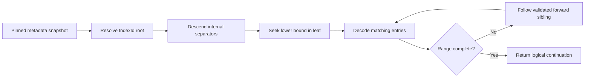
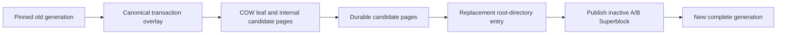

# Packed B+Tree Indexing

> This document specifies the clean native storage format. It deliberately replaces the retired fixed-record index tree: there are no 256-byte index nodes, parent pointers, value vectors, Blob overflow fields, or compatibility readers for old database files.

## Purpose and Scope

ZYX uses one reusable immutable Packed B+Tree implementation for ordered persistent access paths. A tree maps a canonical byte key to one of two explicitly declared leaf-value layouts:

- `BLVL_U64`: a leaf key maps to one unsigned 64-bit logical value;
- `BLVL_EMPTY`: a leaf key has no physical value and its presence is the result.

The first layout serves scalar and catalog access paths. The second removes needless payload from membership-style indexes, including ordinary graph adjacency. A tree declares its layout in every page header; a reader must reject a root or leaf whose layout does not match the tree it is opening.

The tree is an index structure, not an entity store. Node and Edge records remain in Entity pages; a B+Tree leaf never embeds an Edge record or shares an Entity page. The ordinary graph specialization is documented in [Relationship Traversal](/en/docs/zyx/algorithms/relationship-traversal).

## Durable Topology

Each tree has a stable logical `IndexId`. The current root is resolved from the snapshot-pinned Index Root Directory, rather than being stored in an Entity, a mutable in-memory map, or a file offset.


`PageId` is logical. Relocation changes the Page Directory route only; separator child references, root directory entries, and public continuations never need a physical-offset rewrite. An empty tree has no root-directory entry. The first insertion creates its root, and removal of the final entry removes the mapping atomically.

All pages belonging to an index use `SGK_INDEX_PAGE_POOL` and an owner identity that includes the owning `IndexId` and page role. The pool can share physical frames among compatible Index pages, but pages from different logical structures never share a 4 KiB page. Unknown page kinds, owner identities, layout versions, value layouts, or routing metadata fail closed.

## Page Format

Every page is exactly 4 KiB and is decoded through an explicit disk codec. The public format is byte-oriented; C++ object layout, host endianness, padding, and pointer width are never persisted.

| Area | Responsibility |
|---|---|
| Header | Format version, page kind, owner, `IndexId`, generation/LSN, checksum, encoded byte bounds, and declared leaf-value layout |
| Packed entry area | Ordered encoded leaf keys or internal separator/child pairs |
| Restart table | Bounded search anchors for prefix-compressed entries |
| Trailer or protected metadata | Codec-defined integrity information and bounded offsets |

Internal entries route by a separator and a logical child `PageId`. Leaf entries contain canonical keys and only the value bytes permitted by the declared layout. Internal pages are always valued child-reference pages; `BLVL_EMPTY` applies only to leaves.

Keys are prefix-compressed within a page. Restart points make a binary search land at a bounded decode position, so a point lookup does not reconstruct the whole leaf. Split, merge, occupancy, separator truncation, restart spacing, and fan-out are determined from encoded bytes by the shared layout solver. They are policy/configuration results, not handwritten entry-count constants in callers or documentation.

Leaves have a validated forward sibling route for range scans. A backward link is not required by the durable format. During copy-on-write mutation, every changed boundary and separator is rebuilt into the candidate generation before its root is published; a cursor must never follow a sibling that is inconsistent with its pinned root.

## Canonical Keys and Comparators

A tree supplies an explicit key codec and comparator. The codec validates input, produces one canonical byte representation, and decodes on read. Numeric fields use an explicitly selected wire encoding; when lexicographic byte order must match unsigned numeric order, the codec emits the applicable numeric components in canonical big-endian comparison order. This comparator encoding does not change other persisted wire fields.

The comparator must define a strict total order. It is responsible for duplicate identity, lower/upper bounds, internal separators, page ordering, online mutations, bulk construction, integrity checks, and recovery. No caller may compare host-memory structs or assume that one architecture's byte layout is portable to another.

Scalar indexes use a unique composite key that ends in the logical entity identity. For example, a property access path is ordered as:

```text
(canonical PropertyValue, EntityId) -> empty
```

The EntityId suffix is not redundant: it represents one index entry per entity, gives duplicate property values a deterministic order, and makes exact deletion independent of a variable-length value list. It is more compact and mutation-friendly than storing a separate vector of EntityIds for every distinct property value. The user-visible property data remains authoritative in the Entity/Property store.

## Read Path and Cursor Contract

A point lookup descends from the snapshot root through internal separators to one leaf. A range lookup descends once to its lower bound, scans entries in order, and advances across validated forward siblings until the upper bound is reached.



The cursor pins one snapshot and retains only bounded routing/search state, one current leaf pin, and a logical resume key. It must not retain a physical frame, slot, byte offset, or unbounded materialized result. A continuation is valid only for its snapshot, tree identity, comparator, and requested range; a foreign or malformed continuation fails closed. Resume is strict-after the last emitted logical key, which makes it correct across relocation and protects it from duplicate output.

Root and internal routing pages use normal Buffer Pool admission. Point-lookups normally admit the final leaf. Leaves traversed by a long range scan use sequential admission and at most bounded forward prefetch, preventing a scan from evicting hot routing pages.

## Mutation, Atomicity, and Snapshots

Writers start from one pinned metadata generation and build a transaction-local sorted overlay. The overlay canonicalizes duplicate operations, rejects contradictions, and uses one byte-aware copy-on-write plan for all mutations to a tree in that transaction. Candidate pages are written and made durable before any root metadata becomes visible.



Readers observe either the old root or the complete replacement root. They never observe an intermediate split, repaired sibling boundary, or partially updated multi-index transaction. Older snapshots continue to read their prior immutable pages. Concurrent root changes are detected before publication and retried from a fresh snapshot by the transaction layer.

Insertion and deletion are `O(log N)` tree work plus a bounded amount of split, redistribution, or merge planning. The physical write cost is copy-on-write path amplification and must be measured in bytes/pages rather than hidden behind the asymptotic notation.

## Deletion, Reclamation, and Repacking

Deletion removes the exact canonical key. Underflow is judged by encoded byte occupancy, not by a fixed number of entries. The mutation planner redistributes with a sibling when possible or merges candidate pages and repairs separators when necessary. If the root collapses, the new root-directory mapping points to the surviving root; if the last key is removed, it is removed entirely.

Pages displaced by copy-on-write, merge, root collapse, or whole-tree rebuilding enter the shared generation-aware Retire Queue. A physical frame becomes reusable only when no snapshot can resolve the old root. Correctness never depends on a background compactor. A bounded whole-tree repack is allowed only as a measured maintenance operation for poor byte occupancy; it builds a new tree, atomically publishes one root, and retires the old reachable set.

## Bulk Construction

Bulk writers validate records before emitting canonical keys, sort and deduplicate with the same comparator, then construct or merge ordered runs through the shared Packed B+Tree builder. They must not call a separate root-to-leaf insertion for every input key.

Online and bulk paths share the same page codec, fill policy, restart layout, separator rule, ownership validation, checksum, root-publication sequence, and reclamation protocol. All input, run, memory, I/O, and retry budgets are explicit. If future external sorting is needed, it must use bounded process memory or a controlled region inside the single database file; it cannot introduce a second durable database file.

## Global Adjacency Specialization

Ordinary graph adjacency is one reserved built-in key-only tree:

```text
(ADJ_OUT, sourceNodeId, EdgeId) -> empty
(ADJ_IN,  targetNodeId, EdgeId) -> empty
```

It has one reserved `IndexId`, its own owner identity, and the `BLVL_EMPTY` leaf layout. The Edge Entity Store is authoritative for source, target, relationship type, and state. The index stores neither Edge payload nor endpoint/type copies, so it is not a covering index and cannot become one by silently adding a leaf value.

The reserved identity is the format constant `RSS_GLOBAL_ADJACENCY_INDEX_ID`; user and derived indexes cannot claim it. Both directions are ordered ranges in this one tree, rather than separate direction trees or per-Node trees. The direction prefix therefore provides the access partition without multiplying root-directory entries, COW publication paths, or snapshot-retirement state.

This layout packs low-degree Nodes together in the same leaf while allowing a supernode to span sequential leaves. Directed expansion is `O(log E + degree)` with bounded cursor memory. Creating or deleting an Edge publishes the Edge record, Entity Map change, both adjacency keys, and the replacement root in one metadata generation. `DETACH DELETE` uses bounded scans and exact erases; it does not create adjacency Tombstones or mutate neighboring Edges.

At commit, a transaction revalidates and, where necessary, retries/rebases its bounded sorted final-state overlay on the latest root. A newer root alone is never a semantic conflict; duplicate/deleted Edge identity or an inconsistent authoritative endpoint is. This keeps the physical global root from becoming a user-visible conflict domain.

The global adjacency tree and Vector ANN adjacency are unrelated. ANN uses its Vector-specific structures and may not reuse the ordinary adjacency root, page owner, key codec, or cursor contract.

### Entity and Adjacency Separation

`BLVL_EMPTY` means that an adjacency leaf represents only membership in an ordered range. It must not be treated as a compact Edge store. Node and Edge records remain in Entity pages and are addressed through the Entity Map; adjacency leaves contain no entity slot, physical offset, endpoint copy, relationship type, state, or property bytes. An Edge expansion first finds EdgeIds in the global tree and resolves only the required Edge records in the same pinned snapshot.

This separation is intentional: one leaf can share its encoded key space among many low-degree Nodes, while a supernode can continue into following leaves. It prevents both a per-Node page tail and the write amplification of relinking neighboring Edge records. It also keeps physical page relocation local to the Page Directory because neither Entity records nor public continuations point at a B+Tree frame.

## Integrity, Recovery, and Test Gates

The runtime validates every visited page before using it: page kind, format, owner, `IndexId`, generation, LSN, checksum, encoded bounds, restart table, key order, separators, child routes, leaf-value layout, and forward sibling relationship. A corrupt or impossible state is a format error, never an implicit repair or silent skip.

The full integrity scanner additionally verifies root-directory uniqueness and reachability, no cross-tree page ownership, no orphan current page, complete snapshot-safe retirement, and tree-specific semantic rules. For global adjacency, it cross-validates every live Edge against exactly one outgoing and one incoming empty-value key, and every key against the authoritative Edge endpoints.

Every implementation stage requires at least 95% line, branch, function, and region coverage on macOS, Linux, and Windows. Required tests include comparator/codec boundaries, malformed pages, root create/collapse, split/merge/redistribution, duplicate operations, rollback, stale snapshots, relocation, reopen, injected crashes before and after publication, ENOSPC, short I/O, bounded range continuation, bulk/online equivalence, and randomized model-oracle checks.

## Implementation Sequence

1. Freeze the 4 KiB page codec, typed root-directory contract, key codec interface, byte-layout solver, and fail-closed validation tests.
2. Implement immutable point/range reads with logical continuations and Buffer Pool admission hints.
3. Implement transaction-local copy-on-write planning, root publication, retirement, and crash tests.
4. Move scalar indexes to unique composite keys and remove fixed-record/value-vector/Blob-overflow assumptions.
5. Add the global key-only adjacency specialization, then switch graph writes, readers, Cypher expansion, bulk ingest, and `DETACH DELETE` together.
6. Remove retired index/adjacency codecs and readers, remove Node adjacency roots and Edge links, raise the clean format version, and reject retired page subtypes/fields.
7. Run cross-platform coverage, integrity, durability, space, and performance gates before declaring the cutover complete.

## See Also

- [Native Single-File Storage Plan](/en/docs/zyx/architecture/native-single-file-storage-plan)
- [Relationship Traversal](/en/docs/zyx/algorithms/relationship-traversal)
- [Segment Compaction](/en/docs/zyx/algorithms/segment-compaction)
