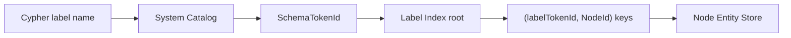

# Label Index

> This page specifies the target native Label Index. It replaces the retired `IndexTreeManager`, mutable root map, state-chain root record, duplicate-value list, and Blob-overflow representation. Old database files are not a supported input to the clean format.

## Model

Labels have a canonical schema identity. The System Catalog maps a UTF-8 label name to a `SchemaTokenId` and maps that token back to its canonical definition. Node records and label index entries store only the token; they never repeat the label name.

The Label Index is a key-only Packed B+Tree with the logical schema:

```text
(labelTokenId, NodeId) -> empty
```

Each Node-label association produces one key. `NodeId` is necessary to give equal label tokens a deterministic, unique order and exact deletion. A label scan seeks the lower bound for `labelTokenId` and streams until the token prefix changes. It does not read or materialize one value vector for the whole label.



The canonical Node label set is authoritative. A fixed Node record retains a small sorted inline prefix, while any remaining sorted token IDs reside in one referenced `EntityLabelSet` record. The Label Index is derived state. Its entries must exactly equal the union of every live Node's inline and overflow token IDs.

## Storage and Root Ownership

The index uses the shared Packed B+Tree codec with `BLVL_EMPTY` leaves, 4 KiB Index pages, a stable logical `IndexId`, and a snapshot-pinned root-directory entry. It shares neither a page nor an owner identity with Node records, `EntityLabelSet` records, properties, ordinary adjacency, or Vector ANN data.

The Index Root Directory maps the label IndexId to the current root PageId and generation. The Superblock publishes that directory root, so it remains fixed size. Relocation changes a Page Directory route, not a Node reference, token, root identity, or cursor continuation. When no Node has a label association, the index has no root-directory entry and no permanent empty root page.

## Read Semantics

For `MATCH (n:Person)`, the planner resolves `Person` to its token in the same pinned snapshot used for the index scan. It scans `(token, NodeId)` in sorted NodeId order, resolves Node records through the Entity Map only when query output or predicates require them, and validates that each resolved live Node still carries the token.

The cursor retains a pinned snapshot, target token, last returned NodeId, bounded page-search state, and at most one leaf pin. It resumes strictly after the last NodeId and never exports PageId, slot, offset, or sibling state. Cache admission follows the common Packed B+Tree policy: routing pages are hot point-read state; long label scans use sequential leaf admission and bounded prefetch.

Lookup complexity is `O(log L + matches)`, where `L` is the number of label associations. Memory is bounded independently of label cardinality.

## Atomic Mutation

Creating a Node or adding a label computes the canonical old/new token sets and derives exact key additions/removals. Removing a label, deleting a Node, and replacing a label set use the same comparison. A transaction publishes all of the following in one metadata generation:

1. Node fixed-record replacement and any `EntityLabelSet` changes.
2. Entity Map and Page Directory changes required by those records.
3. The Label Index Packed B+Tree replacement root.
4. Catalog/metadata roots and the inactive A/B Superblock.

Candidate pages are durable before root publication. A reader sees either the complete old Node/Label Index relation or the complete new one. It cannot observe a label index entry for a Node that is absent from that snapshot, nor a committed label on a Node missing from the index.

`DETACH DELETE` and Edge mutation do not have special Label Index state. Index deletion is an exact key erase; it does not create label tombstones, stale value vectors, or an asynchronous per-label merge debt.

## Bulk Build and Maintenance

Bulk construction reads canonical Node label sets, emits `(token, NodeId)` keys, canonicalizes and sorts them, then constructs a dense key-only tree through the shared bulk builder. It must use the same comparator, page layout, root publication, and integrity rules as online mutation.

Online insertion/deletion is copy-on-write. Byte-aware redistribution and merge keep the tree healthy; displaced pages enter the common snapshot-safe Retire Queue. A measured bounded rebuild may repack low-occupancy pages, but no background compaction is needed for query correctness.

## Integrity and Test Gates

The integrity scanner verifies canonical token ordering, unique nonzero keys, valid key-only page layout, tree ordering/reachability, root ownership, snapshot-safe retirement, and this bidirectional invariant:

```text
Node canonical label set == all Label Index tokens for that Node
```

Tests cover inline-only and overflow label sets, first/final root transitions, multi-label updates, deletion, stale snapshots, split/merge, relocation, bulk/online equivalence, catalog-token mismatch, malformed keys/pages, before/after-publication crash points, ENOSPC, short I/O, and randomized Node-label oracles. Every coverage dimension must reach 95% or higher on macOS, Linux, and Windows.

## See Also

- [Packed B+Tree Indexing](/en/docs/zyx/algorithms/btree-indexing)
- [Native Single-File Storage Plan](/en/docs/zyx/architecture/native-single-file-storage-plan)
- [Relationship Traversal](/en/docs/zyx/algorithms/relationship-traversal)
