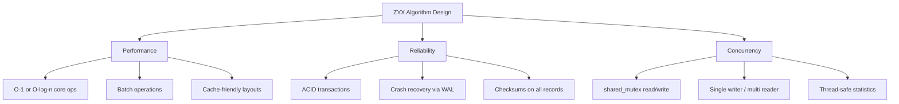

# Algorithms Overview

ZYX employs a range of algorithms across indexing, storage, query processing, vector search, and concurrency control. This section documents each algorithm's design, data flow, and performance characteristics.

## Algorithm Categories

### Storage Algorithms

Algorithms managing native single-file storage:

- **[Segment Compaction](segment-compaction)** — Snapshot-safe relocation and reclamation through native metadata publication

### Indexing Algorithms

Algorithms for fast data lookup:

- **[Packed B+Tree Indexing](btree-indexing)** — Immutable 4 KiB ordered index pages for scalar, label, and adjacency access paths
- **[Label Index](label-index)** — Label-to-node-ID mapping using B+Tree
- **[Property Index](property-index)** — Type-specific B+Tree indexes for property values

### Query Algorithms

Algorithms for efficient query execution:

- **[Query Optimization](query-optimization)** — Multi-rule optimizer with fixed-point iteration
- **[Relationship Traversal](relationship-traversal)** — Global Packed B+Tree range cursors for outgoing and incoming Edge traversal

### Vector Search

Algorithms for high-dimensional vector similarity search:

- **[Vector Metrics](vector-metrics)** — Optimized L2 and IP distance with mixed-precision support
- **[Product Quantization](product-quantization)** — Vector compression via subspace quantization

### Graph Analytics

Algorithms for analyzing graph structure and topology:

- **[GDS Graph Projections](graph-projections)** — Named, filtered, weighted in-memory graphs with catalog lifecycle and lazy CSR caching
- **[Community Detection](community-detection)** — Leiden algorithm for discovering community structure with level lifting and refinement
- **[PageRank](https://en.wikipedia.org/wiki/PageRank)** — Iterative centrality algorithm (via GDS)
- **[Shortest Path](https://en.wikipedia.org/wiki/Shortest_path_problem)** — Dijkstra's algorithm for weighted paths (via GDS)

## Design Principles

All algorithms share these properties:

- **Thread safety**: `std::shared_mutex` for concurrent read access, exclusive write access
- **Batch operations**: Optimized bulk paths for index building and data import
- **Lazy initialization**: Components (QueryEngine, ThreadPool, WAL) initialized on first use
- **Segment-based storage**: All data stored in fixed-size segments with linked-list chains

## Complexity Summary

| Category | Key Operation | Complexity |
|----------|--------------|------------|
| Segment Allocation | Allocate entity slot | O(1) amortized |
| B+Tree Index | Search / Insert | O(log n) |
| Label Index | Find nodes by label | O(log n + k) |
| Property Index | Exact match | O(log n + k) |
| Property Index | Range query | O(log n + k) |
| Relationship Traversal | Get outgoing/incoming edges | O(log E + degree) |
| Community Detection | Leiden per level | O(n + m) × iterations |
| Native Vector Search | K-nearest neighbors | Bounded by the configured candidate and refinement budgets |
| PQ Distance | Approximate distance | O(numSubspaces) |

Where n = entries in index, k = result count, dim = vector dimensionality.
