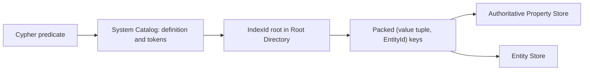

# Property Index

> This page defines the clean native Property Index design. It replaces the retired per-type `IndexTreeManager` maps, mutable state-chain roots, value vectors, type-inference-on-write, and compatibility readers. An index definition and its root are durable catalog data, not process-local configuration.

## Model

The System Catalog owns every index definition: its stable `IndexId`, entity domain, ordered property-token signature, comparator/version, state, and current root mapping. Property names are resolved to tokens in the same pinned snapshot as the query and are not copied into index entries.

Every scalar index has one explicit canonical key codec. For a single-property index, the logical leaf key is:

```text
(canonical PropertyValue, EntityId) -> empty
```

For an ordered composite index, it is:

```text
(canonical PropertyValue1, canonical PropertyValue2, ..., EntityId) -> empty
```

The entity suffix gives duplicate values a stable order and makes one entry removable without deserializing a shared list of EntityIds. It is intentional logical identity, not avoidable duplication. The authoritative property value remains in the Property Store; a scalar index is an access path and is not a covering copy.



An index definition fixes value types, ordering, collation, null policy, and codec version at creation. Writes with a schema-incompatible value fail according to the definition; they do not silently infer a new type, route to a different tree, or skip an index update. Type changes require an explicit definition transition and a newly built root.

## Storage, Roots, and Key Bounds

The tree uses the shared 4 KiB Packed B+Tree page format and `BLVL_EMPTY` leaves. Its stable `IndexId` resolves through the snapshot-pinned Index Root Directory. Tree pages reside in `SGK_INDEX_PAGE_POOL` under the owning Index identity; they never share a page with Entity, Property, adjacency, or Vector data. Relocation preserves `PageId` and changes only its Page Directory route.

The key codec supplies a strict total order, lower/upper bounds, canonical byte representation, and explicit validation. It includes enough type information to make the order unambiguous and uses a canonical numeric comparison encoding where lexical byte order must match numeric order. Prefix compression and restart points reduce repeated tuple bytes within a page; page capacity, separators, fan-out, and occupancy are derived by the shared byte-layout solver.

Every codec has a format-owned maximum encodable key bound. The bound is preflighted before candidate-page allocation or publication. A property value that is valid application data but too large for a declared index codec remains storable in the Property Store; an attempt to index it fails explicitly unless the index definition has a separately specified, query-correct derived representation. The implementation must not hide such a key in a legacy Blob reference or substitute a hash that changes equality/range semantics.

## Query Semantics

Equality seeks the first key for a canonical value and streams while the value prefix remains equal. A range predicate seeks its lower tuple boundary and stops at its exclusive upper boundary. A composite index supports a leftmost-prefix range only when the predicate supplies the prefix required by that index's comparator.

The scan returns NodeId or EdgeId decoded from the key suffix. The executor validates entity visibility and applies residual predicates. When an indexed property can be changed independently of the Entity record, the query snapshot resolves both the index root and Property root from one metadata generation, so an index key cannot point to a different committed property state.

The range cursor keeps a pinned snapshot, definition identity/version, normalized bounds, last emitted logical key, bounded decoder state, and at most one leaf pin. It never exposes PageIds, slots, offsets, or a mutable tree-manager cursor. Exact lookup is `O(log I + matches)` and a range is `O(log I + results)`, with bounded memory.

## Atomic Lifecycle and Mutation

Creating or dropping an index updates its Catalog definition, Root Directory mapping, and all support metadata in one generation. A BUILDING definition is not query-visible until a complete initial tree and READY definition are published together. Dropping an index removes its root mapping and retires its reachable pages snapshot-safely; it does not leave a state-chain root or a user-visible empty tree.

For property insert, update, or removal, the writer derives the old and new canonical keys from the old/new Property Store state. One native transaction plans all affected Property pages, Entity visibility changes, scalar-index key additions/erasures, B+Tree replacement roots, Catalog metadata, and Superblock publication. Candidate pages become durable before the new generation is visible.

An update from one indexed value to another erases the old exact `(value, EntityId)` key and inserts the new exact key. Multiple affected definitions are planned together. An aborted, conflicted, or torn transaction exposes neither a partial Property update nor a partial set of scalar-index roots.

## Bulk Build, Deletion, and Reclamation

Bulk materialization scans one pinned logical Property snapshot, emits canonical `(tuple, EntityId)` keys, validates/deduplicates/sorts them, and uses the shared bulk builder. A build must be bounded in memory and use the same codec, fill policy, separators, checksums, root publication, and retirement as online mutation. It must not perform a root-to-leaf insertion per record.

Online delete uses byte-aware copy-on-write redistribution or merge. A sparse tree may be rebuilt by a bounded, measurable maintenance job, but query correctness does not depend on background compaction. COW-replaced and dropped-tree pages enter the common generation-aware Retire Queue and become reusable only after old snapshots drain.

## Integrity and Test Gates

The integrity scanner validates definition/root correspondence, codec version, page ownership, ordering, separators, restart data, checksums, reachability, and snapshot-safe retirement. Semantic cross-validation samples or fully scans, as requested by maintenance policy, to verify that every index key resolves to a visible Entity/Property pair with the exact canonical tuple and that no eligible indexed property is missing.

Tests cover null/type/collation/key-bound policy, duplicate values, exact delete, value replacement, composite left-prefix ranges, first/final root transitions, BUILDING/READY/DROP publication, stale snapshots, split/merge, relocation, bulk/online equivalence, malformed keys/pages, ENOSPC, short I/O, and crash injection before/after Superblock publication. Line, branch, function, and region coverage must each reach at least 95% on macOS, Linux, and Windows.

## See Also

- [Packed B+Tree Indexing](/en/docs/zyx/algorithms/btree-indexing)
- [Label Index](/en/docs/zyx/algorithms/label-index)
- [Native Single-File Storage Plan](/en/docs/zyx/architecture/native-single-file-storage-plan)
