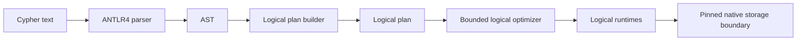
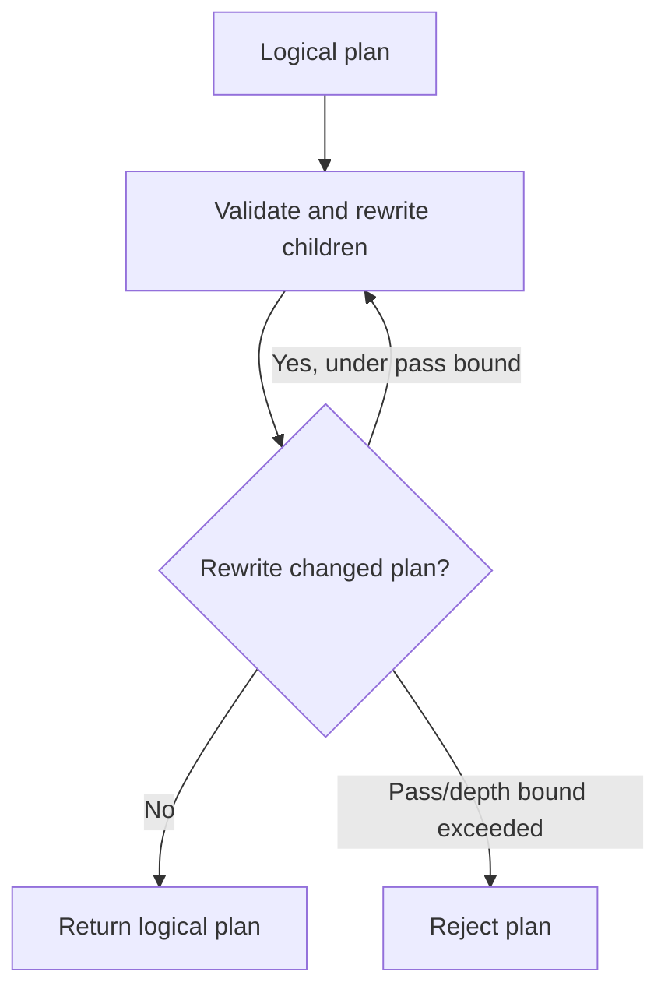

# Query Optimization Algorithm

ZYX optimizes its native logical plan before execution. The optimizer is deliberately storage-neutral: it never opens files, reads physical pages, or builds a physical operator tree. This keeps optimization independent of the relocatable storage format and lets the logical runtime remain the sole execution path.

## Query Processing Pipeline

1. **Parse**: ANTLR4 converts Cypher text into an AST.
2. **Plan**: the planner builds logical operators such as scans, filters, joins, projections, row windows, mutations, and procedures.
3. **Optimize**: `LogicalPlanOptimizer` applies only semantic-preserving rewrites within explicit depth and pass bounds.
4. **Execute**: `QueryEngine` dispatches the resulting logical plan to the read, mutation, schema, or procedure runtime. Read execution opens a pinned logical snapshot only at the native storage boundary.

There is no current physical-plan conversion stage. The retired `PhysicalPlanConverter` and physical operators are not part of this pipeline.

## Bounded Rewrite Loop

`LogicalPlanOptimizer` validates every visited child and performs at most eight rewrite passes by default. It also rejects plans deeper than its configured maximum (1,024 by default). A null child, invalid cardinality estimate, or a plan that does not reach a fixed point inside the bound is rejected rather than partially executed.

**Source**: `include/graph/query/optimization/LogicalPlanOptimizer.hpp`

## Current Rewrites

The native optimizer intentionally has a narrow rule set. It does not claim generic predicate pushdown, projection pushdown, or a cost-based physical-plan search.

| Rewrite | Preconditions | Result |
| --- | --- | --- |
| Literal equality scan hint | A `Filter` directly wraps one `LogicalNodeScan`; the equality is on that scan variable and has a non-null literal value. | Adds an exact property predicate and the property-scan hint to the logical scan. |
| Literal range scan hint | A direct filter contains compatible literal lower and/or upper bounds on one scan property. | Adds one validated range predicate and the range-scan hint. |
| Cartesian input order | A statistics provider supplies valid, unequal estimates for both join inputs. | Places the smaller input on the runtime's materialized right side. Ties and missing estimates preserve order. |
| Limit/project normalization | A non-distinct, well-formed projection is directly below a non-negative limit. | Moves the limit below the projection. |
| Limit/skip normalization | A positive limit wraps a non-negative skip and their sum does not overflow. | Changes it to `Skip(Limit(input, limit + skip), skip)`. |
| Nested row windows | Adjacent non-negative `Limit` or `Skip` operators have a non-overflowing combined value. | Collapses them to one operator. |

The runtime remains the semantic authority. In particular, scan hints are advisory: the native reader revalidates exact or range lookup against the pinned snapshot, keeps the logical predicate as the final check, and fails closed for malformed, stale, unavailable, or over-limit index state.

## Statistics

`LogicalStatisticsProvider` is an optional, storage-neutral interface. It can return a lower bound, expected row count, and upper bound for a logical subtree. All three values must be ordered; invalid estimates reject optimization. With no provider, optimization remains deterministic and does not reorder joins.

The optimizer has no direct dependency on catalog pages, indexes, or file layout. A backend may supply statistics without exposing physical identifiers to query planning.

## Performance And Safety Notes

- Use selective literal predicates with supported scalar values to make an exact or range scan hint eligible.
- Treat `EXPLAIN` as a logical-plan view, not evidence that an index will be selected or that a storage snapshot was opened.
- Do not rely on a hint to change Cypher results: the runtime preserves the original predicate semantics.
- Keep extensions bounded. New rewrites must preserve observable behavior, validate malformed input, and provide explicit native-runtime tests.

## See Also

- [Query Engine](/en/docs/zyx/architecture/query-engine)
- [Cypher Basics](/en/docs/zyx/user-guide/cypher-basics)
- [Property Indexes](/en/docs/zyx/algorithms/property-index)
