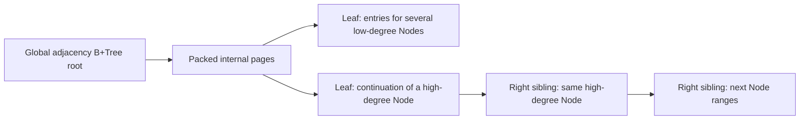

# Relationship Traversal

> This page defines the target ordinary-graph traversal architecture. The transition is staged; until Stage 8 of the [native single-file storage plan](/en/docs/zyx/architecture/native-single-file-storage-plan) is complete, parts of the source tree may still implement the retired adjacency format. The target format does not preserve compatibility with old database files.

## Overview

ZYX stores ordinary graph adjacency in one global Packed B+Tree. The Edge Entity Store remains authoritative, and the tree provides the ordered access path from a Node and direction to EdgeIds.

The design optimizes for:

- shared 4 KiB leaves for low-degree Nodes instead of a page tail per Node;
- bounded, sequential leaf scans for supernodes;
- no adjacency pointers in Node or Edge records;
- atomic visibility of the Edge and both adjacency directions;
- one Packed B+Tree implementation for online mutation, bulk ingest, caching, recovery, and reclamation;
- logical cursors that remain valid independently of physical page relocation.

Ordinary graph adjacency is unrelated to the ANN graph stored for Vector search. They use different owner identities, roots, codecs, and maintenance policies.

## Storage Model

### Authoritative Edge Store

Each live directed relationship has one authoritative Edge record:

```text
EdgeId -> sourceNodeId + targetNodeId + relationshipTypeId + state
```

Node records do not own outgoing or incoming roots. Edge records do not contain `next` or `previous` links. Updating adjacency therefore never rewrites neighboring Edge records.

### Global Adjacency Index

The built-in adjacency index has this logical schema:

```text
(direction, NodeId, EdgeId) -> empty
```

Each live Edge contributes exactly two entries:

```text
(ADJ_OUT, sourceNodeId, EdgeId) -> empty
(ADJ_IN,  targetNodeId, EdgeId) -> empty
```

These are two ordered ranges in one reserved tree, not two direction-specific trees and not a per-Node index family. The direction prefix makes both access paths seekable while preserving one root, codec, COW publication unit, and snapshot-retirement lifecycle.

The value is deliberately empty. The routing NodeId is necessarily part of the access key, but the tree stores neither the other endpoint nor relationship type/state as an Edge payload. The Edge record remains the authoritative complete relationship representation. This first design is not a covering index.

### Storage Boundary

The global index is an access path, not a new mixed Node/Edge container. Keeping these responsibilities separate makes the layout compact without creating a second authoritative representation.

| Durable structure | Stored data | Does not store |
|---|---|---|
| Node Entity page | Node identity, state, labels, and Node-owned references | adjacency root, adjacency keys, or edge-chain links |
| Edge Entity page | `EdgeId`, endpoints, relationship type, state, and Edge-owned references | B+Tree page/slot/offset, `next`/`previous` adjacency links, or duplicated adjacency payload |
| Global adjacency B+Tree leaf | Sorted `(direction, NodeId, EdgeId)` keys with an empty value | Node or Edge records, the opposite endpoint, type, state, or properties |
| Global adjacency B+Tree internal page | Separators and logical child `PageId` values | Entity records or adjacency keys as payload |

Consequently, a leaf can contain consecutive key ranges for several low-degree Nodes; this does not mean their Node or Edge records are co-located in that leaf. Conversely, a high-degree Node may occupy consecutive leaves, but it never gains a private root, chain, or permanently reserved tail page.

The persisted direction enum uses prefixed members such as `ADJ_OUT` and `ADJ_IN` to remain safe from Windows macro collisions. Unknown directions, zero IDs, and malformed key widths fail closed.

### Ordering and Page Sharing

The canonical comparator orders direction first, then unsigned NodeId, then unsigned EdgeId. All entries for one `(direction, NodeId)` are one ordered range.



One leaf may contain entries from many Nodes. A supernode may span any number of consecutive leaves. Neither case allocates a dedicated page to one Node. Prefix compression encodes the repeated direction and NodeId efficiently, while restart points retain bounded random search within a leaf.

Leaf capacity, internal fan-out, restart interval, and split thresholds are derived from encoded byte sizes and the page-layout solver. Documentation, tests, and callers must not copy a derived entries-per-page number as a format constant.

### Root and Physical Location

The tree owns one reserved built-in `IndexId`. A snapshot resolves the root through the Index Root Directory:


Node and Edge pages use Entity pools. Adjacency internal and leaf pages use Index pools. They never share a 4 KiB page: the B+Tree stores access keys, not Edge records. Multiple logical page types may occupy frames in their compatible 128 KiB pools, and an empty physical Segment can later be reclaimed for another SegmentKind.

All tree references use logical PageIds. Evacuating a page changes its Page Directory route, not its PageId; parent references, cursors, Node records, and Edge records do not contain physical offsets and therefore require no relocation rewrite.

## Traversal Operations

### Directed Expansion

Outgoing expansion seeks to the lower bound for `(ADJ_OUT, NodeId)` and advances until the direction or NodeId changes. Incoming expansion does the same with `ADJ_IN`.

The cursor:

- pins one metadata snapshot for its lifetime;
- keeps the logical prefix and last returned EdgeId;
- decodes keys directly from validated page views;
- retains at most the current leaf plus bounded prefetch state;
- never materializes a complete leaf or all edges of a supernode;
- resumes strictly after the last EdgeId and never exposes PageId or physical offset.

The seek plus scan complexity is `O(log E + degree)`. Output materialization remains proportional to the requested result.

### Undirected Expansion and Self-Loops

Undirected expansion opens one outgoing range and one incoming range. Parallel Edges remain distinct because EdgeId is part of the key. A self-loop has one outgoing and one incoming entry; the query operator deduplicates that EdgeId only when the Cypher operator's semantics require one relationship result.

### Edge and Neighbor Materialization

An adjacency-only count can count keys without reading Edge records. Operations that return Edge fields resolve EdgeIds through the snapshot-pinned Edge Entity Map. The reader validates that every resolved Edge is live and that the scanned direction/NodeId matches its authoritative endpoint.

Relationship-type filters initially inspect the authoritative Edge record. The executor batches these reads by Entity page and applies existing query limits; it must not degrade into an unbounded independent random read for every key. A future type-qualified derived index is permitted only after workload evidence justifies its extra write and space cost.

### Buffer Pool Policy

Root and internal routing pages use normal admission. A point probe normally admits its final leaf. Leaves consumed by a range scan use sequential admission, and bounded right-sibling prefetch carries the same hint. This keeps reusable routing state hot while preventing a supernode scan from evicting the point-read working set.

Every page is still validated after cache lookup: owner identity, page subtype, generation, LSN, checksum, key order, restart table, separators, and sibling relationships are mandatory invariants.

## Mutation Semantics

### Create Edge

One transaction plans all of the following against the same pinned generation:

1. Insert the authoritative Edge record and Entity Map entry.
2. Insert the outgoing adjacency key.
3. Insert the incoming adjacency key.
4. Publish the replacement B+Tree root and metadata roots.
5. Publish the inactive A/B Superblock as the new generation.

The two keys use one transaction-local sorted B+Tree overlay. Data pages are durable before the root becomes visible. Recovery selects either the complete old generation or the complete new generation; an Edge can never become visible in only one direction.

The shared root is not a reason to expose spurious write conflicts. At commit, the transaction layer revalidates and, when needed, retries/rebases the bounded sorted final-state overlay against the latest root. It rejects semantic conflicts (for example, a conflicting Edge identity or changed authoritative endpoint), not a disjoint writer merely because that writer published a newer adjacency root.

### Delete Edge

Deletion reads the authoritative old endpoints, erases both exact keys, removes the Edge record and Entity Map entry, and publishes the final state atomically. Ordinary relationship deletion does not append a Tombstone and does not update adjacent Edges.

Retired COW pages enter the common generation-aware Retire Queue. Older snapshots continue to resolve their old root; physical frames become reusable only after those snapshots drain.

### DETACH DELETE

`DETACH DELETE` scans both bounded ranges for the Node, deduplicates EdgeIds including self-loops, validates resource limits, and builds one final-state batch. Every Edge and both of its adjacency entries are removed exactly once. The operation fails before publication if a key contradicts the authoritative Edge record or the configured transaction bound is exceeded.

### Bulk Edge Ingest

Bulk creation validates endpoints first, emits the outgoing and incoming keys, sorts and deduplicates them with the canonical comparator, and merges ordered runs through the shared Packed B+Tree bulk/overlay builder. It does not execute an independent root-to-leaf insertion for every entry.

Online and bulk writers share page fill, prefix/restart, separator, split/merge, checksum, owner, and publication invariants. Memory use is bounded by ingest limits. Any future external run storage must honor the one-database-file durability model and cannot become a second persistent database file.

Bulk work is a final-state operation. It validates the complete batch before publication, coalesces duplicate or cancelling mutations by the canonical key, constructs ordered runs, and applies the resulting changes through the same COW root replacement as online writes. It must never expose a partially built range, a newly created Edge with only one direction, or a replacement root whose Entity changes were not published in the same generation.

## Deletion, Occupancy, and Reclamation

Packed B+Tree deletion performs byte-aware redistribution or merge in COW candidate pages. Empty leaves and collapsed internal roots are retired through the same reclamation path as other Index pages. An empty graph has no adjacency root entry and therefore owns no permanent empty tree page.

The steady-state implementation has no per-Node Root pages, Base chains, Delta chains, logical Tombstones, or adjacency merge worker. A bounded whole-tree repack may be scheduled when measured byte occupancy falls below policy, but it is an optimization, not part of normal read correctness.

The first production implementation uses the plain Packed B+Tree. A bounded global write buffer may be considered only if recorded benchmarks show that isolated Edge COW amplification misses an agreed threshold. Such a buffer must preserve the same logical ordering, cursor, atomicity, memory bounds, crash recovery, and single-file behavior. Per-Node delta hierarchies are not a fallback.

## Cypher Integration

| Cypher pattern or operation | Adjacency access |
|---|---|
| `MATCH (a)-[r]->(b)` | Outgoing range for `a` |
| `MATCH (a)<-[r]-(b)` | Incoming range for `a` |
| `MATCH (a)-[r]-(b)` | Outgoing and incoming ranges with semantic deduplication |
| `degree(a)` or relationship count | Count bounded adjacency entries when no Edge fields are required |
| Variable-length expansion | One bounded cursor per frontier Node, subject to traversal limits |
| `DETACH DELETE a` | Scan both ranges, deduplicate EdgeIds, publish one bulk erase |

The query layer receives a logical continuation, not a page chain. Relocation, leaf split/merge, and a new committed generation cannot leak physical storage details into the Cypher DSL.

## Complexity and Space

| Operation | Time | Additional cursor memory |
|---|---|---|
| Seek outgoing or incoming range | `O(log E)` | Tree height and one leaf pin |
| Stream one direction | `O(log E + degree)` | Bounded, independent of degree |
| Count one direction | `O(log E + degree)` | Bounded |
| Create/delete one Edge | `O(log E)` logical tree work | COW path and bounded split/merge state |
| Sorted bulk ingest | Linear in input plus ordered tree construction/merge work | Configured run bound |

Each directed Edge contributes two compact keys and no values. The cost replaces Node head pointers, four Edge link pointers, per-Node root records, and partially empty adjacency-tail pages. Exact bytes per Edge are measured from encoded pages because prefix compression and occupancy make a handwritten constant misleading.

## Integrity and Test Gates

The full integrity scanner verifies:

- exactly two correctly directed entries for every live Edge;
- every entry resolves to a live Edge with matching endpoints;
- no duplicate, missing, foreign, zero-ID, or unknown-direction key;
- canonical ordering and valid prefix/restart, separator, sibling, owner, generation, LSN, and CRC data;
- one reserved root identity with no collision with user indexes;
- complete reachability and correct snapshot-safe retirement.

Tests cover empty/first/final root transitions, low-degree leaf sharing, supernodes across many leaves, self-loops, parallel Edges, create/delete rollback, `DETACH DELETE`, bulk equivalence, cursor continuation, stale snapshots, page relocation, split/merge/root collapse, ENOSPC, short writes, corruption, and before/after-Superblock crash points.

They also cover a rebase after a concurrent disjoint adjacency publication: both final Edge records and all four directional keys must be visible, while no reader can observe either writer with only one direction.

Line, branch, function, and region coverage must each reach at least 95% on macOS, Linux, and Windows. Performance evidence records COW bytes per Edge mutation, pages read per expansion, bulk throughput, post-churn byte occupancy, Buffer Pool pollution, cursor peak memory, and supernode tail latency.

## See Also

- [Native Single-File Storage Plan](/en/docs/zyx/architecture/native-single-file-storage-plan)
- [B+Tree Indexing](/en/docs/zyx/algorithms/btree-indexing)
- [Query Optimization](/en/docs/zyx/algorithms/query-optimization)
- [Segment Compaction](/en/docs/zyx/algorithms/segment-compaction)
