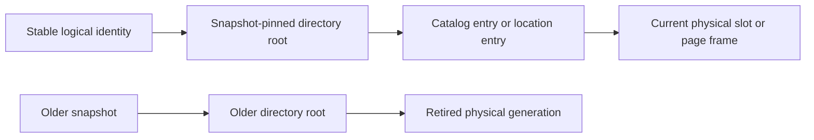
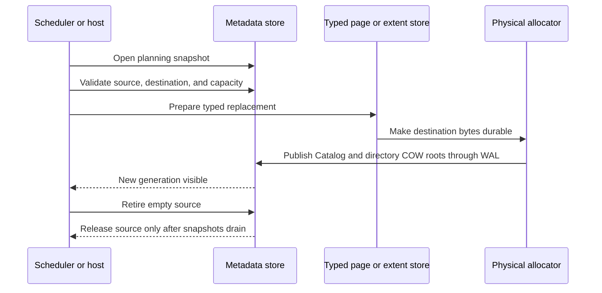

# Segment Compaction

The native logical storage format reclaims space without changing a Node ID, Edge ID, `SegmentId`, `PageId`, or external property reference. Compaction changes only a directory binding from a stable logical identity to a new physical location. This is fundamentally different from the retired physical segment-chain implementation, which moved records and then rewrote references.

The old `FileStorage` / `DataManager` compactor is not the compaction mechanism for a native logical database. In particular, no native logical query may enable compaction through `dbms.setConfigValue`, `dbms.setConfig`, or a System State key. Runtime configuration procedures intentionally fail closed until configuration changes can participate in the same metadata WAL publication as graph writes.

## Storage Identities

The file allocator owns fixed 128 KiB physical slots. Logical references never persist a raw file offset:

| Object | Stable logical identity | Directory that resolves the current physical location |
|---|---|---|
| Fixed Node or Edge segment | `SegmentId` | Catalog and Entity Location Directory |
| Property or State slotted page | `PageId` plus slot and generation | Page Directory |
| Scalar or ordinary-adjacency Packed B+Tree page | `PageId` | Page Directory and Index Root Directory |
| Raw or PQ vector page | `PageId` | Page Directory |
| Vector manifest | manifest `PageId` | Page Directory and Vector Manifest Directory |
| Large object or codebook extent | object/extent identity | Extent Directory and Catalog |

A relocation publishes a new directory generation atomically. Readers that begin after publication resolve the new location; an older reader continues through its pinned directory root and can safely read the former generation. The source cannot be released until every snapshot that can resolve it has drained.

## Supported Compaction Operations

`RelocatableCompactionCoordinator` provides bounded, typed operations. It never raw-copies a format that requires type-specific reconstruction.

| Data layout | Operation | Stable references after compaction |
|---|---|---|
| Property, State, and vector-adjacency slotted pools | Evacuate up to a caller-provided page budget into a compatible destination pool | `PageId`, slot ID, and slot generation |
| Scalar or ordinary-adjacency Packed B+Tree pool | Rebuild typed pages and switch a root-directory binding when needed | `PageId` and index root identity |
| Raw and PQ vector pools | Rebuild typed vector pages | vector page identity and vector-location binding |
| Vector-manifest pool | Rebuild immutable manifests and publish both directory bindings | manifest `PageId` |
| Fixed Node and Edge segments | Relocate the complete fixed-record segment | Node and Edge IDs; the logical `SegmentId` remains unchanged |
| Large-object and codebook extents | Rebuild the validated immutable extent at a destination range | object / codebook extent identity |

Property payload defragmentation inside one slotted page is separate from pool evacuation. It may move payload bytes and update only the owning slot-directory offset; the external page/slot reference remains unchanged. A small property update must not trigger a whole-file relocation.

## Bounded Evacuation Protocol

Each operation is intentionally bounded by destination capacity and an explicit LSN range. A caller selects a source, a compatible destination, a page budget for pooled data, and the first LSN to reserve. The coordinator performs the following sequence:

1. Open a metadata snapshot and validate that source and destination are sealed, compatible, current, and backed by allocated physical slots.
2. Collect and order source pages, then verify that the destination has enough frames for the requested bounded move. If it does not, return `VCS_NO_DESTINATION_CAPACITY` without changing the source.
3. Revalidate each planned page against a fresh snapshot immediately before its typed evacuation. A stale directory binding fails closed instead of moving an unexpected page.
4. Prepare the new bytes, make data durable, then publish the Catalog and relevant directory COW roots through the metadata WAL and Superblock publication boundary.
5. When the source becomes empty, retire it. Reclaim its physical slot only after the snapshot-retention check succeeds.

The result distinguishes normal completion, unavailable destination capacity, and `VCS_SOURCE_RETIRED_AWAITING_SNAPSHOTS`. The latter is not an error: a later maintenance run retries source release using the same segment generation after the last old snapshot closes.

## Reference, Cache, and Recovery Guarantees

Compaction does not change logical graph references. Node and Edge IDs do not need graph-wide repair after a fixed-segment move, and a page relocation does not require rewriting property, adjacency, B+Tree, or vector references that use the stable directory identity.

Caches must key their validity on the logical identity and resolved generation, not a raw file offset. Publication makes a new mapping visible only to new snapshots; an old snapshot keeps the former mapping and its physical generation pinned. This prevents a cache or reader from observing a directory entry that points to bytes not yet durable.

Durability follows the same ordering as normal native writes:

1. validate the type-specific source and destination;
2. write and synchronize complete destination bytes;
3. persist the WAL metadata publication;
4. publish the Superblock root;
5. make the old source reclaimable only after snapshot retention permits it.

An interruption before a durable metadata publication leaves prepared destination bytes unreachable. An interruption after the WAL publication is recovered as the complete directory generation. Recovery never exposes a half-moved logical object.

## Scheduling and Capacity Policy

The native coordinator deliberately does not run an unbounded automatic "compact after every flush" policy. A host scheduler must supply the work budget, choose compatible destinations, reserve LSN capacity, and observe snapshot pressure. This keeps tail latency predictable and makes a no-capacity condition non-destructive.

The following policy is safe for a future scheduler:

- evacuate a bounded number of pages or one whole fixed segment per maintenance slice;
- prefer pools with the largest reclaimable physical capacity, subject to destination-frame availability;
- retry retired-source release after snapshot pins drain;
- perform file-tail truncation only after Catalog and free-space metadata no longer reference tail slots;
- measure reclaimed bytes, source-retention time, directory publication latency, and read/write tail latency before increasing a budget.

There is currently no public Cypher command for native logical compaction. Applications should not depend on legacy configuration procedures or on physical file offsets. Maintenance integration belongs at the native storage-host boundary so it can use the same snapshot, WAL, and publication guarantees described here.
