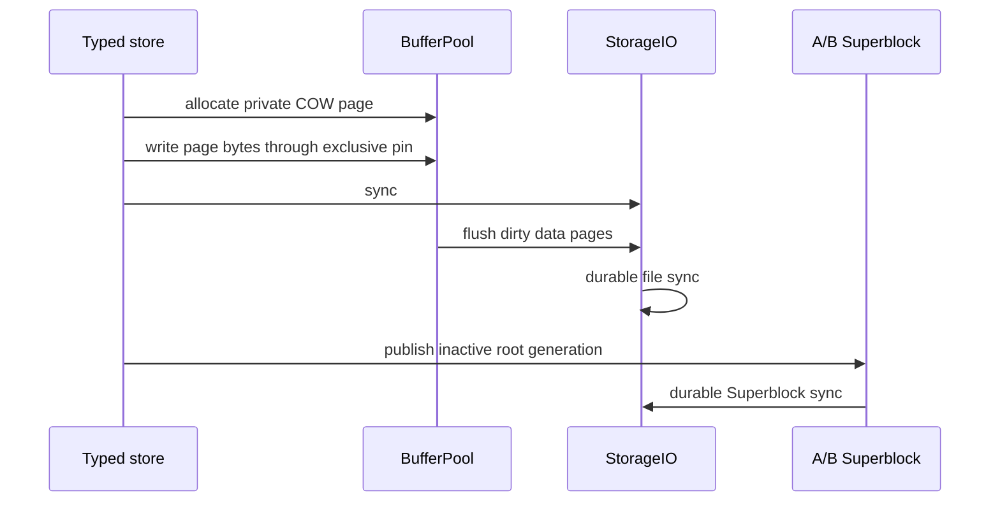

# Cache Management

Every native ZYX database has one shared `BufferPool` below `StorageIO`. It
caches raw 4 KiB pages for the Metadata, Catalog, Entity, Property, B+Tree,
Vector, and LargeValue stores. No native production path uses the historical
128 KiB `PageBufferPool` or a per-entity dirty registry.

`Database` accepts a cache limit in bytes. It defaults to 64 MiB and rejects a
limit smaller than one 4 KiB page. The limit is rounded down to a whole-page
capacity, so resident data never exceeds the configured byte ceiling.

## Page Identity And Pins

A resident page is addressed by the physical 4 KiB-aligned file offset plus a
generation:

```cpp
graph::storage::BufferPoolPageKey key{pageOffset, generation};
```

The generation prevents a cached view from being confused with a later reuse
of the same physical slot. A `Pin` is an RAII handle: a pinned page cannot be
evicted or invalidated. COW writers create a nonzero-generation private page,
change it through the exclusive mutable pin, and publish only the new root.



The cache never makes unvalidated bytes trustworthy. Typed page codecs still
validate their headers, lengths, checksums, ownership, and generation before a
page is interpreted. A malformed file therefore fails closed whether a read is
a cache hit or a miss.

## Admission, Eviction, And Scans

The pool uses byte-bounded 2Q admission:

- First-use pages enter the recent queue.
- A later hit promotes a page into the frequent queue.
- Eviction takes an unpinned page from recent before frequent, flushing a dirty
  page before releasing its frame.
- Sequential `StorageIO` reads bypass residency, so scans do not evict the
  point-query working set.
- Callers can prefetch known sibling pages; a later demand read records the
  prefetch hit.

The pool does not evict a pinned page, overwrite an invalidated pinned page, or
silently discard a dirty page. If no unpinned frame is available, it fails the
operation instead of violating snapshot safety.

## Lifetime And Metrics

`StorageIO::sync()` flushes dirty cache pages before the platform durable sync.
`flushStream()` does the same before a stream visibility boundary, and storage
teardown flushes a configured pool rather than dropping dirty data. Direct
append/reserve operations first flush and invalidate their affected cached
range.

`RelocatableStorageBackend::ioStats()` reports both logical `StorageIO` traffic
and Buffer Pool metrics:

- capacity, resident, pinned, and dirty bytes;
- cache hits, misses, and evictions;
- prefetch requests and demand hits;
- raw disk bytes read and written by the pool.

These counters distinguish application I/O from physical cache writeback, so
they can be used to evaluate hit rate, scan isolation, pin pressure, and write
amplification.
