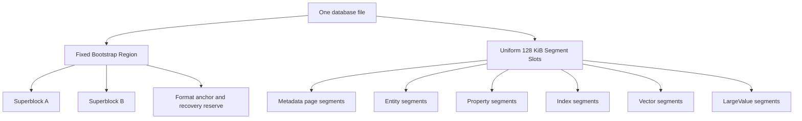
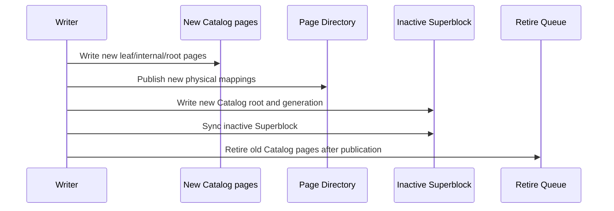
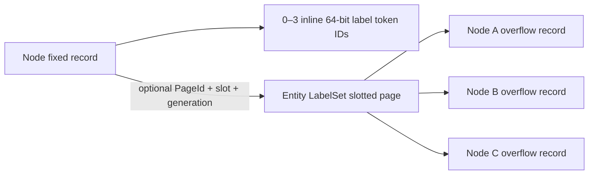

# Native Single-File Storage Specification

> This page retains current single-file rules and explicitly labeled design targets; it is no longer an independent implementation checklist. The [architecture and performance plan](optimization) exclusively owns tasks, admission and progress. Old Stage/P/C ledgers are archived outside the site; their percentages, test counts and not-started claims do not describe the current tree.

Updated: 2026-10-22. Retain COW/A-B publication; do not introduce WAL. Active implementation exclusively follows P0–P7 of [core performance plan](optimization) `core-cost-20261022`. PageId, owner, generation, snapshot, codec, publication, and reclamation invariants remain; amend specific clauses and version affected formats before changing layouts or interfaces, never silently relax reader validation.

Status distinctions: general disjoint writers in Section 2 remain a target; existing bounded blind-patch rebase is not general conflict relaxation. Check actual field-staging and ROW/hybrid capabilities against source and the capability matrix. Dated R-series entries below are historical format evidence, not active tasks or progress. Section 14 key-only adjacency describes the current format, not a permanent constraint on future formats.

Read format values from current `RSS_FORMAT_VERSION`, Superblock and local codec source. These are distinct version spaces; this page does not duplicate stale version numbers.

Validation contract, 2026-10-22: ordinary reads/writes validate CRC, identity, type, generation, route range, and visibility on accessed pages and validate newly modified paths before publication. Reuse untouched subtrees by exact snapshot-bound immutable references. Unrelated commits do not promise detection of fresh corruption in unvisited pages; first access and explicit complete integrity detect it. Complete integrity still rejects duplicates, aliases, orphans, and corruption; atomicity, durability, old snapshots, and reclamation remain unchanged.

2026-10-22 runtime coordination: native handles for one opened-file identity plus database ID share a process-local publication barrier and active-pin registry, retaining local guard/handle ownership and accounts. After a foreign publication, writers invalidate stale control caches and rebuild allocator/retirement proof and metadata ID bounds against the durable root and every registered pin. Own publications advance local source identity; ordinary single-handle commits do not gain global traversals. Open/recovery protects other handles’ old roots. Persistent formats, A/B and data-before-root are unchanged.

## 1. Decision Boundary

### 1.1 Hard constraints

- A database always consists of one database file; data and metadata are not split into separate files.
- Old databases are not opened, migrated online, migrated offline, or compatibility-read.
- Reject incompatible old files explicitly; never automatically delete user databases. Version changes follow the codecs actually changed.
- macOS, Linux, and Windows are required platforms.
- All persisted integers, enums, floating-point values, and references use an explicit little-endian codec; raw C++ struct layouts are never persisted.
- Run necessary affected-module functional tests and relevant fault-recovery tests for format/write changes. No full unit suite or coverage gate in the current scope.

### 1.2 Non-goals

- Do not keep legacy `FileStorage`, legacy `DataManager`, or legacy physical query execution.
- Do not keep migration checkpoints, cutover, legacy backups, or `.migration` sidecars.
- Do not create a domain-specific physical store for code, images, audio, PDFs, or other business payloads.
- Do not maintain isolated, non-interoperable free lists for Catalog, Property, and Vector storage.
- Avoid unbounded interim-format compatibility branches; the format-evolution contract defines versioning and rejection. The old Stage 0 is not an implementation entry.

## 2. Overall Goals

The final architecture must provide all of the following:

- fixed physical segments can be reclaimed and reused across segment kinds;
- Catalog, Page Directory, Allocator, Property, B+Tree, Vector, and LargeValue pages can all be copy-on-written, relocated, and reclaimed;
- updating one Node or Edge does not copy a complete 128 KiB segment;
- a small transaction does not reserve one complete 128 KiB segment for one entity;
- hot reads use validated page views from one shared Buffer Pool;
- database open time is independent of file size and never scans the file to discover Catalog;
- disjoint writers do not fail solely because the global Superblock generation changed;
- large text and binary values can be externalized, chunked, compressed, deduplicated, range-read, and reclaimed;
- B+Tree pages do not pay for a generic entry header or temporary vector materialization on every lookup;
- one Vector mutation does not invalidate the entire PQ/ANN generation;
- every publication recovers as a complete old generation or a complete new generation at every crash point.

## 3. Core Terms and Identity Model

| Concept | Meaning | Can physical location change? |
|---|---|---|
| `EntityId` | Logical business identity of a Node or Edge | No |
| `SegmentId` | Logical identity of a Segment | No |
| `PageId` | Logical identity of a page | No |
| `PhysicalSlot` | Physical 128 KiB Segment slot in the file | Yes |
| `FrameIndex` | 4 KiB page frame inside a Segment | Yes |
| `Generation` | COW version and snapshot safety boundary | Monotonic |
| `LargeValueId` | Logical identity of a generic external value | No |

Persistent references use logical identities. Physical references are used only for Bootstrap roots and the self-bootstrapping path of the Page Directory.

## 4. Single-File Physical Layout

### 4.1 File layout

The database file consists of a fixed Bootstrap Region followed by a uniform Segment Space:



The Bootstrap Region should be one fixed, 128 KiB-aligned region containing:

- format magic and version;
- Superblock A/B;
- database UUID;
- a fixed recovery anchor;
- a small metadata emergency-reserve descriptor;
- reserved fields for future format extensions.

The Bootstrap Region never participates in ordinary Segment allocation. It is a fixed format entry point, not a `SegmentKind`, so the requirement that every ordinary Segment be reclaimable still holds.

### 4.2 Segments and pages

- Every ordinary physical Segment is exactly 128 KiB and file-offset aligned.
- A Segment consists of an explicit envelope and a number of 4 KiB frames.
- The usable frame count is calculated by a layout solver from the envelope, checksum, alignment, and page header; business code must not hard-code it.
- Fixed Entity, B+Tree, Property, Vector, and LargeValue data use 4 KiB pages as the primary COW and cache unit.
- Large contiguous values use multiple frames or Segments inside the fixed physical unit; they never change the global physical Segment size.

### 4.3 SegmentKind and page subtype

Physical allocation is not bound to a future type. The current generation's Segment envelope records `SegmentKind`; the page header records a more specific subtype.

Recommended long-term SegmentKinds:

| SegmentKind | Purpose |
|---|---|
| `SGK_METADATA_PAGE_POOL` | Catalog, Page Directory, Allocator, System Catalog, and Retire Queue pages |
| `SGK_ENTITY_PAGE_POOL` | Mixed Node/Edge fixed pages and Node LabelSet slotted pages |
| `SGK_PROPERTY_PAGE_POOL` | Slotted Property pages |
| `SGK_INDEX_PAGE_POOL` | Packed B+Tree pages |
| `SGK_VECTOR_RAW_POOL` | Raw vector pages |
| `SGK_VECTOR_PQ_POOL` | PQ code pages |
| `SGK_VECTOR_ADJACENCY_POOL` | Vector adjacency pages |
| `SGK_VECTOR_MANIFEST_POOL` | Vector manifest pages |
| `SGK_LARGE_VALUE_DATA_POOL` | Generic LargeValue chunks |
| `SGK_LARGE_VALUE_MANIFEST_POOL` | Generic LargeValue manifests/indexes |
| `SGK_BULK_SCRATCH` | Transaction-private same-file bounded-sort fragments; never graph-visible and reclaimed on writable open if unpublished |
| `SGK_QUERY_SCRATCH` (15) | Opt-in query-private same-file spill extents; separate from bulk scratch, never reachable from public Page/Extent directories |

`SGK_CATALOG` is no longer an unreclaimable dedicated physical pool. Catalog pages use the `MPK_CATALOG` subtype inside `SGK_METADATA_PAGE_POOL`. A metadata Segment may hold multiple metadata page subtypes and, once empty, can be reused for any other SegmentKind.

Ordinary graph adjacency is a built-in Packed B+Tree and therefore uses `SGK_INDEX_PAGE_POOL`. `SGK_VECTOR_ADJACENCY_POOL` is reserved exclusively for ANN graph state; the two structures must not share codecs, owner kinds, roots, or maintenance policies merely because both use the word adjacency.


### 4.4 Query scratch development format

The default build uses Segment envelope version **5** and Superblock version **31**; see 4.5 for the isolated experimental build. Query scratch registers kind **15**; bulk scratch retains kind **14**. This is an incompatible development format change: version 4/30 files are refused without migration or rewriting an older A/B root. The stable-format adoption gate remains open.

`query_scratch_enabled` defaults to `false`. Its opt-in native Sort path uses owner-authenticated private handles, checked version-1 row/run blocks, stable input ordinals and bounded two-way merging. Unsupported rows or orderings remain in memory before the first spill and fail explicitly if encountered after runs are sealed; consumed inputs are never replayed. Physical read-only files cannot allocate, publish or reclaim scratch and cannot use host temporary files as a fallback.

Private extent admission counts each complete 128 KiB physical segment before IO: 128 MiB per session, `maximum_database_query_scratch_bytes` (default 1 GiB) per opened file identity, and 2 GiB per process. Hard-link and symlink aliases share the opened file identity. There are at most 64 domains and 64 active scratch sessions per domain; admission never waits. Resource locks are released before the metadata publication gate. Successful durable release refunds extent bytes; uncertain IO leaves the allowance charged as an orphan until exclusive authenticated writable recovery completes. Corrupt payloads and public-directory references prevent reclamation. Metadata COW extents are separately owned and are not included in this private-extent quota.

Integrity scanning reports sealed private scratch as requiring owner quiescence or writable recovery. A physical read-only open performs no cleanup. Sort, partitioned DISTINCT/UNION, shared budgets, and resource faults were accepted in the previous cycle; aggregate state and hash join still lack general spill. See `benchmarks/architecture-design/decisions/20261016-s53-budget-and-spill-acceptance/`; R6 protects these capabilities during subsequent changes.

### 4.5 Isolated hybrid-property experimental format

`ZYX_EXPERIMENTAL_HYBRID_PROPERTY_FORMAT` defaults OFF. This matrix records default/isolated boundaries. Final R3admission is limited to explicit cost-gated cohorts in the [optimization plan](optimization),without automatic layout switching; `Format.hpp`/`Superblock.hpp` remain the version authority.

| Build | Segment profile/envelope version | Superblock version/header bytes | Property routing |
|---|---:|---:|---|
| Default OFF | 5 | 31/336 | Existing ROW; descriptor physical root must be zero; kind 16 rejected |
| Isolated ON | 9 | 35/352 | ROW and explicit controlled hybrid candidates; only the internal candidate coordinator may publish nonempty roots |

The group-owned locator candidate is frozen at 11/37; current mixed-layout candidate source uses isolated 13/39 and rejects previous experimental 11/37, 9/35, 7/33 and 6/32 files without in-place migration. The builds reject each other's files without migration or reinterpretation of old A/B bytes. Experimental Superblocks add the 16-byte `hybrid_property_descriptor_root` physical reference at offset 336..351. The 32-byte metadata emergency reserve starts at the header end: experimental offset 352, default offset 336. The descriptor is an independently authenticated 4096-byte physical frame in a metadata pool (32-byte header, 192-byte payload, zero tail); it has no routed MetadataPageId and is not an existing logical directory root. Database/physical-root/generation/LSN/CRC and old-pin recovery, integrity and reclamation checks apply. The eighth graph semantic fence includes this root, with different format tokens.

Eight namespace IndexIds `0x8000000000000030`..`0x8000000000000037` are reserved in fixed Node owner/column/extension/group, then Edge owner/column/extension/group order. They are disjoint from schema-definition IDs, global adjacency, System Catalog, Vector mapping prefixes and the LargeValue content index. Ordinary graph scalar upsert/erase/create (both entry points)/drop reject them in every build. Before data preparation, descriptor requests require each nonzero IndexId to match its exact ordinal; another field role or ordinary Index cannot substitute. Final field readers must still authenticate fixed namespace, pinned directory and actual root page/pool epoch rather than trust a frame CRC alone.

Field images use the existing PROPERTY SegmentKind and isolated-build `POK_HYBRID_PROPERTY=16`; retired adjacency owner codes13–15 remain rejected. Standalone allocate/append/replace/evacuate do not gain write authority for this kind. The internal candidate coordinator authenticates actual Entity/ROW/field sources and the exact database/generation/descriptor fence under its writer pin, retaining an account of at most1 MiB. A normal single-group conversion admits at most64 owners/4096 actual memberships. An explicit pure-column cohort may combine up to eight consecutive groups/512 owners under the same account of at most1 MiB, with4096 actual memberships per group and one publication after complete allocation/peak/file admission. A single-group prefix cannot borrow savings from future groups. Preparation-only requests neither publish nor consume durable IDs. Explicit candidate publication reserves every destination before metadata allocation, writes data first, then updates fields/directories/descriptor, Page Directory, Catalog, allocator and exact retire queue in one A/B publication. Public database creation retains format31 ROW. Isolated format35 native transactions can explicitly stage controlled conversion; ordinary reads/writes coordinate existing hybrid layouts under the same semantic fence. There is no automatic conversion or default adoption.

Controlled ROW-to-hybrid conversion may create or reuse authenticated independent field LargeValues. Every new identity's data/manifest frames, Manifest Directory and content index must publish together; duplicate content in one batch receives one identity. The content index retains its existing U64 leaf layout and uses dirty-path COW for an existing tree, without a full rebuild. Pinned routes and page owners authenticate root and child physical epochs separately. A source pool may retire only when all its current pages are replaced/removed; old pins prevent release. Controlled inverse conversion may reuse or create complete ROW carriers. A new carrier's data, manifests, content index and ROW references publish together, retaining existing version-3 owner-neutral wire bytes; PMR encoding matches the original codec. Explicit field lifecycle supports LargeValue SET/REMOVE and controlled owner deletion: authenticate selected content and its single-field token first, then publish new data/manifests/content-index or field/entity removal atomically. No-op uses recursive ROW equality; equal-byte NaNs publish while content deduplication may retain the same identity. Dropping references never directly retires global identities: manifests/content-index remain for exact reachability GC, without inferring global unreachability from a batch difference. Direct bounded GC merges ROW owners and native memberships in stable logical owner order, authenticates references against manifests, and requires complete scans of all registered media. Its private retirement capability binds the exact database, generation, descriptor and erased identities; the writer revalidates it before publishing content-index/manifest/page retirement. Partial scans and concurrent writes cannot authorize deletion. Native immutable data/manifest and reserved content-index pools support typed reconciliation, empty-pool retirement and pin-safe release; general writers and reconciliation remain guarded. Durable native journal GC uses a reserved equal-width `.v2` State identity with the unchanged version-1 payload. Generic State writers cannot create that identity. Plain values may start/reset manifest enumeration; owner progress requires an unmodified private advancement bound to its source database/generation/descriptor. Each resumed non-enumeration step and final retirement must match current persisted protected evidence. Legacy ROW `.v1` evidence is ignored while native groups are active and migrates on reset. Bounded candidate windows authenticate and retain references outside the window. State COW checks all 31 physical positions and all active snapshot routes before reusing unpinned frames; exhausted pinned pools move and retire behind pins. The descriptor and field semantic fence remain unchanged. Canonical inline journal controls may coexist with owner deletion, which advances generation and invalidates their scan; unknown derived State remains guarded. Columns arise only from explicit conversion; subsequent writes do not automatically re-promote extensions. No-op follows recursive ROW type/value equality. See the [optimization plan](optimization) for verified scope and remaining admission.

Normal explicit conversion or controlled field batches target one64-ID group under the existing4096-actual-membership/group and1 MiB work bounds. The dedicated pure-column cohort is the above exception:up to eight groups share that same account and one publication. These are not database lifetime limits. Multiple groups and Node/Edge namespaces share descriptor-bound directories. Adding or removing a group uses private dirty-path COW for existing trees and preserves unrelated prefixes/roots; orphan Index Roots without descriptor bindings still reject. Inverse conversion checks only the selected group and proves that its dedicated field frames contain exactly its authenticated records before removing them. Shared source pools retire only when every current frame is superseded; other routed frames keep the pool alive. A bounded exact census permits direct whole-tree retirement when the selected prefixes exhaust that directory. Inverse conversion clears the descriptor only after all namespaces disappear. Schema/derived-state coordination must preserve existing rejection guards; final production performance admission is recorded in the [optimization plan](optimization).

Controlled Node deletion also authenticates inline/overflow labels and coalesces removals from shared LabelSet pages, preserving other Nodes’ stable slots. LabelSet, fixed Node, Entity Map and native fields publish atomically; empty label pages lose their current routes, and complete detached Entity pools release only after pins drain. Schema/derived-State and general topology coordination remain guarded.

Final reads reuse at most two authenticated groups and an optional original-account column window under the same pin/I/O epoch. Only full owners containing every group column and no extension directory use one bounded column-directory walk;one authenticated field-page holder is retained and scalar bits are copied before callbacks. Mixed/sparse owners keep their original authentication;physical integrity bypasses retained caches. Membership eligibility always checks identity,tokens,live and unused bits:48complete owners prove every column eligible,otherwise exact per-column validation remains. Field writes reuse only the same source-pin authenticated descriptor/reader,without new authority or wire bytes. Budget,cancellation,pin and atomic-publication rules stay. See the [optimization plan](optimization) for process distributions,SET tail limits and Kuzu gaps.

## 5. Bootstrap, Roots, and Page Directory

### 5.1 Superblock roots

A/B Superblocks are the only publication root. In the current v4 staged format, each Superblock records:

- `format_version`;
- `generation`;
- `committed_file_end`;
- `allocator_root_physical_ref`;
- `page_directory_root_physical_ref`;
- `catalog_root_physical_ref`;
- other typed metadata-directory physical roots;
- `index_root_directory_root_physical_ref`;
- `retire_queue_root_physical_ref`;
- logical-ID high-water marks;
- checksum.

The Superblock does not store a whole directory and does not move as a directory grows. It stores only a fixed number of root references. In the current staged format, every metadata directory uses a physical bootstrap reference; this is the temporary Stage 3 representation, not evidence that ordinary metadata pages already have stable metadata PageIds. Stage 4 introduces the stable metadata PageId directory: except for the Page Directory bootstrap root needed to break the self-bootstrap cycle, the other metadata roots then migrate to logical references and support page-local relocation.

### 5.2 Page Directory

The Page Directory represents:

```text
PageId -> PhysicalSlot + FrameIndex + Generation + page metadata
```

It is a COW radix/tree. The Superblock stores the Page Directory root as a physical reference, breaking the self-bootstrap cycle. Other metadata roots in the current staged format are also physical references; once the stable metadata PageId directory is complete, this will converge to only that bootstrap root requiring direct physical addressing.

The final bootstrap is one typed physical header, not a generic resolver. Its data branch maps `PageId` to data-page
locations, while its metadata branch maps only `MetadataPageId` to `PhysicalPageRef`. Both branches, their COW pages,
and the header remain physically linked so a lookup never needs to resolve the directory that performs the lookup.
Every non-bootstrap metadata writer obtains an ID/reference pair from one `MetadataWriteBatch`, records that pair in
the metadata branch, makes all candidate bytes durable, and then publishes the one A/B Superblock generation. A
resolver accepts `MetadataPageId` only; it validates the branch type, route identity, reference generation, visibility
fence, and target page identity before exposing bytes. The bootstrap header and bootstrap-branch frames are internal
physical plumbing, never values accepted by that resolver. This keeps equal numeric `PageId` and `MetadataPageId`
values independent and prevents either a recursive route or a data-directory entry from being interpreted as metadata.

2026-10-15 decoded metadata read contract: cached views are immutable, and their codecs check strict ID ordering before admission. Since `(id - 1) / leaf_capacity` is monotonic for valid IDs, checking both endpoints proves that every entry belongs to the selected leaf ordinal. This shortcut applies only to decoded read views; mutable COW validation retains its complete entry scan. Point and batched metadata-route lookups validate the leaf ID range before returning a hit, so a matching prefix cannot hide a misrouted later entry. This strengthens the earlier point lookup's detection of a corrupt tail; valid lookup results and wire formats do not change. CRC, generation, visibility, directory type, selected physical-reference checks and IO-epoch invalidation remain required.

2026-10-17 Catalog point-lookup scope: required and optional lookups authenticate each visited codec page in full, then resolve only the requested logical child. Directory type, PageId route, generation, LSN visibility and leaf ordinal checks remain required. A point lookup does not guarantee detection of missing routes in unvisited branches; full traversal and integrity scans check those global inconsistencies. Mutable COW preparation and full traversal retain complete child resolution. Wire formats and publication protocols are unchanged.

Before migration begins, recovery and evacuation must validate that every currently reachable metadata radix, internal, and leaf
page in one Superblock has a non-empty, globally unique logical `PageId`. Duplicate or invalid identities must fail closed before
publication; assigning a fresh ID must never mask corruption.

In the staged format, metadata-pool evacuation must also preserve each copied page's logical `PageId`, changing only its physical
frame, generation, and committed LSN. Older snapshots continue to read that identity through their old physical roots while the new
Superblock reads it through the replacement roots. Other metadata COW writers must not remove the existing physical-root protocol until
the stable directory migration is complete.

All ordinary objects hold PageIds. Relocating a Catalog, Property, B+Tree, Vector, or LargeValue page updates only the relevant Page Directory leaf and its COW path; the logical PageId remains unchanged.

### 5.3 Catalog

The logical Catalog contents are:

```text
SegmentId -> SegmentDescriptor
```

Each SegmentDescriptor contains at least:

- current physical slot;
- owner or pool identifier;
- generation;
- frame summary;
- kind/state/flags.

`SegmentId` may be derived from radix leaf ordinal and entry position and should not be duplicated in every entry. Retired physical slots belong in the Retire Queue rather than ordinary Catalog entries.

## 6. Single-File Allocator and Catalog Reclamation

### 6.1 Independent AllocatorRoot

The Allocator cannot use Catalog as its only authority, or allocation becomes circular:


The Superblock therefore points directly to an independent `AllocatorRoot`. The AllocatorRoot is a COW tree managing:

- free Segment runs;
- free metadata frames;
- allocated slots;
- current reservations;
- retired extents;
- committed file end;
- free-space summaries.

### 6.2 Reservations

A writer reserves physical frames/Segments from the old AllocatorRoot:

1. A process-local reservation manager locks candidate positions.
2. The writer writes new Catalog, Page Directory, Allocator, and business pages.
3. The new AllocatorRoot marks the reservations allocated.
4. If the transaction fails, the old AllocatorRoot still sees unpublished reservations as free.
5. A successful Superblock publication makes the new AllocatorRoot visible.

Near ENOSPC, a rotatable metadata emergency reserve is required so a reclaim/publication transaction can still finish. It is not a permanently pinned physical Segment and can be reclaimed after rotation. Once it supplies a published COW frame, it may temporarily be root-reachable while its descriptor remains the authoritative bootstrap identity. The checksummed Metadata Pool header records an `EMERGENCY_RESERVE_ORIGIN` format flag, so recovery accepts only a consumed reserve with that origin and rejects a forged ordinary-pool alias. Rotation then publishes a fresh tail reserve and promotes the former reserve to normal Catalog ownership in the same generation. A successor normally appends at the physical tail. After a failed or force-killed unpublished rotation, it may instead overwrite only the final complete physical slot when the recovered AllocatorRoot marks that exact slot free. It must never infer reachability from file length, overwrite an allocated/root-reachable slot, or reuse a slot with later physical data. This closes the otherwise permanent one-slot hole created by an interrupted candidate without weakening COW publication.

The same rule applies to every normal Metadata Pool allocation, not only reserve rotation. A `MetadataWriteBatch` carries its current published Superblock through the metadata-page allocator lifetime. Before creating a new pool, the allocator may reuse only a final physical slot that is absent from its registered reachable pools, is not reserved by the same batch for data, and is explicitly free in that batch's current AllocatorRoot. A partial candidate byte sequence or a zero-filled reservation alone is never authority to overwrite a slot. This makes a fresh reopen after an interrupted ordinary pool creation safe to retry without turning the skipped suffix into a permanent hole.

### 6.3 Catalog-page reclamation

Catalog updates use COW:



An old page may enter free space only when all of the following hold:

- it is unreachable from the current roots;
- no active snapshot can reach it from an older root;
- its retire generation is below the oldest active snapshot generation;
- the new AllocatorRoot durably records the physical location as reusable.

### 6.4 Segment reclamation and evacuation

If every frame in a metadata Segment is retired:

```text
metadata Segment -> Retire Queue -> Free Segment Tree
```

If only a few live pages remain:

1. Calculate live-frame density.
2. Start a Metadata Evacuator below the density threshold.
3. Copy live pages to new metadata frames.
4. Keep PageIds stable and update only Page Directory locations.
5. Publish the new directory roots with COW.
6. Free the old Segment after snapshot safety.

The released PhysicalSlot has no Catalog restriction and can become a Property, Vector, Index, Entity, or LargeValue Segment.

## 7. Durability and Publication

The current production path does not use Metadata WAL. Published visible pages are protected by fresh-page COW, and A/B Superblocks provide the single-file atomic publication point. Transitional WAL is retired; the subsequent plan retains COW without reintroducing WAL.

The final commit sequence is:

1. Write new business data pages/Segments.
2. Write new metadata pages.
3. Sync file data.
4. Write the inactive Superblock.
5. Sync the Superblock.
6. Retire the old generation and reclaim it after snapshot safety.

No page still reachable from an old Superblock or snapshot may be overwritten before publication.

After a crash, only a complete old generation or a complete new generation may be visible. New pages not reachable from the valid Superblock may become reclaimable space leaks, but never logical corruption.

## 8. Buffer Pool

Create one raw-page Buffer Pool shared by every storage subsystem:

- Metadata;
- Catalog/Page Directory;
- Entity;
- Property;
- B+Tree;
- Vector;
- LargeValue.

The Buffer Pool must provide:

- pin/unpin;
- generation-aware keys;
- dirty/private COW pages;
- 2Q or CLOCK-Pro eviction;
- sequential-scan isolation;
- sibling/page prefetch;
- validate once and cache a validated page view;
- byte-based capacity accounting;
- consistent read/write/flush behavior on Windows, macOS, and Linux.

`cache_size` must connect to this Buffer Pool and is measured in bytes (64 MiB by default, with one 4 KiB page as the minimum). Typed-store construction must not trigger a full reconciliation or implicit disk scan; recovery/reconciliation is owned by one database-open coordinator.

## 9. Fixed Entity Rework

### 9.1 Page layout

Nodes and Edges use 4 KiB fixed-entity pages:


The 128 KiB Segment is a page container, not the COW unit for one entity.

### 9.2 Entity Map

EntityId no longer determines a physical slot. A specialized Entity Map stores:

```text
EntityId -> PageId + slot + optional slot generation
```

Segment generation is supplied by the Catalog/Page Directory of the same snapshot and is not duplicated in every entity entry.

After deletion, a slot can be reused by any new EntityId. Full scans iterate entity pages and bitmaps rather than walking a wide Location Directory one entity at a time.

### 9.3 Node/Edge records

Fixed Node/Edge records remove:

- Property ID;
- Property storage type;
- fields that exist only for Property-ID reservation;
- duplicated logical IDs when a page-local ID array is sufficient.

Node labels use three inline 64-bit Token IDs plus one optional single-page `EntityLabelSet` record. The historical six-label limit is removed. Three inline slots and the 64-bit Token-ID width are explicit format design constants; single-page overflow capacity is a derived result that stores, tests, and documentation never copy as a number.

An Edge record ultimately stores source NodeId, target NodeId, relationship-type Token ID, and necessary state. It is the only authoritative copy of those fields. Node records contain no incoming/outgoing adjacency roots, and Edge records contain no adjacency-list links. Ordinary graph adjacency is a separately maintained built-in Packed B+Tree.

### 9.4 Node-label layout

A fixed Node record stores:

- `inline_label_count`, ranging from zero through three;
- three 64-bit `inline_label_ids`;
- an optional `label_overflow = PageId + slot_id + slot_generation`.

The complete label set consists of nonzero, strictly increasing, unique schema-token IDs. A set of zero through three labels is entirely inline and its overflow reference must be empty. A set of four or more labels keeps the first three Token IDs from the canonical sequence in the fixed record and stores every remaining Token ID, in the same order, in one `EntityLabelSet` record. The fixed record does not duplicate the total count; the overflow-record header stores its own element count.



One 4 KiB LabelSet slotted page stores overflow records for multiple Nodes; a Node must not own a dedicated page. Each overflow record belongs to exactly one Node and is not deduplicated across Nodes. A record does not repeat its NodeId because the stable reference in the fixed Node record is the sole ownership edge. LabelSet pages use the `POK_ENTITY_LABEL` subtype, while Node/Edge fixed pages use `POK_ENTITY`. Both page kinds may share one `SGK_ENTITY_PAGE_POOL`; the design adds neither a dedicated 128 KiB Label Segment nor a dependency on `SGK_PROPERTY_PAGE_POOL`.

### 9.5 Single-page capacity and explicit limit

LabelSet records use an explicit little-endian array of 64-bit Token IDs. They do not use compression, variable-length integers, or a chunk chain. The eight-byte Token-ID width is a base field width in the current format, and the Node record, Schema Token Registry, LabelSet codec, and Label Index keep it consistent.

The capacity of one overflow record is derived from `RSS_PAGE_OWNER_MAX_PAYLOAD_BYTES`, `RSS_SLOTTED_PAGE_HEADER_BYTES`, the 16-byte `RSS_SLOTTED_PAGE_SLOT_BYTES`, `RSS_ENTITY_LABEL_SET_HEADER_BYTES`, record alignment, and `sizeof(uint64_t)`. The normative test is whether the complete encoded LabelSet record fits in one empty typed slotted page. Implementations preflight through one shared encoded-size/capacity solver rather than comparing a handwritten label count.

`RSS_ENTITY_LABEL_SET_MAX_OVERFLOW_LABELS` is the solver result, and `RSS_ENTITY_MAX_LABELS` is the sum of the three inline slots and overflow capacity. The rule applies only to a result computed by composing layout constants, such as an implementation-specific maximum label count: it must not be copied into persisted data, control flow, tests, or documentation as an independent numeric contract. Diagnostic tools may display it, but they obtain it from the shared solver.

In contrast, stable format facts remain explicit. A 64-bit Token ID, a 16-byte slot entry, the three inline slots, and the page size define the on-disk codec and must be documented and tested as such. When a base layout constant changes, update its single code definition and the format version according to persistence-compatibility rules; codecs, allocators, and tests then follow the same solver for every derived limit.

The largest encodable overflow must succeed. `RSS_ENTITY_LABEL_SET_MAX_OVERFLOW_LABELS + 1` must return an explicit capacity error before page allocation, candidate-frame writes, or metadata publication. The current design neither reserves nor implements multi-record, multi-page, or chunked LabelSets.

### 9.6 Placement, updates, and space reuse

LabelSet placement uses a best-fit free-space index isolated by `PageOwnerKind`. Each index entry tracks at least contiguous free bytes, reclaimable bytes, and reusable dead-slot count. Insertion costs the record bytes and adds the 16-byte `RSS_SLOTTED_PAGE_SLOT_BYTES` only when no dead slot is reusable; this avoids a conservative estimate skipping a page that can accept the record. Selection proceeds as follows:

1. Prefer the smallest free region in an existing `POK_ENTITY_LABEL` page that fits `record bytes + slot entry`.
2. If total free space is sufficient but fragmented, compact a candidate COW image and retry.
3. If no current page fits, append a LabelSet page to a free frame in an existing `SGK_ENTITY_PAGE_POOL`.
4. Allocate another Entity-pool Segment only when every matching Entity pool lacks a free frame.

The free-space index must filter by page subtype and must never open a fixed Node/Edge page in the same Entity Segment as a slotted page. A placement hint is not write authority: under the pinned generation, the metadata writer revalidates the Page Directory, Catalog, owner kind, owner LSN, and available COW frame.

Updating a current LabelSet page always writes a new COW frame. The candidate frame may come from the source Segment or another `SGK_ENTITY_PAGE_POOL` in the same owner domain. The latter keeps the original `PageId` and switches only its Page Directory location. A full source pool must not reject an otherwise feasible label update.

A label update first attempts to remain in its current page. A shorter record reuses its existing capacity. Growth tries adjacent free space, a page-local payload move, and compaction in that order while preserving `PageId + slot_id + slot_generation`. Payload offsets exist only in slot entries, so an in-page move does not rewrite the Node record. If the record still does not fit, the transaction creates a slot in another LabelSet page, switches the Node overflow reference, and erases the old slot atomically. Reducing a set to three or fewer labels clears the overflow reference and erases the old slot.

Deletion puts a slot into the dead state, and reuse increments its generation, making stale caches and references fail closed. A smaller new record may use a released slot, and compaction coalesces page-local fragments so the previous record size does not become a permanent hole. An empty LabelSet page enters snapshot-safe retirement. Once every frame in an Entity Segment is unreachable, ordinary Segment evacuation/reclamation can release its physical slot for cross-SegmentKind reuse.

### 9.7 Atomicity, reads, and index consistency

One label mutation publishes the fixed Node page, LabelSet page, Page Directory, and Label Index delta through one metadata transaction and one Superblock generation. Publishing an overflow page before the Node that references it is forbidden, as is erasing the old slot before switching the Node reference. A pre-commit failure leaves no reachable orphan; after commit, an older snapshot continues to read the old Node and LabelSet frames through its old Page Directory root.

A read adds at most one 4 KiB page lookup: it first resolves the fixed Node record through the Entity Map; when the overflow reference is nonempty, it resolves the LabelSet page through the Page Directory and Buffer Pool, then validates `POK_ENTITY_LABEL`, page generation, slot generation, record checksum, canonical ordering, and the capacity bound. Buffer Pool keys use logical PageId and snapshot generation. Relocating a LabelSet page changes only the Page Directory and never rewrites the Node reference.

The integrity scanner cross-validates that every nonempty Node overflow reference resolves to exactly one live LabelSet slot, every live LabelSet slot is referenced by exactly one Node, no two Nodes share a slot, an empty reference carries no partial PageId/slot/generation, and the Label Index token set for that Node exactly equals the canonical union of inline and overflow labels. A mutation computes Label Index add/remove deltas directly from the old and new canonical sets and never scans the complete Label Index.

## 10. Property Store

> Current native writes support per-key set/remove and final-state folding. Large ROW owner collections can still be re-encoded as a whole, so this does not guarantee unrelated large bytes avoid rewrite. Section 10.2 retains target representations. The admitted production ROW placement policy is specified in 10.4; MIXED/column-group authority remains rejected until its separate native lifecycle and format gates pass.

### 10.1 Property identity

Property identity is:

```text
(EntityKind, EntityId) -> PropertyRoot
```

Absence means no Property Directory entry. There is no independent PropertyId reservation, and Node/Edge records do not contain a Property reference.

### 10.2 Multi-level Property representation

| Size | Representation | Goal |
|---|---|---|
| Very small | Inline Property value | Avoid another page read |
| Small/medium | Slotted Property page | Bounded per-entity updates |
| Large collection | Per-key records or a small Property tree | Avoid copying the entire collection for one key |
| Large value | `LargeValueRef` | Chunking, compression, and range reads |

Updating one key must not copy the complete Property collection. Slotted pages need capacity reclaim, hysteresis, and page-pressure compaction.

### 10.3 Property Directory cache

Placement caches must not be globally invalidated by every database generation. Use per-pool/per-shard versions, a persistent free-space class index, and incremental updates.

### 10.4 Admitted production ROW placement

The native backend defaults `adaptive_property_row_chunks` to true for newly materialized owner collections. `PropertyRowChunkPolicy` retains canonical sorted token/value bytes and the owner-keyed Property Directory as the sole authority. Eligible RAW roots use bounded logical cuts after a large entry's token/value header and after its body, keeping adjacent small fields together. The general page-cost rule requires smaller first-use chunks and at most 5% additional estimated data/Manifest/directory/catalog allocation. At most 2048 fields and 4096 cut points participate. Compressed, small, over-wide or non-admitted roots retain ordinary ROW placement; no fields are discarded.

Existing referenced values and content dedup hits keep their immutable layout. There is no automatic repacking, extra canonical copy or new persistent group/token namespace. Generic streamed/bulk callers may retain uniform extents; the reader accepts both explicit-offset layouts. Chunk cuts are transient writer policy, not a serialized codec flag. Snapshot authentication, actual-key enumeration, derived-index maintenance, COW publication and reachability retirement are unchanged. Full owner replacement can still write large unrelated bytes; O3/O5 and steady-state acceptance remain pending.

## 11. Generic LargeValue

Code, images, JSON, PDFs, audio/video, and model files use one `LargeValueStore`; no `CodeObjectStore` or `ImageStore` is created.

Recommended abstraction:

```text
Value
    -> InlineValue
    -> LargeValueRef

LargeValueStore
    -> LargeValueManifest
    -> LargeValueChunk/Extent
```

`LargeValueRef` stores:

- logical object ID;
- generation;
- uncompressed size;
- content hash;
- text/bytes kind;
- a nonempty printable-ASCII media type bounded by the format policy;
- codec;
- checksum information.

`LargeValueRef::generation` and `LargeValueManifest::generation` are immutable
logical generations. They identify the value content and do not change merely
because a compactor copies a physical frame. `PageLocation::generation`,
`PageOwnerHeader::generation`, and `LargeValueManifestLocation::generation`
instead identify the current physical pool/frame generation. The two domains
must not be compared as though they represented one version number.

### 11.1 Cypher and Driver ABI

Ordinary Cypher keeps property assignment semantics:

```cypher
CREATE (f:CodeFile {
    path: $path,
    content: $content,
    content_type: "text/x-c++src"
})
```

Small values are stored inline and large values are automatically externalized. Binary data uses a generic bytes parameter; the storage layer does not add `Code`, `Image`, or other domain-specific ValueKinds.

Very large values use generic Driver ABI streaming operations:

- begin external value;
- write chunk;
- finish/abort;
- read range;
- read stream.

The current ABI exposes a bounded pull stream for result bytes and value
references. A caller supplies an `(offset, length)` range and repeatedly reads
into an application-owned buffer; the stream returns `ZYX_DRIVER_DONE` only
after that range is exhausted. The stream owns an immutable byte snapshot, so
the source result may be closed after the stream is opened. This bounds each
ABI copy, while the native LargeValue range reader remains responsible for
chunk-level I/O and decompression.

`DriverAbiBytesTest.StreamsPersistedLargeValueRangesAfterReopenAndResultRelease`
is the native end-to-end acceptance checkpoint for this boundary: it persists
an over-inline binary Property, closes and reopens the single database file,
opens a strict subrange stream, releases its source result, and verifies the
entire subsequent pull is byte-exact. This proves the persisted `LargeValueRef`
route rather than only an in-memory parameter echo; performance, fault-injection,
binding-adapter, and three-platform gates remain open.

LargeValue creation and the Property reference must be published in one transaction.

### 11.2 Chunking and compression

- Uniform generic extents retain their configured 16/32/64/128 KiB classes. Manifests record explicit contiguous offsets and lengths; final or requested boundary chunks may be smaller. Native Property ROW roots use the admitted bounded policy in 10.4. Tune comparative latency/resource choices only at the final performance gate.
- Usually do not compress very small values.
- Prefer LZ4 or Zstd for code, JSON, SQL, and logs.
- Keep already-compressed PNG, JPEG, ZIP, and similar formats raw by default.
- Store a checksum and codec per chunk.
- Range reads decompress only the required chunks.
- Compute `content_hash` from uncompressed bytes for deduplication.
- Use `normalized_hash` for code-similarity analysis only, never as the physical identity.

### 11.3 Code-analysis data model

Store a source file once whenever possible:

| Entity | Main fields |
|---|---|
| `CodeFile` | path, language, commit, content hash, LargeValueRef, line-index ref |
| AST/Function Node | file ID, start byte, end byte, line range, symbol metadata |
| Independent CodeSnippet | LargeValueRef, language, content hash, normalization metadata |

AST nodes should refer to source ranges instead of copying complete source text.

### 11.4 Reclamation

LargeValue uses immutable objects:

```text
new chunks -> new PropertyRoot -> Superblock publication
-> old object enters Retire Queue
-> snapshot-safe reachability reclaim
```

When multiple entities share one content hash, reachability or reference information must prove that the final reference is gone before reclaiming the object.

### 11.5 Relocation and snapshot safety

LargeValue uses stable `PageId` values rather than physical pointers. A data
page move publishes only its replacement Page Directory location. A manifest
page move publishes its replacement Page Directory location and the matching
`LargeValueManifestLocation` route in one COW/Superblock publication. Both
moves write a physical owner with the destination pool generation while keeping
the logical `LargeValueRef` and manifest generation unchanged.

An old snapshot therefore resolves the old directory roots and reads the old
frames; a newer snapshot resolves the new route and frame. The source pool is
retired after its last current page moves, but its physical slot is released
only after all snapshots that may still resolve the old roots have drained.

## 12. Packed B+Tree

B+Tree uses a specialized packed page codec:

- separate leaf and internal page layouts;
- packed offset arrays;
- canonical on-disk key order;
- prefix compression and restart points;
- binary search on a raw page view;
- range cursors without materializing a full entry vector;
- decode the EntityId suffix from a scalar composite key instead of storing it again as a value.

Property-index ordering remains:

```text
(PropertyValue, EntityId)
```

EntityId supplies stable ordering for duplicate property values and unique positioning. What must be removed is physical duplicate encoding and the wide generic entry header.

Bulk builders and online mutation share the same page invariant, separator, split/merge, and corruption checks.

The implementation supports named key codecs and comparators rather than embedding Property-index assumptions into the tree. The ordinary graph adjacency specialization uses fixed logical fields `(direction, NodeId, EdgeId)` and an empty value. Its comparator orders the fields by direction, unsigned NodeId, then unsigned EdgeId; the disk codec still writes every integer through the explicit format codec. Capacity, fan-out, restart interval, separator size, and entries per page are always derived from encoded bytes and the shared page-layout solver.

Every tree has a stable logical `IndexId`; the COW root PageId and root generation are stored in the Index Root Directory. The ordinary adjacency tree owns one reserved built-in `IndexId` that can never collide with user-created indexes. This keeps the Superblock fixed-size: it publishes the Index Root Directory root, while that snapshot's directory identifies the adjacency root. Empty-tree state is represented by an absent adjacency root entry, not by a permanent empty page.

## 13. Canonical System Catalog

Remove the sealed/dynamic dual system and create one canonical mutable System Catalog:

```text
(property-key, name)       -> token
(property-token, token)    -> name
(schema-name, kind, name)  -> schema token
(schema-token, kind, token)-> definition
(index-id, id)             -> definition
(index-name, name)         -> id
(index-schema, signature)  -> id
(constraint-id, id)        -> definition
(constraint-name, name)    -> id
(sequence, kind)           -> high-water mark
```

Forward, reverse, and secondary entries are atomically updated in one metadata transaction. Do not retain an artificial high-bit dynamic-ID namespace or a sealed tombstone registry.

### 13.0 Graph cardinality statistics

The System Catalog also owns one snapshot-pinned pair of logical Node/Edge cardinalities. Persisted values use a nonzero
encoding so an empty graph remains distinguishable from an invalid B+Tree leaf value; a missing pair means statistics are
unavailable for a legacy file, while a one-sided pair fails closed. Ordinary graph mutations and the final streamed bulk
Edge publication update the pair in the same A/B generation as their Catalog, adjacency, and Entity state. The bulk path
increments the Edge count only when a complete pair already exists; it never derives legacy cardinality from logical-ID
high-water marks.

### 13.1 Schema Token names and IDs

Label and relationship-type names exist only in the canonical System Catalog and are never written into Nodes, Edges, LabelSets, or Label Indexes. The System Catalog maintains two logical directions: name plus kind to `SchemaTokenId`, and kind plus `SchemaTokenId` to a definition containing the canonical name. The forward index serves query binding; the reverse definition serves name rendering, catalog integrity checks, and administration. Execution carries only Token IDs.

A name is a UTF-8 byte string bounded by one shared System Catalog name-limit format constant. That bound simultaneously satisfies the public API policy, definition-record capacity, forward-key capacity, reverse-definition capacity, and target B+Tree fan-out. Cypher, the Driver ABI, System Catalog codecs, and lookup APIs share it. Neither the theoretical range of a persisted length field nor the largest entry that barely fits in an empty page becomes the public name limit.

`SchemaTokenId` uses an explicit 64-bit little-endian wire field. The shared name limit and related key/record overhead use their own format constants. Any B+Tree-entry or page capacity derived from them is consumed only through the shared solver and is never copied as a result number into documentation or callers. Unknown definition versions and inputs beyond the unified name bound fail closed.

The canonical definition owns the authoritative name. A forward B+Tree still stores a comparable name key for collision-free lookup. This bounded duplication occurs once per unique schema token and is deliberate; leaf prefix compression, internal separator truncation, and the dictionary cache control its cost. Names are never duplicated into each entity or Label Index entry.

## 14. Graph Adjacency

> The following key-only/empty-payload/single-tree clauses describe current files. R5 supersedes permanent future-policy restrictions: covering trees and segmented derived adjacency may be compared after specifying consistency, corruption handling, snapshots, atomic maintenance and reclamation. Derived payload is not inherently a second authority. Retain existing primary-record rechecks until a replacement protocol passes acceptance.

Ordinary graph adjacency and Vector ANN adjacency are independent data structures. Ordinary graph adjacency is one global built-in Packed B+Tree; Vector adjacency retains the Vector-specific design in Section 15.

### 14.0 Normative implementation boundary

The ordinary-graph implementation has exactly one durable adjacency representation: the reserved global, key-only Packed B+Tree. This is a format invariant, not a planner preference. Readers/writers of the current format must preserve the following; future formats follow R5 and the format contract:

- the format-reserved `RSS_GLOBAL_ADJACENCY_INDEX_ID` is the only ordinary-graph adjacency `IndexId`; it resolves the one adjacency root from the snapshot-pinned Index Root Directory and is never allocatable to a user or secondary index;
- Node records own no adjacency root or adjacency key, and Edge records own no neighbor link, physical page location, or duplicated adjacency payload;
- each live Edge owns exactly one `ADJ_OUT` key and one `ADJ_IN` key, committed and removed in the same metadata generation as the authoritative Edge change;
- B+Tree pages contain only routing/separator data or key-only adjacency entries, never mixed Node or Edge records;
- a relocation changes only the Page Directory route for a logical `PageId`; it never rewrites an Edge, a Node, a cursor continuation, or a parent child reference.

Per-Node chains, per-Node roots, Base/Delta/Tombstone tiers, adjacency tail pages, and an Edge-to-Edge linked list are retired designs. Do not revive their old implementations as fallbacks or compatibility readers. A new segmented design does not restore old code. R5 experiments and the format-evolution contract determine replacement versus additional access paths, including codec, root, publication, reclamation, integrity and admission.

### 14.0.1 Structural decision record

"Global Packed B+Tree" describes only the ordinary-graph adjacency access path. It neither co-locates Node and Edge records in B+Tree pages nor makes an Edge record a B+Tree leaf value. The following record current-format choices, subject to future admission under R5 and the format contract:

| Option | Decision | Reason |
|---|---|---|
| One global key-only tree | Adopt | Low-degree Nodes share leaves and supernodes stream through sequential leaves; there is one root, codec, publication path, and retirement lifecycle. |
| Separate outgoing and incoming trees | Reject | The `direction` prefix already supplies two ordered access ranges. Splitting the tree only multiplies root-directory, COW, and reclamation state; it cannot remove the two keys required by one Edge mutation. |
| Per-Node root or per-Node B+Tree | Reject | It recreates permanently sparse roots/tail pages, more root publications, and supernode-specific structures; low-degree Nodes cannot share encoded key space. |
| Edge doubly linked list or Edge chain | Reject | Insertion and deletion rewrite Node heads and neighboring Edges, expanding the transactional write set and coupling relocation, snapshots, and integrity to physical relationship links. |
| Embed Edge records or a covering Edge payload in adjacency leaves | Reject | The current protocol lacks independently trusted covering reads: payload still requires primary rechecks and adds writes. R5 reopens the derived-covering protocol; replicated index fields are not inherently a second authority. |

Consequently, a B+Tree leaf can contain **adjacency key ranges** for several Nodes, but never those Nodes' or Edges' entity records. An expansion streams `EdgeId` values first and resolves a record from the Edge Entity Store in the same snapshot only when the query actually needs its endpoint, type, state, or Properties. This deliberate two-stage read separates sequential adjacency scanning from entity materialization and prevents unnecessary Edge fields from occupying every index entry.

### 14.1 Authoritative data and key schema

The Edge Entity Store is authoritative:

```text
EdgeId -> sourceNodeId + targetNodeId + relationshipTypeId + state
```

The adjacency tree is a secondary access path with the logical schema:

```text
(direction, NodeId, EdgeId) -> empty
```

There is one tree and one root, not one tree per direction or per Node. `direction` is the first key component so that the outgoing and incoming access paths are disjoint ordered ranges in the same tree. This preserves one uniform codec, one publication boundary, and one reclamation lifecycle without creating a permanently sparse root hierarchy.

For every live directed Edge, it contains exactly two entries:

```text
(ADJ_OUT, sourceNodeId, EdgeId) -> empty
(ADJ_IN,  targetNodeId, EdgeId) -> empty
```

`AdjacencyDirection` is a persisted prefixed enum; unknown values fail closed on every platform. NodeId and EdgeId are positive 64-bit logical IDs. The routing NodeId is necessarily part of the key, but the empty value is normative: the tree stores neither the other endpoint nor relationship type/state as an Edge payload. Current-format writers must not add a covering value. R5 and the format contract may define a new version or separately identified derived access path, with explicit lifecycle and no silent reinterpretation of this key.

The comparator defines canonical ordering by `direction`, unsigned `NodeId`, then unsigned `EdgeId`. Entries for one `(direction, NodeId)` therefore form one contiguous range and are deterministically ordered. Prefix compression removes the repeated direction/NodeId bytes within such a range. Multiple low-degree Nodes share each leaf; no Node or direction owns a 4 KiB tail page. A supernode spans as many consecutive leaves as required without a per-Node size limit.

The physical boundary is strict. Entity pages contain fixed Node and Edge records; adjacency leaves contain only sorted keys and an empty value; adjacency internal pages contain only separators and logical child PageIds. A B+Tree leaf may therefore contain ranges for many Nodes, but it never contains their Node records or Edge records. This is the packed-layout property, not a decision to place graph entities into the B+Tree.

### 14.2 Root ownership and physical placement

The global tree uses the reserved built-in adjacency `IndexId` in the Index Root Directory. A snapshot resolves:

```text
Superblock -> Index Root Directory -> adjacency IndexId -> B+Tree root PageId + root generation
```

The root entry and every B+Tree page are part of the same metadata generation. Adjacency leaf and internal pages use the ordinary Packed B+Tree codec, `SGK_INDEX_PAGE_POOL`, and adjacency-specific owner identity. They never share a page with Node records, Edge records, or Vector adjacency. Page relocation keeps the logical PageId and changes only the Page Directory route; tree references and Edge records are not rewritten.

An empty graph has no adjacency root entry. The first Edge transaction creates the initial tree and publishes its root entry. Removing the final Edge atomically removes the root entry from the new generation; old snapshots retain the old root, and its physical pages are released only after snapshot safety. No per-Node Root page, Root write-tail hint, Base/Delta chain, Tombstone, merge threshold, merge debt, or recovery cursor exists in the final ordinary-graph format.

### 14.3 Read path and cursor contract

Outgoing and incoming expansion perform a lower-bound seek to the first key for `(direction, NodeId)`, then advance until that prefix changes. The complexity is `O(log E + degree)` comparisons and proportional output work. Root and internal pages use normal Buffer Pool admission. Leaves consumed by a range scan use sequential admission; the cursor prefetches bounded right siblings without pinning an unbounded route.

The cursor reads compressed keys directly from a validated page view. It retains only the current leaf pin, restart/search state, prefix bounds, and a logical continuation key; it must not materialize a complete leaf or a complete adjacency range. Continuation is `(snapshot generation, direction, NodeId, last EdgeId)` and resumes strictly after `last EdgeId`. It never exposes PageId, slot, or physical offset. A stale or foreign continuation fails closed or restarts from its logical lower bound according to the public cursor contract.

An adjacency-only operation such as degree/count may count entries without reading Edge records. Traversals that return Edge fields resolve each EdgeId through the snapshot-pinned Edge Entity Map and validate that the Edge is live and its endpoint matches the scanned prefix. Relationship-type filtering initially reads the authoritative Edge record; it must be batched and locality-aware rather than issuing an unconstrained random read per key.

Undirected expansion opens the two bounded ranges independently and combines them. Self-loop semantics are explicit: one self-loop has one `ADJ_OUT` and one `ADJ_IN` entry; an undirected operator deduplicates by EdgeId only when Cypher semantics require one relationship result.

### 14.4 Mutation and publication

Creating one Edge plans the Edge record, Entity Map entry, `ADJ_OUT` insert, and `ADJ_IN` insert against one pinned generation. It applies both key mutations through one B+Tree COW overlay and publishes all replacement pages, the replacement adjacency root, metadata roots, and the inactive A/B Superblock in one commit. A crash can expose only the complete old generation or the complete new generation; one-direction visibility is forbidden.

Target under R4: distinguish physical root publication from semantic conflicts, validate final-state dependencies against current roots and perform bounded safe rebasing. This is not a current general guarantee: ordinary transactions still compare graph-root fences and can conflict on disjoint changes. Do not remove that fence until replacement isolation/conflict validation is implemented and tested.

Deleting one Edge resolves its authoritative old endpoints, erases both exact adjacency keys through the same overlay, removes the Edge record and Entity Map entry, and atomically publishes the result. Ordinary graph deletion does not append a logical Tombstone. COW-retired pages enter the common generation-aware Retire Queue and become reusable only after older snapshots drain.

`DETACH DELETE` performs bounded outgoing and incoming range scans, deduplicates EdgeIds including self-loops, validates transaction limits before preparing publication, and submits one bulk final-state plan. It removes every affected Edge record and both entries for every Edge exactly once. Concurrent or stale-root publication is rejected before visibility and retried from a fresh snapshot by the transaction layer.

Bulk ingest generates the two keys for every validated Edge, sorts and deduplicates them by the canonical comparator, and feeds the shared bulk/overlay page builder. Already ordered runs should be merged rather than repeatedly inserted one key at a time. Online and bulk paths use identical leaf fill, restart, separator, checksum, split/merge, and owner invariants. Capacity and memory are bounded by configured transaction/run limits; external sorting, if later required, must remain inside the single database file or bounded temporary process memory and may not become a second durable database artifact.

### 14.5 Space, maintenance, and optional write buffering

Deletion uses ordinary Packed B+Tree underflow handling. Sibling redistribution or merge occurs in the candidate COW image; empty leaves and collapsed internal roots retire through the common page-reclamation path. Page occupancy policy uses byte counts from the codec, not fixed entry counts. Background whole-tree compaction is not required for correctness, but a bounded maintenance rebuild may repack a tree whose measured byte occupancy falls below policy. It publishes one replacement root and retires the old tree snapshot-safely.

Current production uses the global Packed B+Tree. Future buffering or segmented layouts require R4/R5 and the format contract decisions covering cursor semantics, atomic visibility, bounded resources, recovery and reclamation. A write buffer is not an approved task, and old per-node delta implementations must not be revived as fallbacks.

### 14.6 Integrity requirements

The integrity scanner verifies all of the following within one pinned snapshot:

- every live Edge has exactly one matching `ADJ_OUT` and one matching `ADJ_IN` entry;
- every adjacency entry resolves to one live Edge whose endpoint matches its direction and NodeId;
- no duplicate, missing, foreign, zero-ID, or unknown-direction key exists;
- key order, prefix/restart encoding, separators, sibling links, page ownership, generation, LSN, and CRC are valid;
- the reserved adjacency IndexId has at most one current root and no user definition can claim it;
- all reachable pages belong to that root, and retired/unreachable pages are classified by the common reclaimer.

Fast open validates roots and page structure on demand; it does not scan all Edges. Full bidirectional cross-validation is an explicit integrity/maintenance operation with bounded-memory external progress, not a normal startup requirement.

## 15. Vector

### 15.1 Manifest

The Vector Manifest remains O(1) and stores only:

- dimensions/metric;
- total record count;
- Raw/PQ/Adjacency mapping roots;
- codebook root/generation;
- base/delta generations;
- ANN entry point;
- allocation-tail hints.

It does not enumerate all Raw/PQ pages. The Page Directory and mapping roots are the authoritative inventory.

### 15.2 Mapping

Mappings return directly:

```text
(PageId, slot, generation)
```

They must not return only a page and then linearly search the page for a VectorId.

The Vector delta mapping uses a fixed typed key `(VectorId, Operation)` and stores the corresponding `NodeId` in
the leaf value. Both `INSERT` and `ERASE` can therefore prove Node-to-Vector, Vector-to-Node, and Raw Location
consistency with bounded point lookups instead of scanning the semantic mapping; seeing both operations for one
VectorId must fail closed.

### 15.3 Online mutation

Vector storage uses immutable base plus mutable delta:

```text
base ANN/PQ generation
delta vectors
tombstones
query merge
background rebuild
atomic base replacement
```

Adding a vector must not invalidate the whole PQ/adjacency generation. With an existing codebook, calculate one PQ code; put adjacency changes in a delta graph or perform local repair.

Delta entry count and mapping-page count are independent bounded resources. Crossing the maintenance threshold must
schedule a base rebuild rather than grow without bound or silently reject user writes; until the rebuild completes,
queries merge `base - tombstones + exact inserts`.

### 15.4 Rebuild

Vector rebuilds finish in unpublished private pages and publish once:

- Raw/PQ/Adjacency mapping roots;
- codebook root;
- base/delta manifest;
- entry point;
- retire queue.

The adjacency builder uses a controlled Vamana/DiskANN/HNSW-style candidate algorithm; all-source/all-candidate O(N^2) comparison is prohibited.

## 16. Legacy and Migration Removal

Retirement applies to implementations, never implicitly to documented behavior. A legacy file must remain available
as a migration reference, or its behavior must first be captured by storage-neutral acceptance tests, when it is the
only implementation or test of a supported API, Cypher procedure, algorithm, administrative operation, or performance
contract. Section 22 is the mandatory feature-preservation and deletion gate for this cleanup.

After Stage 0, the following must not enter production source sets:

- legacy `FileStorage`, `DataManager`, and physical query paths;
- `OfflineMigrationCoordinator`, cutover, checkpoints, and sidecars;
- `Legacy*` storage classes;
- sealed/dynamic registry pairs;
- legacy Blob semantic claim/reclamation;
- the State migration subsystem;
- `SFM_LEGACY` and legacy magic probing;
- legacy backend pointers and legacy QueryEngine constructors;
- `database migrate` and `database cutover` CLI commands.

Maintenance builders with long-term value are retained and moved to:

```text
src/storage/relocatable/maintenance/vector/
src/storage/relocatable/maintenance/index/
```

Examples include the Vector adjacency builder, PQ builder, and scalar-index materializer.

Production CMake must replace recursive globs with explicit source sets so removed legacy files cannot silently re-enter the final binary.

## 17. Component Boundaries and Suggested Directories

Suggested long-term module boundaries:

```text
storage/relocatable/format/
    DiskCodec, Superblock, SegmentEnvelope, PageHeader

storage/relocatable/allocation/
    PhysicalAllocator, AllocatorTree, Reservation, FreeSpaceIndex

storage/relocatable/metadata/
    PageDirectory, Catalog, SystemCatalog, RetireQueue, Recovery

storage/relocatable/cache/
    BufferPool, PageView, Prefetch, Eviction

storage/relocatable/entity/
    EntityPage, EntityMap, EntityLabelSet, EntityScan, EntityMutation

storage/relocatable/property/
    EntityPropertyDirectory, PropertyCollectionRoot, PropertyCollectionRootStore, PropertyValueCodec, LargeValue

storage/relocatable/index/
    PackedBTree, BTreeCursor, BulkBuilder, IndexDirectory, AdjacencyKeyCodec

storage/relocatable/adjacency/
    GlobalAdjacencyIndex, AdjacencyCursor, AdjacencyMutationPlanner, AdjacencyIntegrity

storage/relocatable/vector/
    Raw, PQ, Manifest, DeltaIndex, Search

storage/relocatable/maintenance/
    Reclaimer, Compactor, Evacuator, VectorBuilder
```

Very large aggregate files such as `RelocatableMetadataStore.cpp` should be split along these responsibilities. The transaction coordinator coordinates root changes; it does not implement every page codec.

## 18. Current implementation and verification navigation

Follow R0–R7 in the [COW graph database performance refactoring plan](optimization). Old S0–S6 is complete within its original scope. Run necessary affected-module tests; format/write changes still need atomic publication, old snapshots, reopen, faults, integrity, and reclamation checks. Record actual platforms and source identity. The current reference is Linux x86_64, not the obsolete macOS-only execution constraint.

Production adjacency retains the global 17-byte-key tree and authoritative Edge records. Ordered source batches reuse a snapshot-bound NativeReadSession, batch-fetch missing records, restore adjacency order, and validate endpoints; captured records/buffers remain charged. First access still authenticates the authoritative record; covering indexes have not removed cold-traversal IO. Covering/shared-segmented experiments are not admitted. Future adoption follows R5 protocol, versioning, and full-lifecycle validation.

Bounded property-name batches, immutable metadata route branch reuse, amortized publication reclamation, and row-property compression selection already exist. Do not turn their intermediate historical records into new implementation tasks. Admission is recorded in `benchmarks/architecture-design/decisions/20261018-route-reuse-final-admission/`; historical test counts do not validate later changes.

Native file-length limit defaults to 1 TiB, and integrity/reclamation workspace limits each default to 8 MiB (`RelocatableStorageBackendOptions`). File limits bound logical length, not physical allocation or reserved maintenance space; writable aliases follow the same configuration. Workspace and persistent backlog are distinct: bounded workspace does not imply bounded old-version retention. Protected scratch cleanup/refunds retain the implemented recovery contract.

Public consumers are in the [capability matrix](native-capability-acceptance-matrix); independent release boundaries are in [release follow-ups](native-remaining-work-roadmap). Target paragraphs do not establish implementation. Determine capabilities from code, named tests, and source-identified acceptance.

## 19. Current optimization contracts and acceptance

### 19.1 Incremental commit and supply contracts

Reuse the existing U64 B+Tree layout and reserve Node/Edge IndexIds `0x8000000000000040` / `0x8000000000000041`; ordinary index CRUD must reject them. Version 1 uses five-byte marker keys `00 46 53 01 00` (directory semantic generation plus one) and `00 46 53 01 01` (partially occupied page count plus one). Candidate keys contain `01`, big-endian `uint16(65535-free_slots)`, and the complete big-endian `uint64(PageId)`, with payload one. Only live partially occupied pages appear. Unknown versions, missing markers and malformed keys are rejected. Existing page encodings and file format versions remain unchanged.

The source fence retains the exact `PhysicalPageRef`; publication checks equality with the current entity directory root and verifies that the target root generation equals the summary marker. Each publication of an entity directory uses a unique commit generation. Physical relocation that changes this generation safely invalidates the fast path; ordinary writes fall back and explicit rebuild can rebind it. An empty directory requires zero candidates. Actual candidates still authenticate current mappings, page identities and free slots. Ordinary writes validate accessed paths; full integrity enumerates authoritative entity pages and checks every candidate, count and source generation, detecting omissions, duplicates and orphans. A stale proof is accepted by full integrity only when all authoritative contents still agree.

Legacy files without summaries retain their existing path: open and ordinary writes must not hide full initialization. Explicit `rebuildNativeEntityFreeSpaceSummaries` scans and rebuilds under existing write budgets, cancellation checks, shared publication coordination and atomic transactions. Failure retains the original roots. A new empty directory can initialize its summary atomically with its first normal write. Report initialization time, resources and file growth separately from subsequent write gains.

The BufferPool local-invalidation candidate preserves hash point lookup and 2Q, adding a non-owning offset/generation ordered index under the same CACHE account. Primary/index registration and rollback share one lock. Local/range invalidation costs O(log N + R), with R the overlapping resident entries; precheck all affected pins/private pages before removal or writeback. An intrusive chain inside resident entries tracks dirty pages, making flush O(D) without scanning clean pages or allocating when marking dirty. Index/chain metadata remains within the original cache quota and payload capacity; admission still safely evicts or rejects. This changes runtime structures, not persisted page formats.

Under the bootstrap layout, ordinary LocationDirectory/Catalog COW emits existing-version logical child IDs directly: unchanged children retain IDs authenticated in their parent; changed children use their batch-known page IDs; deletion clears the ID. Newly created internal nodes must also use logical children, even beneath an already-logical parent. Legacy physical children keep their established conversion contract. Final logicalization is idempotent for logical candidates, without a second parent image or sibling reads to recover IDs. Accessed-path authentication, route registration, old pins and fault atomicity remain; no persisted page version changes. Damage on unvisited branches is detected on access or full integrity.

SlottedPagePool placement indexes derive candidates from valid owner IDs in allocated frames of the selected pool, checking at most 31 frames and authenticating the current pin's pool/frame/generation mapping. Old COW/cross-pool moves accept only the exact frame selected by that pin. Live pages retain their original identity, payload and SlottedPage checks. Undecodable owners or unauthenticated generations must fall back to the authoritative directory scan, never be interpreted as page absence. Full integrity still checks global directory/bitmap consistency. This runtime supply change alters neither format nor cache limits.

Overwriting one owner's property value may retain its SlottedPage slot identity: `overwrite` preserves logical PageId/slot/slot generation, while the actual data frame remains COW and routes through each snapshot's Page Directory. Slot generation identifies deletion/reuse rather than value versions; reallocation after deletion must advance it. Erase and explicitly relocate only when page capacity is insufficient. Same-page owner mutations merge into one private final page; individually fitting growths that overflow together relocate only the overflowing owner while retaining LargeValue-plan ownership.

Publication authenticates all actual source mappings, owner LSNs, slot/owner identities and replacement images before omitting EntityPropertyDirectory upserts exactly equal to the current mapping; duplicate/conflicting requests remain errors. The directory records location, not value version, so unchanged roots never prove unchanged values. Actual Page Directory, data frames, retirement and A/B publication remain atomic together. A stale plan with unchanged slot identity must still fail its physical-source/LSN fence. This candidate changes no persistent format, quota or full-integrity contract; performance remains subject to P7.

### 19.2 Compact short text

Scalar kind 4 uses the existing 64-byte column header plus 64 little-endian uint64 words, totaling 576 bytes, retaining namespace/group/token/semantic generation and presence/null/live bitmaps. Each non-NULL word stores a 0..7 byte length in its high byte and up to seven input bytes in order in its low 56 bits; unused payload bytes must be zero. Excess length or nonzero tails are corruption. Empty text is a zero-length zero word; existing masks distinguish NULL/missing, both with zero payload. Text remains raw bytes, including embedded NUL and multibyte text, without truncation or ASCII assumptions. Longer text, mixed types and complex values retain extension/LargeValue/ROW paths; this inline candidate does not restrict supported database strings.

Conversion still requires at least 48 existing field members and one representable non-NULL type; all-NULL fields infer no type. Equality/no-op compares full bytes. A compatible single update replaces the existing column page and necessary routes; incompatible values or low density use existing whole-column demotion, reconstructing at most 64 group members under old-pin and original-budget contracts. Unpack only at owning/typed-output boundaries; synchronous text sinks consume stack bytes within their callback, never queue stack views. Production batching must authenticate by group without owner-level field-directory rewalks and retain shared admission, cancellation and actual entity/label/index validation. Codec success is not adoption.

### 19.3 Group-owned hot columns and cold ROW blocks

**Unique authority and locations.** New group mode `HPGM_COLUMN_ROW_REMAINDER` uses membership version 3. Hot fields retain token-aligned locators; cold-owner masks/block locations also belong to membership, with no cold fields in ordinary EntityPropertyDirectory. Keep actual Entity presence and absence of a competing ordinary ROW root; do not merely skip that check. A hot token is owned by its column across the whole group: an unset owner bit means missing, without cold fallback; a set bit selects the column. Only noncolumn tokens consult the owner's cold block and canonical ROW directory for present/missing/NULL. No cold row may contain a token columnized anywhere in its group. Full integrity checks disjoint hot/cold tokens, all owner/field counts, forward/reverse references, orphan records and absence of competing per-field trees. Unvisited cold-field corruption is discovered at access or full integrity.

`HPS_COLD_ROW` identifies an in-library enumerated cold source only. Persisted OwnerMap source grammar still permits only column/extension (1/2); byte 3 remains rejected.

Membership v3 retains tokens/owner masks/hot locators. Header@40 holds cold-owner mask u64, @48 cold-field total u32, @52 row-block mode/location encoding, @53 zero, @54 grouped-location entry count u16, @56..63 zero. New-mode hot-column count may be zero so complete demotion retains cold ROW/native owner lifecycle. Decoded cold locations are 64 SlotReferences. Encode the shorter of 16-byte locations in cold-owner order and distinct-block entries of owner mask u64 plus 16-byte location; ties use the former. Grouped entries sort by first owner slot, with nonempty disjoint masks exactly covering the cold mask and no repeated block entries. Unused decoded locations are canonical empty references (zero PageId/generation and NO_SLOT), and are not serialized. At most 1024 extra bytes give a 3812-byte maximum membership record; membership/group still share one frame, without changing page/1 MiB/CACHE bounds.

**Cold-block bytes and resources.** A cold block is a record in existing POK_HYBRID_PROPERTY pages, magic `0x5243595A`, version 1, 64-byte header. Its uncompressed body is at most 4096 bytes and 64 rows; split larger sets, never raise allowances. RAW is the universal fallback; use existing LZ4 only when available and actually smaller. Rows reuse complete canonical ROW roots; oversized roots use existing owner-keyed ROW LargeValue references, with actual reference/media/manifest/directory authentication and no cross-database reference borrowing. Compressed blocks add no LargeValue backend or separate Manifest pool.

| Cold-block header offset | Field |
| --- | --- |
| 0/4/6/7 | magic u32/version u16/codec u8 (RAW=0, LZ4=1)/owner kind u8 |
| 8/16/24 | group ID u64/semantic generation u64/owner mask u64 |
| 32/36 | uncompressed body bytes u32/stored body bytes u32 |
| 40/42/44 | row count u16/directory bytes u16/field total u32 |
| 48/52/56 | uncompressed CRC32/stored CRC32/LargeValue owner mask u64 (subset of owner mask) |

The body starts with one four-byte end offset per row. Owner slots follow set-bit order in the header mask rather than being repeated; the LargeValue owner mask identifies root kind. Inline rows contain existing canonical ROW roots, with field counts read from actual root headers/directories. LargeValue rows contain field count u32 plus the existing owner-keyed ROW reference. Concatenate row bytes with exact masks/counts/contiguous bounds. This removes directory repetition of owner/type/count already present in roots. The old 12-byte prototype required 4237 bytes for the actual ID shape and failed the one-frame bound; retain that failure rather than enlarging pages. RAW records must still fit the existing slotted-record bound, splitting or using existing large-root references when necessary. Before allocating decompression storage authenticate declared bounds, stored length and CRC; decompression must return the exact declared size, then validate uncompressed CRC, every row bound and owner/type/directory identity. Only selected fields in authenticated blocks may be borrowed synchronously; later block failure cannot seal or replay prior output. Reuse at most the cursor's existing single 4 KiB ROW-buffer representation for decoded blocks, without a second ROW cache. Typed transient buffers retain original shared admission.

**Publication, changes and migration.** Build cold roots from actual source ROW, pack by group and actually retire detached source pages/pools. Hot columns, cold blocks, membership locators, group, Page Directory, LargeValues, ordinary ROW mapping removal and derived indexes share one A/B publication. Compatible hot updates do not rewrite cold contents. Cold updates/hot demotion rebuild only affected bounded blocks and their counts/locations; deletion handles the whole owner, and empty cold roots drop their location. Old pins retain prior graphs. Complete cold ROOT/LargeValue reads/writes/transitions, cancellation/fault/refund, inverse conversion and all physical reverse checks before converting real input. Mixed cohorts remain at most eight groups/512 owners/4096 members per group/1 MiB; whole-cost and final space gates are unchanged. If bounded prefixes cannot pass whole-database admission, use private staged destination construction whose contract is still required, never publish ineligible prefixes or disable admission temporarily. Only then enter P7; current progress does not increase.


### 19.4 Public conversion, complete admission and lifecycle

Explicit experimental13/39 supports `stageHybridPropertyConversion(..., coldRowRemainder=true)`. Require compact forward conversion and whole-database admission for publication; missing admission refuses before IO. Preparation probes remain nonpublishing. Legacy noncold cohorts retain their pure-column restriction; cold cohorts permit hot/cold or entirely cold fields. Keep at most8 groups,64 IDs/4096 memberships per group and the original shared1MiB account.

The original Native writer fence authenticates actual Entity/ROW/Catalog/field sources. Prepare every specified group and its private field/directory, LargeValue payload/manifest/content-index and metadata work before a single final admission/A/B decision. Never commit new values independently. Preserve source fences, logical IDs and schema/index semantics. Adopt only with at least10% whole-database steady allocation saving within original peak/file limits. Resource exhaustion, incomplete attribution, insufficient saving, cancellation and faults expose no prefix; original roots stay authoritative and existing recovery/reclamation handles private leftovers. This bounded operation is not a cross-transaction database migration; cohort-only savings cannot replace whole-database saving.

Cross-group Node/Edge writes sharing a FieldPage merge into one private image set and namespace-specific directory edits before one publication. Keep64 actual changed/migrated owners,64 user replacements and64 total column plans. Whole-column demotion authenticates original cold directories under the original hot set and migrates every surviving member. New owners require original sealed ID leases/Entity creation proofs. Writes, deletion/final groups, clear, inverse, LargeValue reclamation and field relocation preserve old pins without new OwnerMap/EXT, cache or backend.

Twelve public tests use actual ordinary ROW sources rather than descriptor byte injection. They cover Node/Edge, atomic adoption/refusal, production filter/group/cold point/reopen, hot/cold write/demotion, sealed birth/deletion, atomic new large values and reclamation, inverse retaining other groups, field relocation/retirement, cancellation/retry and partial/complete A/B. Both experimental membership variants pass576 related checks each, default passes155, and both full-query cache modes pass2 necessary checks. No full suite or three-platform measurement claim. A512-owner, five-field test database falls from1,441,792 to1,048,576 steady bytes (27.27%); this is not a medium/holdout space claim.

### 19.5 Current acceptance and evidence

Default5/31 remains unchanged; explicit experimental profile13/Superblock39 retains the352-byte header and rejects old experimental32/33/35/37 files. RAW remains available without LZ4 under the same gate, without promised compression gains. The [optimization plan](optimization) is the sole implementation queue. Under the user's updated instruction, completion denotes delivered implementation/verification/objective reporting, not Kuzu superiority or universal cold-layout eligibility.

Final evidence: `benchmarks/architecture-design/decisions/20261023-core-cost-acceptance/`. Historical progress notes moved to historical-storage-notes-en.md there. Retain protocol contracts and original failures; early publication-closed/incomplete-lifecycle notes no longer define the current boundary.

## Batch-scan candidate format 15/41: isolated implementation and acceptance

Candidate B for `scan-path-20261023` is specified in `benchmarks/architecture-design/decisions/20261024-scan-path-s2/persistent-format.en.md`, with record bytes in the adjacent `membership-wire.en.md`. `ZYX_EXPERIMENTAL_SCAN_PATH_FORMAT` is off by default and requires the experimental hybrid format. It selects isolated versions 15/41, a 208-byte version 2 descriptor and the ninth `NODE_SCAN` membership directory root. Default 5/31, experimental 13/39 and 15/41 reject each other's files without in-place reinterpretation or replacement. BUILDING prevents public opening of unfinished destinations; there is no additional READY flag.

The isolated build provides the explicit offline command `zyx-scan-convert SOURCE DESTINATION`. The source must be a closed 5/31 file and the destination must not exist. The builder checks the read-only source identity, installs complete Node membership and converts eligible Node fields under the existing general rules. Edge fields and ineligible fields retain ROW. Maintenance uses the existing COW, directory, retirement and pool ownership mechanisms. Before clearing BUILDING, completion must run fresh full-graph integrity and, after publication preparation, verify at least 10% saving using actual whole-file length within the 2 GiB combined source, destination and temporary-file limit. Failed destinations may retain BUILDING and must not be used as complete databases; the source is never replaced. The public bounded 8×64 conversion contract is unchanged.

Completed 15/41 files support public SDK opening and modification; direct creation of a new 15/41 database remains refused. Node creation, deletion and label changes publish membership and field roots together through A/B. Writes invalidate read proofs while old pins retain their versions. Public opening verifies the complete Node supply chain; ROW Edge records retain ordinary access validation. Offline completion and explicit full checks validate the entire graph. Linux module, fault, resource and generality evidence is retained in the `20261025-public-scan-lifecycle/`, `20261025-bounded-offline-lifecycle/`, `20261025-node-supply-proof/` and `20261025-capacity-rollback/` decision directories. macOS, Windows and WASM were not executed in this environment. Implementation availability does not grant candidate adoption: real-image space, total cost, performance and guard acceptance follow the current [optimization checklist](optimization) and final evidence.
