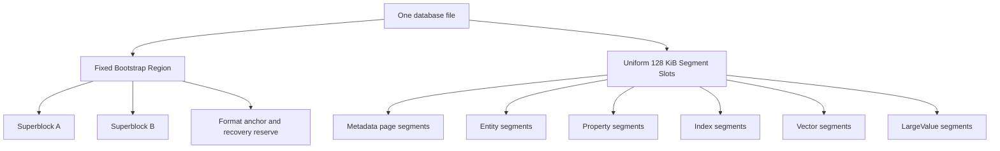
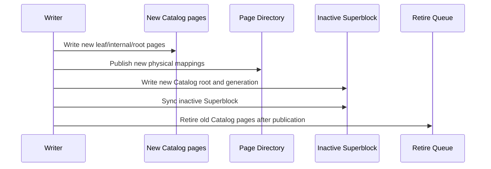
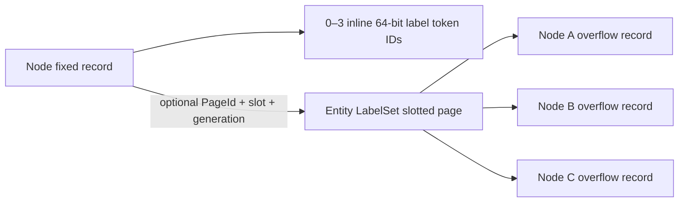

# Native Single-File Storage Re-architecture Plan

> This document is the normative design and implementation plan for ZYX's long-term storage architecture. It takes precedence over historical Stage, legacy-storage, migration, and compatibility descriptions elsewhere. The format defined here is not fully implemented yet; historical implementation notes must not be presented as the final architecture until all stages are complete.

## 1. Decision Boundary

### 1.1 Hard constraints

- A database always consists of one database file; data and metadata are not split into separate files.
- Old databases are not opened, migrated online, migrated offline, or compatibility-read.
- Old databases may be discarded; the new format has a new magic and format version.
- macOS, Linux, and Windows are required platforms.
- All persisted integers, enums, floating-point values, and references use an explicit little-endian codec; raw C++ struct layouts are never persisted.
- Every stage must have independent tests, crash-recovery tests, and coverage gates.

### 1.2 Non-goals

- Do not keep legacy `FileStorage`, legacy `DataManager`, or legacy physical query execution.
- Do not keep migration checkpoints, cutover, legacy backups, or `.migration` sidecars.
- Do not create a domain-specific physical store for code, images, audio, PDFs, or other business payloads.
- Do not maintain isolated, non-interoperable free lists for Catalog, Property, and Vector storage.
- Do not keep adding compatibility branches to format v16; Stage 0 freezes a clean format from scratch.

## 2. Overall Goals

The final architecture must provide all of the following:

- fixed physical segments can be reclaimed and reused across segment kinds;
- Catalog, Page Directory, Allocator, Property, B+Tree, Vector, and LargeValue pages can all be copy-on-written, relocated, and reclaimed;
- updating one Node or Edge does not copy a complete 128 KiB segment;
- a small transaction does not reserve one complete 128 KiB segment for one entity;
- hot reads use validated page views from one shared Buffer Pool;
- database open time is independent of file size and never scans the file to discover Catalog;
- disjoint writers do not fail solely because the global Superblock generation changed;
- large text and binary values can be externalized, chunked, compressed, deduplicated, range-read, and reclaimed;
- B+Tree pages do not pay for a generic entry header or temporary vector materialization on every lookup;
- one Vector mutation does not invalidate the entire PQ/ANN generation;
- every publication recovers as a complete old generation or a complete new generation at every crash point.

## 3. Core Terms and Identity Model

| Concept | Meaning | Can physical location change? |
|---|---|---|
| `EntityId` | Logical business identity of a Node or Edge | No |
| `SegmentId` | Logical identity of a Segment | No |
| `PageId` | Logical identity of a page | No |
| `PhysicalSlot` | Physical 128 KiB Segment slot in the file | Yes |
| `FrameIndex` | 4 KiB page frame inside a Segment | Yes |
| `Generation` | COW version and snapshot safety boundary | Monotonic |
| `LargeValueId` | Logical identity of a generic external value | No |

Persistent references use logical identities. Physical references are used only for Bootstrap roots and the self-bootstrapping path of the Page Directory.

## 4. Single-File Physical Layout

### 4.1 File layout

The database file consists of a fixed Bootstrap Region followed by a uniform Segment Space:



The Bootstrap Region should be one fixed, 128 KiB-aligned region containing:

- format magic and version;
- Superblock A/B;
- database UUID;
- a fixed recovery anchor;
- a small metadata emergency-reserve descriptor;
- reserved fields for future format extensions.

The Bootstrap Region never participates in ordinary Segment allocation. It is a fixed format entry point, not a `SegmentKind`, so the requirement that every ordinary Segment be reclaimable still holds.

### 4.2 Segments and pages

- Every ordinary physical Segment is exactly 128 KiB and file-offset aligned.
- A Segment consists of an explicit envelope and a number of 4 KiB frames.
- The usable frame count is calculated by a layout solver from the envelope, checksum, alignment, and page header; business code must not hard-code it.
- Fixed Entity, B+Tree, Property, Vector, and LargeValue data use 4 KiB pages as the primary COW and cache unit.
- Large contiguous values use multiple frames or Segments inside the fixed physical unit; they never change the global physical Segment size.

### 4.3 SegmentKind and page subtype

Physical allocation is not bound to a future type. The current generation's Segment envelope records `SegmentKind`; the page header records a more specific subtype.

Recommended long-term SegmentKinds:

| SegmentKind | Purpose |
|---|---|
| `SGK_METADATA_PAGE_POOL` | Catalog, Page Directory, Allocator, System Catalog, and Retire Queue pages |
| `SGK_ENTITY_PAGE_POOL` | Mixed Node/Edge fixed pages and Node LabelSet slotted pages |
| `SGK_PROPERTY_PAGE_POOL` | Slotted Property pages |
| `SGK_INDEX_PAGE_POOL` | Packed B+Tree pages |
| `SGK_VECTOR_RAW_POOL` | Raw vector pages |
| `SGK_VECTOR_PQ_POOL` | PQ code pages |
| `SGK_VECTOR_ADJACENCY_POOL` | Vector adjacency pages |
| `SGK_VECTOR_MANIFEST_POOL` | Vector manifest pages |
| `SGK_LARGE_VALUE_DATA_POOL` | Generic LargeValue chunks |
| `SGK_LARGE_VALUE_MANIFEST_POOL` | Generic LargeValue manifests/indexes |

`SGK_CATALOG` is no longer an unreclaimable dedicated physical pool. Catalog pages use the `MPK_CATALOG` subtype inside `SGK_METADATA_PAGE_POOL`. A metadata Segment may hold multiple metadata page subtypes and, once empty, can be reused for any other SegmentKind.

Ordinary graph adjacency is a built-in Packed B+Tree and therefore uses `SGK_INDEX_PAGE_POOL`. `SGK_VECTOR_ADJACENCY_POOL` is reserved exclusively for ANN graph state; the two structures must not share codecs, owner kinds, roots, or maintenance policies merely because both use the word adjacency.

## 5. Bootstrap, Roots, and Page Directory

### 5.1 Superblock roots

A/B Superblocks are the only publication root. Each Superblock records:

- `format_version`;
- `generation`;
- `committed_file_end`;
- `allocator_root_physical_ref`;
- `page_directory_root_physical_ref`;
- `catalog_root_page_id`;
- `system_catalog_root_page_id`;
- `index_root_directory_root_physical_ref`;
- `retire_queue_root_page_id`;
- logical-ID high-water marks;
- checksum.

The Superblock does not store a whole directory and does not move as a directory grows. It stores only a fixed number of root references.

### 5.2 Page Directory

The Page Directory represents:

```text
PageId -> PhysicalSlot + FrameIndex + Generation + page metadata
```

It is a COW radix/tree. The Superblock stores the Page Directory root as a physical reference, breaking the self-bootstrap cycle.

All ordinary objects hold PageIds. Relocating a Catalog, Property, B+Tree, Vector, or LargeValue page updates only the relevant Page Directory leaf and its COW path; the logical PageId remains unchanged.

### 5.3 Catalog

The logical Catalog contents are:

```text
SegmentId -> SegmentDescriptor
```

Each SegmentDescriptor contains at least:

- current physical slot;
- owner or pool identifier;
- generation;
- frame summary;
- kind/state/flags.

`SegmentId` may be derived from radix leaf ordinal and entry position and should not be duplicated in every entry. Retired physical slots belong in the Retire Queue rather than ordinary Catalog entries.

## 6. Single-File Allocator and Catalog Reclamation

### 6.1 Independent AllocatorRoot

The Allocator cannot use Catalog as its only authority, or allocation becomes circular:


The Superblock therefore points directly to an independent `AllocatorRoot`. The AllocatorRoot is a COW tree managing:

- free Segment runs;
- free metadata frames;
- allocated slots;
- current reservations;
- retired extents;
- committed file end;
- free-space summaries.

### 6.2 Reservations

A writer reserves physical frames/Segments from the old AllocatorRoot:

1. A process-local reservation manager locks candidate positions.
2. The writer writes new Catalog, Page Directory, Allocator, and business pages.
3. The new AllocatorRoot marks the reservations allocated.
4. If the transaction fails, the old AllocatorRoot still sees unpublished reservations as free.
5. A successful Superblock publication makes the new AllocatorRoot visible.

Near ENOSPC, a rotatable metadata emergency reserve is required so a reclaim/publication transaction can still finish. It is not a permanently pinned physical Segment and can be reclaimed after rotation.

### 6.3 Catalog-page reclamation

Catalog updates use COW:



An old page may enter free space only when all of the following hold:

- it is unreachable from the current roots;
- no active snapshot can reach it from an older root;
- its retire generation is below the oldest active snapshot generation;
- the new AllocatorRoot durably records the physical location as reusable.

### 6.4 Segment reclamation and evacuation

If every frame in a metadata Segment is retired:

```text
metadata Segment -> Retire Queue -> Free Segment Tree
```

If only a few live pages remain:

1. Calculate live-frame density.
2. Start a Metadata Evacuator below the density threshold.
3. Copy live pages to new metadata frames.
4. Keep PageIds stable and update only Page Directory locations.
5. Publish the new directory roots with COW.
6. Free the old Segment after snapshot safety.

The released PhysicalSlot has no Catalog restriction and can become a Property, Vector, Index, Entity, or LargeValue Segment.

## 7. Durability and Publication

The final format does not depend on a Metadata WAL. Since every visible page is a fresh COW page, A/B Superblocks are sufficient as the single-file atomic publication point. A Metadata WAL may remain as a Stage 0/1 implementation aid, but must be removed from the production path in Stage 1.

The final commit sequence is:

1. Write new business data pages/Segments.
2. Write new metadata pages.
3. Sync file data.
4. Write the inactive Superblock.
5. Sync the Superblock.
6. Retire the old generation and reclaim it after snapshot safety.

No page still reachable from an old Superblock or snapshot may be overwritten before publication.

After a crash, only a complete old generation or a complete new generation may be visible. New pages not reachable from the valid Superblock may become reclaimable space leaks, but never logical corruption.

## 8. Buffer Pool

Create one raw-page Buffer Pool shared by every storage subsystem:

- Metadata;
- Catalog/Page Directory;
- Entity;
- Property;
- B+Tree;
- Vector;
- LargeValue.

The Buffer Pool must provide:

- pin/unpin;
- generation-aware keys;
- dirty/private COW pages;
- 2Q or CLOCK-Pro eviction;
- sequential-scan isolation;
- sibling/page prefetch;
- validate once and cache a validated page view;
- byte-based capacity accounting;
- consistent read/write/flush behavior on Windows, macOS, and Linux.

`cache_size` must connect to this Buffer Pool and is measured in bytes (64 MiB by default, with one 4 KiB page as the minimum). Typed-store construction must not trigger a full reconciliation or implicit disk scan; recovery/reconciliation is owned by one database-open coordinator.

## 9. Fixed Entity Rework

### 9.1 Page layout

Nodes and Edges use 4 KiB fixed-entity pages:


The 128 KiB Segment is a page container, not the COW unit for one entity.

### 9.2 Entity Map

EntityId no longer determines a physical slot. A specialized Entity Map stores:

```text
EntityId -> PageId + slot + optional slot generation
```

Segment generation is supplied by the Catalog/Page Directory of the same snapshot and is not duplicated in every entity entry.

After deletion, a slot can be reused by any new EntityId. Full scans iterate entity pages and bitmaps rather than walking a wide Location Directory one entity at a time.

### 9.3 Node/Edge records

Fixed Node/Edge records remove:

- Property ID;
- Property storage type;
- fields that exist only for Property-ID reservation;
- duplicated logical IDs when a page-local ID array is sufficient.

Node labels use three inline 64-bit Token IDs plus one optional single-page `EntityLabelSet` record. The historical six-label limit is removed. Three inline slots and the 64-bit Token-ID width are explicit format design constants; single-page overflow capacity is a derived result that stores, tests, and documentation never copy as a number.

An Edge record ultimately stores source NodeId, target NodeId, relationship-type Token ID, and necessary state. It is the only authoritative copy of those fields. Node records contain no incoming/outgoing adjacency roots, and Edge records contain no adjacency-list links. Ordinary graph adjacency is a separately maintained built-in Packed B+Tree.

### 9.4 Node-label layout

A fixed Node record stores:

- `inline_label_count`, ranging from zero through three;
- three 64-bit `inline_label_ids`;
- an optional `label_overflow = PageId + slot_id + slot_generation`.

The complete label set consists of nonzero, strictly increasing, unique schema-token IDs. A set of zero through three labels is entirely inline and its overflow reference must be empty. A set of four or more labels keeps the first three Token IDs from the canonical sequence in the fixed record and stores every remaining Token ID, in the same order, in one `EntityLabelSet` record. The fixed record does not duplicate the total count; the overflow-record header stores its own element count.



One 4 KiB LabelSet slotted page stores overflow records for multiple Nodes; a Node must not own a dedicated page. Each overflow record belongs to exactly one Node and is not deduplicated across Nodes. A record does not repeat its NodeId because the stable reference in the fixed Node record is the sole ownership edge. LabelSet pages use the `POK_ENTITY_LABEL` subtype, while Node/Edge fixed pages use `POK_ENTITY`. Both page kinds may share one `SGK_ENTITY_PAGE_POOL`; the design adds neither a dedicated 128 KiB Label Segment nor a dependency on `SGK_PROPERTY_PAGE_POOL`.

### 9.5 Single-page capacity and explicit limit

LabelSet records use an explicit little-endian array of 64-bit Token IDs. They do not use compression, variable-length integers, or a chunk chain. The eight-byte Token-ID width is a base field width in the current format, and the Node record, Schema Token Registry, LabelSet codec, and Label Index keep it consistent.

The capacity of one overflow record is derived from `RSS_PAGE_OWNER_MAX_PAYLOAD_BYTES`, `RSS_SLOTTED_PAGE_HEADER_BYTES`, the 16-byte `RSS_SLOTTED_PAGE_SLOT_BYTES`, `RSS_ENTITY_LABEL_SET_HEADER_BYTES`, record alignment, and `sizeof(uint64_t)`. The normative test is whether the complete encoded LabelSet record fits in one empty typed slotted page. Implementations preflight through one shared encoded-size/capacity solver rather than comparing a handwritten label count.

`RSS_ENTITY_LABEL_SET_MAX_OVERFLOW_LABELS` is the solver result, and `RSS_ENTITY_MAX_LABELS` is the sum of the three inline slots and overflow capacity. The rule applies only to a result computed by composing layout constants, such as an implementation-specific maximum label count: it must not be copied into persisted data, control flow, tests, or documentation as an independent numeric contract. Diagnostic tools may display it, but they obtain it from the shared solver.

In contrast, stable format facts remain explicit. A 64-bit Token ID, a 16-byte slot entry, the three inline slots, and the page size define the on-disk codec and must be documented and tested as such. When a base layout constant changes, update its single code definition and the format version according to persistence-compatibility rules; codecs, allocators, and tests then follow the same solver for every derived limit.

The largest encodable overflow must succeed. `RSS_ENTITY_LABEL_SET_MAX_OVERFLOW_LABELS + 1` must return an explicit capacity error before page allocation, candidate-frame writes, or metadata publication. The current design neither reserves nor implements multi-record, multi-page, or chunked LabelSets.

### 9.6 Placement, updates, and space reuse

LabelSet placement uses a best-fit free-space index isolated by `PageOwnerKind`. Each index entry tracks at least contiguous free bytes, reclaimable bytes, and reusable dead-slot count. Insertion costs the record bytes and adds the 16-byte `RSS_SLOTTED_PAGE_SLOT_BYTES` only when no dead slot is reusable; this avoids a conservative estimate skipping a page that can accept the record. Selection proceeds as follows:

1. Prefer the smallest free region in an existing `POK_ENTITY_LABEL` page that fits `record bytes + slot entry`.
2. If total free space is sufficient but fragmented, compact a candidate COW image and retry.
3. If no current page fits, append a LabelSet page to a free frame in an existing `SGK_ENTITY_PAGE_POOL`.
4. Allocate another Entity-pool Segment only when every matching Entity pool lacks a free frame.

The free-space index must filter by page subtype and must never open a fixed Node/Edge page in the same Entity Segment as a slotted page. A placement hint is not write authority: under the pinned generation, the metadata writer revalidates the Page Directory, Catalog, owner kind, owner LSN, and available COW frame.

Updating a current LabelSet page always writes a new COW frame. The candidate frame may come from the source Segment or another `SGK_ENTITY_PAGE_POOL` in the same owner domain. The latter keeps the original `PageId` and switches only its Page Directory location. A full source pool must not reject an otherwise feasible label update.

A label update first attempts to remain in its current page. A shorter record reuses its existing capacity. Growth tries adjacent free space, a page-local payload move, and compaction in that order while preserving `PageId + slot_id + slot_generation`. Payload offsets exist only in slot entries, so an in-page move does not rewrite the Node record. If the record still does not fit, the transaction creates a slot in another LabelSet page, switches the Node overflow reference, and erases the old slot atomically. Reducing a set to three or fewer labels clears the overflow reference and erases the old slot.

Deletion puts a slot into the dead state, and reuse increments its generation, making stale caches and references fail closed. A smaller new record may use a released slot, and compaction coalesces page-local fragments so the previous record size does not become a permanent hole. An empty LabelSet page enters snapshot-safe retirement. Once every frame in an Entity Segment is unreachable, ordinary Segment evacuation/reclamation can release its physical slot for cross-SegmentKind reuse.

### 9.7 Atomicity, reads, and index consistency

One label mutation publishes the fixed Node page, LabelSet page, Page Directory, and Label Index delta through one metadata transaction and one Superblock generation. Publishing an overflow page before the Node that references it is forbidden, as is erasing the old slot before switching the Node reference. A pre-commit failure leaves no reachable orphan; after commit, an older snapshot continues to read the old Node and LabelSet frames through its old Page Directory root.

A read adds at most one 4 KiB page lookup: it first resolves the fixed Node record through the Entity Map; when the overflow reference is nonempty, it resolves the LabelSet page through the Page Directory and Buffer Pool, then validates `POK_ENTITY_LABEL`, page generation, slot generation, record checksum, canonical ordering, and the capacity bound. Buffer Pool keys use logical PageId and snapshot generation. Relocating a LabelSet page changes only the Page Directory and never rewrites the Node reference.

The integrity scanner cross-validates that every nonempty Node overflow reference resolves to exactly one live LabelSet slot, every live LabelSet slot is referenced by exactly one Node, no two Nodes share a slot, an empty reference carries no partial PageId/slot/generation, and the Label Index token set for that Node exactly equals the canonical union of inline and overflow labels. A mutation computes Label Index add/remove deltas directly from the old and new canonical sets and never scans the complete Label Index.

## 10. Property Store

### 10.1 Property identity

Property identity is:

```text
(EntityKind, EntityId) -> PropertyRoot
```

Absence means no Property Directory entry. There is no independent PropertyId reservation, and Node/Edge records do not contain a Property reference.

### 10.2 Multi-level Property representation

| Size | Representation | Goal |
|---|---|---|
| Very small | Inline Property value | Avoid another page read |
| Small/medium | Slotted Property page | Bounded per-entity updates |
| Large collection | Per-key records or a small Property tree | Avoid copying the entire collection for one key |
| Large value | `LargeValueRef` | Chunking, compression, and range reads |

Updating one key must not copy the complete Property collection. Slotted pages need capacity reclaim, hysteresis, and page-pressure compaction.

### 10.3 Property Directory cache

Placement caches must not be globally invalidated by every database generation. Use per-pool/per-shard versions, a persistent free-space class index, and incremental updates.

## 11. Generic LargeValue

Code, images, JSON, PDFs, audio/video, and model files use one `LargeValueStore`; no `CodeObjectStore` or `ImageStore` is created.

Recommended abstraction:

```text
Value
    -> InlineValue
    -> LargeValueRef

LargeValueStore
    -> LargeValueManifest
    -> LargeValueChunk/Extent
```

`LargeValueRef` stores:

- logical object ID;
- generation;
- uncompressed size;
- content hash;
- text/bytes kind;
- a nonempty printable-ASCII media type bounded by the format policy;
- codec;
- checksum information.

`LargeValueRef::generation` and `LargeValueManifest::generation` are immutable
logical generations. They identify the value content and do not change merely
because a compactor copies a physical frame. `PageLocation::generation`,
`PageOwnerHeader::generation`, and `LargeValueManifestLocation::generation`
instead identify the current physical pool/frame generation. The two domains
must not be compared as though they represented one version number.

### 11.1 Cypher and Driver ABI

Ordinary Cypher keeps property assignment semantics:

```cypher
CREATE (f:CodeFile {
    path: $path,
    content: $content,
    content_type: "text/x-c++src"
})
```

Small values are stored inline and large values are automatically externalized. Binary data uses a generic bytes parameter; the storage layer does not add `Code`, `Image`, or other domain-specific ValueKinds.

Very large values use generic Driver ABI streaming operations:

- begin external value;
- write chunk;
- finish/abort;
- read range;
- read stream.

The current ABI exposes a bounded pull stream for result bytes and value
references. A caller supplies an `(offset, length)` range and repeatedly reads
into an application-owned buffer; the stream returns `ZYX_DRIVER_DONE` only
after that range is exhausted. The stream owns an immutable byte snapshot, so
the source result may be closed after the stream is opened. This bounds each
ABI copy, while the native LargeValue range reader remains responsible for
chunk-level I/O and decompression.

LargeValue creation and the Property reference must be published in one transaction.

### 11.2 Chunking and compression

- Start with a 32 KiB chunk and tune within 16–64 KiB using benchmarks.
- Usually do not compress very small values.
- Prefer LZ4 or Zstd for code, JSON, SQL, and logs.
- Keep already-compressed PNG, JPEG, ZIP, and similar formats raw by default.
- Store a checksum and codec per chunk.
- Range reads decompress only the required chunks.
- Compute `content_hash` from uncompressed bytes for deduplication.
- Use `normalized_hash` for code-similarity analysis only, never as the physical identity.

### 11.3 Code-analysis data model

Store a source file once whenever possible:

| Entity | Main fields |
|---|---|
| `CodeFile` | path, language, commit, content hash, LargeValueRef, line-index ref |
| AST/Function Node | file ID, start byte, end byte, line range, symbol metadata |
| Independent CodeSnippet | LargeValueRef, language, content hash, normalization metadata |

AST nodes should refer to source ranges instead of copying complete source text.

### 11.4 Reclamation

LargeValue uses immutable objects:

```text
new chunks -> new PropertyRoot -> Superblock publication
-> old object enters Retire Queue
-> snapshot-safe reachability reclaim
```

When multiple entities share one content hash, reachability or reference information must prove that the final reference is gone before reclaiming the object.

### 11.5 Relocation and snapshot safety

LargeValue uses stable `PageId` values rather than physical pointers. A data
page move publishes only its replacement Page Directory location. A manifest
page move publishes its replacement Page Directory location and the matching
`LargeValueManifestLocation` route in one COW/Superblock publication. Both
moves write a physical owner with the destination pool generation while keeping
the logical `LargeValueRef` and manifest generation unchanged.

An old snapshot therefore resolves the old directory roots and reads the old
frames; a newer snapshot resolves the new route and frame. The source pool is
retired after its last current page moves, but its physical slot is released
only after all snapshots that may still resolve the old roots have drained.

## 12. Packed B+Tree

B+Tree uses a specialized packed page codec:

- separate leaf and internal page layouts;
- packed offset arrays;
- canonical on-disk key order;
- prefix compression and restart points;
- binary search on a raw page view;
- range cursors without materializing a full entry vector;
- decode the EntityId suffix from a scalar composite key instead of storing it again as a value.

Property-index ordering remains:

```text
(PropertyValue, EntityId)
```

EntityId supplies stable ordering for duplicate property values and unique positioning. What must be removed is physical duplicate encoding and the wide generic entry header.

Bulk builders and online mutation share the same page invariant, separator, split/merge, and corruption checks.

The implementation supports named key codecs and comparators rather than embedding Property-index assumptions into the tree. The ordinary graph adjacency specialization uses fixed logical fields `(direction, NodeId, EdgeId)` and an empty value. Its comparator orders the fields by direction, unsigned NodeId, then unsigned EdgeId; the disk codec still writes every integer through the explicit format codec. Capacity, fan-out, restart interval, separator size, and entries per page are always derived from encoded bytes and the shared page-layout solver.

Every tree has a stable logical `IndexId`; the COW root PageId and root generation are stored in the Index Root Directory. The ordinary adjacency tree owns one reserved built-in `IndexId` that can never collide with user-created indexes. This keeps the Superblock fixed-size: it publishes the Index Root Directory root, while that snapshot's directory identifies the adjacency root. Empty-tree state is represented by an absent adjacency root entry, not by a permanent empty page.

## 13. Canonical System Catalog

Remove the sealed/dynamic dual system and create one canonical mutable System Catalog:

```text
(property-key, name)       -> token
(property-token, token)    -> name
(schema-name, kind, name)  -> schema token
(schema-token, kind, token)-> definition
(index-id, id)             -> definition
(index-name, name)         -> id
(index-schema, signature)  -> id
(constraint-id, id)        -> definition
(constraint-name, name)    -> id
(sequence, kind)           -> high-water mark
```

Forward, reverse, and secondary entries are atomically updated in one metadata transaction. Do not retain an artificial high-bit dynamic-ID namespace or a sealed tombstone registry.

### 13.1 Schema Token names and IDs

Label and relationship-type names exist only in the canonical System Catalog and are never written into Nodes, Edges, LabelSets, or Label Indexes. The System Catalog maintains two logical directions: name plus kind to `SchemaTokenId`, and kind plus `SchemaTokenId` to a definition containing the canonical name. The forward index serves query binding; the reverse definition serves name rendering, catalog integrity checks, and administration. Execution carries only Token IDs.

A name is a UTF-8 byte string bounded by one shared System Catalog name-limit format constant. That bound simultaneously satisfies the public API policy, definition-record capacity, forward-key capacity, reverse-definition capacity, and target B+Tree fan-out. Cypher, the Driver ABI, System Catalog codecs, and lookup APIs share it. Neither the theoretical range of a persisted length field nor the largest entry that barely fits in an empty page becomes the public name limit.

`SchemaTokenId` uses an explicit 64-bit little-endian wire field. The shared name limit and related key/record overhead use their own format constants. Any B+Tree-entry or page capacity derived from them is consumed only through the shared solver and is never copied as a result number into documentation or callers. Unknown definition versions and inputs beyond the unified name bound fail closed.

The canonical definition owns the authoritative name. A forward B+Tree still stores a comparable name key for collision-free lookup. This bounded duplication occurs once per unique schema token and is deliberate; leaf prefix compression, internal separator truncation, and the dictionary cache control its cost. Names are never duplicated into each entity or Label Index entry.

## 14. Graph Adjacency

Ordinary graph adjacency and Vector ANN adjacency are independent data structures. Ordinary graph adjacency is one global built-in Packed B+Tree; Vector adjacency retains the Vector-specific design in Section 15.

### 14.0 Normative implementation boundary

The ordinary-graph implementation has exactly one durable adjacency representation: the reserved global, key-only Packed B+Tree. This is a format invariant, not a planner preference. Every implementation phase and optimization must preserve all of the following:

- the format-reserved `RSS_GLOBAL_ADJACENCY_INDEX_ID` is the only ordinary-graph adjacency `IndexId`; it resolves the one adjacency root from the snapshot-pinned Index Root Directory and is never allocatable to a user or secondary index;
- Node records own no adjacency root or adjacency key, and Edge records own no neighbor link, physical page location, or duplicated adjacency payload;
- each live Edge owns exactly one `ADJ_OUT` key and one `ADJ_IN` key, committed and removed in the same metadata generation as the authoritative Edge change;
- B+Tree pages contain only routing/separator data or key-only adjacency entries, never mixed Node or Edge records;
- a relocation changes only the Page Directory route for a logical `PageId`; it never rewrites an Edge, a Node, a cursor continuation, or a parent child reference.

Per-Node chains, per-Node roots, Base/Delta/Tombstone tiers, adjacency tail pages, and an Edge-to-Edge linked list are retired designs. They are not fallbacks, compatibility readers, or optimization candidates. If measured workloads later require a specialized access path, it must be a separately identified derived index with its own codec, root, publication, reclamation, integrity, and benchmark gates; it must not change the semantics or payload of the global adjacency tree.

### 14.0.1 Structural decision record

"Global Packed B+Tree" describes only the ordinary-graph adjacency access path. It neither co-locates Node and Edge records in B+Tree pages nor makes an Edge record a B+Tree leaf value. The following are mandatory clean-format choices:

| Option | Decision | Reason |
|---|---|---|
| One global key-only tree | Adopt | Low-degree Nodes share leaves and supernodes stream through sequential leaves; there is one root, codec, publication path, and retirement lifecycle. |
| Separate outgoing and incoming trees | Reject | The `direction` prefix already supplies two ordered access ranges. Splitting the tree only multiplies root-directory, COW, and reclamation state; it cannot remove the two keys required by one Edge mutation. |
| Per-Node root or per-Node B+Tree | Reject | It recreates permanently sparse roots/tail pages, more root publications, and supernode-specific structures; low-degree Nodes cannot share encoded key space. |
| Edge doubly linked list or Edge chain | Reject | Insertion and deletion rewrite Node heads and neighboring Edges, expanding the transactional write set and coupling relocation, snapshots, and integrity to physical relationship links. |
| Embed Edge records or a covering Edge payload in adjacency leaves | Reject | It creates a second authoritative copy of endpoint/type/state, mixes Entity and Index codec/lifecycle, and amplifies B+Tree writes whenever a mirrored relationship field changes. |

Consequently, a B+Tree leaf can contain **adjacency key ranges** for several Nodes, but never those Nodes' or Edges' entity records. An expansion streams `EdgeId` values first and resolves a record from the Edge Entity Store in the same snapshot only when the query actually needs its endpoint, type, state, or Properties. This deliberate two-stage read separates sequential adjacency scanning from entity materialization and prevents unnecessary Edge fields from occupying every index entry.

### 14.1 Authoritative data and key schema

The Edge Entity Store is authoritative:

```text
EdgeId -> sourceNodeId + targetNodeId + relationshipTypeId + state
```

The adjacency tree is a secondary access path with the logical schema:

```text
(direction, NodeId, EdgeId) -> empty
```

There is one tree and one root, not one tree per direction or per Node. `direction` is the first key component so that the outgoing and incoming access paths are disjoint ordered ranges in the same tree. This preserves one uniform codec, one publication boundary, and one reclamation lifecycle without creating a permanently sparse root hierarchy.

For every live directed Edge, it contains exactly two entries:

```text
(ADJ_OUT, sourceNodeId, EdgeId) -> empty
(ADJ_IN,  targetNodeId, EdgeId) -> empty
```

`AdjacencyDirection` is a persisted prefixed enum; unknown values fail closed on every platform. NodeId and EdgeId are positive 64-bit logical IDs. The routing NodeId is necessarily part of the key, but the empty value is normative: the tree stores neither the other endpoint nor relationship type/state as an Edge payload. The first implementation must not add a covering value. A future type-qualified access path, if justified by measured workloads, is a separate derived index with its own identity and lifecycle rather than a silent change to this key.

The comparator defines canonical ordering by `direction`, unsigned `NodeId`, then unsigned `EdgeId`. Entries for one `(direction, NodeId)` therefore form one contiguous range and are deterministically ordered. Prefix compression removes the repeated direction/NodeId bytes within such a range. Multiple low-degree Nodes share each leaf; no Node or direction owns a 4 KiB tail page. A supernode spans as many consecutive leaves as required without a per-Node size limit.

The physical boundary is strict. Entity pages contain fixed Node and Edge records; adjacency leaves contain only sorted keys and an empty value; adjacency internal pages contain only separators and logical child PageIds. A B+Tree leaf may therefore contain ranges for many Nodes, but it never contains their Node records or Edge records. This is the packed-layout property, not a decision to place graph entities into the B+Tree.

### 14.2 Root ownership and physical placement

The global tree uses the reserved built-in adjacency `IndexId` in the Index Root Directory. A snapshot resolves:

```text
Superblock -> Index Root Directory -> adjacency IndexId -> B+Tree root PageId + root generation
```

The root entry and every B+Tree page are part of the same metadata generation. Adjacency leaf and internal pages use the ordinary Packed B+Tree codec, `SGK_INDEX_PAGE_POOL`, and adjacency-specific owner identity. They never share a page with Node records, Edge records, or Vector adjacency. Page relocation keeps the logical PageId and changes only the Page Directory route; tree references and Edge records are not rewritten.

An empty graph has no adjacency root entry. The first Edge transaction creates the initial tree and publishes its root entry. Removing the final Edge atomically removes the root entry from the new generation; old snapshots retain the old root, and its physical pages are released only after snapshot safety. No per-Node Root page, Root write-tail hint, Base/Delta chain, Tombstone, merge threshold, merge debt, or recovery cursor exists in the final ordinary-graph format.

### 14.3 Read path and cursor contract

Outgoing and incoming expansion perform a lower-bound seek to the first key for `(direction, NodeId)`, then advance until that prefix changes. The complexity is `O(log E + degree)` comparisons and proportional output work. Root and internal pages use normal Buffer Pool admission. Leaves consumed by a range scan use sequential admission; the cursor prefetches bounded right siblings without pinning an unbounded route.

The cursor reads compressed keys directly from a validated page view. It retains only the current leaf pin, restart/search state, prefix bounds, and a logical continuation key; it must not materialize a complete leaf or a complete adjacency range. Continuation is `(snapshot generation, direction, NodeId, last EdgeId)` and resumes strictly after `last EdgeId`. It never exposes PageId, slot, or physical offset. A stale or foreign continuation fails closed or restarts from its logical lower bound according to the public cursor contract.

An adjacency-only operation such as degree/count may count entries without reading Edge records. Traversals that return Edge fields resolve each EdgeId through the snapshot-pinned Edge Entity Map and validate that the Edge is live and its endpoint matches the scanned prefix. Relationship-type filtering initially reads the authoritative Edge record; it must be batched and locality-aware rather than issuing an unconstrained random read per key.

Undirected expansion opens the two bounded ranges independently and combines them. Self-loop semantics are explicit: one self-loop has one `ADJ_OUT` and one `ADJ_IN` entry; an undirected operator deduplicates by EdgeId only when Cypher semantics require one relationship result.

### 14.4 Mutation and publication

Creating one Edge plans the Edge record, Entity Map entry, `ADJ_OUT` insert, and `ADJ_IN` insert against one pinned generation. It applies both key mutations through one B+Tree COW overlay and publishes all replacement pages, the replacement adjacency root, metadata roots, and the inactive A/B Superblock in one commit. A crash can expose only the complete old generation or the complete new generation; one-direction visibility is forbidden.

The global root is a physical publication point, not a user-visible conflict domain. Before publication, the transaction layer revalidates its sorted final-state overlay against the current root and retries/rebases it when a concurrent adjacency commit has advanced the root. It reports a conflict only for a semantic contradiction such as a duplicate/deleted Edge identity or changed authoritative endpoint, never merely because another writer replaced the global root. Rebase work and retry count are bounded by the transaction policy.

Deleting one Edge resolves its authoritative old endpoints, erases both exact adjacency keys through the same overlay, removes the Edge record and Entity Map entry, and atomically publishes the result. Ordinary graph deletion does not append a logical Tombstone. COW-retired pages enter the common generation-aware Retire Queue and become reusable only after older snapshots drain.

`DETACH DELETE` performs bounded outgoing and incoming range scans, deduplicates EdgeIds including self-loops, validates transaction limits before preparing publication, and submits one bulk final-state plan. It removes every affected Edge record and both entries for every Edge exactly once. Concurrent or stale-root publication is rejected before visibility and retried from a fresh snapshot by the transaction layer.

Bulk ingest generates the two keys for every validated Edge, sorts and deduplicates them by the canonical comparator, and feeds the shared bulk/overlay page builder. Already ordered runs should be merged rather than repeatedly inserted one key at a time. Online and bulk paths use identical leaf fill, restart, separator, checksum, split/merge, and owner invariants. Capacity and memory are bounded by configured transaction/run limits; external sorting, if later required, must remain inside the single database file or bounded temporary process memory and may not become a second durable database artifact.

### 14.5 Space, maintenance, and optional write buffering

Deletion uses ordinary Packed B+Tree underflow handling. Sibling redistribution or merge occurs in the candidate COW image; empty leaves and collapsed internal roots retire through the common page-reclamation path. Page occupancy policy uses byte counts from the codec, not fixed entry counts. Background whole-tree compaction is not required for correctness, but a bounded maintenance rebuild may repack a tree whose measured byte occupancy falls below policy. It publishes one replacement root and retires the old tree snapshot-safely.

The first production implementation must use the plain global Packed B+Tree. If benchmarks show unacceptable COW write amplification for isolated Edge mutations, a later stage may add one bounded global write buffer in front of the same canonical tree. That decision requires recorded thresholds and must preserve one logical cursor, atomic dual-entry visibility, bounded memory, deterministic recovery, and the single-file rule. Per-Node delta chains and the previous Base/Delta/Tombstone hierarchy are not fallback options.

### 14.6 Integrity requirements

The integrity scanner verifies all of the following within one pinned snapshot:

- every live Edge has exactly one matching `ADJ_OUT` and one matching `ADJ_IN` entry;
- every adjacency entry resolves to one live Edge whose endpoint matches its direction and NodeId;
- no duplicate, missing, foreign, zero-ID, or unknown-direction key exists;
- key order, prefix/restart encoding, separators, sibling links, page ownership, generation, LSN, and CRC are valid;
- the reserved adjacency IndexId has at most one current root and no user definition can claim it;
- all reachable pages belong to that root, and retired/unreachable pages are classified by the common reclaimer.

Fast open validates roots and page structure on demand; it does not scan all Edges. Full bidirectional cross-validation is an explicit integrity/maintenance operation with bounded-memory external progress, not a normal startup requirement.

## 15. Vector

### 15.1 Manifest

The Vector Manifest remains O(1) and stores only:

- dimensions/metric;
- total record count;
- Raw/PQ/Adjacency mapping roots;
- codebook root/generation;
- base/delta generations;
- ANN entry point;
- allocation-tail hints.

It does not enumerate all Raw/PQ pages. The Page Directory and mapping roots are the authoritative inventory.

### 15.2 Mapping

Mappings return directly:

```text
(PageId, slot, generation)
```

They must not return only a page and then linearly search the page for a VectorId.

The Vector delta mapping uses a fixed typed key `(VectorId, Operation)` and stores the corresponding `NodeId` in
the leaf value. Both `INSERT` and `ERASE` can therefore prove Node-to-Vector, Vector-to-Node, and Raw Location
consistency with bounded point lookups instead of scanning the semantic mapping; seeing both operations for one
VectorId must fail closed.

### 15.3 Online mutation

Vector storage uses immutable base plus mutable delta:

```text
base ANN/PQ generation
delta vectors
tombstones
query merge
background rebuild
atomic base replacement
```

Adding a vector must not invalidate the whole PQ/adjacency generation. With an existing codebook, calculate one PQ code; put adjacency changes in a delta graph or perform local repair.

Delta entry count and mapping-page count are independent bounded resources. Crossing the maintenance threshold must
schedule a base rebuild rather than grow without bound or silently reject user writes; until the rebuild completes,
queries merge `base - tombstones + exact inserts`.

### 15.4 Rebuild

Vector rebuilds finish in unpublished private pages and publish once:

- Raw/PQ/Adjacency mapping roots;
- codebook root;
- base/delta manifest;
- entry point;
- retire queue.

The adjacency builder uses a controlled Vamana/DiskANN/HNSW-style candidate algorithm; all-source/all-candidate O(N^2) comparison is prohibited.

## 16. Legacy and Migration Removal

After Stage 0, the following must not enter production source sets:

- legacy `FileStorage`, `DataManager`, and physical query paths;
- `OfflineMigrationCoordinator`, cutover, checkpoints, and sidecars;
- `Legacy*` storage classes;
- sealed/dynamic registry pairs;
- legacy Blob semantic claim/reclamation;
- the State migration subsystem;
- `SFM_LEGACY` and legacy magic probing;
- legacy backend pointers and legacy QueryEngine constructors;
- `database migrate` and `database cutover` CLI commands.

Maintenance builders with long-term value are retained and moved to:

```text
src/storage/relocatable/maintenance/vector/
src/storage/relocatable/maintenance/index/
```

Examples include the Vector adjacency builder, PQ builder, and scalar-index materializer.

Production CMake must replace recursive globs with explicit source sets so removed legacy files cannot silently re-enter the final binary.

## 17. Component Boundaries and Suggested Directories

Suggested long-term module boundaries:

```text
storage/relocatable/format/
    DiskCodec, Superblock, SegmentEnvelope, PageHeader

storage/relocatable/allocation/
    PhysicalAllocator, AllocatorTree, Reservation, FreeSpaceIndex

storage/relocatable/metadata/
    PageDirectory, Catalog, SystemCatalog, RetireQueue, Recovery

storage/relocatable/cache/
    BufferPool, PageView, Prefetch, Eviction

storage/relocatable/entity/
    EntityPage, EntityMap, EntityLabelSet, EntityScan, EntityMutation

storage/relocatable/property/
    EntityPropertyDirectory, PropertyCollectionRoot, PropertyCollectionRootStore, PropertyValueCodec, LargeValue

storage/relocatable/index/
    PackedBTree, BTreeCursor, BulkBuilder, IndexDirectory, AdjacencyKeyCodec

storage/relocatable/adjacency/
    GlobalAdjacencyIndex, AdjacencyCursor, AdjacencyMutationPlanner, AdjacencyIntegrity

storage/relocatable/vector/
    Raw, PQ, Manifest, DeltaIndex, Search

storage/relocatable/maintenance/
    Reclaimer, Compactor, Evacuator, VectorBuilder
```

Very large aggregate files such as `RelocatableMetadataStore.cpp` should be split along these responsibilities. The transaction coordinator coordinates root changes; it does not implement every page codec.

## 18. Stage 0-10 Implementation Plan

### Stage 0: Freeze the clean format

Work:

- Define the new single-file magic, format version, and Bootstrap layout.
- Reject every old file magic/version.
- Remove migration/legacy public APIs, CLI, and production sources.
- Unify root descriptors and logical/physical references.
- Establish explicit CMake source sets.
- Update the bilingual architecture and format matrix.

Dependencies: none.

Test gate: new-file creation, old-magic rejection, corrupt-header rejection, three-platform build, format-codec fuzzing.

Current implementation checkpoint: format v3 / Superblock v30 remove the retired Property root, the retired `PropertyPage`/`PropertyRecordCodec` layout, and the former per-Vector adjacency-directory root. The production source set no longer contains `VectorAdjacencyStore`, `VectorAdjacencyLocation`, `MDT_VECTOR_ADJACENCY`, `PropertyPage`, or `PropertyRecordCodec`; Entity Properties resolve only through owner-keyed roots or typed `LargeValue` references, while Vector adjacency resolves only through immutable typed pages, a Manifest, and a per-index mapping tree. Older format versions are rejected at open and cannot become a migration or runtime fallback.

### Stage 1: Single-file durability core

Work:

- Fixed Bootstrap Region and A/B Superblocks.
- Physical bootstrap roots for Page Directory and Allocator.
- COW root publication.
- Remove production Metadata WAL.
- Reservation and metadata emergency reserve.
- Recovery that exposes only old or new generations.

Performance gate: at most one data sync and one Superblock sync per commit; normal open does not scan the file.

Current Stage 1 evidence: `RelocatableProcessCrashTest` creates a direct operating-system child process: POSIX uses
`fork()` and runs the crash workload in the child, while Windows starts the current test binary with `CreateProcessW`.
The child creates and operates only one native database file, then waits after data has been synced but before a new
Superblock is published, or after the new Superblock publication has completed. The parent uses the platform-native
forced-termination API, reopens that database file, and verifies recovery selects only the complete old generation or
the complete new generation respectively. The test deliberately avoids a shell and does not treat its synchronization
marker as a database artifact. The POSIX implementation does not re-exec an ASan-instrumented test binary, so the same
real child-process boundary remains testable under sanitizers. It proves real process kill/reopen behavior for those two
Superblock publication boundaries only; the short-write, torn-page, ENOSPC, and full crash matrices required by section
19 remain independent release gates.

The current macOS ASan and ASan+UBSan test configurations both compile the test-only native I/O fault-injection seams
into `zyx_core`; the Stage 1 targeted group (330 tests) passes under each configuration. This is local sanitizer evidence,
not a replacement for the required three-platform sanitizer and full-suite gates.

`StorageIO::ScopedNativeWriteHookForTesting` and `StorageIO::ScopedNativeSyncHookForTesting` are compiled only into the
test-instrumented core. They are thread-local, RAII-scoped native-write and native-sync seams; the release core does not
compile these branches, and its normal `pwrite` and durable-sync paths remain direct calls. `RelocatableSuperblockFileTest`
uses the write seam to perform a partial inactive-Superblock write to a real database file, then verifies the write fails
immediately and both current and reopened recovery can select only the old generation. The same test injects a native
sync failure before the inactive Superblock is written and verifies that recovery still selects only the old generation.
This covers actual Superblock short-write and pre-publication-sync behavior; the complete data-page, metadata-page, and
ENOSPC fault matrices still need to be completed independently.
The same test simulates a POSIX `ENOSPC` or Windows `ERROR_DISK_FULL` failure return at the platform native-write
boundary and verifies that no new generation can be published. This is disk-full failure semantics for Superblock
publication, not a substitute for the allocator emergency reserve or complete data-page and metadata-page ENOSPC matrices.

`RelocatablePhysicalSegmentAllocatorTest` additionally injects a partial write and POSIX `ENOSPC` / Windows
`ERROR_DISK_FULL` into a new data Segment and a COW metadata page on a real native database file. Each case verifies that
the in-process current snapshot remains the old generation, close/reopen still cannot observe the unfinished
Catalog/Allocator mapping, and the same logical Segment ID and physical slot can be retried. This covers real I/O failure
at both points of the data-before-metadata boundary; it is not a substitute for the complete torn-page, sync-failure,
metadata-emergency-reserve-exhaustion, and all-writer fault matrix.

The same native allocator suite now also covers a real native durable-sync failure after the data Segment and COW metadata
have been written but before the inactive Superblock can make them reachable. A one-shot `fsync` / `FlushFileBuffers`
failure must restore the complete unpublished suffix to the batch's exact initial file size; the current generation stays old,
and the same logical Segment ID and physical slot remain retryable after close and reopen. If durable sync keeps failing, a
subsequent rollback sync cannot prove reclamation, so the allocator must fail closed and refuse to reuse those physical
locations in the current process. A close and reopen recovers only published roots, ignores the unreachable tail, and can
write safely again. This evidence covers the pre-publication durability fence and cleanup failure; it does not replace the
full data/metadata torn-page, all-writer, emergency-reserve-exhaustion, and cross-platform fault matrix.

`NativeSuccessfulAllocationUsesExactlyOneDataFenceAndOneSuperblockFence` measures the successful native physical
allocation path itself, rather than an isolated Superblock call, and asserts exactly two platform durable-sync calls: one
after all candidate data and COW metadata have been written and one after the inactive Superblock is written. Post-publication
metadata-frame reclamation updates only in-memory availability after the published generation is durable; the next normal
publication's required data fence persists those reusable-frame headers. The same test closes and reopens immediately, proving
recovery reconstructs that deferred bookkeeping before it can be reused. This closes the normal successful-path sync-count
assertion, but it is still only one Stage 1 performance gate and does not by itself complete Stage 1.

`StorageFormatTest.DatabaseFactoryCreatesNoMetadataWalOrMigrationSidecar` creates, opens, and closes the public factory
path, then checks that the only database artifact is the requested database file: neither historical `.wal` / `-wal` nor
`.migration` sidecars exist. The backend factory accepts only the complete native relocatable format and rejects historical
files, so this is a production-path assertion rather than a test-only storage configuration.

`RelocatableMetadataStoreTest.ReopenFollowsPublishedRootsInsteadOfScanningAnUnreachableTailSlot` appends one sealed
but unreachable physical tail Segment after a valid publication, reopens through the native positioned-read path, and
records every read. The test fails if any open-time read overlaps the unreachable tail. It therefore proves normal open
follows the published roots rather than discovering metadata by scanning file length; it does not claim a constant bound
on the number of root-reachable metadata pages.

The `RelocatableCompactionWorkloadTest` and `RelocatableCompactionCoordinatorTest` fixtures create only one temporary
database file and no longer create an unused test `.wal`. Both use real native positioned-I/O handles; the former uses
independent reader, writer, and compactor threads to prove that a pinned snapshot still reads the old frame after page
relocation and that the source pool is released only after the reader releases it. This 23-test group passed 25 consecutive
local runs. It is native-I/O concurrency regression evidence, not a substitute for TSan, three-platform concurrency runs,
or the complete fault matrix.
The macOS `native-storage-tsan` CI gate runs both suites plus the concurrent maintenance scenario from
`RelocatableMaintenanceService` with `-fsanitize=thread`; the same 24-test TSan filter passes locally. This gives
continuous race detection rather than treating one sanitizer result as cross-platform concurrency acceptance.

### Stage 2: Unified Buffer Pool

Work:

- 4 KiB raw-page cache.
- Pin/unpin, generation keys, and dirty COW pages.
- 2Q/CLOCK-Pro.
- Sequential-scan isolation.
- Prefetch.
- Migrate every typed store to the Buffer Pool.

Test gate: pinned pages are not evicted, multiple generations coexist, hit/eviction counters are accurate, and memory limits are enforced.

Current checkpoint (not a Stage-completion claim): `RelocatableStorageBackend` enables the byte-bounded 4 KiB
`BufferPool` on open, so ordinary `StorageIO` reads and writes use the cache; `SharedPagePoolAllocator` already
submits validated contiguous page routes for prefetch. `BufferPoolTest` covers pins, private COW pages, 2Q queues,
eviction, sequential bypass, prefetch, read-only behavior, truncation, and corruption guards.

The typed I/O boundary now exists. `StorageIO::readAt/writeAt(BufferPoolPageKey, ...)` accepts only a complete,
4 KiB-aligned page with a nonzero generation; entries at the same physical offset but different generations never
share a cache identity. If a typed write finds an older generation for the same physical page that is pinned or still
private COW, it fails closed. Otherwise it durably flushes and removes the unpinned old entry first. A reused physical
frame therefore cannot silently return new bytes through an old snapshot key. `MetadataPageFile` is the first
production typed-store migration: every complete Catalog, allocator, and location-directory metadata-page read and
write uses this boundary. Its typed readers accept only the three defined `BufferPoolReadHint` values and reject an
unknown enum before resolving a physical reference. `RelocatableMetadataPageFileTest.UsesGenerationTaggedBufferPoolEntriesForCowMetadataPages`
proves two COW frames coexist, verifies hit telemetry, confirms that a stale generation is still rejected by the codec,
and confirms the old frame remains readable after the replacement becomes visible.
`ValidatesAndForwardsDemandReadHintsBeforeResolvingReferences` covers the validated hint boundary. The current complete
profile reports 100.00% line, region, branch, and function coverage for `MetadataPageFile.cpp`.

`SharedPagePoolAllocator` is the second production migration. Pool-control pages, owned data pages, reconciliation,
retirement/reactivation, fresh-pool clearing, and cross-pool COW preparation now read and write only complete 4 KiB
pages keyed by the durable pool generation; no raw partial-byte I/O remains in this allocator. Full-page rewrites retain
the existing data-before-root-publication order and preserve untouched payload bytes when only an owner or frame bitmap
changes. `RelocatableSharedPagePoolAllocatorTest.KeepsPoolControlAndOwnedPagesUnderTheirDurableGenerationKeys`
proves that freshly written control and data pages are cache hits under their durable generation keys with zero disk
reads. Additional contract tests cover prefetch validation, interrupted fresh-pool suffix materialization, stale
cross-pool sources and owners, unallocated frames, and full destination pools. The obsolete runtime branch that
distinguished fixed-record Entity segments was removed: format v25 accepts only native Entity page pools. The complete
isolated test run passed.

The shared-pool demand-read boundary now accepts a validated `BufferPoolReadHint`; an unknown enum fails before any
directory lookup. A sequential demand read keeps the pool-control page on the normal hot-metadata path and marks only
the owned data page transient. `EntityPageStore` uses that boundary for fixed Node/Edge scans and retains one decoded
Entity page per contiguous Entity-Map `PageId` run, so multiple records in one page cause one sequential physical read
rather than one read per Entity. Point reads retain the default normal admission policy. The dedicated
`EntityPageStoreScanCacheTest.NodeScansStreamOneMapLeafAndOneEntityFramePerContiguousRun` and
`EdgeScansStreamMapAndEntityFramesWhilePointReadsRemainResident` tests prove repeated full/resumable scans reread one
4 KiB Entity-Map leaf plus exactly one 4 KiB owned frame for a contiguous run, while hot roots and control metadata stay
resident. A following point read admits both its Map leaf and Entity page normally and then hits both.
`RejectsUnknownDemandReadHintsBeforeRouteLookup` covers the fail-closed enum boundary. The 99 focused
Shared-page/Entity/read-adapter tests and the complete two-shard quick run pass. After this API addition the current
explicit-exclusion profile for `SharedPagePoolAllocator.cpp` is 99.69% line, 99.72% region, 97.87% branch, and 100.00%
function coverage.

Location-directory traversal is now classified independently from point lookup. `visitUntil`, resumable `visitAfter`,
and bulk Entity-ID absence proofs retain the published radix root with normal admission, but read every internal and
leaf descendant with `BPRH_SEQUENTIAL`. Codec validation of magic, version, dimensions, reserved bytes, checksums,
generation, LSN, directory type, route ordinal, and duplicate physical references remains mandatory after each read.
`LocationDirectoryScanCacheTest.KeepsRootResidentAndStreamsDeepDescendantsTransiently` builds a two-level radix with two
internal pages and four leaves: the first traversal reads all seven pages, while repeated full and resumable traversals
hit the root and reread exactly six transient descendants. It then proves a point lookup normally admits and reuses its
internal and leaf pages. `StreamsEntityRangeAbsenceProofDescendantsTransiently` proves the same policy for range absence
validation, and `RejectsInvalidTypedEntryWidthsAndPublicTraversalArguments` covers persisted width bounds and public
fail-closed arguments. All 158 related metadata/Entity/read tests and the complete two-shard quick run pass. The current
complete profile for `LocationDirectory.cpp` is 99.08% line, 97.69% region, 95.07% branch, and 100.00% function coverage.

B+Tree read traversal now applies the same distinction at the tree boundary. Root and internal routing pages use normal
admission, point lookups also admit their final leaf normally, and only the final descended leaf plus right-sibling leaves
visited by a range scan use `BPRH_SEQUENTIAL`. The shared pool-control page and Page Directory/Catalog routing therefore
remain hot while scan leaves become transient. The hint is validated before route resolution, and the existing page codec,
owner, generation, LSN, separator, sibling, and cycle checks still run before any bytes are interpreted as a tree page.
`BTreeIndexScanCacheTest.KeepsRoutingPagesResidentAndStreamsLeafChainTransiently` builds two internal levels and four linked
leaves: repeated scans reread exactly four transient 4 KiB leaves while retaining the root, internal, control, and routing
pages; a subsequent point lookup normally admits one leaf and reuses it. `RejectsAnInvalidReadHintBeforeResolvingThePageRoute`
proves an unknown hint produces no disk read or cache miss before failing closed. All 184 related B+Tree/SlottedPage tests
and the complete two-shard quick run pass. `BTreeIndex.cpp` now reports 98.26% line, 98.99% region, 97.73% branch, and
100.00% function coverage. This completes the B+Tree point/range read-admission classification, not the enclosing Stage 2
gate: `BTreePageStore.cpp` remains at 97.04% line, 95.10% region, 90.21% branch, and 100.00% function coverage, while
`SlottedPagePool.cpp` remains at 91.02% line, 86.34% region, 87.16% branch, and 96.77% function coverage.

Ordinary graph adjacency inherits the established B+Tree admission boundary: root and internal routing pages remain
normally admitted, point probes normally admit their final leaf, and a `(direction, NodeId)` range admits at most its
starting leaf normally. Every right-sibling leaf is sequential, including bounded prefetch. This gives sparse Nodes
sharing a starting leaf a Buffer Pool reuse path while bounding a long supernode scan's resident-leaf contribution to
one 4 KiB page. Page Directory, Catalog, Index Root Directory, pool-control pages, and routing pages remain hot.
`GlobalAdjacencyIndexCacheTest` builds a multi-level tree with a four-leaf supernode range and proves that a repeated
scan rereads exactly the three sequential sibling leaves without growing resident bytes, while its routing path and
starting leaf are reused. `BTreeIndexScanCacheTest` also proves an unsupported initial-leaf hint fails before root
resolution. No Base/Delta-specific cache path remains.

LabelSet overflow is neither a page chain nor a one-pass sequential scan. A fixed Node record owns a stable
`PageId + slot_id + slot_generation` point reference, and one `POK_ENTITY_LABEL` slotted page may contain overflow
records for several Nodes, so adjacent Node reads can reuse the same owned frame. It therefore keeps the default normal
admission policy: Page Directory, Catalog, pool-control, and LabelSet owned frames remain in the point-read working set,
while pool/location identity, owner kind, generation, LSN, the slotted-page codec, slot generation, LabelSet checksum,
and canonical ordering are still validated before interpreting a record.
`RelocatableEntityLabelSetStoreTest.SharedLabelPageRemainsResidentAcrossNodePointReads` enables the Buffer Pool only
after two atomic Node/LabelSet publications and prewarms the Entity Map, Page Directory, Catalog, and pool control. The
first Node overflow read then incurs exactly one 4 KiB owned-frame miss; the second Node sharing that page and a repeated
read of the first Node add no disk read or miss, keep resident bytes unchanged, and increase hits. All 10 tests in the
complete LabelSet suite pass. The Stage 2 LabelSet admission classification is therefore complete; its overflow naming
must not cause this shared point page to be misclassified as transient.

LargeValue capacity planning no longer owns a second SharedPagePool envelope/header decoder. The metadata writer now
calls `SharedPagePoolAllocator::availableFrameCountUnderWrite()`, whose static `readPoolHeader()` overload is the one
validation path for complete control-page bytes and Catalog ownership while the caller already holds the writer fence.
`RelocatableSharedPagePoolAllocatorTest.CountsOnlyCurrentSealedSharedPools` proves two consecutive member/under-write
capacity queries are two Buffer Pool hits with zero misses and zero disk-read bytes.
`RelocatableMetadataStoreTest.LargeValueCapacityPlanningReusesTheExistingSharedDataPool` separately proves that a second
LargeValue reuses the current data pool; unrelated first-time manifest/index pool I/O is intentionally outside that
cache assertion.

LargeValue range reads now classify page admission by traversal position. The directory-routed root Manifest and the
first selected data page use normal admission so short repeated reads retain a useful point-read working set. Every
subsequent data page and every traversed non-root Manifest node use sequential admission, so a full code, text, or media
read does not retain an unbounded number of 4 KiB frames. `LargeValueRangeReadRetainsOnlyItsFirstDataPage` reads one
multi-page raw chunk twice and proves that the second pass reloads precisely the trailing data frames while resident
bytes remain unchanged.

`VectorPageStore::read` now exposes the same typed admission boundary instead of silently treating every Vector page as
hot. ANN and exact candidate lookups explicitly use normal admission because their PageId accesses are graph-driven and
non-contiguous. A bulk or validation reader must explicitly request sequential admission when it streams cold Vector
pages. `RelocatableVectorPageStoreTest.SequentialReadDoesNotRetainAColdVectorPage` first warms a point-read page, then
reads a different Vector page twice with sequential admission; each read performs one data-page I/O and neither grows
resident Buffer Pool bytes. This preserves point-read reuse while making future scans unable to accidentally retain an
unbounded Vector working set.

`MetadataPagePoolAllocator` is the third production migration. Once a durable pool generation is known, control-page
reads, frame-bitmap rewrites, Catalog identity binding, and new-pool creation use one complete generation-keyed 4 KiB
read or write. Bootstrap/root discovery, where no trusted generation exists yet, performs one complete raw 4 KiB
control-page read and validates envelope, header, checksum, and ownership before interpreting it; it never returns to
partial envelope/header reads. Raw writes remain only for zeroing an unpublished complete Segment or an unpublished
failed-batch suffix. New pools reserve the 128 KiB slot and then write one complete typed control page rather than
assembling two partial headers and extending the tail with a last-byte write.

`RelocatableMetadataPagePoolTest.KeepsControlPageUpdatesUnderTheDurablePoolGenerationKey` proves a second frame
allocation and a direct typed control-page read are three cache hits with zero misses and zero disk-read bytes.
`RejectsShortRawControlPageReadsDuringPoolDiscovery` and
`RejectsShortTypedControlPageReadsDuringCatalogRegistration` prove both generation-unknown and generation-known short
reads fail closed before header interpretation. The typed-I/O tests live in a dedicated source so every test file stays
below the 2,000-line limit. All 68 MetadataPagePool tests, all 322 broader metadata/allocator tests, and the complete
quick suite pass. The current complete profile reports 99.55% line, 98.03% region, 95.26% branch, and 100.00% function
coverage for `MetadataPagePool.cpp`.

`PhysicalSegmentAllocator` is the fourth production migration. A 128 KiB extent image is constructed as one zero-filled
candidate and then written as exactly 32 complete, aligned 4 KiB pages keyed by the Catalog generation. Reads validate
all 32 pages, including zero-filled bytes beyond the logical payload, and use the sequential Buffer Pool hint so an
extent scan does not displace hot point-read pages. Whole-Segment relocation reads the complete source image under the
source generation, validates its envelope, Catalog identity, LSN, dimensions, and payload checksum, then writes the
complete destination image under the incremented destination generation. The allocator no longer performs partial raw
envelope/header/payload I/O or an untyped whole-Segment copy.

`RelocatablePhysicalSegmentAllocatorTypedIOTest.WritesOnlyCompleteGenerationTaggedExtentPages` observes all physical
writes and proves that the durable extent image consists of all 32 page-aligned full-page writes; a metadata reservation
may separately extend an unpublished tail with at most one byte. `RejectsAShortReadInAnUnusedTrailingExtentPage` stores
only one payload byte but truncates the second physical page read, proving that unused trailing pages remain part of the
validated durable image and that the read fails closed. `SequentialExtentReadsDoNotRetainScanPages` enables a 512 KiB
Buffer Pool, reads the same extent twice, and observes all 64 physical page reads, proving sequential pages are not
retained after unpin. All 30 tests across the two PhysicalSegmentAllocator suites pass; the required complete quick run
passes both isolated GoogleTest shards and the single CTest registration. The current complete profile reports 97.67%
line, 98.45% region, 97.12% branch, and 100.00% function coverage for `PhysicalSegmentAllocator.cpp`.

This remains a checkpoint, not Stage 2 completion. Fixed Entity data pages, Entity Map metadata traversal, B+Tree
point/range reads, and shared LabelSet point reads now have explicit typed
admission, but the remaining typed stores still require a point/scan/prefetch classification. In the same current full profile,
`RelocatableMetadataStore.cpp` reports 97.11% line, 87.60% region, 72.19% branch, and 97.57% function coverage, so its
transaction-facade branches must be decomposed or tested before the final four-dimensional gate. Every remaining Entity,
Property, LargeValue, and Vector hot paths must still complete the typed-I/O migration, and the B+Tree page-store,
shared slotted-page, and future global-adjacency coverage gaps must still pass all four 95% thresholds.

This typed write path intentionally does not route ordinary publication through `allocatePrivate()`: that API still
lacks a production `root publication complete` state transition. COW-root publication remains the sole visibility
boundary for metadata. The remaining Entity auxiliary paths, Property, LargeValue, and Vector must still migrate one kind
at a time except for the classified B+Tree and adjacency read traversals, and every remaining typed scan must supply and
test its admission hint. A generic cache, or a metadata-only migration, does not meet
Stage 2's generation-aware COW and hot-path migration requirements.

### Stage 3: Allocator, Catalog, and reclamation

Work:

- `SGK_METADATA_PAGE_POOL`.
- Remove metadata pool discovery.
- COW Catalog tree.
- Hierarchical free-space summaries.
- Retire Queue.
- Catalog page/Segment reclamation.
- Metadata evacuation.
- Cross-SegmentKind PhysicalSlot reuse.

Performance gate: O(log N) or amortized O(1) allocation; open complexity independent of file size; Catalog history is reclaimable.

Current checkpoint: production `RelocatableMetadataStore` reconstructs metadata-page pools from metadata roots
published by the A/B Superblocks and no longer scans every physical slot merely to discover pools. An unreachable
tail slot is not examined or repaired by either writable or read-only open; only metadata pages reachable from the
current roots are validated and recovered. Catalog-owned metadata pools, COW Allocator/Catalog roots, snapshot-safe
empty-pool reclamation, Catalog-entry removal, cross-kind PhysicalSlot reuse, and sparse metadata-pool evacuation
are now implemented.

To keep the publication boundary auditable, Catalog-slot reservation, Segment retirement, Segment relocation, and
batch Retire Queue reclamation each use a focused pre-publication coordinator or reclaimer. They only validate and
stage Catalog, Allocator, and Directory changes; the metadata facade still exclusively owns the writer guard,
metadata-pool ownership publication, A/B Superblock publication, and post-publication snapshot reclamation. A
source/destination mismatch, duplicate logical-Segment queue entry, or attempt to release the current Catalog
mapping must fail closed and must never expose an incomplete relocation as reclaimable space.

The Stage 3 evacuator is intentionally conservative while metadata directories still use physical bootstrap
references: with no active local snapshot, it excludes the source pool, validates and rewrites every reachable
metadata directory root into fresh COW frames, publishes one A/B Superblock generation, and only then clears the
source frames. A subsequent empty-pool reclaim transaction removes the source Catalog ownership and Allocator bit.
This is crash-safe and makes the physical slot reusable, but it is a transitional full-directory rewrite. Stage 4's
stable metadata PageId directory replaces it with page-local relocation so evacuation work is proportional to the
source pool's live frames. The Allocator now persists a checksum-covered free-child summary in each COW allocator
radix page: a false child skips its fully allocated subtree, while absent children are canonically free. Recovery
recursively verifies every summary bit against the allocator bitmap leaves before admitting the published generation.
The durable Retire Queue already atomically records relocation/retirement, removes entries and allocator bits in the
same reclamation publication, and has before/after-Superblock crash tests. Stage 3 remains in progress until its
full recovery, corruption, performance, and coverage gates have current cross-platform evidence.

### Stage 4: Fixed Entity pages

Work:

- 4 KiB Node/Edge pages.
- Page-local bitmaps.
- Entity Map.
- Reuse free slots across EntityIds.
- 4 KiB page COW.
- Three inline 64-bit Node labels and a single-page LabelSet overflow record.
- Typed best-fit, slot reuse, page-local compaction, and empty LabelSet-page retirement.
- Atomic publication of the Node page, LabelSet page, and Label Index delta.
- Enforce the single-page LabelSet limit through the shared layout solver without a chunk chain.
- Remove Property reference fields.
- Remove outgoing/incoming adjacency Root fields from Node records and all list-link fields from Edge records.
- Entity-page evacuation.

Current checkpoint: `EntityPage`, the page-local bitmap, slot generations, Entity Map, 4 KiB COW, and cross-pool
entity-page evacuation are implemented. `EntityLabelSetStore` now provides the explicit LabelSet codec,
`POK_ENTITY_LABEL` subtype, canonical-label validation, typed best-fit placement, dead-slot reuse without charging a
second slot-directory entry, page-local compact/rewrite, empty LabelSet-page retirement, and one atomic Node/LabelSet
publication plan. `planNodeLabels()` is snapshot-pinned and has no publication side effect: it returns the exact Node
Entity Map location, replacement Node record, old/new overflow references, and typed LabelSet auxiliary frames.
`EntityPageStore` accepts those frames only with the matching Node update, verifies the logical Node identity, page,
slot generation, and replacement record before it writes candidate frames, and publishes all resulting Page Directory
and Entity Map changes through one generation. The transitional `updateNodeLabels()` wrapper uses that same plan and
batch boundary. The allocator treats a generation-exhausted dead slot as non-reusable, so a stale stable slot
reference cannot resolve to a later LabelSet record. Direct native Entity-page deletion also removes any owner-keyed
Entity Property Directory entry in the same metadata generation; older pinned snapshots retain the old mapping until
normal reclamation. Label Index deltas are now staged from the complete old and new label sets by
`NativeScalarIndexMutationPlanner`, then published with the matching Node page, LabelSet page, Entity Map, and B+Tree
root through one `NativeGraphWriteTransaction`. The normal writable `RelocatableStorageBackend` routes logical mutation
batches through `NativeGraphMutationExecutor`, so inline and overflow labels are end-to-end visible through the native
read path and cannot become visible independently of their published Label Index root. The regression suite covers
logical create, label replacement, deletion, a pinned pre-replacement snapshot, and reopen against this boundary.
`NativeScalarIndexMutationPlanner` also separates the semantic maintenance of relationship types, single-property
indexes, and composite-property indexes from fixed-record representation. It derives B+Tree mutations only from
snapshot-pinned tokens, owner-keyed Property roots, and logical Entity IDs, then publishes them through the same
`NativeGraphWriteTransaction`. It deliberately does not treat a Vector definition as a scalar index; Vector remains the
responsibility of the Stage 10 base/delta writer. A build-pending definition with no B+Tree root remains deferred to its
initial builder rather than receiving a partial mutation stream.
The same boundary also derives UNIQUE/NODE KEY support-tree entries as digest-plus-EntityId keys from canonical Property
bytes. An active constraint with no published root fails closed rather than degrading its mutation into an unindexed write.
`ConstraintMutationValidator` now centralizes UNIQUE, NODE KEY, NOT NULL, Property-type, batch-final-state,
support-tree-collision-bound, and canonical support-tree-transition behavior without depending on a physical record
format. The retired fixed-record coordinator has no production implementation or source-set entry. `PageBackedConstraintMutationAdapter`
builds the native input from the Entity Map, owner-keyed Property roots, and B+Tree roots in that same snapshot, so the
native writer cannot duplicate or drift constraint semantics.
`NativeGraphMutationExecutor` is the corresponding native logical-batch boundary. With a `SystemCatalog` it allocates
previously unseen Property, label, and relationship-type names inside the same `NativeGraphWriteTransaction`; otherwise
it accepts only snapshot-bound resolved tokens for focused lower-layer tests. Label and relationship-type lookups are
explicitly domain-aware, so the same visible name cannot be resolved through an ambiguous callback. The executor validates
batch shape, preserves cancelled creation-ID reservations, applies Node/Edge/Label/Property final states, performs bounded
DETACH deletion, validates constraints, and stages scalar-index plus support-tree transitions through one generation. A
stale logical fence fails before any candidate frame is prepared. It is the production logical graph writer for a writable
native backend. Token allocation and graph state share its generation. Stage 7 routes DDL definitions through the
canonical catalog, so definition records, initial tree builds, and all secondary keys use that same single transaction
boundary.
`NativeVectorMutationPlanner` now computes the snapshot-bound semantic Vector diff for Node creation, complete Property
replacement, label replacement, and deletion. It compares canonical BF16 values rather than source-language value
identity, so equivalent physical vectors do not cause a derived write. The executor stages the resulting bootstrap or
delta through the same native transaction, which publishes the graph change, semantic mapping trees, raw locations, and
Manifest as one generation. An incomplete mapping/Manifest pair remains fail-closed; the remaining Stage 10 work is the
production-quality derived rebuild and evidence gate, not a second graph-write representation.
`EntityPageStore` can combine
COW replacement of
several Node/Edge pages, Entity Map insertions/deletions, final empty-page retirement, and newly appended Node/Edge
pages in an existing shared Entity pool in one metadata generation. Every candidate frame for one pool is preflighted
and written together before the Page Directory and Entity Map roots switch. The same transaction can reserve several
new physical pools from overlapping allocation ranges, or pack several initial typed frames with one identical fresh
Entity-pool reservation (for example a Node/Edge page and a LabelSet page). The grouped reservation creates exactly
one Catalog entry and physical slot; every PageId receives a distinct frame, and the pool is initialized once before
the Page Directory, Entity Map, Catalog, and Allocator roots publish together. Conflicting owner, generation, state,
or allocation-range declarations for one SegmentId fail before any frame is prepared. If a pool preparation fails or
fault injection stops Superblock publication before
visibility, every published pool is reconciled so an in-process retry can observe only the complete old generation;
once an inactive Superblock is completely written, normal A/B recovery exposes the complete new generation instead.
`EntityPageStore::applyNativeGraphBatchTransaction` now consumes snapshot-pinned owner-keyed Property-root plans
with the Entity batch. It materializes the Entity and Property frames before a single Native Graph metadata
publication, returns newly reachable Property locations, and rejects an orphan Property root unless its Node or Edge
owner already exists or is inserted by that same transaction.
The native read foundation now traverses the snapshot-pinned Entity Map directly: bounded Node and Edge scans, resumable
Node scans, and adjacency continuations retain logical IDs only and never fall back to physical-page scans or fixed
records. `PageBackedLogicalGraphReadAdapter` resolves labels, relationship types, and Property keys through the same
pinned metadata generation and emits direct owner-keyed Property entries on `LogicalGraphNode` and `LogicalGraphEdge`;
query predicate evaluation can therefore avoid a second Property-ID lookup. Snapshot, reopen, corrupt Entity-Map
kind, continuation, duplicate-name, record-bound, and metadata-page-bound cases are covered at this lower boundary.
The remaining legacy-shaped backend read wrappers now reconstruct their views from this same native adapter rather than
reading a retired fixed record; the wrappers reject any record shape that cannot be represented without truncation. The
backend's Property-key and schema-token lookup helpers likewise resolve through `SystemCatalog` only. This prevents one
logical snapshot from combining Entity pages with legacy fixed records or independently published token registries.
`LogicalGraphTransactionOverlay` follows the same representation for every Node and Edge Property: it emits direct
owner-keyed entries and never mints or resolves a virtual Property ID. Replacement, deletion, and read-your-writes
validation therefore use the same owner-keyed shape as the native Entity/Property pages; there is no transaction-local
Property-ID bridge that can expose stale values.
The direct backend facade also no longer exposes a Property-ID root read or a
physical-extent external-value read/relocation entry point. It constructs the
Property store with the owner-keyed LargeValue path only, so no new caller can
opt back into a legacy Property-ID read or bypass the Page/Manifest Directory
for external values at the graph-storage boundary.
The current cleanup checkpoint removes `PropertyCollectionOverflowReference`,
`PropertyPageStore`, and the retired `PropertyPage`/`PropertyRecordCodec` layout
from the production source set; no retired Property wire record has a remaining
codec or writer. Format v24 also
removes the Property-ID metadata directory, logical Property-ID high-water mark,
and every corresponding metadata API. Their former Superblock byte ranges no
longer carry fields and must be zero; the decoder fails closed on a nonzero
range, a retired directory enum, or a Property slot that is not an owner-keyed
root or `LargeValue` reference. This preserves later bootstrap offsets while
preventing an old database from being interpreted as the new format.
`LargeValueReachabilityReclaimer` uses an explicit media ownership scanner
registry to enumerate each registered owner's references, then re-authenticates
the Manifest route, owner, media type, and generation within one pinned
snapshot. Unregistered media and every mismatch fail closed before any
retirement publication is prepared. The old fixed-segment writer, fixed-record
store, and legacy graph-write transaction production interfaces and
implementations are also deleted; they cannot remain a fallback for logical
graph mutations. Format v25 removes the residual fixed-record Entity metadata bridge and
upgrades Location leaves to v3: the native Entity Map uses `EntityPageLocation`, while every old v2 leaf is rejected
instead of being misdecoded as a PageId/slot generation. No legacy-format test or production bridge remains in the
native source set; the remaining Stage 4 acceptance work is fault, performance, and cross-platform coverage evidence.

Performance gate: one Node/Edge update does not copy 128 KiB; small transactions do not reserve 128 KiB; deleted space is reusable.

Label test gate: zero/one/three labels, first overflow, `RSS_ENTITY_MAX_LABELS`, and `RSS_ENTITY_MAX_LABELS + 1`; oversized input fails before allocation; duplicate, zero, unordered, and corrupt records are rejected; multiple Nodes share one LabelSet page; a same-page grow, move, or compact preserves the slot reference; a cross-page move atomically changes only the target Node; shrinking inline makes the old slot unreachable; empty-page retirement; snapshot, reopen, owner-kind mismatch, stale-slot-generation, and before/after-Superblock fault injection; changing a base layout constant automatically changes boundary tests through the solver; and 95%+ in all four coverage dimensions on macOS, Linux, and Windows.

### Stage 5: Property and generic LargeValue

Work:

- `(EntityKind, EntityId)` Property identity.
- Remove Property-ID reservation.
- Inline/slotted/per-key/chunked Property levels.
- `LargeValueStore`, manifests, chunks, and content hashes.
- Text/bytes ValueKinds.
- LZ4/Zstd/raw policy.
- Range reads and Driver ABI streaming.
- Snapshot-safe LargeValue reclamation.

Functional gate: ordinary Cypher Property assignment automatically externalizes large values; code, images, JSON, and arbitrary bytes use one physical structure.

Current checkpoint: the native Entity Property Directory is keyed by `(EntityKind, EntityId)`, and Entity roots use a
separate owner-keyed codec that persists no redundant `PropertyId`. First-page materialization publishes the Catalog,
Page Directory, Entity Property Directory, allocator state, and Superblock as one COW generation; replacement and
deletion publish the page image and directory delta in that same generation. The implementation rejects legacy
Property-overflow wire records on this path, preserves old snapshot reads through COW, and has before/after-Superblock
crash coverage for the all-or-nothing publication boundary. Deleting the final root in a Property Page marks its
source frame retired and removes both the Page Directory and Entity Property Directory entries in that same native
graph generation; a page with another live root remains a normal COW replacement. Old snapshots retain the retired
frame until they drain, after which ordinary shared-pool reconciliation makes the frame reusable and the now-empty
Property pool can follow the normal Catalog retirement/release path. The standalone `eraseEntity` helper uses the
same native graph transaction rather than retaining a separate empty-page COW behavior. The lower native Entity-page
batch now accepts those
snapshot-pinned Property plans, packs multiple new roots into one first Property page whenever the slotted-page layout
admits them, and allocates another pool only when the shared capacity calculation requires it. A new Node/Edge and its
first root can therefore become reachable in one generation without calling `ensureEntity`. When multiple new, replaced, or erased
roots target one published Property page, the planner replays their complete final state from one pinned source and emits exactly one
page-local COW replacement; matching `LargeValue` references and directory entries publish in that same generation. Multi-row
`MATCH` `CREATE`, `SET`, and `REMOVE` therefore cannot issue conflicting replacements for one source page, while new roots that do
not fit move to a new pool within the same atomic batch. The production native graph writer supplies these owner-keyed
plans to the same Entity-page batch that publishes the Node or Edge. An oversized logical Property root is therefore
automatically externalized to `LargeValue`, with the small owner-keyed reference, Property Directory entry, LargeValue
manifest, data pages, and graph entity becoming reachable in one generation. Create, replacement, pinned-snapshot reads,
reopen, and delete-without-a-dangling-Property-directory entry are covered at the logical graph boundary. The independent
`LargeValue` foundation uses an independent COW manifest directory to route a `LargeValueId` to a logical manifest `PageId`
and generation. The writer now applies the selected compression policy independently to each chunk. LZ4 and Zstandard are
linked as explicit desktop codecs; a chunk falls back to RAW when the configured minimum saving is not met, and an equal-size
or larger encoded payload is never tagged as compressed. The manifest records the aggregate codec (`RAW`, one codec, or
`MIXED`), while every chunk records its own codec, stored and logical sizes, and both checksums. Native graph Property
publication computes the exact stored-page reservation before publishing the small reference, and materialization verifies
that reservation again before any frame becomes reachable. Empty values have a manifest and SHA-256(empty), multi-page
values can span any number of data pools, and a range read opens only intersecting data frames; full-read SHA-256 validation
remains in place. WASM remains explicitly RAW-only until its codec libraries are provisioned. Generic binary Value support
now exists in the public C++ API, Cypher `bytes()` function, and Driver ABI; the ABI also provides bounded range streams for
top-level result bytes and nested value references. Typed live-page evacuation is now implemented: data pages rebind only
the Page Directory, while manifest pages rebind the Page Directory and LargeValue Manifest Directory in one publication.
Their logical generation remains immutable, old snapshots continue reading the source frames, and source pool release waits
for those snapshots to drain. Direct fault-injection tests and coordinator-level data/manifest pool evacuation tests cover
the publication, reopen, retirement, and release boundaries. The native graph publication validator records the Manifest
root frame exactly once and then validates it through the same manifest-pool inventory as every other node, so a valid root
is not mistaken for a duplicate physical frame. The generic shared chunk pool and persistent deduplication are implemented
at the Stage 9 checkpoint. Formal Stage 5/9 acceptance still requires cross-platform four-dimensional coverage,
durability/fault-injection, and production-scale performance-gate evidence.

### Stage 6: Packed B+Tree

Work:

- Specialized leaf/internal page codecs.
- Prefix compression.
- Restart points.
- Raw-page binary search.
- Cursor/range iterators.
- Remove duplicate EntityId encoding.
- Share invariants between online and bulk builders.
- Specialized Entity Map codec.
- Named key codecs/comparators and empty-value leaf entries for built-in trees.
- Reserved built-in IndexId ownership and atomic Index Root Directory replacement.
- Batched sorted overlay mutation that can insert and erase many keys with one COW path plan.

Performance gate: point lookups and range cursors do not materialize full pages; long/repeated-prefix and empty-value scale tests pass; sorted batches avoid one independent root-to-leaf traversal per key; page fan-out improves while all coverage dimensions meet the gate.

### Stage 7: Canonical System Catalog

Work:

- Merge property-key, schema, index, and constraint registries.
- Remove sealed/dynamic/tombstone pairs.
- Atomically publish DDL and physical roots in one transaction.
- Unify sequence high-water marks.

Current checkpoint: `SystemCatalog` is the authoritative namespaced native B+Tree root for Property-key and schema-token
forward/reverse mappings, Index and Constraint definitions, name and semantic secondary directions, and durable sequence
high-water marks. It validates the bootstrap record and every forward/reverse/secondary direction on read, so missing,
ambiguous, or mismatched entries fail closed. A `SystemCatalogWriteSession` buffers first-root entries and publishes the
whole root only when explicitly finished by the surrounding native graph transaction; existing roots use that
transaction's local B+Tree overlay. `NativeGraphMutationExecutor` can therefore allocate names and publish graph state
atomically, including equal label and relationship-type names in separate domains. Node scalar-index batches, Vector
Index create/drop, and Constraint create/drop all allocate or remove definitions and publish or retire their physical
roots in that same transaction. Constraint support-tree planning resolves Property tokens exclusively through the
snapshot-pinned canonical resolver; it has no sealed/dynamic dictionary fallback. The native scalar and Vector
reclaimers likewise treat the canonical Catalog as the sole definition source: a missing canonical definition is a
reclaimable logical DROP, while an unknown ID outside the namespace fails closed. Tests cover first publication,
repeated allocation, reopen, stale first-root conflict, missing bootstrap rejection, atomic graph/token visibility,
multi-page support-tree retirement, and before/after-Superblock DROP recovery.

The obsolete Index/Constraint registry implementations, isolated migration readers, dynamic Property-key dictionary,
schema-token registry, and fixed-record coordinator bridge have been removed. Native maintenance readers resolve
Property tokens directly from the snapshot-pinned `SystemCatalog`; they do not rebuild or cache an independent token
registry. Production code must not regain a compatibility fallback to any retired registry or record representation.

Consistency gate: forward, reverse, and secondary entries cannot be partially published; all name, ID, and signature lookups share one root.

### Stage 8: Graph adjacency

Work:

- Reserve the built-in adjacency IndexId and adjacency key codec.
- Implement `(ADJ_OUT, sourceNodeId, EdgeId)` and `(ADJ_IN, targetNodeId, EdgeId)` empty-value entries.
- Replace per-Node roots and Base/Delta/Tombstone storage with one global Packed B+Tree.
- Add snapshot-pinned outgoing, incoming, undirected, degree, and continuation cursors.
- Publish the Edge record, Entity Map, two adjacency mutations, replacement root, and metadata roots atomically.
- Revalidate and boundedly rebase a disjoint writer's sorted final-state overlay when another adjacency publication advances the global root; do not surface that physical root change as a semantic transaction conflict.
- Implement sorted bulk creation, bulk deletion, and bounded `DETACH DELETE` final-state planning.
- Reclaim COW-retired leaves/internal pages and collapse an empty root through the common Retire Queue.
- Add integrity cross-validation between the Edge Entity Store and both adjacency directions.
- Delete the ordinary-graph Root record/page codec, write-tail hint, chunk/delta/tombstone codecs, merger, recovery cursor, and maintenance debt.

Implementation order inside Stage 8:

1. Freeze the key comparator, owner identity, reserved IndexId, derived-capacity tests, and root-publication contract.
2. Implement read-only tree construction and range cursors; compare their results against the Edge Entity Store oracle.
3. Route create/delete through one transaction-local B+Tree overlay, implement bounded rebase on a newer root, and add crash injection around every publication boundary.
4. Add bulk ingest and `DETACH DELETE`, including self-loop deduplication and transaction resource bounds.
5. Switch all logical graph readers and Cypher expansion/count operators to the new cursor.
6. Remove old adjacency format/code paths, bump the clean format, and reject every retired page subtype/field.
7. Run integrity, reclamation, coverage, cross-platform, and production-scale performance gates before declaring Stage 8 complete.

Stage 8 is complete only when the production source set has exactly one ordinary-graph adjacency representation: the reserved global key-only tree. The old format may be used as a test oracle during read-path validation, but it must be absent from the shipped source set after cutover; it is neither a migration reader nor a runtime fallback.

Current checkpoint: Node and Edge IDs now come from bounded, durable range leases. A metadata-store-owned coordinator,
rather than an individual planner, owns each in-memory remainder, so independently constructed planners sharing one
database issue each entity kind's IDs in one ordered stream. Leasing advances only the single-file Superblock high-water
marks and does not perturb graph roots; unused leased IDs remain intentionally unreachable after rollback or a process
crash. A logical-transaction preview first acquires its durable ranges and staging consumes those exact ranges. Its
creation-identity plan therefore carries explicit ordered ranges instead of reconstructing identities from a stale
snapshot high-water mark. The Entity writer adopts and validates those ranges before it prepares frames, rejecting
malformed, overlapping, non-durable, or unauthorized IDs. The coordinator retains only outstanding process-local
capabilities: commit claims exact ranges, while rollback/conflict abandons them permanently; neither path makes an ID
reusable. Consequently, two stale
adjacency-only writers can now rebase disjoint Node creation, Edge creation, or Edge deletion over the current global
root. Rebase revalidates every existing source Node/Edge and preserves the two directional keys in the same publication;
a repeated delete or a changed authoritative record remains a semantic conflict. This is not a general graph-write
rebase yet: Property, scalar-index, constraint, schema, and Vector-derived mutations still require their own
final-state source fences before they can be replayed safely. Do not weaken those fences merely by accepting a newer
Superblock.

The ordinary-graph cutover is complete in the production source set: the native CMake allowlist contains only
`AdjacencyKeyCodec` and `GlobalAdjacencyIndex` for ordinary graph adjacency. There is no per-Node Root,
Base/Delta/Tombstone, migration reader, or runtime fallback. The separately named Vector Base/Delta and Vector
adjacency components are derived-index implementations and are not ordinary graph adjacency representations. Old
database files are deliberately unsupported.

Functional gate: a committed Edge is visible through both directions and an aborted/torn publication through neither; deletion removes both directions; self-loops, parallel Edges, missing Nodes, stale snapshots, empty-tree transitions, and `DETACH DELETE` are correct. Two disjoint writers that race only on the global-root publication converge through the bounded rebase path; neither Edge can become one-direction-visible.

Performance gate: sparse graphs share leaves without per-Node 4 KiB waste; expansion is `O(log E + degree)`; supernode traversal approaches sequential leaf I/O with bounded cursor memory; sorted bulk ingest avoids per-key tree descent; one-Edge COW byte amplification, range-read page amplification, and post-churn occupancy meet recorded thresholds.

Coverage gate: key codec/comparator, cursor, mutation planner, publication, integrity scanner, and reclamation each reach at least 95% line, branch, function, and region coverage on macOS, Linux, and Windows.

Current verification evidence includes a layout-derived supernode test: it measures the key-only packed leaf capacity
with the real codec, creates one more Edge than that capacity, and verifies paged cursor traversal and reopen without
 skipping or duplicating any outgoing or incoming Edge. It also retains a continuation from the pinned old snapshot,
 deletes an Edge in a new generation, and proves that the old cursor still reads its original suffix while the current
 snapshot and reopen read the deletion. A separate deterministic pseudo-random create/delete oracle compares every
 global adjacency range with the authoritative Edge Entity Store before and after reopen. These are
functional regression tests, not substitutes for the cross-platform coverage, fault, and production-scale gates.

### Stage 9: Complete LargeValue and maintenance

Work:

- Generic shared chunk pool.
- Content-hash deduplication and immutable reference accounting.
- Media-type policy for native Entity-Property namespaces.
- LargeValue throughput and range-read latency gates.
- Keep maintenance builders in the native `maintenance/` source set.

Stage 5 now provides conservative typed reachability reclamation through an
instance-scoped media-ownership scanner registry. The native Entity-Property
scanner is registered by default; a future owning namespace supplies one
typed scanner that enumerates only its durable references under the shared,
explicit owner-location budget. The reclaimer owns registered scanner handles,
re-authenticates every reported
reference against its directory-routed Manifest before retaining it, requires
the scanner's declared media type to match every reported reference exactly
and fails the entire pass closed otherwise, rejects
duplicate media registrations, and retains unregistered media fail-closed.
Each pass validates every Manifest and data-page route, fails closed on
duplicate Page IDs or mismatched physical owner/location metadata, retires all
frames and the Manifest Directory route atomically, and then retires empty
typed pools. Physical slots are released only after active snapshots drain.
Live-page evacuation is also implemented: `RelocatableCompactionCoordinator`
dispatches data pages through the Page Directory-only move and manifest pages
through the paired Manifest Directory/Page Directory move. The coordinator test
covers source-pool retirement, delayed release with an old snapshot, current
reads, and reopen.
Logical 16/32/64/128 KiB extent classes now determine immutable chunk targets
without changing the fixed physical Segment size. A root-first, multi-level
Manifest tree removes the one-page chunk-count limit; range reads descend only
overlapping child ranges and then binary-search leaf chunks, giving
`O(log N + touched chunks)` traversal for valid trees. The integrity scanner
validates every routed root, its recursive child ranges, data-page ownership,
and unique reachability, rejecting cycles, duplicated children, route
mismatches, and orphaned Manifest or data pages. The shared
`SGK_LARGE_VALUE_DATA_POOL` namespace is now live: many immutable values share
page frames while every data frame retains its owning `ValueId`. Pool retirement
requires the Catalog owner to be the shared namespace owner; a data pool owned
by an individual `ValueId` is not a valid clean-format variant and readers,
integrity scanning, and reclamation fail closed. Pool retirement
is page-granular and snapshot-safe; a shared pool retires only after the Page
Directory proves that no current route survives.

Persistent content deduplication is also live. The reserved internal B+Tree
key contains the format version, kind, media-type length and bytes, logical
byte length, the full SHA-256 digest, and the canonical `ValueId`; it never
uses a truncated hash. A candidate is re-authenticated by reading its Manifest
and logical bytes before reuse, and the codec is deliberately not part of
logical content identity. `LargeValueWriteOptions` exposes the bounded
candidate budget, while `LargeValueDedupLookupResult` and
`LargeValueWriteResult` expose scanned-candidate counts and hit/miss status.
New references, their data/Manifest pages, and the content-index entry publish
in one metadata generation. Reused references are checked again under the
writer before their Property record becomes reachable.

The reclaimer removes the content-index entry, Manifest Directory route, and
every data/Manifest page in that same generation. Its COW content-index
deletion is fenced by the scanned generation and has an explicit Index-pool
allocation range. The read-only integrity scanner verifies that every routed
Manifest has exactly one canonical content-index entry and that the index has
neither mismatched nor orphan entries. Public scalar-index staging rejects the
reserved internal index ID.

The ownership scanner registry, public dedup bounds/observability, and
before/after-Superblock fault injection for the combined deletion publication
are complete. `zyx-large-value-calibrate` now creates a fresh single-file
database, measures unique writes, submitted-write amplification, persistent
dedup hit/miss behavior and candidate work, range-read latency/I/O, space
amplification, and peak RSS, then verifies byte-exact range reads and
reopen-time deduplication before emitting a versioned JSON report. It rejects
an existing target database and requires an explicit finite resource budget,
so a calibration invocation cannot silently reuse stale data or run without
bounded work. `collect_native_storage_evidence.py` validates and hashes the
LargeValue report together with the Vector reports, their separate single-file
smoke databases, and lifecycle transcripts. CI runs all of these with clearly
permissive smoke thresholds and labels the result `ci-smoke`; that proves
pipeline wiring, not production performance. A release baseline still requires
declared target hardware, frozen production-scale input, reviewed thresholds,
and the final cross-platform acceptance evidence. Maintenance builders already
live in the native `maintenance/` source set. Reclamation applies independent
bounds to Manifest Directory routes, recursive Manifest nodes, typed owner
locations, data pages, Page Directory routes, and retirements, so a valid
multi-level value does not consume the route or manifest-node budget merely
because it has more tree nodes.

Space gate: a value slightly above 4 KiB does not consume two 128 KiB Segments; very large values are not limited by one Manifest page; chunk reclamation preserves snapshots.

### Stage 10: Vector base/delta and scalable rebuild

Work:

- O(1) Manifest.
- Mappings that directly store PageId/slot.
- Validated cached page views.
- Base+delta PQ/ANN.
- Tombstone merge.
- Metric-aware Vamana/DiskANN/HNSW-style builder for every declared Vector metric.
- A configured small-index exact threshold and bounded candidate-pruned construction beyond it; degree, candidate
  budget, and pruning alpha are backend limits rather than hidden constants.
- One atomic rebuild publication of PQ, adjacency, both typed mapping roots, and delta retirement.
- Rebuild debt is derived from durable Manifest delta cardinality when the backend opens, so a full transient
  maintenance queue never reclassifies a committed Vector mutation as rolled back or loses its eventual rebuild.
- Vector maintenance source set.

Performance gate: one Vector mutation does not invalidate all derived state; large-index build is not O(N^2);
PQ/adjacency/delta visibility never exposes a partial generation; report QPS, Recall, build time, peak memory,
I/O, and space amplification.

Current Stage 10 checkpoint (implementation evidence, not Stage completion): the durable delta policy separates
three independent limits. `vector_delta_rebuild_threshold` only schedules an offline base rebuild after the committed
overlay crosses the threshold; it does not make an already committed delta unrebuildable. The independent
`maximum_vector_delta_overlay_entries` is the hard semantic bound used by writers and rebuild readers. A mutation
that would exceed it fails before publication, while a queue-admission failure leaves the committed graph mutation
and its durable rebuild debt intact. One resident durable-recovery cursor alternates adjacency checks with
Manifest-Directory-cursor Vector-debt scans in the same bounded queue entry, so even a one-slot queue rediscovers
and executes debt in the current process instead of waiting for another reopen. `maximum_vector_delta_pages` bounds
retirement and rebuild planning for the
delta B+Tree. A writable backend rejects zero/unbounded or inverted limits and also rejects an overlay cap that
cannot fit the configured tree budget.

The delta capacity solver derives its entry ceiling from the current fixed-width leaf layout and the internal-page
fan-out, including every internal level required by the dense B+Tree. It therefore never embeds a guessed entry
count; changing page-layout constants automatically changes the accepted bound. Ordinary delta-fold rebuilds
validate the old PQ/adjacency mappings by their own Vector IDs and page records before retirement, while the strict
canonical-record equality check is reserved for idempotent retry. A Manifest that names a delta mapping without a
matching published root fails closed instead of silently discarding the overlay. Current evidence includes the
durable-reopen recovery test, threshold/cap/page-budget validation, capacity-solver tests, missing-root corruption
coverage, and snapshot-safe retirement tests.

The reproducible Vector calibration path is now also strictly single-file: the build and query tools accept only the
database path, and their I/O and space measurements cover that one file. The CI evidence collector records one
checksummed `smoke_data_file` and rejects an attempt to describe a second metadata-WAL artifact. Its local smoke
pipeline creates the database, reopens it for query calibration, validates passed gates, and publishes the evidence
manifest. This is pipeline evidence only, not production performance approval. Historical online-index DDL likewise
separates the bounded full-Node scan budget (`maximum_online_index_scan_nodes`) from the bounded output-entry budget
(`maximum_online_index_entries`): sparse labels or Properties cannot make a complete scan look truncated, and no
unbounded scan is introduced.

## 19. Testing and Coverage Gates

Every Stage must satisfy all of the following before the next Stage starts:

- full build and tests on macOS, Linux, and Windows;
- line, branch, function, and region coverage all at least 95%;
- fuzz/property tests for codecs, B+Trees, slotted pages, and allocator operations;
- ASan and UBSan, with TSan for concurrent modules;
- real subprocess kill/reopen crash tests;
- torn data-page, metadata-page, and inactive-Superblock tests;
- reader/writer/compactor concurrency tests;
- generation-aware reclamation with long snapshots;
- ENOSPC, short write, read-only open, and tail-truncation failure tests;
- Windows `FlushFileBuffers`/`SetEndOfFile` tests;
- macOS/Linux `fsync`/`fdatasync` tests;
- 1M/10M-scale allocator, Entity scan, B+Tree, LargeValue, and Vector benchmarks.

Stage 8 additionally requires an Edge-store/adjacency property oracle over randomized create/delete batches; exact dual-direction visibility at every injected crash point; self-loop and parallel-Edge cases; low-degree leaf sharing; supernodes spanning many leaves; cursor resume across split, merge, relocation, reopen, and old snapshots; root creation/collapse; bounded `DETACH DELETE`; sorted-bulk/online equivalence; and corruption of keys, restart metadata, separators, siblings, owner identity, and the reserved root mapping.

An old coverage artifact that does not match the current binary is not evidence. Every Stage regenerates its profile and verifies that no object/profile mismatch exists.

## 20. Performance and Space Baselines

Record the following baselines at the end of every Stage:

| Dimension | Metrics |
|---|---|
| Write amplification | Physical bytes for one Node, Property-key, Edge plus two adjacency keys, B+Tree entry, and Vector mutation |
| Read amplification | Page reads for point lookup, range lookup, low-degree expansion, and supernode expansion |
| Cache | Hit ratio, evictions, scan pollution, pinned bytes |
| Space | Live bytes, free bytes, retired bytes, fragmentation |
| Reclamation | Retire-to-free latency, evacuation throughput, cross-kind reuse |
| Startup | Open latency versus file size |
| Index | Fan-out, point lookup, range scan, bulk build |
| Adjacency | Encoded bytes per Edge, leaf byte occupancy, COW bytes per create/delete, bulk throughput, pages per expansion, cursor peak memory, supernode tail latency |
| LargeValue | Compression ratio, write throughput, range-read latency |
| Vector | Build time, peak memory, Recall, QPS, derived-state update cost |

No Stage is complete merely because tests pass; it must also provide space and performance comparisons.

## 21. Definition of Done

The new format may be marked production-default only when all of the following hold:

1. Single-file Bootstrap, A/B Superblocks, Page Directory, and AllocatorRoot recover independently.
2. Ordinary Catalog pages and Segments reclaim after snapshot safety.
3. Released PhysicalSlots reuse across SegmentKinds.
4. No production legacy/migration backend remains.
5. The Buffer Pool covers every storage hot path.
6. Entity, Property, B+Tree, adjacency, LargeValue, and Vector Stage gates pass.
7. All four coverage dimensions exceed 95%.
8. All three platforms pass crash, ENOSPC, short-write, read-only, and reopen matrices.
9. Documentation, codecs, test fixtures, and CMake source sets describe the same clean format.
10. Unknown formats, SegmentKinds, page subtypes, and LargeValue codecs fail closed.
11. Ordinary adjacency has one reserved global Packed B+Tree root; no production per-Node Root/Base/Delta/Tombstone or Edge-link format remains.

Until then, the implementation is a staged experimental implementation and must not promise long-term format stability.
