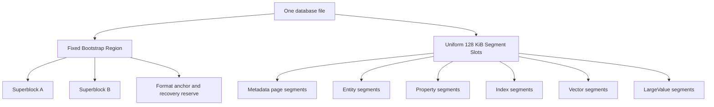
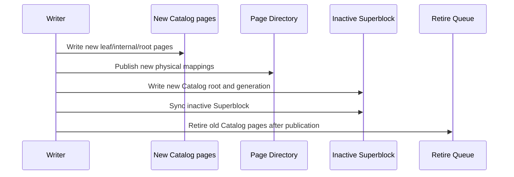
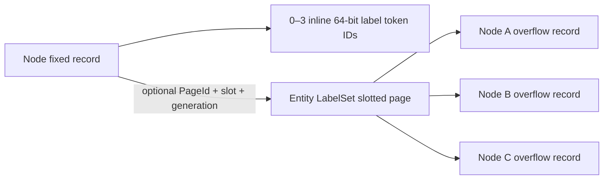

# Native Single-File Storage Re-architecture Plan

> This document is the normative design and implementation plan for ZYX's long-term storage architecture. It takes precedence over historical Stage, legacy-storage, migration, and compatibility descriptions elsewhere. The format defined here is not fully implemented yet; historical implementation notes must not be presented as the final architecture until all stages are complete.

## 1. Decision Boundary

### 1.1 Hard constraints

- A database always consists of one database file; data and metadata are not split into separate files.
- Old databases are not opened, migrated online, migrated offline, or compatibility-read.
- Old databases may be discarded; the new format has a new magic and format version.
- macOS, Linux, and Windows are required platforms.
- All persisted integers, enums, floating-point values, and references use an explicit little-endian codec; raw C++ struct layouts are never persisted.
- Every stage must have independent tests, crash-recovery tests, and coverage gates.

### 1.2 Non-goals

- Do not keep legacy `FileStorage`, legacy `DataManager`, or legacy physical query execution.
- Do not keep migration checkpoints, cutover, legacy backups, or `.migration` sidecars.
- Do not create a domain-specific physical store for code, images, audio, PDFs, or other business payloads.
- Do not maintain isolated, non-interoperable free lists for Catalog, Property, and Vector storage.
- Do not keep adding compatibility branches to format v16; Stage 0 freezes a clean format from scratch.

## 2. Overall Goals

The final architecture must provide all of the following:

- fixed physical segments can be reclaimed and reused across segment kinds;
- Catalog, Page Directory, Allocator, Property, B+Tree, Vector, and LargeValue pages can all be copy-on-written, relocated, and reclaimed;
- updating one Node or Edge does not copy a complete 128 KiB segment;
- a small transaction does not reserve one complete 128 KiB segment for one entity;
- hot reads use validated page views from one shared Buffer Pool;
- database open time is independent of file size and never scans the file to discover Catalog;
- disjoint writers do not fail solely because the global Superblock generation changed;
- large text and binary values can be externalized, chunked, compressed, deduplicated, range-read, and reclaimed;
- B+Tree pages do not pay for a generic entry header or temporary vector materialization on every lookup;
- one Vector mutation does not invalidate the entire PQ/ANN generation;
- every publication recovers as a complete old generation or a complete new generation at every crash point.

## 3. Core Terms and Identity Model

| Concept | Meaning | Can physical location change? |
|---|---|---|
| `EntityId` | Logical business identity of a Node or Edge | No |
| `SegmentId` | Logical identity of a Segment | No |
| `PageId` | Logical identity of a page | No |
| `PhysicalSlot` | Physical 128 KiB Segment slot in the file | Yes |
| `FrameIndex` | 4 KiB page frame inside a Segment | Yes |
| `Generation` | COW version and snapshot safety boundary | Monotonic |
| `LargeValueId` | Logical identity of a generic external value | No |

Persistent references use logical identities. Physical references are used only for Bootstrap roots and the self-bootstrapping path of the Page Directory.

## 4. Single-File Physical Layout

### 4.1 File layout

The database file consists of a fixed Bootstrap Region followed by a uniform Segment Space:



The Bootstrap Region should be one fixed, 128 KiB-aligned region containing:

- format magic and version;
- Superblock A/B;
- database UUID;
- a fixed recovery anchor;
- a small metadata emergency-reserve descriptor;
- reserved fields for future format extensions.

The Bootstrap Region never participates in ordinary Segment allocation. It is a fixed format entry point, not a `SegmentKind`, so the requirement that every ordinary Segment be reclaimable still holds.

### 4.2 Segments and pages

- Every ordinary physical Segment is exactly 128 KiB and file-offset aligned.
- A Segment consists of an explicit envelope and a number of 4 KiB frames.
- The usable frame count is calculated by a layout solver from the envelope, checksum, alignment, and page header; business code must not hard-code it.
- Fixed Entity, B+Tree, Property, Vector, and LargeValue data use 4 KiB pages as the primary COW and cache unit.
- Large contiguous values use multiple frames or Segments inside the fixed physical unit; they never change the global physical Segment size.

### 4.3 SegmentKind and page subtype

Physical allocation is not bound to a future type. The current generation's Segment envelope records `SegmentKind`; the page header records a more specific subtype.

Recommended long-term SegmentKinds:

| SegmentKind | Purpose |
|---|---|
| `SGK_METADATA_PAGE_POOL` | Catalog, Page Directory, Allocator, System Catalog, and Retire Queue pages |
| `SGK_ENTITY_PAGE_POOL` | Mixed Node/Edge fixed pages and Node LabelSet slotted pages |
| `SGK_PROPERTY_PAGE_POOL` | Slotted Property pages |
| `SGK_INDEX_PAGE_POOL` | Packed B+Tree pages |
| `SGK_VECTOR_RAW_POOL` | Raw vector pages |
| `SGK_VECTOR_PQ_POOL` | PQ code pages |
| `SGK_VECTOR_ADJACENCY_POOL` | Vector adjacency pages |
| `SGK_VECTOR_MANIFEST_POOL` | Vector manifest pages |
| `SGK_LARGE_VALUE_DATA_POOL` | Generic LargeValue chunks |
| `SGK_LARGE_VALUE_MANIFEST_POOL` | Generic LargeValue manifests/indexes |
| `SGK_BULK_SCRATCH` | Transaction-private same-file bounded-sort fragments; never graph-visible and reclaimed on writable open if unpublished |

`SGK_CATALOG` is no longer an unreclaimable dedicated physical pool. Catalog pages use the `MPK_CATALOG` subtype inside `SGK_METADATA_PAGE_POOL`. A metadata Segment may hold multiple metadata page subtypes and, once empty, can be reused for any other SegmentKind.

Ordinary graph adjacency is a built-in Packed B+Tree and therefore uses `SGK_INDEX_PAGE_POOL`. `SGK_VECTOR_ADJACENCY_POOL` is reserved exclusively for ANN graph state; the two structures must not share codecs, owner kinds, roots, or maintenance policies merely because both use the word adjacency.

## 5. Bootstrap, Roots, and Page Directory

### 5.1 Superblock roots

A/B Superblocks are the only publication root. In the current v4 staged format, each Superblock records:

- `format_version`;
- `generation`;
- `committed_file_end`;
- `allocator_root_physical_ref`;
- `page_directory_root_physical_ref`;
- `catalog_root_physical_ref`;
- other typed metadata-directory physical roots;
- `index_root_directory_root_physical_ref`;
- `retire_queue_root_physical_ref`;
- logical-ID high-water marks;
- checksum.

The Superblock does not store a whole directory and does not move as a directory grows. It stores only a fixed number of root references. In the current staged format, every metadata directory uses a physical bootstrap reference; this is the temporary Stage 3 representation, not evidence that ordinary metadata pages already have stable metadata PageIds. Stage 4 introduces the stable metadata PageId directory: except for the Page Directory bootstrap root needed to break the self-bootstrap cycle, the other metadata roots then migrate to logical references and support page-local relocation.

### 5.2 Page Directory

The Page Directory represents:

```text
PageId -> PhysicalSlot + FrameIndex + Generation + page metadata
```

It is a COW radix/tree. The Superblock stores the Page Directory root as a physical reference, breaking the self-bootstrap cycle. Other metadata roots in the current staged format are also physical references; once the stable metadata PageId directory is complete, this will converge to only that bootstrap root requiring direct physical addressing.

The final bootstrap is one typed physical header, not a generic resolver. Its data branch maps `PageId` to data-page
locations, while its metadata branch maps only `MetadataPageId` to `PhysicalPageRef`. Both branches, their COW pages,
and the header remain physically linked so a lookup never needs to resolve the directory that performs the lookup.
Every non-bootstrap metadata writer obtains an ID/reference pair from one `MetadataWriteBatch`, records that pair in
the metadata branch, makes all candidate bytes durable, and then publishes the one A/B Superblock generation. A
resolver accepts `MetadataPageId` only; it validates the branch type, route identity, reference generation, visibility
fence, and target page identity before exposing bytes. The bootstrap header and bootstrap-branch frames are internal
physical plumbing, never values accepted by that resolver. This keeps equal numeric `PageId` and `MetadataPageId`
values independent and prevents either a recursive route or a data-directory entry from being interpreted as metadata.

Before migration begins, recovery and evacuation must validate that every currently reachable metadata radix, internal, and leaf
page in one Superblock has a non-empty, globally unique logical `PageId`. Duplicate or invalid identities must fail closed before
publication; assigning a fresh ID must never mask corruption.

In the staged format, metadata-pool evacuation must also preserve each copied page's logical `PageId`, changing only its physical
frame, generation, and committed LSN. Older snapshots continue to read that identity through their old physical roots while the new
Superblock reads it through the replacement roots. Other metadata COW writers must not remove the existing physical-root protocol until
the stable directory migration is complete.

All ordinary objects hold PageIds. Relocating a Catalog, Property, B+Tree, Vector, or LargeValue page updates only the relevant Page Directory leaf and its COW path; the logical PageId remains unchanged.

### 5.3 Catalog

The logical Catalog contents are:

```text
SegmentId -> SegmentDescriptor
```

Each SegmentDescriptor contains at least:

- current physical slot;
- owner or pool identifier;
- generation;
- frame summary;
- kind/state/flags.

`SegmentId` may be derived from radix leaf ordinal and entry position and should not be duplicated in every entry. Retired physical slots belong in the Retire Queue rather than ordinary Catalog entries.

## 6. Single-File Allocator and Catalog Reclamation

### 6.1 Independent AllocatorRoot

The Allocator cannot use Catalog as its only authority, or allocation becomes circular:


The Superblock therefore points directly to an independent `AllocatorRoot`. The AllocatorRoot is a COW tree managing:

- free Segment runs;
- free metadata frames;
- allocated slots;
- current reservations;
- retired extents;
- committed file end;
- free-space summaries.

### 6.2 Reservations

A writer reserves physical frames/Segments from the old AllocatorRoot:

1. A process-local reservation manager locks candidate positions.
2. The writer writes new Catalog, Page Directory, Allocator, and business pages.
3. The new AllocatorRoot marks the reservations allocated.
4. If the transaction fails, the old AllocatorRoot still sees unpublished reservations as free.
5. A successful Superblock publication makes the new AllocatorRoot visible.

Near ENOSPC, a rotatable metadata emergency reserve is required so a reclaim/publication transaction can still finish. It is not a permanently pinned physical Segment and can be reclaimed after rotation. Once it supplies a published COW frame, it may temporarily be root-reachable while its descriptor remains the authoritative bootstrap identity. The checksummed Metadata Pool header records an `EMERGENCY_RESERVE_ORIGIN` format flag, so recovery accepts only a consumed reserve with that origin and rejects a forged ordinary-pool alias. Rotation then publishes a fresh tail reserve and promotes the former reserve to normal Catalog ownership in the same generation. A successor normally appends at the physical tail. After a failed or force-killed unpublished rotation, it may instead overwrite only the final complete physical slot when the recovered AllocatorRoot marks that exact slot free. It must never infer reachability from file length, overwrite an allocated/root-reachable slot, or reuse a slot with later physical data. This closes the otherwise permanent one-slot hole created by an interrupted candidate without weakening COW publication.

The same rule applies to every normal Metadata Pool allocation, not only reserve rotation. A `MetadataWriteBatch` carries its current published Superblock through the metadata-page allocator lifetime. Before creating a new pool, the allocator may reuse only a final physical slot that is absent from its registered reachable pools, is not reserved by the same batch for data, and is explicitly free in that batch's current AllocatorRoot. A partial candidate byte sequence or a zero-filled reservation alone is never authority to overwrite a slot. This makes a fresh reopen after an interrupted ordinary pool creation safe to retry without turning the skipped suffix into a permanent hole.

### 6.3 Catalog-page reclamation

Catalog updates use COW:



An old page may enter free space only when all of the following hold:

- it is unreachable from the current roots;
- no active snapshot can reach it from an older root;
- its retire generation is below the oldest active snapshot generation;
- the new AllocatorRoot durably records the physical location as reusable.

### 6.4 Segment reclamation and evacuation

If every frame in a metadata Segment is retired:

```text
metadata Segment -> Retire Queue -> Free Segment Tree
```

If only a few live pages remain:

1. Calculate live-frame density.
2. Start a Metadata Evacuator below the density threshold.
3. Copy live pages to new metadata frames.
4. Keep PageIds stable and update only Page Directory locations.
5. Publish the new directory roots with COW.
6. Free the old Segment after snapshot safety.

The released PhysicalSlot has no Catalog restriction and can become a Property, Vector, Index, Entity, or LargeValue Segment.

## 7. Durability and Publication

The final format does not depend on a Metadata WAL. Since every visible page is a fresh COW page, A/B Superblocks are sufficient as the single-file atomic publication point. A Metadata WAL may remain as a Stage 0/1 implementation aid, but must be removed from the production path in Stage 1.

The final commit sequence is:

1. Write new business data pages/Segments.
2. Write new metadata pages.
3. Sync file data.
4. Write the inactive Superblock.
5. Sync the Superblock.
6. Retire the old generation and reclaim it after snapshot safety.

No page still reachable from an old Superblock or snapshot may be overwritten before publication.

After a crash, only a complete old generation or a complete new generation may be visible. New pages not reachable from the valid Superblock may become reclaimable space leaks, but never logical corruption.

## 8. Buffer Pool

Create one raw-page Buffer Pool shared by every storage subsystem:

- Metadata;
- Catalog/Page Directory;
- Entity;
- Property;
- B+Tree;
- Vector;
- LargeValue.

The Buffer Pool must provide:

- pin/unpin;
- generation-aware keys;
- dirty/private COW pages;
- 2Q or CLOCK-Pro eviction;
- sequential-scan isolation;
- sibling/page prefetch;
- validate once and cache a validated page view;
- byte-based capacity accounting;
- consistent read/write/flush behavior on Windows, macOS, and Linux.

`cache_size` must connect to this Buffer Pool and is measured in bytes (64 MiB by default, with one 4 KiB page as the minimum). Typed-store construction must not trigger a full reconciliation or implicit disk scan; recovery/reconciliation is owned by one database-open coordinator.

## 9. Fixed Entity Rework

### 9.1 Page layout

Nodes and Edges use 4 KiB fixed-entity pages:


The 128 KiB Segment is a page container, not the COW unit for one entity.

### 9.2 Entity Map

EntityId no longer determines a physical slot. A specialized Entity Map stores:

```text
EntityId -> PageId + slot + optional slot generation
```

Segment generation is supplied by the Catalog/Page Directory of the same snapshot and is not duplicated in every entity entry.

After deletion, a slot can be reused by any new EntityId. Full scans iterate entity pages and bitmaps rather than walking a wide Location Directory one entity at a time.

### 9.3 Node/Edge records

Fixed Node/Edge records remove:

- Property ID;
- Property storage type;
- fields that exist only for Property-ID reservation;
- duplicated logical IDs when a page-local ID array is sufficient.

Node labels use three inline 64-bit Token IDs plus one optional single-page `EntityLabelSet` record. The historical six-label limit is removed. Three inline slots and the 64-bit Token-ID width are explicit format design constants; single-page overflow capacity is a derived result that stores, tests, and documentation never copy as a number.

An Edge record ultimately stores source NodeId, target NodeId, relationship-type Token ID, and necessary state. It is the only authoritative copy of those fields. Node records contain no incoming/outgoing adjacency roots, and Edge records contain no adjacency-list links. Ordinary graph adjacency is a separately maintained built-in Packed B+Tree.

### 9.4 Node-label layout

A fixed Node record stores:

- `inline_label_count`, ranging from zero through three;
- three 64-bit `inline_label_ids`;
- an optional `label_overflow = PageId + slot_id + slot_generation`.

The complete label set consists of nonzero, strictly increasing, unique schema-token IDs. A set of zero through three labels is entirely inline and its overflow reference must be empty. A set of four or more labels keeps the first three Token IDs from the canonical sequence in the fixed record and stores every remaining Token ID, in the same order, in one `EntityLabelSet` record. The fixed record does not duplicate the total count; the overflow-record header stores its own element count.



One 4 KiB LabelSet slotted page stores overflow records for multiple Nodes; a Node must not own a dedicated page. Each overflow record belongs to exactly one Node and is not deduplicated across Nodes. A record does not repeat its NodeId because the stable reference in the fixed Node record is the sole ownership edge. LabelSet pages use the `POK_ENTITY_LABEL` subtype, while Node/Edge fixed pages use `POK_ENTITY`. Both page kinds may share one `SGK_ENTITY_PAGE_POOL`; the design adds neither a dedicated 128 KiB Label Segment nor a dependency on `SGK_PROPERTY_PAGE_POOL`.

### 9.5 Single-page capacity and explicit limit

LabelSet records use an explicit little-endian array of 64-bit Token IDs. They do not use compression, variable-length integers, or a chunk chain. The eight-byte Token-ID width is a base field width in the current format, and the Node record, Schema Token Registry, LabelSet codec, and Label Index keep it consistent.

The capacity of one overflow record is derived from `RSS_PAGE_OWNER_MAX_PAYLOAD_BYTES`, `RSS_SLOTTED_PAGE_HEADER_BYTES`, the 16-byte `RSS_SLOTTED_PAGE_SLOT_BYTES`, `RSS_ENTITY_LABEL_SET_HEADER_BYTES`, record alignment, and `sizeof(uint64_t)`. The normative test is whether the complete encoded LabelSet record fits in one empty typed slotted page. Implementations preflight through one shared encoded-size/capacity solver rather than comparing a handwritten label count.

`RSS_ENTITY_LABEL_SET_MAX_OVERFLOW_LABELS` is the solver result, and `RSS_ENTITY_MAX_LABELS` is the sum of the three inline slots and overflow capacity. The rule applies only to a result computed by composing layout constants, such as an implementation-specific maximum label count: it must not be copied into persisted data, control flow, tests, or documentation as an independent numeric contract. Diagnostic tools may display it, but they obtain it from the shared solver.

In contrast, stable format facts remain explicit. A 64-bit Token ID, a 16-byte slot entry, the three inline slots, and the page size define the on-disk codec and must be documented and tested as such. When a base layout constant changes, update its single code definition and the format version according to persistence-compatibility rules; codecs, allocators, and tests then follow the same solver for every derived limit.

The largest encodable overflow must succeed. `RSS_ENTITY_LABEL_SET_MAX_OVERFLOW_LABELS + 1` must return an explicit capacity error before page allocation, candidate-frame writes, or metadata publication. The current design neither reserves nor implements multi-record, multi-page, or chunked LabelSets.

### 9.6 Placement, updates, and space reuse

LabelSet placement uses a best-fit free-space index isolated by `PageOwnerKind`. Each index entry tracks at least contiguous free bytes, reclaimable bytes, and reusable dead-slot count. Insertion costs the record bytes and adds the 16-byte `RSS_SLOTTED_PAGE_SLOT_BYTES` only when no dead slot is reusable; this avoids a conservative estimate skipping a page that can accept the record. Selection proceeds as follows:

1. Prefer the smallest free region in an existing `POK_ENTITY_LABEL` page that fits `record bytes + slot entry`.
2. If total free space is sufficient but fragmented, compact a candidate COW image and retry.
3. If no current page fits, append a LabelSet page to a free frame in an existing `SGK_ENTITY_PAGE_POOL`.
4. Allocate another Entity-pool Segment only when every matching Entity pool lacks a free frame.

The free-space index must filter by page subtype and must never open a fixed Node/Edge page in the same Entity Segment as a slotted page. A placement hint is not write authority: under the pinned generation, the metadata writer revalidates the Page Directory, Catalog, owner kind, owner LSN, and available COW frame.

Updating a current LabelSet page always writes a new COW frame. The candidate frame may come from the source Segment or another `SGK_ENTITY_PAGE_POOL` in the same owner domain. The latter keeps the original `PageId` and switches only its Page Directory location. A full source pool must not reject an otherwise feasible label update.

A label update first attempts to remain in its current page. A shorter record reuses its existing capacity. Growth tries adjacent free space, a page-local payload move, and compaction in that order while preserving `PageId + slot_id + slot_generation`. Payload offsets exist only in slot entries, so an in-page move does not rewrite the Node record. If the record still does not fit, the transaction creates a slot in another LabelSet page, switches the Node overflow reference, and erases the old slot atomically. Reducing a set to three or fewer labels clears the overflow reference and erases the old slot.

Deletion puts a slot into the dead state, and reuse increments its generation, making stale caches and references fail closed. A smaller new record may use a released slot, and compaction coalesces page-local fragments so the previous record size does not become a permanent hole. An empty LabelSet page enters snapshot-safe retirement. Once every frame in an Entity Segment is unreachable, ordinary Segment evacuation/reclamation can release its physical slot for cross-SegmentKind reuse.

### 9.7 Atomicity, reads, and index consistency

One label mutation publishes the fixed Node page, LabelSet page, Page Directory, and Label Index delta through one metadata transaction and one Superblock generation. Publishing an overflow page before the Node that references it is forbidden, as is erasing the old slot before switching the Node reference. A pre-commit failure leaves no reachable orphan; after commit, an older snapshot continues to read the old Node and LabelSet frames through its old Page Directory root.

A read adds at most one 4 KiB page lookup: it first resolves the fixed Node record through the Entity Map; when the overflow reference is nonempty, it resolves the LabelSet page through the Page Directory and Buffer Pool, then validates `POK_ENTITY_LABEL`, page generation, slot generation, record checksum, canonical ordering, and the capacity bound. Buffer Pool keys use logical PageId and snapshot generation. Relocating a LabelSet page changes only the Page Directory and never rewrites the Node reference.

The integrity scanner cross-validates that every nonempty Node overflow reference resolves to exactly one live LabelSet slot, every live LabelSet slot is referenced by exactly one Node, no two Nodes share a slot, an empty reference carries no partial PageId/slot/generation, and the Label Index token set for that Node exactly equals the canonical union of inline and overflow labels. A mutation computes Label Index add/remove deltas directly from the old and new canonical sets and never scans the complete Label Index.

## 10. Property Store

### 10.1 Property identity

Property identity is:

```text
(EntityKind, EntityId) -> PropertyRoot
```

Absence means no Property Directory entry. There is no independent PropertyId reservation, and Node/Edge records do not contain a Property reference.

### 10.2 Multi-level Property representation

| Size | Representation | Goal |
|---|---|---|
| Very small | Inline Property value | Avoid another page read |
| Small/medium | Slotted Property page | Bounded per-entity updates |
| Large collection | Per-key records or a small Property tree | Avoid copying the entire collection for one key |
| Large value | `LargeValueRef` | Chunking, compression, and range reads |

Updating one key must not copy the complete Property collection. Slotted pages need capacity reclaim, hysteresis, and page-pressure compaction.

### 10.3 Property Directory cache

Placement caches must not be globally invalidated by every database generation. Use per-pool/per-shard versions, a persistent free-space class index, and incremental updates.

## 11. Generic LargeValue

Code, images, JSON, PDFs, audio/video, and model files use one `LargeValueStore`; no `CodeObjectStore` or `ImageStore` is created.

Recommended abstraction:

```text
Value
    -> InlineValue
    -> LargeValueRef

LargeValueStore
    -> LargeValueManifest
    -> LargeValueChunk/Extent
```

`LargeValueRef` stores:

- logical object ID;
- generation;
- uncompressed size;
- content hash;
- text/bytes kind;
- a nonempty printable-ASCII media type bounded by the format policy;
- codec;
- checksum information.

`LargeValueRef::generation` and `LargeValueManifest::generation` are immutable
logical generations. They identify the value content and do not change merely
because a compactor copies a physical frame. `PageLocation::generation`,
`PageOwnerHeader::generation`, and `LargeValueManifestLocation::generation`
instead identify the current physical pool/frame generation. The two domains
must not be compared as though they represented one version number.

### 11.1 Cypher and Driver ABI

Ordinary Cypher keeps property assignment semantics:

```cypher
CREATE (f:CodeFile {
    path: $path,
    content: $content,
    content_type: "text/x-c++src"
})
```

Small values are stored inline and large values are automatically externalized. Binary data uses a generic bytes parameter; the storage layer does not add `Code`, `Image`, or other domain-specific ValueKinds.

Very large values use generic Driver ABI streaming operations:

- begin external value;
- write chunk;
- finish/abort;
- read range;
- read stream.

The current ABI exposes a bounded pull stream for result bytes and value
references. A caller supplies an `(offset, length)` range and repeatedly reads
into an application-owned buffer; the stream returns `ZYX_DRIVER_DONE` only
after that range is exhausted. The stream owns an immutable byte snapshot, so
the source result may be closed after the stream is opened. This bounds each
ABI copy, while the native LargeValue range reader remains responsible for
chunk-level I/O and decompression.

`DriverAbiBytesTest.StreamsPersistedLargeValueRangesAfterReopenAndResultRelease`
is the native end-to-end acceptance checkpoint for this boundary: it persists
an over-inline binary Property, closes and reopens the single database file,
opens a strict subrange stream, releases its source result, and verifies the
entire subsequent pull is byte-exact. This proves the persisted `LargeValueRef`
route rather than only an in-memory parameter echo; performance, fault-injection,
binding-adapter, and three-platform gates remain open.

LargeValue creation and the Property reference must be published in one transaction.

### 11.2 Chunking and compression

- Start with a 32 KiB chunk and tune within 16–64 KiB using benchmarks.
- Usually do not compress very small values.
- Prefer LZ4 or Zstd for code, JSON, SQL, and logs.
- Keep already-compressed PNG, JPEG, ZIP, and similar formats raw by default.
- Store a checksum and codec per chunk.
- Range reads decompress only the required chunks.
- Compute `content_hash` from uncompressed bytes for deduplication.
- Use `normalized_hash` for code-similarity analysis only, never as the physical identity.

### 11.3 Code-analysis data model

Store a source file once whenever possible:

| Entity | Main fields |
|---|---|
| `CodeFile` | path, language, commit, content hash, LargeValueRef, line-index ref |
| AST/Function Node | file ID, start byte, end byte, line range, symbol metadata |
| Independent CodeSnippet | LargeValueRef, language, content hash, normalization metadata |

AST nodes should refer to source ranges instead of copying complete source text.

### 11.4 Reclamation

LargeValue uses immutable objects:

```text
new chunks -> new PropertyRoot -> Superblock publication
-> old object enters Retire Queue
-> snapshot-safe reachability reclaim
```

When multiple entities share one content hash, reachability or reference information must prove that the final reference is gone before reclaiming the object.

### 11.5 Relocation and snapshot safety

LargeValue uses stable `PageId` values rather than physical pointers. A data
page move publishes only its replacement Page Directory location. A manifest
page move publishes its replacement Page Directory location and the matching
`LargeValueManifestLocation` route in one COW/Superblock publication. Both
moves write a physical owner with the destination pool generation while keeping
the logical `LargeValueRef` and manifest generation unchanged.

An old snapshot therefore resolves the old directory roots and reads the old
frames; a newer snapshot resolves the new route and frame. The source pool is
retired after its last current page moves, but its physical slot is released
only after all snapshots that may still resolve the old roots have drained.

## 12. Packed B+Tree

B+Tree uses a specialized packed page codec:

- separate leaf and internal page layouts;
- packed offset arrays;
- canonical on-disk key order;
- prefix compression and restart points;
- binary search on a raw page view;
- range cursors without materializing a full entry vector;
- decode the EntityId suffix from a scalar composite key instead of storing it again as a value.

Property-index ordering remains:

```text
(PropertyValue, EntityId)
```

EntityId supplies stable ordering for duplicate property values and unique positioning. What must be removed is physical duplicate encoding and the wide generic entry header.

Bulk builders and online mutation share the same page invariant, separator, split/merge, and corruption checks.

The implementation supports named key codecs and comparators rather than embedding Property-index assumptions into the tree. The ordinary graph adjacency specialization uses fixed logical fields `(direction, NodeId, EdgeId)` and an empty value. Its comparator orders the fields by direction, unsigned NodeId, then unsigned EdgeId; the disk codec still writes every integer through the explicit format codec. Capacity, fan-out, restart interval, separator size, and entries per page are always derived from encoded bytes and the shared page-layout solver.

Every tree has a stable logical `IndexId`; the COW root PageId and root generation are stored in the Index Root Directory. The ordinary adjacency tree owns one reserved built-in `IndexId` that can never collide with user-created indexes. This keeps the Superblock fixed-size: it publishes the Index Root Directory root, while that snapshot's directory identifies the adjacency root. Empty-tree state is represented by an absent adjacency root entry, not by a permanent empty page.

## 13. Canonical System Catalog

Remove the sealed/dynamic dual system and create one canonical mutable System Catalog:

```text
(property-key, name)       -> token
(property-token, token)    -> name
(schema-name, kind, name)  -> schema token
(schema-token, kind, token)-> definition
(index-id, id)             -> definition
(index-name, name)         -> id
(index-schema, signature)  -> id
(constraint-id, id)        -> definition
(constraint-name, name)    -> id
(sequence, kind)           -> high-water mark
```

Forward, reverse, and secondary entries are atomically updated in one metadata transaction. Do not retain an artificial high-bit dynamic-ID namespace or a sealed tombstone registry.

### 13.0 Graph cardinality statistics

The System Catalog also owns one snapshot-pinned pair of logical Node/Edge cardinalities. Persisted values use a nonzero
encoding so an empty graph remains distinguishable from an invalid B+Tree leaf value; a missing pair means statistics are
unavailable for a legacy file, while a one-sided pair fails closed. Ordinary graph mutations and the final streamed bulk
Edge publication update the pair in the same A/B generation as their Catalog, adjacency, and Entity state. The bulk path
increments the Edge count only when a complete pair already exists; it never derives legacy cardinality from logical-ID
high-water marks.

### 13.1 Schema Token names and IDs

Label and relationship-type names exist only in the canonical System Catalog and are never written into Nodes, Edges, LabelSets, or Label Indexes. The System Catalog maintains two logical directions: name plus kind to `SchemaTokenId`, and kind plus `SchemaTokenId` to a definition containing the canonical name. The forward index serves query binding; the reverse definition serves name rendering, catalog integrity checks, and administration. Execution carries only Token IDs.

A name is a UTF-8 byte string bounded by one shared System Catalog name-limit format constant. That bound simultaneously satisfies the public API policy, definition-record capacity, forward-key capacity, reverse-definition capacity, and target B+Tree fan-out. Cypher, the Driver ABI, System Catalog codecs, and lookup APIs share it. Neither the theoretical range of a persisted length field nor the largest entry that barely fits in an empty page becomes the public name limit.

`SchemaTokenId` uses an explicit 64-bit little-endian wire field. The shared name limit and related key/record overhead use their own format constants. Any B+Tree-entry or page capacity derived from them is consumed only through the shared solver and is never copied as a result number into documentation or callers. Unknown definition versions and inputs beyond the unified name bound fail closed.

The canonical definition owns the authoritative name. A forward B+Tree still stores a comparable name key for collision-free lookup. This bounded duplication occurs once per unique schema token and is deliberate; leaf prefix compression, internal separator truncation, and the dictionary cache control its cost. Names are never duplicated into each entity or Label Index entry.

## 14. Graph Adjacency

Ordinary graph adjacency and Vector ANN adjacency are independent data structures. Ordinary graph adjacency is one global built-in Packed B+Tree; Vector adjacency retains the Vector-specific design in Section 15.

### 14.0 Normative implementation boundary

The ordinary-graph implementation has exactly one durable adjacency representation: the reserved global, key-only Packed B+Tree. This is a format invariant, not a planner preference. Every implementation phase and optimization must preserve all of the following:

- the format-reserved `RSS_GLOBAL_ADJACENCY_INDEX_ID` is the only ordinary-graph adjacency `IndexId`; it resolves the one adjacency root from the snapshot-pinned Index Root Directory and is never allocatable to a user or secondary index;
- Node records own no adjacency root or adjacency key, and Edge records own no neighbor link, physical page location, or duplicated adjacency payload;
- each live Edge owns exactly one `ADJ_OUT` key and one `ADJ_IN` key, committed and removed in the same metadata generation as the authoritative Edge change;
- B+Tree pages contain only routing/separator data or key-only adjacency entries, never mixed Node or Edge records;
- a relocation changes only the Page Directory route for a logical `PageId`; it never rewrites an Edge, a Node, a cursor continuation, or a parent child reference.

Per-Node chains, per-Node roots, Base/Delta/Tombstone tiers, adjacency tail pages, and an Edge-to-Edge linked list are retired designs. They are not fallbacks, compatibility readers, or optimization candidates. If measured workloads later require a specialized access path, it must be a separately identified derived index with its own codec, root, publication, reclamation, integrity, and benchmark gates; it must not change the semantics or payload of the global adjacency tree.

### 14.0.1 Structural decision record

"Global Packed B+Tree" describes only the ordinary-graph adjacency access path. It neither co-locates Node and Edge records in B+Tree pages nor makes an Edge record a B+Tree leaf value. The following are mandatory clean-format choices:

| Option | Decision | Reason |
|---|---|---|
| One global key-only tree | Adopt | Low-degree Nodes share leaves and supernodes stream through sequential leaves; there is one root, codec, publication path, and retirement lifecycle. |
| Separate outgoing and incoming trees | Reject | The `direction` prefix already supplies two ordered access ranges. Splitting the tree only multiplies root-directory, COW, and reclamation state; it cannot remove the two keys required by one Edge mutation. |
| Per-Node root or per-Node B+Tree | Reject | It recreates permanently sparse roots/tail pages, more root publications, and supernode-specific structures; low-degree Nodes cannot share encoded key space. |
| Edge doubly linked list or Edge chain | Reject | Insertion and deletion rewrite Node heads and neighboring Edges, expanding the transactional write set and coupling relocation, snapshots, and integrity to physical relationship links. |
| Embed Edge records or a covering Edge payload in adjacency leaves | Reject | It creates a second authoritative copy of endpoint/type/state, mixes Entity and Index codec/lifecycle, and amplifies B+Tree writes whenever a mirrored relationship field changes. |

Consequently, a B+Tree leaf can contain **adjacency key ranges** for several Nodes, but never those Nodes' or Edges' entity records. An expansion streams `EdgeId` values first and resolves a record from the Edge Entity Store in the same snapshot only when the query actually needs its endpoint, type, state, or Properties. This deliberate two-stage read separates sequential adjacency scanning from entity materialization and prevents unnecessary Edge fields from occupying every index entry.

### 14.1 Authoritative data and key schema

The Edge Entity Store is authoritative:

```text
EdgeId -> sourceNodeId + targetNodeId + relationshipTypeId + state
```

The adjacency tree is a secondary access path with the logical schema:

```text
(direction, NodeId, EdgeId) -> empty
```

There is one tree and one root, not one tree per direction or per Node. `direction` is the first key component so that the outgoing and incoming access paths are disjoint ordered ranges in the same tree. This preserves one uniform codec, one publication boundary, and one reclamation lifecycle without creating a permanently sparse root hierarchy.

For every live directed Edge, it contains exactly two entries:

```text
(ADJ_OUT, sourceNodeId, EdgeId) -> empty
(ADJ_IN,  targetNodeId, EdgeId) -> empty
```

`AdjacencyDirection` is a persisted prefixed enum; unknown values fail closed on every platform. NodeId and EdgeId are positive 64-bit logical IDs. The routing NodeId is necessarily part of the key, but the empty value is normative: the tree stores neither the other endpoint nor relationship type/state as an Edge payload. The first implementation must not add a covering value. A future type-qualified access path, if justified by measured workloads, is a separate derived index with its own identity and lifecycle rather than a silent change to this key.

The comparator defines canonical ordering by `direction`, unsigned `NodeId`, then unsigned `EdgeId`. Entries for one `(direction, NodeId)` therefore form one contiguous range and are deterministically ordered. Prefix compression removes the repeated direction/NodeId bytes within such a range. Multiple low-degree Nodes share each leaf; no Node or direction owns a 4 KiB tail page. A supernode spans as many consecutive leaves as required without a per-Node size limit.

The physical boundary is strict. Entity pages contain fixed Node and Edge records; adjacency leaves contain only sorted keys and an empty value; adjacency internal pages contain only separators and logical child PageIds. A B+Tree leaf may therefore contain ranges for many Nodes, but it never contains their Node records or Edge records. This is the packed-layout property, not a decision to place graph entities into the B+Tree.

### 14.2 Root ownership and physical placement

The global tree uses the reserved built-in adjacency `IndexId` in the Index Root Directory. A snapshot resolves:

```text
Superblock -> Index Root Directory -> adjacency IndexId -> B+Tree root PageId + root generation
```

The root entry and every B+Tree page are part of the same metadata generation. Adjacency leaf and internal pages use the ordinary Packed B+Tree codec, `SGK_INDEX_PAGE_POOL`, and adjacency-specific owner identity. They never share a page with Node records, Edge records, or Vector adjacency. Page relocation keeps the logical PageId and changes only the Page Directory route; tree references and Edge records are not rewritten.

An empty graph has no adjacency root entry. The first Edge transaction creates the initial tree and publishes its root entry. Removing the final Edge atomically removes the root entry from the new generation; old snapshots retain the old root, and its physical pages are released only after snapshot safety. No per-Node Root page, Root write-tail hint, Base/Delta chain, Tombstone, merge threshold, merge debt, or recovery cursor exists in the final ordinary-graph format.

### 14.3 Read path and cursor contract

Outgoing and incoming expansion perform a lower-bound seek to the first key for `(direction, NodeId)`, then advance until that prefix changes. The complexity is `O(log E + degree)` comparisons and proportional output work. Root and internal pages use normal Buffer Pool admission. Leaves consumed by a range scan use sequential admission; the cursor prefetches bounded right siblings without pinning an unbounded route.

The cursor reads compressed keys directly from a validated page view. It retains only the current leaf pin, restart/search state, prefix bounds, and a logical continuation key; it must not materialize a complete leaf or a complete adjacency range. Continuation is `(snapshot generation, direction, NodeId, last EdgeId)` and resumes strictly after `last EdgeId`. It never exposes PageId, slot, or physical offset. A stale or foreign continuation fails closed or restarts from its logical lower bound according to the public cursor contract.

An adjacency-only operation such as degree/count may count entries without reading Edge records. Traversals that return Edge fields resolve each EdgeId through the snapshot-pinned Edge Entity Map and validate that the Edge is live and its endpoint matches the scanned prefix. Relationship-type filtering initially reads the authoritative Edge record; it must be batched and locality-aware rather than issuing an unconstrained random read per key.

Undirected expansion opens the two bounded ranges independently and combines them. Self-loop semantics are explicit: one self-loop has one `ADJ_OUT` and one `ADJ_IN` entry; an undirected operator deduplicates by EdgeId only when Cypher semantics require one relationship result.

### 14.4 Mutation and publication

Creating one Edge plans the Edge record, Entity Map entry, `ADJ_OUT` insert, and `ADJ_IN` insert against one pinned generation. It applies both key mutations through one B+Tree COW overlay and publishes all replacement pages, the replacement adjacency root, metadata roots, and the inactive A/B Superblock in one commit. A crash can expose only the complete old generation or the complete new generation; one-direction visibility is forbidden.

The global root is a physical publication point, not a user-visible conflict domain. Before publication, the transaction layer revalidates its sorted final-state overlay against the current root and retries/rebases it when a concurrent adjacency commit has advanced the root. It reports a conflict only for a semantic contradiction such as a duplicate/deleted Edge identity or changed authoritative endpoint, never merely because another writer replaced the global root. Rebase work and retry count are bounded by the transaction policy.

Deleting one Edge resolves its authoritative old endpoints, erases both exact adjacency keys through the same overlay, removes the Edge record and Entity Map entry, and atomically publishes the result. Ordinary graph deletion does not append a logical Tombstone. COW-retired pages enter the common generation-aware Retire Queue and become reusable only after older snapshots drain.

`DETACH DELETE` performs bounded outgoing and incoming range scans, deduplicates EdgeIds including self-loops, validates transaction limits before preparing publication, and submits one bulk final-state plan. It removes every affected Edge record and both entries for every Edge exactly once. Concurrent or stale-root publication is rejected before visibility and retried from a fresh snapshot by the transaction layer.

Bulk ingest generates the two keys for every validated Edge, sorts and deduplicates them by the canonical comparator, and feeds the shared bulk/overlay page builder. Already ordered runs should be merged rather than repeatedly inserted one key at a time. Online and bulk paths use identical leaf fill, restart, separator, checksum, split/merge, and owner invariants. Capacity and memory are bounded by configured transaction/run limits; external sorting, if later required, must remain inside the single database file or bounded temporary process memory and may not become a second durable database artifact.

### 14.5 Space, maintenance, and optional write buffering

Deletion uses ordinary Packed B+Tree underflow handling. Sibling redistribution or merge occurs in the candidate COW image; empty leaves and collapsed internal roots retire through the common page-reclamation path. Page occupancy policy uses byte counts from the codec, not fixed entry counts. Background whole-tree compaction is not required for correctness, but a bounded maintenance rebuild may repack a tree whose measured byte occupancy falls below policy. It publishes one replacement root and retires the old tree snapshot-safely.

The first production implementation must use the plain global Packed B+Tree. If benchmarks show unacceptable COW write amplification for isolated Edge mutations, a later stage may add one bounded global write buffer in front of the same canonical tree. That decision requires recorded thresholds and must preserve one logical cursor, atomic dual-entry visibility, bounded memory, deterministic recovery, and the single-file rule. Per-Node delta chains and the previous Base/Delta/Tombstone hierarchy are not fallback options.

### 14.6 Integrity requirements

The integrity scanner verifies all of the following within one pinned snapshot:

- every live Edge has exactly one matching `ADJ_OUT` and one matching `ADJ_IN` entry;
- every adjacency entry resolves to one live Edge whose endpoint matches its direction and NodeId;
- no duplicate, missing, foreign, zero-ID, or unknown-direction key exists;
- key order, prefix/restart encoding, separators, sibling links, page ownership, generation, LSN, and CRC are valid;
- the reserved adjacency IndexId has at most one current root and no user definition can claim it;
- all reachable pages belong to that root, and retired/unreachable pages are classified by the common reclaimer.

Fast open validates roots and page structure on demand; it does not scan all Edges. Full bidirectional cross-validation is an explicit integrity/maintenance operation with bounded-memory external progress, not a normal startup requirement.

## 15. Vector

### 15.1 Manifest

The Vector Manifest remains O(1) and stores only:

- dimensions/metric;
- total record count;
- Raw/PQ/Adjacency mapping roots;
- codebook root/generation;
- base/delta generations;
- ANN entry point;
- allocation-tail hints.

It does not enumerate all Raw/PQ pages. The Page Directory and mapping roots are the authoritative inventory.

### 15.2 Mapping

Mappings return directly:

```text
(PageId, slot, generation)
```

They must not return only a page and then linearly search the page for a VectorId.

The Vector delta mapping uses a fixed typed key `(VectorId, Operation)` and stores the corresponding `NodeId` in
the leaf value. Both `INSERT` and `ERASE` can therefore prove Node-to-Vector, Vector-to-Node, and Raw Location
consistency with bounded point lookups instead of scanning the semantic mapping; seeing both operations for one
VectorId must fail closed.

### 15.3 Online mutation

Vector storage uses immutable base plus mutable delta:

```text
base ANN/PQ generation
delta vectors
tombstones
query merge
background rebuild
atomic base replacement
```

Adding a vector must not invalidate the whole PQ/adjacency generation. With an existing codebook, calculate one PQ code; put adjacency changes in a delta graph or perform local repair.

Delta entry count and mapping-page count are independent bounded resources. Crossing the maintenance threshold must
schedule a base rebuild rather than grow without bound or silently reject user writes; until the rebuild completes,
queries merge `base - tombstones + exact inserts`.

### 15.4 Rebuild

Vector rebuilds finish in unpublished private pages and publish once:

- Raw/PQ/Adjacency mapping roots;
- codebook root;
- base/delta manifest;
- entry point;
- retire queue.

The adjacency builder uses a controlled Vamana/DiskANN/HNSW-style candidate algorithm; all-source/all-candidate O(N^2) comparison is prohibited.

## 16. Legacy and Migration Removal

Retirement applies to implementations, never implicitly to documented behavior. A legacy file must remain available
as a migration reference, or its behavior must first be captured by storage-neutral acceptance tests, when it is the
only implementation or test of a supported API, Cypher procedure, algorithm, administrative operation, or performance
contract. Section 22 is the mandatory feature-preservation and deletion gate for this cleanup.

After Stage 0, the following must not enter production source sets:

- legacy `FileStorage`, `DataManager`, and physical query paths;
- `OfflineMigrationCoordinator`, cutover, checkpoints, and sidecars;
- `Legacy*` storage classes;
- sealed/dynamic registry pairs;
- legacy Blob semantic claim/reclamation;
- the State migration subsystem;
- `SFM_LEGACY` and legacy magic probing;
- legacy backend pointers and legacy QueryEngine constructors;
- `database migrate` and `database cutover` CLI commands.

Maintenance builders with long-term value are retained and moved to:

```text
src/storage/relocatable/maintenance/vector/
src/storage/relocatable/maintenance/index/
```

Examples include the Vector adjacency builder, PQ builder, and scalar-index materializer.

Production CMake must replace recursive globs with explicit source sets so removed legacy files cannot silently re-enter the final binary.

## 17. Component Boundaries and Suggested Directories

Suggested long-term module boundaries:

```text
storage/relocatable/format/
    DiskCodec, Superblock, SegmentEnvelope, PageHeader

storage/relocatable/allocation/
    PhysicalAllocator, AllocatorTree, Reservation, FreeSpaceIndex

storage/relocatable/metadata/
    PageDirectory, Catalog, SystemCatalog, RetireQueue, Recovery

storage/relocatable/cache/
    BufferPool, PageView, Prefetch, Eviction

storage/relocatable/entity/
    EntityPage, EntityMap, EntityLabelSet, EntityScan, EntityMutation

storage/relocatable/property/
    EntityPropertyDirectory, PropertyCollectionRoot, PropertyCollectionRootStore, PropertyValueCodec, LargeValue

storage/relocatable/index/
    PackedBTree, BTreeCursor, BulkBuilder, IndexDirectory, AdjacencyKeyCodec

storage/relocatable/adjacency/
    GlobalAdjacencyIndex, AdjacencyCursor, AdjacencyMutationPlanner, AdjacencyIntegrity

storage/relocatable/vector/
    Raw, PQ, Manifest, DeltaIndex, Search

storage/relocatable/maintenance/
    Reclaimer, Compactor, Evacuator, VectorBuilder
```

Very large aggregate files such as `RelocatableMetadataStore.cpp` should be split along these responsibilities. The transaction coordinator coordinates root changes; it does not implement every page codec.

## 18. Stage 0-10 Implementation Plan

### Stage 0: Freeze the clean format

Work:

- Define the new single-file magic, format version, and Bootstrap layout.
- Reject every old file magic/version.
- Remove migration/legacy public APIs, CLI, and production sources.
- Unify root descriptors and logical/physical references.
- Establish explicit CMake source sets.
- Update the bilingual architecture and format matrix.

Dependencies: none.

Test gate: new-file creation, old-magic rejection, corrupt-header rejection, three-platform build, format-codec fuzzing.

Current implementation checkpoint: format v3 / Superblock v30 remove the retired Property root, the retired `PropertyPage`/`PropertyRecordCodec` layout, and the former per-Vector adjacency-directory root. The production source set no longer contains `VectorAdjacencyStore`, `VectorAdjacencyLocation`, `MDT_VECTOR_ADJACENCY`, `PropertyPage`, or `PropertyRecordCodec`; Entity Properties resolve only through owner-keyed roots or typed `LargeValue` references, while Vector adjacency resolves only through immutable typed pages, a Manifest, and a per-index mapping tree. Older format versions are rejected at open and cannot become a migration or runtime fallback.

The deterministic Superblock codec property corpus now covers random 4 KiB pages and checksum-valid one-byte mutations of
canonical pages. Each input must either fail closed with `FormatException` or decode and re-encode byte-for-byte. This
found a real canonicality defect: a checksummed v30 page with nonzero unused payload bytes was accepted, but encoding its
decoded value silently cleared those bytes. The decoder now rejects nonzero bytes in the reserved payload tail after the
metadata emergency reserve. The checkpoint proves a reproducible codec-fuzz boundary and must not be treated as a Stage 0
completion claim; the current full regression passes locally, while three-platform format evidence remains mandatory.

`StorageFormatTest.DatabaseFactoryRejectsChecksumValidButNonCanonicalBootstraps` and
`StorageFormatTest.DatabaseFactoryRejectsBootstrapsWithNoValidChecksum` additionally exercise the production
factory boundary with both A/B slots filled by checksum-valid but invalid Superblocks: an unsupported version, a nonzero
reserved header field, and a nonzero reserved payload byte. Each image is classified as incomplete and refused before a
backend can open it. This complements codec-level validation; it does not close the clean-build, fuzz, recovery, or
three-platform Stage 0 gates.

### Stage 1: Single-file durability core

Work:

- Fixed Bootstrap Region and A/B Superblocks.
- Physical bootstrap roots for Page Directory and Allocator.
- COW root publication.
- Remove production Metadata WAL.
- Reservation and metadata emergency reserve.
- Recovery that exposes only old or new generations.

Performance gate: at most one data sync and one Superblock sync per commit; normal open does not scan the file.

Current Stage 1 evidence: `RelocatableProcessCrashTest` creates a direct operating-system child process: POSIX uses
`fork()` and runs the crash workload in the child, while Windows starts the current test binary with `CreateProcessW`.
The child creates and operates only one native database file, then waits after data has been synced but before a new
Superblock is published, or after the new Superblock publication has completed. The parent uses the platform-native
forced-termination API, reopens that database file, and verifies recovery selects only the complete old generation or
the complete new generation respectively. The test deliberately avoids a shell and does not treat its synchronization
marker as a database artifact. The POSIX implementation does not re-exec an ASan-instrumented test binary, so the same
real child-process boundary remains testable under sanitizers. It proves real process kill/reopen behavior for those two
Superblock publication boundaries only; the short-write, torn-page, ENOSPC, and full crash matrices required by section
19 remain independent release gates.

The macOS ASan+UBSan configuration compiles the test-only native I/O fault-injection seams into `zyx_core`. Its focused
native risk group covers transaction finalization, storage-backend lifecycle, process crash/reopen, LargeValue, Vector,
compaction, and maintenance; 195 tests pass under both sanitizers. This is a required CI gate and local sanitizer evidence,
not a replacement for the required three-platform sanitizer and full-suite gates.

`StorageIO::ScopedNativeWriteHookForTesting` and `StorageIO::ScopedNativeSyncHookForTesting` are compiled only into the
test-instrumented core. They are thread-local, RAII-scoped native-write and native-sync seams; the release core does not
compile these branches, and its normal `pwrite` and durable-sync paths remain direct calls. `RelocatableSuperblockFileTest`
uses the write seam to perform a partial inactive-Superblock write to a real database file, then verifies the write fails
immediately and both current and reopened recovery can select only the old generation. The same test injects a native
sync failure before the inactive Superblock is written and verifies that recovery still selects only the old generation.
This covers actual Superblock short-write and pre-publication-sync behavior; the complete data-page, metadata-page, and
ENOSPC fault matrices still need to be completed independently.
The same test simulates a POSIX `ENOSPC` or Windows `ERROR_DISK_FULL` failure return at the platform native-write
boundary and verifies that no new generation can be published. This is disk-full failure semantics for Superblock
publication, not a substitute for the allocator emergency reserve or complete data-page and metadata-page ENOSPC matrices.

`RelocatablePhysicalSegmentAllocatorTest` additionally injects a partial write and POSIX `ENOSPC` / Windows
`ERROR_DISK_FULL` into a new data Segment and a COW metadata page on a real native database file. Each case verifies that
the in-process current snapshot remains the old generation, close/reopen still cannot observe the unfinished
Catalog/Allocator mapping, and the same logical Segment ID and physical slot can be retried. This covers real I/O failure
at both points of the data-before-metadata boundary; it is not a substitute for the complete torn-page, sync-failure,
metadata-emergency-reserve-exhaustion, and all-writer fault matrix.
`RelocatableProcessCrashTest.KillDuringSegmentCandidateShortWriteRetainsThePublishedGeneration` goes further: a child
is killed after physically writing 16 bytes of the first 4 KiB candidate page of a new Segment and before control returns
to allocator error handling. A fresh-handle reopen can recover only the old Superblock generation, observes neither
Catalog nor Allocator mapping, and retries the same logical Segment ID and physical slot. This is real process-boundary
evidence for an unfinished candidate, not a substitute for the corresponding metadata-page, relocation, and remaining
writer matrices.
`RelocatableProcessCrashTest.KillDuringMetadataPageCandidateShortWriteRetainsThePublishedGeneration` applies the same
16-byte short-write/kill boundary to the first MetadataPageFile COW candidate page in that publication. Reopen likewise
sees only the old generation and can retry. It proves MetadataPageFile cannot damage published metadata before its COW
candidate becomes Superblock-reachable, but does not replace the other metadata-writer, relocation, or sync-failure
matrices.
`RelocatablePhysicalSegmentAllocatorTest.NativeRelocationDestinationShortWriteRetainsSourceAndReopenCanRetry`,
`NativeRelocationDestinationDiskFullRetainsSourceAndReopenCanRetry`, and
`NativeRelocationPrePublicationSyncFailureRetainsSourceAndReopenCanRetry` inject real native failure respectively into
the first 4 KiB target-page write of a complete Segment relocation, a target-page `ENOSPC`/`ERROR_DISK_FULL`, and the
pre-publication data fence. Each proves that both the in-process and fresh-handle reopen Catalog route retain the source
physical slot and payload, the target slot is unallocated, and the same relocation can retry.
`RelocatableProcessCrashTest.KillDuringSegmentRelocationCandidateShortWriteRetainsThePublishedSource` then forcibly
kills the child after it physically writes 16 bytes of that target page but before any error handling can return; the
parent reopen likewise resolves only the published source. This closes the complete-Segment relocation destination's
short-write, disk-full, first-data-fence-failure, and real process-kill boundary. Typed retirement/reclaim, metadata
emergency reserve, tail truncation, and the remaining writer matrices are separate gates.
`NativeRetiredSegmentReleaseMetadataShortWriteRetainsTheRetireQueueAndReopenCanRetry` and
`NativeRetireQueueReclaimMetadataShortWriteRetainsTheRetiredSlotAndReopenCanRetry` additionally cover a real metadata
candidate short write in the explicit retired-slot release and the normal Retire Queue reclaimer. Both retain the
complete pre-retirement-release generation after close/reopen: the slot remains allocated, the Catalog remains retired,
and the queue entry remains present until release/reclaim can safely retry. This covers those two retirement writers'
short-write boundary. The reclaimer also has
`NativeRetireQueueReclaimMetadataDiskFullRetainsTheRetiredSlotAndReopenCanRetry` and
`NativeRetireQueueReclaimPrePublicationSyncFailureRetainsTheRetiredSlotAndReopenCanRetry` for a candidate
`ENOSPC`/`ERROR_DISK_FULL` and the first data-fence failure; both retain that same old generation and allow retry after
reopen. `NativeRetiredSegmentReleaseMetadataDiskFullRetainsTheRetireQueueAndReopenCanRetry` and
`NativeRetiredSegmentReleasePrePublicationSyncFailureRetainsTheRetireQueueAndReopenCanRetry` apply the equivalent
disk-full and first-data-fence assertions to explicit release. They prove that a failed release cannot free the physical
slot or consume the Retire Queue entry before its COW metadata generation is published, and that close/reopen can retry
the same release. `RelocatableProcessCrashTest.KillDuringRetiredSegmentReleaseCandidateShortWriteRetainsTheRetireQueue`
adds the explicit-release process boundary: after a real 16-byte metadata-candidate write and forced child kill, reopen
still sees the retired Catalog entry, allocated slot, and Retire Queue entry, then safely retries release.
`KillDuringRetireQueueReclaimCandidateShortWriteRetainsTheRetiredSlot` proves the equivalent invariant for the normal
Retire Queue reclaimer. The metadata-emergency-reserve matrix remains open.
`EmergencyReserveRotationPrePublicationSyncFailureRetainsTheDescriptorAndReopenCanRetry` now covers the reserve
rotation's real first data-fence failure after a consumed reserve has supplied published COW metadata. It found and
guards the required recovery invariant: this consumed reserve is validly root-reachable until rotation, while its
bootstrap descriptor/header identity and reserve-origin flag remain exact. A failed successor write or fence leaves the old descriptor and
allocator route authoritative; reopen can then rotate to a fresh reserve without treating the consumed reserve as
corruption. `KillDuringEmergencyReserveRotationCandidateRetainsTheConsumedReserve` then force-kills a child after a real
16-byte successor-control-page write and before publication. Reopen keeps the consumed reserve and the old allocator root,
then reuses the root-free physical tail slot for the retry rather than appending past the unreachable candidate. This proves
that an interrupted reserve rotation neither changes reachability nor leaves a permanent single-file hole.
`KillDuringEmergencyReserveRotationCleanupRetainsPublishedRootsAndReusesTheTailOnRetry` covers the complementary
failure-cleanup boundary. It first consumes the reserve through a native ordinary-pool `ENOSPC`/`ERROR_DISK_FULL` path,
then fails the rotation's first data fence after its successor control page exists. The child is force-killed at the
unpublished-tail `truncate` call before cleanup can complete. Reopen retains generation 2, the consumed slot-2 reserve,
and the old AllocatorRoot; slot 3 remains root-free. Retrying the rotation must publish generation 3 by reusing slot 3,
not append slot 4. This proves that neither an interrupted candidate nor an interrupted cleanup can create a reachable
partial reserve rotation or a permanent tail hole.
`RelocatableMetadataEmergencyReserveExhaustionTest.NativeDiskFullWithAnExhaustedReserveRetainsThePublishedGenerationAndCanRetry`
then blocks every ordinary-pool native write, drives one Catalog publication beyond the combined normal and reserve
frame capacity, and proves the exhausted reserve fails closed: no new Superblock is visible, the provisional tail is
truncated, the old descriptor and allocator bit remain authoritative, and the identical request succeeds after reopen
when space is available. A forced-kill boundary while this exhaustion cleanup runs remains part of the broader writer
crash matrix.
`RelocatableMetadataEmergencyReserveExhaustionTest.ReopenReusesOnlyTheRootFreeUnpublishedMetadataTailBeforeAppendingAnotherPool`
persists a partial, root-unreachable ordinary Metadata Pool candidate at the physical tail, reopens from the published
roots, and then forces a new pool allocation. It proves the batch-scoped allocator uses that exact free tail slot rather
than appending a later pool and permanently stranding the candidate slot.
`RelocatableProcessCrashTest.KillDuringMetadataPoolCandidateReusesTheRootFreePhysicalTailOnRetry` advances the same
invariant to a real process boundary: the child is force-terminated after 16 bytes of the ordinary pool's slot-3 control
page have actually been written, but before cleanup or publication can return. The parent reopens from the old Superblock
roots, proves slot 3 remains free, and retries the same Catalog publication in slot 3 rather than appending slot 4. Batch
context is associated with its candidate generation and published Superblock, so a published-but-still-live batch or an
unpublished validation batch cannot contaminate another generation's root-free tail decision as global process state.
`RelocatableTailTruncationTest.NativeTruncateFailureLeavesTheReleasedTailIntactAndCanRetryAfterReopen` uses
`StorageIO::ScopedNativeTruncateHookForTesting` to return `ENOSPC`/`ERROR_DISK_FULL` at the real native tail-truncate
boundary: the file length remains unchanged, reopen can still validate the released slot, and only a later retry shortens
the tail. The production path now uses `StorageIO::truncate()` as well, so Buffer Pool tail invalidation, native error
conversion, and the test seam cannot be bypassed through direct `portable_ftruncate`.
`NativePreTruncateSyncFailureLeavesTheReleasedTailIntactAndCanRetryAfterReopen`
now verifies that a failed first durable fence returns `VTTS_IO_ERROR` without shortening the tail. A failed final fence
is intentionally not reported as success: `NativePostTruncateSyncFailureReportsUncertainDurabilityAndReopensSafely`
verifies it returns `VTTS_IO_ERROR` with the locally shortened length and that reopen remains safe because the suffix was
already published as free. `RelocatableProcessCrashTest.KillAfterTailTruncateBeforeFinalFenceReopensSafely` forces a
child kill after the native truncate returns and before the final durability fence. Reopen still resolves the published
obsolete Catalog entry and free physical slot, with no logical reachability to the truncated suffix.

`RelocatableSharedPagePoolAllocatorFaultTest.ReplacementCandidateShortWriteKeepsOldRouteAndFrameReusable` truncates a
replacement candidate's real native 4 KiB write before its owner header is complete. Because the pool control has not yet
been updated, close/reopen can resolve only the old Page Directory route; the incomplete candidate is unreachable and the
same replacement can retry at the same destination frame. This evidence covers only an unpublished candidate data page;
source owners for replacement, cross-pool evacuation, and typed retirement are now immutable: Page Directory publication
is the sole reachability transition, so a source page still resolved by the old generation is never overwritten before
publication. `ReplacementDoesNotRewriteItsPublishedSourceOwner` and
`EvacuationDoesNotRewriteItsPublishedSourceOwner` assert both paths against real native I/O. Pool control now stores two
checksummed, monotonically sequenced control records: a writer uses generation-tagged `StorageIO::writeControlRecord` to
overwrite only the inactive record, and a reader selects the complete record with the newest sequence. The write first
invalidates every Buffer Pool view of that physical page, so it cannot route through generation-zero generic I/O or let a
stale complete-page cache image overwrite the surviving record after a failure. `ReplacementControlShortWriteRetainsThePreviousCompleteRecord` truncates
that inactive-record write through real native I/O, then verifies reopen still resolves the old Page Directory route and
can retry the same frame. `EvacuationControlShortWriteRetainsTheSourceRoute` applies the same check to the cross-pool
destination control and proves the source route remains the sole reachable mapping. `RelocatableProcessCrashTest.KillAfterPoolControlShortWriteRecoversTheOldPageRoute`
also performs a real child-process kill after the inactive control record is short-written; its parent reopens with a
fresh handle and verifies that the old Page Directory route and payload remain completely readable.
`ReplacementPrePublicationSyncFailureRetainsTheOldRoute` also
injects the first native durable-sync failure and verifies that an unpublished candidate/control cannot change the
visible route, while the same frame remains retryable after reopen.
`ReplacementControlDiskFullRetainsTheOldRoute` and
`EvacuationDestinationControlDiskFullRetainsTheSourceRoute` simulate POSIX `ENOSPC` / Windows `ERROR_DISK_FULL` at
the replacement-control and cross-pool destination-control write boundaries respectively; both retain the complete old
route and remain retryable after reopen. ENOSPC for the remaining typed writers and the full all-writer matrix remain
independent gates.

`RelocatableProcessCrashTest.KillDuringSharedPoolReplacementCandidateShortWriteRetainsOldRouteAndCanRetry` adds the
missing process boundary for the typed replacement data page itself. Its child writes 16 bytes of the replacement frame
and is force-killed before the allocator can handle the short write or alter pool control. A fresh-handle reopen must
route `PageId(91)` to the original frame and payload with exactly one allocated frame; retrying the same replacement then
uses frame 2 and publishes the new payload. This gives the typed COW data-frame path the same old-or-new generation
guarantee already required for metadata candidates.

`RelocatableProcessCrashTest.KillDuringSharedPoolEvacuationCandidateShortWriteRetainsSourceAndCanRetry` applies the
same real 16-byte candidate-write/force-kill boundary to cross-pool evacuation. Reopen must retain `PageId(91)` in its
source pool with the original payload and retain the destination's pre-existing `PageId(92)` as its only allocated frame.
Only a later retry may allocate destination frame 2 and publish the Page Directory move. Thus a torn destination frame
cannot expose a half-evacuated route or corrupt either pool's published frame inventory.

`RelocatableProcessCrashTest.KillDuringEntityPageReplacementCandidateShortWriteRetainsNodeAndCanRetry` raises the
same boundary to the Entity writer: the child is force-killed after 16 bytes of a replacement Entity frame are written,
but before the Entity Map, Page Directory, or Superblock is published. A fresh-handle reopen must still read the complete
old Node through the original Entity Map route, with `PageId(101)` still routed to the original frame; only retrying the
same Node update may reuse frame 2 and publish the replacement Node. This proves that an Entity-page COW cannot expose a
partial Entity or stable Entity Map mapping merely because its lower-level SharedPagePool candidate was torn. Property,
LargeValue, and Vector writers still require their own process fault matrices.

`RelocatableProcessCrashTest.KillDuringPropertyPageReplacementCandidateShortWriteRetainsRootAndCanRetry` applies the
real 16-byte candidate-write/force-kill boundary to an owner-keyed Property mutation. The child is terminated after it
writes the replacement slotted Property-page candidate frame but before the Entity Property Directory, Page Directory, or
Superblock is published. Reopen must retain the old root and its original page route; only retrying the same root
replacement may reuse frame 2 and route the same logical Property `PageId` to the new frame. Thus a torn lower shared-pool
candidate cannot expose a new owner-keyed Property slot, lose the old root, or publish a partial mutation.

`PropertyPagePoolDurabilityTest.ExistingPoolAppendDiskFullRetainsThePublishedRootAndCanRetryAfterReopen` covers the
next data-frame write in an already published Property pool when it fails with POSIX `ENOSPC` or Windows
`ERROR_DISK_FULL`. After reopen, the first root and the pool's free-frame inventory remain authoritative and the second
root is unreachable; after removing the fault, retrying the same root mutation uses the original frame and publishes it
exactly once. This is real disk-full/reopen/retry evidence for an existing-pool append; it does not replace the Property
replacement or metadata-publication matrices.
`PropertyPagePoolDurabilityTest.ExistingPoolAppendSyncFailureRetainsThePublishedRootAndCanRetryAfterReopen` further
fails that append's first native data fence. Reopen still exposes only the first root, and retry is the first publication
of the second root; this closes the existing-pool append's pre-publication sync boundary.

`PropertyPagePoolDurabilityTest.ExistingPageReplacementDiskFullRetainsThePublishedRootAndCanRetryAfterReopen` injects
POSIX `ENOSPC` or Windows `ERROR_DISK_FULL` at the exact candidate data frame for an in-place COW replacement of a
published Property root. After failure, reopen still routes the original logical `PageId` to its old frame and returns
the old root; only retry routes that same `PageId` to the replacement frame.
`ExistingPageReplacementSyncFailureRetainsThePublishedRootAndCanRetryAfterReopen` applies the same assertion to the
replacement's first native data fence. Together with the existing
`KillDuringPropertyPageReplacementCandidateShortWriteRetainsRootAndCanRetry` test, these cover Property replacement
candidate short-write, disk-full, pre-publication data-fence, and real process-kill boundaries.
`PropertyPagePoolDurabilityTest.ExistingPageReplacementMetadataDiskFullRetainsThePublishedRootAndCanRetryAfterReopen`
then allows the replacement data candidate to materialize but returns native `ENOSPC`/`ERROR_DISK_FULL` for the Metadata
Pool COW publication page. Current and reopened reads retain the old Property root and Page Directory route; retry is the
first replacement publication. `PropertyPagePoolDurabilityTest.ExistingPageReplacementFinalSyncFailureReportsUncertainDurabilityAndReopensTheCompleteRoot`
fails only the final inactive-Superblock durable sync. The call reports uncertain durability, while both current and
reopened reads must resolve the complete replacement Property root and Page Directory route. The remaining Property
writer gate is the full cross-platform fault matrix.

`RelocatableBTreePageStoreTest.NativeTreeMaterializationDiskFullRetainsOldRootAndCanRetry` applies the same native
disk-full boundary to two-page immutable B+Tree materialization: when the first new leaf/root candidate returns
`ENOSPC`/`ERROR_DISK_FULL`, the old Index Root remains the only reachable root and the unpublished logical `PageId` is
not consumed; reopen then retries with the same PageId and publishes a complete tree. This proves that a B+Tree data
candidate cannot become reachable before the Index Root Directory/Superblock.
`RelocatableBTreePageStoreTest.NativeTreeMaterializationSyncFailureRetainsOldRootAndCanRetry` also fails the same
batch's first native data fence; the old root and unconsumed PageId likewise survive reopen and retry completes
publication. `RelocatableProcessCrashBTreeTest.KillDuringTreeMaterializationCandidateShortWriteRetainsOldRootAndCanRetry`
also covers a real child process killed after 16 bytes reach the first B+Tree candidate page. Fresh-handle reopen still
parses only the old Index Root, `PageId(102)` remains unreachable, and retry alone publishes the complete two-page tree.
`RelocatableBTreePageStoreTest.NativeTreeMaterializationFinalSyncFailureReportsUncertainDurabilityAndReopensCompleteTree`
then fails only the final inactive-Superblock durability fence. The materialization call reports uncertain durability, but
the current handle and a fresh reopen both select the complete new Index Root and its readable two-page tree; neither may
expose a mixed root/page set.
`RelocatableBTreePageStoreTest.NativeTreeMaterializationMetadataDiskFullRetainsOldRootAndCanRetryAfterReopen` then
allows the candidate B+Tree pages to materialize but returns native `ENOSPC`/`ERROR_DISK_FULL` only for the subsequent
Metadata Pool COW page. Both current and fresh-handle recovery retain the old Index Root and no new Page Directory route;
retry is the first complete tree publication.
`RelocatableProcessCrashBTreeTest.KillDuringTreeMaterializationMetadataCandidateShortWriteRetainsOldRootAndCanRetry`
adds the corresponding real process boundary: the tree data frames are written first, then the child writes 16 bytes of a
Metadata Pool COW candidate and is forcibly terminated before cleanup or publication. Fresh recovery still selects only
the old root with no new page route, and retry is the first complete tree publication.
`RelocatableProcessCrashBTreeTest.KillDuringTreeRetirementMetadataCandidateShortWriteRetainsOldRootAndCanRetryAtomically`
covers the opposite lifecycle: after System Catalog removes a scalar Index definition, the reclaimer plans to remove the
old Index Root and retire every reachable tree page in one metadata publication. The child writes only 16 bytes of that
publication's first complete Metadata COW candidate before it is forcibly terminated; fresh reopen must still read the
old B+Tree through its old root, and only retry may atomically remove both the root mapping and tree page. This prevents
an incomplete reclaim from being interpreted as a committed DROP, but does not replace the fault/crash/retry matrices
for the other typed writers. The B+Tree writer still needs its full cross-platform matrix.
`RelocatableProcessCrashBTreeTest.TreeRetirementMetadataDiskFullRetainsOldRootAndCanRetryAtomicallyAfterReopen` and
`TreeRetirementFirstDataFenceFailureRetainsOldRootAndCanRetryAtomicallyAfterReopen` apply native
`ENOSPC`/`ERROR_DISK_FULL` and a first native data-fence failure to that same DROP-reclaim publication: both the current
handle and a fresh reopen retain the old root and its complete page until retry retires them. The opposite final-fence
contract is covered by `TreeRetirementFinalPublicationFenceReportsUncertainDurabilityAndReopensAtomically`: the call
reports uncertain durability, but after a complete inactive Superblock write both the current handle and fresh reopen
must resolve the complete root/page retirement rather than a mixed generation. Together these tests cover the B+Tree
retirement metadata-candidate disk-full, pre-publication-fence, and post-publication-fence boundaries; they do not
replace the matrix for other typed writers.

`RelocatableProcessCrashBTreeTest.KillDuringStructuralMutationCandidateShortWriteRetainsTheCompleteOldCrossPoolTreeAndCanRetry`
and `KillAfterStructuralMutationSuperblockWriteBeforeFinalSyncRecoversOnlyACompleteTreeGeneration` extend the real
forced-kill proof to a live scalar-index structural split rather than tree retirement. The child starts with a three-key
tree whose root and left leaf are in separate pools; inserting the middle long key must rewrite a leaf and promote a
separator. The former is terminated after writing only 16 bytes of that transaction's first complete 4 KiB structural
candidate; fresh reopen still reads only the complete old three-key tree, and retry first publishes the complete
four-key tree. The latter is terminated after the same structural publication has fully written the inactive Superblock
but before its final durability fence; fresh reopen may select only the complete old or complete new tree, never a
partial tree or wrong value, and retry converges on one correct four-key tree. These provide candidate and
post-Superblock process boundaries for this writer; the complete per-owner and three-platform fault matrix remains open.

`NativeGraphWritePlannerDurabilityTest.DiskFullDuringCompoundGraphCandidateRetainsTheOldGenerationAndCanRetryAfterReopen`
injects real native `ENOSPC`/`ERROR_DISK_FULL` at the first Entity candidate frame of one compound graph write. The
transaction stages two Nodes, one Edge, bidirectional global adjacency, and owner-keyed Node/Edge Property roots. Fresh
reopen after failure exposes no Node, Edge, adjacency Index Root, or Property-directory entry; a new transaction can then
retry and publish the complete relationship atomically. A logical Node/Edge ID lease high-water may be durably published
before this mutation and is intentionally never reused, so recovery verifies no graph-mutation publication relative to
that lease generation rather than incorrectly requiring logical IDs to roll back.
`NativeGraphWritePlannerDurabilityTest.PrePublicationSyncFailureDuringCompoundGraphRetainsTheOldGenerationAndCanRetryAfterReopen`
then fails the aggregate write's first native data fence. Both the current handle and a fresh reopen retain that
post-lease old graph generation with no Node, Edge, adjacency root, or Property directory entry, and a complete retry
publishes all of them together. Conversely,
`NativeGraphWritePlannerDurabilityTest.PostPublicationSyncFailureDuringCompoundGraphReportsUncertainDurabilityAndReopensCompleteGeneration`
fails the final native Superblock durability fence. The transaction correctly reports indeterminate durability, while both
the current handle and a fresh reopen resolve the complete new generation, including both Entity records, both adjacency
directions, and both owner-keyed Property roots. The Property, adjacency, and user scalar-index intermediate
candidate short-write/process-kill boundaries below are also covered; this aggregate writer's remaining gate is the full
cross-platform fault matrix.

The public `RelocatableStorageBackend` adds one caller-safety rule above lower-level publication results. If any native
writer throws after its final publication may have changed the Superblock, the current backend handle becomes
write-poisoned: later graph writes, explicit logical write-transaction acquisition, configuration writes, scalar/Vector
index and constraint DDL, Vector training/rebuild, reclamation, maintenance enablement, and compaction enqueue requests
are rejected until the caller closes and reopens the backend. The backend samples the complete base and post-error
Superblocks at the transaction boundary: validation and planning failures that did not advance publication remain
retryable, while an advanced or unreadable post-error root is conservatively treated as indeterminate. Graph mutations
retain their narrower graph-fence comparison so durable logical-ID lease publication does not incorrectly poison a
later graph retry. Reopen recovers the newest complete A/B generation and clears the guard, so no later writer stages
work against an outcome the caller could not determine.
If the graph-fence recovery inspection itself throws, the backend takes the same conservative branch: it marks the
current handle write-poisoned rather than treating the inspection failure as proof that no graph root changed. This
keeps the graph-specific path aligned with the general transaction publication guard even when the post-error metadata
state cannot be decoded on the current handle.
`RelocatableStorageBackendTest.FinalGraphPublicationSyncFailureRequiresReopenBeforeAnotherWriteAndRecoversTheCompleteGeneration`
proves the graph path. `RelocatableStorageBackendSchemaTest.ConfigurationFinalPublicationSyncFailureReportsUncertainDurabilityAndReopensTheCompleteNewValue`
injects the final native fence failure through durable configuration, then proves the same handle rejects every listed
DDL/transaction write surface before allocation and that reopen exposes one complete configuration generation. This is
a coordinator contract checkpoint only; it does not close the remaining all-writer or three-platform durability matrix.

`NativeGraphWritePlannerDurabilityTest.TornInactiveSuperblockDuringCompoundGraphPublicationRetainsTheOldGenerationAndCanRetryAfterReopen`
also interrupts the aggregate publication after a partial inactive A/B Superblock write. Even though all candidate graph
pages have been materialized, fresh recovery rejects the torn header, retains the post-lease old generation with no graph
mutation, and permits a complete retry.
`NativeGraphWritePlannerDurabilityTest.DiskFullDuringCompoundGraphPropertyCandidateRetainsTheOldGenerationAndCanRetryAfterReopen`
and `DiskFullDuringCompoundGraphAdjacencyCandidateRetainsTheOldGenerationAndCanRetryAfterReopen` select the first complete
candidate page by its checked `POK_PROPERTY` or `POK_INDEX` owner header rather than by a generic write ordinal.
`DiskFullDuringCompoundGraphScalarIndexCandidateRetainsTheOldGenerationAndCanRetryAfterReopen` further decodes the
candidate's checked packed B+Tree page and fails only the requested user scalar-index ID, after the global adjacency tree
has already materialized. Each injects native `ENOSPC`/`ERROR_DISK_FULL`, then proves a fresh reopen exposes no partial
graph, adjacency, Property, or scalar-index state and a retry publishes the whole relationship.
`NativeGraphWritePlannerDurabilityTest.DiskFullDuringCompoundGraphLabelSetCandidateRetainsTheOldGenerationAndCanRetryAfterReopen`
extends that matrix to the typed `POK_ENTITY_LABEL` frame. It creates a Node whose label set exceeds the inline record
capacity, so the same transaction must stage an overflow LabelSet page together with Nodes, an Edge, both adjacency
directions, and owner-keyed Properties. A real native `ENOSPC`/`ERROR_DISK_FULL` at that LabelSet candidate leaves every
one of those logical objects unreachable after reopen; a subsequent retry publishes the complete graph mutation and reads
back the canonical full label set. This closes the compound-writer LabelSet-candidate ENOSPC cell, not the remaining
short-write, torn-page, scale, or three-platform matrix.
`NativeGraphWritePlannerDurabilityTest.DiskFullDuringCompoundGraphMetadataCandidateRetainsTheOldGenerationAndCanRetryAfterReopen`
covers the distinct publication-side failure boundary after candidate Entity, LabelSet, Property, adjacency, and user
scalar-index pages have already materialized. It targets only the first complete 4 KiB COW page in the bootstrap metadata
pool and returns native `ENOSPC`/`ERROR_DISK_FULL`. Fresh reopen retains the old generation and exposes no Entity,
LabelSet, Property directory entry, adjacency root, or scalar Index root; retry is the first complete publication. The
test proves that data-page durability alone cannot make a compound graph mutation reachable without its coherent
Catalog/Page Directory/root metadata publication.
`RelocatableProcessCrashGraphWriteTest.KillDuringCompoundGraphEntityCandidateShortWriteRetainsNoGraphMutationAndCanRetry`
then force-kills an OS child after 16 bytes physically reach that aggregate transaction's Entity candidate and before
any error handling or metadata publication. Fresh-handle reopen retains the separately durable ID-lease generation but
exposes no Node, Edge, bidirectional adjacency root, or owner-keyed Property-directory entry; only a later complete
transaction retry publishes them together. This is real aggregate graph-writer pre-publication process-kill evidence;
it does not replace the final fence or the cross-platform crash matrix. The LabelSet-specific child mode,
`KillDuringCompoundGraphLabelSetCandidateShortWriteRetainsNoGraphMutationAndCanRetry`, creates a Node with an overflow
LabelSet and stops only after 16 bytes reach its `POK_ENTITY_LABEL` candidate. Reopen exposes none of the Node, Edge,
adjacency, or Property state; retry publishes all of it and reads the canonical overflow label set. The remaining
additional child modes,
`KillDuringCompoundGraphPropertyCandidateShortWriteRetainsNoGraphMutationAndCanRetry` and
`KillDuringCompoundGraphAdjacencyCandidateShortWriteRetainsNoGraphMutationAndCanRetry`, stop only after a precise
16-byte write to a `POK_PROPERTY` or `POK_INDEX` candidate page. They prove the same old-generation recovery and complete
retry invariant after all earlier Entity (and, for adjacency, Property) candidates have already been physically written.
`KillDuringCompoundGraphScalarIndexCandidateShortWriteRetainsNoGraphMutationAndCanRetry` additionally parses the packed
B+Tree candidate and kills the child only when its checked Index ID is the user scalar index, after the global adjacency
tree is materialized. Reopen exposes neither the scalar Index Root nor any graph mutation, and retry atomically publishes
the scalar tree with the graph objects.
`KillDuringCompoundGraphMetadataCandidateShortWriteRetainsNoGraphMutationAndCanRetry` adds the corresponding real process
boundary after those data candidates have materialized: the child stages an overflow LabelSet, Node/Edge Properties,
bidirectional adjacency, and a user scalar index, then is killed after 16 bytes reach the first complete 4 KiB bootstrap
metadata-pool COW candidate. Fresh reopen exposes neither the graph objects nor any LabelSet, Property, adjacency, or
scalar-index metadata route; retry is the first complete publication. This proves recovery does not depend on the writer's
normal exception cleanup after metadata COW begins.
`RelocatableProcessCrashGraphWriteTest.KillAfterCompoundGraphSuperblockWriteBeforeFinalSyncRecoversOnlyACompleteGeneration`
covers the complementary final-publication process boundary: the child is force-killed after it has fully written the
inactive Superblock but before the final durability fence. Fresh reopen may select only the complete old generation (no
Node, Edge, either adjacency direction, owner-keyed Property root, or user scalar Index is visible) or the complete new
generation (all are readable); mixed visibility is forbidden. If recovery selects the old generation, a later complete
transaction can retry and atomically publish the same set of graph capabilities.

`RelocatableProcessCrashLargeValueTest.KillDuringDataCandidateShortWriteRetainsPublishedValuesAndCanRetry` further
covers an existing shared data-pool append in the LargeValue writer. The child first publishes `ValueId(1)`, then is
force-killed after writing 16 bytes of the precise `ValueId(2)` data-frame candidate and before the Manifest Directory,
Page Directory, content index, or Superblock is published. A fresh-handle reopen must still read the complete `ValueId(1)`
and retain `next_large_value_id == 2`; only retrying the same write may publish `ValueId(2)`, after which both immutable
values remain readable. This proves that an unreachable LargeValue data candidate cannot consume the logical identity,
pollute the persistent dedup index, or corrupt previously published data. Manifest candidates, sync failures, and `ENOSPC`
still need their own writer-level evidence.

`RelocatableProcessCrashLargeValueTest.KillDuringManifestCandidateShortWriteRetainsPublishedValuesAndCanRetry`
covers the later Manifest candidate in the same writer: after the second value's data frame is prepared, the child is
force-killed after writing only 16 bytes of its Manifest frame. Reopen retains the first value and the unadvanced logical
ID; only retry publishes the second value. Thus prepared data frames cannot become reachable through a torn Manifest or a
missing Manifest Directory/content-index publication.
`RelocatableProcessCrashLargeValueTest.DataFenceFailureRetainsPublishedValuesAndCanRetryAfterReopen` also makes the
second LargeValue publication's first native data fence return POSIX `ENOSPC` or Windows `ERROR_DISK_FULL`, then
force-kills the child after its failure cleanup. Reopen retains the first value and the unadvanced logical ID; only retry
publishes the second value. This is real LargeValue writer data-fence failure/reopen/retry evidence; precise data/manifest
write `ENOSPC` coverage remains to be added.
`RelocatableProcessCrashLargeValueTest.DataCandidateDiskFullRetainsPublishedValuesAndCanRetryAfterReopen` makes the
second value's precise 4 KiB data-frame native write return POSIX `ENOSPC` or Windows `ERROR_DISK_FULL`. The child is
force-killed after the failure path completes; reopen retains the first value and the unadvanced logical ID, and only retry
publishes the second value. Thus data-frame disk-full cannot pollute the Manifest Directory, Page Directory, or content
index; precise Manifest-frame disk-full still needs independent evidence.
`RelocatableProcessCrashLargeValueTest.ManifestCandidateDiskFullRetainsPublishedValuesAndCanRetryAfterReopen` injects
the same POSIX `ENOSPC` / Windows `ERROR_DISK_FULL` into the second value's precise 4 KiB Manifest-frame native write.
Its data frame is already prepared, but the Manifest Directory, Page Directory, content index, and Superblock are not yet
published; reopen still resolves only the first value, and only the same retry can publish the second. This closes the
precise disk-full boundary for both LargeValue data and Manifest candidates.
`RelocatableMetadataStoreTest.LargeValueStoreFinalSyncFailureReportsUncertainDurabilityAndReopensTheCompleteImmutableValue`
then fails only the final inactive-Superblock durability fence for the second immutable value. The write reports uncertain
durability, while the current handle and a fresh reopen must resolve its complete data frame, Manifest Directory entry,
and content-index identity together. Retrying identical content deduplicates to that already-published value instead of
creating a duplicate immutable object.
`RelocatableProcessCrashLargeValueTest.KillAfterSuperblockWriteBeforeFinalSyncRecoversOnlyACompleteLargeValueGeneration`
elevates that final-publication boundary into a real process test: the child is force-killed after the inactive Superblock
has been fully written but before the final sync. Fresh reopen may recover either the complete old generation or the
complete new generation. In the new generation, the second immutable value's data, Manifest Directory, content index,
and `next_large_value_id == 3` must all be visible; in the old generation, the second value must be entirely absent and
the high-water mark remains 2. In either outcome, retry must read or deduplicate to `ValueId(2)` and must never expose a
mixed publication containing only a Manifest, data frame, or dedup identity.
`RelocatableMetadataStoreTest.LargeValueStoreMetadataDiskFullRetainsPublishedValueAndCanRetryAfterReopen` covers the
complementary pre-publication path. It allows the second value's data and Manifest frames to materialize, then returns
native `ENOSPC`/`ERROR_DISK_FULL` only for the Metadata Pool COW page that would publish its directory and content-index
state. Both current and reopened handles retain only the first value with `next_large_value_id == 2`; retry first publishes
`ValueId(2)` without deduplication. `RelocatableProcessCrashLargeValueTest.KillDuringMetadataCandidateShortWriteRetainsPublishedValuesAndCanRetry`
completes the corresponding process-kill boundary: after the second value's data and Manifest candidates are prepared, it
writes only 16 bytes of the Metadata Pool COW candidate that would publish the directories, then forcibly terminates the
child. Reopen retains only `ValueId(1)` with `next_large_value_id == 2`, and retry first publishes `ValueId(2)` without
deduplication. The remaining LargeValue writer gate is the full cross-platform matrix.

`RelocatableProcessCrashVectorTest.KillDuringVectorRawReplacementCandidateShortWriteRetainsOldPageAndCanRetry` applies the
real 16-byte candidate-write/force-kill boundary to a RAW page COW replacement in `VectorPageStore`. Reopen must still
read the old raw Vector record through `PageId(101)`; only retrying the same replacement may reuse frame 2 and publish the
new record. This covers the RAW typed writer, not the fault matrix for PQ, Vector Manifest, adjacency mapping, or their
compound rebuild publication.
`RelocatableProcessCrashVectorTest.KillDuringVectorPqReplacementCandidateShortWriteRetainsOldPageAndCanRetry` applies the
same real force-kill boundary to the separate `SGK_VECTOR_PQ_POOL`. Reopen retains the old PQ record, `POK_VECTOR_PQ`,
and immutable `codebook_generation` as authoritative; only retry publishes the same logical `PageId` to frame 2. This
proves RAW and PQ cannot be merged into one typed-writer acceptance item merely because they share COW machinery.
`RelocatableVectorPageStoreTest.RawReplacementDiskFullRetainsThePublishedPageAndCanRetryAfterReopen` and
`PqReplacementDiskFullRetainsThePublishedPageAndCanRetryAfterReopen` add the complementary precise native-write
disk-full boundary. Each injects POSIX `ENOSPC` or Windows `ERROR_DISK_FULL` only at the replacement's second 4 KiB
frame, confirms that the published `PageId` still resolves to the original bytes and first frame both before and after a
fresh reopen, then retries into that same second frame. RAW and PQ replacement candidates therefore have independent
COW fault boundaries; they do not cover the initial immutable adjacency-pool writer. `RelocatableVectorAdjacencyPageStoreTest.NativeDiskFullDuringMaterializationRetainsNoPublishedAdjacencyPageAndCanRetryAfterReopen`
adds that native-write boundary: it fails the first 4 KiB candidate write with POSIX `ENOSPC` or Windows
`ERROR_DISK_FULL`, verifies both the current handle and a fresh reopen have neither a visible adjacency pool nor a Page
Directory route, then retries the identical ordered records and reads the published adjacency record. This proves an
unreachable candidate pool cannot become an observable derived mapping; it does not replace the separate mapping-tree,
retirement, sync-failure, compound-rebuild, or three-platform gates.
`RelocatableVectorAdjacencyPageStoreTest.NativePrePublicationSyncFailureRetainsNoPublishedAdjacencyPageAndCanRetryAfterReopen`
separately fails the first native data fence after candidate-page preparation. The current handle and a fresh reopen still
have no adjacency pool or Page Directory route, and the same retry is the first visible publication. Together these two
tests distinguish candidate-write exhaustion from uncertain publication durability.
`RelocatableVectorAdjacencyPageStoreTest.NativeFinalPublicationSyncFailureReportsUncertainDurabilityAndReopensTheCompleteAdjacencyPage`
then fails the second native fence, after the complete inactive Superblock record has selected the adjacency pool and its
Page Directory routes. The caller receives the required uncertainty error, while both the current handle and a fresh reopen
must resolve the complete pool and its immutable ordered records; no reader may observe a mixed generation. This closes
the initial adjacency-pool writer's final-fence boundary only. Mapping-tree, retirement, compound-rebuild, and
three-platform boundaries remain separate acceptance work.
`RelocatableVectorAdjacencyPageStoreTest.NativeRetirementDiskFullRetainsThePublishedAdjacencyPageAndCanRetryAfterReopen`
now gives the standalone derived-page retirement path its first native-write boundary. It fails the first 4 KiB retirement
candidate with POSIX `ENOSPC` or Windows `ERROR_DISK_FULL`, proves that the current handle and a fresh reopen still route
and read the original immutable record, then retries the same generation-bound retirement and verifies that the Page
Directory route disappears. This is direct page-retirement evidence only; mapping-tree and compound-rebuild retirement
must still demonstrate their own atomic publication and recovery boundaries.
`RelocatableVectorAdjacencyPageStoreTest.NativeRetirementPrePublicationSyncFailureRetainsThePublishedAdjacencyPageAndCanRetryAfterReopen`
adds the corresponding first-data-fence case: before the retirement Superblock can become visible, a failed native fence
leaves the original route and record authoritative in-process and after reopen, and the same generation-bound retry is the
first successful retirement. The post-publication final-fence and process-kill boundaries remain separate work.
`RelocatableVectorAdjacencyPageStoreTest.NativeRetirementFinalPublicationSyncFailureReportsUncertainDurabilityAndReopensTheCompleteRetirement`
then fails the final native fence after the inactive Superblock has removed the route. It must report uncertain durability,
but both current and reopened snapshots resolve the complete retirement rather than a mixed visibility state. This closes
the standalone retirement final-fence cell; process-kill, mapping-tree, compound-rebuild, and three-platform matrices
remain independent gates.
torn-write and disk-full/retry evidence; neither result covers Vector Manifest, mapping, or compound-rebuild writers.
`RelocatableVectorPageStoreTest.RawReplacementFinalSyncFailureReopensTheCompletePublishedPage` and
`PqReplacementFinalSyncFailureReopensTheCompletePublishedPage` fail only the second native durability fence of their
replacement publication. Both operations report uncertain durability, while the current handle and a fresh reopen resolve
the complete replacement frame. This establishes the final-fence contract independently for RAW and PQ COW writers.
`RelocatableVectorPageStoreTest.RawReplacementPrePublicationSyncFailureRetainsThePublishedPageAndCanRetry` and
`PqReplacementPrePublicationSyncFailureRetainsThePublishedPageAndCanRetry` fail the first data fence instead. The
current and reopened routes retain the original frame, and retry is the first publication of the replacement. Together
with the disk-full and torn-write tests, RAW and PQ replacement COW paths now distinguish pre-publication failure from
post-publication durability uncertainty.
`RelocatableProcessCrashVectorTest.KillDuringVectorManifestReplacementCandidateShortWriteRetainsBothDirectoriesAndCanRetry`
applies the same real 16-byte candidate-write/force-kill boundary to `VectorManifestStore::replace`. After reopen, the
Manifest Directory still resolves the original `(IndexId, PageId, Generation)` logical identity, while the Page Directory
still routes that `PageId` to the old frame and reads the old Manifest. Only retry publishes the same logical page to frame
2 and leaves both directory routes consistent with the replacement Manifest. Thus a stable logical Manifest Directory
identity cannot hide a torn COW page.
`RelocatableVectorManifestStoreTest.ReplacementDiskFullRetainsBothPublishedDirectoriesAndCanRetryAfterReopen` injects
native `ENOSPC`/`ERROR_DISK_FULL` only at that replacement frame. It proves that both the Manifest Directory mapping and
the Page Directory route remain at the original generation across a fresh reopen, then that retry atomically advances both
to the replacement. The separate Manifest COW writer therefore has direct short-write and disk-full evidence; mapping and
compound-rebuild publication remain independent writers.
`RelocatableVectorManifestStoreTest.ReplacementFinalSyncFailureReportsUncertainDurabilityAndReopensBothPublishedDirectories`
fails only its final native durability fence. The call reports uncertainty, but both current and reopened metadata select
the complete replacement Manifest together with its matching Manifest Directory and Page Directory routes.
`RelocatableVectorManifestStoreTest.ReplacementPrePublicationSyncFailureRetainsBothPublishedDirectoriesAndCanRetryAfterReopen`
fails the first data fence instead. Both directory routes remain at the original Manifest in the current and reopened
generations, and retry is the first replacement publication. The Manifest COW writer now has distinct pre-publication,
post-publication, torn-write, and disk-full evidence.
`RelocatableProcessCrashVectorTest.KillBeforeVectorBaseRebuildPublicationRetainsOldGenerationAndCanRetry` force-kills a real
child process after PQ pages, adjacency pages, the Codebook extent, both typed mapping trees, and the replacement Manifest
are prepared and data-fenced, but before the inactive Superblock is written. Reopen can resolve only the old Manifest with
no Codebook/PQ/adjacency roots, and both mapping roots and the Codebook extent are unreachable; retry publishes them
together in one generation. Thus compound base-rebuild candidates cannot become visible through any partial directory.
`RelocatableProcessCrashVectorTest.KillDuringVectorBaseRebuildCodebookCandidateRetainsOldGenerationAndCanRetry` force-kills
the process after the first 4 KiB Codebook-extent candidate page of that compound rebuild has actually written 16 bytes;
reopen still sees only the old Manifest and empty PQ/adjacency mapping roots, and only retry can publish the complete
generation. `RelocatableProcessCrashVectorTest.KillDuringVectorBaseRebuildPqCandidateRetainsOldGenerationAndCanRetry`
adds the same real 16-byte/forced-kill boundary at the first PQ candidate after the Codebook extent has been prepared;
reopen still sees only the old Manifest and no reachable Codebook, PQ, or adjacency mapping root, while retry is the first
complete publication. `RelocatableProcessCrashVectorTest.KillDuringVectorBaseRebuildAdjacencyCandidateRetainsOldGenerationAndCanRetry`
does the same at the first adjacency candidate after both Codebook and PQ candidates have been prepared, proving that all
three immutable data-pool candidates retain the old generation when torn.
`RelocatableProcessCrashVectorTest.KillDuringVectorBaseRebuildMetadataCandidateRetainsOldGenerationAndCanRetry` then
short-writes the first Metadata Pool COW candidate after those data candidates have been prepared; forced termination and
reopen still retain the old Manifest and all old roots, so no prepared Codebook/PQ/adjacency object becomes reachable.
`RelocatableProcessCrashVectorTest.VectorBaseRebuildMetadataCandidateDiskFullRetainsOldGenerationAndCanRetry` applies
the complementary native `ENOSPC`/`ERROR_DISK_FULL` boundary to that Metadata COW candidate. Recovery retains the same
old Manifest and roots, and retry is the first complete rebuild publication.
`RelocatableProcessCrashVectorTest.KillAfterVectorBaseRebuildPublicationRetainsCompleteNewGeneration`
terminates the child after a complete
inactive Superblock has been written and native-durably synced; reopen must see only the complete new Manifest with its
Codebook, PQ root, and adjacency root. Together these provide real candidate/after-publication boundaries for the compound
writer; precise `ENOSPC` for PQ, adjacency mapping, and delta retirement plus the full all-platform matrix remain open.
`RelocatableProcessCrashVectorTest.VectorBaseRebuildCodebookCandidateDiskFullRetainsOldGenerationAndCanRetry` also
force-kills the child after that same Codebook candidate 4 KiB write returns POSIX `ENOSPC` or Windows `ERROR_DISK_FULL`.
Reopen retains the old Manifest with no PQ/adjacency roots and no Codebook extent; only retrying the same rebuild after the
fault is removed publishes the complete new generation together. This proves that failure at the earliest immutable extent
cannot leak any later directory or derived-state visibility from the compound writer.
`RelocatableProcessCrashVectorTest.VectorBaseRebuildPqCandidateDiskFullRetainsOldGenerationAndCanRetry` moves the precise
native disk-full boundary to the first PQ candidate page after the Codebook has been prepared. Reopen still resolves only
the old Manifest, empty PQ/adjacency mapping roots, and an unreachable Codebook extent; retry after removing the fault is
the first point at which the Codebook, PQ, adjacency, and Manifest publish as one generation. Thus a compound writer cannot
misinterpret an already prepared earlier object or a PQ failure as committed derived state.
`RelocatableProcessCrashVectorTest.VectorBaseRebuildAdjacencyCandidateDiskFullRetainsOldGenerationAndCanRetry` applies the
same native disk-full boundary to the first adjacency candidate page, after both the Codebook and PQ candidates have been
prepared. Reopen still exposes only the old Manifest, no mapping roots, and no reachable Codebook extent; retry is the first
operation that publishes the complete replacement generation. This covers the three immutable data candidates, but
adjacency-mapping metadata, delta retirement, sync failures, and the all-platform matrix remain open.
`RelocatableOfflineVectorBaseRebuildTest.NativePrePublicationSyncFailureRetainsOldGenerationAndCanRetry` then fails the
first native data fence of the same compound rebuild after candidate preparation. The in-process and reopened views retain
the old Manifest, no PQ/adjacency mapping roots, and no Codebook extent; only a later retry publishes the complete
generation. This closes that first data-fence boundary, while later publication fences, delta retirement, and the full
cross-platform crash/failure matrix remain open.
`RelocatableOfflineVectorBaseRebuildTest.RejectsCheckpointLsnExhaustionBeforePublishingACompoundBaseGeneration` also
proves that when the checkpoint LSN reaches the `uint64_t` limit, the PQ, adjacency, and Manifest compound generation is
rejected with `FERR_ARITHMETIC_OVERFLOW` before any candidate becomes reachable and the published Superblock generation
remains unchanged. This covers the no-wrap persistent-sequence boundary; it does not replace the real I/O fault matrix.
`RelocatableOfflineVectorBaseRebuildTest.NativePrePublicationSyncFailureRetainsCommittedDeltaOverlayAndCanRetryRetirement`
repeats that failure with a committed delta mapping already present. Both the current and reopened snapshots retain the
old Manifest and the exact delta mapping root/entry; only retrying the rebuild may retire the overlay and replace the base.
This proves the first data fence cannot make delta retirement partially visible, but does not replace the delta-retirement
candidate-write, later-fence, process-kill, or all-platform gates.
`RelocatableProcessCrashVectorTest.KillBeforeDeltaRetirementPublicationRetainsCommittedOverlayAndCanRetryRebuild`
extends the same invariant across a real child-process boundary: the child is killed after the replacement generation and
delta-retirement plan are prepared but before the inactive Superblock is written. Reopen retains the committed delta
Manifest, root, and entry exactly; retry is the first operation that retires the overlay. This closes the pre-publication
kill boundary for the compound delta transition.
`RelocatableProcessCrashVectorTest.KillAfterDeltaRetirementPublicationRetainsCompleteReplacementGeneration` covers the
complementary boundary: it durably writes the inactive Superblock for that same replacement generation and then kills the
child. Reopen observes the complete new PQ/adjacency roots and no delta root or entries. The two tests establish old-or-new
visibility for the compound delta transition across its Superblock boundary; metadata-candidate failures and the all-platform
matrix remain separate gates.
`RelocatableProcessCrashVectorTest.DeltaRetirementMetadataCandidateDiskFullRetainsCommittedOverlayAndCanRetryRebuild`
targets the actual delta-retirement persistence boundary: retirement never overwrites an old delta frame, so the relevant
candidate is the Metadata COW page that removes the delta root and routes. Its native `ENOSPC` / `ERROR_DISK_FULL` failure
retains the committed Manifest and exact delta root/entry after child termination and reopen; retry is the first operation
that retires it. `RelocatableProcessCrashVectorTest.KillDuringDeltaRetirementMetadataCandidateShortWriteRetainsCommittedOverlayAndCanRetryRebuild`
then writes exactly 16 bytes of that Metadata candidate and force-kills the child before error handling. Reopen retains the
same committed delta Manifest/root/entry, and retry is again the first retirement. Together these close the delta transition's
metadata-candidate disk-full and torn-write boundaries; later-fence and all-platform coverage remain open.
`RelocatableOfflineVectorBaseRebuildTest.NativePostPublicationSyncFailureReportsUncertainDurabilityAndReopensCompleteGeneration`
defines the distinct final-fence contract. The data fence succeeds and the inactive Superblock is written, then its native
sync fails: the call reports an I/O error because durability is uncertain, while `MetadataWriteBatch` re-recovers the
Superblock and retains a candidate that is already visible. Both the current handle and reopen therefore observe one
complete replacement generation, never a partially retired delta or a mixed root set; retry is idempotent and returns that
already-published generation rather than emitting duplicates.
`RelocatableProcessCrashVectorTest.KillAfterSuperblockWriteBeforeFinalSyncRecoversOnlyCompleteGeneration` adds the real
process-kill boundary after the complete inactive Superblock write but before its final durable sync. Recovery may select
the old or new generation according to what reached the device, but it must select only a complete Manifest/Codebook/PQ/
adjacency root set; rerunning the rebuild then completes or idempotently recognizes that generation. A device-level
power-loss matrix across all supported platforms remains required.

The same native allocator suite now also covers a real native durable-sync failure after the data Segment and COW metadata
have been written but before the inactive Superblock can make them reachable. A one-shot `fsync` / `FlushFileBuffers`
failure must restore the complete unpublished suffix to the batch's exact initial file size; the current generation stays old,
and the same logical Segment ID and physical slot remain retryable after close and reopen. If durable sync keeps failing, a
subsequent rollback sync cannot prove reclamation, so the allocator must fail closed and refuse to reuse those physical
locations in the current process. A close and reopen recovers only published roots, ignores the unreachable tail, and can
write safely again. This evidence covers the pre-publication durability fence and cleanup failure; it does not replace the
full data/metadata torn-page, all-writer, emergency-reserve-exhaustion, and cross-platform fault matrix.

`NativeSuccessfulAllocationUsesExactlyOneDataFenceAndOneSuperblockFence` measures the successful native physical
allocation path itself, rather than an isolated Superblock call, and asserts exactly two platform durable-sync calls: one
after all candidate data and COW metadata have been written and one after the inactive Superblock is written. Post-publication
metadata-frame reclamation updates only in-memory availability after the published generation is durable; the next normal
publication's required data fence persists those reusable-frame headers. The same test closes and reopens immediately, proving
recovery reconstructs that deferred bookkeeping before it can be reused. This closes the normal successful-path sync-count
assertion, but it is still only one Stage 1 performance gate and does not by itself complete Stage 1.

`StorageFormatTest.DatabaseFactoryCreatesNoMetadataWalOrMigrationSidecar` creates, opens, and closes the public factory
path, then checks that the only database artifact is the requested database file: neither historical `.wal` / `-wal` nor
`.migration` sidecars exist. The backend factory accepts only the complete native relocatable format and rejects historical
files, so this is a production-path assertion rather than a test-only storage configuration.

`RelocatableMetadataStoreTest.ReopenFollowsPublishedRootsInsteadOfScanningAnUnreachableTailSlot` appends one sealed
but unreachable physical tail Segment after a valid publication, reopens through the native positioned-read path, and
records every read. The test fails if any open-time read overlaps the unreachable tail. It therefore proves normal open
follows the published roots rather than discovering metadata by scanning file length; it does not claim a constant bound
on the number of root-reachable metadata pages.

The `RelocatableCompactionWorkloadTest` and `RelocatableCompactionCoordinatorTest` fixtures create only one temporary
database file and no longer create an unused test `.wal`. Both use real native positioned-I/O handles; the former uses
independent reader, writer, and compactor threads to prove that a pinned snapshot still reads the old frame after page
relocation and that the source pool is released only after the reader releases it. This 23-test group passed 25 consecutive
local runs. It is native-I/O concurrency regression evidence, not a substitute for TSan, three-platform concurrency runs,
or the complete fault matrix.
The macOS `native-storage-tsan` CI gate runs both suites plus the concurrent maintenance scenario from
`RelocatableMaintenanceService` with `-fsanitize=thread`, including Vector-rebuild recovery publication; the same
24-test TSan filter passes locally. This gives
continuous race detection rather than treating one sanitizer result as cross-platform concurrency acceptance.
`RelocatableStorageBackendTest.CloseRejectsPinnedSnapshotUntilItIsReleased` covers the owning backend lifecycle boundary:
`close()` rejects while a native logical snapshot is pinned, leaves both the backend and that snapshot usable after the
rejection, then succeeds after release and reopens the same durable graph. This prevents a failed close from partially
tearing down page-routing state or allowing snapshot-protected frames to be reclaimed early.
`RelocatableStorageBackendTest.DirectReadRejectsSnapshotOwnedByAnotherDatabase` proves the corresponding capability
boundary: a direct read through a snapshot from another database is rejected before any catalog or page route is used.
Snapshots therefore cannot be accidentally reused across database identities, even when logical IDs overlap.
`NativeDatabaseLifecycleTest.CloseRejectsActiveTransactionWithoutInvalidatingItsOverlay` lifts the same safety rule to
the public C++ lifecycle: an active write transaction makes `Database::close()` reject, its read-your-writes overlay stays
usable after that rejection, and its later commit is durable across close/reopen. A rejected close therefore cannot turn
an explicit transaction into a half-torn-down in-memory state.
`NativeDatabaseLifecycleTest.CloseRejectsReadOnlyTransactionWithoutDiscardingEphemeralState` covers the complementary
read-only boundary. A read-only transaction does not occupy `Database::hasActiveTransaction()`'s write-conflict slot, but
it still pins a native snapshot, so `Database::close()` rejects. The rejected close leaves both the transaction's snapshot
and the existing process-local GDS projection catalog usable; only a successful backend close clears that ephemeral catalog.
This is snapshot-ownership safety, not a write-conflict rule.
`NativeDatabaseLifecycleTest.ActiveTransactionKeepsNativeBackendAliveAfterDatabaseWrapperDestruction` covers the
destruction-order counterpart. An active public `Transaction` retains a backend lifetime anchor until its commit or
rollback releases the native snapshot. Therefore destroying the `Database` wrapper cannot turn the still-active
transaction into a dangling backend reference; after rollback, the anchor is released and a fresh Database can reopen
the file. This is intentionally an ownership guarantee for the transaction object, not permission to use a destroyed
`QueryEngine` or `Database` facade.
`NativeDatabaseLifecycleTest.ActiveWriteTransactionCanFinishAfterDatabaseWrapperDestruction` applies the same rule to
the write path: even after the wrapper's best-effort close is rejected, an active write transaction can still complete
its own commit and release its backend anchor. The test uses no destroyed facade after wrapper destruction; it verifies
only the transaction's independently owned lifecycle boundary.

### Stage 2: Unified Buffer Pool

Work:

- 4 KiB raw-page cache.
- Pin/unpin, generation keys, and dirty COW pages.
- 2Q/CLOCK-Pro.
- Sequential-scan isolation.
- Prefetch.
- Migrate every typed store to the Buffer Pool.

Test gate: pinned pages are not evicted, multiple generations coexist, hit/eviction counters are accurate, and memory limits are enforced.

Current checkpoint (not a Stage-completion claim): `RelocatableStorageBackend` enables the byte-bounded 4 KiB
`BufferPool` on open, so ordinary `StorageIO` reads and writes use the cache; `SharedPagePoolAllocator` already
submits validated contiguous page routes for prefetch. `BufferPoolTest` covers pins, private COW pages, 2Q queues,
eviction, sequential bypass, prefetch, read-only behavior, truncation, and corruption guards.

The typed I/O boundary now exists. `StorageIO::readAt/writeAt(BufferPoolPageKey, ...)` accepts only a complete,
4 KiB-aligned page with a nonzero generation; entries at the same physical offset but different generations never
share a cache identity. If a typed write finds an older generation for the same physical page that is pinned or still
private COW, it fails closed. Otherwise it durably flushes and removes the unpinned old entry first. A reused physical
frame therefore cannot silently return new bytes through an old snapshot key. `MetadataPageFile` is the first
production typed-store migration: every complete Catalog, allocator, and location-directory metadata-page read and
write uses this boundary. Its typed readers accept only the three defined `BufferPoolReadHint` values and reject an
unknown enum before resolving a physical reference. `RelocatableMetadataPageFileTest.UsesGenerationTaggedBufferPoolEntriesForCowMetadataPages`
proves two COW frames coexist, verifies hit telemetry, confirms that a stale generation is still rejected by the codec,
and confirms the old frame remains readable after the replacement becomes visible.
`ValidatesAndForwardsDemandReadHintsBeforeResolvingReferences` covers the validated hint boundary. The current complete
profile reports 100.00% line, region, branch, and function coverage for `MetadataPageFile.cpp`.

`SharedPagePoolAllocator` is the second production migration. Its ordinary pool-control, owned-data, reconciliation,
retirement/reactivation, fresh-pool clearing, and cross-pool COW page I/O reads and writes complete 4 KiB pages keyed by
the durable pool generation. The sole intentional exception is the inactive 64-byte record in dual-record pool control:
it uses a generation-constrained write that invalidates all cached views of the page, so a partial write can damage only
that inactive record rather than the envelope or active record. Full-page rewrites retain
the existing data-before-root-publication order and preserve untouched payload bytes when only an owner or frame bitmap
changes. `RelocatableSharedPagePoolAllocatorTest.KeepsPoolControlAndOwnedPagesUnderTheirDurableGenerationKeys`
proves that freshly written control and data pages are cache hits under their durable generation keys with zero disk
reads. Additional contract tests cover prefetch validation, interrupted fresh-pool suffix materialization, stale
cross-pool sources and owners, unallocated frames, and full destination pools. The obsolete runtime branch that
distinguished fixed-record Entity segments was removed: format v25 accepts only native Entity page pools. The complete
isolated test run passed.

A new Stage 2 foundation checkpoint further verifies the pre-publication boundary for variable-record and shared-pool
pages: `RelocatableSlottedPageTest.*`, `RelocatableSharedPagePoolAllocatorTest.*`, and
`RelocatableSharedPagePoolAllocatorFaultTest.*` pass 77 tests together. They cover SlottedPage owner binding,
live-slot enumeration, generation-safe reuse, and fragmented-page compaction, plus SharedPagePoolAllocator same-pool
append/mutation, retirement validation, same- and cross-pool COW preparation, every declared pool/owner-kind pair,
valid prefetch, and index-page evacuation without an Index-root binding. In that focused profile,
`SlottedPage.cpp` is 99.57% region, 100.00% function, 99.59% line, and 98.19% branch. With only the allocator/fault
suites, `SharedPagePoolAllocator.cpp` is 97.32% region, 96.55% function, 97.89% line, and 94.72% branch. Adding the
real `RelocatableVectorManifestStoreTest.*` plus LargeValue Manifest/data evacuation and recovery integration tests to
the same profile yields 108 passing tests and raises the allocator to 98.93% region, 100.00% function, 99.11% line,
and 96.48% branch. This proves that the earlier branch gap belongs to Vector/LargeValue Manifest-specific evacuation
dispatch and recovery paths; those paths must be covered through their corresponding typed-store integration and fault
tests rather than by synthesizing invalid low-level state. This evidence still does not replace the full typed-store,
performance, and three-platform Stage 2 gates.

`SlottedPagePool` private preparation wrappers must likewise be covered through their real property-root callers rather
than only through direct `SharedPagePoolAllocator` tests. `RelocatableSlottedPagePoolTest.*`,
`PropertyCollectionRootStoreValidationTest.*`, and `PropertyCollectionRootStoreCacheTest.*` pass 52 tests together,
covering the real append, mutation, cross-pool replacement, new-pool preparation, and snapshot-generation cache call
chains. The shared cache publication helper preserves a newer generation when an older pinned snapshot rebuilds its
local free-space index; the old reader receives its snapshot-correct placement without downgrading the current cache.
In the focused current-binary profile, `SlottedPagePool.cpp` reaches 100.00% region, 100.00% function, 96.39% line,
and 100.00% branch coverage. This closes the file's local four-dimensional checkpoint only; it does not close the
remaining typed-store, fault, performance, or three-platform Stage 2 gates.

The shared-pool demand-read boundary now accepts a validated `BufferPoolReadHint`; an unknown enum fails before any
directory lookup. A sequential demand read keeps the pool-control page on the normal hot-metadata path and marks only
the owned data page transient. `EntityPageStore` uses that boundary for fixed Node/Edge scans and retains one decoded
Entity page per contiguous Entity-Map `PageId` run, so multiple records in one page cause one sequential physical read
rather than one read per Entity. Point reads retain the default normal admission policy. The dedicated
`EntityPageStoreScanCacheTest.NodeScansStreamOneMapLeafAndOneEntityFramePerContiguousRun` and
`EdgeScansStreamMapAndEntityFramesWhilePointReadsRemainResident` tests prove repeated full/resumable scans reread one
4 KiB Entity-Map leaf plus exactly one 4 KiB owned frame for a contiguous run, while hot roots and control metadata stay
resident. A following point read admits both its Map leaf and Entity page normally and then hits both.
`RejectsUnknownDemandReadHintsBeforeRouteLookup` covers the fail-closed enum boundary. The 99 focused
Shared-page/Entity/read-adapter tests and the complete two-shard quick run pass. After this API addition the current
explicit-exclusion profile for `SharedPagePoolAllocator.cpp` is 99.69% line, 99.72% region, 97.87% branch, and 100.00%
function coverage.

Location-directory traversal is now classified independently from point lookup. `visitUntil`, resumable `visitAfter`,
and bulk Entity-ID absence proofs retain the published radix root with normal admission, but read every internal and
leaf descendant with `BPRH_SEQUENTIAL`. Codec validation of magic, version, dimensions, reserved bytes, checksums,
generation, LSN, directory type, route ordinal, and duplicate physical references remains mandatory after each read.
`LocationDirectoryScanCacheTest.KeepsRootResidentAndStreamsDeepDescendantsTransiently` builds a two-level radix with two
internal pages and four leaves: the first traversal reads all seven pages, while repeated full and resumable traversals
hit the root and reread exactly six transient descendants. It then proves a point lookup normally admits and reuses its
internal and leaf pages. `StreamsEntityRangeAbsenceProofDescendantsTransiently` proves the same policy for range absence
validation, and `RejectsInvalidTypedEntryWidthsAndPublicTraversalArguments` covers persisted width bounds and public
fail-closed arguments. All 158 related metadata/Entity/read tests and the complete two-shard quick run pass. The current
complete profile for `LocationDirectory.cpp` is 99.08% line, 97.69% region, 95.07% branch, and 100.00% function coverage.

B+Tree read traversal now applies the same distinction at the tree boundary. Root and internal routing pages use normal
admission, point lookups also admit their final leaf normally, and only the final descended leaf plus right-sibling leaves
visited by a range scan use `BPRH_SEQUENTIAL`. The shared pool-control page and Page Directory/Catalog routing therefore
remain hot while scan leaves become transient. The hint is validated before route resolution, and the existing page codec,
owner, generation, LSN, separator, sibling, and cycle checks still run before any bytes are interpreted as a tree page.
`BTreeIndexScanCacheTest.KeepsRoutingPagesResidentAndStreamsLeafChainTransiently` builds two internal levels and four linked
leaves: repeated scans reread exactly four transient 4 KiB leaves while retaining the root, internal, control, and routing
pages; a subsequent point lookup normally admits one leaf and reuses it. `RejectsAnInvalidReadHintBeforeResolvingThePageRoute`
proves an unknown hint produces no disk read or cache miss before failing closed. All 184 related B+Tree/SlottedPage tests
and the complete two-shard quick run pass. `BTreeIndex.cpp` now reports 98.26% line, 98.99% region, 97.73% branch, and
100.00% function coverage. This completes the B+Tree point/range read-admission classification, not the enclosing Stage 2
gate: the current 224-test B+Tree profile reports `BTreePageStore.cpp` at 97.13% line, 96.73% region, 95.06% branch,
and 100.00% function coverage, while
`SlottedPagePool.cpp` remains at 91.02% line, 86.34% region, 87.16% branch, and 96.77% function coverage.

Ordinary graph adjacency inherits the established B+Tree admission boundary: root and internal routing pages remain
normally admitted, point probes normally admit their final leaf, and a `(direction, NodeId)` range admits at most its
starting leaf normally. Every right-sibling leaf is sequential, including bounded prefetch. This gives sparse Nodes
sharing a starting leaf a Buffer Pool reuse path while bounding a long supernode scan's resident-leaf contribution to
one 4 KiB page. Page Directory, Catalog, Index Root Directory, pool-control pages, and routing pages remain hot.
`GlobalAdjacencyIndexCacheTest` builds a multi-level tree with a four-leaf supernode range and proves that a repeated
scan rereads exactly the three sequential sibling leaves without growing resident bytes, while its routing path and
starting leaf are reused. `BTreeIndexScanCacheTest` also proves an unsupported initial-leaf hint fails before root
resolution. No Base/Delta-specific cache path remains.

LabelSet overflow is neither a page chain nor a one-pass sequential scan. A fixed Node record owns a stable
`PageId + slot_id + slot_generation` point reference, and one `POK_ENTITY_LABEL` slotted page may contain overflow
records for several Nodes, so adjacent Node reads can reuse the same owned frame. It therefore keeps the default normal
admission policy: Page Directory, Catalog, pool-control, and LabelSet owned frames remain in the point-read working set,
while pool/location identity, owner kind, generation, LSN, the slotted-page codec, slot generation, LabelSet checksum,
and canonical ordering are still validated before interpreting a record.
`RelocatableEntityLabelSetStoreTest.SharedLabelPageRemainsResidentAcrossNodePointReads` enables the Buffer Pool only
after two atomic Node/LabelSet publications and prewarms the Entity Map, Page Directory, Catalog, and pool control. The
first Node overflow read then incurs exactly one 4 KiB owned-frame miss; the second Node sharing that page and a repeated
read of the first Node add no disk read or miss, keep resident bytes unchanged, and increase hits. All 10 tests in the
complete LabelSet suite pass. The Stage 2 LabelSet admission classification is therefore complete; its overflow naming
must not cause this shared point page to be misclassified as transient.

LargeValue capacity planning no longer owns a second SharedPagePool envelope/header decoder. The metadata writer now
calls `SharedPagePoolAllocator::availableFrameCountUnderWrite()`, whose static `readPoolHeader()` overload is the one
validation path for complete control-page bytes and Catalog ownership while the caller already holds the writer fence.
`RelocatableSharedPagePoolAllocatorTest.CountsOnlyCurrentSealedSharedPools` proves two consecutive member/under-write
capacity queries are two Buffer Pool hits with zero misses and zero disk-read bytes.
`RelocatableMetadataStoreTest.LargeValueCapacityPlanningReusesTheExistingSharedDataPool` separately proves that a second
LargeValue reuses the current data pool; unrelated first-time manifest/index pool I/O is intentionally outside that
cache assertion.

LargeValue range reads now classify page admission by traversal position. The directory-routed root Manifest and the
first selected data page use normal admission so short repeated reads retain a useful point-read working set. Every
subsequent data page and every traversed non-root Manifest node use sequential admission, so a full code, text, or media
read does not retain an unbounded number of 4 KiB frames. `LargeValueRangeReadRetainsOnlyItsFirstDataPage` reads one
multi-page raw chunk twice and proves that the second pass reloads precisely the trailing data frames while resident
bytes remain unchanged.

`VectorPageStore::read` now exposes the same typed admission boundary instead of silently treating every Vector page as
hot. ANN and exact candidate lookups explicitly use normal admission because their PageId accesses are graph-driven and
non-contiguous. A bulk or validation reader must explicitly request sequential admission when it streams cold Vector
pages. `RelocatableVectorPageStoreTest.SequentialReadDoesNotRetainAColdVectorPage` first warms a point-read page, then
reads a different Vector page twice with sequential admission; each read performs one data-page I/O and neither grows
resident Buffer Pool bytes. This preserves point-read reuse while making future scans unable to accidentally retain an
unbounded Vector working set.

`MetadataPagePoolAllocator` is the third production migration. New-pool creation and private Catalog identity binding
write a complete generation-keyed 4 KiB control page. A published metadata pool instead keeps two independently
checksummed, monotonically sequenced headers in that page. Frame-bitmap updates use the generation-tagged
`StorageIO::writeControlRecord` boundary to update only the inactive 64-byte header and invalidate every cached view
of the complete control page first; a short write therefore cannot overwrite the envelope or active header, and stale
complete-page bytes cannot be flushed after failure. Bootstrap/root discovery, where no trusted generation exists yet,
performs one complete raw 4 KiB control-page read and validates envelope, header, checksum, and ownership before
interpreting it; it never returns to partial envelope/header reads. Raw writes remain only for zeroing an unpublished
complete Segment, an unpublished failed-batch suffix, and independently checksummed inactive shared- or metadata-pool
control records. The latter must use the generation-tagged cache-invalidation boundary rather than generic byte I/O.

`RelocatableMetadataPagePoolTest.KeepsControlPageUpdatesUnderTheDurablePoolGenerationKey` proves a subsequent
typed read decodes the new allocation bitmap after the invalidation instead of serving stale control bytes.
`ControlRecordShortWriteRetainsThePreviousAllocationBitmap` truncates the exact inactive metadata-pool record through
real native I/O, re-discovers the pool, and proves the earlier allocation bitmap remains authoritative and reusable.
`RelocatableProcessCrashTest.KillAfterMetadataPoolControlShortWriteRetainsThePreviousBitmap` kills a child after it
has torn that same inactive record, then opens from a fresh handle with `CPOM_DISCOVER_ONLY` to prove the old bitmap
remains authoritative and its next data frame is retryable. This isolated test cannot use ordinary root recovery to
assert that the original frame remains allocated: it has no Catalog-root reachability, and normal recovery must reclaim
such an unreachable frame.
`ControlRecordDiskFullRetainsThePreviousAllocationBitmap` simulates POSIX `ENOSPC` / Windows `ERROR_DISK_FULL` at the
same exact 64-byte write boundary and proves re-discovery preserves the old bitmap and retry frame.
`RejectsShortRawControlPageReadsDuringPoolDiscovery` and
`RejectsShortTypedControlPageReadsDuringCatalogRegistration` prove both generation-unknown and generation-known short
reads fail closed before header interpretation. The typed-I/O tests live in a dedicated source so every test file stays
below the 2,000-line limit. `RelocatableMetadataEmergencyReserveExhaustionTest.MetadataControlRecordPrePublicationSyncFailureRetainsPublishedBitmapAndCanRetryAfterReopen`
also drives a real metadata COW allocation through the inactive metadata-pool control record, fails the first native
data fence, and proves the previously published bitmap, Superblock, and pool accounting survive both in-process cleanup
and reopen before the same publication retries. The targeted metadata-pool suite passes locally; coverage must be
regenerated from the current binary before this Stage gate can claim four-dimensional closure. The complete
metadata-writer fault matrix remains an independent gate.

Logical identity allocation and Retire Queue reclamation now live in the dedicated
`RelocatableMetadataStoreIdentity.cpp` implementation unit. It owns no alternate transaction or recovery path: every
PageId, SegmentId, NodeId, EdgeId, VectorId, Property-key Token, and schema Token operation still obtains the facade's
writer guard, stages exactly one `MetadataWriteBatch`, calls `PoolOwnership::preparePublication`, publishes through the
same A/B Superblock boundary, and only then reclaims released snapshots. Retire Queue reclamation follows the identical
publication protocol. This separates durable identity/reclamation responsibility from page and typed-store codecs without
weakening atomicity. The focused 275-test MetadataStore/PhysicalSegmentAllocator profile covers its valid, no-op,
invalid-checkpoint, snapshot, and reclamation paths at 100.00% line, branch, function, and region coverage. It is a
component checkpoint, not evidence that the encompassing Stage 2 or Stage 3 gates are closed.

The compound native graph coordinator now also authenticates each newly assigned Entity and owner-keyed Property
frame after its typed preparer returns but before it publishes any Page Directory, Entity Map, or Entity Property
Directory route. Authentication rereads only the explicitly assigned frames and requires the sealed pool envelope,
allocation bitmap, `PageId`, logical owner, owner kind, generation, checkpoint LSN, and zero owner flags to agree.
Consequently its cost is `O(newly materialized frames)`, not a scan of all persisted pages. The Entity regression proves
that an invoked preparer which leaves an assigned frame unwritten cannot advance the generation, allocate the pool,
or leave a route visible after reopen. The same bounded proof now covers derived B+Tree frames with the logical
`IndexId` as the page owner, rather than inferring ownership from the capacity pool. Its successful Vector-bootstrap
fixture materializes actual mapping-tree frames. The same coordinator boundary now authenticates every newly reachable
Raw and Manifest frame from both Vector bootstrap and delta publication: its logical index owner, typed owner kind,
pool generation, checkpoint LSN, allocation bit, and durable owner header must agree before it can enter the Page,
Vector Location, or Vector Manifest Directory. The regression first materializes the mapping-tree frames, then leaves
the assigned Raw and Manifest frames unwritten; publication fails before any generation, Catalog, or directory change,
and reopen still exposes the old complete generation. The standalone Vector coordinator applies the same bounded proof
to every initial RAW, PQ, immutable adjacency, and Manifest pool frame. The offline rebuild coordinator additionally
authenticates every newly reachable PQ, immutable adjacency, derived mapping-tree, and Manifest replacement frame before
it changes any Page, Index Root, or Manifest Directory route. A logically plausible no-op rebuild preparer therefore
fails before publication; Codebook extents retain their separate typed immutable-extent validation boundary.

Vector-owned initial materialization now lives in the separate
`RelocatableMetadataStoreVector.cpp` implementation unit. It owns initial Raw, PQ, and immutable adjacency pool
materialization as well as Manifest publication. `VectorPageStore`, `VectorAdjacencyPageStore`, and
`VectorManifestStore` remain the only production callers: they supply typed payloads only after the metadata writer
assigns the logical PageId, dedicated pool SegmentId, generation, and data-frame locations. The coordinator validates
those callback-produced physical facts before making a Page Directory, Vector Location Directory, or Vector Manifest
Directory entry visible, then publishes through the same one-batch A/B Superblock boundary. A narrow test-only access
shim covers each coordinator's otherwise unreachable defensive callback contract; it is not part of the production API.
The current focused 284-test run passes, and its direct current-binary profile reports 97.81% region, 100.00% function,
96.95% line, and 97.22% branch coverage for this implementation unit. This closes only the extracted unit's local
coverage checkpoint; typed Vector writer fault, performance, and cross-platform gates remain independent Stage 2 and
Stage 10 work.

The larger offline derived-state replacement coordinator is separately owned by
`RelocatableMetadataStoreVectorRebuild.cpp`. It remains one writer-held metadata batch: it validates the complete Raw,
PQ, codebook, immutable adjacency, mapping-tree, Manifest, retirement, and stale-source plan before publishing any root,
then uses the same A/B Superblock boundary and post-publication snapshot reclamation as every other typed store. The
focused Base/PQ/adjacency rebuild suites currently pass 80 end-to-end tests after this responsibility move. A direct
metadata-coordinator contract test additionally starts from a real published Manifest fence and verifies that a typed
preparer cannot alter writer-owned Codebook, mapping-root, PQ-frame, mapping-frame, or Manifest replacement identities;
each rejected attempt leaves the original generation and Manifest directory visible. Its valid-shape/no-write variant
assigns legal-looking frames without materializing typed bytes and is rejected by bounded physical authentication before
any route moves. A second direct contract test rejects
invalid PQ/mapping/delta and adjacency-retirement plans, stale Manifest fences, and requests with no free physical slot,
as well as stale or foreign published PQ, adjacency, and typed mapping retirement sources. The same fixture proves a
preparer cannot mutate any writer-owned retirement pool, page location, owner tuple, or mapping-retirement batch. The
same fixture publishes a real immutable Codebook through `VectorCodebookStore`, then proves that a rebuild candidate
cannot reuse either that reachable Catalog `SegmentId` or its manifest `ExtentId`. Codebook physical reservations and
Extent Directory entries are joined by `SegmentId`, never by independently sorted ordinal, so a manifest Segment that
sorts after its data extents remains valid. Mapping-tree retirement admission also reads each immutable page owner under
the held writer fence and requires the expected logical B+Tree `IndexId` and `POK_INDEX` kind before any replacement
candidate is prepared. A real foreign mapping-tree retirement plan is rejected before its preparer runs; this prevents an
invalid owner from leaving an unreachable candidate suffix merely to discover the error later in the typed callback.
The same pre-write source authentication covers retiring PQ and immutable adjacency pages, including their exact typed
owner ID/kind and owner LSN, so a stale physical source rejects before the rebuild callback can write a candidate.
Every failure leaves the generation and directories unchanged. The focused test group covering PQ, adjacency, delta, and
metadata-publication states currently records `RelocatableMetadataStoreVectorRebuild.cpp` at 99.26% region, 100.00%
function, 99.45% line, and 95.54% branch coverage.
The coordinator's local four-dimensional coverage checkpoint is closed. Its candidate PageIds are allocated by the
metadata batch and then authenticated as writer-owned identities, so the coordinator deliberately does not repeat
unreachable checks for a preparer to reuse a retired or duplicate PageId; it still validates every preparer-controlled
frame location and rejects duplicate frames within a pool. The multi-page PQ, adjacency, and mapping-pool tests prove
that those live frame-conflict checks execute before publication. Stage 10 remains open for fault, performance, and
three-platform evidence.

The production write-caller audit for `MetadataPageFile` confirms that bootstrap
`AllocatorDirectory::initializeNew()` writes only newly allocated frames before any Superblock root publication, while
runtime `CatalogTree`, `LocationDirectory`, `AllocatorDirectory`, and `MetadataDirectoryEvacuation` each call
`MetadataWriteBatch::allocatePage()` before passing the returned candidate to MetadataPageFile. The batch binds the
candidate generation, rejects duplicate physical frames, and permits only references allocated by that batch as candidate
roots, so production COW paths cannot overwrite a metadata page resolved by the current snapshot. Tests that directly
write a published page through MetadataPageFile are controlled corruption fixtures, not production writers. The complete
sync/error matrix belongs to `MetadataWriteBatch::publish()` and the enclosing facade publication boundary; it cannot be
replaced by an isolated low-level page-writer sync test.

`PhysicalSegmentAllocator` is the fourth production migration. A 128 KiB extent image is constructed as one zero-filled
candidate and then written as exactly 32 complete, aligned 4 KiB pages keyed by the Catalog generation. Reads validate
all 32 pages, including zero-filled bytes beyond the logical payload, and use the sequential Buffer Pool hint so an
extent scan does not displace hot point-read pages. Whole-Segment relocation reads the complete source image under the
source generation, validates its envelope, Catalog identity, LSN, dimensions, and payload checksum, then writes the
complete destination image under the incremented destination generation. The allocator no longer performs partial raw
envelope/header/payload I/O or an untyped whole-Segment copy.

`RelocatablePhysicalSegmentAllocatorTypedIOTest.WritesOnlyCompleteGenerationTaggedExtentPages` observes all physical
writes and proves that the durable extent image consists of all 32 page-aligned full-page writes; a metadata reservation
may separately extend an unpublished tail with at most one byte. `RejectsAShortReadInAnUnusedTrailingExtentPage` stores
only one payload byte but truncates the second physical page read, proving that unused trailing pages remain part of the
validated durable image and that the read fails closed. `SequentialExtentReadsDoNotRetainScanPages` enables a 512 KiB
Buffer Pool, reads the same extent twice, and observes all 64 physical page reads, proving sequential pages are not
retained after unpin. All 30 tests across the two PhysicalSegmentAllocator suites pass; the required complete quick run
passes both isolated GoogleTest shards and the single CTest registration. The current complete profile reports 97.67%
line, 98.45% region, 97.12% branch, and 100.00% function coverage for `PhysicalSegmentAllocator.cpp`.

This remains a checkpoint, not Stage 2 completion. Fixed Entity data pages, Entity Map metadata traversal, B+Tree
point/range reads, and shared LabelSet point reads now have explicit typed
admission, but the remaining typed stores still require a point/scan/prefetch classification. The native graph publication
transaction has been extracted from `RelocatableMetadataStore.cpp` into
`RelocatableMetadataStoreGraphMutation.cpp`; it retains one writer guard, one metadata write batch, data-before-directory-before-
Superblock publication, and post-publication snapshot reclamation. This is a responsibility boundary, not a completion claim.
The focused integration profile covering the metadata store, graph write planner, public backend, recovery, LargeValue, scalar-
index, and Vector call paths reports 85.81% region, 93.94% function, 83.62% line, and 66.75% branch coverage for that extracted
unit. The remaining derived-index and Vector bootstrap/delta paths therefore need behavior-driven end-to-end tests before the
final four-dimensional gate. Every remaining Entity, Property, LargeValue, and Vector hot path must still complete the typed-I/O
migration, and the B+Tree page-store, shared slotted-page, and future global-adjacency coverage gaps must still pass all four
95% thresholds.

One native graph-write regression now prepares an Entity, an externalized LargeValue Property, a scalar-index creation, and a
Vector bootstrap in the same transaction, then interrupts immediately before the inactive Superblock write. Reopen retains only
the independently durable logical-ID lease: no Entity route, LargeValue Manifest, scalar root, Vector root, Vector Manifest, or
Vector Location becomes visible. This is a combined atomic-publication checkpoint, not a replacement for the remaining typed
fault, recovery, scale, and cross-platform gates.
The complementary post-Superblock interruption uses the same combined transaction and confirms that recovery exposes the
complete Entity, LargeValue, scalar-index, and Vector generation together, never a partial cross-store state.
`RelocatableStorageBackendSchemaTest.GraphMutationFinalPublicationSyncFailureReopensOneCompleteLargeValueScalarIndexAndVectorGeneration`
adds the real native-handle final-fence case for that same public graph mutation. It observes the complete inactive
Superblock write, fails only its following native durable sync, and reopens through the public logical read, scalar-index,
and Vector-search boundaries. Because a failed final fence leaves device durability uncertain, recovery may select either
the complete old generation (no Entity, scalar entry, or Vector hit) or the complete new generation (the externalized
LargeValue Property, scalar entry, Vector Manifest, and Vector hit all agree on the same Node); it must never expose a
mixed state. This is one Stage 1/3 composition checkpoint, not closure of the remaining fault, scale, coverage, or
three-platform gates.

This typed write path intentionally does not route ordinary publication through `allocatePrivate()`: that API still
lacks a production `root publication complete` state transition. COW-root publication remains the sole visibility
boundary for metadata. The remaining Entity auxiliary paths, Property, LargeValue, and Vector must still migrate one kind
at a time except for the classified B+Tree and adjacency read traversals, and every remaining typed scan must supply and
test its admission hint. A generic cache, or a metadata-only migration, does not meet
Stage 2's generation-aware COW and hot-path migration requirements.

### Stage 3: Allocator, Catalog, and reclamation

Work:

- `SGK_METADATA_PAGE_POOL`.
- Remove metadata pool discovery.
- COW Catalog tree.
- Hierarchical free-space summaries.
- Retire Queue.
- Catalog page/Segment reclamation.
- Metadata evacuation.
- Cross-SegmentKind PhysicalSlot reuse.

Performance gate: O(log N) or amortized O(1) allocation; open complexity independent of file size; Catalog history is reclaimable.

Current checkpoint: production `RelocatableMetadataStore` reconstructs metadata-page pools from metadata roots
published by the A/B Superblocks and no longer scans every physical slot merely to discover pools. An unreachable
tail slot is not examined or repaired by either writable or read-only open; only metadata pages reachable from the
current roots are validated and recovered. Catalog-owned metadata pools, COW Allocator/Catalog roots, snapshot-safe
empty-pool reclamation, Catalog-entry removal, cross-kind PhysicalSlot reuse, and sparse metadata-pool evacuation
are now implemented.

To keep the publication boundary auditable, Catalog-slot reservation, Segment retirement, Segment relocation, and
batch Retire Queue reclamation each use a focused pre-publication coordinator or reclaimer. They only validate and
stage Catalog, Allocator, and Directory changes; the metadata facade still exclusively owns the writer guard,
metadata-pool ownership publication, A/B Superblock publication, and post-publication snapshot reclamation. A
source/destination mismatch, duplicate logical-Segment queue entry, or attempt to release the current Catalog
mapping must fail closed and must never expose an incomplete relocation as reclaimable space.

The Stage 3 evacuator is intentionally conservative while metadata directories still use physical bootstrap
references: with no active local snapshot, it excludes the source pool, validates and rewrites every reachable
metadata directory root into fresh COW frames, publishes one A/B Superblock generation, and only then clears the
source frames. A subsequent empty-pool reclaim transaction removes the source Catalog ownership and Allocator bit.
This is crash-safe and makes the physical slot reusable, but it is a transitional full-directory rewrite. Stage 4's
stable metadata PageId directory replaces it with page-local relocation so evacuation work is proportional to the
source pool's live frames. Before a directory can be migrated, the evacuator also requires every reachable radix and
leaf page to carry a nonzero, globally unique logical PageId; duplicate physical frames and duplicate logical IDs are
rejected before publication rather than silently assigned new identities. The Allocator now persists a checksum-covered free-child summary in each COW allocator
radix page: a false child skips its fully allocated subtree, while absent children are canonically free. Recovery
recursively verifies every summary bit against the allocator bitmap leaves before admitting the published generation.
The durable Retire Queue already atomically records relocation/retirement, removes entries and allocator bits in the
same reclamation publication, and has before/after-Superblock crash tests. Stage 3 remains in progress until its
full recovery, corruption, performance, and coverage gates have current cross-platform evidence.

### Stage 4: Fixed Entity pages

Work:

- 4 KiB Node/Edge pages.
- Page-local bitmaps.
- Entity Map.
- Reuse free slots across EntityIds.
- 4 KiB page COW.
- Three inline 64-bit Node labels and a single-page LabelSet overflow record.
- Typed best-fit, slot reuse, page-local compaction, and empty LabelSet-page retirement.
- Atomic publication of the Node page, LabelSet page, and Label Index delta.
- Enforce the single-page LabelSet limit through the shared layout solver without a chunk chain.
- Remove Property reference fields.
- Remove outgoing/incoming adjacency Root fields from Node records and all list-link fields from Edge records.
- Entity-page evacuation.

Current checkpoint: `EntityPage`, the page-local bitmap, slot generations, Entity Map, 4 KiB COW, and cross-pool
entity-page evacuation are implemented. `EntityLabelSetStore` now provides the explicit LabelSet codec,
`POK_ENTITY_LABEL` subtype, canonical-label validation, typed best-fit placement, dead-slot reuse without charging a
second slot-directory entry, page-local compact/rewrite, empty LabelSet-page retirement, and one atomic Node/LabelSet
publication plan. `planNodeLabels()` is snapshot-pinned and has no publication side effect: it returns the exact Node
Entity Map location, replacement Node record, old/new overflow references, and typed LabelSet auxiliary frames.
`EntityPageStore` accepts those frames only with the matching Node update, verifies the logical Node identity, page,
slot generation, and replacement record before it writes candidate frames, and publishes all resulting Page Directory
and Entity Map changes through one generation. The transitional `updateNodeLabels()` wrapper uses that same plan and
batch boundary. The allocator treats a generation-exhausted dead slot as non-reusable, so a stale stable slot
reference cannot resolve to a later LabelSet record. Direct native Entity-page deletion also removes any owner-keyed
Entity Property Directory entry in the same metadata generation; older pinned snapshots retain the old mapping until
normal reclamation. Label Index deltas are now staged from the complete old and new label sets by
`NativeScalarIndexMutationPlanner`, then published with the matching Node page, LabelSet page, Entity Map, and B+Tree
root through one `NativeGraphWriteTransaction`. The normal writable `RelocatableStorageBackend` routes logical mutation
batches through `NativeGraphMutationExecutor`, so inline and overflow labels are end-to-end visible through the native
read path and cannot become visible independently of their published Label Index root. The regression suite covers
logical create, label replacement, deletion, a pinned pre-replacement snapshot, and reopen against this boundary.
`NativeScalarIndexMutationPlanner` also separates the semantic maintenance of relationship types, single-property
indexes, and composite-property indexes from fixed-record representation. It derives B+Tree mutations only from
snapshot-pinned tokens, owner-keyed Property roots, and logical Entity IDs, then publishes them through the same
`NativeGraphWriteTransaction`. It deliberately does not treat a Vector definition as a scalar index; Vector remains the
responsibility of the Stage 10 base/delta writer. A build-pending definition with no B+Tree root remains deferred to its
initial builder rather than receiving a partial mutation stream.
The same boundary also derives UNIQUE/NODE KEY support-tree entries as digest-plus-EntityId keys from canonical Property
bytes. An active constraint with no published root fails closed rather than degrading its mutation into an unindexed write.
`ConstraintMutationValidator` now centralizes UNIQUE, NODE KEY, NOT NULL, Property-type, batch-final-state,
support-tree-collision-bound, and canonical support-tree-transition behavior without depending on a physical record
format. The retired fixed-record coordinator has no production implementation or source-set entry. `PageBackedConstraintMutationAdapter`
builds the native input from the Entity Map, owner-keyed Property roots, and B+Tree roots in that same snapshot, so the
native writer cannot duplicate or drift constraint semantics.
`NativeGraphMutationExecutor` is the corresponding native logical-batch boundary. With a `SystemCatalog` it allocates
previously unseen Property, label, and relationship-type names inside the same `NativeGraphWriteTransaction`; otherwise
it accepts only snapshot-bound resolved tokens for focused lower-layer tests. Label and relationship-type lookups are
explicitly domain-aware, so the same visible name cannot be resolved through an ambiguous callback. The executor validates
batch shape, preserves cancelled creation-ID reservations, applies Node/Edge/Label/Property final states, performs bounded
DETACH deletion, validates constraints, and stages scalar-index plus support-tree transitions through one generation. A
stale logical fence fails before any candidate frame is prepared. It is the production logical graph writer for a writable
native backend. Token allocation and graph state share its generation. Stage 7 routes DDL definitions through the
canonical catalog, so definition records, initial tree builds, and all secondary keys use that same single transaction
boundary.
`NativeVectorMutationPlanner` now computes the snapshot-bound semantic Vector diff for Node creation, complete Property
replacement, label replacement, and deletion. It compares canonical BF16 values rather than source-language value
identity, so equivalent physical vectors do not cause a derived write. The executor stages the resulting bootstrap or
delta through the same native transaction, which publishes the graph change, semantic mapping trees, raw locations, and
Manifest as one generation. An incomplete mapping/Manifest pair remains fail-closed; the remaining Stage 10 work is the
production-quality derived rebuild and evidence gate, not a second graph-write representation.
`EntityPageStore` can combine
COW replacement of
several Node/Edge pages, Entity Map insertions/deletions, final empty-page retirement, and newly appended Node/Edge
pages in an existing shared Entity pool in one metadata generation. Every candidate frame for one pool is preflighted
and written together before the Page Directory and Entity Map roots switch. The same transaction can reserve several
new physical pools from overlapping allocation ranges, or pack several initial typed frames with one identical fresh
Entity-pool reservation (for example a Node/Edge page and a LabelSet page). The grouped reservation creates exactly
one Catalog entry and physical slot; every PageId receives a distinct frame, and the pool is initialized once before
the Page Directory, Entity Map, Catalog, and Allocator roots publish together. Conflicting owner, generation, state,
or allocation-range declarations for one SegmentId fail before any frame is prepared. If a pool preparation fails or
fault injection stops Superblock publication before
visibility, every published pool is reconciled so an in-process retry can observe only the complete old generation;
once an inactive Superblock is completely written, normal A/B recovery exposes the complete new generation instead.
`EntityPageStore::applyNativeGraphBatchTransaction` now consumes snapshot-pinned owner-keyed Property-root plans
with the Entity batch. It materializes the Entity and Property frames before a single Native Graph metadata
publication, returns newly reachable Property locations, and rejects an orphan Property root unless its Node or Edge
owner already exists or is inserted by that same transaction.
The native read foundation now traverses the snapshot-pinned Entity Map directly: bounded Node and Edge scans, resumable
Node scans, and adjacency continuations retain logical IDs only and never fall back to physical-page scans or fixed
records. `PageBackedLogicalGraphReadAdapter` resolves labels, relationship types, and Property keys through the same
pinned metadata generation and emits direct owner-keyed Property entries on `LogicalGraphNode` and `LogicalGraphEdge`;
query predicate evaluation can therefore avoid a second Property-ID lookup. Snapshot, reopen, corrupt Entity-Map
kind, continuation, duplicate-name, record-bound, and metadata-page-bound cases are covered at this lower boundary.
The remaining legacy-shaped backend read wrappers now reconstruct their views from this same native adapter rather than
reading a retired fixed record; the wrappers reject any record shape that cannot be represented without truncation. The
backend's Property-key and schema-token lookup helpers likewise resolve through `SystemCatalog` only. This prevents one
logical snapshot from combining Entity pages with legacy fixed records or independently published token registries.
`LogicalGraphTransactionOverlay` follows the same representation for every Node and Edge Property: it emits direct
owner-keyed entries and never mints or resolves a virtual Property ID. Replacement, deletion, and read-your-writes
validation therefore use the same owner-keyed shape as the native Entity/Property pages; there is no transaction-local
Property-ID bridge that can expose stale values.
The direct backend facade also no longer exposes a Property-ID root read or a
physical-extent external-value read/relocation entry point. It constructs the
Property store with the owner-keyed LargeValue path only, so no new caller can
opt back into a legacy Property-ID read or bypass the Page/Manifest Directory
for external values at the graph-storage boundary.
The current cleanup checkpoint removes `PropertyCollectionOverflowReference`,
`PropertyPageStore`, and the retired `PropertyPage`/`PropertyRecordCodec` layout
from the production source set; no retired Property wire record has a remaining
codec or writer. Format v24 also
removes the Property-ID metadata directory, logical Property-ID high-water mark,
and every corresponding metadata API. Their former Superblock byte ranges no
longer carry fields and must be zero; the decoder fails closed on a nonzero
range, a retired directory enum, or a Property slot that is not an owner-keyed
root or `LargeValue` reference. This preserves later bootstrap offsets while
preventing an old database from being interpreted as the new format.
`LargeValueReachabilityReclaimer` uses an explicit media ownership scanner
registry to enumerate each registered owner's references, then re-authenticates
the Manifest route, owner, media type, and generation within one pinned
snapshot. Unregistered media and every mismatch fail closed before any
retirement publication is prepared. The old fixed-segment writer, fixed-record
store, and legacy graph-write transaction production interfaces and
implementations are also deleted; they cannot remain a fallback for logical
graph mutations. Format v25 removes the residual fixed-record Entity metadata bridge and
upgrades Location leaves to v3: the native Entity Map uses `EntityPageLocation`, while every old v2 leaf is rejected
instead of being misdecoded as a PageId/slot generation. No legacy-format test or production bridge remains in the
native source set; the remaining Stage 4 acceptance work is fault, performance, and cross-platform coverage evidence.

Performance gate: one Node/Edge update does not copy 128 KiB; small transactions do not reserve 128 KiB; deleted space is reusable.

Label test gate: zero/one/three labels, first overflow, `RSS_ENTITY_MAX_LABELS`, and `RSS_ENTITY_MAX_LABELS + 1`; oversized input fails before allocation; duplicate, zero, unordered, and corrupt records are rejected; multiple Nodes share one LabelSet page; a same-page grow, move, or compact preserves the slot reference; a cross-page move atomically changes only the target Node; shrinking inline makes the old slot unreachable; empty-page retirement; snapshot, reopen, owner-kind mismatch, stale-slot-generation, and before/after-Superblock fault injection; changing a base layout constant automatically changes boundary tests through the solver; and 95%+ in all four coverage dimensions on macOS, Linux, and Windows.

### Stage 5: Property and generic LargeValue

Work:

- `(EntityKind, EntityId)` Property identity.
- Remove Property-ID reservation.
- Inline/slotted/per-key/chunked Property levels.
- `LargeValueStore`, manifests, chunks, and content hashes.
- Text/bytes ValueKinds.
- LZ4/Zstd/raw policy.
- Range reads and Driver ABI streaming.
- Snapshot-safe LargeValue reclamation.

Functional gate: ordinary Cypher Property assignment automatically externalizes large values; code, images, JSON, and arbitrary bytes use one physical structure.

Current checkpoint: the native Entity Property Directory is keyed by `(EntityKind, EntityId)`, and Entity roots use a
separate owner-keyed codec that persists no redundant `PropertyId`. First-page materialization publishes the Catalog,
Page Directory, Entity Property Directory, allocator state, and Superblock as one COW generation; replacement and
deletion publish the page image and directory delta in that same generation. The implementation rejects legacy
Property-overflow wire records on this path, preserves old snapshot reads through COW, and has before/after-Superblock
crash coverage for the all-or-nothing publication boundary. Deleting the final root in a Property Page marks its
source frame retired and removes both the Page Directory and Entity Property Directory entries in that same native
graph generation; a page with another live root remains a normal COW replacement. Old snapshots retain the retired
frame until they drain, after which ordinary shared-pool reconciliation makes the frame reusable and the now-empty
Property pool can follow the normal Catalog retirement/release path. If every usable COW frame of a Property page is
still pinned by live historical generations, the writer reserves a fresh compatible Property pool and publishes the
stable PageId's new image there in the same metadata generation. The old Page Directory root continues resolving the
source frame while the new root resolves the destination, so no snapshot-visible bytes are overwritten. This fallback
has coverage for retained generations, old/current reads, source-frame reclamation after release, and reopen, plus all
Superblock publication boundaries: interruptions before or during an inactive-Superblock write recover the complete old
generation and permit retry, while an interruption after the complete inactive write recovers the complete new generation.
Stage 5 still requires real data-page short-write, sync-failure, ENOSPC, cross-platform coverage, and performance gates.
The standalone `eraseEntity` helper uses the
same native graph transaction rather than retaining a separate empty-page COW behavior. The lower native Entity-page
batch now accepts those
snapshot-pinned Property plans, packs multiple new roots into one first Property page whenever the slotted-page layout
admits them, and allocates another pool only when the shared capacity calculation requires it. A new Node/Edge and its
first root can therefore become reachable in one generation without calling `ensureEntity`. When multiple new, replaced, or erased
roots target one published Property page, the planner replays their complete final state from one pinned source and emits exactly one
page-local COW replacement; matching `LargeValue` references and directory entries publish in that same generation. Multi-row
`MATCH` `CREATE`, `SET`, and `REMOVE` therefore cannot issue conflicting replacements for one source page, while new roots that do
not fit move to a new pool within the same atomic batch. The production native graph writer supplies these owner-keyed
plans to the same Entity-page batch that publishes the Node or Edge. An oversized logical Property root is therefore
automatically externalized to `LargeValue`, with the small owner-keyed reference, Property Directory entry, LargeValue
manifest, data pages, and graph entity becoming reachable in one generation. Create, replacement, pinned-snapshot reads,
reopen, and delete-without-a-dangling-Property-directory entry are covered at the logical graph boundary. The independent
`LargeValue` foundation uses an independent COW manifest directory to route a `LargeValueId` to a logical manifest `PageId`
and generation. The writer now applies the selected compression policy independently to each chunk. LZ4 and Zstandard are
linked as explicit desktop codecs; a chunk falls back to RAW when the configured minimum saving is not met, and an equal-size
or larger encoded payload is never tagged as compressed. The manifest records the aggregate codec (`RAW`, one codec, or
`MIXED`), while every chunk records its own codec, stored and logical sizes, and both checksums. Native graph Property
publication computes the exact stored-page reservation before publishing the small reference, and materialization verifies
that reservation again before any frame becomes reachable. Empty values have a manifest and SHA-256(empty), multi-page
values can span any number of data pools, and a range read opens only intersecting data frames; full-read SHA-256 validation
remains in place. WASM remains explicitly RAW-only until its codec libraries are provisioned. Generic binary Value support
now exists in the public C++ API, Cypher `bytes()` function, and Driver ABI; the ABI also provides bounded range streams for
top-level result bytes and nested value references. Typed live-page evacuation is now implemented: data pages rebind only
the Page Directory, while manifest pages rebind the Page Directory and LargeValue Manifest Directory in one publication.
Their logical generation remains immutable, old snapshots continue reading the source frames, and source pool release waits
for those snapshots to drain. Direct fault-injection tests and coordinator-level data/manifest pool evacuation tests cover
the publication, reopen, retirement, and release boundaries. The native graph publication validator records the Manifest
root frame exactly once and then validates it through the same manifest-pool inventory as every other node, so a valid root
is not mistaken for a duplicate physical frame. The generic shared chunk pool and persistent deduplication are implemented
at the Stage 9 checkpoint. Formal Stage 5/9 acceptance still requires cross-platform four-dimensional coverage,
durability/fault-injection, and production-scale performance-gate evidence.

The direct store lifecycle also explicitly covers both halves of an otherwise empty immutable value: one pinned snapshot
prevents reclamation of its data and Manifest frames, and after that snapshot drains both the shared data pool and the
shared Manifest pool regain their frames, pass the same Catalog retirement protocol, and release their physical slots.
This is a local snapshot/reclamation contract only; it does not close the remaining Stage 5/9 fault, scale, coverage, or
three-platform gates.

The current Property-root checkpoint additionally verifies the full shared-page mutation lifecycle: multiple existing
roots are replayed as one COW frame, multiple erasures retire an empty source page, an oversized root reuses an already
published identical `LargeValue`, and a relocation into a fresh pool prepares only candidate frames while the pinned
source snapshot and its directory route remain readable. The associated source-level profile combines the Property-root
validation/cache/durability groups, native graph writer groups, and the Property-page packing group. With the
repository's documented proof-backed coverage exclusions applied, `PropertyCollectionRootStore.cpp` currently measures
98.08% region, 100.00% function, 98.82% line, and 95.08% branch coverage. This closes only this file's local
four-metric checkpoint; it does not close Stage 5, whose cross-platform fault and performance gates remain mandatory.

### Stage 6: Packed B+Tree

Work:

- Specialized leaf/internal page codecs.
- Prefix compression.
- Restart points.
- Raw-page binary search.
- Cursor/range iterators.
- Remove duplicate EntityId encoding.
- Share invariants between online and bulk builders.
- Specialized Entity Map codec.
- Named key codecs/comparators and empty-value leaf entries for built-in trees.
- Reserved built-in IndexId ownership and atomic Index Root Directory replacement.
- Batched sorted overlay mutation that can insert and erase many keys with one COW path plan.

Performance gate: point lookups and range cursors do not materialize full pages; long/repeated-prefix and empty-value scale tests pass; sorted batches avoid one independent root-to-leaf traversal per key; page fan-out improves while all coverage dimensions meet the gate.

Current Stage 6 checkpoint: `RelocatableBTreePageStoreTest` verifies that a multi-level unary internal root chain recursively collapses to a leaf root in one COW publication when its only leaf entry is deleted. A pre-delete snapshot still resolves the original tree, so neither the old leaf nor any retired internal frame can be reused early; those frames become allocator-visible free space only after that snapshot is released and retirement reclamation runs. This is evidence for the combined structural-collapse and snapshot-safe frame-reclamation boundary; it does not replace the remaining scale, cross-platform, or four-dimensional coverage gates for this Stage.

The focused B+Tree group (`RelocatableProcessCrashBTreeTest`, `RelocatableBTreeIndexTest`,
`BTreeIndexScanCacheTest`, `RelocatableBTreePageCodecTest`, `RelocatableBTreePageStoreTest`,
`InitialBTreeBuilderTest`, and `RelocatableScalarIndexTreeReachabilityReclaimerTest`) has 224 passing tests in one
current instrumented run. Its current evidence is `BTreePageStore.cpp` at 96.73% region, 100.00% function, 97.13%
line, and 95.06% branch coverage; `BTreePage.cpp` is at 97.59%, 100.00%, 96.61%, and 95.31% respectively. The tests
include foreign-root rejection, malformed parent/leaf-level rejection, immutable initial-tree and retirement batch-plan
rejection, and reused header/payload slot rejection. This is a local coverage checkpoint, not Stage completion: scale
benchmarks, complete fault/reopen coverage, and macOS/Linux/Windows evidence remain required.

`RelocatableBTreePageCodecTest` additionally runs a deterministic property corpus over arbitrary packed payload bytes and
single-byte mutations of a multi-restart canonical leaf. Every input must fail closed with `FormatException` or re-encode
to the identical byte sequence after decode. The complete local regression passes with this codec-fuzz gate enabled. It
strengthens canonical-format evidence only; it does not replace Stage 6 scale, recovery, coverage, or three-platform gates.

A tree-retirement plan spanning two shared index pools is now verified to group work in stable SegmentId order, sort every pool's PageIds, and prepare retirement frames only, with no replacement or append. A subsequent production `NativeGraphWriteTransaction` retirement test covers complete publication of that multi-pool plan: the old snapshot continues to read both leaves after root removal, the current generation no longer exposes the root, and each pool reclaims only its own retired frames after the old snapshot is released. A cross-platform child-process test additionally force-kills the process after a retirement Metadata COW candidate has physically short-written 16 bytes; a fresh-handle reopen must retain the readable complete old root and both leaves, and only a subsequent native transaction may atomically remove the root. The multi-pool lifecycle therefore has snapshot, reopen/retry, and real crash-boundary evidence. `RelocatableBTreePageStoreTest.TransactionallySplitsAPublishedCrossPoolTreeWithoutBreakingPinnedOrReopenedReads` adds the complementary live-mutation boundary: a published tree whose root and left leaf are in different pools is structurally split through the production transaction path, while a pinned snapshot retains the original three-key tree and a fresh reopen reads the complete four-key tree. `RelocatableProcessCrashBTreeTest.KillDuringStructuralMutationCandidateShortWriteRetainsTheCompleteOldCrossPoolTreeAndCanRetry` and `KillAfterStructuralMutationSuperblockWriteBeforeFinalSyncRecoversOnlyACompleteTreeGeneration` cover the same native scalar-index structural split at its first 4 KiB candidate short-write/force-kill and final-publication boundaries respectively: reopen can read only a complete old or complete new tree, and retry converges on one correct key/value tree. `RelocatableBTreePageStoreTest.NativeBulkPlanPublishesDenseMultiPoolTreeThroughTheGraphTransactionAndReopens` now drives `BulkBTreeBuilder::planNativeTree()` through production PageId assignment, native graph transaction publication, point/range reads, and reopen. Its companion rejection test and the second-pass divergence matrix cover a short source, invalid value, changed leaf boundary, unordered key, extra entry, and changed value without making an Index root visible. The current 227-test profile records `BulkBTreeBuilder.cpp` at 97.34% region, 100.00% function, 100.00% line, and 95.33% branch coverage under the repository reporting semantics. The bulk-builder local four-dimensional coverage checkpoint is therefore closed; Stage 6 remains open for production-scale benchmarks, complete fault/reopen coverage, and macOS/Linux/Windows evidence.

### Stage 7: Canonical System Catalog

Work:

- Merge property-key, schema, index, and constraint registries.
- Remove sealed/dynamic/tombstone pairs.
- Atomically publish DDL and physical roots in one transaction.
- Unify sequence high-water marks.

Current checkpoint: `SystemCatalog` is the authoritative namespaced native B+Tree root for Property-key and schema-token
forward/reverse mappings, Index and Constraint definitions, name and semantic secondary directions, and durable sequence
high-water marks. It validates the bootstrap record and every forward/reverse/secondary direction on read, so missing,
ambiguous, or mismatched entries fail closed. A `SystemCatalogWriteSession` buffers first-root entries and publishes the
whole root only when explicitly finished by the surrounding native graph transaction; existing roots use that
transaction's local B+Tree overlay. `NativeGraphMutationExecutor` can therefore allocate names and publish graph state
atomically, including equal label and relationship-type names in separate domains. Node scalar-index batches, Vector
Index create/drop, and Constraint create/drop all allocate or remove definitions and publish or retire their physical
roots in that same transaction. Constraint support-tree planning resolves Property tokens exclusively through the
snapshot-pinned canonical resolver; it has no sealed/dynamic dictionary fallback. The native scalar and Vector
reclaimers likewise treat the canonical Catalog as the sole definition source: a missing canonical definition is a
reclaimable logical DROP, while an unknown ID outside the namespace fails closed. Tests cover first publication,
repeated allocation, reopen, stale first-root conflict, missing bootstrap rejection, atomic graph/token visibility,
multi-page support-tree retirement, and before/after-Superblock DROP recovery.

The DDL durability contract now also has a final-publication-failure boundary through the public scalar-index API.
`RelocatableStorageBackendSchemaTest.ScalarIndexDdlFinalPublicationSyncFailureRequiresReopenAndExposesOnlyACompleteSchemaGeneration`
injects an I/O failure after the inactive Superblock for a populated scalar Index has been written but before its final
sync returns. The affected backend rejects all subsequent writers until it is closed and reopened. Recovery exposes
either no Index definition or one fully readable definition with its complete B+Tree entries; retrying the absent case
materializes that same complete tree. It must never expose a Catalog definition without its root, or an Index root
without its canonical definition. This is one DDL failure checkpoint, not the remaining all-DDL crash, scale,
coverage, and three-platform gate.

The same final-sync boundary is covered for a populated Vector Index by
`RelocatableStorageBackendSchemaTest.VectorIndexDdlFinalPublicationSyncFailureRequiresReopenAndExposesOnlyACompleteSchemaGeneration`.
It verifies that the Index definition, Vector Manifest, raw/mapping roots, and historical vector records remain one
indivisible generation: after reopening, the Index is either absent or supports a complete exact query, and the absent
case can be retried to that same usable state. No write is permitted on the uncertain original handle.

`RelocatableStorageBackendSchemaTest.UniqueConstraintDdlFinalPublicationSyncFailureRequiresReopenAndExposesOnlyACompleteSchemaGeneration`
completes this public DDL checkpoint for the extra Constraint support-tree root. Reopen may expose no constraint or a
complete UNIQUE definition with its canonical support-tree entry; the latter actively rejects a duplicate write. It
therefore rules out an observable definition/root split for all current canonical DDL root shapes.

The scalar DROP counterpart is covered by
`RelocatableStorageBackendSchemaTest.ScalarIndexDropFinalPublicationSyncFailureRequiresReopenAndExposesOnlyACompleteSchemaGeneration`.
It verifies that a failed final fence leaves the original handle write-blocked, while reopen sees either the complete
pre-DROP definition and entries or the complete removed state. In either case a subsequent public operation is safe;
the retired B+Tree root is never visible without its matching Catalog state.

`RelocatableStorageBackendSchemaTest.UniqueConstraintDropFinalPublicationSyncFailureRequiresReopenAndExposesOnlyACompleteSchemaGeneration`
applies the same rule to a UNIQUE DROP, including its support-tree retirement. Reopen exposes either the complete
pre-DROP constraint and support tree or no constraint at all, and the original failed handle cannot issue another
write. Vector DROP deliberately remains separate: its dependency-ordered derived-state retirement belongs to the
maintenance recovery matrix rather than the schema-generation publication itself.

`RelocatableStorageBackendSchemaTest.VectorIndexDropMaintenanceFinalPublicationSyncFailureRequiresReopenAndCanRetryPhysicalRetirement`
now covers that separate Vector DROP boundary through the public maintenance API. It first publishes canonical schema
invisibility, then injects native final-Superblock-sync failure during the physical lifecycle retirement. The original
backend is required to reject every further maintenance or graph write because that retirement generation may already
have become durable. A fresh open must retain the absent canonical definition, and a retry must converge on a fully
retired dependency graph without resurrecting a Manifest, mapping root, Raw page, PQ page, adjacency page, or schema
entry. This closes the public final-publication checkpoint for the first maintenance phase; the remaining per-phase
short-write, ENOSPC, process-crash, scale, coverage, and three-platform Vector lifecycle matrix remains a Stage 9/10
gate.

`RelocatableStorageBackendSchemaTest.VectorIndexDropMaintenanceSecondPhaseFinalSyncFailureRequiresReopenAndResumesFromTheManifestRetirement`
extends the same public contract past the Manifest phase. A final-sync failure during the next Raw-state retirement
does not allow the original handle to continue. Reopen must preserve the already absent schema entry and retry must be
idempotent: depending on whether the failed final fence reached durable media, it either completes that remaining
physical phase or observes it as already complete. In neither recovery outcome may the retired Manifest or canonical
Vector definition reappear.

An active write session is move-constructible but intentionally not move-assignable. Catalog staging may already have
entered the transaction-local B+Tree overlay, so ordinary C++ move assignment cannot discard the destination session's
pending state safely. The moved-from construction source is invalidated, while any future replace/abandon operation must
be an explicit transaction-aware API with a rollback/checkpoint contract rather than implicit assignment.

The obsolete Index/Constraint registry implementations, isolated migration readers, dynamic Property-key dictionary,
schema-token registry, and fixed-record coordinator bridge have been removed. Native maintenance readers resolve
Property tokens directly from the snapshot-pinned `SystemCatalog`; they do not rebuild or cache an independent token
registry. Production code must not regain a compatibility fallback to any retired registry or record representation.

Consistency gate: forward, reverse, and secondary entries cannot be partially published; all name, ID, and signature lookups share one root.

### Stage 8: Graph adjacency

Work:

- Reserve the built-in adjacency IndexId and adjacency key codec.
- Implement `(ADJ_OUT, sourceNodeId, EdgeId)` and `(ADJ_IN, targetNodeId, EdgeId)` empty-value entries.
- Replace per-Node roots and Base/Delta/Tombstone storage with one global Packed B+Tree.
- Add snapshot-pinned outgoing, incoming, undirected, degree, and continuation cursors.
- Publish the Edge record, Entity Map, two adjacency mutations, replacement root, and metadata roots atomically.
- Revalidate and boundedly rebase a disjoint writer's sorted final-state overlay when another adjacency publication advances the global root; do not surface that physical root change as a semantic transaction conflict.
- Implement sorted bulk creation, bulk deletion, and bounded `DETACH DELETE` final-state planning.
- Reclaim COW-retired leaves/internal pages and collapse an empty root through the common Retire Queue.
- Add integrity cross-validation between the Edge Entity Store and both adjacency directions.
- Delete the ordinary-graph Root record/page codec, write-tail hint, chunk/delta/tombstone codecs, merger, recovery cursor, and maintenance debt.

Implementation order inside Stage 8:

1. Freeze the key comparator, owner identity, reserved IndexId, derived-capacity tests, and root-publication contract.
2. Implement read-only tree construction and range cursors; compare their results against the Edge Entity Store oracle.
3. Route create/delete through one transaction-local B+Tree overlay, implement bounded rebase on a newer root, and add crash injection around every publication boundary.
4. Add bulk ingest and `DETACH DELETE`, including self-loop deduplication and transaction resource bounds.
5. Switch all logical graph readers and Cypher expansion/count operators to the new cursor.
6. Remove old adjacency format/code paths, bump the clean format, and reject every retired page subtype/field.
7. Run integrity, reclamation, coverage, cross-platform, and production-scale performance gates before declaring Stage 8 complete.

Stage 8 is complete only when the production source set has exactly one ordinary-graph adjacency representation: the reserved global key-only tree. The old format may be used as a test oracle during read-path validation, but it must be absent from the shipped source set after cutover; it is neither a migration reader nor a runtime fallback.

Current checkpoint: Node and Edge IDs now come from bounded, durable range leases. A metadata-store-owned coordinator,
rather than an individual planner, owns each in-memory remainder, so independently constructed planners sharing one
database issue each entity kind's IDs in one ordered stream. Leasing advances only the single-file Superblock high-water
marks and does not perturb graph roots; unused leased IDs remain intentionally unreachable after rollback or a process
crash. A logical-transaction preview first acquires its durable ranges and staging consumes those exact ranges. Its
creation-identity plan therefore carries explicit ordered ranges instead of reconstructing identities from a stale
snapshot high-water mark. The Entity writer forwards those ranges, but the common metadata-publication coordinator is
the sole capability-claim boundary before it takes the metadata writer and prepares frames. It rejects malformed,
overlapping, non-durable, forged, or already abandoned IDs on every direct and planner-owned path. The coordinator retains only outstanding process-local
capabilities: commit claims exact ranges, while rollback/conflict abandons them permanently; neither path makes an ID
reusable. Consequently, two stale
adjacency-only writers can now rebase disjoint Node creation, Edge creation, or Edge deletion over the current global
root. Rebase revalidates every existing source Node/Edge and preserves the two directional keys in the same publication;
a repeated delete or a changed authoritative record remains a semantic conflict. This is not a general graph-write
rebase yet: Property, scalar-index, constraint, schema, and Vector-derived mutations still require their own
final-state source fences before they can be replayed safely. Do not weaken those fences merely by accepting a newer
Superblock.

A claimed capability is deliberately one-shot even if a later writer-side fence, typed materializer, or publication
step rejects the graph mutation: the durable high-water mark has already made that logical ID observable to the
transaction, so retrying it as a reusable capability could resurrect an ID after a partially evaluated operation. The
failed operation leaves no graph route visible, but its claimed IDs remain permanent holes and a corrected retry must
use a newly acquired range. `RelocatableMetadataStoreTest.BurnsAClaimedLogicalIdLeaseWhenTheWriterGenerationFenceRejectsPublication`
proves this boundary: the rejected stale generation does not publish a new metadata root, the claimed range cannot be
replayed, and the next acquisition begins after it.

Statement staging is separately atomic inside an active logical transaction. Candidate issued IDs, creation ranges, and
the accumulated final-state batch are built off-transaction and adopted only after every reference and final-state
validation succeeds. A failed newly leased statement abandons only that new lease; it cannot poison an earlier valid
statement. A failed preview-backed statement keeps its exact outstanding lease and no mutation payload, so a corrected
statement with the same creation shape reuses the preview IDs without allocating a second range. The named native
transaction-atomicity regressions cover both paths.

The lower native graph-write planner applies the same rule before a direct lease is acquired: it first validates the
transaction's accumulated per-kind reservation budget, then acquires and appends the exact returned range. If an
unexpected post-acquisition validation fails, it abandons that process-local capability while deliberately retaining the
durable high-water advance. Adopting a mixed Node/Edge reservation validates both kind ranges before retaining either,
so a malformed Edge range cannot leave the Node half staged. The lease-recovery regressions prove that a cumulative
bound rejection neither advances the high-water mark nor leaves the never-acquired next range claimable.
`NativeGraphWritePlannerAdjacencyTest.RebasesDisjointMixedCreateDeleteBatchesWithoutLosingEitherDirection` also
exercises the combined form: two stale writers each delete a different existing Edge and create a replacement Edge.
After the second writer rebases, both old Edge records and both pairs of keys are absent, while both replacement Edge
records and their outgoing/incoming ranges are present.

The ordinary-graph cutover is complete in the production source set: the native CMake allowlist contains only
`AdjacencyKeyCodec` and `GlobalAdjacencyIndex` for ordinary graph adjacency. There is no per-Node Root,
Base/Delta/Tombstone, migration reader, or runtime fallback. The separately named Vector Base/Delta and Vector
adjacency components are derived-index implementations and are not ordinary graph adjacency representations. Old
database files are deliberately unsupported.

Functional gate: a committed Edge is visible through both directions and an aborted/torn publication through neither; deletion removes both directions; self-loops, parallel Edges, missing Nodes, stale snapshots, empty-tree transitions, and `DETACH DELETE` are correct. Two disjoint writers that race only on the global-root publication converge through the bounded rebase path; neither Edge can become one-direction-visible.

Performance gate: sparse graphs share leaves without per-Node 4 KiB waste; expansion is `O(log E + degree)`; supernode traversal approaches sequential leaf I/O with bounded cursor memory; sorted bulk ingest avoids per-key tree descent; one-Edge COW byte amplification, range-read page amplification, and post-churn occupancy meet recorded thresholds.

Coverage gate: key codec/comparator, cursor, mutation planner, publication, integrity scanner, and reclamation each reach at least 95% line, branch, function, and region coverage on macOS, Linux, and Windows.

Current verification evidence includes a layout-derived supernode test: it measures the key-only packed leaf capacity
with the real codec, creates one more Edge than that capacity, and verifies paged cursor traversal and reopen without
 skipping or duplicating any outgoing or incoming Edge. It also retains a continuation from the pinned old snapshot,
 deletes an Edge in a new generation, and proves that the old cursor still reads its original suffix while the current
 snapshot and reopen read the deletion. A separate deterministic pseudo-random create/delete oracle compares every
global adjacency range with the authoritative Edge Entity Store before and after reopen. These are
functional regression tests, not substitutes for the cross-platform coverage, fault, and production-scale gates.

`RelocatableStorageBackendTest.OrdinaryFinalEdgeDeletionRetiresGlobalAdjacencyRootAndSurvivesReopen` additionally
creates the only Edge in an ordinary writer generation, deletes it, and reads the Metadata Index Root Directory to
prove that the global adjacency root was retired rather than left as a permanently reachable empty COW tree. Reopen
then verifies both directions remain empty and the integrity scanner passes. This closes that local empty-root
retirement regression only; long-running churn occupancy, tail reuse, fault injection, 10M, and three-platform gates
remain open.

The adjacency read boundary now has named fail-closed checks for the reserved root's owner identity and for a
malformed key that falls inside the requested logical range: a foreign root owner is rejected before Root Directory
publication, and a zero-Edge-ID key is rejected when range materialization decodes it. Its public range-read
regressions also prove that an adjacency leaf outside its inherited separator range, a nonreciprocal sibling link, or
a cyclic sibling chain is rejected before it can yield an Edge ID. `NativeGraphWritePlannerDetachTest` also verifies
an over-limit `DETACH DELETE` fails before publication, leaving the Node, both Edge records, and the outgoing
adjacency range unchanged. These checks close specific integrity and bounded-delete regression gaps only; the
remaining Stage 8 corruption matrix, scale, platform, and performance gates remain mandatory.

The integrity scanner now exercises the corresponding durable metadata and deep-tree cases rather than relying only
on direct range reads: a forged reserved Index Root Directory generation is rejected before the authoritative Edge
cross-check, and a multi-leaf global adjacency tree with a corrupted internal separator is rejected through inherited
child-range validation. Both regressions restore the original bytes and rescan successfully, proving that the test
detects the intended corruption instead of a persistent fixture failure. This closes those two fail-closed cases only;
deeper restart-metadata, fault, scale, and three-platform evidence remains required.

Existing-tree bulk ingestion now has a separate bounded path rather than replaying a large batch through one COW
descent per key. The planner first canonicalizes the transaction's adjacency operations into one sorted final-state
stream. Once that stream reaches the configurable bulk-rebuild threshold, it sequentially scans the snapshot-pinned
old tree, merges the two ordered streams, and plans a fresh bottom-up packed tree. The same metadata publication
fences the old root, retires every old tree page, materializes all new pools, and atomically publishes the replacement
root. An empty merged result instead retires the old root without materializing an empty tree. The two source passes
are independently verified for identical ordering, boundaries, count, and semantic checksum; scans and output are
explicitly bounded by the tree-page and entry budgets. Small batches retain the transaction-local COW overlay, so an
ordinary Edge write does not rewrite the complete tree. Regression tests force this path on a small fixture and prove
old-snapshot visibility, current merged topology, both directions, reopen, and the empty-tree retirement boundary. A
separate real child-process test short-writes the first replacement adjacency page and force-kills the writer before
metadata publication; a fresh reopen sees only the complete old tree, and the same bulk mutation then retries to one
complete replacement tree. This closes that candidate-page crash boundary, not the remaining scale or platform gates.

`zyx-bulk-edge-calibrate` is a reproducible public-C++-API calibration runner for this Stage. It creates a fresh,
explicitly selected single-file database (or a tool-owned temporary one), writes one columnar Edge batch through
`beginBulkTransaction()` and `createEdgesColumnar()`, verifies the contiguous returned IDs, commits, reopens, and
verifies the Cypher count. Its versioned JSON report declares the generated workload and hardware labels; attests to
one database file (and rejects conventional WAL/SHM sidecars); records endpoint setup, staging, commit, reopen, scan,
storage-per-Edge, ingest throughput, and
peak RSS; optionally records a bounded phase summary; and records the enforced-gate outcome. Schema v3 also reports
scratch candidate segments, source-run count, and merge-pass count. An enforced report must name finite resource and
performance limits plus a positive minimum source-run count and a minimum merge-pass count; the report fails when the
actual durable scratch shape does not meet those assertions. CI runs a deliberately permissive `ci-smoke` invocation
(one source run and zero merge passes), validates the report, and hashes both the report and its database file into the
native-storage evidence manifest. That pipeline proves the public streamed bulk path, single-file assertion, and
evidence wiring, not a production benchmark or fan-in proof.

The public streamed coordinator also has direct disk-full regressions at its `POK_ENTITY` candidate and sealed
`SGK_BULK_SCRATCH` source writes: a POSIX `ENOSPC` or Windows `ERROR_DISK_FULL` rolls back the transaction, leaves the
old graph unexposed, and permits a later same-endpoint retry. These are intentionally bulk-path tests rather than an
inference from the ordinary graph writer.
Production approval still requires frozen 1M/10M inputs, target-hardware thresholds, reviewed memory/space results,
fault evidence, and macOS/Linux/Windows results. The frozen 10M invocation must set source-run and merge-pass minima
that prove the configured scratch fan-in was exercised, rather than only checking that the metrics were emitted. A 10,000-Edge smoke run exposed repeated relationship-token
resolution as the dominant post-reopen scan cost; the query-facing native reader now keeps a generation-isolated name
cache, so cache entries never cross a pinned metadata generation. A subsequent 100,000-Edge local calibration showed
that an unfiltered `COUNT(e)` still paid to materialize optional Edge Properties even after that cache. The logical read
contract now has an explicit topology-only Edge stream, with a conservative complete-Edge fallback for other backends.
The relocatable implementation validates the Edge Entity Map record and resolves its relationship-type token, but does
not open the Edge Property root; direct count validates bounded endpoint existence probes rather than materializing
Node labels or Properties. Focused regressions assert both that the count selects this stream and that the native stream
does not resolve Property keys. On the recorded local 100,000-Edge workload, reopen count time fell from about 1.92 s
to about 1.54 s and the optional-Property phase disappeared. The remaining cost is Entity Map traversal and fixed-record
validation, so a later scan optimization must batch directory and Entity-page locality while retaining every ordered-ID,
page-kind, slot-generation, and snapshot-ownership validation; it must not weaken corruption detection merely to count
faster.

The first production-scale retry exposed and fixed a deterministic bulk-planning defect before it could be mistaken for a
performance limit. Internal separator pages were initially planned with `PageId(1)` as a one-byte varint placeholder, while
metadata materialization used the actual logical Page IDs. Once those IDs crossed a varint boundary, the materialized packed
payload was larger than the planned SlottedPage capacity. Both `BulkBTreeBuilder` and `InitialBTreeBuilder` now plan internal
pages with the maximum persisted `uint64` varint width; a focused key-only adjacency regression also reopens every page and
verifies the ordered scan. On the local machine, 200,000 same-supernode Edges now complete the single-file calibration and
reopen scan (`commit` about 19.3 s, `reopen + scan` about 4.6 s, 85.9 bytes/Edge), and 1,000,000 Edges complete it as well
(`commit` about 123.4 s, `reopen + scan` about 22.8 s, 82.7 bytes/Edge). These are local diagnostic observations, not
cross-platform production thresholds. The default graph-write budget now derives the adjacency-operation ceiling from the
logical Edge reservation: every Edge requires exactly two ordinary-adjacency mutations, so a transaction that may reserve
`N` Edge IDs admits `2N` keys by default. This fixes the previous contradictory default that rejected a valid maximum-size
Edge batch before the bulk builder ran. It remains a finite admission bound, not a claim that retaining `2N` keys and all
logical Edge final state in memory is an acceptable production-scale design. The next Stage 8 implementation task is a
bounded-run bulk pipeline. It may reuse the external sorter's framing and merge algorithms, but it must store its
transaction-private runs in unreachable native scratch pages in the same database file, then publish only the final tree.
The existing `tmpfile()`-backed sorter remains appropriate for offline maintenance only and is not a valid ordinary-graph
ingest dependency. 10M, bounded-memory, and three-platform evidence remain required before Stage 8 closes.

The first native bulk-run foundation is now present. A run fragment is an immutable, strictly key-ordered sequence of
bounded B+Tree entry frames with an explicit little-endian header, an aggregate record-area CRC, and a CRC for every
record. The only persistent store for these fragments is a transaction-owned `SGK_BULK_SCRATCH` full segment in the
database file; it has no Page Directory, Entity Map, Index Root, or other graph-visible route. Writable open runs its
recovery before constructing graph readers and retires/releases every sealed scratch segment left by an interrupted
process. This makes private staging space reclaimable without an external temporary file or a durable WAL sidecar.
The scratch foundation now also has a bounded, transaction-private run manifest. A leaf manifest names ordered
fragments; a bounded fan-out parent manifest names manifests from exactly the preceding level. The source cursor checks
owner, generation, checksum, declared entry count, strict global key order, child level, and configured depth while
holding only one decoded fragment. The streaming writer accepts an already ordered stream, buffers one configured
fragment, and seals the manifest hierarchy incrementally. It emits full-segment fragments in an explicitly bounded
allocation batch, so one leaf group does not advance the Catalog/Superblock once per fragment and the retained encoded
payload is bounded independently from manifest fan-out. This is the durable same-file run-write boundary only:
The run-level bounded fan-in merger is now present: it opens only the configured number of input manifests, rejects
overlapping keys, and writes the merged result through the same bounded hierarchy. It still does not stream logical Edge
final state from the public transaction or publish the final graph root, so it is not evidence that Stage 8 bulk ingestion
is complete. These standalone scratch operations intentionally publish their private Catalog entries independently;
they are a correctness/recovery foundation, not the final graph-write integration. The production integration must move
Segment-ID reservation, scratch physical writes, run-manifest publication, and final adjacency-root publication into one
bounded native metadata transaction; otherwise the scratch generations would advance the Superblock behind the graph
transaction's snapshot fence.

The candidate path now also has a read-only bounded fan-in source. It holds exactly one frontier entry per input source,
validates strict order inside each source and across the merged output, rejects duplicates and an exhausted entry budget,
and is independently rewindable for both `BulkBTreeBuilder` passes. It performs no scratch allocation and no Catalog or
Superblock publication. This is the correct bridge from a bounded set of locally sorted adjacency runs to the final
writer-fenced tree build; inputs exceeding the fan-in limit still require a candidate-private reduction stage, and this
primitive deliberately does not make Entity/Property/Entity-Map publication bounded by itself.

The first transaction-boundary primitive is now in place: `NativeGraphDerivedStateMutation` can declare bounded,
complete-image `SGK_BULK_SCRATCH` private segments. The sole graph metadata coordinator assigns their candidate-only
SegmentId and physical slot while it owns the writer fence, writes and syncs their complete segment images before the
typed tree materializer runs, then publishes only Catalog, Allocator, and graph/Index state needed by the final graph.
A private segment receives no Entity, Page, Extent, Index, Manifest, Catalog, or Allocator route. Its physical slot is
reserved for the duration of the candidate so final allocations cannot collide with it, but remains free in the
published allocator once the final pages are materialized. A failure before publication leaves no reachable scratch
route; a successful publication likewise leaves no temporary Catalog entry or follow-up reclamation transaction. This primitive does not yet replace
`NativeBulkRunStore::writeBatch()`, which remains a standalone recovery-test foundation. The writer now also exposes
an internal, callback-scoped candidate reader after it has persisted the full scratch images and before it invokes typed
tree materializers. The reader accepts only the candidate's `(SegmentId, Generation, owner)` identities, verifies the
sealed envelope and payload CRC on every read, exposes neither a public snapshot nor a physical slot, and becomes invalid
when the callback returns. `NativeBulkRun` can construct its rewindable manifest cursor from that reader, so both
`BulkBTreeBuilder` source passes can consume unpublished scratch without a temporary Catalog/Superblock publication.
When a manifest must name sibling fragments, the coordinator first allocates the complete bounded candidate identity set,
then invokes an image callback for each segment. This avoids placeholder or guessed IDs: a fragment/manifest payload may
reference only identities allocated by that same candidate, and an empty pre-image is rejected unless that callback replaces
it with one bounded nonempty final image.
The typed deferred adjacency-plan result now reserves its mutation shape under that same writer before page identities
are allocated. For a first tree it converts tagged scratch operations into key-only leaf entries. For an existing tree it
merges the rewindable tagged `UPSERT`/`ERASE` stream with the writer-fenced current cursor, builds a fresh packed tree,
and retires every old frame in the same publication; an empty merge retires the old root without materializing an empty
tree. The metadata coordinator accepts this deferred protocol only for the reserved global adjacency IndexId and applies
the same root fence, pool ownership, PageId uniqueness, retirement, fresh-pool bound, and root-reference validation as a
normal derived Index mutation. The planner must not independently publish scratch and merely refresh its snapshot; that
shortcut would reintroduce a generation-fence violation. This is still a commit-time bridge: public transaction staging
retains the complete canonical operation stream, so it does not yet close the bounded-ingestion requirement.

The Edge-specific scratch foundation is intentionally separate from `NativeBulkRun`: `NativeBulkEdgeRecord` is a canonical
Edge record (assigned Edge ID, endpoints, type, and canonical Property payload), whereas `NativeBulkRun` frames ordered
B+Tree entries. `NativeBulkEdgeRun` adds a per-record and aggregate-checked sequence of those Edge records, and
`NativeBulkEdgeRunStreamingWriter` now seals its runs through a bounded, hierarchical Edge manifest. Its rewindable source
holds one decoded run and one bounded reference group per manifest level; its recursive release validates ownership,
generation, checksums, ordering, and cycles before retiring every private run and manifest. This establishes typed,
single-file, crash-reclaimable Edge staging without an external temporary file. It is foundation only: the final public
pipeline must stream this source directly into Entity/Property materialization and the global adjacency merge under one
writer-fenced graph publication. It must not rehydrate the source into `LogicalGraphMutationBatch`,
`LogicalGraphTransactionOverlay`, or `NativeGraphWriteTransaction::edges_`. Bulk transaction read semantics must also be
explicit: after the first streamed Edge batch, either expose a bounded scratch-backed cursor or reject arbitrary
read-your-writes/Cypher reads; ordinary transactions retain their existing full overlay semantics.

`NativeBulkEdgeMaterializer` is the next typed boundary in that pipeline. It rewinds the sealed source and emits exactly
one resolved record at a time: a fixed Edge Entity record, an owner-keyed tokenized Property root, and the two canonical
key-only adjacency entries. Before each emission it independently revalidates the canonical record codec, strict Edge-ID
order, exact ordered nonoverlapping leased ranges, type/property-token resolution, and Property-token uniqueness. Its
visitor API deliberately has no bulk-result return type, so a later Entity/Property page publisher cannot accidentally
recover a record-linear intermediate vector. This is conversion evidence only, not a streaming-commit claim: final
endpoint/fence revalidation, page-local materialization, and one-generation publication are still required.

`NativeBulkEdgeEntityPageBatcher` is the next page-local boundary. It feeds the resolved stream into batches no larger
than `EntityPage::recordCapacity(EPRK_EDGE)`, which is derived from the current fixed-page codec rather than copied as a
numeric constant. The candidate publisher may retain one such batch while preparing a new Edge page, but it must flush
that page-local image before accepting another full batch. This establishes an `O(one Edge page + one record)` Entity
working set; it is deliberately not a substitute for a directory bulk builder.

The writer-owned scratch identity boundary now represents homogeneous candidate fragments as one compact plan
(`kind`, owner, allocation interval, envelope contract, and count) plus an ordinal-addressable, callback-scoped identity
set. It does not construct a second vector merely to let a manifest name its sibling SegmentIds; the set derives each
identity from the metadata batch's contiguous logical-ID allocation and rejects foreign/out-of-range identities before a
payload read. The legacy per-fragment request vector remains only for existing small callers and is validated as one
homogeneous identity contract. This removes duplicate request/identity state from the bulk path, but it is not
yet the final constant-memory metadata allocator: the writer still retains one candidate physical-slot record while
unpublished, bounded by `maximum_bulk_edge_candidate_pages`. Replacing that temporary slot table with an incremental,
writer-owned placement ledger is required before claiming end-to-end bulk memory independence from candidate fragment
count.

Edge-ID order is **not** adjacency-key order: records are assigned IDs in append order, while the two final key spaces
sort first by direction and endpoint. A correct bulk publisher must therefore generate `ADJ_OUT` and `ADJ_IN` into
transaction-private same-file bounded runs, reduce them with bounded fan-in, and only then merge each ordered result
with the writer-fenced global adjacency tree. It must never rely on Edge-ID order to bypass that sort, and it must not
use the `tmpfile()`-backed offline sorter in an ordinary graph transaction. The backend consequently owns independent
finite `bulk_edge_sort_run_bytes`, `maximum_bulk_edge_sort_runs`, and `maximum_bulk_edge_candidate_pages` limits in
addition to `maximum_bulk_edge_transaction_records`. `maximum_bulk_edge_append_records` and
`maximum_bulk_edge_append_bytes` separately bound one publication-gate work unit; larger clients must submit multiple
appends. Record count alone cannot bound variable payload, merge fan-in, lock residency, or page/directory candidate work.

As an interim peak-memory reduction, commit-time adjacency canonicalization now stable-sorts and compacts the transaction's
existing operation vector in place. It does not construct a second ordered map or a second result vector: unique bulk keys
therefore retain one encoded key allocation, while the only allowed duplicate pair (`UPSERT`, then `ERASE` for a provisional
Edge) is removed in place. The rewindable sources for both bulk replacement and first-tree construction also reference this
single transaction-owned canonical vector rather than copying a complete mutation vector or complete `BTreePageEntry` vector.
That reference exists only during the commit planning/materialization window and never escapes the transaction lifetime.
This preserves final-state semantics and reduces allocation churn, but the logical transaction and mutation executor still
retain complete Edge requests/final state; only the planned bounded-run pipeline closes that larger memory-scaling gap.

The transaction-side Edge identity boundary now uses incremental durable leases. The transaction admission ceiling and
`bulk_edge_id_lease_block_records` are independent: the former limits total records, while the latter limits unused logical
ID suffix and lease-publication frequency. A lease is at least the current append size, is clamped to the transaction's
remaining admission allowance, and is acquired only when the active range cannot satisfy that append. Each append receives
strictly increasing IDs from one range; a later append may cross to a newer range after an interleaved writer. The transaction
retains the exact ordered ranges because `claimNativeGraphLogicalIdReservation()` must claim each originally issued
capability exactly once. The number of descriptors is bounded by configured work and lease-block size; it is never one
descriptor per Edge. Rollback or failure abandons every range without making any ID reusable. At most an unused lease suffix,
not the complete transaction ceiling, becomes a permanent logical hole. The hole allocates no Entity, Property, adjacency,
or file bytes. This closes both the previous transaction-sized-hole defect and the unbounded per-append-descriptor alternative,
but **not** public bounded ingestion: commit still rejects a streamed manifest until the final atomic coordinator exists.

The active transaction stages through `NativeBulkEdgeRunStreamingWriter` and `NativeBulkRunStore`. Every run and manifest is
an allocator- and Catalog-managed `SGK_BULK_SCRATCH` segment in the same database file, but no Page Directory, Entity Map,
Index Root, or other graph-visible root can reach it. The backend publication gate is acquired only for one bounded append,
finish, or cleanup operation; it is not retained for the transaction lifetime. Before each such operation the writer refreshes
its checkpoint floor, so ordinary graph, schema, Vector, or maintenance publications may safely occur between appends.
Allocation and retirement are batched to avoid one metadata generation per fragment. A writable reopen validates and reclaims
orphan scratch, while rollback recursively validates and retires a sealed manifest in bounded batches. Raw append-only file-tail
staging, truncate-dependent correctness, and allocator-untracked bytes are not part of the accepted design.

The final coordinator must consume this durable scratch source directly. Copying it into a second candidate representation
would double staging I/O and peak disk demand without improving atomicity. Scratch metadata generations are intentionally
graph-invisible; atomicity is defined at the graph-visible publication boundary. A crash before that boundary leaves only
recoverable scratch. A crash after it leaves either the old or new Superblock graph roots; any surviving scratch is still
unreachable and is reclaimed on writable open. Successful commit may eagerly retire it after publishing the graph, but that
cleanup is not part of graph correctness and must not make the committed result fail retroactively.

The transitional `NativeBulkEdgeCandidateStaging` source-copy path has been removed. Preflight now derives the scalar
source-run diagnostic during its existing validation pass, without a second source scan, and does not charge those
already durable runs to the derived-candidate budget. Deferred publication reads the original `NativeBulkRunStore`
source directly. The private candidate layout contains only genuinely derived Token, token-resolver, OUT-adjacency,
IN-adjacency, and optional LargeValue content-index state; every derived fragment remains subject to the finite candidate
budget.

After private Token/adjacency preparation succeeds, the coordinator may obtain only a callback-scoped
`NativeStreamedGraphDeferredPublication`: it reopens the sealed durable source and delivers Edge records in pages sized
by the `EntityPage` codec, or Property roots one owner at a time. It owns no record-linear vector, PageId, SegmentId,
physical slot, Catalog mutation, or metadata handle; its Token resolver also borrows the private resolver from the same
callback. The subsequent metadata bridge must consume this typed source directly and allocate/materialize page by page.
It must not rematerialize the entire stream into a transaction-wide request vector merely to reuse the older
`EntityPageBatch*` or Property-plan API. That bridge is still incomplete, so this is not evidence that streamed commit is
available.

The native Entity/Property publication boundary now forwards that callback-scoped candidate reader without widening a
logical or public API. A private consumer can therefore verify or stream its sealed input while the same metadata writer
still owns every final Entity, Property, Index, Catalog, Allocator, and Superblock decision. Regression coverage proves
both required outcomes: a successful consumer cannot leave a private Catalog route, and a consumer failure leaves the
whole Entity batch unreachable rather than publishing graph pages in a preceding generation.

The first half of the required early boundary is now explicit: `NativeGraphEarlyPublicationPlanningContext` runs only
after candidate images have been synced and while the metadata writer still fences the current generation, but before
the coordinator allocates final Entity, Property, LargeValue, or Index pools and PageIds. It exposes only the contiguous
candidate identity set, its callback-scoped payload reader, and the writer-pinned current snapshot. It exposes neither a
physical slot nor a metadata mutation handle. Planning can therefore derive a bounded immutable final request shape and
fail before a public destination is reserved. Tests prove the ordering, scope invalidation, and all-or-nothing failure
boundary. `NativeStreamedGraphPublicationPlan` now supplies the first concrete immutable, count-only shape: it validates
the writer-fenced Edge source and exact lease, derives Edge Entity-page batches, charges each token/OUT/IN initial
run, its manifest hierarchy, every bounded-fan-in reduction level's rewritten fragments and manifests, and the maximum
candidate-private Token resolver tree against the candidate budget. It retains neither records, token names,
payloads, physical slots, nor a public metadata capability. The callback still returns no request object: the next
implementation increment must pass this plan from early planning to the same metadata batch and make its typed
materializers consume it. Until every typed output
uses that plan, streamed commit remains deliberately unavailable.

The private candidate layout now contains only the four core derived ordinal ranges: Token runs, Token resolver, outgoing
adjacency runs, and incoming adjacency runs, followed by the optional LargeValue content-index range. The metadata batch
reserves this derived range before it writes any payload. Ordinals begin as a checked reservation payload. Early planning receives a scoped writer
that can replace a reservation exactly once and only at an identity already in the range; it cannot reserve an identity,
select a slot, update a directory, or publish a root. The reader rejects an unfilled reservation. If any private payload
was filled in planning, the writer data-fences it before a later deferred planner or typed materializer receives a reader.
This gives multi-pass derived-run construction a real same-generation persistence point without making incomplete scratch
state publicly reachable or copying the authoritative source.

`NativeBulkEdgeTokenRunBuilder` is the bounded preflight input for that coordinator. It rewinds the sealed Edge source,
extracts relationship-type and Property-key names into sorted, locally deduplicated `NativeBulkRun` fragments, and enforces
both sort-byte and candidate-fragment limits. It deliberately does not call `SystemCatalogWriteSession::ensure*Token`:
that session's ordinary staged-name maps are appropriate for bounded statement batches, but would make a streamed
transaction's memory scale with every distinct input name. The final coordinator must instead merge token runs with bounded
fan-in and stage the resulting Catalog mutations in its single native graph publication.

`NativeBulkEdgePrivateRunMaterializer` supplies the corresponding private representation boundary for one reduction
level: every physical output fragment is sealed as a private candidate, while the `closesRun` signal creates exactly one
`NativeBulkRunManifest` hierarchy for the whole logical output run. A later level can therefore reopen a split run through
one manifest rather than treating its fragments as independent inputs. `NativeBulkEdgePrivateRunSet` then persists those
logical roots in its own bounded fan-out hierarchy, so the next pass never retains a vector that grows with run count.
Its fixed header validates owner, count, reserved fields, and payload CRC; traversal validates each child level and
propagated run count before it yields another source. An exact fan-out flush is valid and must not be mistaken for an
empty input.

`NativeBulkEdgePrivateRunPipeline` composes these primitives for one immutable family range. It consumes reserved
candidate ordinals monotonically, persists initial sorted runs and each later merge level into distinct identities, and
invokes a writer-scoped private data fence before reopening a completed level through the scoped reader. This fence is
data durability only: it cannot allocate a SegmentId, select a slot, inspect public metadata, or publish a root. The
pipeline returns the sole terminal `NativeBulkRun` manifest rather than a run-set manifest, so a typed final-tree builder
uses the correct codec. It remains a private bounded primitive: the coordinator must still connect token, OUT, and IN
initial builders to their immutable layout ranges, resolve Catalog tokens without an unbounded name map, and publish
their final trees with Entity/Property/LargeValue state in one metadata generation. Until that coordinator and its fault
matrix exist, streamed commit remains deliberately unavailable.

`NativeBulkEdgePrivateFamilyMaterializer` is the narrow adapter from source-specific push builders to that pipeline:
the token builder and each adjacency direction emit one already sorted initial fragment directly into the assigned
range, rather than accumulating a transaction-wide list of run descriptors. The adapter fixes semantics at the owning
boundary: token names use `KEEP_ONE` across runs, while canonical OUT/IN adjacency keys use `REJECT`. A zero-sized token
range is valid only when a bounded source pass emits no token fragments; both adjacency ranges must be nonempty. The
metadata-writer integration test stages source, token, OUT, and IN ranges in one immutable candidate layout and proves
their roots remain private after the one graph generation. This still does not publish those roots into the System
Catalog or global adjacency tree.

`NativeBulkEdgeCatalogTokenMaterializer` now supplies the next bounded Catalog boundary. It consumes the final sorted
private token run as a rewindable source, checks each name against the writer-pinned System Catalog, and allocates only
missing Property or relationship-type Token IDs in that stream order. It deliberately keeps neither a transaction-wide
name map nor a vector of pending Catalog entries. Its resolution source can be reopened for later Edge-page passes, and
its final Catalog source merges the existing ordered Catalog with forward mapping, reverse mapping, and sequence-overlay
entries in key order for a two-pass dense B+Tree replacement. Empty token input leaves an absent Catalog absent. This
component is still planning only: it owns no metadata mutation capability, does not publish a Catalog root, and cannot
be used as an O(1) per-Edge lookup by scanning its ordered source. The coordinator must persist or materialize a
candidate-local searchable resolver from the same mapping before it streams Edge records, then publish that Catalog
replacement, Entity/Property/LargeValue state, and both adjacency roots in one generation.

`NativeBulkEdgePrivateTokenResolver` is that candidate-local lookup boundary. It writes a compact immutable,
checksummed search tree into a dedicated, pre-reserved private candidate range. Its leaves store canonical token keys and
Token IDs; its internal entries store only a first key and a sibling candidate `SegmentId`. The reader validates owner,
range membership, ordering, node level, reserved fields, and payload checksum on every descent. It therefore resolves a
Property key or relationship type in bounded tree depth without a transaction-wide `map<name, token>`, without repeated
scans of the token stream, and without creating a public Page Directory or Catalog route to scratch bytes. The immutable
publication plan reserves the maximum tree shape from the configured token-entry bound; unused candidates remain
unreachable. This is still not the graph commit: the coordinator must use this resolver only inside its writer-fenced
scope and atomically publish the final public Catalog/tree replacements afterward.

`NativeStreamedGraphPrivatePreparationCoordinator` composes the source-private portion of the protocol inside that same
writer-scoped early-planning callback: it materializes the bounded token family, prepares the Catalog overlay, builds the
candidate-private Token resolver from the exact same resolution stream, and materializes both canonical adjacency
families. It returns no public root and does not allocate public Entity, Property, LargeValue, Catalog, or Index pages.
This gives the final publication coordinator one checked private-preparation result while preserving the boundary that
readers cannot observe any partial graph state.

#### P0 streamed bulk-Edge closure contract

The missing component is one `NativeStreamedGraphPublicationCoordinator` owned by `RelocatableMetadataStore`; it is not a
new public API and it must not be assembled in `RelocatableLogicalGraphTransaction`. The transaction owns only the durable
source manifest, ordered exact Edge-ID lease ranges, the graph-state fence, and configured bounds. The coordinator owns all
physical identities, typed page writers, directory sessions, index builders, durability fences, and the sole graph-visible
`MetadataWriteBatch::publish()`.

The required commit sequence is:

1. Seal the source and run codec, ordering, lease-membership, endpoint, record-count, byte, fan-in, and candidate-page
   preflight before consuming a lease capability or allocating any public destination.
2. Acquire the native publication gate only for finalization. Recover the current Superblock and compare the semantic
   graph-state fence, not raw metadata generation: scratch allocation and cleanup are allowed to advance metadata while
   leaving every graph root unchanged. A changed relevant graph root is a conflict unless the dedicated adjacency-only
   bounded rebase proves it disjoint.
3. Start one metadata writer and one `MetadataWriteBatch`. Claim every original Edge-ID lease range exactly once, derive the
   scalar publication shape, and allocate contiguous PageId/SegmentId families without constructing per-Edge placement
   vectors. Edge Entity-directory append is strictly monotonic but sparse because interleaved leases can leave ID gaps.
4. Consume the durable source directly through callback-scoped readers. Materialize Entity, inline Property, LargeValue
   data/Manifest, Catalog-token replacement, OUT/IN adjacency merge, scalar-index updates, and their Page/Catalog/location
   routes through page-local writers and append sessions. Never convert the source into `LogicalGraphMutationBatch`,
   `LogicalGraphTransactionOverlay`, `NativeGraphWriteTransaction::edges_`, or a transaction-sized request vector.
5. Validate and data-sync every typed candidate, finish every Catalog/directory/index session, then publish all graph-visible
   roots through exactly one Superblock generation. No reader may observe an Edge record without both adjacency directions,
   its resolved type, complete Property/LargeValue state, and required scalar-index entries.
6. Release the publication gate after the outcome is known. Retire source and derived scratch in bounded batches. Cleanup
   failure after a successful graph publication is recovery debt, not a failed commit; writable reopen completes it from
   graph-unreachable `SGK_BULK_SCRATCH` ownership.

The memory bound is expressed by components, not by an Edge-sized container:
`O(lease ranges + one source fragment + sort-run bytes + merge fan-in + one typed output pool + one mutable directory path +
index-builder frontier)`. The lease-range term is bounded by the transaction limit and
`bulk_edge_id_lease_block_records`; all other terms have independent finite configuration. Finalization performs sequential
source reads and sequential typed writes. It does not copy the complete source, perform one B+Tree descent per Edge, or hold
the publication gate while the client is still feeding input.

`publishStreamedEdgeEntityPages()` and `publishStreamedEdgeEntityAndInlinePropertyPages()` are verification checkpoints,
not composable commit phases. Calling either from the public transaction would publish incomplete graph state. After the
coordinator covers the complete root set, these partial publishers and raw-tail compatibility fields in their request types
must be retired rather than retained as a second production path.

P0 is complete only when the rejection in streamed `commit()` is replaced by this coordinator and named tests prove inline
Property, LargeValue overflow, existing/new tokens, scalar-index participation, self-loops, parallel Edges, sparse multi-lease
IDs, reopen, old-or-new crash visibility, short write, final sync failure, ENOSPC, conflict/rebase, bounded memory, and orphan
scratch recovery. The public C++ and Driver ABI paths must then route to the same native transaction, followed by macOS,
Linux, and Windows evidence. Primitive/unit coverage alone does not close P0.

Local combined topology/Token checkpoint (2026-08-15, macOS):
`RelocatableStorageBackendTest.StreamedBulkEdgeCommitPublishesParallelSelfLoopAndDistinctTypesInOneGeneration`
creates parallel Edges and a self-loop across two new relationship types in one bounded bulk transaction. It checks every
Edge record, both adjacency directions, type resolution, and integrity after the sole final publication and again after
reopen. This fills the same-generation multi-type plus self-loop/parallel regression.
`RelocatableStorageBackendTest.StreamedBulkEdgeCommitReusesExistingAndPublishesNewRelationshipAndPropertyTokens` also
proves one publication can reuse relationship/property tokens previously persisted by the ordinary writer while atomically
creating another new token pair. It checks duplicate-type parallel Edges, token resolution, both adjacency directions, and
reopen. These regressions do not close P0 source-corruption, fault/concurrency, scale, or three-platform gates.
`RelocatableStorageBackendTest.StreamedBulkEdgeFinalSyncFailureIsIndeterminateAndReopenRecoversTheCompleteGeneration`
also creates a new relationship-type and Property-key token in the same uncertain final-sync publication. The old handle
is fenced, and reopen can resolve only the complete new generation including the Edge property. This fills the local new
token x final-sync-failure combination regression, not the full fault, concurrency, scale, or three-platform gates.

### Stage 9: Complete LargeValue and maintenance

Work:

- Generic shared chunk pool.
- Content-hash deduplication and immutable reference accounting.
- Media-type policy for native Entity-Property namespaces.
- LargeValue throughput and range-read latency gates.
- Keep maintenance builders in the native `maintenance/` source set.

Stage 5 now provides conservative typed reachability reclamation through an
instance-scoped media-ownership scanner registry. The native Entity-Property
scanner is registered by default; a future owning namespace supplies one
typed scanner that enumerates only its durable references under the shared,
explicit owner-location budget. The reclaimer owns registered scanner handles,
re-authenticates every reported
reference against its directory-routed Manifest before retaining it, requires
the scanner's declared media type to match every reported reference exactly
and fails the entire pass closed otherwise, rejects
duplicate media registrations, and retains unregistered media fail-closed.
Each pass validates every Manifest and data-page route, fails closed on
duplicate Page IDs or mismatched physical owner/location metadata, retires all
frames and the Manifest Directory route atomically, and then retires empty
typed pools. Physical slots are released only after active snapshots drain.
Live-page evacuation is also implemented: `RelocatableCompactionCoordinator`
dispatches data pages through the Page Directory-only move and manifest pages
through the paired Manifest Directory/Page Directory move. The coordinator test
covers source-pool retirement, delayed release with an old snapshot, current
reads, and reopen.
Logical 16/32/64/128 KiB extent classes now determine immutable chunk targets
without changing the fixed physical Segment size. A root-first, multi-level
Manifest tree removes the one-page chunk-count limit; range reads descend only
overlapping child ranges and then binary-search leaf chunks, giving
`O(log N + touched chunks)` traversal for valid trees. The integrity scanner
validates every routed root, its recursive child ranges, data-page ownership,
and unique reachability, rejecting cycles, duplicated children, route
mismatches, and orphaned Manifest or data pages. The shared
`SGK_LARGE_VALUE_DATA_POOL` namespace is now live: many immutable values share
page frames while every data frame retains its owning `ValueId`. Pool retirement
requires the Catalog owner to be the shared namespace owner; a data pool owned
by an individual `ValueId` is not a valid clean-format variant and readers,
integrity scanning, and reclamation fail closed. Pool retirement
is page-granular and snapshot-safe; a shared pool retires only after the Page
Directory proves that no current route survives.

Persistent content deduplication is also live. The reserved internal B+Tree
key contains the format version, kind, media-type length and bytes, logical
byte length, the full SHA-256 digest, and the canonical `ValueId`; it never
uses a truncated hash. A candidate is re-authenticated by reading its Manifest
and logical bytes before reuse, and the codec is deliberately not part of
logical content identity. `LargeValueWriteOptions` exposes the bounded
candidate budget, while `LargeValueDedupLookupResult` and
`LargeValueWriteResult` expose scanned-candidate counts and hit/miss status.
New references, their data/Manifest pages, and the content-index entry publish
in one metadata generation. Before a reused reference can enter a new Property
record, the coordinator reads the currently routed root Manifest from a pinned
snapshot and requires its complete immutable `LargeValueRef` identity to match
(`ValueId`, media type, logical length, digest, and tree metadata). It then
checks the route again under the metadata writer fence before publication. The
first check rejects a forged or stale logical reference without lengthening the
writer critical section; the second rejects a concurrent retirement, so a
published Property can never point at a missing or identity-mismatched value.
The direct `LargeValueStore::write` path applies the same publication discipline:
it retains the planning snapshot's metadata generation and supplies it to the
single native graph publication. A writer that commits after planning but before
that publication therefore causes a fail-closed stale-generation error instead
of allowing the planned `ValueId`, content-index root, or allocation plan to be
replayed against a newer metadata generation. Retrying starts from a fresh
snapshot, so logical IDs and deduplication candidates are recalculated from one
coherent state.

The reclaimer removes the content-index entry, Manifest Directory route, and
every data/Manifest page in that same generation. Its COW content-index
deletion is fenced by the scanned generation and has an explicit Index-pool
allocation range. The read-only integrity scanner verifies that every routed
Manifest has exactly one canonical content-index entry and that the index has
neither mismatched nor orphan entries. Public scalar-index staging rejects the
reserved internal index ID.
The retirement boundary reconstructs the complete current immutable tree under
the writer generation fence and requires the caller plan to contain exactly
those Manifest and data frames, including non-root Manifest nodes. A partial
plan is rejected before the content index or Manifest Directory can change, so
unreachable child frames cannot become permanent space leaks.

The ownership scanner registry, public dedup bounds/observability, and
before/after-Superblock fault injection for the combined deletion publication
are complete. `zyx-large-value-calibrate` now creates a fresh single-file
database, measures unique writes, submitted-write amplification, persistent
dedup hit/miss behavior and candidate work, range-read latency/I/O, space
amplification, and peak RSS, then verifies byte-exact range reads and
reopen-time deduplication before emitting a versioned JSON report. It rejects
an existing target database and requires an explicit finite resource budget,
so a calibration invocation cannot silently reuse stale data or run without
bounded work. `collect_native_storage_evidence.py` validates and hashes the
LargeValue report together with the Vector reports, their separate single-file
smoke databases, and lifecycle transcripts. CI runs all of these with clearly
permissive smoke thresholds and labels the result `ci-smoke`; that proves
pipeline wiring, not production performance. A release baseline still requires
declared target hardware, frozen production-scale input, reviewed thresholds,
and the final cross-platform acceptance evidence. Maintenance builders already
live in the native `maintenance/` source set. Reclamation applies independent
bounds to Manifest Directory routes, recursive Manifest nodes, typed owner
locations, data pages, Page Directory routes, and retirements, so a valid
multi-level value does not consume the route or manifest-node budget merely
because it has more tree nodes.

Space gate: a value slightly above 4 KiB does not consume two 128 KiB Segments; very large values are not limited by one Manifest page; chunk reclamation preserves snapshots.

### Stage 10: Vector base/delta and scalable rebuild

Work:

- O(1) Manifest.
- Mappings that directly store PageId/slot.
- Validated cached page views.
- Base+delta PQ/ANN.
- Tombstone merge.
- Metric-aware Vamana/DiskANN/HNSW-style builder for every declared Vector metric.
- A configured small-index exact threshold and bounded candidate-pruned construction beyond it; degree, candidate
  budget, and pruning alpha are backend limits rather than hidden constants.
- One atomic rebuild publication of PQ, adjacency, both typed mapping roots, and delta retirement.
- Rebuild debt is derived from durable Manifest delta cardinality when the backend opens, so a full transient
  maintenance queue never reclassifies a committed Vector mutation as rolled back or loses its eventual rebuild.
- Vector maintenance source set.

Performance gate: one Vector mutation does not invalidate all derived state; large-index build is not O(N^2);
PQ/adjacency/delta visibility never exposes a partial generation; report QPS, Recall, build time, peak memory,
I/O, and space amplification.

Current Stage 10 checkpoint (implementation evidence, not Stage completion): the durable delta policy separates
three independent limits. `vector_delta_rebuild_threshold` only schedules an offline base rebuild after the committed
overlay crosses the threshold; it does not make an already committed delta unrebuildable. The independent
`maximum_vector_delta_overlay_entries` is the hard semantic bound used by writers and rebuild readers. A mutation
that would exceed it fails before publication, while a queue-admission failure leaves the committed graph mutation
and its durable rebuild debt intact. One resident durable-recovery cursor alternates adjacency checks with
Manifest-Directory-cursor Vector-debt scans in the same bounded queue entry, so even a one-slot queue rediscovers
and executes debt in the current process instead of waiting for another reopen. `maximum_vector_delta_pages` bounds
retirement and rebuild planning for the
delta B+Tree. A writable backend rejects zero/unbounded or inverted limits and also rejects an overlay cap that
cannot fit the configured tree budget.

The delta capacity solver derives its entry ceiling from the current fixed-width leaf layout and the internal-page
fan-out, including every internal level required by the dense B+Tree. It therefore never embeds a guessed entry
count; changing page-layout constants automatically changes the accepted bound. Ordinary delta-fold rebuilds
validate the old PQ/adjacency mappings by their own Vector IDs and page records before retirement, while the strict
canonical-record equality check is reserved for idempotent retry. A Manifest that names a delta mapping without a
matching published root fails closed instead of silently discarding the overlay. Current evidence includes the
durable-reopen recovery test, threshold/cap/page-budget validation, capacity-solver tests, missing-root corruption
coverage, and snapshot-safe retirement tests.

The immutable Manifest follows the same stable-PageId relocation rule as other typed pages. When retained historical
snapshots have consumed every replacement frame in its current `SGK_VECTOR_MANIFEST_POOL`, the next delta publication
allocates a fresh typed Manifest pool and remaps the same logical Manifest PageId there in the one graph-mutation
generation; it never overwrites a readable frame or changes callers' logical reference. The old snapshot continues to
resolve its complete prior Manifest and mapping tree. `NativeGraphWritePlannerVectorTest.
MovesTheManifestToANewPoolWhenCowFramesAreExhausted` exhausts those COW frames with pinned generations, verifies the
new-pool publication, old-snapshot visibility, integrity scan, and reopen recovery. This closes that placement branch
only; Stage 10 still requires the remaining fault, scale, performance, coverage, and three-platform gates.

The reproducible Vector calibration path is now also strictly single-file: the build and query tools accept only the
database path, and their I/O and space measurements cover that one file. The CI evidence collector records one
checksummed `smoke_data_file` and rejects an attempt to describe a second metadata-WAL artifact. Its local smoke
pipeline creates the database, reopens it for query calibration, validates passed gates, and publishes the evidence
manifest. This is pipeline evidence only, not production performance approval. Historical online-index DDL likewise
separates the bounded full-Node scan budget (`maximum_online_index_scan_nodes`) from the bounded output-entry budget
(`maximum_online_index_entries`): sparse labels or Properties cannot make a complete scan look truncated, and no
unbounded scan is introduced.

## 19. Testing and Coverage Gates

The following are final acceptance gates for each Stage, not a rule that all later work must stop until every
repository-wide metric is available. During the native/legacy coexistence period, correctness, recovery, bounded
resource behavior, and capability migration take precedence. Later independent work may proceed once its own inputs
are stable, but a Stage cannot be declared complete and its protected legacy dependency closure cannot be retired
until every applicable gate below is evidenced:

- full build and tests on macOS, Linux, and Windows;
- line, branch, function, and region coverage all at least 95%;
- fuzz/property tests for codecs, B+Trees, slotted pages, and allocator operations;
- ASan and UBSan, with TSan for concurrent modules;
- real subprocess kill/reopen crash tests;
- torn data-page, metadata-page, and inactive-Superblock tests;
- reader/writer/compactor concurrency tests;
- generation-aware reclamation with long snapshots;
- ENOSPC, short write, read-only open, and tail-truncation failure tests;
- Windows `FlushFileBuffers`/`SetEndOfFile` tests;
- macOS/Linux `fsync`/`fdatasync` tests;
- 1M/10M-scale allocator, Entity scan, B+Tree, LargeValue, and Vector benchmarks.

Stage 8 additionally requires an Edge-store/adjacency property oracle over randomized create/delete batches; exact dual-direction visibility at every injected crash point; self-loop and parallel-Edge cases; low-degree leaf sharing; supernodes spanning many leaves; cursor resume across split, merge, relocation, reopen, and old snapshots; root creation/collapse; bounded `DETACH DELETE`; sorted-bulk/online equivalence; and corruption of keys, restart metadata, separators, siblings, owner identity, and the reserved root mapping. The public C++ API already has an equivalence regression that writes the same parallel-edge and self-loop batch through online and columnar bulk transactions, then compares ordered topology/properties after reopen. That proves observable equivalence only; it does not replace the pending production-scale proof that sorted bulk construction avoids repeated per-key tree descent.

An old coverage artifact that does not match the current binary is not evidence. Every Stage regenerates its profile and verifies that no object/profile mismatch exists.

Before legacy retirement is complete, coverage is a local quality guard rather than a migration blocker: every native
behavior migration or bug fix runs the smallest relevant tests and inspects line/branch coverage for the changed
production file, while the complete native suite must still pass. Do not add tests merely to raise a global number for
implementation-only legacy source that will be deleted once its consumer closure retires. C7 performs the global
four-dimension `>=95%` closure only after legacy deletion has stabilized the source set.

## 20. Performance and Space Baselines

Record the following baselines at the end of every Stage:

| Dimension | Metrics |
|---|---|
| Write amplification | Physical bytes for one Node, Property-key, Edge plus two adjacency keys, B+Tree entry, and Vector mutation |
| Read amplification | Page reads for point lookup, range lookup, low-degree expansion, and supernode expansion |
| Cache | Hit ratio, evictions, scan pollution, pinned bytes |
| Space | Live bytes, free bytes, retired bytes, fragmentation |
| Reclamation | Retire-to-free latency, evacuation throughput, cross-kind reuse |
| Startup | Open latency versus file size |
| Index | Fan-out, point lookup, range scan, bulk build |
| Adjacency | Encoded bytes per Edge, leaf byte occupancy, COW bytes per create/delete, bulk throughput, pages per expansion, cursor peak memory, supernode tail latency |
| LargeValue | Compression ratio, write throughput, range-read latency |
| Vector | Build time, peak memory, Recall, QPS, derived-state update cost |

No Stage is complete merely because tests pass; it must also provide space and performance comparisons.

## 21. Definition of Done

The new format may be marked production-default only when all of the following hold:

1. Single-file Bootstrap, A/B Superblocks, Page Directory, and AllocatorRoot recover independently.
2. Ordinary Catalog pages and Segments reclaim after snapshot safety.
3. Released PhysicalSlots reuse across SegmentKinds.
4. No production legacy/migration backend remains.
5. The Buffer Pool covers every storage hot path.
6. Entity, Property, B+Tree, adjacency, LargeValue, and Vector Stage gates pass.
7. All four coverage dimensions exceed 95%.
8. All three platforms pass crash, ENOSPC, short-write, read-only, and reopen matrices.
9. Documentation, codecs, test fixtures, and CMake source sets describe the same clean format.
10. Unknown formats, SegmentKinds, page subtypes, and LargeValue codecs fail closed.
11. Ordinary adjacency has one reserved global Packed B+Tree root; no production per-Node Root/Base/Delta/Tombstone or Edge-link format remains.
12. Every previously supported API, Cypher feature, graph algorithm, and administrative procedure is either implemented
    on the native logical boundary and covered by acceptance tests, or removed only by an explicit product decision.

Until then, the implementation is a staged experimental implementation and must not promise long-term format stability.

## 22. Feature-Preserving Migration and Legacy Retirement

This section is the normative closure plan for retiring the old implementation. It supplements Stages 0-10; it is not
an additional storage-format Stage. Storage work may proceed in parallel, but a legacy component cannot be deleted
merely because it is absent from `ZYX_CORE_SOURCES` or `ZYX_TEST_SOURCES`.

### 22.1 Preserve capability, redesign implementation

Migration preserves supported capability and observable semantics; it does not copy the old source tree into a new
directory. Legacy code is evidence for requirements and edge cases, not an architectural template. Every migrated
feature must be redesigned for the clean native architecture when the old implementation is storage-coupled,
inefficient, fragile, difficult to test, or unable to scale.

The preservation boundary includes:

- supported Cypher syntax, procedure names, argument forms, result fields, mathematical meaning, transaction visibility,
  documented errors, cancellation, and resource bounds;
- supported C++ and Driver ABI operations, ownership/lifetime rules, and cross-language behavior, except for an explicitly
  approved breaking API decision;
- algorithmic properties such as projection filtering and weighting, WCC membership, shortest-path optimality, PageRank
  convergence, and Leiden connectivity/refinement guarantees;
- durability, snapshot isolation, corruption handling, bounded memory and I/O, and macOS/Linux/Windows support;
- documented performance and scale characteristics, measured against reproducible baselines.

The preservation boundary does not include:

- old class names, files, directories, constructors, inheritance trees, manager/registry shapes, or physical operators;
- `FileStorage`, `DataManager`, Segment-chain identities, physical offsets, linked-list adjacency, sidecar WAL, or old database
  codecs and compatibility branches;
- accidental ordering, undefined behavior, race-dependent output, redundant encoding, unbounded scans, global invalidation,
  or other implementation artifacts that were never part of a documented contract;
- confirmed bugs. A bug is fixed in the new implementation and receives a regression test; it is not preserved for
  behavioral parity.

Each migration item therefore starts with a storage-neutral capability contract and a clean module design. Internal APIs,
data structures, algorithms, concurrency strategy, caches, and file organization may be replaced completely. The selected
design must have one clear owner, explicit dependency direction, bounded resource use, corruption validation, snapshot-safe
lifetime, and extension points that do not expose physical storage identities. Reusing legacy code requires an affirmative
review showing that it already satisfies these properties; copy-and-patch is not the default.

Functional equivalence is evaluated at the correct level. Deterministic public results require exact acceptance tests.
Algorithms with multiple valid answers use mathematical invariants, quality bounds, deterministic tie-breaking where
promised, and reproducible fixtures rather than byte-for-byte comparison with one legacy run. Performance migration uses
complexity analysis plus measured latency, throughput, peak memory, I/O amplification, space amplification, and scale
curves. A feature is not considered migrated merely because its happy-path result matches on a small graph.

### 22.2 Classification and deletion rule

Every legacy source, test, benchmark, and documented behavior has exactly one status:

| Status | Meaning | Allowed action |
|---|---|---|
| `KEEP_NATIVE` | It belongs to the clean native architecture | Keep it in the explicit production or test source set |
| `RETIRED` | A legacy implementation family has completed its dependency audit and been removed from the repository | Do not reintroduce it; CMake guards and native acceptance tests continue to protect its replacement behavior |
| `READY_TO_DELETE` | Its behavior is already provided and tested through the native logical path, or it is only an obsolete physical-format detail | Delete it together with its implementation-only tests |
| `HOLD_FOR_PORT` | It is the only remaining implementation, parser, test, benchmark, or specification of required behavior | Do not delete it; port behavior and tests first |
| `DELETE_AFTER_GATE` | A replacement exists, but dependency, parity, performance, or cross-platform evidence is incomplete | Delete only after the listed gate passes |

The default for an unclassified file is `HOLD_FOR_PORT`. Passing tests are not proof of feature parity when the relevant
test was omitted from the native source set. `tests/src/query/parser/cypher/test_CypherGds.cpp` is now part of
`ZYX_NATIVE_TEST_SOURCES`: it runs public GDS Cypher contracts through the native `QueryEngine`. This is direct native
acceptance evidence, but it does not by itself close the remaining transaction, recovery, scale, performance, and
three-platform gates.

### 22.3 Current migration audit

| Capability | Native implementation or gap | Status and required closure |
|---|---|---|
| Node/Edge CRUD, labels, Properties, `MATCH`, `OPTIONAL MATCH`, directed/undirected expansion, variable-length traversal, named paths | Logical read/mutation runtimes over `LogicalGraphRead` and `LogicalGraphWrite`; relocatable Entity and global adjacency stores | The native path is the sole current implementation, and the public `zyx::QueryBuilder` also uses logical plans. Native GDS, Leiden, and public behavior tests no longer consume the retired physical operator/traversal or legacy-storage families. Remaining work is limited to the explicitly tracked public-contract, fault/recovery, scale, coverage, and platform gates; this row no longer retains a legacy source or test family. |
| Retired Segment-index and page-cache implementation surfaces | Native relocatable buffer pool, metadata, and typed page stores | The former SegmentIndexManager/PageBufferPool implementation surfaces and their implementation-only tests were physically removed after exact consumer audits. CMake's retired-path guard prevents their return; current native tests cover the replacement storage-neutral behavior. This row is historical retirement evidence, not a reason to retain `FileStorage` or `DataManager`. |
| Scalar indexes and constraints | `LogicalGraphSchema`, `LogicalPlanSchemaRuntime`, relocatable System Catalog, B+Tree, and constraint support trees | The native path is the sole runtime owner: DDL, Catalog definitions, online materialization, mutation maintenance, snapshot reads, constraint validation, drop/reclaim, and reopen recovery all use the native implementation. The legacy `IndexManager`/`ConstraintManager` closure and its implementation-only tests retired physically after a complete consumer audit. The remaining C1/C5/C6 functional, fault, scale, and three-platform gates remain open; deleting the old closure does not complete those gates. |
| Bulk Node and Edge creation | C++ bulk transactions and Driver ABI ingest use native logical writes and the relocatable write planner | `NativeBulkLoader` retired physically with its implementation-only test. A further audit proved that legacy `ColumnarBulkInput`, `DataManager::add*Columnar`, `PropertyManager::storePropertiesColumnarBatch`, and their dedicated tests have no production, public API, Driver ABI, binding, app, benchmark, WAL, or recovery consumer. Native C++ API/Driver ABI tests cover columnar creation, shape/endpoint validation, atomicity, index visibility, and ingest lifecycle, so this complete legacy family also retired physically. The remaining C1/C2/C5/C6 functional, fault, scale, and three-platform gates remain open. |
| Unweighted shortest path | `algo.shortestPath` is registered and runs over snapshot-pinned logical adjacency | A native path exists; the old `AlgoShortestPathOperator` and its dedicated `DataManager` test retired with the physical-query family. C0 must still fix the complete result, error, resource, and cross-platform public contract case by case, but this capability no longer retains a physical/storage consumer. |
| Named GDS projection catalog | `LogicalProjectionCatalog`, the strict `LogicalProjectionSpecCodec`, and `gds.graph.project`, `drop`, `dropAll`, `exists`, `list`, and `schema` are in the native logical runtime | The native catalog is the sole runtime owner; the old parser/manager physical closure retired. Complete historical result-schema, explicit-transaction semantics, and acceptance suites remain open C1 public-contract gates; native tests must close them rather than treating a legacy-storage closure as a substitute. |
| GDS projection semantics | Multi-label/type filters, orientation, constant/property weights, immutable snapshots, mutation-fence-based `stale`, memory descriptors, and a thread-safe lazy CSR have a native path | The native logical projection no longer retains an old-storage consumer. C1 public-contract parity, failure/cancellation, scale, performance, and three-platform gates remain to be completed; this audit cannot be used as evidence to delete the remaining legacy-persistence closure. |
| GDS algorithms | PageRank, WCC, Betweenness, Closeness, and weighted Dijkstra execute through the native registry/runtime over immutable logical CSR; Leiden has native local moving, refinement, hierarchical contraction, and original-Node level mapping | The legacy GDS/Leiden algorithm closure retired, and native algorithms no longer depend on `FileStorage` or `DataManager`. C2 parallel-consistency, complete modularity/randomized-property, public-contract, performance, and three-platform gates remain open; retirement of the old implementation does not mark them complete. |
| In-process graph algorithm helpers | C0 audit confirms that the installed C++ API (`include/zyx/`), Driver ABI, bindings, and public documentation expose neither `GraphAlgorithm::findAllPaths` nor DFS; the public BFS and unweighted-shortest-path contracts already use bounded logical snapshots | `UNSUPPORTED`: record the explicit non-public decision in the acceptance matrix. The DataManager-coupled legacy helpers/tests retired with the physical-query family; C0/C7 must still continuously verify that no public or internal build dependency is reintroduced. |
| Vector query and training | Relocatable raw/PQ/adjacency/manifest stores implement `db.index.vector.queryNodes` and `db.index.vector.train` | The native stores are the sole current runtime owner. The former VectorIndexManager/registry/DiskANN/PQ implementation family and implementation-only tests were physically removed after consumer audit. Remaining work is the explicitly tracked recall/performance, fault/recovery, coverage, and platform acceptance; no old Vector source is retained for these gates. |
| C++ `QueryBuilder` | `zyx::QueryBuilder`, move-only `PreparedQuery`, and native logical plans; every Value uses typed `QueryContext` binding | `IN_PROGRESS`: the legacy fluent surface has entered the new public API with no parser or physical-operator dependency; per-behavior acceptance, DDL/procedure error/result, binding, and three-platform gates remain |
| Runtime configuration and statistics | `NativeConfigurationService`, native System Catalog, `LogicalGraphAdministrationBackend`, QueryEngine query policy, bounded slow-query recorder, and saturating runtime counters | `IN_PROGRESS`: native autocommit `dbms.listConfig`, `getConfig`, `setConfig`, `showStats`, `resetStats`, slow-query list/clear, durable query policy, process-local `stats.enabled`, and opt-in durable compaction control exist. Historical result-schema and three-platform gates remain. |
| Procedures inside explicit transactions | `NativeProcedureManifest` assigns every native procedure one explicit mode: overlay-snapshot reads (`algo.shortestPath`, Vector query), transaction-local GDS catalog procedures, or autocommit-only Vector training/DBMS administration | `IN_PROGRESS`: native transaction tests prove overlay visibility, local-catalog isolation, rollback/commit retirement, and autocommit-only pre-side-effect rejection. Complete C3 cancellation, timeout, failure-atomicity, historical result-schema, and three-platform gates before legacy retirement. |
| Logical optimization and statistics | `LogicalPlanOptimizer` and the Catalog-backed statistics provider own native index selection, range canonicalization, and safe Cartesian ordering; the old physical optimizer/statistics closure retired physically. | `IN_PROGRESS`: remaining logical pushdown, statistics, correctness/performance, and three-platform gates must close through the native implementation and tests; do not retain or reconnect the old optimizer/test/benchmark closure. |
| `EXPLAIN`, `PROFILE`, and plan diagnostics | Logical plan printing and runtime profiling replace physical plan visualization; the old `PlanVisualizer` retired physically. | `IN_PROGRESS`: retain and extend native acceptance tests for user-visible output rather than restoring the old class shape. |
| Parser/expression behavior | The current visitor and logical expression evaluator own the active native query path; supported expression and function contracts are exercised by native parser, structural-expression, and public Cypher suites | The old evaluator implementation and evaluator-only tests were physically retired after replacement coverage and consumer audit. Remaining work is limited to the tracked public edge cases, resource bounds, coverage, and platform gates; do not restore the retired evaluator family. |
| Documentation and feature manifests | Native GDS projection/catalog procedures and algorithms execute through the logical runtime; the C++ API documentation now uses the `PreparedQuery` contract | Migration incomplete: bilingual documentation must describe the native implementation checkpoint separately from remaining C1/C2 parity, recovery, performance, and platform gates |

### 22.4 Closure workstream

Execute this workstream in order. A later item may start early, but it cannot authorize deletion owned by an earlier gate.

#### C0: Freeze the capability manifest and deletion guard

- Record every supported Cypher clause, function, procedure, C++ API, Driver ABI operation, algorithm, and administrative
  command as a storage-neutral acceptance contract.
- Make CMake classify all current C++ test sources as native or `HOLD_FOR_PORT`, and record the corresponding binding
  contracts in the capability manifest. A test may not disappear merely because a native executable uses a narrower
  allowlist.
- Add a registry test that compares the supported procedure manifest with `ProcedureRegistry` and runtime handlers.
- Keep old tests read-only as behavior specifications until a native replacement test names the same contract.

Gate: there are no unclassified feature tests, and removal of a registered procedure or public API fails CI.

Current C0 progress: `NativeProcedureManifest` is the single source of truth for each procedure currently implemented by
the native logical runtime. `ProcedureRegistry` derives its metadata from it, the runtime dispatches through its typed
kind, and a native test verifies manifest/registry/runtime agreement. CMake classifies every current repository C++ test
source as either part of `zyx_test_suite` or `HOLD_FOR_PORT`. The current public C++ API, Driver ABI, language-binding,
native-procedure, and Cypher clause/expression sub-ledgers are explicit. The scalar-function ledger now has one row per
registered `FunctionRegistry` name and points to direct public QueryEngine evidence; each row remains in progress until
its NULL/type/error/resource-bound and platform gates close. The remaining C0 work is to replace every `HOLD_FOR_PORT`
structural-expression behavior with a storage-neutral native acceptance test (or an explicit unsupported decision),
refine every clause family to its observable behavior cases, and record every remaining public or legacy
algorithm/administrative behavior not represented by the native procedure manifest; this partial implementation does
not authorize any additional legacy deletion.

The public C++ API test cohort is now compiled by `zyx_test_suite`: the API algorithm, CRUD, lifecycle, parameter,
result, sequential/concurrent execution, transaction, conversion, persistence, and error-path suites exercise the
native logical runtime rather than remaining unexecuted `HOLD_FOR_PORT` evidence. Its configuration test follows the
native contract: `dbms.setConfig` succeeds in autocommit mode and fails before side effects inside an explicit
transaction. This is an execution-evidence checkpoint, not C0 closure; API/binding parity, fault recovery, resource
bounds, and three-platform evidence still remain.

The current native unit-coverage checkpoint additionally proves complete local four-metric contracts for the AST
clone/visitor/rendering implementations of `ListSliceExpression`, `QuantifierFunctionExpression`, and
`ReduceExpression`; for `Record`'s copy/move/reference/missing-key/merge behavior; and for the legacy fixed-size
`Node` value codec's label/property mutations, byte-buffer decoding, and layout preservation. `EvaluationContext`
now covers parameter absence/presence, Node/Edge/MAP lookup, every supported value family, and each conversion failure
family at 100% region/function/line and 97.22% branch coverage. `NativeTransactionTest` drives the core logical
transaction owner through commit, read-your-writes, RAII rollback, read-only rejection, move construction/assignment,
and finalized-state errors without a physical-storage harness. Its remaining constructor and injected I/O-failure
defensive paths require an explicit native fault seam; they are not marked covered merely because public happy-path
transactions pass. `test_TypedValueKey.cpp` is now in the native test source set and verifies the typed logical
aggregation support without physical operators: `TypedScalarValue` reaches 100% local region/function/line/branch
coverage, while `TypedDistinctSet`, `TypedGroupCounter`, and `TypedValueKey` each exceed 95% in all four local metrics.
`test_CsvReader.cpp` is likewise in the native source set and proves delimiter/limit validation, RFC 4180 quoting,
CRLF input, malformed-record rejection, reset, and byte/column/field bounds at more than 95% in all local metrics.
`EntityPageAuxiliaryMutationBatchTest` establishes that only replacement, append, and new-pool frames make an auxiliary
batch publishable; owner bindings alone are validation metadata and do not create a physical mutation.
The current complete macOS production-coverage run is 94.44% region, 98.60% function, 94.56% line, and 88.61%
branch coverage (`41487/43931`, `5630/5710`, `61761/65314`, and `29911/33756`, respectively). It ran both isolated
GoogleTest shards successfully against the current binary and excludes test sources, generated-parser sources, and
external toolchain/dependency paths, but
includes every hand-written native `src/` implementation, including Cypher internal helpers, diagnostic code, and CLI code; a scope-regression test
prevents those native directories from being hidden again. These local results therefore do not close the
repository-wide four-metric or three-platform C0 gate. Any production or test change after this run requires a fresh
complete profile before it can be cited as current verification. The same run also verifies the unified
GraphMutation generation fence: every Entity/Property/Index/Vector batch passes its pinned snapshot generation to the
coordinator, so a direct lower-layer caller cannot overwrite a newer committed generation with a stale page plan.
`RelocatableMetadataStoreTest.RejectsStaleGraphMutationGenerationBeforeCallingAnyTypedMaterializerOrReservingSlots`
uses a structurally valid fresh-index plan after the pinned generation has advanced, proves that neither graph nor Index
materializers run, and verifies that no Catalog root or physical-slot reservation becomes visible before or after reopen.
Its companion
`RelocatableMetadataStoreTest.PublishesFreshDerivedIndexRootAtomicallyAndRecoversItAfterReopen` materializes the same
fresh Index plan at the current generation and proves one coherent Catalog/Allocator/Page Directory/Index-root
publication after reopen. These are focused coordinator-contract checkpoints, not a substitute for the complete
cross-store fault, scale, coverage, or three-platform gates.

The Driver ABI resource-lifecycle ledger is now exhaustive for the declarations in `zyx_driver_abi.h`: identity/error,
database lifecycle, Arrow ingest, transactions, parameters, owned values, direct graph execution, result/value traversal,
entities, and bounded byte streams each name their native acceptance tests and remaining platform/binding gates. This is
a C0 sub-checkpoint, not Driver ABI retirement: C++/binding acceptance gates, Cypher behavior contracts, algorithms,
and three-platform evidence are still required.

The binding ledger now records the exact current Rust, Python, Node.js, and browser-WASM surfaces and their intentionally
unsupported operations. Rust exposes the smallest direct Driver ABI wrapper today; Python and Node.js own typed
adapters over the ABI; browser WASM deliberately exposes only a read-only profile. This closes C0's binding-surface
inventory, but not its binding acceptance gates: each supported operation still needs its platform, recovery, lifetime,
and performance evidence before a legacy behavior can retire.

The clause/expression audit now distinguishes grammar acceptance from native behavioral coverage. Logical clause families
have named native owners and partial evidence; registered scalar functions already have a native unit-test checkpoint,
while legacy structural-expression suites remain migration specifications. Native public-query contracts now cover `CASE`,
quantifiers, `reduce`, list comprehensions/slices, typed `EXISTS`, filtered pattern comprehensions, arithmetic type/null/error
boundaries, Boolean/XOR three-valued truth-table and precedence behavior, infix string predicates including invalid
regular-expression failure, and entity introspection on native graph data. `test_EntityIntrospectionFunction.cpp` is also part of the native test source set and covers the storage-neutral `FunctionRegistry` fallback for `id`, `labels`, `type`, `keys`, and `properties`, including defensive omission of a malformed zero label marker. It does not retain a `DataManager` token-resolution compatibility branch; resolving public logical names remains the logical-runtime contract. The public scalar-function contracts and their per-name C0 ledger now cover the
registered surface, including `toString(NULL)` propagation rather than conversion of the internal display string.
List-comprehension predicates now accept only Boolean or `NULL`: `NULL` filters out the current element, while a
non-Boolean predicate fails explicitly rather than being silently coerced through generic truthiness. The
same predicate contract now applies to searched `CASE`, `EXISTS` pattern filters, and pattern-comprehension filters:
`false` and `NULL` do not select a branch or candidate, while every non-Boolean value fails before a misleading result
can be materialized. Public `CASE` coverage also verifies that a `NULL` simple comparison never matches a `NULL` `WHEN`,
and that unmatched simple/searched forms return their `ELSE` value or `NULL` when no `ELSE` is present. The
native list-literal AST now preserves dynamic child expressions instead of parse-time-folding row bindings to `NULL`.
`CypherStructuralExpressionsTest.RestoresOuterBindingsAfterScopedExpressions`,
`EvaluatesDynamicListLiteralsInTheCurrentRowScope`, and
`EvaluatesDynamicMapLiteralsInTheCurrentRowScope` prove nested-comprehension scope restoration, nested arithmetic,
dynamic `IN` lists, and dynamic map/list members through the public QueryEngine. Static list and map literals retain their
compact `PropertyValue` representation; a literal with a dynamic member preserves its expression subtree and evaluates it
only in the current row scope. Dynamic maps reuse the map-projection item representation without a source binding; the
runtime rejects a property selector, `.*`, or an empty literal key in that literal-only form rather than interpreting an
invalid AST as a projection. The logical runtime also bounds static and dynamic list literals by the configured result
row limit, and dynamic map literals/map projections by the configured Property-entry limit, before materializing their
members. Every native scalar function now uses that same `maximum_rows` policy: invocation rejects excessive arity before
allocating its argument vector, every List input is checked before reaching the legacy registry implementation, `split()`
checks before each append, and every List result is checked before returning a logical row.
`QueryEngineLogicalBackendBoundaryTest.ScalarFunctionsRespectTheNativeListAndArgumentBounds` proves through the public
`QueryEngine` that `tail()` cannot copy an over-bound dynamic List, `split()` cannot materialize an over-bound result, and
variadic `coalesce()` cannot allocate an over-bound argument vector. The native logical boundary also owns a strict
string/List function type contract: it no longer converts a number, Boolean, or arbitrary display value into the string
or integer argument of `upper`, `substring`, string predicates, `replace`, `left`, or `right`; nor can it silently treat
a scalar as the List input to `reverse`, `head`, `tail`, `last`, `size`, `length`, `nodes`, or `relationships`.
`CypherFunctionContractsTest.RejectsLegacyScalarFunctionCoercionsThroughThePublicQueryEngine` fixes these fail-closed
errors through public execution; the same contract requires every unary math function and `pow`/`atan2` to accept only
an integer or double, never a numeric string or Boolean. The conversion codec also rejects non-finite and out-of-range
doubles: `toInteger` validates finiteness and the `int64_t` range before the C++ cast, `toFloat` rejects `NaN`, infinity,
and an `ERANGE` string parse, and `toBoolean` does not treat a non-finite number as truthy.
`CypherFunctionContractsTest.RejectsNonFiniteAndOutOfRangeConversionsThroughThePublicQueryEngine` covers these parameter
boundaries. Native `toBoolean` no longer delegates to legacy generic truthiness: it accepts only a Boolean, finite
numeric value, or case-insensitive `true`/`false` text; every other string, List, Map, temporal, and bytes input fails
closed through the public path. `CypherFunctionContractsTest.AppliesOnlyExplicitNativeToBooleanConversionsThroughThePublicQueryEngine`
fixes both the accepted and rejected input sets. The entity-introspection direct logical path also cannot bypass the List
bound: `labels()` validates `maximum_rows` before copying label tokens, and `keys()` does so before allocating its sorted
key vector. `QueryEngineLogicalBackendBoundaryTest.EntityIntrospectionListsRespectTheNativeResultBound` uses a one-row,
two-label/two-property-key Node to prove these failures arise from function materialization, not row emission. The next C0
implementation work is to complete other remaining function NULL/type/error/resource boundaries, migrate every
remaining structural scope/error/short-circuit boundary to storage-neutral native fixtures, or explicitly reject syntax
at execution; neither parser acceptance nor a legacy unit test can certify native support.

##### CASE migration checkpoint

`tests/src/query/expressions/test_CaseExpression.cpp` has been retired after its distinct contracts were verified
through the native runtime:

| Legacy contract family | Native replacement or decision | Retirement status |
|---|---|---|
| Simple and searched CASE selection, first-match ordering, `ELSE`, no-match, string/typed comparison, and `NULL` comparison behavior | `CypherStructuralExpressionsTest.EvaluatesCaseAndQuantifierExpressions`, `PreservesCaseNullNoElseAndFallbackSemantics`, `PreservesCaseFirstMatchAndTypedComparisonSemantics`, and `ShortCircuitsCaseAndBooleanBranches` execute through the public `QueryEngine` and logical runtime. | Native behavioral replacement was compiled and executed before retirement. |
| CASE AST clone, rendering, optional `ELSE`, multiple branches, and visitor dispatch | `ExpressionClone.CaseExpressionSimpleClone`, `CaseExpressionSearchedClone`, `CaseExpressionMultipleBranches`, and `CaseExpressionDefaultElse` cover the storage-neutral AST contract. | Native structural contract is retained in the active test set. |
| Implicit numeric or floating-point truthiness in searched `WHEN` | Not carried forward. The native public contract accepts only Boolean or `NULL`; `CypherStructuralExpressionsTest.RejectsNonBooleanPredicateContexts` rejects `CASE WHEN 1`. | Explicit unsupported legacy behavior, not a compatibility regression. |

The former fixture's remaining cases either duplicated those active contracts or depended on legacy truthiness. C0
remains open for capability-wide coverage, recovery, and three-platform gates.

##### IN migration checkpoint

`tests/src/query/expressions/test_InExpression.cpp` has been retired after its native mapping was verified:

| Legacy contract family | Native replacement or decision | Retirement status |
|---|---|---|
| Static and dynamic membership, empty lists, duplicate elements, and integer/string/floating-point/Boolean/mixed value matches | `CypherStructuralExpressionsTest.PreservesThreeValuedInSemantics`, `PreservesNullForDynamicInList`, `EvaluatesDynamicListLiteralsInTheCurrentRowScope`, and `EvaluatesDynamicInListMembersAgainstEachMatchedEntity` exercise the public QueryEngine. | Native behavioral and AST replacements were compiled and executed before retirement. |
| `NULL` membership | The prior evaluator returned `false` for a `NULL` value. Native execution returns `NULL` when no decisive match exists, as required by Cypher three-valued semantics. | Corrected legacy behavior; do not restore the old result. |
| IN AST clone, rendering, empty static list, and visitor dispatch | `ExpressionClone.InExpressionCloneAndToString`, `InExpressionEmptyList`, and the core visitor-dispatch test cover the storage-neutral AST contract. | Native structural contract is retained in the active test set. |

The retired fixture contained no remaining native behavior specification: it was evaluator-only and its `NULL`
membership expectation contradicted the public Cypher contract. C0 itself remains open for the broader capability,
recovery, coverage, and platform gates.

##### List expression migration checkpoint

`tests/src/query/expressions/test_ListExpressions.cpp` has been retired after its native replacements were verified.
The active `CypherListLiteralsTest` suite and
`CypherStructuralExpressionsTest.EvaluatesListIndexAndSliceBoundariesThroughThePublicQueryEngine` cover static and
property-backed lists, nested and mixed values, positive/negative/omitted/out-of-range indexing and slicing, and
invalid source/index/bound failures through the public `QueryEngine`. The latter explicitly rejects floating-point
indexes and slice bounds, so the former evaluator's truncating `1.0` behavior is not carried forward. Filter and
extract comprehension behavior is covered through public execution by `CypherListLiteralsTest` and
`CypherStructuralExpressionsTest.EvaluatesListComprehensionScopeAndRejectsInvalidPredicates`; expression ownership,
optional children, rendering, visitor dispatch, and cloning remain covered by the active `ExpressionClone` list
tests. The retired suite depended on `ExpressionEvaluator` and contained no remaining observable native contract.

##### Quantifier migration checkpoint

`tests/src/query/expressions/test_QuantifierFunctions.cpp` has been retired after verification of the public native
contract. `CypherStructuralExpressionsTest` and `LogicalPlanReadRuntimeTest` cover `all`, `any`, `none`, and `single`
through parsed logical plans: decisive true/false results, empty-list identities, `NULL` list and predicate behavior,
and non-list/non-Boolean rejection. `ExpressionClone.QuantifierFunctionExpressionPreservesScopedExpressionContract`
retains the expression's structured ownership, rendering, visitor dispatch, and deep-cloning contract. The former test
directly invoked the retired scalar-function fallback, which correctly rejects quantifiers because they are Cypher
syntax rather than scalar calls; its remaining evaluator cases included legacy truthiness/coercion behavior that the
native public runtime intentionally rejects.

##### Binary/Unary migration checkpoint

`tests/src/query/expressions/test_BinaryOp.cpp` and `test_UnaryOp.cpp` have been retired after their native
replacements were verified. The native logical runtime's public contracts are as follows; an internal
`ExpressionEvaluator` result in the former fixture was not production behavior:

| Legacy contract family | Native replacement or decision | Retirement status |
|---|---|---|
| Integer/floating arithmetic, precedence/associativity with variable operands, string concatenation, divide/modulo-by-zero errors, `NULL` propagation, and three-valued `AND`/`OR`/`XOR` with short-circuiting | `CypherStructuralExpressionsTest.EvaluatesPublicArithmeticTypesAndRejectsInvalidOperands`, `EvaluatesDynamicArithmeticPrecedenceAndRejectsLegacyCoercions`, `PreservesThePublicThreeValuedBooleanTruthTable`, and `ShortCircuitsCaseAndBooleanBranches` execute through the public `QueryEngine` and logical runtime. | Native behavioral replacement was compiled and executed before retirement. |
| Unary integer/double negation, Boolean `NOT`, and unary `NULL` propagation | `CypherStructuralExpressionsTest.EvaluatesPublicUnaryTypesAndRejectsLegacyTruthiness` executes variable operands so parser constant folding of numeric literals cannot hide the runtime path. | Native behavioral replacement was compiled and executed before retirement. |
| Numeric or string Boolean truthiness, including `NOT 0`, `NOT 42`, `NOT ''`, `NOT 'text'`, and matching logical binary truthiness | Do not migrate it. The native public predicate contract accepts only Boolean or `NULL`; the named test rejects numeric/string operands. | Explicitly unsupported legacy behavior, not a compatibility regression. |
| Boolean numeric coercion and truncating a floating-point input before `%` | Do not migrate it. Native arithmetic accepts only numeric operands, and `%` accepts only integer operands; `EvaluatesDynamicArithmeticPrecedenceAndRejectsLegacyCoercions` rejects both inputs. | Explicitly unsupported legacy behavior, not a compatibility regression. |

The retired files contained no remaining observable native contract. C0 still requires Binary/Unary resource bounds,
recovery, four-metric coverage, and all three platform gates before the capability family itself can close.

`test_ComplexArithmeticExpressions.cpp` was retired with the same evaluator-only boundary. Its nested variable,
grouping, precedence, mixed numeric, large-integer, and fractional-result cases are now explicitly executed through
the public `QueryEngine` by
`CypherStructuralExpressionsTest.EvaluatesNestedArithmeticWithVariablesAndStableNumericResults`.

`test_FunctionCall.cpp` has also been retired. Active `FunctionRegistry` family tests keep direct registration and
implementation unit coverage, `ExpressionClone` and expression utility tests keep function-call AST ownership and
rendering coverage, and `CypherFunctionContractsTest` executes each supported public function family, its `NULL`,
type, arity, and malformed-value boundaries through the native `QueryEngine`. The old mixed fixture additionally
accepted scalar coercions that native public execution rejects, so it is not a valid production specification.

`test_ExpressionEvaluator_Arithmetic.cpp` and `test_ExpressionEvaluator_Logical.cpp` have been retired as well.
Their supported numeric, string-concatenation, division/error, and three-valued Boolean contracts are covered by the
active structural-expression tests and `LogicalPlanReadRuntimeTest`. The latter now also covers every supported
date/datetime/duration operand order, temporal differences, temporal components (including epochs), and unknown or
non-temporal component access. The retired arithmetic tests accepted Boolean arithmetic and truncating fractional
modulo; native public execution deliberately rejects both coercions.

`test_ExpressionEvaluator_TemporalArith.cpp` has also been retired after its public behavior was mapped to the native
logical runtime. `LogicalPlanReadRuntimeTest` covers duration arithmetic, date/datetime addition and subtraction in
both accepted operand orders, temporal differences, component extraction, and unknown/non-temporal component access.
`PreservesNegativeMonthRolloverAcrossTheTemporalEraThroughCypher` additionally executes the former year-zero,
negative-month rollover boundary through parsed parameterized Cypher. Null-pointer visitor calls and direct
`EvaluationContext` setup are evaluator implementation details, not public query behavior.

`test_ExpressionEvaluator_Advanced.cpp` has been retired after replacement by public native contracts. The structural
Cypher tests cover simple/searched CASE first-match, NULL, fallback, and no-ELSE semantics; all four quantifiers,
including empty and three-valued NULL results; and `reduce` over integer, string, empty, and invalid non-list inputs.
Native entity/map projection tests cover selectors, missing properties, explicit literals including literal NULL,
all-properties expansion, map bindings, scalar rejection, and NULL bindings. The old file's direct visitor null-pointer
calls and hand-built unknown quantifier nodes were evaluator implementation tests, not accepted Cypher surface.

`test_ExpressionEvaluatorDataManager.cpp` has been retired after its old-storage patterns were replaced with native
logical contracts. Public QueryEngine tests now cover typed `EXISTS`, target-label filters, WHERE acceptance/rejection,
outgoing pattern comprehension, all-properties map expansion, and unavailable/bounded shortest paths. The native
logical runtime also covers typed incoming/undirected shortest-path traversal, map materialization, bounded
continuations, malformed adjacency, and path resource limits. A migration defect found by this audit was corrected:
incoming `CREATE` relationships now retain their logical direction in `LogicalCreateEdge` and reverse physical endpoints
at the one batch-mutation boundary. Public and direct-runtime tests prove that an incoming relationship is visible only
through its declared direction. The old tests' missing-record behavior and non-Boolean predicate rejection were not
valid public Cypher contracts: native execution returns `NULL` for unavailable bindings and fails non-Boolean predicates.

The final evaluator-only test trio, `test_ExpressionEvaluator.cpp`, `test_ExpressionEvaluationHelper.cpp`, and
`test_Expressions.cpp`, has also been retired. Their literal/parameter/list/map and scalar-function cases are executed
through the logical runtime and public `QueryEngine` function-contract suites; `ExpressionClone`,
`ExpressionAcceptNonConst`, and `EvaluationContext` retain AST ownership, rendering, visitor, and local value-context
contracts; `test_QueryResult.cpp` retains native result formatting and invalid-view behavior. The remaining former
expectations were null-pointer visitor calls, physical `Record` helper wrappers, or legacy numeric/string truthiness and
coercion, none of which are a public native query contract. The physical-operator dependency was subsequently removed,
so the evaluator, helper, predicate-function wrappers, generic `ExpressionValueReader`, and their evaluator-only fixture
were removed as one audited legacy family.

`test_ExpressionEvaluator_Comparison.cpp` and `test_ExpressionEvaluator_ListOps.cpp` were retired after the native
public coverage was completed. `CypherStructuralExpressionsTest.EvaluatesTypedComparisonOperatorsThroughThePublicQueryEngine`
now covers ordered/equality/string/`NULL` comparison semantics, while its infix-string, list index/slice,
comprehension, and `IN` cases cover the active list and string behavior. Float indexes and slice bounds are
intentionally rejected rather than silently truncated; null-pointer visitor paths are not a public query contract.

The native aggregate checkpoint now also covers public QueryEngine global and grouped aggregates, statistical aggregates,
and valid/invalid percentile contracts. During this migration, `collect` and `collect(DISTINCT ...)` were corrected to
omit NULL inputs, matching Cypher aggregation semantics instead of preserving the former accumulator-only behavior. The
logical aggregate builder now preserves the second AST argument of a top-level percentile call and validates aggregate
arity before lowering; this prevents an invalid percentile from being silently replaced by the historical default value.

The [Native Capability Acceptance Matrix](native-capability-acceptance-matrix) now provides the auditable family-level
baseline: it records native owner, current acceptance evidence, legacy retention rule, and outstanding gate for each public
surface. It deliberately labels itself incomplete until every individual contract has a record, so it protects legacy
specifications without falsely certifying behavior parity.

#### C1: Port the GDS projection foundation

- Redesign `ProjectionSpec` and its parser as a storage-neutral GDS module. Internal types and signatures may change;
  preserve the accepted external configuration forms, validation semantics, multi-label/type selection, orientation,
  and weight behavior.
- Build projections only from `LogicalGraphReadSnapshot`, using bounded Node and adjacency cursors. No algorithm may include
  `FileStorage`, `DataManager`, physical page locations, or Segment-chain types.
- Make one Database-owned projection catalog hold immutable projection snapshots, descriptors, and lazy CSR objects.
- Add a logical graph revision token suitable for exact `stale` detection without exposing page or Segment locations.
- Restore `gds.graph.project`, `drop`, `dropAll`, `exists`, `list`, and `schema` in `ProcedureRegistry` and the logical procedure runtime.

Gate: the complete projection unit and Cypher integration suites pass on the relocatable backend, including reopen-independent
catalog lifetime, stale detection, malformed backend data, bounded scans, and concurrent catalog access.

Current C1 progress: `LogicalGraphProjection` and `LogicalProjectionCatalog` establish the storage-neutral core. The
builder consumes only a pinned `LogicalGraphReadSnapshot`: its Node scan and every Node's outgoing adjacency use
bounded cursors that can report continuation; a continuation is rejected before publication rather than silently
truncating a supernode into an incomplete projection. It rejects incomplete bounded scans and malformed adjacency,
supports label/type/orientation/weight selection, and produces deterministic immutable adjacency. The catalog keeps
immutable shared projections behind a shared mutex and compares opaque logical mutation fences for `stale`. `QueryEngine`
now owns the catalog, so each Database instance has an independent process-local projection lifetime. The bounded,
strict `LogicalProjectionSpecCodec` decodes native and legacy-compatible argument forms and rejects unknown options,
alias ambiguity, invalid types, and configuration input beyond its explicit bounds. The procedure manifest, registry, and
logical runtime now restore `gds.graph.project`, `drop`, `dropAll`, `exists`, `list`, and `schema`; native Cypher
integration tests cover create/list/schema/stale/drop/dropAll. The projection also builds one thread-safe, shared lazy
CSR cache; it is a purely in-memory derived view with explicit Node-ID and offset vectors, never persisted state and never
a snapshot mutation. Native tests now cover concurrent catalog create/list and catalog isolation between Database
instances. `gds.graph.drop` and `gds.graph.dropAll` publish removal while holding the write lock, then let potentially
expensive immutable-object destruction occur after unlocking. `dropAll` swaps the live projection and source-revision maps,
so observers see either the complete old catalog or the complete empty catalog without prolonged writer exclusion. A
concurrent `list()`/`get()` and `dropAll()` test verifies that readers see only a complete old descriptor set or the empty
catalog; a `get()` after an already-valid list snapshot may correctly report that the entry was concurrently removed.
`gds.graph.list` now returns the legacy-compatible `sourceRevision`/`currentRevision` columns: they are
monotonic catalog-local logical tokens keyed by opaque mutation fences, not physical publication/page identifiers. A missing
named list filter returns zero rows (while `gds.graph.schema` remains a strict lookup). The catalog retains a fence token and
reference count only while a live projection uses that fence as its source; observations made without a live source retain
only the final fence. This keeps a long-running catalog bounded across unbounded graph generations and directly reuses that
latest token if it becomes a new projection source. `Database::close()` clears this process-local catalog, so reopening the
same database file cannot resurrect a former projection while still allowing a new projection to be built from durable graph
data. Relationship descriptors always expose the fixed six-field public map schema: `type`, `orientation`,
`weightKind`, `weightProperty`, `constantWeight`, and `defaultWeight`. A weight mode changes values only; it never
adds, removes, or renames a descriptor field. This preserves the legacy `constantWeight` spelling and gives bindings a
stable schema without mode-dependent map probing. `gds.graph.list` also preserves the historical descriptor
column order, including process-local `createdAtMillis`, non-negative `buildMillis`, `hasCsr`, and `csrMemoryBytes`.
Catalog inspection reads both CSR fields from one thread-safe cache-state snapshot without constructing it: the latter two
values remain `false`/zero until an algorithm materializes the derived cache.
`LogicalGdsProceduresTest.ListsProjectionDescriptorsInStableNameOrderWithoutMaterializingCsr` verifies the public
lexicographic listing, missing-filter result, historical column order, and non-materializing observation boundary.
`LogicalGdsProceduresTest.DescribesConstantWeightProjectionWithLegacyWeightKindFields` verifies the exact four-column
`gds.graph.schema` result shape, the fixed six-field relationship descriptor schema for property and constant weights,
and stale transition after a
graph mutation. `LogicalGdsProceduresTest.DescribesAndExecutesReversePropertyWeightedProjection` verifies that a public
`REVERSE` property-weighted projection reverses reachability, reports the `PROPERTY` descriptor fields exactly, uses an
edge's numeric property when present, and uses `defaultWeight` when it is absent. `LogicalProjectionSpecCodecTest.DecodesStructuredSelectorsAndNormalizesTokenSelectors` and
`LogicalProjectionSpecCodecTest.RejectsInvalidWeightsStructuredEntriesAndBounds` cover storage-neutral selector decoding,
weight/orientation precedence, wildcard normalization, malformed structured entries, numeric weight validation, and decoder
resource bounds. The focused Catalog and codec suites now additionally cover public empty/invalid inputs, revision-token
retention and fail-closed accounting corruption, post-build cancellation boundaries, all documented projection signatures,
selector/weight variants, and resource limits. On the current local instrumented binary,
`LogicalProjectionCatalog.cpp` records 100.00% region/function/branch and 99.63% line coverage, while
`LogicalProjectionSpecCodec.cpp` records 100.00% in all four metrics. These are local C1 component checkpoints, not a
completion claim: C3 explicit-transaction procedure semantics and complete
remaining public-contract parity still require gates, so C1 is not complete.

#### C2: Port all graph algorithms

- Implement PageRank, WCC, Betweenness, Closeness, weighted Dijkstra, and Leiden as pure algorithms over a
  storage-neutral immutable projection interface and cache-efficient graph representation. Existing
  `GraphProjection`/`CsrProjection` classes may be replaced when a cleaner design preserves the capability contract.
- Port `findAllPaths`, breadth-first traversal, and depth-first traversal to bounded logical adjacency helpers when they
  remain part of the supported C++ surface.
- Register every `gds.*` procedure and preserve argument forms, defaults, output columns, ordering guarantees, missing-path
  behavior, validation errors, weight semantics, and deterministic tie-breaking.
- Preserve Leiden refinement, hierarchical contraction, original-Node mapping, serial/parallel consistency, and modularity
  non-decrease properties; retain the Leiden benchmark with the new projection builder.

Gate: uniquely defined results agree on deterministic fixtures; algorithms with multiple valid outputs satisfy their
mathematical invariants and quality bounds; randomized property tests pass; GDS/Leiden line, branch, function, and region
coverage each meet the repository threshold; algorithm performance is no worse than the recorded legacy baseline for
equivalent projections.

Current C2 progress: `LogicalGraphAlgorithms` now provides bounded, storage-neutral PageRank, WCC, Betweenness, Closeness,
and weighted Dijkstra
over the immutable `LogicalGraphProjection` lazy CSR only. It validates CSR shape, Node-ID routing, edge weights, and every
resource bound; `leidenModularity` reuses the same fail-closed CSR validation boundary, so quality verification cannot bypass
corruption checks for offsets, Node routing, or synthetic arcs. The algorithms receive query cancellation/deadline checks through a checkpoint. The native procedure runtime registers
and executes `gds.pageRank.stream`, `gds.wcc.stream`, `gds.betweenness.stream`, `gds.closeness.stream`, and
`gds.shortestPath.dijkstra.stream`; Cypher integration tests cover
deterministic results, `YIELD`/`RETURN`/`ORDER BY`, weighted cumulative cost, missing paths, unknown projections, and invalid
arguments. A fixed-seed randomized oracle now compares WCC against an independent union-find, weighted Dijkstra against an
independent directed shortest-path calculation, and checks PageRank determinism, finite non-negative scores, and score
normalization over small logical graphs. A separate fixed-seed metamorphic oracle reverses every relationship direction and verifies that
Betweenness and Closeness retain identical scores because their native centrality view is weakly undirected. `gds.leiden.stream` now also has bounded local moving, connectivity refinement, hierarchical contraction,
original-Node level mapping, and a strict options map bounded by its set of unique accepted option names; each level retains only its current compact graph and maps the final
answer back to stable original Node IDs. Native unit tests use fixed-seed random graphs to verify deterministic assignments,
complete assignments, finite modularity, and non-decrease; local moving also protects every round with a modularity
non-decrease rollback guard. The Database-owned ThreadPool now executes each level's independent Node degree scan and
`concurrency` limits its workers; community-changing local moving remains serial to avoid data races and preserve strict
determinism. The degree scan uses bounded parallel batches; before each batch, cancellation is checked only on the calling
thread, never by a worker invoking a QueryGuard callback that is not generally thread-safe. Leiden and weakly-undirected centrality views ignore the projection builder's explicitly marked synthetic
reverse arc, so one relationship in an `UNDIRECTED` projection contributes exactly one logical relationship while a
self-loop retains its two degree incidences. Supergraph contraction also checks cancellation and charges the algorithm work
budget for every input arc and emitted aggregate entry. Native regression tests cover the synthetic-arc tight work budget,
edgeless graphs, weighted parallel relationships/self-loops, a cancellation checkpoint, and equivalent serial versus
bounded-ThreadPool results. The fixed-seed parallel oracle covers two- and four-worker pools with automatic, serial,
bounded, and over-subscribed caller concurrency caps. They also cover empty projections, public resource/option validation, invalid Leiden modularity
assignments (including a same-cardinality assignment that substitutes an unknown Node), an oversized Leiden options-map rejection,
and Dijkstra stale-frontier/no-path, zero-weight-cycle parent-chain, finite-distance-overflow, and source/target absence cases. Leiden refinement evaluates the documented numeric split-gain boundary rather than treating every positive `refinementThreshold` as the same Boolean switch: zero disables refinement, a split whose gain equals the threshold is accepted, and a larger threshold rejects it. Aggregate degree/weight overflow is rejected before it can reach modularity or refinement arithmetic. Broader parallel phases, cross-platform scale benchmarks, and
complete public-contract parity remain.
`LogicalGdsProceduresTest.PreservesAlgorithmProcedureResultColumnOrderAndLogicalValueTypes` uses the native
`QueryEngine` to lock complete column order and logical output types for the PageRank, WCC, Betweenness, Closeness,
Leiden, and Dijkstra stream procedures; Dijkstra's `node` is asserted to be a logical Node rather than a storage handle.
It protects the binding-visible result-materialization contract, but does not replace numerical oracles,
failure/cancellation, scale, or platform gates.
`leiden-bench` no longer creates a temporary legacy-format database or depends on `FileStorage`, `DataManager`,
`GraphProjection`, `CsrProjection`, or `LeidenEngine`. It builds a fixed-seed clique-chain/random
`LogicalGraphReadSnapshot`, then the native `LogicalGraphProjection`, and reports graph-build, projection, Leiden, peak-RSS,
and modularity metrics. Its smoke run verifies the benchmark path, not a production-scale baseline; the latter still needs
frozen hardware, inputs, thresholds, and three-platform evidence.
The synthetic snapshot now maintains separate outgoing/incoming Edge-ordinal indexes per Node and implements bounded,
resumable `scanAdjacentEdges()` with the production logical-read contract: a continuation names the final Edge of the
preceding page and its exact successor, while invalid directions and bounds fail closed. Projection therefore no longer
rescans the complete Edge vector for every Node or encounters an unsupported paginated-read stub. In non-frozen local
macOS checks on 2026-08-15 with a fixed seed and four workers, the 100,000-Node random graph had 300,354 relationships:
build/projection/Leiden took 0.249138/0.306656/12.7616 seconds, peak RSS was 214,032 KiB, and the result had 269
communities at 0.370483 modularity. The same-size clique-chain graph had 459,999 relationships:
0.182789/0.357450/1.09684 seconds, 226,464 KiB peak RSS, 625 communities, and 0.997043 modularity. This demonstrates
only that the native C1 projection and C2 Leiden harness scale to this local input. It has no frozen
hardware/workload/threshold, legacy-baseline, Linux, or Windows evidence and cannot close a performance or platform gate.
The C2
audit confirms public BFS and unweighted shortest path already use bounded logical snapshots. A fixed-seed public C++ API
oracle now constructs independent directed graphs and verifies BFS's complete unique, nondecreasing-hop visitation plus
shortest-path endpoint, edge-validity, minimum-hop, depth-bound, and unreachable-node contracts. A transaction-local
variant proves the same logical-snapshot behavior over staged Nodes/Edges and that rollback leaves no path visible. Legacy-only
`findAllPaths`/DFS are now explicitly classified as unsupported legacy-internal helpers by the C0 manifest audit; their
sources and implementation-only tests retired physically with the physical-query family, while C0/C7 continue to prevent
an internal or public dependency from being reintroduced. The legacy `LeidenEngine` large parallel disjoint-pair invariant
is also ported as
`LogicalGraphAlgorithmsTest.PreservesDisjointPairCommunitiesAcrossNativeParallelDegreeScanning`: it builds many
disconnected pairs through the storage-neutral logical projection and proves serial and bounded-ThreadPool results are
identical, each pair stays in one community, and no pair is merged with another. The old algorithm source/tests and their
physical `QueryPlanner`/`GdsOperators` consumer closure were subsequently removed after a coherent-family audit.
`ProjectionSpecParser` has already retired: the native `LogicalProjectionSpecCodec` is the only runtime decoder. The
native source set now also executes `test_CypherGds.cpp` through `QueryTestFixture`, so 28 public Cypher contract cases
cover graph catalog lifecycle, projection signatures, selectors, weights, orientations, stream results, errors, and
Leiden options without constructing a legacy physical plan. The physical `QueryPlanner`/`GdsOperators`/legacy-algorithm
tree has now been removed; C2's remaining gates are the production baseline, three-platform evidence, and the complete
public-contract audit, not coverage for the old `LeidenEngine`.

#### C3: Complete native procedure and transaction semantics

- Define whether each procedure is snapshot-read, transaction-overlay-read, metadata-mutating, or graph-mutating.
- Allow read procedures to observe the correct explicit-transaction snapshot or overlay where promised; mutating procedures
  must participate in one native publication boundary or reject before side effects.
- Make `YIELD`, `WHERE`, projection, ordering, pagination, cancellation, and resource bounds consistent for every procedure.

Gate: autocommit and explicit-transaction tests cover commit, rollback, cancellation, timeout, and failure atomicity.

Current C3 checkpoint: `NativeProcedureManifest` defines an explicit transaction mode for every native procedure.
`algo.shortestPath` and `db.index.vector.queryNodes` are `OVERLAY_SNAPSHOT_READ` procedures. In an explicit transaction,
shortest path opens only the `LogicalGraphTransactionOverlay` snapshot and therefore observes the same transaction's staged
final Node/Edge state. A relocatable logical transaction now pins one snapshot that implements both graph reads and Vector
search, and its overlay exposes that exact derived generation without reopening an autocommit snapshot. Vector search uses
the pinned derived generation while the graph overlay is unchanged. After the overlay revision advances, the base derived
index could omit new vectors or include deleted/replaced vectors, so the runtime instead performs a bounded exact scan of
the transaction's final Node view. The scan retains metric and codec evaluation at the pinned Vector-generation owner,
never reopens an autocommit snapshot, and reports its own exact-overlay work counters. Vector training remains
`AUTOCOMMIT_ONLY` because it would publish an independent derived
generation outside the transaction's sole graph-publication boundary. Every GDS catalog operation and GDS
algorithm is `TRANSACTION_LOCAL_CATALOG`: each core/public transaction owns a derived catalog accessible only from that
transaction, and both commit and rollback retire it without touching the `QueryEngine` Database-owned catalog. Overlay
snapshots carry an opaque logical revision, advanced by every successfully staged nonempty batch, so a transaction-local
projection reports `stale` after a later staged graph mutation without inventing or exposing physical locations. Native tests
verify overlay shortest path never reads the autocommit backend, Vector query uses the transaction-pinned snapshot, and
staged creation, property replacement, and deletion use the exact final-state fallback rather than stale derived data.
Vector training rejection performs no training side effect.
Native relocatable-file end-to-end tests additionally prove that `algo.shortestPath` reads staged Nodes/Edges in its own
transaction, remains invisible to an autocommit reader and after rollback, and remains visible after commit and reopen. A
public read-only transaction can query its pinned Vector generation; a write transaction queries its own final graph state
after staging a graph mutation, without combining stale derived data with the overlay. Rollback restores the original
durable derived result. `NativeTransactionTest.CommitWriteFailureFinalizesTransactionWithoutPublishingAndAllowsReopenRetry`
uses the test-only cross-platform native write seam to short-write one real 4 KiB candidate page during public
`graph::Transaction::commit()`. It proves that a storage write failure makes the transaction terminally rolled back,
releases the Database active-writer count, publishes none of its staged Node, preserves that absence after close/reopen,
and still permits a later independent write. Repeated commit or rollback on that failed transaction is rejected. This
is direct public commit-failure evidence, not a substitute for the remaining per-writer fault matrix. An
overlay-local GDS projection plus PageRank, WCC, Betweenness, Closeness, Leiden, and Dijkstra are usable in the same
transaction, invisible to the Database-owned catalog, and become stale after a later staged mutation; a core read-only
transaction's catalog is gone after commit. `NativeTransactionTest.TransactionLocalGdsProjectionsRemainUsableAfterFailedStatementsAndNeverLeak`
additionally proves the actual public file-backed path: a failed deferred `gds.graph.project` result pipeline leaves no
catalog entry and releases its name for an immediate retry; failed deferred `gds.graph.drop` and `gds.graph.dropAll` result
pipelines both preserve an already usable transaction-local projection, and both commit and rollback discard their
private catalog without making either projection visible through the Database-owned catalog. An already-expired `QueryGuard`
times out before the overlay snapshot is opened, so it does not touch transaction state. A non-owning,
storage-neutral cancellation checkpoint is now carried by every Vector search request. Exact mapping B+Tree traversal,
delta traversal, ANN frontier expansion, exact refinement, and transaction-final overlay candidate scans check it at
bounded units of work. Cancellation throws before a partial result can be returned and does not mutate the pinned
generation; focused B+Tree, Vector, procedure, and overlay tests prove both propagation and post-cancellation reads.
`db.index.vector.train` carries the same non-owning checkpoint through semantic forward/reverse mapping scans, raw-record
validation, deterministic PQ sampling/training/encoding, adjacency construction, derived-page materialization, and
mapping-retirement preparation. Every such check is before the single metadata publication boundary: cancellation leaves
the previous Manifest and all prior derived roots visible, and a retry may publish one complete replacement generation.
Vector training additionally follows `prepare -> materialize result -> commit`: preparation validates and fences the
source generation while its preview supplies the public status, result-pipeline evaluation occurs before the one durable
derived-generation publication, and destroying an uncommitted operation releases the fence without publication. A
failing `YIELD`/`WHERE`/`RETURN` pipeline therefore cannot leave a trained generation visible. The implementation
uses `checkGuardNow()` immediately before `commit()`, so a deadline crossed while a small prepared generation's preview
or result pipeline runs cannot be hidden by the ordinary periodic checkpoint and cannot publish that generation. It
deliberately performs no cancellation check after that publication returns, so it cannot report a timeout after making
the new generation durable. Unit and native-backend tests cancel both during the derived build and before page
preparation, verify the prior on-disk bytes/Manifest remain authoritative, then retry successfully;
`PreparedVectorTrainingPublishesOnlyOnOneExplicitCommit` additionally proves abandon, single-commit, and double-commit
rejection on the native backend. `QueryEngineLogicalBackendBoundaryTest.VectorTrainingChecksTheGuardImmediatelyBeforePublication`
proves the exact prepared-but-not-published timeout boundary, while the real-file
`TimedOutVectorTrainingResultPipelineDoesNotPublishDerivedGeneration` crosses a deadline during the result pipeline,
reopens the one database file, and proves the following retry is its first publication. `FailedVectorTrainingResultPipelineDoesNotPublishDerivedGeneration`
likewise proves an erroring result pipeline cannot publish a derived generation.
Every native procedure also calls `checkGuardNow()` after manifest/scope validation and before opening a snapshot or invoking
administration, maintenance, or catalog side effects; this shared acquisition boundary cannot defer an already-expired
deadline to periodic sampling. `QueryEngineLogicalBackendBoundaryTest.EveryNativeProcedureTimesOutBeforeBackendAccess`
executes one valid call per manifest entry, checks that table against manifest cardinality, and proves an expired guard wins
before a backend capability is required. Its independent
`NativeProcedureEntryChecksAnExpiredGuardWithoutPeriodicPriming` variant does not advance the periodic counter, so it
proves the shared immediate entry boundary rather than an accidental interval sample. Real native-backend tests prove an already-expired
`dbms.setConfig` persists no configuration, `dbms.resetStats` preserves existing runtime counters, and
`dbms.clearSlowQueries` preserves existing slow-query records. The real-file
`TimedOutDbmsResultPipelineDoesNotPublishConfiguration` test further proves that a deadline crossed while a scalar
result expression is materialized cannot publish a durable configuration across reopen. Its corresponding
`TimedOutDbmsResetStatsResultPipelinePreservesExistingRuntimeStatistics` and
`TimedOutDbmsClearSlowQueriesResultPipelinePreservesExistingRecords` tests exercise the same immediate pre-publication
deadline boundary for both process-local observability mutations. An already-expired guard also leaves an existing
`gds.graph.drop`/`dropAll` catalog entry visible. The three mutating DBMS procedures fully materialize and validate their
bounded `YIELD`/`WHERE`/projection/sort/pagination result pipelines before the one configuration or observability
side-effect boundary. A deterministic result-expression failure therefore cannot report an error after changing
database-visible administrative state; `FailedDbmsResultPipelineDoesNotPublishConfiguration`,
`FailedDbmsResetStatsResultPipelinePreservesExistingRuntimeStatistics`, and
`FailedDbmsClearSlowQueriesResultPipelinePreservesExistingRecords` prove this separately for durable configuration,
runtime-statistics reset, and slow-query-record clearing. Read-only administration enumeration and GDS result materialization also check
the guard for every bounded output row; mutating procedures intentionally do not add a post-publication guard that could
misreport a durable outcome. GDS projection construction propagates that checkpoint between Node and Edge
work units and builds an immutable projection before preparing a catalog mutation, so a mid-build timeout leaves no
visible projection and a retry can use the same name. `gds.graph.project`, `gds.graph.drop`, and `gds.graph.dropAll`
then use a prepared catalog mutation: it retains the catalog writer fence while the bounded result pipeline is
materialized, publishes visibility only on one explicit commit, and abandons without changing catalog state if the
pipeline fails. The same publication boundary uses `checkGuardNow()`: a small projection can cross its timeout inside
one slow snapshot scan without reaching the normal 1,024-call sampling interval, yet must still abandon its prepared
catalog mutation. `QueryEngineLogicalBackendBoundaryTest.GdsProjectionChecksAnExpiredGuardImmediatelyBeforePublishingItsCatalogMutation`
proves that timeout and successful retry through the public procedure. The production-backend
`TimedOutGdsCatalogResultPipelinesDoNotPublishMutations` test crosses the deadline during result materialization after
prepared `project`, `drop`, and `dropAll` mutations; each keeps the correct process-local Catalog view because this
Catalog is intentionally not a database-file root. `LogicalProjectionCatalogTest.PreparedMutationsPublishOnlyOnOneExplicitCommit` proves abandon,
single-commit, and double-commit rejection for each mutation shape, while
`QueryEngineLogicalBackendBoundaryTest.FailedGdsCatalogResultPipelinesDoNotPublishMutations` proves failed public
result pipelines preserve the complete pre-existing catalog. `gds.graph.list` now passes the logical row limit into
`LogicalProjectionCatalog`: the catalog rejects an oversized enumeration before descriptor construction, checks the procedure
guard for every retained entry, and releases its shared lock before sorting the copied descriptors.
`LogicalProjectionCatalogTest.BoundsAndCancelsEnumerationWithoutChangingCatalogContents` proves zero/oversized bounds,
deterministic cancellation during enumeration, and that no catalog entry is removed or partially published after cancellation.
Every native procedure now uses the same positive `maximum_rows` invariant when appending output rows; administration
enumerations and every GDS stream reject the next row before a partial `QueryResult` can be materialized. The final scalar
result materialization path also checks the guard for each row. `QueryEngineLogicalBackendBoundaryTest.GdsProcedureRowsRespectTheConfiguredResultBound`
proves a two-Node PageRank stream rejects a one-row bound while its immutable catalog entry remains usable.
`QueryEngineLogicalBackendBoundaryTest.TransactionOverlayRejectsEveryAutocommitOnlyProcedureBeforeBackendAccess`
iterates every manifest-declared `AUTOCOMMIT_ONLY` procedure and proves an explicit transaction rejects it before opening
an overlay snapshot, invoking a maintenance or administration service, or submitting a graph mutation batch. Its query
table is cardinality-checked against the manifest, so adding a new autocommit-only procedure requires explicit
transaction-boundary coverage.
`LogicalPlanMutationRuntimeTest.TimedOutForeachDoesNotPublishAnyMutation` separately proves that a timeout at the
native mutation-runtime checkpoint abandons a `FOREACH` create batch before any Node or mutation batch becomes visible.
The real-file `TimedOutForeachDoesNotPublishItsStagedBatch` test crosses the deadline while a `FOREACH` body completes
its delayed Property expression. Its complete create batch is already staged, but the immediate guard rejects it before
single-file publication; reopening proves the created Node never became durable.
`ForeachFailureAfterStagingDoesNotPublishAnyMutation` deterministically verifies that, after the first create has been
staged, a later expression failure leaks no visible write from the complete batch.
`FailedForeachAndWriteOnlyCallResultPipelinesDoNotPublishBatches` raises the outer-result variant to the real
single-file backend: both complete bodies stage successfully, then a deterministic `RETURN` failure abandons each batch;
neither created Node is present after close/reopen.
`SetFailureAfterStagingDoesNotPublishAnyMutation` verifies the same invariant for staged Property replacements.
`MergeFailureAfterStagingDoesNotPublishAnyMutation` and
`WriteOnlyCallFailureAfterStagingDoesNotPublishAnyMutation` extend it to `MERGE` and write-only `CALL`.
`TimedOutWriteOnlyCallDoesNotPublishItsStagedBatch` exercises that re-bound write-only `CALL` path on the real
single-file backend: a delayed Property expression expires after staging and before the shared immediate publication
guard, and close/reopen confirms that no created Node becomes durable.
Every graph-mutation publication boundary now calls `checkGuardNow()` immediately before durable publication. In
particular, `InTransactionsCallKeepsCompletedBatchesWhenCancellationPreventsTheNextPublication` proves that an
independent batch completed before cancellation remains durable while the cancelled next batch does not publish.
`InTransactionsSubqueryRejectsTransactionOverlayBeforeAnyIndependentCommit` verifies the complementary explicit-
transaction boundary on the real relocatable backend: a caller-owned logical transaction overlay rejects
`CALL { ... } IN TRANSACTIONS` before it can open or publish an independent batch, and rollback leaves no autocommit-
visible Node. This prevents an inner Cypher batch commit from escaping the caller's sole publication boundary.
The real-file `TimedOutInTransactionsCallDoesNotPublishItsCurrentBatch` test complements that partial-success contract:
when the first independent batch expires after its delayed Property expression has staged its complete batch but before
the shared guard, that current batch is absent both immediately and after close/reopen.
`TimedOutInTransactionsCallKeepsEarlierCommittedBatchDurable` verifies the complementary real-file timeout boundary:
the first batch commits before the deadline, the next batch reaches its delayed post-staging publication check after the
deadline, and only that current batch is rejected. The acknowledged first batch remains readable after close/reopen.
`InTransactionsKeepsCompletedBatchesWhenALaterBatchBodyFails` establishes the corresponding real-file failure contract:
the first independently committed batch remains readable after close/reopen when a later batch body deterministically
fails, while that failing batch publishes no partial Node. This is intentional `IN TRANSACTIONS` partial-success semantics,
not statement-wide rollback; it makes every already acknowledged independent commit explicit and durable.
`InTransactionsPreflightsOuterResultFailureBeforeAnyBatchCommits` proves the inverse all-or-nothing boundary for the
statement-level result pipeline: a deterministic outer `RETURN` failure is evaluated against the materialized input before
the first independent batch starts, so no batch is visible before or after reopening.
`CreateDoesNotPublishWhenItsReturnExpressionFails` and
`SetAndDeleteDoNotPublishWhenTheirReturnExpressionsFail` prove that a deterministic post-mutation result error is
preflighted before publication for `CREATE`, `SET`, and `DELETE`; `CREATE` validates with provisional logical IDs and
rebuilds only the successful client result with backend-assigned IDs. The real-file
`TimedOutGraphMutationResultPipelinesDoNotPublishBatches` test crosses a deadline while a scalar result expression is
materialized after staging `CREATE`, `SET`, `REMOVE`, `DELETE`, `DETACH DELETE`, and `MERGE`; all six retain their old
graph state across close/reopen. The `DETACH DELETE` case also keeps the matched Node and its incident Edge visible, so a
timeout cannot publish only part of an adjacency removal. This is a C3 checkpoint, not closure of the
remaining cross-procedure failure/cancellation matrix.
`FailedRemoveAndDetachDeleteResultPipelinesDoNotPublishBatches` supplies the equivalent real-file failure boundary for
`REMOVE` and `DETACH DELETE`: a deterministic result-expression error after both mutations are staged retains the
Property, label, Node, and incident Edge across close/reopen.
The `CREATE` preflight also retains scalar result values that do not depend on a created entity, so they are evaluated
exactly once across the publication boundary; entity-dependent values are re-evaluated only after publication to expose
their durable IDs. `CreateCachesPrepublicationScalarResultsButReturnsDurableEntityIds` covers both rules.
`MERGE` now evaluates dynamic Node/relationship identity Properties for every input row against the pinned logical
snapshot. Literal and dynamic Properties form a key-sorted typed identity, and a relationship cache key also includes
its logical source/target references. Different input values therefore cannot reuse an incorrect match, while repeated
equal values reuse one provisional entity. NULL identities, empty keys, duplicate literal/dynamic keys, and empty
expressions are rejected before staging rather than silently degrading into an incorrect match.
`MergeEvaluatesDynamicNodeIdentityPropertiesPerInputRow`,
`MergeDynamicIdentitySupportsParametersAndReadBindings`,
`MergeDynamicIdentityNullOrFailureDoesNotPublishStagedRows`, and
`MergeEvaluatesDynamicRelationshipIdentityPropertiesPerInputRow` cover per-row, parameter/read-binding,
NULL/expression-failure, and relationship identity contracts respectively.
Mutation results also have an explicit post-mutation pipeline: the runtime evaluates every input and builds one atomic
batch before it applies `ORDER BY`, `RETURN`, `SKIP`, and `LIMIT` in memory, so pagination can never truncate the
mutation input. `MergeAppliesReturnOrderingAndPaginationAfterPublishingAllInputRows` proves that ordering.
Deterministically failing `RETURN`/`ORDER BY` expressions are preflighted against provisional logical entities before
publication; `MergeDoesNotPublishWhenItsReturnExpressionFails` proves that a failed result expression leaves neither
a Node nor a batch visible. Scalar preflight values that do not depend on a newly created entity are retained through
result materialization, so a volatile `RETURN` or multi-row `ORDER BY` expression runs once rather than once before and
once after publication. Expressions that depend on a created entity remain deferred and use the durable IDs returned by
the backend; `MergeCachesPrepublicationScalarResultsButUsesPublishedEntityIds` and
`MergeCachesPrepublicationSortKeys` prove both boundaries. Final entity IDs are still materialized only after successful
publication, so a provisional ID is never exposed through the public result. `maximum_rows` is enforced by the same
streaming input boundary that proves a mutation input was exhausted; the runtime does not keep a second, unreachable
post-read row counter. `MergeRejectsAnOverBoundInputWithoutPublishingItsPrefix` proves an over-bound `UNWIND` input
fails before any prefix can become visible.
`NativeTransactionTest.FailedMutationDoesNotPublishPartialStatementIntoTheTransactionOverlay` and
`CppApiTest.FailedMutationDoesNotLeakPartialWritesFromAnExplicitTransaction`, and
`CppApiTest.CypherTransactionFailureDoesNotLeakPartialStatementWrites` raise the same contract to the core, public C++
transaction, and `BEGIN`/`COMMIT` surfaces: a failing `FOREACH` cannot publish a partial Node into the overlay; the
transaction remains active and the caller retains its normal choice to commit or roll back previously successful staged writes.
`CypherAlgoTest.AlgoShortestPathAcceptsCanonicalStringIdsAndRejectsMalformedStrings` and
`AlgoShortestPathRejectsPartialOverflowAndNonNumericIdentifierForms` exercise the public Cypher parser-to-runtime
boundary for decimal IDs and depth: only complete, positive, representable values are accepted. The latter covers a
trailing suffix, empty value, negative string, unsigned overflow, malformed or negative depth, and non-numeric scalar
arguments, so prefix parsing cannot accidentally traverse a different entity or use an unintended bound.
`AlgoShortestPathUsesTheStandardProcedureResultPipeline` independently proves that shortest-path rows use the same
`YIELD`/`WHERE`/projection/order/pagination pipeline as the other native procedures, including logical Node result
materialization. These are narrow C3 public-contract checkpoints; they do not close the remaining cross-procedure
cancellation, failure-atomicity, or three-platform gates.
C3 still needs the remaining cross-procedure cancellation and failure-atomicity matrix.

The pure-algorithm cancellation seam is independently deterministic: the native unit contract injects failure only after
PageRank has completed one iteration, Leiden has built its working adjacency and entered community work, and Dijkstra has
processed its first frontier item. Each failure propagates without returning a partial result; the same immutable projection
retains its original CSR identity and can immediately run all three algorithms successfully. This verifies in-algorithm
cancellation rather than merely an already-expired procedure-entry guard, but it does not close C3's remaining public
procedure and three-platform matrix.

#### C4: Restore the advertised C++ builder surface

- Replace physical-operator output with a storage-neutral logical `QueryPlan` or a parameterized query object executed by
  `Database`.
- Preserve documented read, write, index, procedure, `UNWIND`, ordering, pagination, parameter binding, ownership, and error
  behavior without exposing internal physical operators.
- Update `include/zyx/zyx.hpp`, bilingual API documentation, examples, and binding expectations together.

Gate: every old builder behavior has a native test, the public headers contain no physical storage/execution type, and
`./scripts/test_bindings.sh --all` passes.

Implementation contract: the stable surface is `zyx::QueryBuilder` plus a move-only `zyx::PreparedQuery`.
`Database::query()` and `Transaction::query()` create a builder; each fluent call appends a typed logical clause, `build()`
returns `PreparedQuery`, and `Database::execute(const PreparedQuery&)` / `Transaction::execute(const PreparedQuery&)`
execute it at the current native logical boundary. `PreparedQuery` contains no Cypher text, planner, storage handle, or
physical operator. Property `Value` instances are always stored as bound parameters; labels, relationship types, property
keys, variables, and procedure names must be validated against the supported identifier grammar when built and bound as
logical symbols when executed. They must never be escaped and concatenated into Cypher. Builder-state errors occur only on
build or execution and publish no partial mutation. Every legacy fluent method must first migrate to this typed AST and a
native acceptance test before its physical closure can retire.

Current C4 implementation checkpoint: `include/zyx/zyx.hpp` now exposes the move-only types above plus `query()` and
`execute(const PreparedQuery&)` on `Database` and `Transaction`. `src/api/PreparedQuery.cpp` constructs native logical
operators directly: it neither invokes the parser nor constructs Cypher text, and it has no physical-operator dependency.
The current fluent surface covers the legacy builder's Node scans, filters, Node/relationship creation, delete,
Property/label set, remove, index administration, procedure call, return, skip, limit, ordering, and `UNWIND`. It applies
a bounded ASCII identifier grammar at `build()` to every identifier. Property values use internal `QueryContext` parameter
binding; create/update, match predicates, and filters read them through `ParameterExpression` or a parameter predicate.
`test_PreparedQuery.cpp` now maps and proves every legacy fluent-surface behavior: single/multi-label MATCH, WHERE,
Node/relationship creation, regular/DETACH delete, every scalar SET branch, label/property removal, both DROP INDEX
overloads, SHOW INDEXES, successful/failing CALL results, RETURN/SKIP/LIMIT/ORDER BY/UNWIND, empty-builder no-op, and
invalid builder states. The mapping is in the [Native Capability Acceptance Matrix](native-capability-acceptance-matrix#c-querybuilder-contract-mapping-c4-checkpoint).
On macOS, the equivalent individual Node, Rust, and Python binding suites pass against the current
library (63 Node tests, 38 Rust tests, and 146 Python tests); the Python run uses the repository's Python 3.14 test venv.
The Node and Python suites both include an over-inline binary Property test that forces native LargeValue materialization,
persists through close/reopen, and verifies binding-owned result bytes. Node additionally verifies that its queued write
copies the caller Buffer before the caller mutates it; Rust verifies `Params` byte input and copied `Vec<u8>` output.
This checkpoint still does not close C4: Linux/Windows binding evidence and the three-platform gate remain required.
three-platform gates remain.

#### C5: Restore configuration and statistics deliberately

- Replace legacy `SystemStateManager` configuration coupling with a native Database-owned configuration/observability service;
  `SystemConfigManager` has been removed after its native replacement was verified.
- Separate immutable startup options, transient process controls, and durable database configuration. Durable changes use
  the same metadata transaction and recovery guarantees as other native metadata.
- Reintroduce `dbms.listConfig`, `getConfig`, `setConfig`, `showStats`, and `resetStats` with documented permissions, value
  validation, restart behavior, transaction semantics, and bounded result sets.

Gate: persistence/reopen, concurrent readers, invalid values, rollback/failure, and all three platforms pass.

Current C5 checkpoint: the native System Catalog now stores one canonical scalar configuration record per name in the
same COW metadata transaction as other catalog changes. Replacing a value removes the previous record in that transaction;
snapshot readers retain the previous value, and reopen recovers only a complete published value. The storage-neutral
`LogicalGraphAdministrationBackend` keeps these durable records separate from process-local I/O and Buffer Pool statistics.
The native manifest, registry, and logical procedure runtime now execute `dbms.listConfig`, `dbms.getConfig`,
`dbms.setConfig`, `dbms.showStats`, `dbms.resetStats`, `dbms.listSlowQueries`, and `dbms.clearSlowQueries`; all are explicitly `AUTOCOMMIT_ONLY`, so an explicit logical
transaction rejects them before opening an independent administrative snapshot or publishing a side effect. Native tests
cover typed-value rejection, update, snapshot isolation, reopen, read-only rejection, result projection, and overlay
rejection. `NativeConfigurationService` is now the Database-owned policy authority between this durable boundary and
query execution. It deliberately accepts only keys with a real native owner: durable `query.timeout_ms`,
`query.max_memory_mb`, `query.max_var_length_depth`, `query.slow_log.enabled`, and `query.slow_log.threshold_ms`,
plus the explicitly process-local `stats.enabled` control.
The first three require bounded non-negative integers with defaults `30000`, `0`, and `50`. `query.max_memory_mb`
limits resident-memory growth observed from the start of one query, rather than rejecting the process memory already
needed to host the database; `0` disables that per-query check. This makes a temporary restrictive setting recoverable
through the same configuration surface. Slow-query logging uses a
durable Boolean enable flag (default disabled) and a bounded non-negative millisecond threshold (default `1000`).
Construction validates and applies durable records, an accepted update is first
durably published and only then changes the in-memory policy, and a failed durable write leaves the active policy
unchanged. `QueryEngine` reads a locked policy snapshot when it creates its default `QueryGuard` for both autocommit and
transaction-overlay execution. It also applies the durable variable-length ceiling to shortest-path and variable-length
traversals: an unset `QueryContext` uses the database ceiling, while an explicit caller value can only further reduce it.
The recorder is Database-owned, synchronized, and bounded. It records only a logical-plan category, elapsed time,
success/failure, and a process-local sequence: it never retains Cypher text, literals, or bound parameters. Query
execution finalization records both successful and failed plans; the list/clear procedures are excluded to avoid
diagnostic recursion. Direct tests cover defaults, reload, invalid-key/type/range rejection before any write,
failed-backend atomicity, concurrent policy readers during updates, bounded recorder retention, statistics delegation,
the default guard using the persisted memory policy, and the durable depth ceiling on real graph traversal.
`stats.enabled` is not a database-file record: it controls only Database-owned QueryEngine runtime counters
(`completed`, `succeeded`, `failed`, and aggregate elapsed milliseconds), which use saturating atomics on the
execution-finalization path. When disabled, no new query-runtime counter is recorded and `dbms.showStats` omits
only those four rows; backend I/O and Buffer Pool diagnostics remain visible. Disabling does not discard an existing
counter snapshot, so re-enabling exposes it again; `dbms.resetStats` resets both backend and query-runtime counters.
The service rejects a persisted `stats.enabled` record fail-closed rather than interpreting it as a durable partial
observability setting. Snapshots can observe concurrently changing counters independently; they are not a transaction
or cross-counter consistency boundary. Production-backend tests inject a real 4 KiB candidate-page short write and a
final Superblock synchronization failure through `StorageIO`: the former reopens the complete old configuration and
can retry, while the latter reports uncertain durability but reopens the complete new configuration and supports an
idempotent retry. Administrative result schemas retain the historical `key`/`value` shape and `dbms.setConfig` also
returns its `status` field; `dbms.showStats` and `dbms.resetStats` retain their `category`/`metric`/`value` and `result`
shapes. Remaining legacy names are explicitly classified as embedding startup controls or native-owned policies, never
inert durable records. C5 implementation is therefore feature-complete; macOS/Linux/Windows recovery and procedure
evidence remain its final acceptance gate. `storage.compaction.enabled` is now available only when the embedding has opted into the native maintenance
service. Disabling first pauses the bounded worker and waits for an in-flight task to leave its execution boundary before
publishing the durable disable; enabling first publishes durable authorization and then resumes the worker, so maintenance
never performs a write that durable state did not authorize. A failed disable publication restores the preceding lifecycle
state or explicitly requires close/reopen if restoration itself fails. Backend open reads the durable Boolean before
activating its recovery task, so a reopened opted-in service remains paused until explicitly re-enabled.

Local result-schema checkpoint (2026-08-15, macOS):
`CypherAdminTest.PreservesNativeAdministrationProcedureResultColumnsAndLogicalValueTypes` locks the column order and
logical value type of all seven administration procedures through the native `QueryEngine`. It preserves the
Integer/Boolean polymorphism of `dbms.listConfig.value` and creates a slow-query record before validating list output.
This is local historical result-schema evidence only; it does not close recovery or three-platform acceptance gates.

The remaining legacy names are deliberately classified before any implementation accepts them. This prevents the
catalog from becoming a bag of values that no runtime consumes:

| Legacy key | Native disposition | Required owner before it can be accepted by `dbms.setConfig` |
|---|---|---|
| `log.level` | Process/embedding startup control, not database-file state | An embedding-owned logging sink and explicit startup option; one database file must not change logging for unrelated databases in the same process. |
| `thread.pool.size` | Per-Database-instance startup option, not dynamic file state | Database construction and ThreadPool ownership that can prove safe resize/lifecycle semantics; until then it cannot be changed through a query. |
| `storage.compaction.enabled` | Durable native maintenance policy when the embedder opts into native maintenance | Implemented: Database-owned controller, bounded worker pause/resume, durable restart behavior, and failed-disable restoration. A backend without opt-in maintenance rejects the key rather than persisting an inert value. Remaining work is production fault injection and three-platform evidence. |
| `query.slow_log.enabled`, `query.slow_log.threshold_ms` | Durable native observability policy plus process-local records | Implemented: bounded synchronized recorder, logical-plan-only redaction, `dbms.listSlowQueries`, `dbms.clearSlowQueries`, and success/failure finalization integration. Remaining work is full historical result-schema parity and three-platform evidence. |
| `stats.enabled` | Process-local QueryEngine observability control | Implemented: it never writes a database record; it gates only saturating query-runtime completed/succeeded/failed/elapsed counters. Disabling hides those rows without suppressing storage diagnostics, re-enabling retains the previous snapshot, and reset clears both runtime and storage statistics. Three-platform evidence remains. |

An unrecognized key is rejected before a metadata write. This is intentional fail-closed behavior, not a compatibility gap.

#### C6: Rebuild performance infrastructure and close Vector retirement

- Implement logical statistics and optimization without reusing storage-coupled physical planners. Cover exact-index lookup,
  predicate/projection/limit pushdown, join ordering, adjacency cardinality, and bounded cost estimates.
- Move `BFloat16` and Vector metric primitives to a native common or relocatable namespace, then update all production/tests.
- Compare native Vector exactness, Recall, QPS, build time, memory, update behavior, and recovery with recorded legacy behavior.
- Retain only generally useful candidate/PQ builders, moved under relocatable maintenance; remove registry/path/cache behavior
  tied to old storage.

Current C6 checkpoint: `LogicalPlanOptimizer` is a new native-only logical-plan layer. It is invoked after parsing and
before a cacheable plan enters `PlanCache`; it has no dependency on `FileStorage`, `DataManager`, physical operators,
legacy indexes, or the retired `query/optimizer` tree. Its first semantic-preserving rules normalize adjacent constant
`LIMIT` and `SKIP` windows only when the exact result is representable, leaving malformed or overflowing windows for the
runtime's existing validation. A valid non-`DISTINCT` projection may also receive a constant `LIMIT` below the projection;
the streaming runtime evaluates the same rows in the same order, while `DISTINCT` and malformed projections remain
unchanged. It pushes the `node.property = non-NULL literal` conjuncts of one direct `Filter(NodeScan)` joined by `AND`
into one scan while retaining the original `Filter` as the sole execution-time semantic check. The logical runtime can
therefore select its existing snapshot-pinned `findNodesByExactProperties()` boundary. Its relocatable implementation
first uses a bounded native unique/node-key support-tree lookup, then selects a native PROPERTY or COMPOSITE B+Tree when
one exactly matches the requested label and complete Property set. Every returned entry revalidates Entity ID, label,
Property token/value, order, and caller result/Property bounds; non-scalar, non-finite, or oversized keys safely fall
back to the ordinary scan, while a corrupt, stale, or missing published Index root fails closed. Non-equality, reversed
operands, NULL, conflicting scan predicates (including static/parameter duplicates), variable mismatches, and non-direct
scan shapes remain unchanged. The optimizer also bounds rewrite passes
and plan depth, fails closed on malformed logical operator contracts, and exposes a bounded `LogicalStatisticsProvider` /
`LogicalCardinalityEstimate` interface for a future native
Catalog-backed statistics owner. A focused current-binary profile of `LogicalPlanOptimizer.cpp` reports 98.82% region,
100.00% function, 97.94% line, and 95.24% branch coverage. This establishes the clean optimizer boundary; it does not
yet close C6. Unique/node-key, scalar, and complete composite exact-equality selection are executable checkpoints. A one-label, one-property scalar index also executes a property-left literal range through a snapshot-pinned, bounded paged lookup while retaining the original Filter; `AND` bounds for that same property are tightened into one canonical interval, while distinct properties, reversed operands, `NULL`, and pre-existing scan predicates remain unchanged. A nonempty literal equality prefix plus a distinct trailing-property range now selects only a same-order native COMPOSITE B+Tree; it pages from a snapshot-pinned encoded prefix, recomputes full composite keys, supports one-sided and open/closed intervals, and always retains the original Filter. No matching index safely falls back to the ordinary bounded scan, an unknown label/property produces an empty answer, and non-scalar/non-finite/oversized values return `nullopt`; a stale, malformed, or result/entry-bound-exceeding selected-tree state fails closed. Every candidate revalidates its physical key, Node, label, and Property, results are Node-ID-sorted, and an answer that cannot be proven complete fails closed. A Cartesian Join with two valid, strict estimates puts its smaller input on the runtime-materialized right side, while missing, invalid, and tied estimates retain the original plan. The provider reads one Catalog counter pair per planning operation; for a single-hop `LogicalTraversal`, it derives a saturating average-adjacency expected value from `ceil(edge_count / node_count)` and a saturating `input_upper * edge_count` upper bound. An impossible `node_count == 0 && edge_count != 0` Catalog pair, an unknown direction, or an invalid depth/shape yields no estimate and never a graph scan; a `both` traversal uses the global Edge count per input-row bound because the runtime deduplicates by Edge ID. `QueryEngineLogicalBackendBoundaryTest.UsesCatalogAdjacencyCardinalityToOrderCartesianTraversalInput` locks the resulting placement of an empty-adjacency traversal on the Cartesian runtime's materialized right side, while `LogicalGraphReadExecutorTest.OptimizedFilterNodeScanUsesCanonicalConjunctiveRangeLookup` and `LogicalGraphReadExecutorTest.OptimizedFilterNodeScanUsesCompositeRangeLookupAndRetainsPredicateValidation` lock the scalar canonical interval and composite prefix/range retained-Filter semantics. Remaining predicate/projection/limit pushdown, production-scale benchmarks, Vector calibration, and three-platform evidence remain mandatory.

The native System Catalog now provides snapshot/reopen-safe Node/Edge counters for ordinary writes. The bounded statistics
provider reads only that small record and returns a conservative `0..node_count` estimate only for Node scans below simple
unary wrappers; it never opens a graph snapshot or scans entities during planning. Cacheable read plans now reach logical
optimization, while DML, DDL, and non-cacheable plans retain their parsed shape. A streamed bulk Edge commit updates an
already-complete counter pair in the same final publication, retains the old pair on a data-sync failure, and exposes the
complete new generation only after reopen when final sync is indeterminate. This does not close C6: remaining pushdown,
Vector calibration, benchmarks, coverage, and three-platform
gates remain open.

The native Vector path no longer includes the retired `graph/vector/core` BF16 or metric headers. Its canonical
truncating BF16 conversion and all three precision-pair L2/IP primitives now live in `graph/common/VectorMath.hpp` and
are consumed by the relocatable codec, search, backend, and their native tests. The current-binary focused profile for
that header is also 100.00% in all four metrics. This is a primitive-boundary migration only: it does not retire the
legacy Vector registry or establish the C6 Recall/QPS/build-time/recovery acceptance matrix.

The complete native core source set and the two native calibration apps are covered by the same boundary: configuration
recursively follows their in-repository include closure and rejects every path reaching the retired `graph/vector/core`,
`graph/vector/index`, or `graph/vector/quantization` trees.
The core/test binary, `zyx-vector-build-calibrate`, and `zyx-vector-calibrate` have been reconfigured and compiled on
macOS, then completed build/reopen/query reports against
the frozen smoke fixture. Their deliberately permissive `ci-smoke` thresholds prove only the calibration source set,
single-file pipeline, and report wiring; they are not production Recall, QPS, build-time, memory, update, or recovery
baselines and do not constitute retirement evidence for the legacy Vector registry/DiskANN/PQ family.

The graph-comparison runner's p50 regression gate now has an executable provenance boundary as well:
`--baseline-summary` must be accompanied by the sibling runner-generated `environment.json`, whose dataset manifest,
database set, scale/seed, profile, execution mode, warmup/iterations, thread contract, and platform must match field by
field. A missing, non-object JSON, or mismatched baseline fails closed. Git commit is deliberately outside this equality
set because the gate compares revisions. This prevents a historical summary from a different machine or workload from
being treated as a production baseline, but does not replace frozen target hardware, reviewed thresholds,
production-scale/vector data, or final cross-platform approval.

Gate: optimizer correctness tests, scale benchmarks, Vector calibration, cross-platform builds, and coverage gates pass.

Another bounded-window checkpoint rewrites a positive `LIMIT(Skip(input, offset), limit)` into
`Skip(Limit(input, offset + limit), offset)`, giving the streaming input an exact proven upper bound. It accepts only
nonnegative, non-overflowing windows; `LIMIT 0` retains its existing no-child-read short circuit, while negative or
unrepresentable windows remain runtime errors. `LogicalPlanOptimizerTest.PushesPositiveLimitBelowNonNegativeSkip` and
`LogicalGraphReadExecutorTest.OptimizedLimitSkipPreservesStreamingRowsAndStopSignal` respectively verify the shape and
same-snapshot rows/stop signal. This is a local C6 pushdown checkpoint only; it does not close production benchmarks,
Vector, or platform gates.

#### C7: Final behavior parity and retirement

- Run every native API, Driver ABI, binding, Cypher, GDS, algorithm, crash, recovery, integrity, and performance gate.
- Regenerate coverage from the exact tested binary and require at least 95% for line, branch, function, and region metrics.
- Update all bilingual documentation and `rules/architecture.md` so no page describes a deleted implementation as current.
- The tracked source/test set has already completed the legacy consumer audit and physical retirement. Any future
  `HOLD_FOR_PORT` input must first pass C0 classification and a replacement audit; deleted implementations must not return.

Gate: the Section 21 definition of done and every capability row in Section 22.3 are closed.

### 22.5 P0/P1 retirement-audit result

P0 isolates the native executable with explicit source and test allowlists. P1 then audits whether a legacy family can
actually leave the repository; absence from `ZYX_CORE_SOURCES` is not deletion evidence. The physical-query, legacy storage,
sidecar WAL, old Vector, and evaluator implementation-only families have passed that audit and were physically retired. The
current native binary contains only logical runtime and relocatable storage source sets.

The table below preserves historical audit evidence for each deletion batch; wording such as "remains protected by a gate"
describes the state at that checkpoint. The current tracked source/test closure is defined by the current-closure statement
above and the latest checkpoint at the end of this document, and must not be used to retain or restore retired implementations.

| Classification | Retained content | Evidence and required release gate |
|---|---|---|
| `RETIRED` | Legacy core persistence, `FileStorage`, `DataManager`, dictionaries, indexes, state, WAL, constraints, traversal, and their implementation-only tests | The current tracked source/test consumer audit found no public API, Driver ABI, binding, app, benchmark, native-runtime, or documentation-code consumer. Native logical runtime, relocatable storage, native procedure/schema owners, and binding tests now cover the public contracts. This implementation family is physically retired and must not re-enter the native build through a later CMake allowlist edit. |
| `RETIRED` | `ExpressionEvaluator`, `ExpressionEvaluationHelper`, predicate-function wrappers, generic `ExpressionValueReader`, and evaluator-only tests | Public structural-expression and logical-runtime contracts cover the accepted CASE, quantifier, three-valued, list/map, comparison, and function behavior. The former sources had no native or public consumer after the physical-query family retired, so this coherent legacy family was removed. |
| `RETIRED` | DataManager-bound legacy columnar Node/relationship scan, predicate, materialization, candidate, and frontier helpers, plus their implementation-only tests | A repository-wide consumer audit found this closure only referenced itself or its dedicated tests; native core, public API, bindings, apps, benchmarks, and documentation have no consumer. The storage-neutral `LogicalGraphReadExecutor` and logical runtime now own public read-query behavior. DataManager itself and the remaining storage closure stay until the C1/C2/C5/C6 gates. |
| `RETIRED` | Legacy generic `LRUCache`, its white-box tests, and former test-only facades/telemetry | The last two consumers were the old-format `TokenRegistry` name/ID lookup caches. They are now bounded, paired `std::unordered_map` caches owned by `TokenRegistry`; a cache replacement or disabled cache always falls back to the authoritative dictionary state. This removes the generic cache and its implementation-only tests without changing dictionary persistence, WAL/recovery, or public `dbms.showStats()` / `dbms.resetStats()` contracts. |
| `RETIRED` | Legacy `PageBufferPool` capacity/size/hit/miss telemetry, single-page `copyPage()` facade, and their dedicated assertions | Capacity, `size()`, `hits()` / `misses()` / `resetStats()`, atomics, `copyPage()`, and all callers had no production, public API, Driver ABI, binding, app, benchmark, WAL, recovery, native-runtime, or documentation consumer. The old pool's real `DataManager` read-through, contiguous-page copy, LRU, invalidation, clear, and flush behavior remain unchanged; only unobservable or test-only surfaces are removed. Public `dbms.showStats()` / `dbms.resetStats()` and native `BufferPool` statistics are separate current contracts. |
| `RETIRED` | Legacy `test_CacheStats.cpp` outside the native test source set | The file only repeated public `dbms.showStats()` / `dbms.resetStats()` calls through `LegacyPhysicalStorageTestHarness`, with no production, public API, Driver ABI, binding, app, benchmark, WAL, recovery, CMake, or documentation consumer. Native logical-backend, Cypher-admin, and relocatable-backend tests cover registration, result shape, reset side effects, configuration toggles, and transaction/failure boundaries, so deleting this dead test file changes no public statistics, PageBufferPool telemetry, or old-format persistence/recovery behavior. |
| `RETIRED` | The single-CRC forwarding surface `SegmentTracker::setPendingCrc()` and raw `setBitmapBit()` / `getBitmapBit()` observer surface | The single-CRC caller was a white-box CRC test; the real `StorageWriter` flush path already submits precomputed CRCs in bulk through retained `setPendingCrcs()`. Raw bitmap setter/getter callers were likewise implementation-only tests, now routed through the real runtime `setEntityActive()` / `isEntityActive()` APIs. Removing these duplicate surfaces does not alter Segment CRC, bitmaps, flush, WAL, or recovery behavior. The Segment-chain closure remains protected by C1/C2/C5/C6 gates. |
| `RETIRED` | The diagnostic facade `DeletionManager::analyzeSegmentFragmentation()` and its two dedicated white-box tests | It only enumerated existing `SegmentTracker` headers and returned their `getFragmentationRatio()`, with no production, public API, binding, app, benchmark, WAL, or recovery caller. The real compaction decision remains in `SpaceManager` through retained tracker aggregation, so removing duplicate map materialization does not change deletion, bitmaps, reclamation, or compaction. The complete legacy deletion/Segment-chain closure remains protected by C1/C2/C5/C6 gates. |
| `RETIRED` | `SegmentTracker::setEntityActiveRange()` and its three range-bitmap tests used only by white-box tests | The precise audit found no production, public API, binding, app, benchmark, WAL, or recovery consumer. This range wrapper only held the tracker lock while repeating the same bitmap/inactive-count update as `setEntityActive()`. The real `StorageWriter` batch write path retains `batchSetEntityActive()`, so removing this duplicate test surface does not change snapshot writes, dirty headers, flush, or recovery; the Segment-chain closure remains protected by C1/C2/C5/C6 gates. |
| `RETIRED` | The read-only `SegmentTracker::countActiveEntities()` observer and its four dedicated white-box tests | It only takes a shared lock and returns header `used - inactive_count`, with no production, public API, binding, app, benchmark, WAL, or recovery consumer. Retained bitmap/usage tests directly assert these authoritative header fields and the real `setEntityActive()` / `batchSetEntityActive()` write behavior, so removing this redundant observer does not change snapshot writes, compaction, flush, or recovery; the Segment-chain closure remains protected by C1/C2/C5/C6 gates. |
| `RETIRED` | The undefined, caller-free private declarations `DeletionManager::performNodeDeletion()` / `performEdgeDeletion()` | The repository has no definition or caller for either helper. Actual delete, property/blob cascade, ID reclamation, bitmap/fragmentation updates, and compaction marking remain in retained `deleteNode()`, `deleteEdge()`, `deletePropertyEntity()`, and `mark*Inactive()` implementations, so removing dead declarations does not alter deletion, WAL, or recovery; the legacy deletion closure remains protected by C1/C2/C5/C6 gates. |
| `RETIRED` | `FileHeaderManager::updateFileHeaderMaxIds()` and its internal `updateMaxIdForSegment()` chain-scan helper used only by implementation-only tests | The precise audit found no production, WAL, recovery, binding, app, or benchmark consumer. Retained `FileStorage`, `SegmentCompactor`, max-ID references, and header-flush paths continue to maintain the real max-ID lifecycle, so removing this old chain-scan helper does not alter header persistence, compaction, WAL, or recovery; the legacy persistence closure remains protected by C1/C2/C5/C6 gates. |
| `RETIRED` | The caller-free `FileHeaderManager::readFileHeader()` / `updateFileHeader()` facades and dedicated tests | A repository-wide audit found no production, WAL, recovery, binding, app, or benchmark caller. Real header open/read continues through retained `validateAndReadHeader()` and writes/publication continue through `flushFileHeader()`; affected flush tests directly read the written file to retain observable persistence assertions. Removing the facades therefore does not alter header persistence, open validation, WAL, or recovery. |
| `RETIRED` | The consumer-free outer forwarding getter `FileStorage::getSegmentTracker()` | A repository-wide audit found no production, public API, Driver ABI, binding, app, or benchmark caller. WAL recovery fixtures and the multi-segment save test now obtain the same tracker through retained `DataManager::getSegmentTracker()`; actual segment allocation, snapshot writes, WAL recovery, and compaction retain their existing owners. This removes only duplicate exposure while the legacy persistence closure remains protected by C1/C2/C5/C6 gates. |
| `HOLD_FOR_PORT` | GDS/Leiden, Vector registry/DiskANN/PQ, configuration/statistics, and C++ API documentation/tests | These describe or implement public capability that has not completed its target migration. Their current implementation may be replaced, but the contract cannot disappear. |
| `RETIRED` | `PlanVisualizer` and its physical-operator-only unit test | Its only production caller was the retired physical `QueryExecutor`; native logical `EXPLAIN`/`PROFILE` behavior is covered by logical query-engine tests. The old tree-format class was removed because it is not a public contract. |
| `RETIRED` | `SystemConfigManager`, its header/source, and three implementation-only configuration tests | Native `NativeConfigurationService` and the relocatable administration backend now own configuration, statistics, slow-query, and maintenance policy. A repository-wide production/test/CMake audit found the old manager served only the legacy fixture, so it was deleted. `SystemStateManager` remains protected by the remaining C5/C6 consumers. |
| `RETIRED` | The consumer-free legacy `SYS_CONSTRAINTS` state-key constant alias | A repository-wide audit found this **constant** only at its declaration, so it was removed. The complete legacy `ConstraintManager` closure was subsequently replaced by the native System Catalog and constraint support tree, then retired physically. |
| `RETIRED` | The `SystemStateManager` `double` scalar template surface and its implementation-only tests | An exact consumer audit found `get<double>` and `set<double>` only in this legacy manager's implementation-only test. The index, dictionary, and vector closures still protected by C5/C6 do not rely on it, so the explicit instantiations and dedicated tests were removed. |
| `RETIRED` | The `SystemStateManager` `std::vector<float>` / `std::vector<PropertyValue>` scalar/map template surface and its dedicated tests | An exact audit found no production caller for these instances. The old `VectorIndexRegistry` actually uses the retained `setMap<PropertyValue>(config_.toProperties())`, so only the consumer-free vector instances, conversion helper, and dedicated tests were removed without weakening the Vector closure still protected by C6. |
| `RETIRED` | Legacy `VectorIndexManager::hasIndex()`, its uncalled ThreadPool-forwarding surface, and the test-only branches that covered the query | A repository-wide audit found no caller in production, bindings, apps, benchmarks, native tests, or documentation. The retained `getIndex()` path still reads the registry/config during old-format reopen, so deleting this implementation-test-only query and the never-injected manager-to-DiskANN ThreadPool forwarding does not remove Vector persistence/recovery behavior or DiskANN's own parallel behavior. The complete legacy `VectorIndexManager`/registry/DiskANN/PQ family remains protected by the C6/Stage 10 gates. |
| `RETIRED` | Legacy `VectorIndexConfig::codebookKey`, the state-map `cb_key` field, and their implementation-only tests | `VectorIndexRegistry` never reads this field: actual codebook-blob writes and loads always use `codebookStateKey_`, derived from the index name. The remaining references were configuration round-trip or white-box assertions, so removing this redundant metadata does not change codebook training/loading, Vector persistence, or recovery behavior. The complete registry/DiskANN/PQ family remains protected by the C6/Stage 10 gates. |
| `RETIRED` | Legacy `VectorIndexConfig::pqSubspaces`, the state-map `pq_m` field, and their implementation-only assertions | No production consumer reads this redundant metadata. `NativeProductQuantizer` serializes `numSubspaces` into the codebook payload and `VectorIndexRegistry::loadQuantizer()` restores it from that payload, so removing the config member and its read/write branches does not change PQ training/loading, codebook persistence, DiskANN, or recovery. Existing old state maps remain openable because the generic config reader ignores their unknown `pq_m` property; the only remaining text occurrence is that compatibility fixture. The complete registry/DiskANN/PQ family remains protected by the C6/Stage 10 gates. |
| `RETIRED` | The test-only `FileStorage::updateEntityInPlace()` / `deleteEntityOnDisk()` forwarding templates, their explicit instantiations, and dedicated forwarding tests | A repository-wide audit found no production, binding, app, benchmark, or storage caller. `FileStorage::save()` and WAL recovery retain their direct `StorageWriter` ownership and calls, so removing this outer forwarding surface does not alter legacy entity writes, flushes, or recovery. `FileStorage`, `StorageWriter`, WAL, and `DataManager` remain protected coherent families until the C1/C2/C5/C6 retirement gates are met. |
| `RETIRED` | Legacy `DatabaseInspector`, `FileStorage::getInspector()`, and the inspector-only tests | The inspector only formatted the retired `FileHeader`, segment-chain, and old entity layouts. A repository-wide audit found no production, binding, app, benchmark, CMake, or public-API consumer; all use was implementation-only testing. It does not participate in writes, flushes, WAL replay, reopen, or recovery. Native integrity verification and the relocatable integrity scanner remain intact, while the legacy persistence/recovery family stays protected by C1/C2/C5/C6 gates. |
| `RETIRED` | The consumer-free `FileStorage::setThreadPool()` injection point and its parallel-path-only tests | No production, binding, app, benchmark, or legacy runtime caller injected a pool. `threadPool_` and `getThreadPool()` remain because the old `IndexBuilder` still reads the default-null pointer; deleting only the setter therefore preserves its actual behavior, compilation, and recovery closure while removing a test-only parallel path. `FileStorage`/`StorageWriter`/`IndexBuilder`/WAL recovery remain protected by C1/C2/C5/C6 gates. |
| `RETIRED` | The test-only value-vector `FileStorage::saveData()` / `StorageWriter::saveData()` wrappers, their explicit instantiations, and tests dedicated to those wrappers | A repository-wide audit found no caller in production, bindings, apps, benchmarks, WAL recovery, or the snapshot write path. `FileStorage::save()` continues to use `StorageWriter::writeSnapshot()`; its retained reference-based `saveNewEntityRefs()` / `saveDataRefs()` path and WAL's retained `saveNewEntities()` / `updateEntityInPlace()` calls preserve the actual legacy write and recovery behavior. Tests that exercise real snapshot or delete behavior now use these retained runtime interfaces, so this deletion removes only the test facade while the `FileStorage`/`StorageWriter`/`DataManager` family remains protected by C1/C2/C5/C6 gates. |
| `RETIRED` | The consumer-free value-vector `StorageWriter::writeSegmentData()` wrapper, its internal `writeSegmentDataSpan()` forwarding wrapper, explicit instantiations, and wrapper-only tests | A precise audit found no production, binding, app, benchmark, WAL, snapshot, or recovery caller. Real snapshot insertion still reaches the retained reference-based `writeSegmentDataRefs()` from `writeNewSlotEntityRefs()`, while WAL and recovery retain `saveNewEntities()`, `updateEntityInPlace()`, and `deleteEntityOnDisk()`. The remaining update and metrics tests now first create an actual segment chain through `saveNewEntities()`. This removes only a test facade; the `StorageWriter`/`FileStorage`/`DataManager` coherent family stays protected by C1/C2/C5/C6 gates. |
| `RETIRED` | The copy-owning `StorageWriter::writeSnapshot(FlushSnapshot&)` overload and its test-only call surface | Production `FileStorage::save()` exclusively passes `PersistenceManager::createSnapshotView()` to the retained non-owning view overload; WAL, bindings, apps, benchmarks, and recovery have no caller. Tests now construct the same `FlushSnapshotView`, retaining coverage of the actual flush path including touched-segment, CRC, header persistence, sync, and cache invalidation behavior. The protected `StorageWriter`/`FileStorage`/`DataManager` family is otherwise unchanged. |
| `RETIRED` | Copy-owning `FlushSnapshot`, `DirtyEntityRegistry::createFlushSnapshot()`, `PersistenceManager::createSnapshot()`, and `DataManager::prepareFlushSnapshot()` / owning invalidation overload | The audited production flush path already uses `createFlushSnapshotView()`, `createSnapshotView()`, `prepareFlushSnapshotView()`, and `invalidateDirtySegments(const FlushSnapshotView&)`; no production, public API, binding, app, benchmark, WAL, or recovery consumer used the copying API. Direct `StorageWriter` tests now own maps in a test-local fixture type and pass the retained view, so the real flush lifecycle remains covered without retaining a production copy container. Legacy persistence, WAL, recovery, and old-format compatibility remain protected by C1/C2/C5/C6 and platform gates. |
| `RETIRED` | The value-vector `StorageWriter::saveModifiedAndDeleted()` wrapper, its explicit instantiations, and its empty-input facade test | No production, binding, app, benchmark, WAL, or recovery caller exists. Snapshot writes retain the reference-based `saveModifiedAndDeletedRefs()` path; the update/delete test now uses `FlushSnapshotView` to exercise that real path. `updateEntityInPlace()`, `deleteEntityOnDisk()`, snapshot writing, and WAL recovery remain unchanged. |
| `RETIRED` | The test-only `FileStorage::allocateSegment()` forwarding wrapper and the two tests that needed this facade | An exact audit found no production, binding, app, benchmark, WAL, snapshot, or recovery caller. The only callers were the direct forwarding test and an `IDAllocator` implementation test that manufactured an empty segment. The retained `StorageWriter` still owns and directly uses `SegmentAllocator` for actual old-format writes, while the allocator's own tests remain; removing this facade therefore leaves the C1/C2/C5/C6 persistence, recovery, and compatibility gates intact. |
| `RETIRED` | Both integer-index and `EntityType` `FileStorage::getIDAllocator()` forwarding overloads and their implementation-only test call surface | An exact audit found neither outer getter has a production, binding, app, benchmark, WAL, or recovery consumer. All allocator behavior tests now obtain the same retained owner through `DataManager::getIdAllocator(EntityType)`, while WAL recovery retains direct `getIDAllocators()` use. Removing these outer facades does not change allocator persistence, legacy-format reopen, or recovery; the coherent legacy allocator family remains protected by C1/C2/C5/C6 gates. |
| `RETIRED` | The unchecked `DataManager::getIdAllocator(uint32_t)` overload | Its sole production use was the generic `BaseEntityManager` allocating IDs from each entity's known static `typeId`, with two equivalent raw test calls. These callers now explicitly convert to `EntityType` and use the retained type-safe overload. Removing raw slot access does not change allocator allocation, persistence, legacy-format reopen, or WAL recovery; the coherent legacy allocator family remains protected by C1/C2/C5/C6 gates. |
| `RETIRED` | The thin `DataManager::hasUnsavedChanges()`, `captureCommittedSnapshot()`, `prepareFlushSnapshotView()`, and `commitFlushSnapshot()` persistence facades | An exact audit found only `FileStorage`, `TransactionManager`, and implementation-only tests using these methods; each merely forwarded to the retained `PersistenceManager` owner. Production flush and snapshot publication now call `hasUnsavedChanges()`, `createSnapshotView()`, `commitSnapshot()`, and `captureCommittedSnapshot()` directly, while transaction suppression and WAL lifecycle remain in `DataManager`'s real transaction methods. Tests use a friend-restricted `DataManagerTestAccess` helper. Removing these outer facades changes no dirty overlay, flush, snapshot, WAL, or recovery behavior; the legacy persistence family remains protected by C1/C2/C5/C6 gates. |
| `RETIRED` | The thin `DataManager::setAutoFlushCallback()` persistence facade | The only production caller was `FileStorage` initialization, and the method only forwarded to `PersistenceManager::setAutoFlushCallback()`. `FileStorage` now installs the callback on the owning persistence manager directly; transaction suppression, threshold checks, flush scheduling, WAL, and recovery behavior remain unchanged. |
| `RETIRED` | The cached-copy-only `DataManager::getFileHeader()` observer | It had no production, binding, app, benchmark, WAL, or recovery consumer. The three real read-through/invalidation tests now obtain the authoritative Node chain head from the retained `SegmentTracker`; header magic/version white-box assertions remain covered by `FileHeaderManager` format/open/flush tests. `validateAndReadHeader()`, `flushFileHeader()`, and all header persistence/recovery paths remain unchanged. |
| `RETIRED` | The consumer-free `DataManager::setMaxDirtyEntities()` forwarding facade | It only forwarded to the retained `PersistenceManager::setMaxDirtyEntities()`, and its sole callers were one real auto-flush test and a no-throw white-box assertion. The real auto-flush test now configures its owner directly and still verifies that the callback fires only after the dirty threshold is reached; `FileStorage` callback installation, transaction suppression, snapshots, WAL, and recovery remain unchanged. |
| `RETIRED` | The `PersistenceManager::setMaxDirtyEntities()` test-only threshold override | A repository-wide consumer audit found no production, public API, Driver ABI, binding, app, benchmark, WAL, recovery, or documentation caller; every call only reduced the fixed production dirty high-water mark for white-box unit tests. The threshold is now a private `10,000` constant. The retained tests drive that threshold and cover mixed-type aggregation, batch crossing, and rechecking after transaction suppression. This removal does not change flush, snapshot, WAL, or recovery behavior. |
| `RETIRED` | The behavior-free `DataManager::closeFileHandles()` compatibility hook and its no-op test | `StorageIO` exclusively owns the native read/write-handle lifecycle. An exact audit found the empty method was called only by `FileStorage::close()` and one `EXPECT_NO_THROW` white-box test, with no production, binding, app, benchmark, WAL, or recovery consumer. Removing this hook does not change `FileStorage` flush, truncation, handle-close ordering, or Windows deletion behavior; the legacy persistence/recovery closure remains protected by C1/C2/C5/C6 gates. |
| `RETIRED` | The no-op entity-cache facade and the now consumer-free `EntityManagerInterface` abstraction | `EntityTraits::addToCache()` / `removeFromCache()` never maintained state: real reads use `PageBufferPool`, while write/delete visibility uses the `PersistenceManager` dirty registry. After that facade was retired, an exact audit found `EntityManagerInterface` was only inherited by `BaseEntityManager` and exercised by its dedicated mock-only test; no production, public API, Driver ABI, binding, app, benchmark, WAL, recovery, native-runtime, or documentation code held or used the interface. The header and mock test are physically deleted, while `BaseEntityManager` retains the virtual `add`/`update` dispatch required by `EdgeManager` and `StateManager`. Dirty overlays, actual entity mutation, page-pool invalidation, flush, WAL, and recovery behavior remain unchanged; the legacy persistence closure remains protected by C1/C2/C5/C6 gates. |
| `RETIRED` | The consumer-free `FileStorage::getIntegrityChecker()` getter and its non-null-only test | A repository-wide audit found no production, binding, app, benchmark, WAL, recovery, or other storage caller. At that time `FileStorage::verifyIntegrity()` delegated directly to its owned checker, and native relocatable integrity verification/scanning was unchanged. Removing this internal helper exposure therefore removed no integrity behavior or retirement gate. |
| `RETIRED` | The consumer-free `FileStorage::clearCache()` forwarding wrapper and its two dedicated tests | No production, binding, app, benchmark, WAL, recovery, or other storage caller used this wrapper. `FileStorage` still clears `DataManager` directly during close and after successful compaction, so all actual cache lifecycle behavior remains intact while this outer test facade is removed. |
| `RETIRED` | The consumer-free `FileStorage::verifyBitmapConsistency()` forwarding surface, `IntegrityChecker::verifyBitmapConsistency()`, and their dedicated tests | A precise audit found no production, binding, app, benchmark, WAL, recovery, or native-scanner caller for the bitmap-counter comparison. The then-retained `FileStorage::verifyIntegrity()` continued to check CRCs, while native relocatable integrity verification/scanning and every persistence/recovery gate remained unchanged. |
| `RETIRED` | The public test-injection exposure of `FileStorage::initializeComponents()` and `persistSegmentHeaders()`, plus the direct header-persistence test | `open()` is the only caller of component initialization, while save/compaction are the only callers of segment-header persistence. Both methods are now private; their real lifecycle behavior remains while the only direct external call was removed. |
| `RETIRED` | The legacy internal `graph::query::QueryBuilder`, `ReadingClauseHandler`, `WritingClauseHandler`, `AdminClauseHandler`, `PatternBuilder`, and their implementation-only tests | The native `CypherToPlanVisitor` builds a logical plan directly through the AST-backed `LogicalPlanBuilder`; the public builder is `zyx::QueryBuilder`/`PreparedQuery`. A repository-wide audit found no remaining production, binding, benchmark, or native-test consumer of these legacy facades. Real public `WITH`/`RETURN` behavior tests remain and are now part of the native test source set. |
| `RETIRED` | The legacy `ProjectionSpecParser` and its implementation-only test | Native `LogicalProjectionSpecCodec` is the sole runtime decoder for `gds.graph.project`; it covers config maps, structured selectors, orientation, property/constant weights, all tokens, invalid inputs, and bounded-resource rejection. A repository-wide audit found the legacy parser was called only by its own test. |
| `RETIRED` | Legacy physical executor/operator, access-path planner, physical optimizer/statistics, `QueryPlanner`, `PhysicalPlanConverter`, and legacy GDS/Leiden algorithm closure | Native `QueryEngine` dispatches only logical plans and has no source/header dependency on this closure. Native QueryEngine, transaction, schema, CSV, subquery, observability, integration, GDS, and parser-reuse suites cover its public contracts. The physical source, headers, and implementation-only tests were removed after a repository-wide consumer audit and a regenerated native `zyx_test_suite` build; final Linux/Windows retirement evidence remains a release gate. |
| `RETIRED` | `EntityObserverManager::isSuppressed()` / `getObservers()` and their sole accessor-only white-box test | A repository-wide audit across production, public API, Driver ABI, bindings, apps, benchmarks, WAL, recovery, and documentation found no real consumer for these getters; their only calls read the internal boolean and observer vector in a white-box test. `getValidators()` remains the real constraint-validation entry point for `DataManager` Node/Edge/property/columnar mutations, while `setSuppressNotifications()` continues to prevent duplicate observer notifications during internal property mutation; registration and dispatch lifecycle remain intact. Removing this internal-state exposure and its dedicated test changes no constraint, observer, persistence, WAL, or recovery behavior. The native quick suite `native-20260820T123406-45758` completed with `exit_code: 0`. Because the native source allowlist did not recompile this legacy translation unit, that regression proves no native-path regression only; the precise consumer audit remains the deletion evidence. |
| `RETIRED` | Legacy `WALManager::getWALPath()` / `getGroupCommitDelayUs()` and their read-only accessor assertions | A repository-wide audit across production, public API, Driver ABI, bindings, apps, benchmarks, recovery, and documentation found no real consumer for these getters: the former only exposed a path to a white-box test, while the latter only echoed a setter value. `WALManager::isOpen()` remains used by transaction/DataManager WAL routing; at the completion of this batch, `getWALSize()`, `getAutoCheckpointThreshold()`, and `shouldCheckpoint()` remained for observable checkpoint behavior tests, and the former two numeric observers are retired by a subsequent ledger entry; WAL open/write/sync/checkpoint/read/recovery behavior is unchanged. Removing these internal observers changes no WAL persistence, replay, checkpoint, or recovery behavior. The native quick suite `native-20260820T124229-57612` completed with `exit_code: 0`; because it does not compile the legacy WAL unit, the precise consumer audit remains the physical-deletion evidence. |
| `RETIRED` | Legacy `IDAllocator::getEntityType()` and its sole construction-echo white-box test | An exact audit found no production, public API, Driver ABI, binding, app, benchmark, WAL, recovery, or documentation consumer; the only call checked that Node/Edge allocators retained their constructor `EntityType`. The actual type boundary remains determined by `DataManager::getIdAllocator(EntityType)`, every allocator's constructor argument, and the entity allocation/reclaim paths. `getCurrentMaxId()` remains required by traversal, index-builder, constraint-range, and recovery logic. Removing this observer and its dedicated assertion changes no ID allocation, batch allocation, reclaim, compaction, WAL replay, or old-format recovery behavior. The native quick suite `native-20260820T124801-65169` completed with `exit_code: 0`; because the native allowlist does not compile the legacy allocator unit, the consumer audit remains the physical-deletion evidence. |
| `RETIRED` | The test-only `SnapshotManager::getNextSnapshotId()` observer and its white-box assertions | `TransactionManager` only publishes immutable committed snapshots through `publishSnapshot()`/`publishCleanSnapshot()` and pins them for read-only transactions through `acquireSnapshot()`; no production, public API, Driver ABI, binding, app, benchmark, WAL, recovery, or documentation consumer reads the next assigned ID. Tests continue to assert the monotonic `snapshotId` of each published snapshot directly, so removing this preallocation-counter exposure changes no snapshot publication, read isolation, WAL flush, or recovery behavior. The native quick suite `native-20260820T125515-75221` completed with `exit_code: 0`. |
| `RETIRED` | The legacy `TokenRegistry::getRootIndexId()` observer and its white-box root-ID assertions | No production, public API, Driver ABI, binding, app, benchmark, WAL, recovery, or documentation consumer reads this getter. The real dictionary owner privately restores its root from `SystemStateManager`, uses it for B+Tree lookup in `getOrCreateTokenId()`/`resolveTokenId()`, and persists the state whenever the root changes. Tests now prove the same observable contract through token creation, flush, reopen, bidirectional ID/name lookup, and continued writes rather than reading the internal root ID. Removing the observer changes no token-dictionary persistence, reopen, WAL, or recovery behavior. The native quick suite `native-20260820T125951-81941` completed with `exit_code: 0`; because the legacy dictionary unit is not in the native allowlist, the precise consumer audit remains the physical-deletion evidence. |
| `RETIRED` | The `StorageIO::getReadFd()` raw-read-handle observer and its dedicated white-box assertions | No production, public API, Driver ABI, binding, app, benchmark, WAL, recovery, or documentation consumer reads this getter. `StorageIO` continues to own `readFd_` privately: `hasPreadSupport()` remains the cross-platform I/O capability boundary, `readAt()` continues its positioned reads, and `fileSizeUncached()` still uses the read handle when no write handle is present. Removing the raw-handle exposure therefore changes no open, read, truncate, cache, WAL, or recovery behavior. The native quick suite `native-20260820T130501-89403` completed with `exit_code: 0`. |
| `RETIRED` | The `DataManager::isReadOnlyMode()` test-only state observer and its white-box test | No production, public API, Driver ABI, binding, app, benchmark, WAL, recovery, or documentation consumer reads this getter. The retained `setReadOnlyMode()` is still called by the legacy `TransactionManager` at read-only transaction begin/commit/rollback, and private `guardReadOnly()` continues to reject every legacy mutation; behavioral tests retain that write-rejection coverage. Removing this observer changes no thread-local read-only isolation, transaction, WAL, or recovery behavior. The native quick suite `native-20260820T130906-95043` completed with `exit_code: 0`; because the legacy DataManager unit is not in the native allowlist, the precise consumer audit remains the physical-deletion evidence. |
| `RETIRED` | The legacy `TransactionContext` `txnOps_`, `recordOp()`, `getOps()`, and `Transaction::TxnOperation` test journal | An exact audit confirms the operation vector was read only by white-box assertions; it never participates in commit, rollback, pending WAL records, flush, replay, or recovery. The captured committed snapshot, added-entity coalescing, pending-WAL add/change staging, and flush paths remain the real transaction owners, and tests continue to validate add/update/delete, empty input, coalescing, and clear from those observable behaviors. Removing the consumer-free journal changes no transaction, WAL, or recovery behavior. The native quick suite `native-20260820T131643-6210` completed with `exit_code: 0`; because the legacy transaction-context unit is not in the native allowlist, the precise consumer audit remains the physical-deletion evidence. |
| `RETIRED` | The `TransactionContext::activeTxnId()` test-only observer | A repository-wide audit found no production, public API, Driver ABI, binding, app, benchmark, WAL, recovery, test, or documentation consumer. The transaction context still holds `activeTxnId_` privately and writes it during real WAL flushes; the `setActive()`/`clear()` lifecycle is unchanged, so removing the observer changes no transaction, WAL, replay, or recovery behavior. The native quick suite `native-20260820T132145-15428` completed with `exit_code: 0`; because the legacy transaction-context unit is not in the native allowlist, the precise consumer audit remains the physical-deletion evidence. |
| `RETIRED` | The `DataManager::getTransactionContext()` test-only facade and its transaction-bookkeeping white-box assertions | An exact audit found no production, public API, Driver ABI, binding, app, benchmark, WAL, recovery, or native-runtime consumer of the outer getter; only legacy tests inspected transaction bookkeeping, the WAL-manager pointer, or made a no-op call. Real `DataManager::rollbackActiveTransaction()` restores the captured committed snapshot, while observable rollback and WAL-record tests remain and prove add, update, delete, mixed rollback, add-update coalescing, add-delete no-op, and tombstone behavior. Removing this state exposure changes no transaction, WAL, replay, or recovery behavior. The native quick suite `native-20260820T133145-29339` completed with `exit_code: 0`; because the legacy test/unit is not in the native allowlist, the precise consumer audit remains the physical-deletion evidence. |
| `RETIRED` | Consumer-free `DataManager::initializeTokenRegistry()` public initialization forwarder | The precise audit found only `setSystemStateManager()` itself calling this layer. That owner now constructs `TokenRegistry` directly. Removing the redundant initialization surface does not change SystemState wiring, token persistence, flush/reopen, WAL, or recovery; the legacy DataManager/dictionary closure remains protected by the C1/C2/C5/C6 gates. |
| `RETIRED` | The `IndexManager::getIndexBuilder()` test-only owner facade | An exact audit found no production, public API, Driver ABI, binding, app, benchmark, WAL, recovery, or native-runtime caller; the only two legacy `IndexBuilder` test suites used it to read `IndexManager`'s private raw pointer. The tests now explicitly own an independent test builder with the same `IndexManager` and `FileStorage`, retaining label/property index-build and defensive batch-fallback coverage. `IndexManager::initialize()` still creates and owns the production builder for the actual index lifecycle, so bootstrap, event dispatch, state persistence, and recovery are unchanged. The native quick suite `native-20260820T133731-39204` completed with `exit_code: 0`; because legacy index units are not in the native allowlist, the precise consumer audit remains the physical-deletion evidence. |
| `RETIRED` | The `IndexTreeManager::getDataManager()` test-only dependency observer and its sole constructor-identity assertion | An exact audit found no production, public API, Driver ABI, binding, app, benchmark, WAL, recovery, or native-runtime consumer; the only call checked the identity of the shared pointer received by the constructor. After the scalar-index closure retired, `IndexTreeManager` is no longer a scalar-index owner; however, legacy `TokenRegistry` still uses it for the old physical token dictionary. The class itself therefore remains `HOLD_FOR_PORT` under the C5/C6 data/dictionary closure and must not be deleted early. Removing the observer changes no index-tree data, transaction, WAL, or recovery behavior. The native quick suite `native-20260820T134255-46872` completed with `exit_code: 0`. |
| `RETIRED` | The complete legacy `DataManager::getDirtyEntityInfos()` aggregate observer, its filtering helper, six explicit template instantiations, and observer-only tests | A final repository-wide audit found no production, public API, Driver ABI, binding, app, benchmark, WAL, recovery, native-runtime, or documentation consumer; after relationship segment statistics retired, all remaining calls merely enumerated dirty records in implementation-only tests. The retained single-entity `getDirtyInfo()` and dirty registry remain real legacy mutation, rollback, flush, WAL, and recovery dependencies, so behavior tests now assert the known entity's dirty state directly. Removing the aggregate facade changes no snapshot, dirty overlay, flush, WAL, or recovery behavior. The complete quick suite `native-20260821T132922-33491` passed both isolated shards and CTest registration (Region 93.69%, Function 98.39%, Line 93.33%, Branch 86.18%); the legacy DataManager unit remains outside the native allowlist, so the precise consumer audit remains the physical-deletion evidence. |
| `RETIRED` | Legacy `PersistenceManager::getAllDirtyInfos()` and `DirtyEntityRegistry::getAllDirtyInfos()` aggregate-copy chain, six persistence template instantiations, and aggregate-only tests | Once the DataManager aggregate observer retired, an exact repository audit found no production, public API, Driver ABI, binding, app, benchmark, WAL, recovery, native-runtime, or documentation caller; the remaining callers only enumerated test state. Direct `getDirtyInfo(id)`, `visitInfos(ids, visitor)`, snapshot-map capture, active/flushing precedence, commit, rollback, flush, WAL, and recovery remain. Tests now prove active-over-flushing precedence and every known dirty entity through direct lookup. The complete quick suite `native-20260821T133726-45040` passed both isolated shards and CTest registration (Region 93.69%, Function 98.39%, Line 93.33%, Branch 86.18%). |
| `RETIRED` | The `DataManager::getPagePool()` raw-pool observer and its accessor-only cache-stat assertions | A repository-wide audit across production, public API, Driver ABI, bindings, apps, benchmarks, WAL, recovery, native runtime, and documentation found no caller for this getter. It only exposed the pool's size/capacity/hit/miss counters and direct reset/clear operations to legacy physical tests. `PageBufferPool` remains privately owned by `DataManager`; real `preadSegments()` read-through/bypass, flush invalidation, and clear-cache lifecycle behavior remain unchanged. Tests retain observable `dbms.showStats`/`dbms.resetStats`, zero-cache reads, and entity readability after cache clear, so removing the observer changes no read path, cache invalidation, flush, WAL, or recovery behavior. The targeted native quick run `native-20260820T140318-79700` completed with `exit_code: 0`; because legacy DataManager/cache-stat units are outside the native allowlist, the precise consumer audit remains the physical-deletion evidence. |
| `RETIRED` | Legacy `DeletionManager::isNodeActive()` / `isEdgeActive()` bitmap-observer facades and accessor-only tests | A repository-wide audit across production, public API, Driver ABI, bindings, apps, benchmarks, WAL, recovery, native runtime, and documentation found no caller for either method; they only exposed `SegmentTracker`'s existing lookup/bitmap result to implementation-only tests. The tests now verify deletion through actual `DataManager` Node/Edge visibility while retaining assertions for SegmentTracker bitmaps, inactive counts, fragmentation, connected-Edge/property/Blob cascades, and invalid-segment deletion behavior. Removing the observers therefore changes no delete, ID-reclaim, compaction, WAL, or recovery behavior. The complete quick suite `native-20260820T142456-13137` completed both isolated shards with `exit_code: 0`; because the legacy DeletionManager unit is outside the native allowlist, the precise consumer audit remains the physical-deletion evidence. |
| `RETIRED` | Legacy `IndexManager::getVectorIndexName()` metadata-lookup facade and its accessor-only tests | A repository-wide audit across production, public API, Driver ABI, bindings, apps, benchmarks, WAL, recovery, native runtime, and documentation found no caller for this lookup; it only traversed legacy `SYS_INDEXES` metadata and returned a name to white-box tests. The retained `createVectorIndex()`, `listIndexesDetailed()`, `VectorIndexManager` owner, and Node add/update/delete Vector-lifecycle coverage still prove the actual metadata, persistence, and index behavior. Removing the facade therefore changes no Vector registry, DiskANN/PQ, WAL, or recovery behavior. The complete quick suite `native-20260820T143226-26533` completed both isolated shards with `exit_code: 0`; the legacy Vector lifecycle closure remains protected by C6/Stage 10 gates. |
| `RETIRED` | The `DataManager::hasCachedRelationshipSegmentTypeStats()` internal cache-state observer and its white-box assertions | An exact audit found no production, public API, Driver ABI, binding, app, benchmark, WAL, recovery, native-runtime, or documentation caller; the method only read the relationship-segment-summary cache's internal map. Tests retain observable durable-segment candidate collection, subsequent reuse through the cached collector, missing relationship types, and dirty/snapshot boundaries, so removing the observer changes no relationship statistics, cache invalidation, flush, WAL, or recovery behavior. The complete quick suite `native-20260820T143740-33733` completed both isolated shards with `exit_code: 0`; because the legacy DataManager unit is outside the native allowlist, the precise consumer audit remains the physical-deletion evidence. |
| `RETIRED` | The complete legacy Vector persistence closure: `VectorIndexManager`, `VectorIndexRegistry`, `DiskANNIndex`, legacy PQ/K-Means/BF16 headers and source, old IndexManager Vector hooks, and their implementation-only test/documentation closure | A repository-wide audit found no active consumer in the native source set, public C++ API, Driver ABI, bindings, applications, benchmarks, WAL, recovery, or native tests. Native `RelocatableStorageBackend` owns logical Vector schema creation, transaction-local delta publication, snapshot-pinned search, training, rebuild recovery, and reclaimer lifecycle. The old family was therefore physically deleted rather than merely excluded from CMake; its user documentation now names the native adjacency/PQ implementation. A clean CMake regeneration and `zyx_test_suite` build passed; the complete quick suite `native-20260820T145757-63740` completed with `exit_code: 0`, and `bun run check:links` passed. |
| `RETIRED` | The complete legacy scalar-index and constraint persistence closure: `IndexManager`, `IndexBuilder`, `EntityTypeIndexManager`, `LabelIndex`, `PropertyIndex`, index metadata/observer code, `ConstraintManager`, unique/node-key/not-null/type constraints, and their implementation-only tests | A repository-wide audit found no legacy-closure consumer in the native source set, public C++ API, Driver ABI, bindings, applications, benchmarks, WAL, recovery, or native tests. Native `RelocatableStorageBackend` provides the public behavior through logical schema, System Catalog, B+Trees, the online scalar materializer, mutation planner, constraint support trees, and the transaction-local validator. The residual legacy DataManager observer/validator notification contract moved to its own data boundary, so it is no longer coupled to retired index/constraint code. A clean CMake regeneration and `zyx_test_suite` build passed; the complete quick suite `native-20260820T151706-94548` completed with `exit_code: 0`, and `bun run check:links` passed. This deletion does not close the remaining C1/C5/C6 functional, fault, scale, or three-platform gates. |
| `RETIRED` | `PropertyIndexBuildScanner` and its implementation-only tests | This scanner only converted legacy DataManager fixed-record Property reads into scalar build input for the retired `IndexBuilder`. After the complete index closure retired, no production, public API, Driver ABI, binding, app, benchmark, WAL, recovery, native-source, or native-test consumer remains; `PropertyEntitySegmentScanner` and ordinary Property read/predicate paths do not depend on it. The native online scalar-index materializer owns the public `CREATE INDEX` read, sort, and publication behavior. A clean CMake regeneration and `zyx_test_suite` build passed; the complete quick suite `native-20260820T152613-13969` completed with `exit_code: 0`, and `bun run check:links` passed. This small deletion does not close the remaining C1/C5/C6 gates. |
| `RETIRED` | The legacy `WALEntityChange` owning batch API, `WALManager::writeEntityChanges()`, and their dedicated tests | An exact audit found no production, public API, Driver ABI, binding, app, benchmark, WAL-recovery, or documentation consumer of this vector-owning batch surface; its only callers were two implementation-only tests. The real transaction/WAL path already uses the retained non-owning `WALEntityChangeView` and `writeEntityChangeViews()`, which still cover batch ordering, payloads, empty input, and the closed-WAL failure path. Single-record `writeEntityChange()`, commit, sync, checkpoint, read, and recovery behavior are unchanged. Removing the owning wrapper therefore changes no durability, replay, or recovery semantics. The `zyx_test_suite` build passed; the complete quick suite `native-20260820T153401-27004` completed with `exit_code: 0`, and `bun run check:links` passed. The remainder of the legacy WAL family stays protected by C5/C6 gates. |
| `RETIRED` | The `SystemStateManager` generic map API (`UpdateMode`, `getMap()`, `setMap()`, and `remove()`) and its complete implementation-only state-manager test suite | An exact audit found no production, public API, Driver ABI, binding, app, benchmark, WAL/recovery, or documentation consumer for typed-map reads, map replace/merge, or the outer remove method; all callers were dedicated white-box tests. The still-used token dictionary depends only on `get<int64_t>` / `set<int64_t>`, while relationship statistics continue to use `getAll()`. The retained `set()` now directly performs the same single-field merge/no-op check before writing back, so the unconsumed map abstraction is not retained. This removal changes no token-root persistence, WAL, or recovery behavior. CMake regeneration and the `zyx_test_suite` build passed; the complete quick suite `native-20260820T153957-37142` completed with `exit_code: 0`, and `bun run check:links` passed. The complete legacy state/dictionary closure remains protected by C5/C6 gates. |
| `RETIRED` | The `FileStorage::getSystemStateManager()` forwarding getter and the `SystemStateManager::getAll()` raw-property facade | A repository-wide audit found no production, public API, Driver ABI, binding, app, benchmark, WAL/recovery, or documentation caller. The former only exposed FileStorage's already-owned manager to TokenRegistry implementation tests; those tests now construct the same wrapper while preserving token create/reopen assertions. The latter only let relationship-type-statistics tests inspect an obsolete total-state key; those assertions now read the real store directly through retained `DataManager::getStateProperties()`. FileStorage still owns and injects `SystemStateManager` on open, and TokenRegistry still persists its root using retained scalar get/set, so removing these two observers changes no token-root, WAL, or recovery behavior. The `zyx_test_suite` build passed; the complete quick suite `native-20260820T154457-44619` completed with `exit_code: 0`, and `bun run check:links` passed. The legacy state/dictionary closure remains protected by C5/C6 gates. |
| `RETIRED` | The unconsumed `std::string` / `bool` scalar template instances of `SystemStateManager` and the bool-from-int compatibility extraction | After retirement of the state-manager implementation-only suite, no production, public API, Driver ABI, binding, app, benchmark, WAL/recovery, test, or documentation consumer requests either instance; the sole real consumer is TokenRegistry's `int64_t` root get/set. Removing the string/bool instances and bool conversion changes no token persistence, WAL, or recovery behavior. The `zyx_test_suite` build passed; the complete quick suite `native-20260820T155128-56772` completed with `exit_code: 0`, and `bun run check:links` passed. The legacy state/dictionary closure remains protected by C5/C6 gates. |
| `RETIRED` | The unconsumed `FileStorage::getThreadPool()` observer | A repository-wide audit found no production, public API, Driver ABI, binding, app, benchmark, WAL/recovery, or test caller for this legacy getter; the same-named native Database accessor is not a FileStorage consumer. `FileStorage::threadPool_` itself remains the real snapshot-writer argument, so removing only the observer changes no snapshot write, WAL, or recovery behavior. The `zyx_test_suite` build passed; the complete quick suite `native-20260820T155637-64930` completed with `exit_code: 0`, and `bun run check:links` passed. |
| `RETIRED` | The `FileStorage::isCompactionEnabled()` test-only state observer | An exact audit found the getter read only by three implementation-only tests inspecting the setter's atomic flag, with no production, public API, Driver ABI, binding, app, benchmark, WAL/recovery, or documentation consumer. The retained `setCompactionEnabled()` still controls the delete/fragmentation compaction branch in `flushImpl()`; real flush tests for enabled, disabled, below-threshold, above-threshold, and reopen behavior remain. Removing the observer therefore changes no compaction, snapshot write, WAL, or recovery behavior. The `zyx_test_suite` build passed; the complete quick suite `native-20260820T160131-72477` completed with `exit_code: 0`, and `bun run check:links` passed. |
| `RETIRED` | The legacy public `FileStorage::setCompactionEnabled()` control surface | An exact audit found calls only in four legacy compaction/flush test files, with no production, Database, Driver ABI, binding, app, benchmark, WAL/recovery, or documentation consumer. The setter is now private and legacy tests use the `FileStorageTestAccess` friend helper; `flushImpl()` compaction enabled/disabled behavior, thresholds, deletion, reopen, and actual compaction remain unchanged. This removes only the test control surface; the legacy FileStorage/compaction closure remains protected by C1/C2/C5/C6 gates. |
| `RETIRED` | The legacy `FileStorage::isOpen()` forwarding observer | An exact audit found this method read only by legacy FileStorage tests, with no production, Driver ABI, binding, app, benchmark, WAL/recovery, or documentation consumer. Production continues to use private `isFileOpen`, while native `Database` owns its separate backend lifecycle; `isOpen()` is now private and tests read it through `FileStorageTestAccess`. Open/close/reopen lifecycle and error semantics are unchanged. This removes only the old observer; the legacy FileStorage/compaction closure remains protected by C1/C2/C5/C6 gates. |
| `RETIRED` | The complete legacy `DataManager` observer/validator callback closure | A repository-wide audit confirmed `DataManager::registerObserver()` / `registerValidator()`, `EntityObserverManager`, `IEntityObserver`, `IEntityValidator`, callback dispatch, and their dedicated tests only referenced one another; production, public API, Driver ABI, bindings, apps, benchmarks, WAL/recovery, native runtime, and documentation had no consumer. Native `ConstraintMutationValidator`, the logical mutation planner, and System Catalog own the replacement constraint behavior. The old headers, sources, registration/notification/validation calls, and dedicated tests are physically deleted. Node/Edge/property/columnar writes, transaction rollback, dirty overlays, and old-format persistence tests remain; only callback white-box assertions are removed. |
| `RETIRED` | The legacy `RelationshipSegmentStatsScanner` and `DataManager` relationship Segment-statistics cache closure | An exact audit confirmed the scanner, its transient cache, all type/range/property-candidate count APIs, and their dedicated tests had no production, public API, Driver ABI, binding, app, benchmark, WAL/recovery, native-runtime, or documentation consumer. The only non-test references invalidated that cache after page invalidation. Native logical graph reads use the relocatable graph read path instead. The scanner header/source, `DataManagerRelationshipStats.cpp`, cache members, all statistics APIs, and the dedicated test are physically deleted. Actual Node/Edge writes, `PageBufferPool` invalidation, flush, WAL, and recovery behavior remain unchanged. |
| `RETIRED` | The legacy `DataManager` Property Entity bulk-scan, predicate, and map-materialization closure | An exact audit confirmed the Property Entity segment scanner, serialized-value/predicate helpers, row-column visitors, owner-oriented collectors, and every bulk scan/count API had no production, public API, Driver ABI, binding, app, benchmark, WAL/recovery, native-runtime, or documentation consumer. Native logical reads instead evaluate Property data through the relocatable graph-read path. The obsolete headers/sources, scan-specific types, APIs, five dedicated test files, and scan-only blocks from six mixed legacy test files are physically deleted. Real direct Property reads, Node/Edge mutation, external Property persistence, `PageBufferPool`, flush, WAL, and recovery behavior remain. |
| `RETIRED` | The legacy `DataManager::bulkLoadEntities()` and full-segment `preadSegments()` scan closure | An exact audit confirmed `bulkLoadEntities()` with its Node/Edge/Property instantiations, the bypass/read-through `preadSegments()` facade, and `SegmentReadCachePolicy` had no production, public API, Driver ABI, binding, app, benchmark, WAL/recovery, native-runtime, or documentation consumer; every caller was an implementation-only legacy test. Relocatable logical graph reads own query scanning. `preadBytes()` and direct per-entity reads remain because old-format persistence and recovery still use them. The obsolete APIs, implementations, dedicated test file, and scan-only blocks from mixed legacy tests are physically deleted; real entity mutation, direct reads, `PageBufferPool`, flush, WAL, and recovery behavior remain unchanged. Complete quick suite `native-20260821T130257-93704` passed both isolated shards and CTest registration (Region 93.69%, Function 98.39%, Line 93.33%, Branch 86.19%); C1/C2/C5/C6, fault/recovery, scale, coverage, and three-platform retirement gates remain open. |
| `RETIRED` | The legacy `DataManager::getNodeManager()` raw-manager observer | An exact audit found no production, public API, Driver ABI, binding, app, benchmark, WAL/recovery, native-runtime, or documentation consumer; the only callers were legacy Node/BaseEntity/Property/Edge manager white-box tests. `NodeManager` itself and DataManager's real Node mutation path remain, so only the released getter is physically deleted. The existing friend-limited `DataManagerTestAccess` exposes the private owner to those tests. This does not alter Node create/update/delete, dirty overlays, flush, WAL, or recovery. Complete quick suite `native-20260821T130844-2073` passed both isolated shards and CTest registration (Region 93.70%, Function 98.39%, Line 93.34%, Branch 86.20%); C1/C2/C5/C6, fault/recovery, scale, coverage, and three-platform retirement gates remain open. |
| `RETIRED` | The legacy `DataManager::getSegmentTracker()` raw-manager observer | An exact audit found no production, public API, Driver ABI, binding, app, benchmark, WAL/recovery, native-runtime, or documentation consumer; it was used only by legacy WAL-recovery harnesses, a multi-segment save test, and one DataManager invalidation test. The released getter is physically deleted, while those tests obtain the same private tracker through friend-limited `DataManagerTestAccess`. `SegmentTracker` itself and internal segment lookup, entity reads, flush, WAL recovery, and compaction remain. Complete quick suite `native-20260821T131241-7619` passed both isolated shards and CTest registration (Region 93.69%, Function 98.39%, Line 93.33%, Branch 86.19%); C1/C2/C5/C6, fault/recovery, scale, coverage, and three-platform retirement gates remain open. |
| `RETIRED` | The public `TokenRegistry::saveState()` facade with no external consumer | An exact audit found no production, public API, Driver ABI, binding, app, benchmark, WAL/recovery, test, or documentation caller. TokenRegistry itself still calls the method after initialization and B+Tree-root changes to write its root ID through the retained scalar state API. Moving it private changes no token creation, root persistence, reopen, WAL, or recovery behavior; it only removes unnecessary legacy public surface. The `zyx_test_suite` build passed; the complete quick suite `native-20260820T160635-79501` completed with `exit_code: 0`, and `bun run check:links` passed. |
| `RETIRED` | `FileStorage` public component getters (`getStorageIO`, `getIDAllocators`, `getStorageWriter`, `getFileHeaderManager`) | Exact consumer audit found no production, public API, Driver ABI, binding, app, benchmark, or native-runtime consumer; only isolated legacy WAL/physical test harnesses and one read-only flush white-box test accessed these implementation handles. The getters are now private and exposed only through narrowly scoped friend test harnesses. WAL replay/recovery still receives the same component instances, while FileStorage lifecycle, header persistence, allocation, and read-only behavior remain unchanged. Legacy persistence/recovery and cross-platform retirement gates remain open. |
| `RETIRED` | The public `TokenRegistry::STORAGE_KEY` constant with no external consumer | An exact audit found no production, public API, Driver ABI, binding, app, benchmark, WAL/recovery, test, or documentation consumer. Only TokenRegistry's initialize/saveState implementation uses it to read and write the legacy B+Tree dictionary root. The persisted key remains necessary for old-database reopen compatibility, so it stays as a private implementation detail rather than deleting the state format; token creation, root persistence, reopen, WAL, and recovery remain unchanged. The `zyx_test_suite` build passed; the complete quick suite `native-20260820T161220-87528` completed with `exit_code: 0`, and `bun run check:links` passed. The C5/C6 and cross-platform retirement gates remain open. |
| `RETIRED` | The legacy `IndexTreeManager` clear, batch-insert, replace, remove/rebalance, range/count/key-scan APIs and their dedicated white-box tests | A repository-wide audit found the running legacy token dictionary uses only `initialize()`, single-record `insert()`, and `find()`; the remaining APIs were called only by four implementation-only B+Tree test files, with no production, public API, Driver ABI, binding, app, benchmark, WAL/recovery, or documentation consumer. This removes non-token public surface, the deletion path and underflow redistribution/merge implementation, and their fixture/tests. The retained minimal tree is still covered through TokenRegistry token-create, split, root-persistence, flush, and reopen behavior. The `zyx_test_suite` build passed; the complete quick suite `native-20260820T162212-1293` completed with `exit_code: 0`, and `bun run check:links` passed. `IndexTreeManager` itself remains `HOLD_FOR_PORT` for the legacy dictionary; the C5/C6 and cross-platform retirement gates remain open. |
| `RETIRED` | The legacy `Index` entity underflow, entry delete/count/range-count, `insertEntry()` compatibility wrapper, `removeChild()`, and three dedicated white-box test suites | An exact audit found no production, public API, Driver ABI, binding, app, benchmark, WAL/recovery, or documentation consumer; these APIs were used only by core Index implementation tests. The token dictionary's required metadata serialization, blob-backed entry serialization, `tryInsertEntry()`, `findValues()`, leaf splitting/internal-child mutation, and the parent/leaf-link/child-ID APIs required by EntityReferenceUpdater remain. This removes the unconsumed APIs, implementations, and three dedicated tests without changing token creation, split, root persistence, flush, reopen, or legacy entity relocation. The `zyx_test_suite` build passed; the complete quick suite `native-20260820T162933-15196` completed with `exit_code: 0`, and `bun run check:links` passed. The Index entity and remaining legacy dictionary/recovery closure stay protected by C5/C6 and cross-platform retirement gates. |
| `RETIRED` | The write-only legacy private `IndexTreeManager::keyDataType_` field | A repository-wide audit found the `keyDataType` constructor parameter still creates the dictionary key comparator once, but the corresponding member field was written only by construction and never read by production, public API, Driver ABI, binding, app, benchmark, WAL/recovery, test, or documentation code. Removing this redundant storage changes no comparator, B+Tree serialization, token creation, split, root persistence, flush, reopen, or recovery behavior. The `zyx_test_suite` build passed; one unrelated native-maintenance concurrent-wait timeout passed on a targeted rerun, then the complete quick suite `native-20260820T163813-29632` completed with `exit_code: 0`, and `bun run check:links` passed. The C5/C6 and cross-platform retirement gates remain open. |
| `RETIRED` | The scalar-index `IndexTypes` residual compile dependency in legacy TokenRegistry | After removal of the scalar-index closure, no production, public API, Driver ABI, binding, app, benchmark, WAL/recovery, test, documentation, or build-script consumer of `IndexTypes` remains; TokenRegistry's persisted dictionary kind was the sole residual reference. Its historical value is `5`, now retained as a private TokenRegistry constant so the retired IndexManager metadata is not reintroduced while existing files' Index::Metadata type stays compatible. The TokenRegistry source passes C++20 syntax-only compilation; the `zyx_test_suite` build passed, the complete quick suite `native-20260820T164529-40987` completed with `exit_code: 0`, and `bun run check:links` passed. The C5/C6 and cross-platform retirement gates remain open. |
| `RETIRED` | The legacy `SpaceManager::getTotalFragmentationRatio()` white-box observer and four accessor-only assertions | An exact audit found no external production, public API, Driver ABI, binding, app, benchmark, WAL, recovery, native-runtime, or documentation caller; the aggregate fragmentation calculation is consumed only by retained `shouldCompact()` threshold behavior. The calculation is therefore private, while the empty/low/high-threshold `shouldCompact()` behavior tests and the real FileStorage flush-compaction path remain. Removing this observer changes no segment allocation, compaction, max-ID update, WAL, or legacy-format recovery behavior. The `zyx_test_suite` build passed, and the complete quick suite `native-20260820T165726-58099` completed with `exit_code: 0`. The legacy space-management closure remains protected by C1/C2/C5/C6 and cross-platform retirement gates. |
| `RETIRED` | The legacy `SegmentAllocator::findMaxId()` public static white-box entry point and three direct-call assertions | An exact audit found no external production, public API, Driver ABI, binding, app, benchmark, WAL, recovery, native-runtime, or documentation caller; allocator code alone uses the helper to calculate each new segment's start ID in real `allocateSegment()` behavior. The helper is private, and the direct empty/single/multiple-chain aggregation assertions are removed; segment allocation, chain append, free-segment reuse, continuous start-ID, compaction, and header-chain persistence behavior tests remain. Removing the public exposure changes no segment allocation, WAL, or legacy-format recovery behavior. The `zyx_test_suite` build passed, and the complete quick suite `native-20260820T170338-68678` completed with `exit_code: 0`. The legacy allocation closure remains protected by C1/C2/C5/C6 and cross-platform retirement gates. |
| `RETIRED` | The legacy `PersistenceManager::isTransactionActive()` internal transaction-flag observer and three readback-only test cases | An exact audit found no production, public API, Driver ABI, binding, app, benchmark, WAL, recovery, native-runtime, or documentation getter caller. TransactionManager still maintains the legacy transaction lifecycle through retained `setTransactionActive()`, while PersistenceManager's upsert/batch/auto-flush paths read the private atomic flag directly to suppress automatic flushes inside an active transaction. The retained behavior test verifies that a callback activating the transaction does not run twice in the same batch. Removing the observer therefore changes no dirty registry, transaction, flush, WAL, or recovery behavior. The `zyx_test_suite` build passed, and the complete quick suite `native-20260820T171031-80184` completed with `exit_code: 0`. The legacy persistence closure remains protected by C1/C2/C5/C6 and cross-platform retirement gates. |
| `RETIRED` | The public white-box entry point `SpaceManager::compactSegments()` | An exact audit found no external production, public API, Driver ABI, binding, app, benchmark, WAL, recovery, native-runtime, or documentation caller. Production `FileStorage` enters the complete compaction lifecycle only through the retained mutex-protected `safeCompactSegments()` path. The two direct tests now use that same real entry point; internal orchestration still performs empty-segment reclamation, per-type compaction/merge, tail relocation, and max-ID refresh in order. Narrowing this surface changes no compaction, WAL, or legacy-format recovery behavior. |
| `RETIRED` | The legacy `WALManager::setGroupCommitDelayUs()`, delay state/sleep branch, and dedicated setter test | An exact audit found no production, public API, Driver ABI, binding, app, benchmark, recovery, native-runtime, or documentation delay-configuration consumer; its only callers were legacy WAL white-box tests and the runtime default was always zero. The retained group-commit leader/waiter, flush-and-sync, concurrent-commit, buffer-flush, rollback, checkpoint, read, and recovery paths no longer depend on an artificial sleep. Removing this unconsumed performance-tuning surface changes no WAL record order, durability, replay, or recovery behavior. `WALManager.cpp` passes C++20 syntax-only compilation; the `zyx_test_suite` build passed, and the complete quick suite `native-20260820T171529-90552` completed with `exit_code: 0`. The legacy WAL closure remains protected by C5/C6 and cross-platform retirement gates. |
| `RETIRED` | The legacy `WALManager::setBufferSize()` test-injection entry point and zero/tiny-buffer white-box tests | An exact audit found no production, public API, Driver ABI, binding, app, benchmark, recovery, native-runtime, or documentation consumer. The retained default 1 MiB WAL buffer remains the real record append/flush owner; the test now writes an entity-change record exceeding that default to drive the actual automatic flush, then verifies the BEGIN/entity/COMMIT records are readable and intact. Removing zero-capacity, one-byte-capacity, and reserve-capacity white-box tests changes no record order, buffer flush, sync, checkpoint, replay, or recovery behavior. `WALManager.cpp` passes C++20 syntax-only compilation; the `zyx_test_suite` build passed, and the complete quick suite `native-20260820T172056-98405` completed with `exit_code: 0`. The legacy WAL closure remains protected by C5/C6 and cross-platform retirement gates. |
| `RETIRED` | The complete legacy `UndoLog` state, its before-image update adapter, and its direct implementation-only tests | An exact audit found that no production code reads undo entries: rollback restores the captured committed snapshot, while WAL staging independently owns add/update/delete record construction. The only direct consumers were the isolated vector-wrapper tests and white-box size assertions. The obsolete header, transaction-context field, record/clear calls, caller-supplied update before-images, and direct tests are physically removed; retained rollback, WAL coalescing, tombstone, replay, and recovery tests continue to protect the fixed-record compatibility closure. |
| `RETIRED` | The dead legacy `SegmentCompactor::isSegmentAtEndOfFile()` / `findFreeSegmentNotAtEnd()` helpers and their eight dedicated white-box tests | An exact audit found no production, public API, Driver ABI, binding, app, benchmark, WAL, recovery, native-runtime, or documentation consumer; `SegmentCompactor` itself no longer calls either helper. Their only callers were eight implementation-only tests of their internal calculations. The retained `SpaceManager -> relocateSegmentsFromEnd()` coordination path and end-to-end tests for no free segments, no relocatable segments, tail-to-hole moves, source/target ordering, and exhausted free slots continue to cover actual relocation behavior. Removing this dead code changes no segment relocation, compaction, header-chain, WAL, or legacy-format recovery behavior. `SegmentCompactor.cpp` passes C++20 syntax-only compilation; the `zyx_test_suite` build passed, and the complete quick suite `native-20260820T173450-19988` completed with `exit_code: 0`. The legacy space-management closure remains protected by C1/C2/C5/C6 and cross-platform retirement gates. |

| `RETIRED` | The legacy whole-bitmap `SegmentTracker::updateActivityBitmap()` test facade and its three dedicated white-box tests | An exact audit found no production, public API, Driver ABI, binding, app, benchmark, WAL, recovery, native-runtime, or documentation consumer; all six callers were tests. The real legacy snapshot-write path still has `StorageWriter` call retained `batchSetEntityActive()`, and the non-dedicated tests now use that actual path to establish inactive bitmap entries. Removing the whole-bitmap reset helper and its dedicated tests changes no active/inactive count, dirty header, snapshot write, compaction, WAL, or legacy-format recovery behavior. After removing the transitive `<cstring>` include, `SegmentTracker.cpp` explicitly includes required `<ranges>` for cross-compiler portability; C++20 syntax-only compilation, the `zyx_test_suite` build, and the complete quick suite `native-20260820T174015-28410` all passed with `exit_code: 0`. The legacy segment-chain closure remains protected by C1/C2/C5/C6 and cross-platform retirement gates. |

| `RETIRED` | The public white-box facade `SegmentCompactor::findCandidatesForMerge()` and its sole empty-candidate assertion | An exact audit found the helper has only one production caller, internal `mergeSegments()`, with no public API, Driver ABI, binding, app, benchmark, WAL, recovery, native-runtime, or documentation consumer. Its sole external access directly asserted an empty candidate vector in an implementation-only test. The helper is now private; retained `mergeSegments()` tests cover no candidates, one candidate, multiple candidates, end/front consolidation, and real entity moves, so compaction, header-chain, WAL, and legacy-format recovery behavior are unchanged. `SegmentCompactor.cpp` C++20 syntax-only compilation, the `zyx_test_suite` build, and the complete quick suite `native-20260820T174749-39976` all passed with `exit_code: 0`. The legacy space-management closure remains protected by C1/C2/C5/C6 and cross-platform retirement gates. |

| `RETIRED` | The six public implementation-detail `DeletionManager::mark*Inactive()` facades | An exact audit found no production, public API, Driver ABI, binding, app, benchmark, WAL, recovery, native-runtime, documentation, or test consumer; the six mark helpers are called only by `DeletionManager`'s own real delete/cascade orchestration. They are now private while retaining their ID reclamation, DataManager tombstone, fragmentation check, and compaction-marking behavior; `deleteNode()`, `deleteEdge()`, property/blob/index/state delete, and cascades are unchanged. Independent syntax-only compilation of `DeletionManager.cpp` remains blocked by the pre-existing `FileStorage.hpp` reference to retired `StorageFormatKind::SFM_LEGACY` and its stale initializer, unrelated to this access change; no legacy format enum is restored. The `zyx_test_suite` build and complete quick suite `native-20260820T175335-50164` both passed with `exit_code: 0`. The legacy deletion closure remains protected by C1/C2/C5/C6 and cross-platform retirement gates. |

| `RETIRED` | The unused `DeletionManager` FileStorage dependency, redundant standard-library includes, stale forward declaration, and commented-out member residue | The `<vector>`, `<chrono>`, FileStorage include/forward declaration, `refreshSegmentState()`, and commented-out members in the DeletionManager header/source had no code consumer. Removing them lets `DeletionManager.cpp` compile C++20 syntax-only without an unrelated dependency on legacy `FileStorage.hpp` and its retired `StorageFormatKind::SFM_LEGACY` reference; ID reclamation, tombstones, cascades, fragmentation, compaction, WAL, and recovery behavior are unchanged. The `zyx_test_suite` build and complete quick suite `native-20260820T175944-59083` both passed with `exit_code: 0`. The legacy deletion closure remains protected by C1/C2/C5/C6 and cross-platform retirement gates. |

| `RETIRED` | The legacy `FileStorage` `StorageBackend` inheritance, `SFM_LEGACY` format declaration, and `formatKind()` / `capabilities()` facades | An exact audit found FileStorage is no longer passed as a `StorageBackend` pointer, reference, or smart pointer, and no production, public API, Driver ABI, binding, app, benchmark, WAL/recovery, test, or documentation consumer reads either facade. After retiring that stale backend identity, the existing-file guard accepts only historical headers unrecognized by the native-only probe; complete, incomplete, truncated, and empty native formats are all rejected before the legacy header reader can interpret them. FileStorage open/flush/close and its DataManager, StorageWriter, and WAL/recovery entry points remain. `FileStorage.cpp` passes C++20 syntax-only compilation; the `zyx_test_suite` build and complete quick suite `native-20260820T180843-71956` completed with `exit_code: 0`. The legacy persistence/recovery closure remains protected by C1/C2/C5/C6 and cross-platform retirement gates. |

| `RETIRED` | The legacy `IStorageEventListener`, `FileStorage::registerEventListener()`, weak listener list, and pre-flush notification loop | An exact audit found no production, public API, Driver ABI, binding, app, benchmark, WAL/recovery, or documentation consumer for the complete listener chain; all uses were dedicated white-box listener tests. The hook previously served the retired `IndexManager` and no longer participates in either native or legacy persistence ownership, so its header, registration/notification implementation, and tests limited to valid, expired, reentrant, and throwing listeners are removed. Real flush, the concurrent flush mutex, snapshot writes, compaction, integrity, WAL, and recovery behavior remain. `FileStorage.cpp` passes C++20 syntax-only compilation; CMake regeneration, the `zyx_test_suite` build, and complete quick suite `native-20260820T181511-81297` completed with `exit_code: 0`. The legacy persistence/recovery closure remains protected by C1/C2/C5/C6 and cross-platform retirement gates. |

| `RETIRED` | The legacy `IntegrityChecker`, `FileStorage::verifyIntegrity()` forwarding, and its facade/checker tests | An exact audit found FileStorage was IntegrityChecker's only production owner and its sole external facade was used only by legacy-format implementation-only tests; there is no public API, Driver ABI, binding, app, benchmark, WAL/recovery, or native-runtime consumer. The current format is covered by `RelocatableStorageBackend::verifyIntegrity()` and the native scanner's checksum, ownership, root-reachability, and fail-closed contract. The checker header/source, FileStorage construction/teardown/forwarding, six facade tests, and the dedicated checker suite are therefore removed, with bilingual architecture and feature documentation updated to the native scanner. `FileStorage.cpp` passes C++20 syntax-only compilation; CMake regeneration, the `zyx_test_suite` build, and complete quick suite `native-20260820T182158-90827` completed with `exit_code: 0`. The legacy persistence/recovery closure remains protected by C1/C2/C5/C6 and cross-platform retirement gates. |

| `RETIRED` | The legacy `FileStorage::threadPool_` dead concurrency-extension field | An exact audit found no setter, constructor injection, production consumer, or test consumer; its sole use passed the permanently-null field to `StorageWriter::writeSnapshot()`. The field and its now-unneeded `ThreadPool` header dependency are removed, with the same null pointer passed directly, so snapshot writes, flush, WAL, recovery, and the native Database's real thread pool do not change. `FileStorage.cpp` passes C++20 syntax-only compilation; the `zyx_test_suite` build and complete quick suite `native-20260820T182827-3435` completed with `exit_code: 0`. The legacy persistence/recovery closure remains protected by C1/C2/C5/C6 and cross-platform retirement gates. |

| `RETIRED` | The unused `DataManager` local in legacy `PropertyManager::storeProperties()` and the obsolete post-read `addToCache()` hook for external Property records | An exact audit found the pointer obtained by `storeProperties()` was never read; repository-wide `addToCache` now resolves only to TokenRegistry's own dictionary-cache helper, with no corresponding DataManager Property-cache write surface. Retained `getEntityProperties()` continues to read external Property records through `DataManager::getProperty()` and merge their values; blob handling, Property/Blob cleanup, flush, WAL, and recovery are unchanged. `PropertyManager.cpp` passes C++20 syntax-only compilation, the `zyx_test_suite` build passed, and complete quick suite `native-20260820T183856-18846` completed with `exit_code: 0`. The current native test binary does not include the gate-protected legacy PropertyManager suite, so the deletion evidence is the exact consumer audit plus source-level compilation. The legacy property/persistence closure remains protected by C1/C2/C5/C6 and cross-platform retirement gates. |

| `RETIRED` | The public white-box facade of legacy `StorageWriter::deleteEntityOnDisk()` and its six direct-call tests | An exact audit found no production, public API, Driver ABI, binding, app, benchmark, WAL, or recovery direct caller; the only external consumers were six implementation-only tests. The real deletion implementation remains called by the snapshot writer's private `saveModifiedAndDeletedRefs()`, so this retires only the public test entry point while retaining ID reclamation, in-place inactive writes, bitmap maintenance, snapshot writes, flush, WAL, and recovery behavior. `StorageWriter.cpp` passes C++20 syntax-only compilation, the `zyx_test_suite` build passed, and complete quick suite `native-20260820T184802-31299` completed with `exit_code: 0`. The legacy write/persistence closure remains protected by C1/C2/C5/C6 and cross-platform retirement gates. |

| `RETIRED` | The `makeEdge()` and `readPropertyFromDisk()` helpers, plus directly unused includes, left by retired by-value Edge/Property writer tests | An exact audit found no caller for either fixture helper; they served only the deleted by-value Edge/Property wrapper tests. Retained Node in-place-update and snapshot tests still exercise the real writer path, so the removal changes no ID reclamation, bitmap, snapshot-write, flush, WAL, or recovery behavior. Complete quick suite `native-20260820T185415-40035` completed with `exit_code: 0`; the legacy write/persistence closure remains protected by C1/C2/C5/C6 and cross-platform retirement gates. |

| `RETIRED` | The legacy `SaveBatch` / `classifyEntities()` header export, explicit template instantiations, and four white-box classification tests | An exact audit found no production, public API, Driver ABI, binding, app, benchmark, WAL, or recovery external consumer; the only outside calls were four implementation-only tests. The serial and parallel prepare paths in `StorageWriter::writeSnapshotMaps()` retain the identical classification logic, now held in `StorageWriter.cpp`'s private anonymous namespace, so the unnecessary header export and explicit template instantiations are removed. `StorageWriter.cpp` and both legacy test translation units pass C++20 syntax-only compilation, the `zyx_test_suite` build passed, and complete quick suite `native-20260820T190120-49987` completed with `exit_code: 0`. Snapshot writes, ID reclamation, bitmap maintenance, flush, WAL, and recovery behavior are unchanged; the legacy write/persistence closure remains protected by C1/C2/C5/C6 and cross-platform retirement gates. |

| `RETIRED` | The legacy generic `SegmentTracker::updateSegmentHeader()` callback-mutation facade, implementation, and two dedicated callback/index tests | An exact audit found no production, public API, Driver ABI, binding, app, benchmark, WAL, or recovery caller; the interface existed only for legacy white-box tests. Runtime mutations remain on `updateSegmentUsage()`, `appendEntityRange()`, bitmap, and link APIs. The DataManager short-read, zero-used, and over-capacity defensive tests remain; they now directly alter an already-held tracker header only inside the test to construct the same corrupt input, so rejection coverage is not reduced. `SegmentTracker.cpp`, `test_SegmentTracker.cpp`, and `test_DataManager_BulkLoadAndValidation.cpp` pass C++20 syntax-only compilation, the `zyx_test_suite` build passed, and complete quick suite `native-20260820T190903-60665` completed with `exit_code: 0`. The segment-chain, DataManager, WAL, and recovery closure remains protected by C1/C2/C5/C6 and cross-platform retirement gates. |

| `RETIRED` | The public white-box facade of legacy `SegmentCompactor::processEmptySegments(type)` and three direct-call tests | An exact audit found its only non-test caller is retained `processAllEmptySegments()`, while `SpaceManager::compactSegments()` still executes real empty-segment reclamation through that all-type entry point; there is no production, public API, Driver ABI, binding, app, benchmark, WAL, recovery, or native-runtime external caller. The single-type helper is therefore private and the three redundant white-box assertions are removed, while Node/Edge reclamation coverage through `processAllEmptySegments()` and the real compaction lifecycle remain. `SegmentCompactor.cpp` and both legacy compactor test translation units pass C++20 syntax-only compilation, the `zyx_test_suite` build passed, and complete quick suite `native-20260820T191517-69379` completed with `exit_code: 0`. The segment-allocation, compaction, WAL, and recovery closure remains protected by C1/C2/C5/C6 and cross-platform retirement gates. |

| `RETIRED` | The legacy numeric observers `WALManager::getWALSize()` / `getAutoCheckpointThreshold()` and their accessor-only assertions | An exact audit found no production, public API, Driver ABI, binding, app, benchmark, WAL-recovery, or documentation consumer; TransactionManager's real auto-checkpoint branch reads only the retained `shouldCheckpoint()` decision. Tests now verify observable threshold policy: the maximum threshold does not trigger, a low threshold does trigger, and a threshold equal to `sizeof(WALFileHeader)` causes commit to checkpoint before settling back below the strict `>` threshold after checkpoint recreates the header. This avoids treating the persistent WAL header as an accidental zero-size implementation detail. WAL open/write/sync/checkpoint/read/replay/recovery behavior is unchanged. The legacy TransactionManager translation unit cannot independently syntax-check because of pre-existing incompatibilities with native Transaction/QueryEngine APIs, unrelated to these getters; deletion evidence is the exact consumer audit and C++20 syntax-only checks for WALManager.cpp and the accessor test. Complete native quick suite `native-20260820T192725-86437` completed with `exit_code: 0` and protects native paths only. C1/C2/C5/C6, fault/recovery, coverage, and cross-platform retirement gates remain open. |

| `RETIRED` | The legacy public `StorageIO::isWritable()` facade and its accessor-only assertion | An exact audit found no production, public API, Driver ABI, binding, app, benchmark, WAL/recovery, native-runtime, or documentation consumer; the query was used only inside `StorageIO::requireWritable()`. It is now private, and the BufferPool read-only test verifies the real `std::logic_error` rejection behavior of `writeAt()`, `append()`, and `reserveAppendSpace()`. StorageIO access-mode semantics, BufferPool, read/write/truncate, WAL, and recovery behavior are unchanged. `StorageIO.cpp` and `BufferPool.cpp` pass C++20 syntax-only checks; the `zyx_test_suite` build, targeted test, and complete native quick suite `native-20260820T224145-72818` passed. C1/C2/C5/C6, fault/recovery, coverage, scale, and cross-platform retirement gates remain open. |

| `RETIRED` | The legacy raw-handle `StorageIO::getWriteFd()` / `setWriteFd()` facades and their accessor-only assertions | An exact audit found `getWriteFd()` has one production caller in `RelocatableMetadataStore`'s native tail-truncation capability check, while `setWriteFd()` has one production caller in the `FileStorage` initialization path; the remaining callers were two `StorageIO` accessor-only tests, with no public API, Driver ABI, binding, app, benchmark, WAL/recovery, or documentation consumer. Both raw-handle APIs are now private and exposed only to `RelocatableMetadataStore` and `FileStorage` through friend declarations; the two tests that only checked the raw handle value are removed. `hasPwriteSupport()` remains the cross-platform capability boundary, and truncate, sync, read/write, BufferPool, WAL, and recovery behavior are unchanged. `RelocatableMetadataStore.cpp` passes C++20 syntax-only compilation, `StorageIOTest.*` passes 56/56, the `zyx_test_suite` build passes, and complete native quick suite `native-20260820T230037-449` passed. C1/C2/C5/C6, fault/recovery, coverage, scale, and cross-platform retirement gates remain open. |

| `RETIRED` | The legacy raw-stream `StorageIO::getStream()` facade and its accessor-only assertion | An exact audit found the only production caller is the old-format truncate/reopen path in `FileTruncator`; the remaining caller was one accessor-only test, with no public API, Driver ABI, binding, app, benchmark, WAL/recovery, native-runtime, or documentation consumer. The getter is now private and exposed only to `FileTruncator` through a friend declaration; the test that only checked the returned stream pointer and state is removed. `flushStream()`, native `ftruncate`, the fstream fallback, segment free-list, and WAL/recovery behavior are unchanged. `FileTruncator.cpp` passes C++20 syntax-only compilation, the `zyx_test_suite` build passes, StorageIO targeted regression passes, and complete native quick suite `native-20260821T100559-8531` passed. C1/C2/C5/C6, fault/recovery, coverage, scale, and cross-platform retirement gates remain open. |

| `RETIRED` | The legacy strict-flush `FileStorage::flushOrThrow()` facade | An exact audit found it is called only by `LegacyPhysicalStorageTestHarness` and `LegacyWALTestDatabase` to preserve the test boundary that a flush failure propagates before WAL close; there is no production, public API, Driver ABI, binding, app, benchmark, native-runtime, or documentation consumer. The entry point is now private through the existing two friend harnesses. It still executes the same `flushImpl()`, so the exception-swallowing/logging contract of `flush()`, snapshot persistence, sync, compaction, WAL checkpoint ordering, and recovery behavior remain unchanged. `FileStorage.cpp` passes C++20 syntax-only compilation and complete native quick suite `native-20260821T101200-18706` passed. C1/C2/C5/C6, fault/recovery, coverage, scale, and cross-platform retirement gates remain open. |

| `RETIRED` | The legacy `IDAllocator::setCacheLimits()` test-injection surface | An exact audit found this method is called only by legacy allocator unit tests to cover L1/L2/volatile-cache eviction and interval limits; there is no production, public API, Driver ABI, binding, app, benchmark, WAL/recovery, native-runtime, or documentation consumer. Its declaration and definition now exist only in a `ZYX_ENABLE_STORAGE_TEST_HOOKS` build, while production always uses the allocator's private default limits. This cleanup changes no ID allocation/batch allocation/free, gap recovery, compaction, WAL replay, or old-format recovery behavior. `IDAllocator.cpp` passes C++20 syntax-only compilation with and without the test instrumentation define, and complete native quick suite `native-20260821T101914-34350` passed. C1/C2/C5/C6, fault/recovery, coverage, scale, and cross-platform retirement gates remain open. |

| `RETIRED` | The consumer-free `SegmentTracker::getSegmentHeaderCopy()` read observer and its three slow/hot-path white-box tests | An exact audit found no production, public API, Driver ABI, binding, app, benchmark, WAL/recovery, native-runtime, or documentation consumer; all three callers only exercised cached or uncached header reads from legacy tracker tests. Runtime callers retain the authoritative `getSegmentHeader()` path and the segment-chain, allocator, compactor, flush, WAL, and recovery behavior is unchanged. The observer implementation and its dedicated tests are removed; `SegmentTracker.cpp` passes C++20 syntax-only compilation, CMake regeneration succeeds, and the existing `zyx_test_suite` target rebuild remains clean. The segment-chain closure remains protected by C1/C2/C5/C6 and cross-platform retirement gates. |

| `RETIRED` | The legacy `BaseEntityManager::getBatch()` / `getInRange()` forwarding facades and their implementation-only manager tests | An exact repository-wide audit found no production, native-runtime, public C++ API, Driver ABI, binding, app, benchmark, WAL/recovery, or documentation consumer. `getBatch()` only loops over the retained single-entity `get()` operation, while `getInRange()` only forwards to the retained `DataManager::getEntitiesInRange<T>()`; all external callers were old manager white-box tests. The two facades and tests that existed solely to assert their filtering/range wrappers are removed; single-entity reads, DataManager range scanning, dirty overlays, deletion, flush, WAL, and recovery behavior remain. `BaseEntityManager.cpp`, the affected legacy test translation units, CMake regeneration, and the `zyx_test_suite` build pass; the legacy entity/persistence closure remains protected by C1/C2/C5/C6 and cross-platform retirement gates. |

| `RETIRED` | The legacy public white-box `SegmentAllocator::updateFileHeaderChainHeads()` facade and its direct-call test | An exact audit found the only external caller directly asserts `FileHeader` chain heads in an implementation-only test; the two production callers are SegmentAllocator's own deallocation path and the same old-format coordination path in `SegmentCompactor`. The method is now private and exposed only to `SegmentCompactor` through friendship, and the redundant direct-call test is removed. Node/Edge/Property/Blob/Index/State chain heads continue to update through real deallocation and compaction paths. Segment allocation, compaction, WAL, and old-format recovery behavior are unchanged. `SegmentAllocator.cpp` and `SegmentCompactor.cpp` pass C++20 syntax-only compilation, and complete native quick suite `native-20260821T102529-48349` passed. C1/C2/C5/C6, fault/recovery, coverage, scale, and cross-platform retirement gates remain open. |

| `RETIRED` | The legacy public `SegmentCompactor::setEntityReferenceUpdater()` injection facade | An exact audit found its sole production caller is `FileStorage` after assembling `DataManager`; the `SegmentCompactorTest` and `SpaceManagerTest` legacy fixtures also install a real updater to cover entity-reference repair during compaction. The updater is still required old-format compaction behavior and is not deleted. The setter is now private and exposed only to `FileStorage` and the two fixtures through friendship. Compaction, entity-reference repair, WAL, and recovery behavior are unchanged. `SegmentCompactor.cpp` and both fixture translation units pass C++20 syntax-only compilation, and complete native quick suite `native-20260821T103343-59807` passed. C1/C2/C5/C6, fault/recovery, coverage, scale, and cross-platform retirement gates remain open. |

| `RETIRED` | The unpublished `StateRecordStore::ensure()` State writer and `StateRecordStoreOptions` | An exact audit found the production backend only constructs the store and exposes snapshot-pinned State Directory reads through `read()`; `ensure()` and its options have no production, public API, Driver ABI, binding, app, benchmark, WAL/recovery, or documentation caller. Native State codec/store, integrity, and LargeValue-reclaimer fixtures alone materialize authenticated State pages. The State format and read path remain; the writer/options now exist only in `ZYX_ENABLE_STORAGE_TEST_HOOKS` builds, so the release artifact carries no unpublished writer. This does not close the C5 State/configuration owner, fault/recovery, or cross-platform gates. Release and test-instrumented C++20 syntax-only checks for `StateRecordStore.cpp`, plus complete native quick suite `native-20260821T104152-72596`, passed. |

| `RETIRED` | The legacy raw-manager observers `DataManager::getIndexEntityManager()` / `getStateManager()` | An exact audit found neither getter has a production, public API, Driver ABI, binding, app, benchmark, WAL/recovery, or documentation caller; only legacy Index/State-manager and BaseEntityManager white-box fixtures read the DataManager-owned instances. The managers, their private DataManager lifecycle, and internal Index/State operations remain. Both getters are private and fixtures use `DataManagerTestAccess`, so neither release nor test builds expose these old-format observation points. This does not close C5 State/configuration, the legacy index/dictionary owner, fault/recovery, or cross-platform gates. Release and test-instrumented C++20 syntax-only checks for `DataManager.hpp`, plus complete native quick suite `native-20260821T105033-85465` (Region 93.69%, Function 98.39%, Line 93.33%, Branch 86.18%), passed. |

| `RETIRED` | The consumer-free legacy `SystemStateKeys.hpp` constants header | An exact audit found the header name and every remaining Node/Edge prefix, suffix, field, and `SYS_INDEXES` constant only at their own definitions, with no production, public API, Driver ABI, binding, app, benchmark, WAL/recovery, test, CMake, or runtime-documentation consumer. Retained dictionary/state protocols already use owner-local keys or literals, so the isolated header is physically deleted; `SystemStateManager`, TokenRegistry, and old State persistence/recovery remain. This does not close C5 State/configuration, fault/recovery, or cross-platform gates. Complete native quick suite `native-20260821T105858-1820`, CTest registration, and its coverage report passed (Region 93.69%, Function 98.39%, Line 93.33%, Branch 86.19%). |

| `RETIRED` | `DataManager::getEntityReferenceUpdater()` legacy component observer | An exact audit found the sole production caller is `FileStorage` retrieving the same updater while wiring the compactor, with one additional `EntityReferenceUpdaterTest` legacy fixture; there are no public API, Driver ABI, binding, app, benchmark, WAL, recovery, or documentation consumers. The getter is now private and friend-restricted to `FileStorage` and the fixture. `EntityReferenceUpdater` itself remains required by old-format compaction entity-reference repair. DataManager initialization, compaction, WAL/recovery behavior are unchanged; the native target build and complete quick suite `native-20260821T111526-28249` passed (Region 93.69%, Function 98.39%, Line 93.33%, Branch 86.19%). C1/C2/C5/C6, fault/recovery, coverage, scale, and cross-platform retirement gates remain open. |

| `RETIRED` | `DataManager::setDeletionFlagReference()` legacy test-injection surface | An exact audit found the sole production caller is `FileStorage` initialization wiring, with all other calls coming from two legacy DataManager white-box fixtures; there are no public API, Driver ABI, binding, app, benchmark, WAL, recovery, or documentation consumers. The setter is now private, with production access limited to the `FileStorage` friend and tests routed through the explicitly isolated `DataManagerTestAccess` helper. `markDeletionPerformed()` and `BaseEntityManager` deletion notification behavior are unchanged. C++20 syntax-only checks for both legacy fixtures and `FileStorage.cpp`, the native target build, and complete quick suite `native-20260821T112431-42912` passed (Region 93.70%, Function 98.39%, Line 93.34%, Branch 86.19%). C1/C2/C5/C6, fault/recovery, coverage, scale, and cross-platform retirement gates remain open. |

| `RETIRED` | `DataManager::setSystemStateManager()` / `setAutoFlushCallback()` legacy initialization injection | An exact audit found both setters have only `FileStorage` initialization wiring as production callers; the remaining calls are from `EntityReferenceUpdaterTest`, `DeletionManager`, and DataManager white-box fixtures, with no public API, Driver ABI, binding, app, benchmark, WAL, recovery, or documentation consumers. Both setters are now private, with production access limited to the `FileStorage` friend and tests routed through `DataManagerTestAccess`. SystemState initialization, TokenRegistry wiring, auto-flush, and persistence behavior are unchanged. Relevant fixtures and `FileStorage.cpp` C++20 syntax-only checks, the native target build, and complete quick suite `native-20260821T113044-53395` passed (Region 93.69%, Function 98.39%, Line 93.33%, Branch 86.19%). C1/C2/C5/C6, fault/recovery, coverage, scale, and cross-platform retirement gates remain open. |

| `RETIRED` | The consumer-free `FileStorageFlushDetail` cache-invalidation helper, enum, header, source, and accessor-only test | An exact audit found the helper was called only by `FileStorage::save()` and its test only asserted which branch label was returned; no production, public API, Driver ABI, binding, app, benchmark, WAL/recovery, or documentation consumer used the helper or enum. The two real branches are now explicit in `FileStorage::save()`: empty touched-segment input invalidates the dirty snapshot, otherwise the reported segments are invalidated. `DataManager` invalidation behavior, flush ordering, page-pool state, WAL, recovery, and cross-platform I/O are unchanged. The helper closure and test were physically deleted; `FileStorage.cpp` passes C++20 syntax-only compilation, format/superblock targeted tests pass 19/19, and the full quick suite `native-20260823T145858-57768` passed. The legacy FileStorage/DataManager persistence closure remains protected by C1/C2/C5/C6 gates. |

| `RETIRED` | The legacy `SegmentTracker::getSegmentsByType()` / `getFreeSegments()` public white-box observers | An exact audit found these observers have no public API, Driver ABI, binding, app, benchmark, WAL/recovery, native-runtime, or documentation-code consumer. Production calls are limited to the retained `DataManager`, `FileTruncator`, `SegmentAllocator`, `SegmentCompactor`, and `SpaceManager` lifecycle owners; tests now use the narrow `SegmentTrackerTestAccess` wrapper. The segment cache, free-list, allocation, truncation, compaction, WAL, and recovery behavior are unchanged. `SegmentTracker.cpp`, `SegmentAllocator.cpp`, `FileTruncator.cpp`, `SegmentCompactor.cpp`, `SpaceManager.cpp`, and `DataManager.cpp` pass project-dependency C++20 syntax-only compilation; the full quick suite and legacy focused test evidence are still required before this row is closed. |

| `RETIRED` | The legacy `SegmentTracker::getChainHead()` / `getChainTail()` public white-box observers | An exact audit found no public API, Driver ABI, binding, app, benchmark, WAL/recovery, native-runtime, or documentation-code consumer. Production callers are limited to the retained allocator, ID allocator, storage writer, and compactor owners; tests now use `SegmentTrackerTestAccess`. Chain-head/tail publication, file-header persistence, allocation, compaction, flush, WAL, and recovery behavior are unchanged. The affected production units pass project-dependency C++20 syntax-only compilation; full quick and focused legacy evidence are still required before closure. |

| `RETIRED` | Legacy `SegmentTracker` chain-topology, free-list, and header-write mutation surfaces | An exact audit found `updateChainHead()`, `updateChainTail()`, `updateSegmentLinks()`, `markSegmentFree()`, `removeFromFreeList()`, and `writeSegmentHeader()` have no public API, Driver ABI, binding, app, benchmark, WAL/recovery, native-runtime, or documentation-code consumer. Their production callers are only the retained `SegmentAllocator`, `SegmentCompactor`, `StorageWriter`, and `FileTruncator` lifecycle owners. The methods are private, while `SegmentTrackerTestAccess` retains focused legacy behavior assertions. Chain rewiring, free-list reuse, header persistence, allocation, compaction, truncation, flush, WAL, and recovery behavior are unchanged. The affected production units pass project-dependency C++20 syntax-only compilation; full quick and focused legacy evidence are still required before closure. |

| `RETIRED` | Legacy `SegmentTracker` registration, usage-accounting, and compaction-marking surfaces | An exact audit found `registerSegment()`, `updateSegmentUsage()`, and `markForCompaction()` have no public API, Driver ABI, binding, app, benchmark, WAL/recovery, native-runtime, or documentation-code consumer. Production callers are only the retained `SegmentAllocator`, `SegmentCompactor`, and `DeletionManager` owners. The methods are private, while `SegmentTrackerTestAccess` retains focused legacy behavior assertions. Segment registration/index synchronization, usage and inactive accounting, compaction marking, allocation, deletion, flush, WAL, and recovery behavior are unchanged. The affected production units pass project-dependency C++20 syntax-only compilation; full quick and focused legacy evidence are still required before closure. |

The P1 audit rule is deliberately conservative: a test that includes `LegacyPhysicalStorageTestHarness`, `FileStorage`,
`DataManager`, a physical operator, or an old Segment-chain layout stays in the repository unless its implementation-only
status is proven. The unreferenced `LegacyQueryTestFixture` retired with the physical-query family. Tests that assert a
supported result, error, ordering, atomicity, recovery, or performance property must first gain a named native acceptance
replacement.

### 22.6 Historical deletion guards and current status

The current native source allowlist no longer contains the legacy storage, physical executor, sidecar WAL, old Vector, or
evaluator implementation families, and there is no tracked `HOLD_FOR_PORT` source/test closure for them. Historical migration
notes and public-contract documentation remain as records; they are not current implementation consumers and must not justify
reintroducing retired code. If a new unclassified source/test appears, C0 classification, consumer audit, and a native
replacement must establish whether it is necessary before it is retained or deleted.

### 22.7 Safe deletion workflow

For each deletion batch:

1. Name the capability row and its status from Section 22.3.
2. Search production, tests, benchmarks, bindings, examples, and documentation for remaining includes and symbols.
3. Move any behavior assertion to a native fixture before deleting its legacy test.
4. Delete one implementation family and its implementation-only tests; do not combine unrelated storage, query, Vector,
   GDS, configuration, and API removals in one batch.
5. Configure from a clean build directory so stale objects cannot conceal a missing source.
6. Run `./scripts/run_tests.sh --quick`; for API changes also run `./scripts/test_bindings.sh --all`.
7. Regenerate coverage from the same binary and check all four metrics. A batch is incomplete if it lowers covered behavior
   by silently shrinking the test executable.
8. Verify macOS, Linux, and Windows before marking the family retired.

No recursive deletion of an entire legacy tree is permitted while one of its exceptions remains `HOLD_FOR_PORT`.

| `RETIRED` | SegmentTracker wiring and CRC injection surfaces | An exact audit found `SegmentTracker::setSegmentIndexManager()` has one production caller, `DataManager` construction, and its remaining callers only set up legacy tracker/index tests. `setPendingCrcs()` has one production caller, `StorageWriter` after draining its CRC shadow buffers, and one focused CRC test. Neither is a public API, Driver ABI, binding, app, benchmark, WAL/recovery, native-runtime, or documentation contract. Both are now private to their real owners; `SegmentTrackerTestAccess` retains all index-update fallback and pending-CRC flush assertions. Index synchronization, precomputed CRC publication, segment-header flush, WAL, and recovery behavior are unchanged. The affected production and legacy test units pass project-dependency C++20 syntax-only compilation. Complete native quick suite `native-20260823T135440-66781` passed with two isolated shards and clean CTest registration; coverage was Region 93.70%, Function 98.40%, Line 93.34%, Branch 86.21%. This completes the consolidated tracker lifecycle cleanup milestone. |

| `RETIRED` | Segment-index bootstrap and tracker observation surfaces | An exact audit found `SegmentIndexManager::initialize()` is used only by the old-format `FileStorage` bootstrap and `DataManager` initialization, while `setSegmentIndex()` and `buildSegmentIndexes()` are owned by `FileStorage` bootstrap/compaction. The tracker reset `initialize()` has no external caller beyond its constructor. `SegmentTracker::{getActivityBitmap(), isIdInUsedRange()}` are used at runtime only by `IDAllocator` recovery; their remaining callers are focused legacy behavior tests. None is a public API, Driver ABI, binding, app, benchmark, WAL/recovery, native-runtime, or documentation contract. The methods are now private to their real owners, with narrow `SegmentIndexManagerTestAccess` and `SegmentTrackerTestAccess` preserving bootstrap/rebuild, bitmap/range, and error-path assertions. Bootstrap's single chain walk, State key-map recovery, index lookup/rebuild, allocator gap recovery, bitmap validation, flush, WAL, and recovery behavior remain unchanged. Complete native quick suite `native-20260823T134921-59312` passed with two isolated shards and clean CTest registration; coverage was Region 93.70%, Function 98.40%, Line 93.34%, Branch 86.20%. This is accumulated into the next consolidated cleanup milestone. |

| `RETIRED` | Legacy physical-maintenance entry-point exposure | An exact repository audit found `FileTruncator::truncateFile()` and `SpaceManager::{shouldCompact(), safeCompactSegments()}` each have only `FileStorage` as a production caller; all other callers are their focused legacy behavior tests. They are not public API, Driver ABI, binding, app, benchmark, WAL/recovery, native-runtime, or documentation contracts. The methods are now private to their real `FileStorage` lifecycle owner, with narrow `FileTruncatorTestAccess` and `SpaceManagerTestAccess` preserving every truncation, threshold, compaction orchestration, and concurrency assertion. The old-format truncate fallback and Windows-safe native-handle path, fragmentation thresholding, empty-segment reclamation, compact/merge, tail relocation, and max-ID recalculation are unchanged. `FileStorage.cpp`, `FileTruncator.cpp`, `SpaceManager.cpp`, and both directly affected test units pass project-dependency C++20 syntax-only compilation; the current native test binary does not register these legacy test suites, so that fact is not represented as direct runtime coverage. Complete native quick suite `native-20260823T133612-38830` passed with two isolated shards and clean CTest registration; coverage was Region 93.70%, Function 98.40%, Line 93.34%, Branch 86.21%. This is part of the consolidated cleanup milestone. |

| `RETIRED` | FileHeaderManager maximum-ID observer references | An exact repository audit found the six `getMax*IdRef()` methods were used only by legacy-format `FileStorage` allocator setup, `SegmentCompactor` max-ID recalculation, and legacy tests/fixtures; no public API, Driver ABI, binding, app, benchmark, WAL/recovery, native-runtime, or documentation consumer exists. The forwarding observers are physically removed. `FileStorage` and `SegmentCompactor`, as the real owners, use narrow friend access to the same private counters; `FileHeaderManagerTestAccess::maxId()` preserves test-only observation. ID allocation, compaction recalculation, header flushing/persistence, WAL, and recovery behavior are unchanged. A project-dependency C++20 syntax-only check passed for the production units and eight directly affected legacy test units; four EntityReferenceUpdater test units retain a pre-existing missing-`SegmentType` include drift unrelated to this change. Complete native quick suite `native-20260823T132247-16857` passed (`exit_code: 0`), with Region 93.70%, Function 98.40%, Line 93.34%, and Branch 86.21% coverage. This remains part of the current consolidated cleanup milestone rather than a standalone commit. |

| `RETIRED` | SegmentTracker flush, CRC, and compaction-control surfaces | An exact audit found `flushDirtySegments()` and `collectSegmentCrcs()` are used only by `FileStorage` and `WALRecovery` for header persistence and recovery; `getSegmentsNeedingCompaction()` is used only by `SegmentCompactor`; and `calculateFragmentationRatio()` is used only by `SpaceManager`. The remaining callers are focused legacy behavior tests. No public API, Driver ABI, binding, app, benchmark, native-runtime, or documentation-code consumer exists. These methods are private to their real owners, while `SegmentTrackerTestAccess` preserves dirty-header flush, CRC aggregation, fragmentation, and candidate-selection assertions. File-header CRC persistence, WAL/recovery flushes, compaction selection, and weighted thresholding are unchanged. The affected production and legacy test units pass project-dependency C++20 syntax-only compilation. Native quick suite `native-20260823T141346-93863` passed with two isolated shards and clean CTest registration; coverage was Region 93.70%, Function 98.40%, Line 93.34%, Branch 86.21%. This is accumulated with adjacent segment-maintenance cleanup rather than committed per accessor. |

| `RETIRED` | SegmentCompactor maintenance-control surface | An exact audit found `compactSegments()`, `mergeSegments()`, `processAllEmptySegments()`, `relocateSegmentsFromEnd()`, and `recalculateMaxIds()` have only `SpaceManager` as a production caller; `mergeIntoSegment()` and `moveSegment()` are also compactor-internal helpers, and `setEntityReferenceUpdater()` is wired only by `FileStorage`. The remaining callers are three focused legacy behavior suites. No public API, Driver ABI, binding, app, benchmark, WAL/recovery, native-runtime, or documentation-code consumer exists. These methods are private to the `FileStorage` and `SpaceManager` lifecycle owners; `SegmentCompactorTestAccess` retains every merge, relocation, compaction, max-ID, and entity-reference repair assertion. Segment movement, chain rewiring, empty-segment reclamation, compaction orchestration, header maintenance, WAL, and recovery behavior are unchanged. The affected production and legacy test units pass project-dependency C++20 syntax-only compilation. Native quick suite `native-20260823T141346-93863` passed with two isolated shards and clean CTest registration; coverage was Region 93.70%, Function 98.40%, Line 93.34%, Branch 86.21%. This remains part of the consolidated segment-maintenance milestone. |

| `RETIRED` | FileHeaderManager lifecycle-control surface | An exact audit found `initializeFileHeader()`, `validateAndReadHeader()`, `extractFileHeaderInfo()`, and `hasPendingChanges()` are used only by `FileStorage`; `flushFileHeader()` and `updateAggregatedCrc()` are used only by `FileStorage` and `WALRecovery`. The remaining callers are focused legacy header-behavior tests. No public API, Driver ABI, binding, app, benchmark, native-runtime, or documentation-code consumer exists. The methods are private to the real lifecycle owners; `FileHeaderManagerTestAccess` preserves initialization, validation, flush-failure, pending-change, metadata extraction, and CRC assertions. Header creation/open validation, max-ID persistence, aggregate CRC persistence, WAL recovery, and cross-platform I/O behavior are unchanged. The affected production and legacy test units pass project-dependency C++20 syntax-only compilation. Native quick suite `native-20260823T142156-5545` passed with two isolated shards and clean CTest registration; coverage was Region 93.70%, Function 98.40%, Line 93.34%, Branch 86.21%. This remains part of the consolidated old-format lifecycle milestone. |

| `RETIRED` | StorageBootstrap chain-scan surface | An exact audit found `StorageBootstrap::scanChain()` is used only by `FileStorage` during old-format open and by its focused legacy behavior test. It has no public API, Driver ABI, binding, app, benchmark, WAL/recovery, native-runtime, or documentation-code consumer. The method is private to `FileStorage`, while `StorageBootstrapTestAccess` retains the physical-max-ID and index-entry assertions from the single-chain scan test. The one-pass bootstrap scan, index rebuild inputs, allocator gap-recovery inputs, State key-map recovery, and open behavior are unchanged. The production path and focused test pass project-dependency C++20 syntax-only compilation. Native quick suite `native-20260823T142156-5545` passed with two isolated shards and clean CTest registration; coverage was Region 93.70%, Function 98.40%, Line 93.34%, Branch 86.21%. This joins the same consolidated old-format lifecycle milestone. |

| `RETIRED` | The legacy public `DataManager::markDeletionPerformed()` and `checkAndTriggerAutoFlush()` lifecycle hooks | An exact consumer audit found only `BaseEntityManager`/`DataManager` internal callers and white-box transaction/deletion tests, with no public API, Driver ABI, binding, app, benchmark, WAL/recovery, or documentation contract. Both hooks retain identical deletion-flag, transaction-suppression, dirty-threshold, and flush-scheduling behavior, but are now private; tests use the narrow `DataManagerTestAccess` helper. `DataManager.cpp`, `BaseEntityManager.cpp`, and four affected legacy test translation units pass C++20 syntax-only checks; the native target required no rebuild, and complete quick suite `native-20260821T223311-34028` passed with two isolated shards, clean CTest registration, bilingual documentation links, and diff checks. Coverage was Region 93.70%, Function 98.39%, Line 93.34%, Branch 86.20%. The `PersistenceManager` auto-flush owner and deletion behavior remain unchanged; C1/C2/C5/C6, fault/recovery, coverage, scale, and cross-platform retirement gates remain open. |

| `RETIRED` | The legacy `DataManager::getEdgeForAdjacency()` and `findEdgesByNode()` traversal entry points | An exact consumer audit found `getEdgeForAdjacency()` is used only by `RelationshipTraversal` (through a named `detail::edgeForAdjacency()` bridge) and white-box cache/dirty tests, while `findEdgesByNode()` is used only by `DeletionManager` and direction-behavior tests; there is no public API, Driver ABI, binding, app, benchmark, WAL/recovery, or documentation contract. Both entry points are now private; adjacency reads, cycle bounds, direction branches, inactive filtering, deletion unlinking, and WAL/recovery behavior remain unchanged, and tests use `DataManagerTestAccess` without removing behavior assertions. `DataManager.cpp`, `RelationshipTraversal.cpp`, `DeletionManager.cpp`, and four affected legacy test translation units pass C++20 syntax-only checks; complete quick suite `native-20260821T224450-50417` passed with two isolated shards, clean CTest registration, bilingual documentation links, diff checks, and coverage of Region 93.70%, Function 98.39%, Line 93.34%, Branch 86.20%. C1/C2/C5/C6, fault/recovery, coverage, scale, and cross-platform retirement gates remain open. |

| `RETIRED` | The legacy internal `DataManager::findSegmentForEntityId<T>()` segment-index adapter | An exact consumer audit found only `StorageWriter`, `WALRecovery`, `StateManager`, and `DataManager`'s own disk-read/flush paths, with no test, public API, Driver ABI, binding, app, benchmark, or documentation consumer. The real `SegmentIndexManager` lookup, segment-chain, WAL replay, State key-map recovery, and flush behavior remain; only the adapter is private and friend access is limited to the three real owners. `DataManager.cpp`, `StorageWriter.cpp`, `WALRecovery.cpp`, and `StateManager.cpp` pass C++20 syntax-only checks; complete quick suite `native-20260821T224955-57657` passed with two isolated shards, clean CTest registration, bilingual documentation links, and diff checks. Coverage was Region 93.70%, Function 98.39%, Line 93.34%, Branch 86.21%. This batch remains uncommitted until a larger coherent milestone is complete. |

| `RETIRED` | The `DataManager` flush-cache invalidation internal surface | An exact consumer audit found `invalidateDirtySegments()` and `invalidateSegments()` were used only by the real post-flush strategy now expressed directly in `FileStorage::save()` and one white-box test, with no public API, Driver ABI, binding, app, benchmark, WAL/recovery, or documentation consumer. Both methods remain private and are reached through FileStorage's existing friend relationship; `DataManagerTestAccess` retains dirty-snapshot, empty-view, and explicit touched-segment assertions. Page-pool invalidation, flush snapshots, WAL, recovery, and cross-platform I/O behavior are unchanged. `DataManager.cpp`, `FileStorage.cpp`, and the affected test pass C++20 syntax-only checks; complete quick suite `native-20260822T095638-6829` passed with two isolated shards, clean CTest registration, bilingual documentation links, and diff checks. Coverage was Region 93.70%, Function 98.39%, Line 93.34%, Branch 86.20%. |

| `RETIRED` | The legacy generic `DataManager::getEntitiesInRange<T>()` range-read surface | An exact consumer audit found its only production caller is `StateManager::populateKeyToIdMap()` during legacy State dictionary bootstrap; the remaining callers are FileStorage/DataManager legacy behavior tests, with no public API, Driver ABI, binding, app, benchmark, WAL/recovery, native-runtime, or documentation consumer. The template entry point is private, while `StateManager` retains real bootstrap access and `DataManagerTestAccess` preserves range, limit, dirty-overlay, inactive-filtering, cache, and disk-read assertions. The actual range scan and State recovery behavior remain. Affected production and seven test translation units pass C++20 syntax-only checks; complete quick suite `native-20260822T100330-16712` passed with two isolated shards, clean CTest registration, and diff checks. Coverage was Region 93.70%, Function 98.39%, Line 93.34%, Branch 86.20%. This is accumulated with adjacent legacy-surface cleanup rather than committed separately. |

| `RETIRED` | The legacy `DataManager::findStateByKey()` State lookup facade | An exact consumer audit found its only production caller is `StateChainManager::findStateByKey()`, which retains the public state-chain lookup behavior; the other six callers are DataManager legacy white-box tests, with no public API, Driver ABI, binding, app, benchmark, WAL/recovery, native-runtime, or documentation consumer. The facade only forwards to the real owner, `StateManager::findByKey()`, and is now private; the existing `StateChainManager` friend access preserves lookup behavior, while `DataManagerTestAccess` preserves hit, miss, and post-update key lookup assertions. `DataManager.cpp`, `StateChainManager.cpp`, and three affected test translation units pass C++20 syntax-only checks; complete quick suite `native-20260822T101114-27789` passed with two isolated shards, clean CTest registration, and diff checks. Coverage was Region 93.70%, Function 98.39%, Line 93.34%, Branch 86.20%. This remains accumulated with the range-read and adjacent legacy-surface cleanup rather than committed separately. |

| `RETIRED` | The legacy `DataManager::clearCache()` cache-control surface | An exact consumer audit found no public API, Driver ABI, binding, app, benchmark, WAL/recovery, native-runtime, or documentation caller. The only real production lifecycle callers remain `DataManager` rollback and `FileStorage` close and successful-compaction page-pool invalidation. The entry point is private, with existing `FileStorage` friend access retained; 102 legacy white-box calls now use `DataManagerTestAccess`, preserving dirty-read, disk-reload, inactive-filtering, snapshot, flush, delete, compaction, and reopen cache-eviction assertions. `DataManager.cpp`, `FileStorage.cpp`, and 20 affected legacy test translation units pass C++20 syntax-only checks; `test_FileStorage.cpp` has a pre-existing, unrelated direct access to private `FileStorage::isOpen()` and is unchanged. Complete quick suite `native-20260822T102045-41889` passed with two isolated shards, clean CTest registration, and diff checks. Coverage was Region 93.70%, Function 98.39%, Line 93.34%, Branch 86.21%. This remains accumulated with the range-read, State lookup, and adjacent legacy-surface cleanup rather than committed separately. |

| `RETIRED` | The legacy `DataManager::addNodes()` Node batch persistence closure | An exact consumer audit found no production, public API, Driver ABI, binding, app, benchmark, WAL, recovery, native-runtime, or documentation consumer for this entry point or its `NodeManager::prepareAddBatch()` / `persistPreparedAddBatch()` helpers. Native logical writes and the relocatable planner own the public bulk contract. Legacy traversal, transaction, and StorageWriter tests that used batch creation only as setup now add Nodes individually, preserving actual ID allocation, Property materialization, transaction records, flush, and recovery through the single-Node owner; white-box tests that asserted only the removed batch empty-input, ID, Property-materialization, or transaction-record details retired with the implementation. `DataManager.cpp`, `NodeManager.cpp`, and seven affected test translation units pass C++20 syntax-only checks; two legacy units retain pre-existing independent Transaction API drift. Complete quick suite `native-20260822T103110-57273` passed with two isolated shards, clean CTest registration, and diff checks. Coverage was Region 93.70%, Function 98.39%, Line 93.34%, Branch 86.20%. This remains accumulated with adjacent legacy-surface cleanup rather than committed separately. |

| `RETIRED` | The legacy `DataManager::addEdges()` Edge batch persistence closure | An exact consumer audit found `DataManager::addEdges()`, `EdgeManager::addBatch()` / `prepareAddBatch()` / `persistPreparedAddBatch()`, `RelationshipTraversal::buildBatchLinks()` / `applyBatchLinkUpdates()` / `linkEdgesBatch()`, and their dense/hash batch-link planner reachable only from each other or dedicated legacy white-box tests. There is no production, public API, Driver ABI, binding, app, benchmark, WAL, recovery, native-runtime, or documentation consumer. Native logical writes and the relocatable planner own the public bulk contract. The retained single-Edge `DataManager::addEdge()`, `EdgeManager::add()`, and `RelationshipTraversal::linkEdge()` / `unlinkEdge()` preserve ID allocation, Property materialization, transaction recording, adjacency, deletion, flush, and recovery. Tests that asserted only batch pre-linking, dense planning, empty input, or perf phases retired with the removed implementation rather than being misrepresented as per-Edge behavior tests. Four production units and seven affected test translation units pass project-dependency C++20 syntax-only checks; `test_RelationshipTraversal.cpp` retains only its pre-existing independent missing-`Transaction::CheckpointPolicy` error. Complete quick suite `native-20260822T105603-92372` passed with two isolated shards (`exit_code: 0`), clean CTest registration, diff checks, and bilingual documentation links. Regenerated coverage was Region 93.70%, Function 98.39%, Line 93.34%, Branch 86.20%. Together with the adjacent Node batch cleanup, this is one local commit milestone. |

| `RETIRED` | The legacy generic batch persistence closure | An exact consumer audit found no production, public API, Driver ABI, binding, app, benchmark, WAL, recovery, native-runtime, or documentation consumer for `BaseEntityManager::addBatch()`, `assignMissingIds()`, `persistAddedBatch()`, `PropertyManager::storePropertiesBatch()`, `DataManager::addPropertyEntities()`, or `TransactionContext::recordAdds()`. The final internal `storePropertiesBatch() -> addPropertyEntities() -> addBatch() -> recordAdds()` branch closed when the Node/Edge batch entry points retired. Single-entity Property/Blob materialization, `updateBatch()`, dirty overlay, flush, WAL, and recovery owners remain. Tests that asserted only batch allocation, empty input, Property-entity batching, or batch persistence retired with the implementation; tests retaining `updateBatch()` added/modified/inactive behavior now use individual manager `add()` calls for setup. `BaseEntityManager.cpp`, `DataManager.cpp`, `PropertyManager.cpp`, `TransactionContext.cpp`, and two affected test translation units pass project-dependency C++20 syntax-only checks (with only pre-existing unused warnings). Complete quick suite `native-20260822T111623-21255` passed with two isolated shards (`exit_code: 0`), clean CTest registration, and diff checks. Regenerated coverage was Region 93.70%, Function 98.39%, Line 93.34%, Branch 86.20%. This remains accumulated with the next adjacent legacy-storage cleanup rather than committed separately. |

| `RETIRED` | The legacy `DataManager` caller-supplied before-image batch-update adapters | An exact consumer audit found `updateNodesWithBeforeImages()` and `updateEdgesWithBeforeImages()` have no production, public API, Driver ABI, binding, app, benchmark, WAL, recovery, native-runtime, or documentation caller; their only callers were three dedicated legacy white-box tests. The adapters and those tests are removed. The retained single-entity update path still owns old-image lookup, undo/WAL recording, dirty overlay, flush, and recovery; regular legacy batch updates remain separately held until their full closure is retired. The generic-batch test cleanup also removed stale references to the already-retired `recordAdds()` and `storePropertiesBatch()` symbols, rather than leaving dormant compile failures. Ten affected legacy production/test translation units pass project-dependency C++20 syntax-only checks (only three pre-existing unused/nodiscard warnings remain in `test_BaseEntityManager.cpp`). Complete quick suite `native-20260822T112927-39684` passed with two isolated shards (`exit_code: 0`), CTest still registers only `zyx_all_tests`, and regenerated coverage was Region 93.70%, Function 98.39%, Line 93.34%, Branch 86.21%. This is accumulated with the adjacent generic-batch retirement work and remains uncommitted. |

| `RETIRED` | The legacy full batch-update persistence closure | An exact consumer audit found no production, public API, Driver ABI, binding, app, benchmark, WAL, recovery, native-runtime, or documentation consumer for `DataManager::updateNodes()` / `updateEdges()`, `BaseEntityManager::updateBatch()`, `PersistenceManager::upsertBatch()` / `upsertBatchSelected()`, `DirtyEntityRegistry::upsertBatch()` / `upsertBatchSelected()`, or `TransactionContext::recordUpdates()`. The retained single-entity `DataManager::updateNode()` / `updateEdge()`, manager `update()`, persistence `upsert()`, and transaction `recordUpdate()` continue to own old-image lookup, undo/WAL records, dirty overlay, auto-flush, and recovery. Dedicated batch-only assertions retire with those APIs, but `test_DirtyEntityRegistry.cpp` and `test_PersistenceManager.cpp` remain because their scalar upsert, flush snapshot, auto-flush, and transaction-suppression behavior is still `HOLD_FOR_PORT`; their assertions now use retained scalar owners rather than retired batch or `isDirty()` facades. Affected production and legacy test translation units pass project-dependency C++20 syntax-only checks, with only three pre-existing warnings in `test_BaseEntityManager.cpp`; the independent `Transaction::CheckpointPolicy` drift in `test_Transaction.cpp` remains outside this batch. Complete quick suite `native-20260822T115545-79558` passed with two isolated shards (`exit_code: 0`), CTest registers only `zyx_all_tests`, documentation links and diff checks pass, and regenerated coverage is Region 93.70%, Function 98.39%, Line 93.34%, Branch 86.20%. This joins the adjacent batch-persistence retirement work as one local milestone. |

| `RETIRED` | The legacy `IDAllocator::allocateBatch()` contiguous-range allocator | An exact consumer audit found no production, public API, Driver ABI, binding, app, benchmark, WAL, recovery, native-runtime, or documentation caller after the legacy batch-persistence closure retired. The allocator's scalar `allocate()` remains the only allocation path and continues cache reuse, disk scan, and sequential allocation. Batch-only allocator assertions retire with the API. The retained free-path test for an unpersisted ID beyond a segment capacity now creates that state through 5,000 ordinary allocations, so volatile-cache reuse behavior remains covered without preserving the range allocator. `IDAllocator.cpp` and the two affected legacy test translation units pass project-dependency C++20 syntax-only checks; complete quick suite `native-20260822T120818-98364` passed with two isolated shards (`exit_code: 0`), CTest registers only `zyx_all_tests`, diff checks pass, and regenerated coverage is Region 93.70%, Function 98.39%, Line 93.34%, Branch 86.20%. This remains uncommitted while adjacent retirement candidates are audited. |

| `RETIRED` | State/Blob chain data-comparison helper encapsulation and State key-lookup forwarding removal | `BlobChainManager::isDataSame()` and `StateChainManager::isDataSame()` remain only as private helpers because their respective `update*Chain()` owners use them; nine direct white-box assertions retire while observable same-data reuse, changed-data update, and missing/inactive/corrupt chain behavior remains covered through update-chain tests. `StateChainManager::findStateByKey()` and `DataManager::findStateByKey()` formed a forwarding-only closure to the real `StateManager::findByKey()` owner, with no production, public API, Driver ABI, binding, app, benchmark, WAL/recovery, native-runtime, or documentation code consumer, so the complete closure is removed and retained behavior tests call the real owner. Exact code search finds no external direct calls. Seven affected production/test translation units plus the two allocator tests pass project-dependency C++20 syntax-only checks; `test_StateChainManager.cpp` still has the pre-existing unrelated `Transaction::CheckpointPolicy` declaration drift. Complete quick suite `native-20260822T130604-80175` passed with two isolated shards (`exit_code: 0`), CTest registration, bilingual link checks, and diff checks pass; regenerated coverage is Region 93.70%, Function 98.39%, Line 93.34%, Branch 86.21%. |

| `RETIRED` | `StateChainManager::getStateChainIds()` internal chain traversal surface | An exact repository search found only class-local calls from `StateChainManager::updateStateChain()` and `deleteStateChain()`, with no production, public API, Driver ABI, binding, app, benchmark, WAL/recovery, native-runtime, or documentation code consumer. The helper only exposes internal State-chain IDs, so it is now private; twelve implementation-only white-box tests that directly inspected ID lists, inactive heads, or missing intermediate states are removed. Retained create/read/update/delete behavior tests continue to protect chain contents, tail cleanup, corruption handling, and blob delegation. `StateChainManager.hpp/.cpp` and the affected test unit pass diff checks; `test_StateChainManager.cpp` still has the pre-existing independent `Transaction::CheckpointPolicy` compile drift. Complete quick suite `native-20260822T130604-80175` passed with two isolated shards (`exit_code: 0`), CTest registration, bilingual link checks, and diff checks pass; regenerated coverage is Region 93.70%, Function 98.39%, Line 93.34%, Branch 86.21%. |

| `RETIRED` | Physical removal of `DataManager::getIndexEntityManager()` / `getStateManager()` raw-manager getters | An exact repository audit found no production, public API, Driver ABI, binding, app, benchmark, WAL/recovery, native-runtime, or documentation caller; only `DataManagerTestAccess` used the getters as a legacy white-box observation layer. The behavior-free forwarding getters are removed, and the test access layer reads the same private `DataManager` owners through its existing friend relationship. Index/State manager construction, lifecycle, operations, and BaseEntityManager behavior are unchanged. `DataManager.cpp` and four affected test translation units pass project-dependency C++20 syntax-only checks, with no getter call remnants. Complete quick suite `native-20260822T131331-90575` passed with two isolated shards (`exit_code: 0`), CTest registration, bilingual link checks, and diff checks; regenerated coverage is Region 93.70%, Function 98.39%, Line 93.34%, Branch 86.21%. |

| `RETIRED` | Physical removal of the remaining `DataManager` component-observer getters | An exact consumer audit found the remaining `getSegmentIndexManager()`, `getEdgeManager()`, `getPropertyManager()`, `getBlobManager()`, `getPersistenceManager()`, `getRelationshipTraversal()`, and `getEntityReferenceUpdater()` methods were forwarding-only. Their real owners already have `DataManager` friend access, tests use the existing `DataManagerTestAccess`, and no public API, Driver ABI, binding, app, benchmark, WAL/recovery, native-runtime, or documentation consumer remains. The methods and callers are physically removed or switched to the same private owner members without changing storage, property/blob, index/state, traversal, transaction, flush, WAL, recovery, or cross-platform behavior. Complete quick suite `native-20260822T132524-7613` passed with two isolated shards (`exit_code: 0`), clean CTest registration, bilingual documentation links, and diff checks. Coverage was Region 93.70%, Function 98.39%, Line 93.34%, Branch 86.20%. The group is one local commit rather than one commit per getter. |

| `RETIRED` | Consolidated removal of legacy test-observer and lifecycle-wiring wrappers | An exact consumer audit found `DataManager::setWALManager()` only forwarded to `TransactionContext`, `DataManager::setDeletionFlagReference()` only assigned the deletion flag pointer, and `FileStorage::getStorageIO()`, `getIDAllocators()`, `getStorageWriter()`, and `getFileHeaderManager()` were read only by legacy physical/WAL tests. `FileStorage::getDataManager()` had one real production consumer, the legacy `TransactionManager`; it is physically removed from the public surface and `TransactionManager` uses friend access to the same private `dataManager` owner. Tests use the existing friend-based `DataManagerTestAccess` / `FileStorageTestAccess`. WAL wiring, deletion marking, recovery construction, and cross-platform I/O behavior are unchanged. A clean configure and complete quick suite `native-20260822T135319-54200` passed with two isolated shards (`exit_code: 0`), clean CTest registration, bilingual documentation links, and diff checks; coverage was Region 93.70%, Function 98.40%, Line 93.34%, Branch 86.20%. This is one local milestone with adjacent legacy-storage cleanup. |

| `RETIRED` | Legacy pointer and test-observer forwarding adapters | An exact consumer audit found `BaseEntityManager::getDataManagerPtr()` was used only by the base implementation and its Node, Edge, Property, Blob, Index, and State manager subclasses, where it merely returned the same protected `dataManager_` pointer. `TransactionContext::getWALManager()` likewise only returned its private pointer to friend `DataManager`; its public `undoLog()`, `pendingWalChanges()`, and `pendingWalAddsByType()` observers existed only for legacy white-box tests. `FileHeaderManager::getFileHeader()` only returned the same mutable header to `SegmentAllocator` and four legacy white-box assertions. No public API, Driver ABI, binding, app, benchmark, WAL/recovery, native-runtime, or documentation consumer uses these adapters. They are physically removed: production owners use existing private members while narrow `TransactionContextTestAccess` and `FileHeaderManagerTestAccess` preserve every test observation. Allocation, property/blob handling, traversal link/unlink, transaction bookkeeping, WAL flush, rollback, header-chain updates, and recovery behavior are unchanged. Ten affected legacy test translation units and all affected production units pass project-dependency C++20 syntax-only compilation; `test_Transaction.cpp` still exposes only its pre-existing `Transaction::CheckpointPolicy` drift. Complete native quick suite `native-20260823T131252-2884` passed with two isolated shards, clean CTest registration, and a diff check. Coverage was Region 93.70%, Function 98.40%, Line 93.34%, Branch 86.20%. This is one local cleanup milestone. |

## 23. Framework-Level Read-Path Optimization and Implementation Gaps

This section records the framework-level gaps exposed by benchmark comparison and the implementation sequence that closes them. These are not
workload-specific tricks. They must not reintroduce Segment Chains, per-node adjacency roots, Edge linked lists, a second database file, or
query-specific fast paths. Every change remains within the single-file format, A/B Superblock, generation-aware Catalog/Page Directory, shared
Buffer Pool, global key-only adjacency Packed B+Tree, and no-migration policy. A faster write path does not mean that the read path is complete;
the Stage 2, 4, 5, 6, and 8 production-read gates therefore remain open until this section is implemented and verified. Existing "native core"
statements mean correctness-core completion only.

### 23.1 Benchmark evidence and measurement contract

The current and historical architecture were compared on the same macOS arm64 host, AppleClang 17, Conan toolchain, Release configuration,
smoke dataset, and seed. The historical binary was rebuilt from a separate worktree whose commit is not a linear ancestor of the current branch,
so the result is a reference baseline, not a strict before/after claim. `load_nodes_edges` is roughly twice as fast in the current architecture,
while read paths regressed by tens to thousands of times for label/property scans, relationship scans, one- and two-hop expansion, shortest-path
chains, top-k sorting, and indexed point/equality/range lookups. Exact p50/p95/p99, RSS, database size, and logical/physical byte counts must be
stored in reproducible benchmark artifacts rather than encoded as format constants.

Profiles show repeated metadata-directory lookup, page-route lookup, Catalog and segment validation, page reads, payload copies, slotted-page
decoding, and complete property-root decoding on node scans. Relationship-property filters materialize complete Edges repeatedly, and shortest
path reads complete Edge and Node objects even when only topology is needed. Every phase below must record structural counters as well as wall-clock
time.

### 23.2 Phased implementation

#### Phase 0: freeze observable contracts again

- Freeze scan, indexed, multihop, and write workloads across smoke, small, million-scale, and ten-million-scale corpora, with opened, warm, and
  cold-ish modes.
- Record p50/p95/p99, RSS, file size, logical/physical read and write bytes, and deterministic structural counters.
- Count Page Directory lookups, Catalog lookups, envelope/control validations, typed payload-copy bytes, B+Tree root descents, complete entity
  materializations, decoded property count, and dynamic allocations.
- Establish the current baseline first; an optimization is accepted only when it improves more than one workload class without changing results.

#### Phase 1: add `NativeReadSession`

Introduce a snapshot-bound read session owning a `MetadataSnapshotPin`, bounded PageId-to-PageLocation and SegmentId-to-CatalogEntry caches,
validated envelope/control views, a snapshot-local token dictionary, and Directory/B+Tree cursor state. Caches are generation-scoped and bounded
by entries or bytes. Physical offsets remain inside storage and never cross into query, binding, or public ABI layers.

#### Phase 2: add zero-copy typed page views

Separate `PinnedTypedPageView`, `DecodedRecordView`, and `MutableOwnedPage`. A reader keeps a Buffer Pool pin and references bytes only after checksum,
owner, generation, and slot-generation validation. Mutation continues to use owning COW representations. A cache hit must not copy an entire page
payload or bypass integrity validation.

#### Phase 3: unify streaming Directory/B+Tree APIs

Provide `pointLookup(key)`, `multiLookup(sorted keys)`, and `openRangeCursor(lower, upper)` for Entity Map, Property Directory, indexes, and adjacency.
Each range cursor descends the root once, streams leaf/sibling pages, emits callbacks or spans instead of constructing unbounded vectors, and may use
bounded sibling prefetch. Cursors carry logical continuation only; physical PageIds never leak.

#### Phase 4: true Entity-page scans

Add a page-local EntityId array to Entity Pages so full scans enumerate live slots in page/bitmap order without an Entity Map lookup per entity.
Use an Entity Map range cursor only when ID order is required. Sort and group batch point reads by PageId, pin each distinct page once, then restore
caller order. Add a counter-based regression proving that the per-entity tree lookup pattern is gone.

#### Phase 5: selective, tiered Property storage

Use the hierarchy: no property means no directory entry; a small set uses a packed shared slotted record; a large set uses a shared overflow/per-key
tree; one oversized value uses `LargeValueRef`. Sort the Property-token offset directory and support binary search/selective decode. Full decode is
allowed only for `properties(n)`, `keys(n)`, or an explicitly complete result. Overflow records are keyed by
`(EntityKind, EntityId, PropertyToken)`. A size/pressure solver with hysteresis chooses representations; no fixed property-count assumption is allowed.
Small mutation batches use sorted `multiLookup`, never a full Property Directory mirror.

#### Phase 6: projection-aware delayed materialization

Add a query-text-independent `EntityReadShape` carrying entity identity, label/type token, requested Property tokens, and an `all Properties` flag.
Internal rows hold an `EntityRef` and selected-field cache by default instead of eagerly constructing full `LogicalGraphNode`/`LogicalGraphEdge` values.
Public result types may still materialize at the boundary. Execution carries token IDs and resolves names only at result or binding boundaries.

#### Phase 7: topology-first adjacency

Implement three cursor layers: `AdjacencyKeyCursor` returns EdgeIds, `EdgeTopologyBatchCursor` returns endpoint/type tokens, and
`EdgeMaterializationCursor` reads selected or full Properties only after a predicate passes and output requires it. Degree/count, relationship-type filters,
and shortest path must not touch unrelated Property pages; relationship-property predicates decode only requested tokens. Resolve EdgeIds in Entity-page
batches and pin each distinct page once. Do not add a type-qualified tree or per-node persistent delta unless measurement independently justifies it.

#### Phase 8: separate index candidates from entity reads

The index layer returns an `IndexCandidateBatch` containing EntityId, covered values, and root/snapshot identity. Runtime validates liveness, evaluates
covered predicates directly, and loads only missing requested fields; it must not reread a complete Node after an index hit. Full cross-store integrity
checks belong to an integrity scanner or paranoid mode, not every normal query.

#### Phase 9: scale writes and maintenance

Keep format semantics while adding target-page grouping, one COW candidate per page, sorted directory merges, incremental free-space indexes, and a
shared B+Tree WriteBatch for online and bulk paths. Do not add an adjacency-only write buffer. A general bounded write buffer may be considered only after
measured COW write amplification proves it necessary.

### 23.3 Structural acceptance gates

- Full Entity scans must not perform one independent Entity Map tree lookup per entity.
- Envelope/control validation must be reusable within one snapshot/segment.
- A Buffer Pool hit must not copy a complete page payload.
- A B+Tree range cursor descends the root once; adjacency count never reads Property pages.
- Shortest path never reads unrelated Properties; an index-candidate path never reads the same entity twice.
- Requesting one Property decodes one Property; a batch point lookup pins each distinct Entity Page at most once.
- Cache, cursor, batch, and materialization memory is bounded.
- Relocation, old snapshots, split/merge, reopen, and checksum/owner/generation corruption preserve results or fail closed.
- Each phase adds pin-lifetime, cursor-continuation, selective/full-equivalence, topology/full-Edge-equivalence, and deterministic-counter tests.
- Run final four-dimensional coverage only after the source set is stable. Coverage is a final gate, not the current blocker; do not inflate it with
  mocks, fabricated corruption, impossible plans, TTY/I/O failures, or scale workloads.

The production-read status for Stages 2, 4, 5, 6, and 8 can be closed only after these gates pass. Until then they remain correctness-core complete,
not production-read complete.
