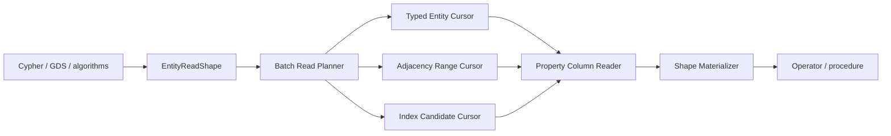

# Optimization Strategy

This is the single execution document for performance work on the new ZYX architecture. It defines a reusable batched read and execution framework. It must not introduce a branch for one benchmark, Cypher text, or dataset. The [native single-file storage plan](native-single-file-storage-plan) owns persistent layout, page formats, Catalog, Page Directory, recovery, relocation, and reclamation. The [native capability acceptance matrix](native-capability-acceptance-matrix) owns feature migration and legacy-retirement status.

Queries and graph algorithms declare a logical read shape. The shared framework organizes reads by snapshot, logical page, and bounded batch. Every optimization preserves snapshot isolation, corruption detection, resource limits, cancellation, result order, duplicates, `NULL`, `LIMIT`, and `SKIP` semantics.

## Current Assessment

Release measurements show that the new architecture is not uniformly slower: index loading/building has already beaten the old path in some runs, and point lookup is close. The large regressions are concentrated in full entity scans, property filters, index-candidate verification, and short-path traversal.

The common cost is repeated execution of:

```text
generic Page Directory route
  -> Entity Map lookup
  -> Entity page validation
  -> Property Directory lookup
  -> Property page validation
  -> complete-object materialization
```

When this chain is repeated for every entity or candidate, it hides the benefits of logical identity, snapshot routing, and relocatable pages. Remove repeated work first; use structural counters before considering a page-layout change.

Reusable foundations already present include `EntityReadShape`, `NativeReadSession`, `BoundedBatch`, `SelectionVector`, `BTreeIndex::RangeCursor`, selected-column Property APIs, ordered Node/Edge batch reads, topology/reference adjacency APIs, and LargeValue manifest/chunk/range-read support. These foundations do not mean that every consumer has migrated. A stage closes only after its consumer audit, tests, and lifecycle evidence are complete.

## Target Architecture



The framework has five boundaries:

1. **Shape**: the consumer declares fields instead of choosing physical reads.
2. **Plan**: logical IDs, Property tokens, and budgets become ordered batches.
3. **Execute**: requests are grouped by typed directory, PageId, and page slot.
4. **Validate**: page admission, record decoding, and semantic cross-checks enforce invariants.
5. **Materialize**: only the declared result shape is built, in logical order.

Every new consumer must use these boundaries and must not implement its own per-entity loop.

## Read Shape Contract

All Node, Edge, adjacency, and index reads use an explicit shape:

| Shape | Data |
| --- | --- |
| `IDENTITY` | NodeId or EdgeId, liveness, and state |
| `TOPOLOGY` | EdgeId, source, target, relationship type, and state |
| `LABELS` | Identity plus label tokens |
| `SELECTED_PROPERTIES` | Identity plus requested Property-token columns |
| `COMPLETE` | Complete logical Node or Edge |

A shape also carries the pinned snapshot, row and temporary-byte budgets, cancellation checkpoint, admission/prefetch policy, early-stop requirement, and ordering/duplicate contract.

Default shapes are:

| Consumer | Shape |
| --- | --- |
| degree, count, BFS, DFS, shortest path, Leiden | `TOPOLOGY` |
| relationship-type filter | `TOPOLOGY` |
| entity references | `IDENTITY` |
| Property predicate | `TOPOLOGY + SELECTED_PROPERTIES` |
| GDS projection | Declared projection fields |
| `RETURN n` or `RETURN r` | `COMPLETE` |

`COMPLETE` is reserved for consumers that really return complete objects. A topology algorithm must not create a Property cursor for adapter convenience.

## Batch Read Contract

Batch reads use gather, execute, and scatter:

```text
Gather:
  collect logical IDs, shape, Property tokens, and budgets

Execute:
  resolve directories, group by PageId, pin pages sequentially, decode in-page

Scatter:
  restore the caller's requested order by input ordinal
```

Physical requests may sort and deduplicate, but results preserve logical order, duplicate IDs, `NULL` and missing positions, `LIMIT`, `SKIP`, early-stop, and snapshot visibility. Every variable-length Property, LargeValue, label set, and result object is charged before it enters downstream execution. A batch is bounded by both rows and bytes.

The physical cost of a batch should track directory ranges, metadata pages, distinct data pages, decoded records, and selected values rather than the number of input rows.

## Typed Entity Page Cursors

Node and Edge scans must use typed entity-directory entry points. Do not walk the generic `visitPageLocationsUntil()` stream and filter pages by segment or owner afterward.

The shared cursor family is:

```text
NodePageCursor
EdgePageCursor
PropertyPageCursor
IndexPageCursor
AdjacencyRangeCursor
```

Each cursor binds one `MetadataSnapshotPin`, reads only its typed directory, caches the current pool route, admits and pins each page once, scans many records in that page, uses bounded sequential admission/prefetch, resumes through logical continuation, and stops at row, byte, cancellation, or visitor limits. A record scan must not cause a Page Directory root descent. A page must not be re-authenticated and re-pinned for multiple owners in one session.

## Property Column Reader

Property pages are shared 4 KiB slotted pages. Node and Edge roots may share a page. Property reads are page-oriented:

```text
EntityPropertyKey
  -> one Property Directory range merge
  -> group by Property PageId
  -> pin each Property page once
  -> decode multiple owner roots in-page
  -> decode only requested tokens
  -> restore entity order
```

The common reader provides `readSelectedColumns(keys, tokens, budget)`, `readPropertyCounts(keys, budget)`, `readPropertyExists(keys, tokens, budget)`, and `readFullRoots(keys, budget)`. Small roots decode only framing, slot, token offsets, and requested values. Selected reads must not decode an entire root merely because one token was requested.

Directory cursors, route cache, page image, owner/slot-generation validation, token offset directory, snapshot generation, cancellation, and row/byte budget are shared by all four APIs.

## LargeValue Reads

When a Property collection does not fit in a Property page, the page stores only a `LargeValueRef`. The generic LargeValueStore stores the payload in manifests, chunks, and 4 KiB data pages. It serves source code, JSON, text, images, and arbitrary bytes without a domain-specific store.

The existing mechanism provides immutable logical IDs, manifest trees, chunked data pages, per-chunk `RAW`/`LZ4`/`ZSTD` codecs, content hashing and bounded deduplication, full and range reads, generation-aware retirement, and snapshot-safe reclaim.

The remaining framework work is selected range reading. The Property payload offset directory must map to LargeValue chunk ranges so a selected token reads only overlapping chunks. Reading one small field must not unconditionally read a large source file or binary object. Compression remains a generic per-chunk policy with a savings threshold and RAW fallback; it must not contain file-type-specific branches.

## Topology-First Adjacency

Ordinary graph adjacency is the global key-only Packed B+Tree:

```text
(direction, NodeId, EdgeId) -> empty
```

The Edge Entity page remains authoritative for endpoints, type, and state. An adjacency leaf contains no complete Edge, Property, endpoint copy, or physical offset.

The common API is:

```text
scanTopology(node, direction)
scanReferences(node, direction)
scanSelected(node, direction, shape)
scanFull(node, direction, shape)
scanForNodes(nodes, direction, shape)
```

Multi-Node scans reuse `GlobalAdjacencyIndex::visitForNodes()` and one continuous range cursor. Edge IDs are then grouped by Entity page and decoded as topology. Type and other light predicates run before selected Property reads.

Topology-only paths must not pin unrelated Property pages, build complete `LogicalGraphEdge` objects, resolve Property names, or read LargeValues. Endpoint and direction validation remains in the same snapshot, including self-loop, parallel-edge, continuation, and early-stop semantics.

## Index Candidate Stream

Indexes use `(canonical value tuple, EntityId)` keys. The index is an access path; authoritative Property values remain in the Property Store. Reads expose a generation-bound candidate batch containing the canonical key, EntityId, index definition/version, and snapshot generation.

Exact, scalar-range, and composite-range candidates share one root-descent `BTreeIndex::RangeCursor`, bounded candidate batches, Entity-page grouping, selected Property-column grouping, candidate/column alignment and reorder, residual validation, early-stop, and byte budgets.

Candidate verification must not perform independent Entity Directory and Property Directory root lookups for every candidate. When the index and Property state were published atomically in one generation, the query performs the necessary liveness, shape, and residual checks; full cross-store verification belongs to index build, maintenance, recovery, and the integrity scanner.

Every candidate stream rejects a wrong snapshot or definition, zero/duplicate/invalid IDs, owner/generation/checksum/codec mismatches, missing or misaligned Property columns, row/byte overflow, and a physical reorder that cannot be scattered back to logical order.

## Snapshot-Local Cache

Caches store physical reads and authenticated intermediate state, never final query answers:

1. **Buffer Pool** caches physical 4 KiB pages.
2. **Snapshot route cache** maps logical PageIds to current physical routes.
3. **NativeReadSession** caches typed pages, Entity records, tokens, and Property columns for one snapshot.

Cache identity includes logical identity, snapshot generation, page generation, owner kind, and codec/layout version. Relocation changes only the Page Directory route; a route-generation change invalidates the old route while PageId, EntityId, EdgeId, LargeValueRef, and cursor continuation remain stable. Authenticated owner, generation, LSN, checksum, and layout state may be reused in one session, never across snapshots or owner kinds.

## Layered Validation

| Layer | Checks |
| --- | --- |
| Page admission | magic, owner, kind, generation, LSN, checksum, layout |
| Page scan | slot bounds, bitmap/slot directory, record kind, page-local offsets |
| Semantic read | logical ID, endpoint, direction, index key, Property token, snapshot visibility |

Full page validation remains mandatory at admission, recovery, and integrity scans. A page authenticated in one session may use lightweight record checks on repeat reads, but semantic fail-closed checks remain mandatory and benchmark mode cannot disable corruption validation.

## Batch Execution Primitives

`BoundedBatch`, typed columns, and `SelectionVector` are shared by scan, filter, project, aggregate, JOIN, OPTIONAL MATCH, UNION, `LOAD CSV`, `LIMIT`, and `SKIP`.

Each batch declares row count, selected count, materialized bytes, validity/null masks, logical ordinals, cancellation state, and downstream ownership. Filters should update selection vectors instead of copying rejected complete objects. Projects copy Property payload only when the column is retained. Count, degree, and existence operations do not create complete result rows.

Batching changes internal order only; null, duplicate, ordering, short-circuit, and error semantics remain unchanged.

## Writes and Maintenance

Online mutations, bulk ingest, index builds, adjacency rebuilds, and maintenance share canonical ordering, a byte-aware page builder, fill/split/merge policy, codecs/checksums, COW publication, retirement, and reclaim.

Bulk Edge writes plan the Edge Entity, OUT adjacency, IN adjacency, Property root, and affected indexes in one transaction-local sorted overlay. Each Edge must not cause an independent root-to-leaf insertion, split, or metadata publication. Add generic dirty-path COW, Directory merge, or a shared B+Tree WriteBatch only when structural counters show that COW amplification remains the dominant cost.

Every write optimization proves writer conflict/rebase, short I/O, ENOSPC, interruption, old-snapshot reads, reopen/recovery, retire-queue reclaim, single-file durability, and atomic visibility of Entity, adjacency, Property, and index state.

## Staged Execution Plan

These are the only stages. Names describe reusable capabilities, not benchmarks.

### Stage 0: Trusted Baseline and Structural Counters

Separate diagnostic profile overhead from measured latency. Fix the Release toolchain, dataset, seed, warmup, iterations, and execution mode. Record `directory_range_calls`, `root_descents`, `metadata_pages_read`, `distinct_page_pins`, `records_decoded`, `selected_values_decoded`, `full_materializations`, `materialized_bytes`, and `large_value_chunks_read`. Counters are saturating and cannot change query behavior.

Close when one run explains both latency and structural work and the required tests pass.

### Stage 1: Typed Entity Cursors

Use typed Node/Edge page-location cursors, remove generic Page Directory scans and segment filtering, cache pool routes and authenticated pages, and add sequential admission, bounded prefetch, and cancellation.

Close when root descents and page pins no longer repeat per record and relocation, reopen, old-snapshot, corruption, and early-stop tests pass.

### Stage 2: Unified EntityReadShape

Audit query, GDS, procedure, overlay, constraint, and maintenance Entity entry points. Use explicit shapes everywhere, remove field-by-field reads and premature complete materialization, and unify session, budget, cancellation, and logical-order handling.

Close when topology consumers create no Property cursor, complete objects are produced only for `COMPLETE`, and null, duplicate, order, limit, and snapshot regressions pass.

### Stage 3: Property Page Batch Reader

Implement gather/execute/scatter Property batches, group roots by PageId, locate selected tokens through offset directories, share one cursor across count/exists/selected/full APIs, and map Property offsets to LargeValue chunk ranges.

Close when one session authenticates and pins each Property page once, selected reads decode no unrequested token, LargeValue selected reads are ranged, and large-value/corruption tests pass.

### Stage 4: Topology-First Adjacency

Move traversal, degree, count, shortest path, Leiden, GDS, and procedures to topology/reference shapes. Use continuous multi-Node adjacency cursors, batch Edge topology by Entity page, and apply type/endpoint predicates before complete Property reads.

Close when topology-only paths have no unrelated Property pins/decodes, supernodes stream across leaves, and self-loop, parallel-edge, continuation, early-stop, and cancellation tests pass.

### Stage 5: Index Candidate Stream

Unify exact, range, and composite candidate streams. Descend once, verify by Entity and Property page groups, preserve generation/owner/checksum/codec/liveness/residual checks, and support value-major batch order with bounded deduplication and scatter.

Close when root descent does not grow with candidate count, candidates do not independently visit both directories, and stale, missing-field, duplicate, corruption, concurrent-snapshot, and resource-bound tests pass.

### Stage 6: Batch Execution

Connect `BoundedBatch`, typed columns, and `SelectionVector` to scan/filter/project/aggregate/JOIN/OPTIONAL MATCH/UNION/`LOAD CSV`/`LIMIT`/`SKIP`. Separate selection from payload and enforce one byte budget and cancellation contract.

Close when empty, all-selected, all-rejected, null, duplicate, unsorted, early-stop, and aggregate-boundary semantics pass and count-like operations avoid complete entities.

### Stage 7: Snapshot Cache and Layered Validation

Unify Buffer Pool, route-cache, and NativeReadSession lifetimes. Reuse authenticated pages in one session, move full page checks to admission/recovery/integrity scans, and retain record and semantic fail-closed checks.

Close when route generation invalidates stale routes, snapshots do not contaminate one another, and corruption, relocation, reopen, and reclaim tests pass.

### Stage 8: General Write Batching

Measure replacement, append, retirement, publication, scratch decoding, and bytes per mutation. Implement target-page grouping, sorted Directory merge, and B+Tree WriteBatch only when evidence supports them. Online, bulk, and rebuild paths share page building and publication.

Close when writer-conflict, fault-injection, ENOSPC, recovery, reclaim, old-snapshot, and concurrent-write tests pass and the optimization applies to a mutation class rather than one workload.

### Stage 9: Final Evaluation and Coverage Closure

Run the no-profile Release binary on macOS, Linux, and Windows across smoke, small, and medium scales and warm, opened, and cold-ish modes. Compare latency, page work, bytes, memory, and file size. Run comprehensive four-dimensional coverage only after feature work and required tests are complete.

## Test Protocol

During development, run the smallest relevant selection:

```bash
./scripts/run_tests.sh --quick --gtest-filter "SuiteName.*" --file path/to/changed/source.cpp
```

Every stage covers normal and cross-page reads, empty/full results, early-stop, unordered/duplicate/missing/malformed input, relocation, reopen, old snapshots, owner/generation/slot-generation/checksum/codec corruption, cancellation, row/byte budgets, LargeValue compression/range reads, and reclaim. After the functional work for a stage:

```bash
./scripts/run_tests.sh --quick
```

Comprehensive four-dimensional coverage is a Stage 9 activity. Tests must never be changed merely to hide a source defect.

## Structural Acceptance Metrics

| Metric | Target |
| --- | --- |
| root descents | correlated with ranges/batches |
| directory range calls | not linear in record count |
| distinct page pins | bounded by pages actually needed |
| full materializations | no more than the declared shape requires |
| selected decodes | only requested tokens |
| LargeValue chunks | only requested ranges |
| materialized bytes | always within batch budget |
| result order | identical to the existing contract |

If a speedup cannot be explained by these structural metrics, the stage stays open and the shared framework is investigated instead of adding a local fast path.

## Prohibited Changes

- Branches keyed by benchmark names, Cypher text, fixed node counts, or fixed degree;
- restoring the old Segment Chain or Edge linked list;
- copying complete Properties into indexes as covering data;
- final-result caches in the query layer;
- disabling owner, generation, checksum, or snapshot validation;
- assuming a fixed number of entities per page;
- domain-specific stores for code, images, or another payload type;
- a second persistent database file or external WAL;
- enlarging pages or bitmaps before read-path attribution is complete.

The optimization is complete when all consumers use the shared shape, batch, typed-cursor, Property-column, topology-cursor, and snapshot-cache contracts; required feature, lifecycle, corruption, and resource tests pass; and the final no-profile multi-platform Release evaluation is explained by structural counters.

## Related Documents

- [Native Single-File Storage Plan](native-single-file-storage-plan)
- [Native Capability Acceptance Matrix](native-capability-acceptance-matrix)
- [Relationship Traversal](../algorithms/relationship-traversal)
- [Property Index](../algorithms/property-index)
- [Packed B+Tree Indexing](../algorithms/btree-indexing)
