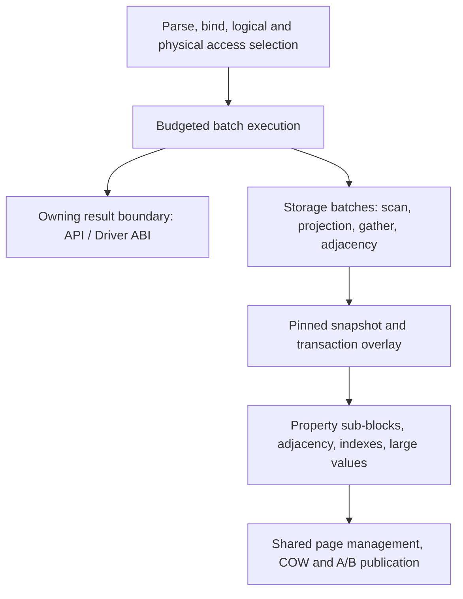

# COW Graph Database Performance Refactoring Plan

Updated: 2026-10-19. Plan ID: `cow-performance-20261019`. **This is the sole active optimization entry point. R0–R7 has 24 deliverables, with 13/24 accepted (54.2%). This batch accepts foundational R4.1/R4.2/R6.1/R6.2/R6.3; R1.3/R2.3, R4.3 and other performance gates remain pending R7.**

The objective is to reduce positioning, decoding, conversion, materialization, and metadata work per query/update while preserving existing public capabilities. Retain the engine and make evidence-backed structural changes within it; do not replace the entire backend or promise to outperform Kuzu on every workload.

The completed S0–S6 cycle remains **34/34**, referring only to that cycle. Its bilingual plan, previous storage specification, release navigation, and machine progress are byte-preserved in `benchmarks/architecture-design/archive/20261019-completed-s0-s6/`; `manifest.json` records provenance and SHA-256. Old A/O/S task IDs, intermediate percentages, and then-outstanding work no longer drive implementation. Historical adoption/rejection records remain evidence, not automatic production admission for a new layout.

## 1. Fixed boundaries and execution rules

### 1.1 Product, persistence, and compatibility

- Preserve the general property graph, dynamic properties/types, multiple labels, stable logical IDs, and existing Cypher/QueryBuilder/GDS/Vector/Driver ABI/binding behavior. Internal representation changes must not silently remove capabilities or change query semantics.
- Preserve strict single-file operation: persistent data, recovery information, and supported query scratch remain in the same database file. Add no WAL/SHM/temporary sidecars.
- Retain COW and A/B superblocks, data-before-root ordering, and durable acknowledgement. Do not introduce WAL or cross-transaction group commit, disable synchronization, or weaken durability. If future small-transaction evidence warrants a protocol change, design commit and recovery separately.
- Preserve logical/physical identity separation, snapshots, read-your-writes, integrity authentication, shared allocation, relocation, and safe reclamation. Logical IDs are not reused; physical page/slot reuse must validate identity and generation.
- Public compatibility does not imply byte-format compatibility. The development policy remains new databases for new formats and explicit rejection of old formats, without automatic migration or user-file deletion. Update the [single-file specification](native-single-file-storage-plan) and compatibility matrix before introducing codecs/roots. Never reinterpret old version bytes silently. A migration tool is outside mandatory scope; migration and backup contracts remain prerequisites for a stable format release.
- Preserve macOS/Linux/Windows portability and the non-JIT WASM path. Report platforms actually exercised; Linux results do not prove execution on the other platforms.

Single-file packaging, COW/WAL persistence, and row/column access or batch execution are different choices. Kuzu 0.11 onward uses one main file but may create `.wal`, `.shadow`, and `.tmp` files ([official documentation](https://kuzudb.github.io/docs/developer-guide/files/)). File count does not explain scan gaps, and WAL alone does not establish query performance.

### 1.2 Implementation and documentation ownership

At implementation start, reconcile remote `work` with local changes; fast-forward or use an isolated worktree without resetting/stashing away user changes. Freeze actual source, not merely HEAD. Report accepted tasks, evidence, and remaining issues each round. Commit/push follows effective session authorization; historical approval does not authorize arbitrary new payloads.

Run only necessary affected-module unit tests, not the full unit suite; coverage is not a gate. During development use short correctness/mechanism checks rather than frequent benchmarks. Full-size correctness, long resource checks, and formal performance comparisons belong to the final window after implementation. Documentation changes need documentation checks only. `scripts/run_tests.sh --file` limits coverage presentation, not the tests executed.

This page owns ordering, status, and admission; the [single-file specification](native-single-file-storage-plan) owns current format rules; the [capability matrix](native-capability-acceptance-matrix) owns consumers and semantic evidence; [release follow-ups](native-remaining-work-roadmap) own independent release boundaries. Store decisions in `benchmarks/architecture-design/decisions/` and local raw results in ignored `benchmarks/architecture-design/results/`. Formal evidence must not exist only in ignored directories.

## 2. Existing foundations, remaining gaps, and evidence

### 2.1 Starting point and current increment

This documentation review uses repository commit `0427be26001073e3caf66621e1b8e62fd3da84dc`. The previous formal evaluation froze production source at `c28794a7c92434e809f9bbb17d48e8c457a70263`. R0 must recheck a different implementation starting point; the following table is not evidence for unknown future source.

The table records the R0 starting snapshot. Current increment: R1.1/R1.2 added direct property-cell production and continuous applicable native scans, numeric/string filters, single/multiple-key aggregation, and DISTINCT. Complex consumers/parameter residuals retain explicit bounded adapters; R1.3 adapter/semantic work is implemented, pending R7 performance admission. R2 adds authenticated immutable radix views and corrects mutable pool-control cache identity across handle publication.

| Area | Existing foundation to reuse | Actual remaining work |
|---|---|---|
| Execution | AST/Expression/logical optimization, bound slots/descriptors, batch identity, EntityRef, selection vectors, typed numeric filtering, budgeted fallback | Some typed batches are produced by converting generic values, and some consumers return to row property maps; connect producers and consumers directly |
| Properties | Selected decoding, sorted batched positioning, field staging, row/large-value handling, batched property names | Owner-level positioning and collection encoding can amplify scans/small updates; experimental hybrid layouts are not admitted |
| Metadata | Bounded decoded/route caches, immutable route branch reuse, batched lookup, amortized reclamation triggers | Measure and reduce repeated positioning, authentication, copying, and shared-path updates; do not rebuild equivalent caches |
| Graph access | Global key-only adjacency tree, authoritative Edge checks, snapshot-bound traversal batches and session reuse | First access generally still fetches the authoritative Edge; covering/segmented experiments cannot simply be enabled |
| Transactions | COW/A-B, snapshots, overlay, ordinary graph-root fence, bounded safe blind-patch rebase | General disjoint writes may still conflict; do not claim serializability or general multi-writer support |
| Resources/spill | Process/database accounts, QUERY/CACHE/WRITE/MAINT ownership, result lifetimes, in-file sort runs/merge and partitioned DISTINCT/UNION | Preserve these through batch changes; aggregate state/hash join do not already have general spill |
| Planning/diagnostics | Cardinality estimates, existing index/range selection and rewrites, EXPLAIN/PROFILE, PerfTrace | Extend cost, selection reasons, and actual work for new paths; do not describe this as building an optimizer from scratch |

Existing sort/DISTINCT implementations are `src/query/execution/ExternalQuerySort.hpp` and `ExternalQueryKeySet.hpp`; scope and budget boundaries are recorded in `20261016-s53-budget-and-spill-acceptance/en.md`. Existing capabilities are protection contracts, not newly completed deliverables.

### 2.2 Latest formal reference and limitations

Linux x86_64, medium with 225,000 nodes/860,000 edges, warm base window with three independent processes per source and three warm-ups/ten measurements per case. Values below are medians of process P50s in ms, not a new baseline or a claim of precise P95 estimation.

| Workload | Previously optimized ZYX | Kuzu 0.11.3 | ZYX/Kuzu |
|---|---:|---:|---:|
| Node point lookup | 2.285855 | 0.234714 | 9.7 |
| Two-hop traversal | 2.168795 | 0.824298 | 2.6 |
| Label/property filtering | 332.551 | 2.136180 | 155.7 |
| Actual country group/count | 440.596 | 3.644591 | 120.9 |
| All-node score filtering | 634.9675 | 0.873943 | 726.6 |

Exact values/process distributions are in `benchmarks/architecture-design/decisions/20261018-route-reuse-base-read-checkpoint/proof.json`; complete admission/resource costs are in `20261018-route-reuse-final-admission/`. Original `d09fc467` is a historical comparison only; the next before-source is the actual implementation starting point. Historical workload name `aggregation_group_by` means COUNT DISTINCT; actual grouped output is `aggregation_count_by_group`. Do not interchange them.

Retain these limitations: ZYX native IPC and Kuzu Python differ, and schema/index/commit semantics are not universally equivalent. Unsupported cases are N/A; actual failures/timeouts remain failures/timeouts. Previous whole-process preparation/index peaks increased approximately 7–11%, while scan peaks decreased approximately 55–57%; do not report only better query-phase peaks. Single diagnostic runs, cumulative materialization bytes, storage-layer read bytes, and nested timers are not formal latency, peak memory, physical device reads, or additive CPU shares respectively.

## 3. Target structure and shared contracts

These are responsibilities, not a requirement for additional wrapper objects or a second complete executor. Every stage follows these contracts:

1. **Identity/lifetime:** descriptors carry sufficient database/snapshot/layout/property identity. Row references validate batch owner/incarnation. Separate plan binding from execution pins and define schema/layout invalidation. Borrowed values cannot outlive page pins, batch reuse, or transactions; escaping values require owned data and budget transfer.
2. **Semantics:** retain internal missing/stored-NULL/value distinctions and existing Cypher mapping, comparison/hash rules, overflow, multiplicity, aliases, ORDER BY, OPTIONAL, paths, and correlated subqueries. Batching, retries, and pushdown must preserve volatile-expression and side-effect evaluation counts.
3. **Authority/atomic visibility:** properties, entities, derived indexes, adjacency, statistics, and retirement publish together according to the existing contract. Physical page-map changes do not replace semantic version advancement. The current graph fence omits some physical directories; new layouts must advance the appropriate semantic fence.
4. **Errors:** fall back only for predefined optional-optimization admission failures. Never treat corruption, cancellation, I/O errors, or post-output failures as empty data or replayable input. Pre-delivery batch splitting must preserve results and errors without duplicates.
5. **Resources:** charge capacity, nested payloads, indexes, buffers, pins, and escaped output through existing accounts. Avoid double charging and premature refunds. Accounted memory and RSS are distinct. Do not wait under a lock for resources whose release requires that lock.
6. **Bounded work:** specify limits for positioning, re-encoding, splitting, reclamation, and retries. Do not defer unbounded work to maintenance or rely on growing caches, delta chains, or logs.

## 4. Required implementation contracts

### 4.1 R1: Continuous storage production and batch consumption

Reuse `BoundNodeScanBatch`, batch identity, bound programs, and budgets; extend one internal batch contract. Define range scan and random gather separately, preserving ordinals, duplicate IDs, missing entities, and result order. Point reads must not scan a whole group. Bound batches by bytes and rows; wide/large values can reduce batch size rather than force large reservations.

Common integer/float/bool and string paths should directly produce consumable data. Initially use owned offsets/bytes or an equivalent bounded string representation. Dictionary encoding is conditional; codes from different dictionaries are not directly comparable. Dynamic complex values retain equivalent charged fallback. Copying a PropertyValue array into typed arrays alone does not eliminate conversion.

The first mandatory continuous path is scan → filter/project → aggregate → owning output, covering numeric/string filters, actual single/multiple-key group-by, COUNT DISTINCT, and empty input. Compare complete grouping tuples; retain existing NULL, numeric type, merge, and error semantics. Independently deduplicating columns and recombining them is incorrect.

Then connect applicable Top-K/sort and join/expand batch boundaries. Register batch paths or bounded adapters for UNWIND, procedures, subqueries, mutation read consumers, and other consumers. Every retained adapter records conditions, ownership, budget, cost counters, and removal conditions. Ordinary scan/filter/aggregate must not fall back wholesale to rows while claiming continuity; complex paths may retain explicit adapters. Existing sort/DISTINCT spill must remain usable.

Flat batches are mandatory. Factorized/grouped intermediates, parallel execution, SIMD, and JIT are not prerequisites. Future adoption must validate multiplicity, correlation, and task-local state; additional threads cannot disguise single-thread data-path costs.

### 4.2 R2: Lean metadata reads and authentication

For point lookup, scan, and adjacency gather, map token → owner/directory → route → page → value. Distinguish calls, unique pages, cache hits, codec decodes, checksum bytes, copies, and I/O. Audit existing caches and route reuse before adding anything equivalent.

Within a snapshot, group positioning by page and reuse cursors/authenticated immutable pages while restoring ordinals. Cache keys cover database identity, logical page/route identity, generation, and interpretation context. Cache absence only with a defined validity interval. Test file growth, publication by another valid handle, relocation, page reuse, and old snapshots. Amortize file-size checks only with equivalent bounds/concurrency guarantees; do not simply remove them.

First loads retain required format authentication. Cache hits must not lose owner/generation/range validation. Point access validates visited objects; full integrity scans validate global inconsistencies. Specify when later authentication/integrity checks detect external modification while data is cached; do not promise every logical read discovers all media changes.

Aim for sequential positioning work proportional to accessed groups/pages rather than repeated identical directory descents per value, while retaining bounded random lookup. R2 does not itself change the persistent format; necessary format changes follow R3/R4 version contracts.

### 4.3 R3: Bounded hybrid property sub-blocks and field updates

**Production adoption is conditional; full-lifecycle prototypes and cost validation are mandatory.** Reuse field set/remove, map merge/replacement, and overlay semantics. Address underlying collection-wide encoding rather than rebuilding field staging.

- Define logical groups, physical pages, compression blocks, and COW update units separately. The old A3 64-ID group is an existing candidate, not a new performance conclusion. R3.1 must decide group capacity, sub-block size, sparse thresholds, and per-operation work limits with a cost record before encoding them.
- Separate Node/Edge spaces; labels remain membership only. Dense suitable fields use compact columns; sparse/mixed fields use bounded extensions. Dynamic types do not become a permanent schema. Each owner/token has one snapshot authority; extensions do not retain a second complete row.
- Explicitly encode presence, NULL, type, and liveness. Provide actual-field enumeration per entity; full reads do not iterate global tokens or all group fields. Avoid a tree per entity/field and large private tail pages for sparse groups.
- Large values are separately stored and authenticated; small updates reuse unchanged references. Projection must not decode unrelated large values, and one changed value must not unconditionally rewrite a group/large collection. Do not rebuild unchanged indexes. Validate no-op, type change, REMOVE, and complete map replacement separately.
- Sub-blocks, ownership descriptors, enumeration, graph routes, indexes, semantic fences, allocation, and retirement switch under one publication protocol. Stable logical pages do not imply unchanged semantics. Old snapshots retain old layouts; reopen, relocation, deletion, and failed publication require precise reachability/reclamation rules.
- Start with a small set of explicit encodings and bounded explicit conversion. Do not introduce automatic layout oscillation, unbounded deltas, or whole-container rewriting as the default. Unsupported encoding/capacity shapes retain a working row representation without losing fields.

R3.1 must provide read/COW path and cost tables for single-entity/single-field reads, full entities, N entities/f selected fields, one-field updates, and deletion/reclamation. Include directories, owner enumeration, presence/type, partial fill, allocator, indexes, and old versions. State growth in actual fields F, entities E, groups G, and distinct group keys K, particularly avoiding O(E×K) sparse membership metadata.

Cover dense/sparse and singleton fields, randomly interleaved shapes, multiple labels, continuing type changes, sparse groups after deletion, wide/large values, and neighbor-property gather. Compare against current rows using the same batch executor; R1 gains are not layout gains. Missing graph routing, full lifecycle, retirement, or total costs preclude production admission. Rejection may complete R3.2 comparison, never automatically R3.3 production delivery.

### 4.4 R4: Bounded COW updates and maintenance

Reuse immutable branch sharing and reclamation batching. Coalesce same-page/shared-tree-path updates within a transaction, encoding final changes and updating only affected indexes. Never mutate published or reader-referenced pages in place. Measure field-interface work, actual page rewrites, and total publication separately.

Preserve candidate data/metadata writes → data fence → inactive A/B slot write → superblock fence → acknowledgement. Recovery selects the newest valid root and handles torn writes, failed syncs, and uncertain commits; root selection is not whole-database integrity. Count ID reservations, ordinary commits, and maintenance publications separately rather than hiding multiple internal publications as one cheap transaction.

Enumerate actual catalog, allocator, page-map, index, route, and retire-queue changes. Work should scale with changed pages and necessary shared paths, not unrelated stored data. Register any remaining global scan with its trigger, limit, and reason it cannot be incremental.

Give foreground and maintenance separate page/byte/time budgets; expose backlog, oldest pin, reusable free pages, and truncatable tail pages. Long snapshots require backpressure or explicit resource rejection rather than live-page reclamation/unbounded growth. Validate compaction, physical relocation, and tail truncation separately. File length is not live-data size. Do not increase resource caps, indefinitely defer cleanup, or invent a mandatory zero-retirement-at-every-close condition to claim gains.

Retain current isolation. Reuse verified bounded blind rebase, never merely remove the graph fence. Any later expansion needs separately documented read/absence/range/constraint/schema/endpoint dependencies, validation points, and retry limits. Disjoint writes sharing a page must rebuild against the latest version or conservatively conflict, never overwrite each other. Do not automatically replay side effects. General multi-writer execution and stronger isolation are not promised by this cycle.

### 4.5 R5: Adjacency and access planning

First define directly consumable EdgeId, NeighborId, TypeId, direction, visibility, and continuation batches. Retain parallel edges, self-loops, type filters, overlay, and ordering. The comparator is the current key-only tree plus existing batched authoritative-record reuse.

Compare a covering B+Tree with shared segmented adjacency without restoring retired per-node root/delta code. Edge records remain topology authority. Direct derived reads require atomic maintenance, authenticated identity, and a fault-detection contract. Specify whether reads, commits, or integrity scans detect valid-checksum wrong endpoint/type, missing reverse entries, duplicate/orphan entries, and stale generations. Keep authoritative-record checks until the replacement protocol passes.

Candidates must cover create/delete, both directions, authoritative records, type indexes, statistics, old snapshots, reopen, and retirement, not just reads. Prefer the smaller covering-tree change if it meets goals; segmentation must justify directory/update/space costs. Protect random insertion/deletion, hotspots/power-law degrees, supernodes, and multi-hop access.

Extend the existing optimizer with necessary label/type/property selectivity, degree distributions, or bounded estimates. Define statistics identity, maintenance/invalidation, error bounds, and fallback. Planning must not scan the graph to collect statistics. Price candidate counts, column widths, pages, materialization, and memory when choosing index/gather/scan, filter placement, joins, and expansion order. Unknown/stale statistics must still yield safe stable plans. Push down only proven semantic equivalents, protecting LIMIT, OPTIONAL, NULL, duplicates, and volatile expressions.

### 4.6 R6: Resources, lifetime, and observability

Reuse existing coordination/scratch; charge new batches, caches, operator state, and output to the same accounts. Bulk reservations may amortize accounting, but retained capacity stays charged and exceptions/cancellation release it. Results may outlive transactions. If zero-copy causes long pins, provide a bounded copying/rejection policy.

Preserve in-file sort and DISTINCT/UNION spill and specify compatibility of new consumers. Unsupported group-by/hash join spill must fail clearly on budget exhaustion; do not claim general external-memory execution. Adding those spill algorithms is a separate future extension, not implied by this cycle reaching 100%.

Logical read-only transactions may use scratch only under existing internal permissions on writable files; physical read-only never writes scratch. Temporary pages use query ownership and an independent lifetime, without retention by unrelated user snapshots. Scratch and user commits must not lose shared allocator updates. Test cancellation, disk-full, crash/reopen, concurrent aliases, and cleanup retry.

Extend existing EXPLAIN/PROFILE with actual access paths, batch/row adapters and reasons, estimated/actual rows, selectivity, read/decode/checksum work, materialization/budget peaks, spill, and publication stages. Specify units, cumulative/peak scope, inclusions, and nesting. Formal timing runs separately with instrumentation off.

Split oversized files by binding, operators, storage access, budgets, and publication responsibilities, with one implementation owner. File splitting is not a performance result and does not justify parallel long-lived backends. Remove adapters only after proving all consumers have replacements and preserving semantic tests.

## 5. Dependencies, deliverables, and progress

The main sequence is R0 → R1 → R2 → R3 → R4 → R5 → R6 → R7. Identity/resources and affected correctness tests apply from each stage, not only R6. Bounded R3/R5 prototypes may start once interfaces stabilize. Performance admission occurs in the R7 window; before that, completed code may be marked implemented/pending admission, not accepted. Subsequent stages depend on ready interfaces/correctness contracts rather than prior final performance acceptance, avoiding a circular wait for R7.

| Stage | Three independent deliverables and completion conditions | Accepted |
|---|---|---:|
| R0 Starting point/contracts | **R0.1** Source/capability/adapter audit; **R0.2** Comparable baseline and preregistered sampling, resources, success/protection metrics; **R0.3** Call paths/mechanism counters and interface/format decision register with owners for correctness-critical questions | 3/3 |
| R1 Batch execution | **R1.1** Storage producers, identity, ownership; **R1.2** Continuous numeric/string filters and actual aggregation; **R1.3** Other consumers or explicit bounded adapters, semantic protection, and R7 performance review (implemented/pending admission) | 2/3 |
| R2 Metadata reads | **R2.1** Actual paths/repeated-work attribution; **R2.2** Authentication/positioning/cursor reuse and invalidation tests; **R2.3** Point/scan/gather work and R7 performance admission (implemented/pending admission) | 2/3 |
| R3 Property sub-blocks | **R3.1** Byte layout, parameters, cost/lifecycle decision; **R3.2** Full-lifecycle prototype and same-executor comparison; **R3.3** Admitted production integration, format update, and R7 read/write/space admission | 1/3 |
| R4 COW updates | **R4.1** Incremental page/path coalescing and small-update implementation; **R4.2** Publication/fault/snapshot/reclamation/backpressure checks; **R4.3** R7 admission for mature-file small transactions, batches, and sustained updates | 2/3 |
| R5 Graph access/planning | **R5.1** Adjacency consistency protocol and full-lifecycle candidates; **R5.2** Admitted production access and R7 graph read/write/space admission; **R5.3** New access costs, plan selection, and holdout validation | 0/3 |
| R6 Engineering/resources | **R6.1** New-path budgets, result lifetime, existing spill compatibility; **R6.2** EXPLAIN/PROFILE and physical-work observability; **R6.3** Resource/cancellation/read-only faults, responsibility cleanup, and recorded platform-validation scope | 3/3 |
| R7 Final acceptance | **R7.1** Frozen final candidate, affected modules, full-size correctness; **R7.2** Comparable read/write/resources/steady-state and Kuzu comparison, per-task admission; **R7.3** Final capability/format/decision updates, evidence cleanup, remaining-gap report | 0/3 |

**Total: 13/24 (54.2%).** States are not started, in progress, implemented/pending admission, accepted, and blocked. Count each evidenced deliverable once. This page is the only manually maintained progress table; machine summaries must be derived. The old 34/34 in `decisions/current-progress.json` is explicitly historical and supplies no new denominator.

Resolve correctness-critical interfaces/codecs/protocols before their production implementation; performance decisions may wait until the final window. Candidates must be selectable/buildable in isolation for comparison and cannot become the sole default production format before admission. Reject failed candidates and retain existing production paths. Comparison work may complete while production tasks remain blocked. A rejection decision does not substitute for mandatory production capability; do not shrink the denominator to reach 100%. Explicit scope amendments require user agreement.

The preceding batch was limited to R0.1/R0.2/R0.3/R1.1/R1.2. R0 evidence is in `benchmarks/architecture-design/decisions/20261019-r0-five-item-start/`. R1.1/R1.2 are preregistered foundational capabilities; R1.3/R7 still determines performance benefit.

R1.1 evidence: `benchmarks/architecture-design/decisions/20261019-r1-direct-property-producer/`. Direct production, presence/mixed types, duplicate gather, old snapshots, cancellation, and budgets are accepted. R1.2 continuity is now accepted; see `benchmarks/architecture-design/decisions/20261019-r1-continuous-filter-aggregate/`. Final 75 targeted checks pass, including exact native cross-batch filtering, tuple grouping, and DISTINCT.

The second batch was fixed to **R1.3/R2.1/R2.2/R2.3/R3.1**; evidence: `benchmarks/architecture-design/decisions/20261019-r2-next-five/`. R2.1/R2.2/R3.1 are accepted. R1.3 adapter/semantic work and R2.3 mechanism evidence are implemented/pending admission under the existing stage dependencies; neither is counted early. The latest results cover 183 distinct necessary-module cases (the 182-case run had nine control-prewarming fixture failures; after correcting prewarming, all 22 affected checks passed, not one 183/183 run). The separate genuine cross-handle failure and its fix are retained. No full unit suite or new formal performance window was run.

R3.1 fixes one 64-ID candidate, 48-slot column eligibility, independent field subblocks, shared membership/column/extension/group maps, an explicit descriptor/additional semantic fence, complete cost admission and both lifecycle directions; see `r3-layout-en.md` in that directory. It is not encoded or production-admitted; prototype/format/production work remains R3.2/R3.3.

This batch accepts **R4.1/R4.2/R6.1/R6.2/R6.3** under preregistered foundation/correctness/resource/observation contracts. Evidence: `benchmarks/architecture-design/decisions/20261019-r46-five/`. Ready COW and R1/R2 interfaces support this common-contract work; it does not substitute for the R3 format prototype, R5 adjacency candidate or R7 admission.

Existing-owner updates/no-ops/removals no longer enumerate property pools unconditionally. Reuse existing same-page COW coalescing and move owning plans/large-value buffers. Eight owner updates produce one 4032-byte replacement payload, exact old-pin/reopened values and no property-pool enumeration. PROFILE uses fixed, admitted thread-local observation for actual batches/adapters, both filter layers, reads/checksums, local-budget peaks, internal ID/graph publications and fences. Original columns retain order and summary columns are appended; existing Driver ABI map access is verified. EXPLAIN remains snapshot-free and describes candidates/adapter conditions; unavailable estimates are NULL, and diagnostics are not performance results.

Final necessary run: 245 passing cases; final PROFILE/ABI changes: 99 affected checks passing. Latest union: 263 distinct passing cases across runs, not one 263-case run. Preserve the initial 166-case run with three failures and their source/test causes. Checks cover publication/evacuation faults, pins/reclamation/file backpressure/tail truncation, quota/guard/result escape and existing sort/DISTINCT/UNION spill. Linux x86_64 only; no three-platform or complete binding-matrix claim. R6 contracts also constrain future R3/R5 integration, which must add its affected tests before R7. R4.3 still requires mature writes, steady resource/maintenance observations and admission; no new formal performance window ran.

## 6. Validation and admission

### 6.1 Baselines, sampling, and workloads

R0 freezes source manifests/dirty diff, build options/dependencies/binary hashes, hardware/OS/threads, buffer-pool/query budgets, seed/data hashes, formats, schema/indexes, entry points, and result consumption. Reuse a baseline only if identities and conditions match completely; otherwise run one before optimization. Keep the control binary rather than rebuilding modified source as before.

After R7 freeze, complete necessary correctness before consolidated timing. Start warm measurements with at least three independent processes, three warm-ups, and ten measurements per case. R0 preregisters aggregation, P95 uncertainty, supplementation rules, and total time budget. Small samples do not establish accurate tails; never rerun until passing. Separate cold, fresh-open, and warm; process restart is not OS-cache eviction. Interleave sources on the same machine. Restore writes from equivalent logical baselines and fix timing boundaries for open/commit/close and durability.

Include hit/miss lookup, random fields/full entities, label/type scans, numeric/string filtering, actual group-by/COUNT DISTINCT, sort/Top-K, one/multi-hop/supernodes, dynamic fields, wide/large values, small/batched/mixed writes, long snapshots, deletion/compaction, low-budget/spill, and sustained updates. Hold out combinations of scale/selectivity/degree/type/sparsity. Validate actual IDs, values, types, NULLs, required order, and multiplicity, not merely counts.

Compare under equal resources without raising caps to create wins. The previous matrix used 64 MiB query memory, 6 GiB address space, 2 GiB file size, and 1800 seconds per family. These are protection settings when reusing that matrix, not product defaults. Preregister independent justified budgets for necessary new cases in R0 without rewriting history. Retain failed endpoints/reasons; do not repeat long runs for unchanged failed source.

### 6.2 Admission thresholds and falsification

- Correctness, public semantics, atomic publication, recovery, snapshots, and resource cleanup pass first. Default performance objectives require at least 10% primary P50 improvement reproducible across processes, with no stable protected P50/P95 regression exceeding 5% beyond control noise. Borderline/insufficient evidence is uncertain and follows preregistered supplementation.
- Report memory, read/write bytes, allocations, steady-state space, and maintenance backlog separately. Stable resource growth above 5% requires explanation and explicit admission. Unbounded write/space costs or protected lookup/update regressions cannot buy faster scans. Exceeding protection thresholds needs a concrete tradeoff and user agreement.
- Interface/correctness foundations are judged by dependencies, semantics, lifetimes, and protection cost, not a mechanical 10% win per commit. Classify work before measurement; do not rename a failed performance change as infrastructure to avoid admission.
- R1 falsification: ordinary filters/aggregates still rebuild row property maps or fully convert typed columns back; R2: only cache growth without lower work; R3: payload-only accounting, whole-group updates, incomplete lifecycle; R4: weakened synchronization/unbounded cleanup backlog; R5: skipped authentication or unadmitted write regressions; R6: uncharged capacity, early refunds, invalid escaped output.
- Checklist completion and Kuzu performance goals remain separate. Disclose per-case gaps, N/A, failures, and API/schema/durability differences. Averages or selected wins must not hide regressions; diagnostic counts do not directly establish speedups.

### 6.3 Necessary tests and evidence

| Change | Required affected contracts |
|---|---|
| Batches/operators | Types/NULL/overflow, string comparison/hash, multi-key grouping, empty input, duplicates, ordering, OPTIONAL/paths/correlation, volatile evaluation counts, budgets/cancellation, batch reuse, escaped output |
| Properties/metadata | Field semantics, no-op, indexes/uniqueness, dynamic/sparse/large values, old snapshots, aliases, page reuse, valid-checksum wrong identity, reopen/relocation/reclamation |
| Publication/adjacency | Data/root failure points, uncertain commit, self-loops/parallel edges/directions/continuations/overlay, missing/orphan entries, endpoint deletion conflict, shared-page updates and conservative conflicts |
| Resources/scratch | Actual capacity, transfers/refunds, low budget, disk-full, read-only, cancellation/OOM, output outliving transactions, aliases, crash cleanup, bounded maintenance backlog |

Find real GoogleTest suites and use explicit filters. Extend affected contracts without repeating the full suite or already-passing long matrices. Fix implementation defects rather than deleting assertions or changing expected results to hide them. New formats require writer/reader/integrity/reclaimer and old-format rejection coverage. Preserve per-platform evidence for persistence boundaries; missing runs remain unverified.

Each admission record includes task IDs, before/after source/binary identity, hypotheses/falsification, interface/format decisions, commands, exact-result oracle, raw samples/summary hashes, resources/noise, adoption/rejection reason, open issues, and private-artifact cleanup. Do not overwrite historical results. Clean only this cycle's databases, logs, processes, and build copies, never user databases or other tasks' resources.

## 7. Source entry points and existing decisions

| Work | Current entry points, not whole-file rewrite instructions |
|---|---|
| R1 | `src/query/execution/LogicalPlanReadRuntime.cpp`, `DirectPropertyColumns.hpp`, `BoundNodeScanBatch.hpp`, `PrimitiveNumericColumns.hpp`, `BatchEnvelope.hpp`; `include/graph/query/execution/` |
| R1/R3 | `src/storage/relocatable/entity/PageBackedGraphReadAdapter.cpp`, `PageBackedLogicalGraphReadAdapter.cpp`; `src/storage/relocatable/property/PropertyCollectionRootStore.cpp` |
| R2 | `include/graph/storage/relocatable/entity/NativeReadSession.hpp`; `src/storage/relocatable/metadata/`; `src/storage/StorageIO.cpp` |
| R3/R4 | `include/graph/storage/LogicalGraphWrite.hpp`, `src/storage/LogicalGraphTransactionOverlay.cpp`; `src/storage/relocatable/entity/NativeGraphMutationExecutor.cpp`, `NativeGraphWritePlanner.cpp` |
| R4 | `src/storage/relocatable/metadata/RelocatableMetadataStore.cpp`, `MetadataWriteBatch.cpp`; `src/storage/relocatable/format/SuperblockFile.cpp`; `src/storage/relocatable/backend/RelocatableStorageBackend.cpp` |
| R5 | `src/storage/relocatable/adjacency/`, `src/storage/relocatable/index/`; `src/query/optimization/LogicalPlanOptimizer.cpp` |
| R6 | `src/query/execution/ResourceCoordinator.hpp`, `ProcessResourceDomains.hpp`, `ExternalQuerySort.hpp`, `ExternalQueryKeySet.hpp`; `include/graph/storage/LogicalQueryScratch.hpp` |
| Verification | `apps/compare_benchmark/main.cpp`; `benchmarks/graphdb-comparison/runner/`; `tests/src/query/`, `tests/src/storage/` |

Read these existing records under `benchmarks/architecture-design/decisions/`: `20261014-a1-design-contract/` (identity/batch semantics), `20261014-a3-layout-contract/` (property authority/cost), `20261014-a4-adjacency-fault-contract/` (fault responsibility), `20261014-a5-isolation-contract/` and `20261014-s5-bounded-blind-rebase/` (isolation), `20261013-a7-format-boundary/` (format), `20261016-s53-budget-and-spill-acceptance/` (implemented resources/spill), and `20261018-immutable-route-branch-reuse/` (implemented publication reuse). Their historical progress is inactive. Explicitly supersede still-applicable contracts in new decisions rather than silently bypassing them in code.
