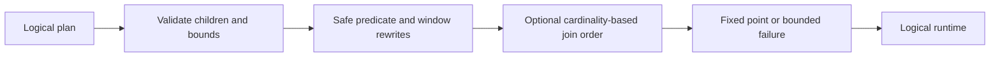
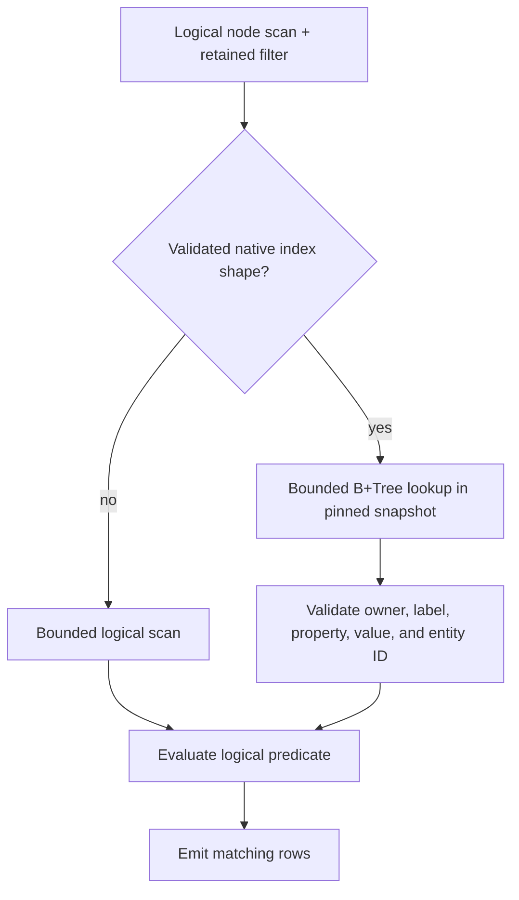

# Optimization Strategies

Optimization is correctness-constrained: an optimization may reduce work, but it cannot weaken validation, alter observable Cypher semantics, or bypass pinned-snapshot storage checks. The current native implementation has three layers: logical-plan rewrites, validated native access paths, and relocatable storage I/O.

## Logical Plan Rewrites

`LogicalPlanOptimizer` runs after parsing an optimizable logical plan and before runtime dispatch. It has bounded pass and depth limits, recursively validates non-null children, and stops only at a fixed point. It is storage-neutral; an optional `LogicalStatisticsProvider` supplies bounded estimates without exposing pages or physical operators.

The implemented rewrites are intentionally small and explicit:

| Rewrite | Preconditions and retained guarantee |
|---|---|
| Equality scan hint | A direct node scan has a static, non-null, property-right literal equality. The filter remains in the plan. |
| Range scan hint | A direct node scan has compatible literal bounds for one property; an equality prefix may precede a trailing range. The filter remains in the plan. |
| Cartesian join order | Both sides have valid estimates and the left side is strictly smaller, because the runtime materializes the right side. Ties and missing estimates preserve order. |
| `LIMIT` through project | The limit is non-negative and the project is non-`DISTINCT` with valid items. |
| Adjacent windows | Nested `LIMIT`, nested `SKIP`, and positive `LIMIT(Skip(...))` normalize only for non-negative, non-overflowing values. `LIMIT 0`, invalid, and overflowing windows retain runtime behavior. |

The optimizer does not claim generic filter or projection pushdown. It rejects or leaves unchanged reversed operands, null equality, ambiguous range combinations, invalid existing scan predicates, unsafe `SKIP` movement, ties, and unknown statistics. This conservative policy avoids changing row ordering, expression failures, or null behavior.

## Native Access Paths

The read runtime remains the semantic authority. A logical node-scan hint may use native B+Tree scalar, range, or composite equality-prefix/trailing-range lookup only when the storage reader can validate it within one pinned snapshot.

Unavailable indexes fall back only where the runtime supports a bounded logical scan. Malformed, stale, mismatched, or over-limit index state fails closed. An unknown property produces an empty result rather than an inferred match. Native statistics are advisory and must never cause a planning-time graph scan.

## Execution And Resource Bounds

The logical runtimes stream reads where possible and install a `QueryGuard` with database policy defaults when the caller provides none. Runtime bounds cap node records, metadata pages, adjacency records, properties, rows, distinct rows, vector work, and GDS work. A transaction-owned overlay keeps staged writes private until its owner commits; it is not an independent autocommit optimization path.

Vector search and maintenance use the native relocatable vector path. Current smoke calibration proves source-set and report wiring only; production Recall, QPS, build-time, memory, update, and recovery targets remain acceptance gates, not documented performance claims.

## Storage I/O And Cache

`StorageIO` provides checked, typed file I/O for the relocatable backend. Metadata is read through pinned snapshots, and the generation-aware `BufferPool` caches validated pages without making stale mappings visible. Publication uses the single-file A/B Superblock protocol described in the native storage plan; queries and optimizations must not bypass codec, owner, generation, checksum, or snapshot validation.

The retired segment-chain `DataManager`, `PageBufferPool`, external-WAL group commit, and HNSW execution descriptions are historical migration material. They are not current performance architecture and remain subject to the roadmap's replacement and retirement gates.
