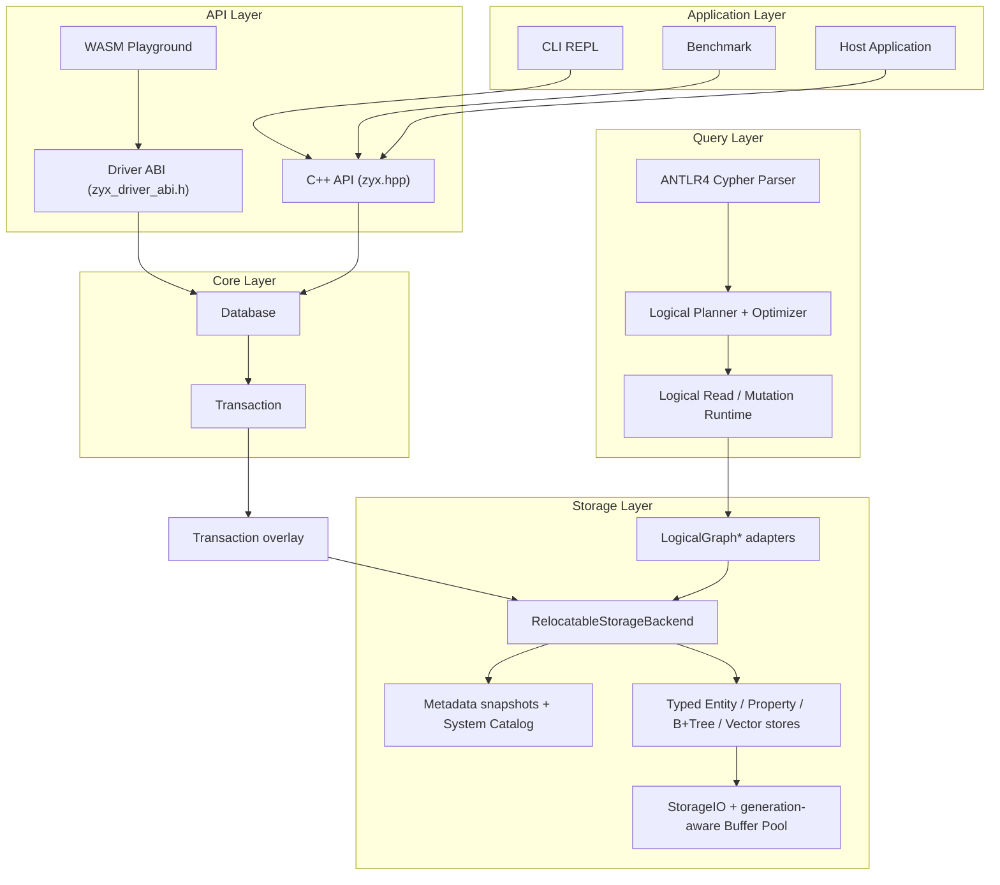
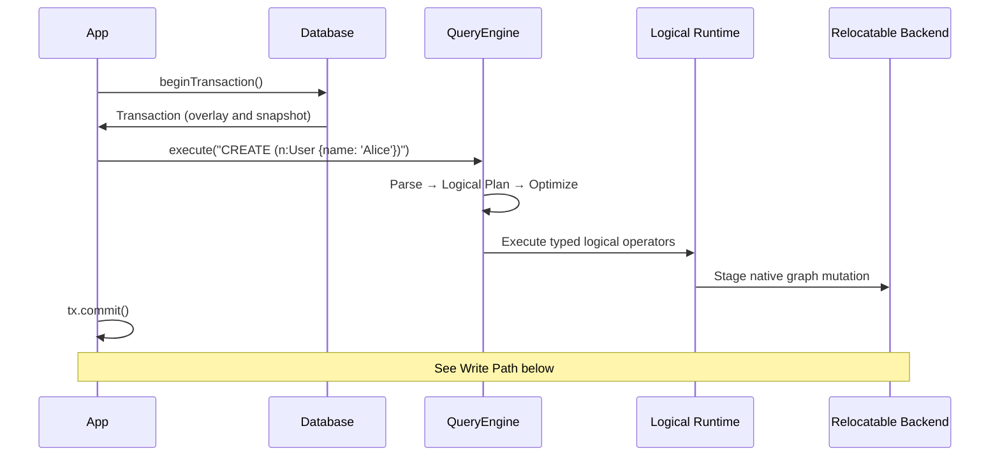
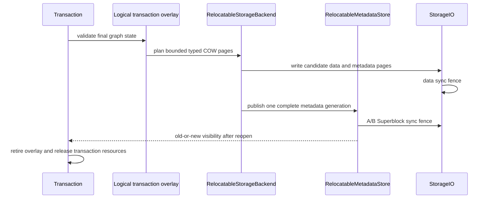
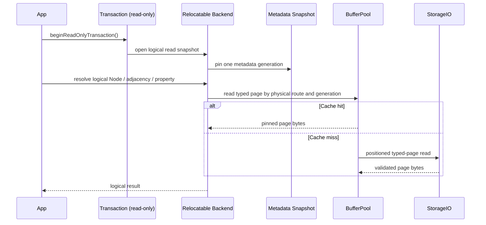

# Architecture Overview

> This page describes the current native logical/relocatable production path. The [Native Single-File Storage Re-architecture Plan](native-single-file-storage-plan) is the normative format and lifecycle contract. Legacy `DataManager`, segment-chain, external-WAL, and physical-executor material are historical migration references, not current architecture.

ZYX is an embeddable graph database engine. Its core is an in-process library — no separate server process is required.

## Layered Architecture

**Layer responsibilities:**

- **Application Layer** — CLI tool, benchmark suite, and host applications that embed ZYX.
- **API Layer** — C++ API (`zyx.hpp`), stable Driver ABI (`zyx_driver_abi.h`), language bindings, and WASM bindings for browser use.
- **Query Layer** — Cypher text becomes a typed logical plan. The logical optimizer preserves semantics while applying bounded scan and row-window normalizations; logical read and mutation runtimes execute the plan through storage-neutral interfaces.
- **Storage Layer** — `RelocatableStorageBackend` owns one database file, pinned metadata snapshots, the canonical System Catalog, typed page stores, and native maintenance. `StorageIO` and the generation-aware Buffer Pool provide the typed I/O boundary; external WAL/SHM sidecars are not part of the production protocol.
- **Core Layer** — `Database` owns the backend and lazily initializes `QueryEngine` and the thread pool. `Transaction` owns a native logical transaction, its read-your-writes overlay, and its pinned lifetime.

## Key Objects

| Object | Responsibility | Source |
|--------|---------------|--------|
| `graph::Database` | Backend lifecycle and lazy initialization of QueryEngine / ThreadPool | `include/graph/core/Database.hpp` |
| `graph::query::QueryEngine` | Cypher parsing, plan building, and execution | `include/graph/query/api/QueryEngine.hpp` |
| `graph::storage::RelocatableStorageBackend` | Single-file native graph, schema, Vector, snapshot, and maintenance boundary | `include/graph/storage/relocatable/backend/RelocatableStorageBackend.hpp` |
| `graph::storage::RelocatableMetadataStore` | A/B Superblock publication, Catalog roots, allocator state, and snapshot pins | `include/graph/storage/relocatable/metadata/RelocatableMetadataStore.hpp` |
| `graph::storage::StorageIO` | Checked positioned I/O and ordered data/Superblock sync fences | `include/graph/storage/StorageIO.hpp` |
| `graph::Transaction` | Transaction-owned logical overlay, commit/rollback, and backend lifetime | `include/graph/core/Transaction.hpp` |

## Main Execution Paths

### Query Path

### Write Path (commit)

### Read Path

## Design Principles

1. **Embeddable first** — ZYX is a library, not a server. Link directly into your process.
2. **Pinned snapshots** — every native read resolves data through one immutable metadata generation, so page relocation and reuse cannot mix generations.
3. **One-file COW publication** — candidate pages are durable before one A/B Superblock publication; reopen observes either a complete old or complete new generation.
4. **Typed, bounded I/O** — entity, property, index, Catalog, and Vector stores retain owner/generation/checksum validation and use finite cursors and admission-aware cache reads.
5. **Fail closed** — malformed routes, keys, checksums, ownership, generation, and resource bounds are rejected rather than falling back to a legacy representation.
