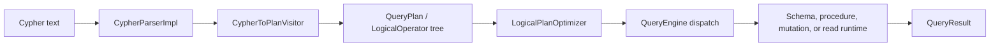

# Query Engine

The current query path is a native **Parse -> Logical plan -> Logical optimization -> Logical runtime** pipeline. It does not convert a plan into the retired physical-operator executor. Every runtime reads through a logical storage backend, so query code does not depend on segment layouts or physical locations.

## Pipeline Overview

`QueryEngine` owns parser reuse, the logical `PlanCache`, optional native cardinality statistics, execution limits, and dispatch. A cache hit returns a reusable logical `QueryPlan`; schema-changing plans invalidate the cache. The engine applies execution-mode checks before a mutating plan can run and installs a database resource policy and `QueryGuard` when the caller did not supply one.

## 1. Parsing And Logical Plans

ANTLR4 generates the Cypher parser from the grammar under `src/query/parser/cypher/generated/`. `CypherParserImpl` produces a parse tree, and `CypherToPlanVisitor` builds a `LogicalOperator` tree directly; there is no separate public AST execution layer.

Logical operators are storage-neutral, inspectable, cloneable plan nodes. The type enum uses `LOP_` prefixes for Windows compatibility. Its families include:

| Family | Examples |
|---|---|
| Read and shaping | node scan, filter, project, aggregate, sort, limit, skip, join, traversal, variable-length traversal, unwind, union |
| Mutation | create node/edge, set, remove, delete, merge, foreach, subquery |
| Schema and administration | index and constraint DDL, show indexes/constraints, transaction control, procedures, vector operations |
| Observability | explain and profile |

The exact supported Cypher surface is maintained in `UNSUPPORTED_CYPHER_FEATURES.md`. A logical operator is not treated as supported merely because its enum exists: a runtime must explicitly implement it, otherwise the native path fails closed rather than falling back to the retired executor.

## 2. Logical Optimization

`LogicalPlanOptimizer` is deliberately storage-neutral. It has bounded rewrite passes and plan depth, validates child structure, and only applies transformations whose observable Cypher behavior is preserved. It can consume a bounded cardinality estimate supplied by the native backend, but it does not inspect storage pages or physical indexes itself.

Current transformations include:

- exposing static, non-null property equality predicates on a direct node scan while retaining the original filter as the semantic authority;
- exposing one direct literal range, including an equality-prefix plus trailing-range scan shape where valid;
- putting the strictly smaller, validated side of a Cartesian join on the runtime's materialized-right side;
- moving a non-negative `LIMIT` below a non-`DISTINCT` projection with valid items;
- normalizing adjacent `LIMIT` and `SKIP` windows only when values are non-negative and arithmetic is representable.

The optimizer intentionally leaves ambiguous or unsafe cases unchanged. For example, it does not reverse literal/property operands, invent an access path for `NULL`, or push `SKIP` beneath projection merely to reduce work; those rewrites could change errors or row semantics. The read runtime remains responsible for validating scan boundaries and applying retained predicates.

## 3. Runtime Dispatch And Transactions

`QueryEngine::executePlan()` unwraps `EXPLAIN` or `PROFILE` and dispatches the inner logical plan by capability:

| Plan class | Runtime |
|---|---|
| Schema mutation or schema read | `LogicalPlanSchemaRuntime` |
| Procedure call | `LogicalPlanProcedureRuntime` |
| Data mutation | `LogicalPlanMutationRuntime` |
| Remaining native read plan | `LogicalPlanReadRuntime` |

`EXPLAIN` renders the logical tree without opening a storage snapshot or publishing work. `PROFILE` runs the same dispatch and appends one logical-plan timing summary. Read-only contexts reject data or schema mutation (except inspection by `EXPLAIN`), and regular read-write transactions reject schema mutation.

A caller-owned logical transaction uses `executePlanWithLogicalTransactionOverlay()`. Reads and supported procedures observe that overlay, while staged writes remain unpublished until its owner commits. The overlay explicitly rejects schema mutation and applies the same execution guard and bounded runtime options.

## 4. Native Read Boundary

`LogicalPlanReadRuntime` is streaming and bounded. It opens logical snapshots through `LogicalGraphReadBackend`, carries logical node/edge values rather than token IDs or physical locations, and materializes result entities only at the output boundary. Its limits cover node and adjacency records, metadata pages, properties, rows, and distinct rows.

Native index-assisted scans are only hints. The storage reader performs exact lookup or range validation against a pinned snapshot; malformed, stale, unavailable, or over-limit state fails closed. Predicates retained in the logical plan remain the final semantic check, which prevents an optimization hint from broadening results.

## Historical Migration Material

Older documentation may describe `PhysicalPlanConverter`, `PhysicalOperator`, `QueryExecutor`, `QueryPlanner`, or the old GDS/Leiden implementation as current execution components. That physical query family has been removed after native logical replacement verification. Segment-chain scans and `DataManager` remain separately gated storage-migration material and are not part of the current native query path.
