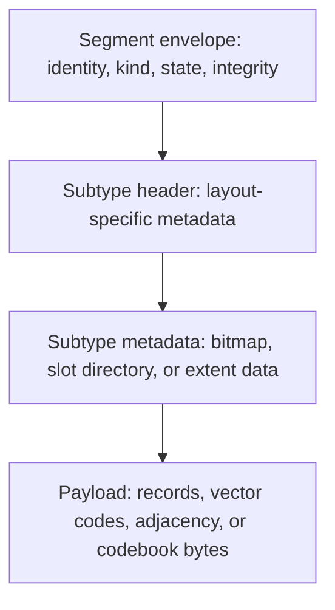
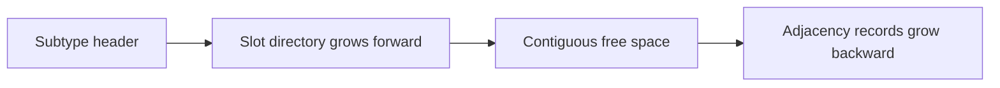
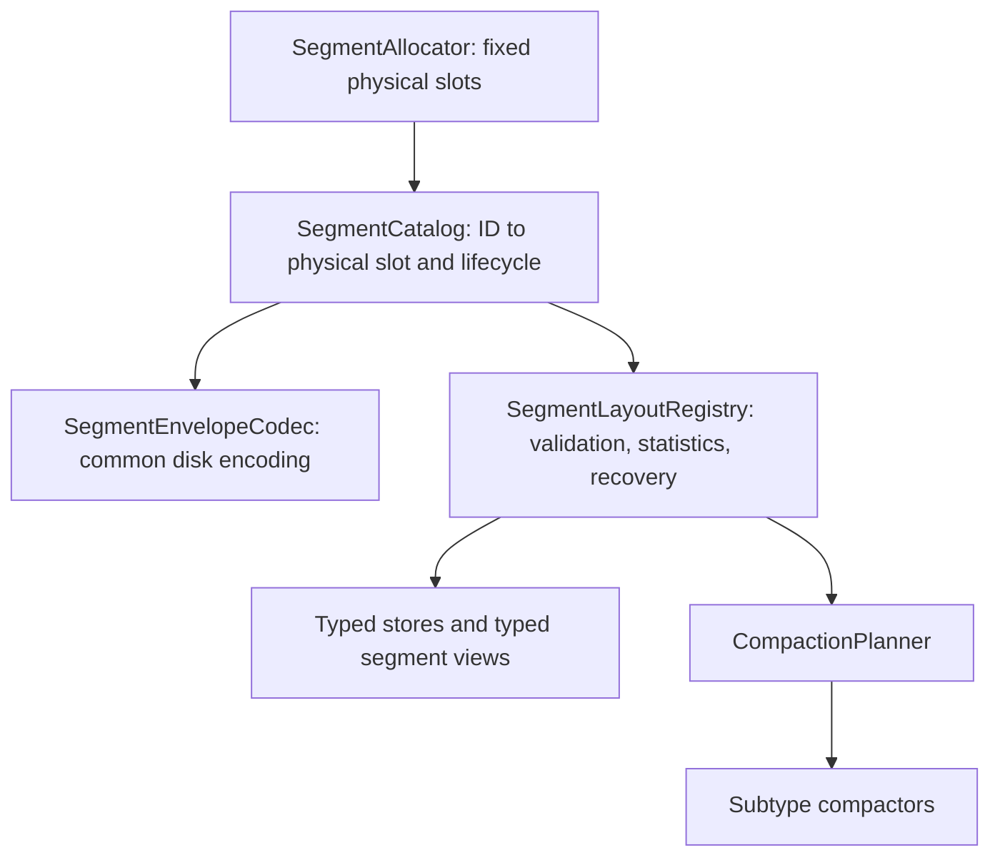
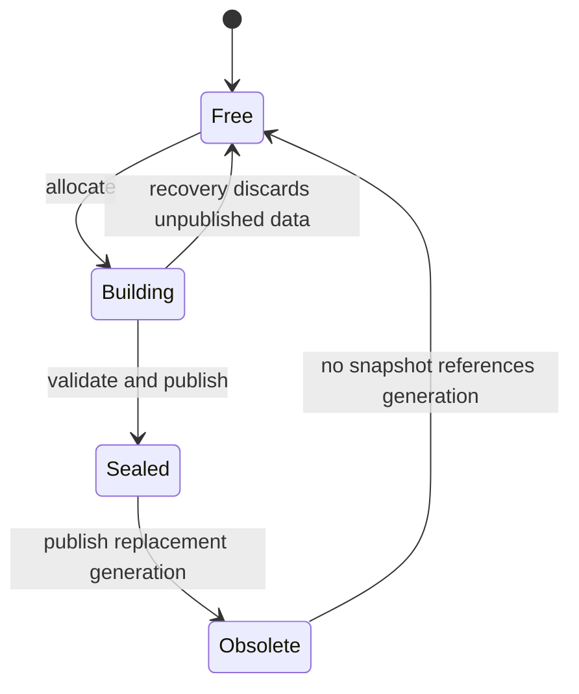

# Segment Storage vNext Design

> **Status: design only.** This document records the target architecture for a future file-format revision. It does not describe the current on-disk format and is not yet implemented. See [Segment Format](segment-format) for the current implementation.

## Goals

The next segment architecture separates physical storage concerns from layout-specific record semantics. It is intended to:

- retain fixed-size, page-aligned segments and reuse the existing I/O, buffer-pool, WAL, and recovery foundations;
- support fixed graph entities, raw vectors, PQ codes, variable-size adjacency lists, codebooks, and future layouts without expanding one universal header;
- keep hot scans statically typed and free from per-record virtual dispatch;
- reduce write amplification during metadata updates and checksum maintenance;
- make relocation, copy-on-write generations, online compaction, and future multi-file storage possible;
- define an explicit, cross-platform disk encoding independent of C++ structure padding and compiler ABI.

Backward compatibility with the current format is not a design constraint. The implementation should introduce a new file-format version and use an explicit migration or rebuild tool instead of preserving weak abstractions.

## Design Principles

1. **Uniform physical envelope, specialized payload.** Segment size, lifecycle, identity, integrity, and ownership are common. Capacity, occupancy, lookup, and compaction belong to the subtype.
2. **Logical identity is stable.** Persistent references use a segment ID, never a raw file offset.
3. **Bytes are the common accounting unit.** Record counts remain subtype-specific; generic planning uses live, reclaimable, and free bytes.
4. **Dispatch once per segment.** Cold control paths use registered layout operations. Hot loops open a typed view and operate without per-record type checks.
5. **Disk encoding is explicit.** Integer widths, byte order, bounds, checksums, and version transitions are defined by codecs rather than native structure layout.
6. **Publication is atomic at the manifest level.** New generations are built privately, validated, and then made visible through a committed catalog or manifest update.

## Layered Model

The physical allocator understands only fixed-size slots. A subtype store initializes and interprets the bytes inside the allocated slot.

## Physical Segment Envelope

The target format uses a fixed 128 KiB physical segment. The first 64 bytes form a stable envelope, while `header_bytes` locates the aligned payload after subtype metadata.

| Field | Width | Responsibility |
|---|---:|---|
| `magic` | 32 bits | Reject uninitialized or unrelated data |
| `format_version` | 16 bits | Version the common envelope |
| `header_bytes` | 16 bits | Locate the payload and permit subtype-header growth |
| `kind` | 16 bits | Select the registered layout codec |
| `state` | 16 bits | Represent free, building, sealed, and obsolete states |
| `flags` | 32 bits | Store common lifecycle flags only |
| `segment_id` | 64 bits | Stable logical identity |
| `owner_id` | 64 bits | Identify the entity store, index, or vector index |
| `generation` | 64 bits | Support copy-on-write publication and snapshots |
| `committed_lsn` | 64 bits | Make WAL replay idempotent |
| `payload_bytes` | 32 bits | Bound integrity validation and reads |
| `header_crc` | 32 bits | Validate metadata before trusting offsets and lengths |
| `payload_crc` | 32 bits | Validate sealed payload data |
| reserved | 32 bits | Preserve envelope size for compatible extensions |

The envelope deliberately excludes record capacity, high watermark, live count, entity ID ranges, occupancy bitmaps, compaction policy, and linked-list offsets.

The planned segment kinds use prefixed enum members to remain safe on Windows, including `SGK_ENTITY_FIXED`, `SGK_VECTOR_RAW`, `SGK_VECTOR_PQ`, `SGK_VECTOR_ADJACENCY`, `SGK_VECTOR_CODEBOOK`, and `SGK_INDEX_PAGE`. Segment states similarly use `SGS_FREE`, `SGS_BUILDING`, `SGS_SEALED`, and `SGS_OBSOLETE`.

## Subtype Layouts

### Fixed Record Layout

Nodes, edges, properties, and other fixed-size entities retain direct slot addressing. Their subtype header owns:

| Metadata | Meaning |
|---|---|
| Record size and stride | Logical record bytes and aligned physical distance between records |
| Record capacity | Number of addressable slots in this specific layout |
| High watermark | First slot that has never been allocated |
| Live count | Number of currently visible records |
| First entity ID | ID-to-slot mapping base when the store uses contiguous IDs |
| Occupancy offset and bytes | Location of the subtype-owned activity bitmap |
| Records offset | Aligned beginning of fixed records |

High watermark and live count replace the ambiguous combination of `used` and `inactive_count`. Deletion changes live count and occupancy but does not rewrite the allocation history.

### Raw Vector Layout

Each raw-vector segment is homogeneous for dimension, element encoding, stride, owner, and generation. Its subtype header contains dimension, element type, logical record size, aligned stride, capacity, high watermark, live count, occupancy location, records offset, and the first vector ordinal.

Capacity is calculated once when the segment is created. For example, a 384-dimensional BF16 vector has a 768-byte logical record. Metadata and alignment reduce the exact capacity slightly below the payload-only theoretical limit. FP32, BF16, and future encodings therefore have different capacities while retaining the same physical segment size.

### Product-Quantized Code Layout

PQ codes are fixed-size records but can number in the thousands per segment. Their bitmap is stored in subtype metadata instead of the common envelope. The subtype header records the codebook generation, code size, stride, capacity, high watermark, live count, occupancy location, code area, and first vector ordinal.

This avoids the current universal 512-slot bitmap ceiling and preserves dense packing for small codes.

### Adjacency Layout

Variable-size adjacency records use a slotted-page layout. The slot directory grows forward and encoded adjacency data grows backward.

Its header reports slot count, live slot count, slot-directory end, payload beginning, live bytes, reclaimable bytes, and graph generation. It does not expose a generic record capacity because variable-length records make such a value misleading.

Adjacency updates should use copy-on-write blocks or generations so that readers never observe offsets being rewritten in place.

### Codebook Extent Layout

Quantizers and codebooks are immutable, versioned objects split across one or more extents. Their subtype metadata records codebook identity, generation, chunk index, chunk count, chunk bytes, and total bytes. They have no occupancy bitmap or per-record compaction.

### Layout Comparison

| Layout | Unit of direct access | Occupancy model | Compaction unit |
|---|---|---|---|
| Fixed entity | Fixed record slot | Subtype bitmap | Live records |
| Raw vector | Aligned vector slot | Subtype bitmap | Live vectors |
| PQ code | Compact code slot | Payload-resident bitmap or tombstone map | Live codes |
| Adjacency | Variable-size slot | Slot directory and generations | Copy-on-write block |
| Codebook | Immutable extent | Whole-object state | Whole generation |

## Capacity Calculation

Fixed-record capacity depends on the subtype header, occupancy bytes, record stride, and alignment. Because bitmap size itself depends on capacity, the layout builder converges on a stable capacity during segment creation. The resulting capacity and offsets are persisted and validated when opened.

Validation must prove that every multiplication and addition is overflow-safe and that the complete record area remains within the physical segment. Capacity calculation is never repeated inside a scan loop.

## Common Space Accounting

Generic storage components consume normalized byte statistics instead of assuming a shared record count:

| Statistic | Meaning |
|---|---|
| Live bytes | Bytes required by visible data |
| Reclaimable bytes | Occupied bytes recoverable through compaction or generation retirement |
| Immediately free bytes | Space available without compaction |
| Metadata bytes | Layout overhead excluded from usable payload |

The compaction planner ranks segments by byte utilization, reclaimable-byte ratio, rewrite cost, age, and snapshot visibility. Subtype compactors perform the actual rewrite and return a relocation result when logical locations change.

## Runtime Architecture

### Cold Paths

Database open, integrity checking, recovery, inspection, and compaction scheduling select registered operations once from the segment kind. An operation set provides validation, space statistics, recovery, and compaction entry points.

### Hot Paths

Entity and vector stores open a typed segment view after validating kind and version. The view caches decoded offsets and typed metadata. Record scans then use direct addressing with no per-record virtual call or segment-kind switch.

## Segment Catalog and Manifests

Persistent consumers store a segment ID plus slot and generation. The catalog maps segment ID to physical slot, kind, owner, generation, and lifecycle state. Physical offsets remain an allocator detail.

Per-store or per-index manifests contain immutable ordered segment-ID lists. Publishing a replacement generation commits a new manifest and retires the old generation after no snapshot references it.

This replaces per-segment `next` and `previous` file offsets, avoiding neighbor rewrites during relocation and allowing future file reorganization or tiering.

## Disk Encoding and Cross-Platform Rules

- All persisted integers use explicit little-endian encoding with fixed widths.
- Disk codecs, not native C++ structures, define offsets and encoded sizes.
- Enum values and widths are explicit and stable.
- Decoders validate magic, version, state, kind, lengths, alignment, arithmetic overflow, and checksums before exposing a view.
- Unsupported versions fail deterministically; they are never interpreted using the newest in-memory structure.
- Tests must use golden byte fixtures on macOS, Linux, and Windows and include corruption, truncation, and unknown-version cases.

## Integrity and Write Amplification

The envelope has an independent header checksum so corrupted lengths cannot drive unsafe reads. Mutable data uses WAL plus page-level checksums. A full payload checksum is computed when an immutable segment is sealed, rather than rereading 128 KiB after every metadata update.

This separates three concerns:

- WAL establishes transaction durability and idempotent replay;
- page checksums detect localized corruption in mutable segments;
- sealed payload checksums validate immutable generations efficiently.

## Lifecycle and Crash Recovery

A writer builds a segment privately, writes subtype metadata and payload, validates checksums, records the catalog or manifest change through WAL, and only then publishes the sealed generation. Readers resolve only committed sealed generations. Recovery discards unpublished building segments and replays committed manifest changes idempotently using the committed LSN.

## Component Boundaries

| Component | Owns | Must not own |
|---|---|---|
| Segment allocator | Physical slot allocation and reuse | Record capacity, IDs, vector dimensions |
| Segment catalog | Logical-to-physical mapping and lifecycle | Subtype record interpretation |
| Envelope codec | Common encoded fields and validation | Native structure serialization |
| Layout registry | Cold-path dispatch by kind | Per-record query loops |
| Typed store | Record operations and typed views | Global physical allocation policy |
| Compaction planner | Priority and budget decisions | Layout-specific byte movement |
| Subtype compactor | Safe rewrite and relocation output | Cross-store scheduling policy |

## Migration Plan

1. Introduce disk codecs, segment IDs, and golden cross-platform format tests without changing current read paths.
2. Add the physical-slot allocator and catalog behind a new file-format version.
3. Move current fixed entities to the fixed-record subtype and verify semantic parity.
4. Add raw-vector and PQ-code stores, then replace blob-backed vector payloads.
5. Add copy-on-write adjacency and immutable codebook extents.
6. Switch generic statistics and compaction planning to byte accounting.
7. Remove legacy chain heads, raw-offset references, and universal bitmap assumptions.

The migration should be delivered as independently testable stages. A database is either opened with the current format or explicitly migrated/rebuilt into the new format; partial in-place interpretation is not allowed.

## Acceptance Criteria

- Line, branch, function, and region coverage each meet the project threshold.
- Golden disk-format tests pass with MSVC, Clang, and GCC on Windows, macOS, and Linux.
- Corrupt headers, invalid offsets, arithmetic overflow, torn writes, unknown kinds, and truncated payloads fail safely.
- Hot raw-vector and PQ scans contain no per-record virtual dispatch or layout-kind switch.
- Metadata-only updates do not require a full-segment read or checksum recomputation.
- Compaction preserves snapshot visibility and never exposes a partially published generation.
- Segment relocation does not rewrite persistent business-level references.
- Benchmarks report scan throughput, insert throughput, write amplification, recovery time, compaction bandwidth, and space utilization for every subtype.

## Explicit Non-Goals

- Preserving the current native `SegmentHeader` binary representation.
- Forcing all subtype layouts to share record-count semantics.
- Placing every occupancy bitmap in the common envelope.
- Building an independent vector storage engine outside the core allocator, WAL, buffer pool, and recovery infrastructure.
- Hiding vector-index write failures behind logging.

## Related Documents

- [Current Segment Format](segment-format)
- [Storage System](storage)
- [Write-Ahead Log](wal)
- [Segment Allocation](../algorithms/segment-allocation)
- [Segment Compaction](../algorithms/segment-compaction)
- [DiskANN](../algorithms/diskann)
- [Product Quantization](../algorithms/product-quantization)
