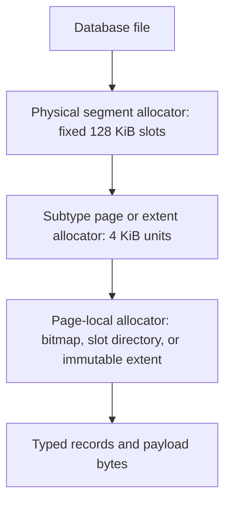

# Segment Storage vNext Design

> **Status: design only.** This document defines the target architecture and staged implementation plan for a future file-format revision. It does not describe the current on-disk format and is not yet implemented. See [Segment Format](segment-format) for the current implementation.

## Decision Summary

The following decisions are architectural invariants for vNext:

| Area | Decision |
|---|---|
| Physical allocation | Every physical segment remains exactly 128 KiB and page-aligned |
| Global reuse | A fully free segment can be reused by any subtype; the free list is type-independent |
| Hole reclamation | Any active tail segment can relocate into any earlier free segment, regardless of subtype |
| Internal allocation | Subtypes may divide a segment into 4 KiB pages and contiguous multi-page extents |
| Physical references | Persistent consumers use stable logical IDs, never raw file offsets |
| Fixed records | Node, Edge, raw-vector, and PQ records use fixed strides and capacity-derived bitmaps |
| Variable records | Property, vector adjacency, and B+Tree entries use slotted pages |
| Multiple owners | Multiple indexes may share a physical pool segment at page or extent granularity |
| Large objects | Blob becomes an extent-backed store for large opaque values, not a universal serialization layer |
| Publication | Relocation and replacement use copy-on-write generations and WAL-backed atomic publication |
| Compatibility | The new format has a new version and an explicit rebuild or migration tool; partial interpretation is forbidden |

Global 16/32/64/128 KiB physical segment size classes are explicitly rejected. They would make hole reuse size-dependent, add external fragmentation, and complicate tail truncation. Logical extents of those sizes are allowed only inside a fixed 128 KiB segment.

## Goals

The next storage architecture must:

- preserve the current type-independent whole-segment reclamation model;
- improve Node and Edge density by removing fixed 256-byte disk padding;
- support compact fixed records and efficient variable-size records without expanding one universal header;
- let many small property, B+Tree, Blob, and vector indexes share physical segments safely;
- keep hot fixed-record and vector loops free from per-record virtual dispatch and layout checks;
- reduce metadata write amplification and avoid checksumming an entire mutable segment after every small update;
- support stable logical identities, online relocation, snapshots, copy-on-write publication, and crash recovery;
- define an explicit cross-platform disk encoding independent of C++ object layout and compiler ABI;
- deliver the rewrite in independently testable stages with 95% or greater line, branch, function, and region coverage.

Backward compatibility with weak abstractions in the current format is not a goal. Semantic API compatibility remains required unless a separately approved API change says otherwise.

## Non-Negotiable Invariants

1. **A physical segment is always 128 KiB.** No subtype changes the file allocator's unit.
2. **A free physical segment has no type.** Reinitialization may assign any supported segment kind.
3. **Logical identity is stable.** Moving bytes never changes business-level Node IDs, Edge IDs, Page IDs, Blob IDs, or index identities.
4. **New data is published before old data is reclaimed.** Delete-before-create replacement is forbidden.
5. **Readers never observe partially initialized bytes.** A generation is visible only after validation and committed publication.
6. **One hot unit has one layout.** A fixed record page or extent has one owner, kind, version, encoding, dimension, and stride.
7. **Bytes are the common accounting unit.** Generic components do not infer fragmentation from subtype record counts.
8. **Disk bytes are decoded defensively.** Lengths, offsets, arithmetic, enum values, generations, and checksums are validated before use.
9. **Every stage keeps the repository buildable and testable.** Experimental vNext paths remain isolated until cutover.

## Layered Space Model



The physical allocator understands only fixed-size segment slots. A subtype may use the whole segment as a fixed-record area or divide it into thirty-two 4 KiB pages. Page grouping is a logical allocation policy and does not change the physical segment size.

### Allocation and Reclamation Units

| Layer | Unit | Responsibility |
|---|---:|---|
| File allocator | 128 KiB physical segment | Reserve, reuse, relocate, and truncate file space |
| Pool allocator | 4 KiB page or contiguous page extent | Assign storage to a subtype and logical owner |
| Fixed layout | Fixed record slot | Direct addressing and occupancy bitmap |
| Variable layout | Slotted record | Offset, length, generation, and page-local compaction |
| Large object layout | Immutable extent generation | Streaming bytes, compression, checksum, and retirement |

## Physical Segment Envelope

The first 64 bytes form a stable common envelope. Subtype metadata begins after it, and `header_bytes` locates the first subtype-controlled payload byte.

| Field | Width | Responsibility |
|---|---:|---|
| `magic` | 32 bits | Reject uninitialized or unrelated data |
| `format_version` | 16 bits | Version the common envelope |
| `header_bytes` | 16 bits | Locate subtype data and permit subtype-header growth |
| `kind` | 16 bits | Select the registered layout codec |
| `state` | 16 bits | Represent free, building, sealed, retired, and obsolete states |
| `flags` | 32 bits | Store common lifecycle flags only |
| `segment_id` | 64 bits | Stable logical segment identity |
| `owner_id` | 64 bits | Identify a store or shared pool; page headers identify per-page owners |
| `generation` | 64 bits | Support copy-on-write publication and snapshots |
| `committed_lsn` | 64 bits | Make WAL replay idempotent |
| `payload_bytes` | 32 bits | Bound integrity validation and reads |
| `header_crc` | 32 bits | Validate metadata before trusting offsets and lengths |
| `payload_crc` | 32 bits | Validate immutable or sealed payload data |
| reserved | 32 bits | Preserve the 64-byte envelope for compatible extensions |

The common envelope must not contain record capacity, high watermark, live count, ID ranges, bitmaps, slot directories, compaction thresholds, or linked-list offsets.

Planned segment kinds use Windows-safe prefixed enum members. The initial registry includes `SGK_ENTITY_FIXED`, `SGK_PROPERTY_PAGE_POOL`, `SGK_INDEX_PAGE_POOL`, `SGK_VECTOR_RAW_POOL`, `SGK_VECTOR_PQ_POOL`, `SGK_VECTOR_ADJACENCY_POOL`, `SGK_LARGE_OBJECT_POOL`, `SGK_CODEBOOK_EXTENT`, and `SGK_CATALOG`. Lifecycle members similarly use a prefix, including `SGS_FREE`, `SGS_BUILDING`, `SGS_SEALED`, `SGS_RETIRED`, and `SGS_OBSOLETE`.

## Explicit Disk Codecs

Disk codecs define exact field offsets, integer widths, byte order, encoded size, validation, and version transitions. They do not serialize native C++ structures.

The in-memory `Node` and `Edge` classes may retain STL containers and convenient methods. Their disk records remain compact fixed byte sequences. The initial sizing target is a 96-byte Node record and an 80-byte Edge record; final strides are accepted only after layout validation and benchmarks.

The Node record contains only fixed topology and reference metadata: ID, first incoming and outgoing edge IDs, property reference, fixed label references, label count, and property storage kind. The Edge record contains its ID, endpoint IDs, relationship-chain references, property reference, and type ID. Variable property payloads remain outside Node and Edge records. Activity is represented by the layout bitmap and is not duplicated as an in-record boolean.

All codecs must:

- use fixed-width integer types and explicit little-endian encoding;
- avoid native enum, `bool`, pointer, STL, padding, and `sizeof(struct)` persistence;
- reject unsupported versions and unknown required flags;
- validate counts before indexing fixed arrays;
- use checked addition and multiplication before constructing offsets or allocations;
- preserve reserved bytes as zero and reject nonzero reserved bits when required by the version;
- provide golden byte fixtures shared by macOS, Linux, and Windows tests.

## Fixed-Record Layout and Bitmaps

Node, Edge, raw-vector, and PQ-code layouts use direct slot addressing. Their subtype headers own:

| Metadata | Meaning |
|---|---|
| `record_bytes` | Logical encoded bytes in one record |
| `record_stride` | Aligned physical distance between records |
| `capacity` | Number of addressable slots |
| `high_watermark` | First slot that has never been allocated |
| `live_count` | Number of currently visible records |
| `first_logical_id` | Optional contiguous ID-to-slot base |
| `bitmap_offset` and `bitmap_bytes` | Location and exact size of the activity bitmap |
| `records_offset` | Aligned beginning of fixed records |

The activity bitmap always uses one bit per slot. Its raw size is `ceil(capacity / 8)`. The bitmap starts at a 64-byte-aligned offset, and the record area begins at the next required alignment after the bitmap. Bitmap size is not a global constant and is not stored inline in the common envelope.

Capacity and bitmap size depend on each other. The layout builder chooses the largest capacity for which the aligned header, bitmap, and all fixed records fit inside 128 KiB. It persists the result, and open-time validation repeats the checked calculation. Scan loops consume the validated result without recomputing it.

Approximate targets, subject to the final subtype headers, are:

| Layout | Target stride | Approximate capacity | Raw bitmap bytes |
|---|---:|---:|---:|
| Current 256-byte record | 256 B | 512 | 64 B |
| Node vNext | 96 B | about 1,360 | about 170 B |
| Edge vNext | 80 B | about 1,630 | about 204 B |
| Raw BF16, 384 dimensions | 768 B | about 170 | about 22 B |
| Raw FP32, 384 dimensions | 1,536 B | about 85 | about 11 B |
| PQ code, 32 bytes | 32 B | about 4,070 | about 509 B |

The larger Node and Edge bitmaps are expected and inexpensive: one bit is only 0.125 byte per record. Removing 160 or more bytes of fixed padding per record dominates the extra bitmap bytes.

`high_watermark` distinguishes never-allocated tail slots from deleted slots. `live_count` avoids repeated population counts for common statistics. Free-slot hints may accelerate reuse, but the bitmap remains the source of truth.

## Slotted Pages

Variable-size Property, vector-adjacency, and B+Tree records use slotted pages. A page header and slot directory grow from the front; payload bytes grow from the back.


A slot entry stores an offset, length, state flags, and generation. External references use a stable Page ID, slot ID, and generation rather than a payload offset. Page-local compaction may move payload bytes and update slot offsets without changing external references.

Variable-record update order is:

1. overwrite in place when the existing allocation is sufficient and WAL protects the change;
2. extend in place when adjacent contiguous space is sufficient;
3. write a replacement payload elsewhere in the same page and publish the slot entry;
4. compact the 4 KiB page only when total free bytes are sufficient but contiguous free bytes are not;
5. otherwise allocate a new slot in another page, publish the new reference, and retire the old slot.

Page-local compaction, subtype segment evacuation, whole-segment relocation, and file truncation are separate operations. A small Property update must never invoke a whole-file compaction path.

Each variable page reports `live_bytes`, `reclaimable_bytes`, `contiguous_free_bytes`, metadata bytes, slot count, and live slot count. Insert selection uses a free-space index rather than scanning every page.

## Node and Edge Stores

Node and Edge records remain fixed-size within one layout version. Two entities of the same type never acquire different base-record strides because their properties, large values, and future variable metadata live in separate stores.

The vNext implementation must preserve:

- direct slot addressing for hot scans;
- stable Node and Edge IDs across compaction and physical relocation;
- relationship traversal semantics and incoming/outgoing chain integrity;
- multi-label behavior and the current maximum-label contract until a separately designed label store replaces it;
- property references that can publish a replacement without deleting the previous value first;
- snapshot visibility and rollback behavior.

Dense Node and Edge segment scans should improve because more useful records fit in each cache and I/O unit. Codec overhead must be measured, but no native packed structures or unaligned field access may be used as a shortcut.

## Property Store

The Property Store owns property keys, value types, structured encoding, and references to large values. Small and medium records use slotted pages. Node and Edge records store a logical Property reference, not payload bytes.

The storage policy chooses among:

| Value shape | Storage |
|---|---|
| Small scalar, string, list, or map | Inline in a Property slotted page |
| Medium structured value | Property overflow pages or typed chunks |
| Large value accessed as one object | Blob/Large Object reference |
| Large list or map requiring element-level access | Typed chunked Property layout |
| Vector value | Dedicated Vector Store reference |

Size thresholds are allocation policy, not file-format constants. They must be tuned with benchmarks and remain configurable without changing encoded compatibility.

Property keys use token IDs rather than repeated key strings. Large structured containers are chunked when the query engine needs element-level access or partial updates. Whole-value Blob encoding is allowed only when whole-value semantics are sufficient.

Updates use copy-on-write when they move across pages: write and validate the new record, publish the new Property reference through WAL, then retire the old slot. Reclaimable holes remain page-local until needed; they do not permanently restrict future record sizes because page-local compaction coalesces them.

## B+Tree Page Store

B+Tree nodes become real 4 KiB pages instead of 256-byte `Index` entities. Each page uses a slot directory for variable keys and values. Prefix compression, posting or overflow pages, and page-level checksums replace generic Blob overflow for structured index data.

Multiple logical indexes share `SGK_INDEX_PAGE_POOL` segments at page granularity. A 128 KiB segment contains thirty-two 4 KiB pages and a page-allocation bitmap. Each active page header identifies its owner index and generation. A page becomes reusable immediately after a committed merge or index drop; the physical segment returns to the global free list only when all pages are free.

Persistent child, sibling, and root references use stable Page IDs. A Page Directory maps Page IDs to Segment ID, page index, and generation. Moving a page between pool segments updates the directory rather than every B+Tree pointer.

B+Tree mutation must preserve standard redistribution, split, merge, root-collapse, leaf-link, and crash-atomicity invariants. A multi-page structural change is committed through WAL before any retired page becomes reusable.

## Vector Storage

One physical 128 KiB segment may store pages or extents owned by multiple vector indexes. Sharing occurs at page or contiguous extent granularity, never by interleaving unrelated per-record layouts.

Each vector page or extent is homogeneous for:

- owner vector-index ID;
- page kind and layout version;
- dimension and element encoding;
- record stride or PQ code size;
- codebook generation;
- publication generation.

Allocation prefers an existing pool with the same layout key and contiguous free pages. Large indexes naturally acquire full segments, while small indexes consume only a few pages and share the remaining physical space.

### Raw Vector Pool

Raw vectors use fixed records and a capacity-derived bitmap. A mapping from logical vector or graph Node ID resolves to Page ID, slot ID, and generation. Hot search and training loops open a typed extent once and perform no per-record owner, dimension, or encoding checks.

### PQ Code Pool

PQ codes use fixed records and their own bitmap. Page headers persist code size and codebook generation. Re-encoding publishes a new generation before old PQ pages are retired.

### Vector Adjacency Pool

Vector adjacency means the variable neighbor list used by DiskANN, not the ordinary graph relationship chain stored in Node and Edge records. Adjacency records use slotted pages and copy-on-write publication. The initial segment rewrite does not change ordinary graph adjacency representation.

### Codebook Extents

Quantizers and codebooks are immutable versioned objects stored in one or more extents. The manifest records identity, generation, chunk ordering, total bytes, and checksums. They have no per-record activity bitmap.

### Vector Manifests

Each vector index owns an immutable manifest listing raw extents, PQ extents, adjacency pages, codebook generation, entry point, dimension, metric, and encoding. Dropping an index retires its manifest and releases all referenced pages or extents after snapshot safety permits reclamation.

## Blob and Large Object Store

Blob is an extent-backed store for large opaque byte values. It is not the default persistence mechanism for structured engine data.

Appropriate Blob payloads include large strings, binary values, whole-value JSON or documents, large immutable lists or maps, and plugin-defined opaque data. Raw vectors, PQ codes, vector adjacency, B+Tree pages, posting lists, ordinary Property records, and codebooks use their dedicated layouts.

A Blob object has a stable Object ID and immutable generation. Its manifest records total logical bytes, compression policy, extent ordering, block lengths, and checksums. Large values may span any number of fixed physical segments through a list of logical extents; no logical object is limited to one segment.

Compression is independent of the decision to use Blob storage. Large compressible values use independently compressed blocks so range reads do not decompress the entire object. Incompressible or already compressed blocks remain raw. The encoded format persists the actual codec, compressed length, uncompressed length, and checksum. Compression policy and thresholds remain configurable.

Blob replacement follows create, validate, publish, retire, and reclaim order. Old extents remain readable until no snapshot references their generation.

## Shared Pools and Ownership

Pool segments allow many small owners to share one physical segment without per-record layout checks.

| Pool | Sharing unit | Per-unit owner |
|---|---|---|
| Property pool | Slotted page | Entity/property-store scope |
| Index pool | 4 KiB B+Tree page | Logical index ID |
| Raw-vector pool | Fixed-record page or extent | Vector-index ID |
| PQ pool | Fixed-record page or extent | Vector-index ID and codebook generation |
| Adjacency pool | Slotted page | Vector-index ID |
| Large-object pool | Page extent | Blob Object ID and generation |

The segment envelope identifies the pool. Page or extent headers identify the logical owner. Allocation policy groups compatible layouts and prefers contiguous runs, while manifests prevent readers from scanning unrelated owners.

## Stable IDs, Catalogs, and Manifests

The Segment Catalog maps each stable Segment ID to physical offset, kind, owner or pool, generation, lifecycle state, and committed LSN. Physical offset is never a persistent business-level reference.

Page and extent directories map stable Page IDs and Extent IDs to Segment ID, page index, page count, and generation. Store manifests list logical IDs rather than offsets. Catalog and manifest updates are checksummed, WAL-protected, and replayable.

Whole-segment relocation therefore changes only the Segment Catalog mapping. Page evacuation changes only the Page or Extent Directory. Node IDs, Edge IDs, B+Tree pointers, Blob references, and vector mappings remain stable.

## Space Accounting

Generic storage components consume normalized byte statistics:

| Statistic | Meaning |
|---|---|
| `live_bytes` | Bytes required by visible data |
| `reclaimable_bytes` | Retired, deleted, or fragmented bytes recoverable through compaction |
| `immediately_free_bytes` | Space usable without compaction |
| `contiguous_free_bytes` | Largest directly usable region where relevant |
| `metadata_bytes` | Headers, bitmaps, directories, and manifests |
| `reserved_tail_bytes` | Allocated but unused bytes in the current tail or extent |

The current concept of fragmentation must not treat never-used append space as deleted fragmentation. Compaction priority considers reclaimable bytes, expected output bytes, rewrite cost, age, snapshot visibility, and achievable tail truncation.

Dense fixed-record layouts target greater than 90% utilization of their record region. Metadata-only updates must not require reading or checksumming an entire 128 KiB mutable segment.

## Compaction and Type-Independent Reclamation

Compaction is split into four explicit operations:

| Operation | Understands subtype | Unit |
|---|---|---|
| Page-local compaction | Yes | One 4 KiB variable-record page |
| Subtype evacuation | Yes | Records, pages, or extents from a sparse segment |
| Physical relocation | No | One complete 128 KiB segment |
| File truncation | No | Consecutive free tail segments |


A partially free segment remains owned by its subtype. Once its bitmap, page map, or extent map is empty and all retired generations are safe, it enters the global type-independent free list. The old subtype header is invalidated before reuse.

Any active tail segment can move into any earlier free physical segment because all physical segments have the same size. Relocation copies the segment, validates it, publishes the Segment Catalog mapping through WAL, retires the old location, waits for pins or snapshots, and then marks the old slot free. The operation does not inspect the segment payload.

## Concurrency and Snapshot Safety

- Readers resolve logical IDs to a generation, pin the page or segment, and never follow a location being reclaimed.
- Mutable page updates use page latches and WAL; multi-location replacements use copy-on-write publication.
- New pages, extents, manifests, and segments remain in building state until checksummed and committed.
- Retired generations are reclaimed only after the oldest visible snapshot and all buffer-pool pins have advanced.
- Slot generations prevent stale references from reading a reused slot.
- Lock and latch ordering must be documented per store before concurrency is enabled; no implementation may acquire catalog locks from a record-level hot loop.
- Cache entries include generation or are invalidated on publication so relocation cannot return stale bytes.

## WAL, Integrity, and Recovery

WAL establishes transaction ordering and idempotent replay. Page checksums protect mutable pages, while sealed immutable extents and segments use payload checksums. Header checksums are independent so corrupted lengths cannot drive unsafe reads.

Recovery must handle:

- allocated but unpublished segments, pages, and extents;
- committed catalog updates with an old physical location still present;
- torn page writes and checksum mismatches;
- a new manifest published before old-generation retirement completes;
- interrupted page evacuation and whole-segment relocation;
- interrupted index split, merge, and root collapse;
- truncated or corrupt slot directories and overflow references;
- unknown kinds, versions, codecs, enum values, and required flags;
- duplicate ownership, overlapping extents, and catalog cycles.

Recovery discards unpublished building objects, replays committed mappings by LSN, preserves the newest valid committed generation, and never guesses the meaning of an unsupported format.

## Runtime Component Boundaries

| Component | Owns | Must not own |
|---|---|---|
| Physical Segment Allocator | Fixed-slot allocation, free list, relocation target, tail space | Record capacity, vector dimension, Property encoding |
| Segment Catalog | Segment ID to physical location and lifecycle | Subtype record interpretation |
| Page/Extent Directory | Stable Page or Extent ID to segment location | Query semantics |
| Envelope Codec | Common encoded fields and validation | Native structure serialization |
| Layout Registry | Cold-path dispatch, validation, statistics, recovery hooks | Per-record query loops |
| Typed Store | Record operations, typed views, owner manifests | Global physical allocation policy |
| Compaction Planner | Priority, budget, and truncation benefit | Layout-specific byte movement |
| Subtype Compactor | Safe evacuation and relocation output | Cross-store scheduling |
| Blob Store | Opaque large objects and block compression | Vector, B+Tree, or Property semantics |

## Staged Implementation Plan

vNext is developed behind an experimental storage-format boundary. The current format remains the production default until the final cutover. A stage is complete only when its code, tests, coverage, benchmarks, recovery behavior, and documentation pass its exit gate.

### Stage 0: Baseline, Metrics, and Format Contract

Complete:

- freeze current-format golden fixtures and document current file-size, scan, insert, update, recovery, and compaction baselines;
- add per-subtype live, free, metadata, and write-amplification measurements without changing disk semantics;
- define vNext numeric format version, logical ID widths, alignment rules, enum values, and invalid-value policy;
- define benchmark datasets for empty, small, medium, dense, delete-heavy, update-heavy, multi-index, vector, and large-Blob workloads;
- inventory tests whose assertions depend on physical offsets, 256-byte records, 512-slot bitmaps, Blob chains, or native headers.

Tests and gate:

- current full test suite remains green;
- current-format fixtures reopen identically on macOS, Linux, and Windows;
- measurement code reaches 95% line, branch, function, and region coverage;
- no baseline benchmark changes beyond measurement noise.

### Stage 1: Codec and Layout Foundation

Complete:

- implement checked little-endian primitives, envelope codec, subtype-header codecs, and checked arithmetic helpers;
- implement the fixed-layout capacity solver and bitmap sizing;
- implement layout registry validation without connecting it to production read or write paths;
- add stable typed wrappers for Segment ID, Page ID, Extent ID, generation, and LSN;
- add deterministic error categories for malformed and unsupported storage.

Tests and gate:

- golden byte tests cover every field and platform;
- truncation, overflow, bad alignment, invalid enum, unknown version, checksum, and reserved-bit tests fail safely;
- property-based round-trip tests cover valid boundary values;
- every new foundation module reaches 95% in all four coverage dimensions;
- sanitizers and static analysis report no out-of-bounds or integer-overflow defect.

### Stage 2: Segment Catalog and Physical Relocation

Complete:

- implement the fixed 128 KiB physical-slot allocator, type-independent free list, Segment Catalog, and generation lifecycle;
- implement building, publish, retire, free, and recovery transitions;
- implement whole-segment relocation using Segment ID rather than linked physical offsets;
- preserve the ability to move any tail subtype into any earlier free slot;
- implement pin- and snapshot-aware delayed reuse;
- test with synthetic payload layouts before migrating a production entity store.

Tests and gate:

- allocate, free, reuse, relocate, reopen, and tail-truncate tests cover every state transition;
- a matrix moves every synthetic subtype into holes created by every other subtype;
- failpoints cover crashes before copy, after copy, before publish, after publish, and before old-slot reuse;
- concurrent pin and relocation tests prove old bytes are not reused early;
- catalog, allocator, relocation, and recovery modules reach 95% in all four dimensions.

### Stage 3: Compact Node and Edge Stores

Complete:

- implement versioned Node and Edge disk codecs and fixed-record subtype headers;
- remove 256-byte on-disk padding and duplicate in-record activity flags;
- integrate capacity-derived bitmaps, high watermark, live count, and direct slot scans;
- preserve ID, label, relationship-chain, CRUD, transaction, WAL, snapshot, and rollback semantics;
- implement Node and Edge subtype evacuation while keeping logical IDs stable;
- keep vNext experimental and isolated from the current production format.

Tests and gate:

- codec golden fixtures and boundary tests cover exact encoded bytes;
- existing semantic Node, Edge, traversal, Cypher CRUD, transaction, WAL, and recovery tests run unchanged where assertions are logical;
- physical-layout tests are replaced with explicit vNext fixtures rather than weakened assertions;
- random create, update, delete, reopen, compact, and traverse sequences compare against an in-memory model;
- Node and Edge modules reach 95% in all dimensions;
- dense scan throughput does not regress by more than 5%, and bytes per live Node and Edge improve materially from baseline.

### Stage 4: Page Pool and Slotted-Page Framework

Complete:

- implement 4 KiB page allocation inside fixed physical segments;
- implement page-allocation bitmaps, stable Page IDs, Page Directory, latches, checksums, and free-space indexing;
- implement slot directory create, read, overwrite, move, delete, reuse, generation, and page-local compaction;
- implement shared-pool ownership and whole-page evacuation;
- return a physical segment to the global free list only after every page and retired generation is free.

Tests and gate:

- model-based tests run randomized slot operations and compare exact live records;
- tests cover fragmented free space, slot reuse, stale generations, full pages, corrupt directories, and page evacuation;
- multiple owners share one pool segment without visibility leaks;
- page-local compaction preserves Page ID and slot ID;
- page pool and slotted-page modules reach 95% in all four dimensions.

### Stage 5: Property and Large Object Stores

Complete:

- move ordinary Property records to slotted pages with tokenized keys and typed encoding;
- implement configurable inline, overflow-page, typed-chunk, and Blob/Large Object policies;
- implement stable Property references and copy-on-write cross-page updates;
- replace fixed 256-byte Blob chains with extent-backed immutable Blob generations;
- implement block compression metadata, raw fallback, range reads, checksums, and snapshot-safe retirement;
- support values larger than one physical segment without imposing the current Blob-chain layout.

Tests and gate:

- existing Property semantics, Cypher values, parameter, update, removal, constraint, and index tests retain logical assertions;
- boundary tests cover policy thresholds, growth, shrink, page movement, fragmentation, and values spanning many segments;
- compression tests cover compressible, incompressible, already-compressed, corrupt, partial-range, and mixed-codec blocks;
- failpoints prove write, validate, publish, retire, and reclaim ordering;
- Property, Blob, compression, and recovery modules reach 95% in all dimensions;
- property-heavy benchmarks report latency, throughput, space utilization, and write amplification.

### Stage 6: B+Tree Page Store

Complete:

- replace 256-byte Index entities with 4 KiB B+Tree pages;
- implement slotted keys and values, prefix compression where beneficial, and dedicated overflow or posting pages;
- let multiple indexes share index pool segments at page granularity;
- use stable Page IDs for parent, child, root, and leaf sibling references;
- implement WAL-atomic redistribution, split, merge, root collapse, page release, evacuation, and reopen;
- remove structured B+Tree overflow from the generic Blob Store.

Tests and gate:

- existing exact, range, composite, constraint, planner, and persistence tests retain semantic results;
- randomized insert, duplicate, remove, split, merge, and reopen sequences compare against an ordered reference model;
- multiple indexes share, grow, drop, evacuate, and reuse one physical segment;
- failpoints cover every multi-page structural publication boundary;
- B+Tree, page allocator, and recovery changes reach 95% in all dimensions;
- fanout, tree height, lookup latency, write amplification, and bytes per key improve or meet approved baselines.

### Stage 7: Raw Vector and PQ Pools

Complete:

- add shared raw-vector and PQ page or extent pools with homogeneous per-extent layouts;
- allow multiple vector indexes to share one physical segment without per-record owner filtering;
- add stable vector-location mappings and immutable per-index manifests;
- preserve idempotent upsert, bulk coalescing, dimension validation, PQ generation, and error propagation;
- allocate contiguous runs for large indexes and reuse small runs for small indexes;
- keep existing Blob-backed vector storage available only inside the old-format implementation.

Tests and gate:

- tests cover same-layout and different-layout indexes sharing physical segments;
- dimensional, encoding, stride, codebook-generation, duplicate-ID, update, remove, drop, reopen, and evacuation cases are covered;
- existing vector query and Driver ABI results remain semantically identical;
- corruption and failpoint tests cover mapping and manifest publication;
- vector pool modules reach 95% in all four dimensions;
- search recall, latency, build throughput, memory, disk bytes, and write amplification meet approved baselines.

### Stage 8: Vector Adjacency and Codebook Extents

Complete:

- move DiskANN neighbor lists to copy-on-write adjacency slotted pages;
- move quantizers and codebooks to immutable checksummed extents;
- make vector index manifests atomically publish raw, PQ, adjacency, codebook, and entry-point generations;
- implement adjacency page compaction, index drop, snapshot retirement, and recovery;
- remove vector-specific use of the vNext Blob Store.

Tests and gate:

- adjacency boundary, large-neighbor-list, fragmentation, update, prune, delete, and corruption tests are complete;
- codebook training, replacement, reopen, partial write, unknown codec, and generation mismatch tests are complete;
- agent-memory, long-conversation, bulk, and Driver ABI vector regressions remain green;
- adjacency, codebook, manifest, and recovery modules reach 95% in all dimensions;
- DiskANN recall and latency remain within approved tolerances.

### Stage 9: Unified Compaction, Integrity, and Stress Validation

Complete:

- connect byte-based planning to every subtype's page-local and evacuation operations;
- implement type-independent whole-segment relocation and tail truncation for all production subtypes;
- validate catalog, page, extent, manifest, ownership, checksum, and reference integrity on open and through inspection tools;
- add bounded background compaction budgets and observability;
- run long concurrent reader, writer, snapshot, compaction, reopen, and crash-recovery workloads.

Tests and gate:

- every subtype can create a free segment that is reused by every other subtype;
- mixed workloads repeatedly evacuate sparse segments, fill earlier holes, and truncate the tail;
- crash matrices cover all lifecycle and publication transitions;
- corruption tests never allocate from untrusted lengths or offsets;
- changed compaction, integrity, and recovery modules reach 95% in all dimensions;
- sustained workloads show bounded space amplification and no unbounded retired-generation growth.

### Stage 10: Migration, Cutover, and Legacy Removal

Complete:

- provide an explicit offline migration or logical export/rebuild tool with validation and resumable progress;
- reject unsupported or partially converted files deterministically;
- compare source and destination entity counts, labels, relationships, properties, indexes, vector results, and checksums;
- switch new databases to vNext only after every prior gate passes on all supported platforms;
- retain old-format opening only as a clearly isolated migration input path if product policy requires it;
- remove old `SegmentHeader` persistence, raw offset chains, fixed 64-byte common bitmap assumptions, 256-byte Index entities, and vector Blob layouts after cutover;
- update architecture, migration, operation, inspection, and troubleshooting documentation in both languages.

Tests and gate:

- migration fixtures cover empty, small, large, fragmented, indexed, vector, Blob-heavy, and corrupt databases;
- bindings and Driver ABI suites pass against migrated and newly created databases;
- `./scripts/run_tests.sh --quick` and the full coverage workflow pass on macOS, Linux, and Windows;
- line, branch, function, and region coverage are each at least 95% for every changed module;
- performance and space reports are reviewed before the old write path is deleted.

## Test and Coverage Policy

Every stage follows these rules:

- identify the root cause before changing an existing test expectation;
- preserve semantic API and query tests whenever only physical layout changes;
- replace physical-layout assertions with versioned golden fixtures, never weaker assertions;
- add corruption, truncation, overflow, failpoint, rollback, reopen, and cross-platform coverage for every persistent codec;
- add deterministic model-based or randomized state-machine tests for allocators, slotted pages, B+Trees, and compaction;
- split test files before they exceed the repository's 2,000-line limit;
- keep each of line, branch, function, and region coverage at or above 95%, rather than relying on aggregate line coverage;
- run focused coverage during a stage and the full suite before the stage is accepted.

Project verification commands include:

```bash
./scripts/run_tests.sh --quick
./scripts/run_tests.sh --html
./scripts/run_tests.sh --quick --file src/storage/SegmentTracker.cpp
cmake --build buildDir --target zyx_test_suite
./buildDir/zyx_test_suite --gtest_filter="SuiteName.TestName"
```

When a test changes because a file-format contract intentionally changed, the change description must identify the old physical assumption, the new contract, and the semantic behavior that remains invariant.

## Performance and Space Gates

Each stage reports relevant metrics rather than deferring all performance validation to cutover:

| Area | Required measurements |
|---|---|
| Fixed entities | Bytes per live record, sequential scan throughput, random lookup, insert, update, delete |
| Slotted pages | Allocation latency, update latency, page compaction bytes, fragmentation, fill factor |
| B+Tree | Fanout, height, lookup/range latency, split/merge rate, write amplification |
| Vector | Build throughput, query latency, recall, bytes/vector, PQ compression, adjacency bytes |
| Blob | Compression ratio, encode/decode throughput, range-read latency, bytes/object |
| Compaction | Reclaimed bytes, bytes rewritten, pause time, background bandwidth, tail truncation |
| Recovery | Open time, WAL replay time, catalog validation time, corrupt-file failure latency |

No hot-path stage is accepted with an unexplained regression greater than 5% against its approved baseline. Space improvements must be reported separately for dense payload utilization and whole-file amplification so tail slack is not hidden by record-level numbers.

## Final Acceptance Criteria

- All physical segments remain fixed 128 KiB and globally reusable without subtype restrictions.
- A tail segment of any kind can fill an earlier free segment and permit file truncation.
- Node and Edge disk records are compact, fixed, explicitly encoded, and semantically equivalent to the current API.
- Bitmap size follows layout capacity and has no universal 512-slot ceiling.
- Variable records use validated slotted pages with stable references and bounded page-local compaction.
- Multiple B+Tree and vector indexes can share pool segments without per-record owner filtering.
- Blob stores only appropriate large opaque values and supports multi-segment, checksummed, block-compressed generations.
- Catalog, manifest, page, extent, and slot generations prevent stale or partially published reads.
- Corrupt headers, directories, offsets, counts, codecs, checksums, and manifests fail safely.
- Metadata-only updates do not require full-segment checksum recomputation.
- Every changed module reaches at least 95% line, branch, function, and region coverage.
- Golden-format, semantic, recovery, binding, Driver ABI, and performance gates pass on macOS, Linux, and Windows.

## Explicit Non-Goals

- Preserving the native binary representation of the current `SegmentHeader`.
- Introducing globally variable-size physical segments or a global buddy allocator.
- Letting different per-record vector layouts interleave in one fixed record area.
- Making Node or Edge base records variable-size.
- Placing every occupancy bitmap in the common envelope.
- Treating generic Blob storage as the persistence layer for structured vector, Property, or index data.
- Building an independent vector storage engine outside the core allocator, WAL, buffer pool, catalog, and recovery infrastructure.
- Hiding storage or vector-index write failures behind logging.

## Related Documents

- [Current Segment Format](segment-format)
- [Storage System](storage)
- [Write-Ahead Log](wal)
- [Segment Allocation](../algorithms/segment-allocation)
- [Segment Compaction](../algorithms/segment-compaction)
- [DiskANN](../algorithms/diskann)
- [Product Quantization](../algorithms/product-quantization)
