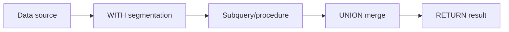

# Advanced Queries

This page covers the core constructs for composing complex query pipelines.



## WITH — Pipeline Boundary

`WITH` splits a query into stages, each with independent filtering and projection:

```cypher
MATCH (p:Person)
WITH p, p.age AS age
WHERE age >= 30
RETURN p.name, age
ORDER BY age DESC;
```

:::info
After `WITH`, only the listed variables remain available in subsequent stages. Unlisted variables are discarded.
:::

## UNION / UNION ALL

Combine results from multiple structurally identical queries:

```cypher
MATCH (n:Person) RETURN n.name AS name
UNION ALL
MATCH (n:Company) RETURN n.name AS name;
```

| Type | Behavior |
|---|---|
| `UNION` | Deduplicated merge |
| `UNION ALL` | Keep all rows (including duplicates) |

## UNWIND — Expand into Rows

Expand a list into multiple rows — commonly used as a data source for batch operations:

```cypher
UNWIND [1, 2, 3] AS x
RETURN x, x * 10;
```

## CALL Subquery and Transactional Batching

```cypher
MATCH (n:Input)
CALL {
  WITH n
  CREATE (:Output {v: n.val})
} IN TRANSACTIONS OF 1000 ROWS
RETURN n.val;
```

:::tip
`IN TRANSACTIONS OF N ROWS` commits in batches of N rows, ideal for large-volume writes. See [Batch Operations](batch-operations).

In the current native runtime, this is a write-only, no-export `CREATE` subquery feature and it is autocommit-only.
:::
:::

## LOAD CSV

`LOAD CSV` reads bounded local files inside the Cypher pipeline. For a normal native database, the import root is the directory containing the database file. For example, a database at `/srv/graphs/demo.zyx` may import `/srv/graphs/users.csv`:

```cypher
LOAD CSV WITH HEADERS FROM 'file:///srv/graphs/users.csv' AS row
RETURN row.name, row.age;
```

Custom field delimiter (e.g., TSV):

```cypher
LOAD CSV WITH HEADERS FROM 'file:///srv/graphs/users.tsv' AS row FIELDTERMINATOR '\t'
RETURN row.name;
```

Only local `file:///` URIs below the configured import root are accepted. Remote URLs, URI hosts, query/fragment forms, and paths that escape the root (including percent-encoded traversal) are rejected. CSV parsing also enforces configured file, row, record, column, and field limits. Use the CLI [`import`](import-export#path-2-cli-bulk-import) workflow for large datasets.

## Built-in Procedures

### Native Runtime Boundary

The native logical runtime supports only procedures with a native, snapshot-pinned implementation. `dbms.listConfig()`, `dbms.getConfig(key)`, `dbms.setConfig(key, value)`, `dbms.showStats()`, and `dbms.resetStats()` are available only in autocommit mode and use the Database-owned native configuration service. Durable keys publish through the same single-file COW metadata boundary as graph metadata; process-local `stats.enabled` never creates a database-file record. Unsupported keys and explicit-transaction calls fail before any administrative side effect.

### Vector Index

| Procedure | Description |
|---|---|
| `db.index.vector.queryNodes(idx, k, vec)` | Vector nearest-neighbor search |
| `db.index.vector.train(idx)` | Train a vector index |

### Graph Algorithms

| Procedure | Description |
|---|---|
| `algo.shortestPath(startId, endId)` | Shortest path |

### GDS Graph Algorithms

GDS (Graph Data Science) procedures use a named projection pattern: project a subgraph first, then run algorithms.

| Procedure | Parameters | Description |
|---|---|---|
| `gds.graph.project(name, config)` | Projection name, node/relationship selection, orientation, and weights | Create a named graph projection |
| `gds.graph.drop(name)` | Projection name | Drop graph projection |
| `gds.graph.dropAll()` | None | Drop all graph projections |
| `gds.graph.exists(name)` | Projection name | Check whether a projection exists |
| `gds.graph.list(name?)` | Optional projection name | List catalog descriptors |
| `gds.graph.schema(name)` | Projection name | Inspect normalized projection schema |
| `gds.pageRank.stream(name, maxIter?, damping?)` | Projection name, optional iterations, optional damping factor | PageRank |
| `gds.wcc.stream(name)` | Projection name | Weakly Connected Components |
| `gds.betweenness.stream(name, samplingSize?)` | Projection name, optional sampling size | Betweenness Centrality |
| `gds.closeness.stream(name)` | Projection name | Closeness Centrality |
| `gds.shortestPath.dijkstra.stream(name, startId, endId)` | Projection name, source ID, target ID | Dijkstra shortest path |
| `gds.leiden.stream(name, options?)` | Projection name, optional Leiden options map | Leiden community detection |

See [GDS Graph Projections](/en/docs/zyx/algorithms/graph-projections) for the structured projection schema and catalog lifecycle, and [Leiden Community Detection](/en/docs/zyx/algorithms/community-detection) for algorithm options.

## EXPLAIN / PROFILE

Two key tools for query tuning:

| Command | Purpose |
|---|---|
| `EXPLAIN` | View the logical plan structure without executing |
| `PROFILE` | Execute the query and return timing information; the native relocatable logical path currently adds one whole-plan summary row rather than per-operator metrics |


