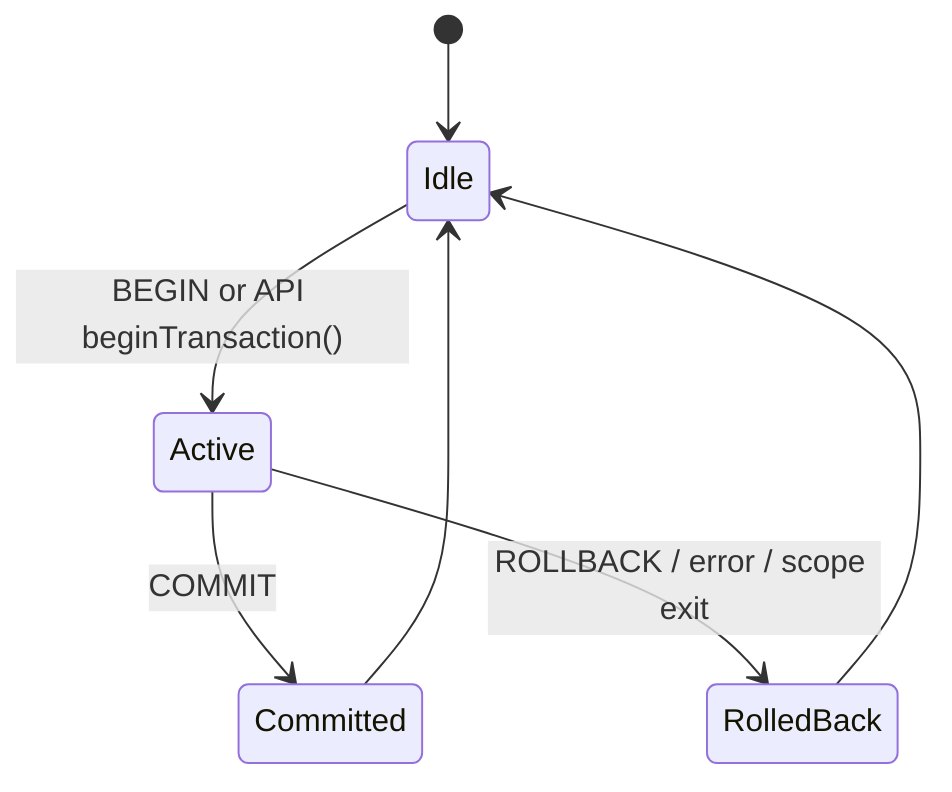
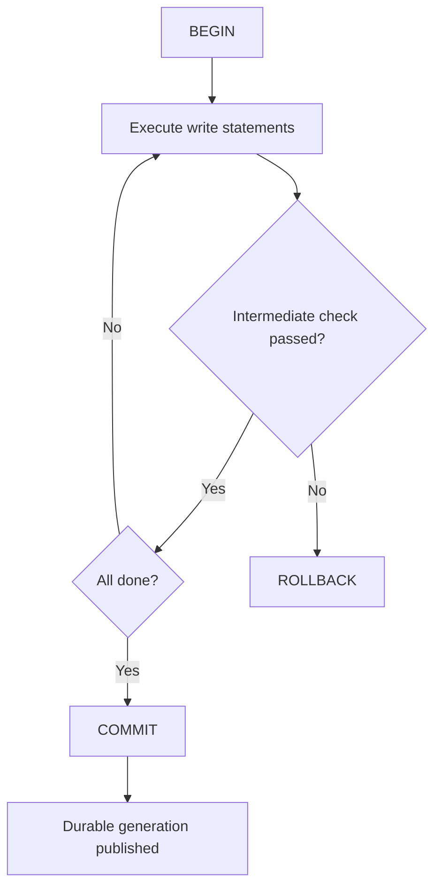

# Transactions

## Transaction Lifecycle



## Explicit Transactions in REPL

```cypher
BEGIN;
CREATE (:User {name: 'Alice'});
CREATE (:User {name: 'Bob'});
COMMIT;
```

Rollback case:

```cypher
BEGIN;
CREATE (:User {name: 'Temp'});
ROLLBACK;
```

## Three Transaction Modes

| Mode | Typical Use | Notes |
|---|---|---|
| Implicit (single statement) | Simple one-shot reads/writes | Each statement auto-wrapped in a transaction; lowest overhead |
| Explicit (`BEGIN...COMMIT`) | Multi-step atomic updates | Clear success/failure boundary |
| API transaction object | Service-side orchestration | C++ `Transaction` class auto-rolls back on destruction; Python `with` block auto-commits on success, auto-rolls back on exception |

:::tip API Auto-Rollback
A `Transaction` object obtained through the C++ API will automatically roll back when destroyed without a prior `commit()` call, ensuring no uncommitted dirty data is left behind.
:::

## Python Transaction Examples

```python
import zyxdb

with zyxdb.Database("/tmp/mydb.zyx") as db:
    # Write transaction — auto-commits on normal exit
    with db.begin_transaction() as tx:
        tx.execute("CREATE (n:User {name: 'Alice'})")
        tx.execute("CREATE (n:User {name: 'Bob'})")
        # auto-commits here

    # Explicit rollback
    with db.begin_transaction() as tx:
        tx.execute("CREATE (n:User {name: 'Temp'})")
        tx.rollback()

    # Auto-rollback on exception
    try:
        with db.begin_transaction() as tx:
            tx.execute("CREATE (n:User {name: 'Ghost'})")
            raise ValueError("oops")  # auto-rolls back
    except ValueError:
        pass

    # Read-only transaction (snapshot isolation)
    with db.begin_read_only_transaction() as tx:
        rows = list(tx.execute("MATCH (n:User) RETURN n.name AS name"))
```

:::tip
For the full Python Transaction API, see [Python API Reference](../api/python-api#transaction).
:::

## Behavior Notes

:::warning Concurrency Model
The native backend provides **pinned snapshot reads and conservative optimistic write validation**. Several ordinary write transactions may stage changes, while durable publication is serialized within one writable backend. If another graph-changing transaction commits, a stale writer can fail with a conflict even when it changes a different entity. Start a new transaction and repeat its reads to retry. Read-only transactions keep their original snapshot. This is not a general serializable-isolation guarantee. Use one writable database owner; independent writable handles/processes are outside this contract. Nested transactions are not supported.
:::

- Uncommitted changes are not durable until `COMMIT`
- A successful native `COMMIT` durably publishes a complete copy-on-write generation; it does not require a later `save()` or the legacy WAL path
- A failed commit ends the transaction. If the durable outcome is indeterminate, close/reopen the database and inspect recovered state before retrying; do not automatically replay procedures or other external side effects
- Ordinary transactions read their own staged changes. Streamed bulk append has a separate contract and does not provide this overlay behavior

## Failure Handling Pattern



1. Start an explicit transaction for multi-step writes
2. Validate intermediate assumptions with `MATCH ... RETURN`
3. `COMMIT` only when all checks pass
4. `ROLLBACK` on any semantic or business failure

A bounded native blind-write exception now permits up to 64 persisted Node property owners to rebase. It applies only before any transaction read snapshot or Vector snapshot has been exposed, and excludes patches, creation/deletion, labels and Edge mutations. Under the publication gate, validation compares every owner’s Property Directory slot identity/generation (including absence) and Node liveness with its pinned base; the executor then rebuilds from latest roots and checks current constraints/indexes. At most three builds are allowed. Any exposed read, unsupported operation or over-cap dependency set retains the whole-graph fence. This exception does not add automatic query/procedure replay or cross-owner concurrency.
