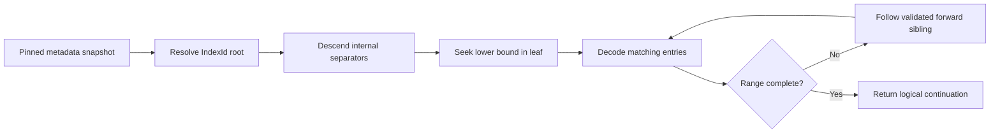
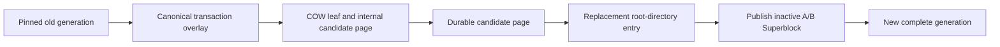

# Packed B+Tree 索引

> 本文定义干净的原生存储格式。它明确替换已退役的固定 record index tree：不再存在 256-byte index node、parent pointer、value vector、Blob overflow field，也不保留旧数据库文件的 compatibility reader。

## 目标与范围

ZYX 使用一套可复用的不可变 Packed B+Tree 实现承载有序持久访问路径。每棵树将 canonical byte key 映射到两种显式声明的 leaf-value layout 之一：

- `BLVL_U64`：leaf key 映射到一个 unsigned 64-bit logical value；
- `BLVL_EMPTY`：leaf key 不含物理 value，key 的存在本身就是结果。

第一种 layout 用于 scalar 与 Catalog access path。第二种 layout 消除 membership-style index 中不必要的 payload，普通图 adjacency 即使用它。每个 page header 都声明 tree layout；reader 打开树时必须拒绝与目标树不匹配的 root 或 leaf layout。

该树是 index structure，而不是 entity store。Node/Edge record 仍保存在 Entity page；B+Tree leaf 不嵌入 Edge record，也不与 Entity page 共用 page。普通图特化请参阅[关系遍历](/zh/docs/zyx/algorithms/relationship-traversal)。

## 持久拓扑

每棵树拥有稳定的逻辑 `IndexId`。current root 从 snapshot-pinned Index Root Directory 解析，不存储在 Entity、可变内存 map 或 file offset 中。


`PageId` 是逻辑 ID。relocation 只修改 Page Directory route；separator child reference、root directory entry 和公开 continuation 都不需要改写 physical offset。空 tree 没有 root-directory entry。第一次 insert 创建 root；删除最后一个 entry 会原子删除 mapping。

归属同一 index 的所有 page 使用 `SGK_INDEX_PAGE_POOL`，并使用包含所属 `IndexId` 与 page role 的 owner identity。pool 可以让兼容的 Index page 共享 physical frame，但不同逻辑结构绝不能共用一个 4 KiB page。unknown page kind、owner identity、layout version、value layout 或 routing metadata 必须 fail closed。

## Page 格式

每个 page 固定为 4 KiB，并通过 explicit disk codec 解码。public format 以 byte 为单位；不得持久化 C++ object layout、host endianness、padding 或 pointer width。

| 区域 | 职责 |
|---|---|
| Header | format version、page kind、owner、`IndexId`、generation/LSN、checksum、encoded byte bound 与声明的 leaf-value layout |
| Packed entry area | 有序编码的 leaf key，或 internal separator/child pair |
| Restart table | 为 prefix-compressed entry 提供有界 search anchor |
| Trailer 或受保护 metadata | codec 定义的 integrity information 与有界 offset |

internal entry 通过 separator 与逻辑 child `PageId` 路由。leaf entry 包含 canonical key，以及由声明 layout 允许的唯一 value byte。internal page 始终是带 child-reference value 的 page；`BLVL_EMPTY` 仅适用于 leaf。

key 在 page 内进行 prefix compression。restart point 使 binary search 落到有界 decode 位置，因此 point lookup 不需要重建整个 leaf。split、merge、occupancy、separator truncation、restart spacing 与 fan-out 都由共享 layout solver 根据 encoded byte 推导；它们是 policy/configuration 的结果，不能在 caller 或文档中写成固定 entries-per-page 常量。

leaf 为 range scan 保留经过校验的 forward sibling route。持久格式不要求 backward link。copy-on-write mutation 时，所有已变化 boundary 与 separator 都必须在 candidate generation 中重建后才能发布 root；cursor 绝不能沿着与 pinned root 不一致的 sibling 前进。

## Canonical Key 与 Comparator

每棵树都提供 explicit key codec 和 comparator。codec 校验输入、生成唯一 canonical byte representation，并在 read 时解码。numeric field 使用明确的 wire encoding；当 lexicographic byte order 必须匹配 unsigned numeric order 时，codec 使用适用 numeric component 的 canonical big-endian comparison order。该 comparator encoding 不会改变其他 persisted wire field。

comparator 必须定义 strict total order。它决定 duplicate identity、lower/upper bound、internal separator、page ordering、online mutation、bulk construction、integrity check 与 recovery。任何 caller 都不得比较 host-memory struct，也不得假定某个架构的 byte layout 可跨平台持久化。

scalar index 使用以 logical entity identity 结尾的唯一 composite key。例如 property access path 的排序为：

```text
(canonical PropertyValue, EntityId) -> empty
```

`EntityId` suffix 不是冗余：它代表每个 entity 一条 index entry，为重复的 PropertyValue 提供确定顺序，并使 exact deletion 不依赖 variable-length value list。相比于为每个 distinct property value 保存一个 EntityId vector，它更紧凑且更利于 mutation。用户可见的 property data 仍由 Entity/Property store 权威保存。

## 读取路径与 Cursor Contract

point lookup 从 snapshot root 沿 internal separator 下降到一个 leaf。range lookup 只下降一次定位 lower bound，按序扫描 entry，并通过经过校验的 forward sibling 推进到 upper bound。



cursor pin 一个 snapshot，只保留有界 route/search state、一个 current leaf pin 与 logical resume key；不能保存 physical frame、slot、byte offset 或无界 materialized result。continuation 只对其 snapshot、tree identity、comparator 和 requested range 有效；foreign 或 malformed continuation 必须 fail closed。resume 严格位于最后一个 emitted logical key 之后，因此 relocation 后仍正确，也不会产生 duplicate output。

root/internal routing page 使用 normal Buffer Pool admission。point lookup 通常 normal-admit 最终 leaf。长 range scan 的 leaf 使用 sequential admission，并且至多执行有界 forward prefetch，防止 scan 淘汰 hot routing page。

## Mutation、原子性与 Snapshot

writer 从一个 pinned metadata generation 开始，并构建 transaction-local sorted overlay。overlay canonicalize duplicate operation、拒绝 contradiction，并为该 transaction 中同一 tree 的所有 mutation 生成一个 byte-aware copy-on-write plan。candidate page 必须在任何 root metadata 可见之前写入并 durable。



reader 只能观察 old root 或完整 replacement root，绝不能观察中间 split、已修复一半的 sibling boundary 或部分更新的 multi-index transaction。old snapshot 继续读取先前的 immutable page。并发 root change 必须在 publication 前检测，由 transaction layer 基于 fresh snapshot 重试。

insert/delete 的 tree work 为 `O(log N)`，另加有界的 split、redistribution 或 merge planning。物理 write cost 是 copy-on-write path amplification，必须以 bytes/pages 测量，而不能被渐进复杂度掩盖。

## 删除、回收与 Repacking

delete 删除 exact canonical key。underflow 按 encoded byte occupancy 判断，而不是按固定 entry 数判断。mutation planner 尽可能向 sibling 重新分布；否则 merge candidate page 并修复 separator。root collapse 时，new root-directory mapping 指向幸存 root；删除最后一个 key 时，mapping 被完全移除。

被 copy-on-write、merge、root collapse 或 whole-tree rebuilding 替换的 page 进入共享 generation-aware Retire Queue。只有没有 snapshot 能解析 old root 后，physical frame 才可复用。正确性不依赖后台 compactor。只有测量到 byte occupancy 较差时，才允许执行有界 whole-tree repack maintenance：它构建 new tree、原子发布一个 root，并 retirement old reachable set。

## Bulk Construction

bulk writer 在发出 canonical key 前校验 record，按相同 comparator 排序和去重，再由共享 Packed B+Tree builder 构建或 merge ordered run。不得对每个 input key 独立调用一次 root-to-leaf insertion。

online 与 bulk path 共享同一 page codec、fill policy、restart layout、separator rule、ownership validation、checksum、root-publication sequence 与 reclamation protocol。所有 input、run、memory、I/O 和 retry budget 必须显式。未来若需要 external sort，只能使用有界 process memory 或单数据库文件内的受控区域；不能引入第二个 durable database file。

## 全局 Adjacency 特化

普通图 adjacency 是一棵保留的内建 key-only tree：

```text
(ADJ_OUT, sourceNodeId, EdgeId) -> empty
(ADJ_IN,  targetNodeId, EdgeId) -> empty
```

它拥有一个保留 `IndexId`、独立 owner identity 和 `BLVL_EMPTY` leaf layout。Edge Entity Store 对 source、target、relationship type 与 state 保持权威。index 既不保存 Edge payload，也不重复 endpoint/type，因此它不是 covering index，不能通过静默增加 leaf value 变成 covering index。

该保留 identity 是格式常量 `RSS_GLOBAL_ADJACENCY_INDEX_ID`；user 与 derived index 都不能占用。两个 direction 是同一棵 tree 中的有序 range，而不是两棵按 direction 划分的 tree 或 per-Node tree。direction prefix 因而提供 access partition，却不会增加 root-directory entry、COW publication path 或 snapshot-retirement state 的数量。

该布局让低阶 Node 在同一个 leaf 中紧凑共享，也让超级节点跨越连续 leaf。directed expansion 为 `O(log E + degree)`，cursor memory 有界。创建或删除 Edge 时，必须在一个 metadata generation 中发布 Edge record、Entity Map change、两个 adjacency key 和 replacement root。`DETACH DELETE` 使用有界 scan 与 exact erase；不创建 adjacency Tombstone，也不修改相邻 Edge。

commit 时，transaction 必须针对最新 root 重新验证；必要时重试/rebase 其有界 sorted final-state overlay。仅出现更新的 root 不构成语义 conflict；duplicate/deleted Edge identity 或不一致的权威 endpoint 才是。这样物理上的全局 root 不会成为用户可见的 conflict domain。

全局 adjacency tree 与 Vector ANN adjacency 无关。ANN 使用 Vector 专用结构，不得复用普通 adjacency root、page owner、key codec 或 cursor contract。

### Entity 与 Adjacency 的分离

`BLVL_EMPTY` 表示 adjacency leaf 只代表有序 range 中的 membership，不能把它当作紧凑的 Edge store。Node 与 Edge record 继续存放于 Entity page，并通过 Entity Map 寻址；adjacency leaf 不保存 entity slot、physical offset、endpoint copy、relationship type、state 或 property byte。Edge expansion 先从全局 tree 找到 EdgeId，再在同一个 pinned snapshot 中只解析所需的 Edge record。

这种分离是刻意设计：一个 leaf 可以让多个低阶 Node 共享编码 key space，超级节点则可延续到后续 leaf。它同时避免 per-Node page tail 和修改相邻 Edge link 的写放大。由于 Entity record 与 public continuation 都不指向 B+Tree frame，physical page relocation 也被限制在 Page Directory 内。

## Integrity、Recovery 与测试门禁

runtime 在使用前验证每个访问 page：page kind、format、owner、`IndexId`、generation、LSN、checksum、encoded bound、restart table、key order、separator、child route、leaf-value layout 与 forward sibling relationship。corrupt 或 impossible state 是 format error，不能隐式 repair 或 silent skip。

完整 integrity scanner 还验证 root-directory uniqueness 与 reachability、没有 cross-tree page ownership、没有 orphan current page，以及 snapshot-safe retirement 完整。对全局 adjacency，它会交叉验证每条 live Edge 恰好有一个 outgoing 与一个 incoming empty-value key，并验证每个 key 都匹配权威 Edge endpoint。

每个 implementation stage 在 macOS、Linux 与 Windows 都必须达到至少 95% 的 line、branch、function 和 region coverage。测试必须包括 comparator/codec boundary、malformed page、root create/collapse、split/merge/redistribution、duplicate operation、rollback、stale snapshot、relocation、reopen、publication 前后 crash injection、ENOSPC、short I/O、有界 range continuation、bulk/online equivalence 与 randomized model-oracle check。

## 实施顺序

1. 冻结 4 KiB page codec、typed root-directory contract、key codec interface、byte-layout solver 与 fail-closed validation test。
2. 实现 immutable point/range read、logical continuation 与 Buffer Pool admission hint。
3. 实现 transaction-local copy-on-write planning、root publication、retirement 与 crash test。
4. 将 scalar index 切换到 unique composite key，并删除 fixed-record/value-vector/Blob-overflow 假设。
5. 添加全局 key-only adjacency 特化，再一并切换 graph write、reader、Cypher expansion、bulk ingest 与 `DETACH DELETE`。
6. 删除退役 index/adjacency codec 和 reader、删除 Node adjacency root 与 Edge link、提升 clean format version，并拒绝退役 page subtype/field。
7. 在宣布 cutover 完成之前运行 cross-platform coverage、integrity、durability、space 与 performance gate。

## 另见

- [原生单文件存储重构方案](/zh/docs/zyx/architecture/native-single-file-storage-plan)
- [关系遍历](/zh/docs/zyx/algorithms/relationship-traversal)
- [Segment 整理](/zh/docs/zyx/algorithms/segment-compaction)
