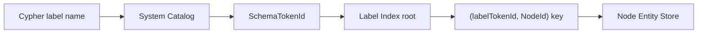

# 标签索引

> 本文定义目标原生 Label Index。它替换已退役的 `IndexTreeManager`、可变 root map、state-chain root record、重复 value list 与 Blob-overflow 表示。旧数据库文件不是 clean format 支持的输入。

## 模型

label 拥有 canonical schema identity。System Catalog 将 UTF-8 label name 映射为 `SchemaTokenId`，也将 token 反向映射到 canonical definition。Node record 与 Label Index entry 只保存 token，绝不重复 label name。

Label Index 是一棵 key-only Packed B+Tree，逻辑 schema 为：

```text
(labelTokenId, NodeId) -> empty
```

每个 Node-label association 产生一个 key。`NodeId` 为相同 label token 提供确定且唯一的顺序，并支持 exact deletion。label scan seek 到 `labelTokenId` 的 lower bound，并在 token prefix 改变时停止；不得读取或 materialize 整个 label 的一个 value vector。



canonical Node label set 是权威数据。fixed Node record 保留少量有序 inline prefix，剩余有序 token ID 保存在一个被引用的 `EntityLabelSet` record 中。Label Index 是 derived state；它的 entry 必须与每个 live Node 的 inline/overflow token ID 并集严格一致。

## 存储与 Root 所有权

index 使用共享 Packed B+Tree codec、`BLVL_EMPTY` leaf、4 KiB Index page、稳定逻辑 `IndexId` 与 snapshot-pinned root-directory entry。它不与 Node record、`EntityLabelSet` record、property、普通 adjacency 或 Vector ANN data 共享 page 或 owner identity。

Index Root Directory 将 Label IndexId 映射到 current root PageId 与 generation。Superblock 发布 directory root，因此保持 fixed size。relocation 只修改 Page Directory route，不修改 Node reference、token、root identity 或 cursor continuation。当没有任何 Node-label association 时，index 没有 root-directory entry，也不保留永久空 root page。

## 读取语义

对 `MATCH (n:Person)`，planner 在与 index scan 相同的 pinned snapshot 中将 `Person` 解析为 token。它按 NodeId 顺序扫描 `(token, NodeId)`，仅在 query output 或 predicate 需要时通过 Entity Map 解析 Node record，并验证每个 resolved live Node 仍具有该 token。

cursor 保留 pinned snapshot、target token、最后返回的 NodeId、有界 page-search state 与至多一个 leaf pin。它严格在最后一个 NodeId 后恢复，绝不导出 PageId、slot、offset 或 sibling state。cache admission 遵循通用 Packed B+Tree policy：routing page 是 hot point-read state；长 label scan 使用 sequential leaf admission 与有界 prefetch。

lookup complexity 为 `O(log L + matches)`，其中 `L` 是 label association 数量。memory 与 label cardinality 无关且有界。

## 原子 Mutation

创建 Node 或增加 label 时，先计算 canonical old/new token set，再生成 exact key add/remove。删除 label、删除 Node 和替换 label set 使用相同的比较。一个 transaction 在同一 metadata generation 中发布：

1. Node fixed-record replacement 与任何 `EntityLabelSet` change。
2. 这些 record 所需的 Entity Map 与 Page Directory change。
3. Label Index Packed B+Tree replacement root。
4. Catalog/metadata root 与 inactive A/B Superblock。

candidate page 必须在 root publication 前 durable。reader 只能看到完整 old Node/Label Index relation 或完整 new relation，不能看到索引中存在但该 snapshot 中 Node 不存在的 label entry，也不能看到已提交但缺失 index entry 的 Node label。

`DETACH DELETE` 与 Edge mutation 不拥有特殊 Label Index state。index delete 是 exact key erase；不创建 label tombstone、stale value vector 或异步 per-label merge debt。

## Bulk Build 与维护

bulk construction 读取 canonical Node label set，生成 `(token, NodeId)` key，canonicalize/sort 后通过共享 bulk builder 构建密集 key-only tree。它必须与 online mutation 使用相同 comparator、page layout、root publication 与 integrity rule。

online insert/delete 使用 copy-on-write。byte-aware redistribution/merge 保持 tree 健康；被替换 page 进入公共 snapshot-safe Retire Queue。仅当测量表明 occupancy 较差时，才可执行有界 rebuild repack；query correctness 不依赖后台 compaction。

## Integrity 与测试门禁

integrity scanner 验证 canonical token ordering、unique nonzero key、有效 key-only page layout、tree ordering/reachability、root ownership、snapshot-safe retirement 与以下双向 invariant：

```text
Node canonical label set == all Label Index tokens for that Node
```

测试覆盖 inline-only/overflow label set、first/final root transition、multi-label update、deletion、stale snapshot、split/merge、relocation、bulk/online equivalence、catalog-token mismatch、malformed key/page、publication 前后 crash point、ENOSPC、short I/O 与 randomized Node-label oracle。macOS、Linux、Windows 上每个 coverage 维度均必须达到 95% 或以上。

## 另见

- [Packed B+Tree 索引](/zh/docs/zyx/algorithms/btree-indexing)
- [原生单文件存储重构方案](/zh/docs/zyx/architecture/native-single-file-storage-plan)
- [关系遍历](/zh/docs/zyx/algorithms/relationship-traversal)
