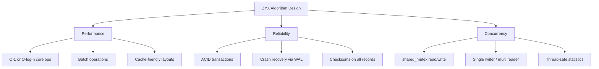

# 算法总览

ZYX 在索引、存储、查询处理、向量搜索和并发控制等方面采用了一系列算法。本节记录每种算法的设计、数据流和性能特征。

## 算法分类

### 存储算法

管理原生单文件存储的算法：

- **[段压缩](segment-compaction)** — 通过 native metadata publication 实现 snapshot-safe relocation 和回收

### 索引算法

用于快速数据查找的算法：

- **[Packed B+Tree 索引](btree-indexing)** — 为标量、标签和 adjacency access path 提供不可变 4 KiB 有序 index page
- **[标签索引](label-index)** — 使用 B+Tree 的标签到节点 ID 映射
- **[属性索引](property-index)** — 针对属性值的类型特定 B+Tree 索引

### 查询算法

用于高效查询执行的算法：

- **[查询优化](query-optimization)** — 基于固定点迭代的多规则优化器
- **[关系遍历](relationship-traversal)** — 使用全局 Packed B+Tree range cursor 遍历出边和入边

### 向量搜索

用于高维向量相似性搜索的算法：

- **[向量度量](vector-metrics)** — 经过优化的 L2 和 IP 距离计算，支持混合精度
- **[乘积量化](product-quantization)** — 通过子空间量化进行向量压缩

### 图分析

用于分析图结构和拓扑的算法：

- **[GDS 图投影](graph-projections)** — 带 catalog 生命周期和惰性 CSR cache 的命名、筛选、带权内存图
- **[社区检测](community-detection)** — Leiden 算法，通过层级提升和精化发现社区结构
- **[PageRank](https://en.wikipedia.org/wiki/PageRank)** — 迭代式中心性算法（通过 GDS）
- **[最短路径](https://en.wikipedia.org/wiki/Shortest_path_problem)** — Dijkstra 加权最短路径算法（通过 GDS）

## 设计原则

所有算法共享以下特性：

- **线程安全**：使用 `std::shared_mutex` 实现并发读访问和独占写访问
- **批量操作**：针对索引构建和数据导入的优化批量处理路径
- **惰性初始化**：组件（QueryEngine、ThreadPool、WAL）在首次使用时初始化
- **基于段的存储**：所有数据存储在固定大小的段中，以链表形式链接

## 复杂度汇总

| 类别 | 关键操作 | 复杂度 |
|----------|--------------|------------|
| Segment Allocation | Allocate entity slot | O(1) amortized |
| B+Tree Index | Search / Insert | O(log n) |
| Label Index | Find nodes by label | O(log n + k) |
| Property Index | Exact match | O(log n + k) |
| Property Index | Range query | O(log n + k) |
| Relationship Traversal | Get outgoing/incoming edges | O(log E + degree) |
| 社区检测 | Leiden 每层 | O(n + m) × 迭代次数 |
| 原生向量检索 | K 近邻 | 受配置的候选与精排预算限制 |
| PQ Distance | Approximate distance | O(numSubspaces) |

其中 n = 索引中的条目数，k = 结果数量，dim = 向量维度。
