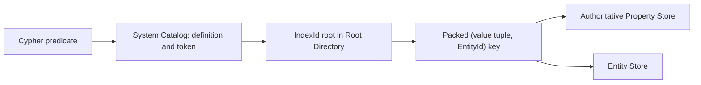

# 属性索引

> 本文定义干净的原生 Property Index 设计。它替换已退役的 per-type `IndexTreeManager` map、可变 state-chain root、value vector、write 时 type inference 与 compatibility reader。index definition 及其 root 是 durable Catalog data，而不是 process-local configuration。

## 模型

System Catalog 拥有每个 index definition：稳定 `IndexId`、entity domain、有序 property-token signature、comparator/version、state 与 current root mapping。property name 在与 query 相同的 pinned snapshot 中解析为 token，绝不复制到 index entry。

每个 scalar index 都有一个明确的 canonical key codec。single-property index 的逻辑 leaf key 为：

```text
(canonical PropertyValue, EntityId) -> empty
```

有序 composite index 的逻辑 leaf key 为：

```text
(canonical PropertyValue1, canonical PropertyValue2, ..., EntityId) -> empty
```

entity suffix 为重复 value 提供稳定顺序，使单条 entry 可移除而无需反序列化共享 EntityId list。它是有意的 logical identity，不是可消除的重复。权威 property value 保存在 Property Store；scalar index 是 access path，而非 covering copy。



index definition 在创建时固定 value type、ordering、collation、null policy 与 codec version。schema-incompatible value 按 definition 失败；不得静默推断新 type、路由到不同 tree 或跳过 index update。type change 需要显式 definition transition 与新建 root。

## 存储、Root 与 Key 边界

tree 使用共享 4 KiB Packed B+Tree page format 与 `BLVL_EMPTY` leaf。稳定 `IndexId` 通过 snapshot-pinned Index Root Directory 解析。tree page 位于 `SGK_INDEX_PAGE_POOL`，owner 为所属 Index identity；它绝不与 Entity、Property、adjacency 或 Vector data 共用 page。relocation 保持 `PageId`，只修改 Page Directory route。

key codec 提供 strict total order、lower/upper bound、canonical byte representation 与 explicit validation。它包含足以使排序无歧义的 type information；当 lexical byte order 必须匹配 numeric order 时使用 canonical numeric comparison encoding。prefix compression 与 restart point 降低 page 中重复 tuple byte；page capacity、separator、fan-out 与 occupancy 全部由共享 byte-layout solver 推导。

每个 codec 都有 format-owned maximum encodable key bound，必须在 candidate-page allocation/publication 前 preflight。一个作为 application data 有效但对已声明 index codec 过长的 property value 仍可存储在 Property Store；尝试 index 它必须显式失败，除非 index definition 另行定义了不改变 query semantics 的 derived representation。实现不得将该 key 隐藏进 legacy Blob reference，也不得用改变 equality/range semantics 的 hash 替代。

## Query 语义

equality seek 到 canonical value 的第一个 key，并在 value prefix 相等时 stream。range predicate seek 到 lower tuple boundary，并在 exclusive upper boundary 停止。composite index 只有当 predicate 提供了该 comparator 所需 prefix 时，才支持 leftmost-prefix range。

scan 从 key suffix 解码 NodeId 或 EdgeId。executor 验证 entity visibility，并应用 residual predicate。当 indexed property 可独立于 Entity record 修改时，query snapshot 从同一 metadata generation 解析 index root 与 Property root，因此 index key 不可能指向不同 committed property state。

range cursor 保留 pinned snapshot、definition identity/version、normalized bound、last emitted logical key、有界 decoder state 与至多一个 leaf pin。它不暴露 PageId、slot、offset 或 mutable tree-manager cursor。exact lookup 为 `O(log I + matches)`，range 为 `O(log I + results)`，memory 有界。

## 原子 Lifecycle 与 Mutation

创建或 drop index 时，在同一 generation 中更新 Catalog definition、Root Directory mapping 与所有 support metadata。BUILDING definition 在完整 initial tree 与 READY definition 一起发布前不可 query。drop index 时移除 root mapping 并 snapshot-safe retire reachable page；不得遗留 state-chain root 或 user-visible empty tree。

property insert/update/removal 时，writer 从 old/new Property Store state 派生 old/new canonical key。一个 native transaction 规划所有受影响的 Property page、Entity visibility change、scalar-index key add/erase、B+Tree replacement root、Catalog metadata 与 Superblock publication。candidate page 必须在 new generation 可见前 durable。

从一个 indexed value 更新到另一个时，erase old exact `(value, EntityId)` key 并 insert new exact key。多个受影响 definition 一起规划。aborted、conflicted 或 torn transaction 不会暴露 partial Property update，也不会暴露 partial scalar-index root 集合。

## Bulk Build、删除与回收

bulk materialization 扫描一个 pinned logical Property snapshot，发出 canonical `(tuple, EntityId)` key，validate/deduplicate/sort 后使用共享 bulk builder。build 的 memory 必须有界，并使用与 online mutation 相同的 codec、fill policy、separator、checksum、root publication 与 retirement。不得为每个 record 单独执行 root-to-leaf insertion。

online delete 使用 byte-aware copy-on-write redistribution 或 merge。sparse tree 可由有界、可度量 maintenance job rebuild，但 query correctness 不依赖后台 compact。COW-replaced page 与 dropped-tree page 进入公共 generation-aware Retire Queue，只有 old snapshot 释放后才能复用。

## Integrity 与测试门禁

integrity scanner 验证 definition/root correspondence、codec version、page ownership、ordering、separator、restart data、checksum、reachability 与 snapshot-safe retirement。按 maintenance policy 执行 sample 或 full semantic cross-validation，确认每个 index key 都解析到可见 Entity/Property pair 且 canonical tuple 完全匹配，并确认没有遗漏应索引的 property。

测试覆盖 null/type/collation/key-bound policy、duplicate value、exact delete、value replacement、composite left-prefix range、first/final root transition、BUILDING/READY/DROP publication、stale snapshot、split/merge、relocation、bulk/online equivalence、malformed key/page、ENOSPC、short I/O 与 Superblock publication 前后 crash injection。macOS、Linux、Windows 上 line、branch、function、region coverage 均必须至少达到 95%。

## 另见

- [Packed B+Tree 索引](/zh/docs/zyx/algorithms/btree-indexing)
- [标签索引](/zh/docs/zyx/algorithms/label-index)
- [原生单文件存储重构方案](/zh/docs/zyx/architecture/native-single-file-storage-plan)
