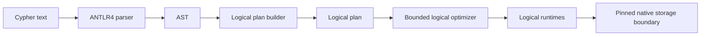
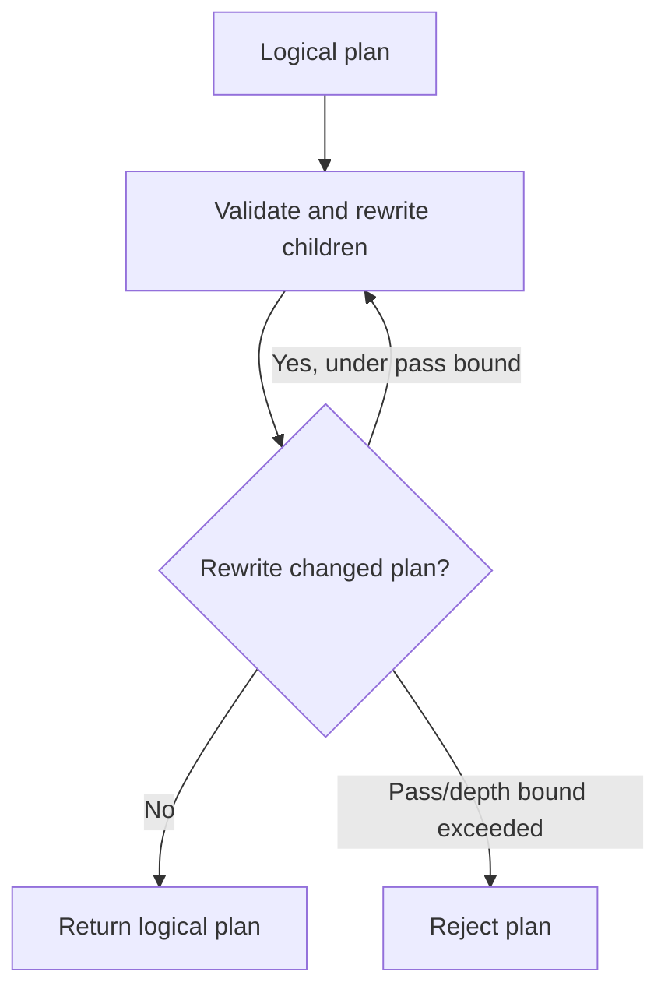

# 查询优化算法

ZYX 在执行前优化 native logical plan。优化器刻意保持 storage-neutral：它不打开文件、不读取 physical page，也不构造 physical operator tree。这样优化与 relocatable storage format 解耦，logical runtime 仍是唯一的执行路径。

## 查询处理流水线

1. **解析**：ANTLR4 将 Cypher 文本转换为 AST。
2. **规划**：planner 构建 scan、filter、join、projection、row window、mutation 和 procedure 等 logical operator。
3. **优化**：`LogicalPlanOptimizer` 只在显式的深度和轮次上限内应用保持语义的重写。
4. **执行**：`QueryEngine` 将得到的 logical plan 分派到 read、mutation、schema 或 procedure runtime。read execution 只在 native storage boundary 打开 pinned logical snapshot。

当前流水线没有 physical-plan conversion 阶段；已退休的 `PhysicalPlanConverter` 和 physical operator 不属于该路径。

## 有界重写循环

`LogicalPlanOptimizer` 会验证每个访问到的 child，默认最多执行 8 轮重写，并拒绝深度超过配置上限（默认 1,024）的计划。null child、无效 cardinality estimate 或未在上限内达到 fixed point 的计划都会被拒绝，而不会部分执行。

**源码**：`include/graph/query/optimization/LogicalPlanOptimizer.hpp`

## 当前重写规则

native optimizer 有意保持较窄的规则集；它不宣称实现 generic predicate pushdown、projection pushdown 或基于代价的 physical-plan search。

| 重写 | 前提 | 结果 |
| --- | --- | --- |
| Literal equality scan hint | 一个 `Filter` 直接包裹 `LogicalNodeScan`；等值比较针对该 scan variable，且 literal 非 NULL。 | 向 logical scan 写入 exact property predicate 和 property-scan hint。 |
| Literal range scan hint | 直接 filter 为同一 scan property 提供可兼容的 literal lower/upper bound。 | 写入一个经过验证的 range predicate 和 range-scan hint。 |
| Cartesian input order | statistics provider 为 join 两侧提供有效且不相等的 estimate。 | 将较小输入放在 runtime materialize 的右侧；estimate 相等或缺失时保持原顺序。 |
| Limit/project normalization | 非 distinct 且格式正确的 projection 直接位于 non-negative limit 下方。 | 将 limit 移到 projection 下方。 |
| Limit/skip normalization | positive limit 包裹 non-negative skip，且两值相加不溢出。 | 改写为 `Skip(Limit(input, limit + skip), skip)`。 |
| Nested row windows | 相邻 non-negative `Limit` 或 `Skip` 的组合值不溢出。 | 合并为一个 operator。 |

runtime 仍是语义权威。尤其是 scan hint 只是建议：native reader 会针对 pinned snapshot 再验证 exact/range lookup，保留 logical predicate 作为最终检查，并对 malformed、stale、unavailable 或 over-limit 的 index state fail closed。

## 统计信息

`LogicalStatisticsProvider` 是可选的 storage-neutral 接口。它可为一个 logical subtree 返回 lower bound、expected row count 和 upper bound，三者必须有序；无效 estimate 会使优化被拒绝。没有 provider 时优化保持确定性，也不会重排 join。

优化器不直接依赖 catalog page、index 或 file layout。backend 可以提供 statistics，但无需向查询规划暴露 physical identifier。

## 性能与安全注意事项

- 对支持的 scalar literal 使用选择性 predicate，才能让 exact 或 range scan hint 具备候选资格。
- `EXPLAIN` 展示的是 logical plan，不能证明会选择某个 index，也不能证明已打开 storage snapshot。
- 不要依赖 hint 改变 Cypher 结果；runtime 保留原始 predicate 的语义。
- 扩展必须保持有界。新的 rewrite 必须保持可观察行为、验证 malformed input，并提供明确的 native-runtime test。

## 另见

- [查询引擎](/zh/docs/zyx/architecture/query-engine)
- [Cypher 基础](/zh/docs/zyx/user-guide/cypher-basics)
- [属性索引](/zh/docs/zyx/algorithms/property-index)
