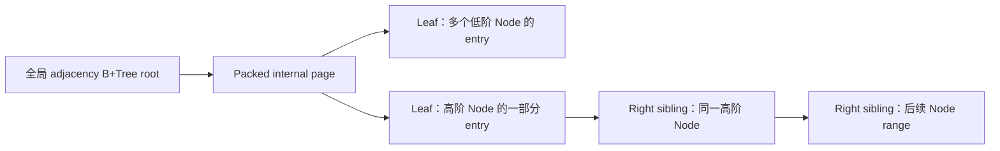

# 关系遍历

> 本文定义普通图关系遍历的目标架构。迁移会分阶段完成；在[原生单文件存储重构方案](/zh/docs/zyx/architecture/native-single-file-storage-plan) Stage 8 完成前，源码中仍可能存在已退役 adjacency format 的过渡实现。目标格式不兼容旧数据库文件。

## 概述

ZYX 使用一棵全局 Packed B+Tree 存储普通图 adjacency。Edge Entity Store 仍是权威数据源；该树提供从 Node 与方向到 EdgeId 的有序访问路径。

该设计的优化目标包括：

- 多个低阶 Node 共享 4 KiB leaf，避免每个 Node 留下一页尾部空间；
- 超级节点使用有界、接近顺序读取的 leaf scan；
- Node/Edge record 不保存 adjacency pointer；
- Edge 与两个 adjacency direction 原子可见；
- online mutation、bulk ingest、cache、recovery 和 reclamation 复用同一 Packed B+Tree 实现；
- logical cursor 不依赖 physical page location，page 搬迁后仍能正确恢复。

普通图 adjacency 与 Vector search 的 ANN 图无关。它们使用不同的 owner identity、root、codec 和维护策略。

## 存储模型

### 权威 Edge Store

每条 live directed relationship 只有一个权威 Edge record：

```text
EdgeId -> sourceNodeId + targetNodeId + relationshipTypeId + state
```

Node record 不持有 outgoing/incoming root。Edge record 不包含 `next` 或 `previous` link。更新 adjacency 因而不会改写相邻 Edge record。

### 全局 Adjacency Index

内建 adjacency index 的逻辑 schema 为：

```text
(direction, NodeId, EdgeId) -> empty
```

每条 live Edge 恰好生成两个 entry：

```text
(ADJ_OUT, sourceNodeId, EdgeId) -> empty
(ADJ_IN,  targetNodeId, EdgeId) -> empty
```

这两个 entry 是同一棵保留 tree 中的两个有序 range，不是两棵按 direction 划分的 tree，也不是 per-Node index family。direction prefix 使两条 access path 都可 seek，同时保持一个 root、一个 codec、一个 COW publication unit 和一套 snapshot-retirement lifecycle。

value 明确为空。routing NodeId 必然属于 access key，但 tree 不保存另一端 endpoint，也不把 relationship type/state 作为 Edge payload 存入 tree。Edge record 仍是完整 relationship 的权威表示。第一版不是 covering index。

### 存储边界

全局 index 是 access path，而不是混合存放 Node/Edge 的新容器。明确分离职责可以让布局紧凑，同时避免产生第二份权威数据。

| 持久化结构 | 存储的数据 | 不存储的数据 |
|---|---|---|
| Node Entity page | Node identity、state、label 与 Node-owned reference | adjacency root、adjacency key 或 edge-chain link |
| Edge Entity page | `EdgeId`、endpoint、relationship type、state 与 Edge-owned reference | B+Tree page/slot/offset、`next`/`previous` adjacency link 或重复的 adjacency payload |
| 全局 adjacency B+Tree leaf | 排序后的 `(direction, NodeId, EdgeId)` key，value 为空 | Node/Edge record、另一端 endpoint、type、state 或 property |
| 全局 adjacency B+Tree internal page | separator 与逻辑 child `PageId` | Entity record 或作为 payload 的 adjacency key |

因此，一个 leaf 可以容纳多个低阶 Node 的连续 key range；这不代表这些 Node 或 Edge record 与 leaf 共置。相反，超级节点可以跨越连续 leaf，但它永远不会获得私有 root、chain 或永久保留的 tail page。

持久化 direction enum 使用 `ADJ_OUT`、`ADJ_IN` 这类带前缀 member，避免 Windows macro 冲突。未知 direction、零 ID 或错误 key width 必须 fail closed。

### 排序与 Page 共享

canonical comparator 依次按 direction、无符号 NodeId、无符号 EdgeId 排序。同一 `(direction, NodeId)` 的所有 entry 构成一个有序 range。



一个 leaf 可以保存多个 Node 的 entry；超级节点可以跨越任意多个连续 leaf。两种情况都不会为单个 Node 分配专用 page。prefix compression 高效编码重复 direction/NodeId，restart point 则保持 leaf 内随机查找有界。

Leaf capacity、internal fan-out、restart interval 和 split threshold 全部由编码字节数与 page layout solver 推导。文档、测试和 caller 不能把派生出的 entries-per-page 数复制为 format constant。

### Root 与物理位置

该树拥有一个保留的内建 `IndexId`。snapshot 通过 Index Root Directory 解析 root：


Node/Edge page 使用 Entity pool；adjacency internal/leaf page 使用 Index pool，二者绝不共用一个 4 KiB page：B+Tree 保存的是 access key，不是 Edge record。兼容的逻辑 page type 可以占用各自 128 KiB pool 中的 frame；物理 Segment 完全清空后可以回收给其他 SegmentKind。

所有 tree reference 都使用逻辑 PageId。page evacuation 只修改 Page Directory route，不改变 PageId；parent reference、cursor、Node record 和 Edge record 都不包含 physical offset，因此不需要 relocation rewrite。

## 遍历操作

### 有向扩展

Outgoing expansion seek 到 `(ADJ_OUT, NodeId)` 的 lower bound，再推进到 direction 或 NodeId 改变为止。Incoming expansion 使用 `ADJ_IN` 执行相同操作。

cursor 必须：

- 在生命周期内 pin 一个 metadata snapshot；
- 只保留 logical prefix 与最后返回的 EdgeId；
- 直接从经过校验的 page view 解码 key；
- 至多保留当前 leaf 与有界 prefetch state；
- 不 materialize 完整 leaf 或超级节点的全部 Edge；
- 严格从最后一个 EdgeId 后恢复，且不暴露 PageId 或 physical offset。

seek 加 scan 的复杂度为 `O(log E + degree)`，结果 materialization 与请求输出量成正比。

### 无向扩展与 Self-loop

无向扩展分别打开一个 outgoing range 和一个 incoming range。parallel Edge 因 key 包含 EdgeId 而保持独立。self-loop 具有一个 outgoing 和一个 incoming entry；只有 query operator 的 Cypher 语义要求返回一条 relationship 时，才对该 EdgeId 去重。

### Edge 与 Neighbor Materialization

只依赖 adjacency 的 count 可以直接统计 key，不读取 Edge record。需要返回 Edge 字段时，通过 snapshot-pinned Edge Entity Map 解析 EdgeId。reader 必须验证 Edge live，且扫描的 direction/NodeId 与其权威 endpoint 一致。

第一阶段的 relationship-type filter 读取权威 Edge record。executor 应按 Entity page 对这些读取批处理并应用现有 query limit，不能退化为每个 key 一次无界独立随机读。未来只有 workload evidence 证明额外写入和空间成本合理时，才能增加 type-qualified derived index。

### Buffer Pool 策略

root/internal routing page 使用 normal admission，point probe 的最终 leaf 通常也 normal admission。range scan 消费的 leaf 使用 sequential admission；有界 right-sibling prefetch 携带相同 hint。这样可保留可复用的 routing state，同时避免超级节点扫描淘汰 point-read working set。

cache lookup 后仍必须校验每个 page：owner identity、page subtype、generation、LSN、checksum、key order、restart table、separator 与 sibling relationship 都是强制 invariant。

## Mutation 语义

### 创建 Edge

一个 transaction 必须针对同一 pinned generation 规划：

1. 插入权威 Edge record 和 Entity Map entry。
2. 插入 outgoing adjacency key。
3. 插入 incoming adjacency key。
4. 发布 replacement B+Tree root 与 metadata root。
5. 将 inactive A/B Superblock 发布为 new generation。

两个 key 使用同一个 transaction-local sorted B+Tree overlay。data page 在 root 可见前 durable。recovery 只能选择完整 old generation 或完整 new generation；禁止 Edge 只在一个方向可见。

共享 root 不能成为对外暴露伪写冲突的理由。commit 时，transaction layer 必须重新验证有界 sorted final-state overlay；必要时针对最新 root 重试/rebase。它应拒绝真正的语义 conflict（例如相互冲突的 Edge identity 或已改变的权威 endpoint），而不能仅因一个互不冲突的 writer 发布了更新的 adjacency root 就失败。

### 删除 Edge

删除操作读取权威旧 endpoint，erase 两个精确 key，删除 Edge record 与 Entity Map entry，并原子发布最终状态。普通 relationship 删除不追加 Tombstone，也不更新相邻 Edge。

COW 退休 page 进入公共 generation-aware Retire Queue。旧 snapshot 继续解析自己的旧 root；只有它们释放后，physical frame 才能复用。

### DETACH DELETE

`DETACH DELETE` 扫描 Node 的两个有界 range，对包含 self-loop 的 EdgeId 去重，校验资源上限，再构建一个 final-state batch。每条 Edge 与其两个 adjacency entry 都恰好删除一次。如果 key 与权威 Edge record 冲突或超过配置的 transaction bound，操作必须在 publication 前失败。

### Bulk Edge Ingest

bulk create 先校验 endpoint，再生成 outgoing/incoming key，使用 canonical comparator 排序和去重，然后通过共享 Packed B+Tree bulk/overlay builder 合并有序 run。不能为每个 entry 单独执行一次 root-to-leaf insert。

online 与 bulk writer 共享 page fill、prefix/restart、separator、split/merge、checksum、owner 和 publication invariant。内存由 ingest limit 约束。未来任何 external run storage 都必须遵守单数据库文件 durability model，不能成为第二个持久数据库文件。

Bulk work 是 final-state operation。它必须在 publication 前校验完整 batch，按 canonical key 合并 duplicate 或相互抵消的 mutation，构建 ordered run，并通过与 online write 相同的 COW root replacement 应用最终变更。它绝不能暴露部分构建的 range、只在一个方向可见的新 Edge，或没有在同一 generation 发布 Entity change 的 replacement root。

## 删除、Occupancy 与回收

Packed B+Tree delete 在 COW candidate page 内执行 byte-aware redistribution 或 merge。空 leaf 与折叠的 internal root 使用和其他 Index page 相同的 reclamation path。空图不存在 adjacency root entry，也不会保留永久空 tree page。

steady-state 实现不存在 per-Node Root page、Base chain、Delta chain、逻辑 Tombstone 或 adjacency merge worker。若实际 byte occupancy 低于策略，可以执行有界全树 repack；它是优化，不属于普通读取正确性的一部分。

第一版生产实现使用普通 Packed B+Tree。只有记录的基准证明孤立 Edge COW amplification 无法达到约定阈值时，才考虑有界全局 write buffer。该 buffer 必须保持同一逻辑排序、cursor、atomicity、memory bound、crash recovery 与单文件行为。per-Node delta hierarchy 不能作为 fallback。

## Cypher 集成

| Cypher pattern 或操作 | Adjacency access |
|---|---|
| `MATCH (a)-[r]->(b)` | `a` 的 outgoing range |
| `MATCH (a)<-[r]-(b)` | `a` 的 incoming range |
| `MATCH (a)-[r]-(b)` | outgoing 与 incoming range，并按语义去重 |
| `degree(a)` 或 relationship count | 不需要 Edge 字段时直接统计有界 adjacency entry |
| variable-length expansion | 每个 frontier Node 一个有界 cursor，并遵守 traversal limit |
| `DETACH DELETE a` | 扫描两个 range、EdgeId 去重、发布一次 bulk erase |

query layer 接收 logical continuation，而不是 page chain。relocation、leaf split/merge 和新 commit generation 都不能把 physical storage detail 泄漏到 Cypher DSL。

## 复杂度与空间

| 操作 | 时间 | 额外 cursor 内存 |
|---|---|---|
| seek outgoing/incoming range | `O(log E)` | tree height 与一个 leaf pin |
| stream 一个方向 | `O(log E + degree)` | 有界，与 degree 无关 |
| count 一个方向 | `O(log E + degree)` | 有界 |
| create/delete 一条 Edge | `O(log E)` 逻辑 tree work | COW path 与有界 split/merge state |
| sorted bulk ingest | input 线性工作加有序 tree construction/merge | 配置的 run bound |

每条 directed Edge 贡献两个 compact key 且没有 value。这些成本替代 Node head pointer、四个 Edge link pointer、per-Node root record 和未填满的 adjacency tail page。由于 prefix compression 与 occupancy 会改变结果，每条 Edge 的精确字节数应从实际编码 page 计量，不能使用手写常量。

## Integrity 与测试门禁

完整 integrity scanner 验证：

- 每条 live Edge 恰好具有两个 direction 正确的 entry；
- 每个 entry 都解析到 endpoint 匹配的 live Edge；
- 不存在 duplicate、missing、foreign、zero-ID 或 unknown-direction key；
- canonical ordering 与 prefix/restart、separator、sibling、owner、generation、LSN、CRC 全部有效；
- 保留 root identity 唯一，且不与 user index 冲突；
- reachability 完整，snapshot-safe retirement 正确。

测试覆盖 empty/first/final root transition、低阶 Node leaf sharing、跨多个 leaf 的 supernode、self-loop、parallel Edge、create/delete rollback、`DETACH DELETE`、bulk equivalence、cursor continuation、stale snapshot、page relocation、split/merge/root collapse、ENOSPC、short write、corruption，以及 Superblock 发布前后的 crash point。

还必须覆盖并发但语义无冲突的 adjacency publication 后的 rebase：两个最终 Edge record 与四个 direction key 都可见，且 reader 不会观察到任何 writer 只出现一个 direction。

macOS、Linux 和 Windows 的 line、branch、function、region coverage 都必须至少达到 95%。性能证据记录每次 Edge mutation 的 COW bytes、每次 expansion 的 page read、bulk throughput、churn 后 byte occupancy、Buffer Pool pollution、cursor peak memory 与 supernode tail latency。

## 另见

- [原生单文件存储重构方案](/zh/docs/zyx/architecture/native-single-file-storage-plan)
- [B+Tree 索引](/zh/docs/zyx/algorithms/btree-indexing)
- [查询优化](/zh/docs/zyx/algorithms/query-optimization)
- [Segment 整理](/zh/docs/zyx/algorithms/segment-compaction)

### 当前获准的批量遍历路径（2026-10-14）

生产路径保留 17 字节键的全局邻接树和权威 Edge 记录。对于有序的源节点批次，适配器有界收集 Edge ID，从绑定当前快照的 `NativeReadSession` 捕获已验证主记录，仅将缓存缺失项交给类型化 Entity 目录批量读取。输出恢复原邻接顺序，每次回调前均检查端点，缓存命中也不例外。即使回调导致有界会话缓存淘汰，已捕获的记录仍然有效。内存准入包括捕获记录矩阵、缺失 ID 缓冲、临时主记录批次和游标缓冲；压力可缩小逻辑批次。

持久化 codec、保留索引身份、根和 Driver ABI 不变。首次遇到的边仍验证主记录，冷遍历的主记录 IO 并未消除。查询会话不能跨元数据代际复用。对于已缓存页面上的外部破坏，在后续认证加载或显式完整性验证时发现，而不是每次重读已缓存主记录。

覆盖 u64 叶值/共享拓扑载体和共享分段块实验候选暂不接入生产：原生载体可读取并保持旧快照，但尚无图的原子路由、双向变更与可达性退休集成，也未证明端到端优化阈值达标。通过这些门槛前保留现有布局。候选细节和正确性证据记录在 `benchmarks/architecture-design/decisions/20261014-s4-candidate-comparison`。最终计时与稳态读写/空间验收仍属于独立的 S4.4 工作。
