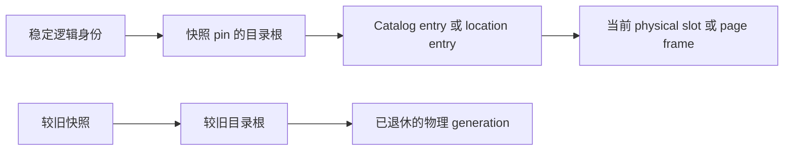
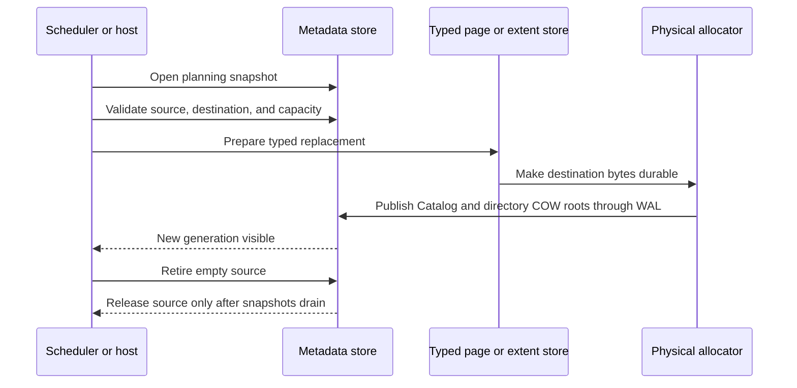

# 段压缩

原生逻辑存储格式回收空间时，不会改变 Node ID、Edge ID、`SegmentId`、`PageId` 或外部 property 引用。压缩只会将稳定逻辑身份到新物理位置的目录绑定切换为新一代。这与已退休的物理段链实现完全不同；后者移动记录后还需要重写引用。

旧的 `FileStorage` / `DataManager` compactor 不是原生逻辑数据库所使用的压缩机制。native code 绝不得通过 `dbms.setConfigValue` 或 System State key 控制它。embedding 若 opt-in native maintenance，可用 autocommit `dbms.setConfig('storage.compaction.enabled', <Boolean>)`；该服务会围绕同一个单文件 COW metadata publication boundary pause/resume 有界 maintenance worker，并在不存在 native maintenance owner 时拒绝此 key。

## 存储身份

文件分配器负责固定大小为 128 KiB 的物理槽位。逻辑引用永不持久化原始文件 offset：

| 对象 | 稳定逻辑身份 | 解析当前物理位置的目录 |
|---|---|---|
| 固定 Node 或 Edge 段 | `SegmentId` | Catalog 与 Entity Location Directory |
| Property 或 State slotted page | `PageId` 加 slot 与 generation | Page Directory |
| 标量或普通 adjacency Packed B+Tree page | `PageId` | Page Directory 与 Index Root Directory |
| Raw 或 PQ vector page | `PageId` | Page Directory |
| Vector manifest | manifest `PageId` | Page Directory 与 Vector Manifest Directory |
| Large object 或 codebook extent | object/extent identity | Extent Directory 与 Catalog |

一次重定位会原子发布新的目录 generation。发布后开始的 reader 解析到新位置；较早的 reader 则继续通过其 pin 的目录根安全读取原来的 generation。只有能解析到源位置的全部 snapshot 都已释放后，源空间才可以释放。

## 支持的压缩操作

`RelocatableCompactionCoordinator` 提供有界、类型化的操作。对于需要类型特定重建的格式，它绝不会进行原始字节拷贝。

| 数据布局 | 操作 | 压缩后的稳定引用 |
|---|---|---|
| Property、State 与 vector-adjacency slotted pool | 在调用方给定的 page budget 内迁移到兼容的 destination pool | `PageId`、slot ID 与 slot generation |
| 标量或普通 adjacency Packed B+Tree pool | 重建类型化 page，并在需要时切换 root-directory binding | `PageId` 与 index root identity |
| Raw 与 PQ vector pool | 重建类型化 vector page | vector page identity 与 vector-location binding |
| Vector-manifest pool | 重建不可变 manifest，并发布两个 directory binding | manifest `PageId` |
| 固定 Node 与 Edge 段 | 重定位完整 fixed-record segment | Node 和 Edge ID；逻辑 `SegmentId` 保持不变 |
| Large-object 与 codebook extent | 在目标范围重建已验证的 immutable extent | object / codebook extent identity |

单个 slotted page 内的 property payload 整理与 pool evacuation 是两件独立的事。前者可以移动 payload bytes，并只更新所属 slot directory 的 offset；外部 page/slot 引用保持不变。一次小 property 更新绝不能触发 whole-file relocation。

## 有界迁移协议

每项操作都会被 destination capacity 和显式 LSN 范围约束。调用方选择 source、兼容的 destination、pool 数据的 page budget，以及要预留的首个 LSN。协调器按以下顺序执行：

1. 打开 metadata snapshot，验证 source 与 destination 都是 sealed、兼容、当前有效，并由已分配的 physical slot 支撑。
2. 收集并排序 source page，确认 destination 拥有完成请求的有界迁移所需的 frame。空间不足时返回 `VCS_NO_DESTINATION_CAPACITY`，且 source 不发生变化。
3. 在每次类型化迁移之前，用新 snapshot 重新验证规划的 page。过期的 directory binding 会 fail closed，不会迁移意外的 page。
4. 准备新 bytes，使数据持久化，然后通过 native metadata COW 和 Superblock 发布边界发布 Catalog 与相关 directory 的 COW root。
5. source 变空后将其 retire。只有 snapshot-retention 检查成功时，才回收其 physical slot。

结果会区分正常完成、目标容量不可用，以及 `VCS_SOURCE_RETIRED_AWAITING_SNAPSHOTS`。最后一种不是错误：最后一个旧 snapshot 关闭后，后续维护运行可使用同一 segment generation 重试 source release。

## 引用、缓存与恢复保证

压缩不会改变逻辑图引用。固定段移动后，无需对 Node 或 Edge ID 进行全图修复；使用稳定 directory identity 的 property、adjacency、B+Tree 与 vector 引用也无需重写。

cache 的有效性必须基于逻辑身份和解析到的 generation，而不是原始文件 offset。发布只会向新 snapshot 暴露新的 mapping；旧 snapshot 保留原 mapping 及其 physical generation pin。这防止 cache 或 reader 看到一个指向尚未 durable bytes 的 directory entry。

持久化顺序与普通 native write 一致：

1. 验证类型特定的 source 与 destination；
2. 写入并同步完整的 destination bytes；
3. 持久化 metadata COW publication；
4. 发布 Superblock root；
5. 只在 snapshot retention 允许时使旧 source 可回收。

若在 durable metadata publication 前中断，已准备的 destination bytes 不可达。若在 WAL publication 后中断，recovery 会恢复完整的 directory generation。recovery 绝不会暴露部分移动的逻辑对象。

## 调度与容量策略

native coordinator 有意不采用“每次 flush 后进行无界自动压缩”的策略。host scheduler 必须提供 work budget、选择兼容的 destination、预留 LSN capacity，并观察 snapshot pressure。这样可保持可预测的 tail latency，并使 no-capacity 成为无破坏性的结果。

未来 scheduler 可安全采用以下策略：

- ��个 maintenance slice 只迁移有界数量的 page 或一个完整 fixed segment；
- 在 destination-frame 可用的前提下，优先处理可回收 physical capacity 最大的 pool；
- snapshot pin 释放后重试 retired-source release；
- 仅在 Catalog 与 free-space metadata 都不再引用 tail slot 后执行 file-tail truncation；
- 在增加 budget 前测量 reclaimed bytes、source-retention time、directory publication latency 以及读写 tail latency。

目前不存在 public Cypher command 用于 native logical compaction。应用不应依赖 legacy configuration procedure 或 physical file offset。维护集成属于 native storage-host 边界，以便使用本文描述的同一套 snapshot、WAL 与 publication 保证。
