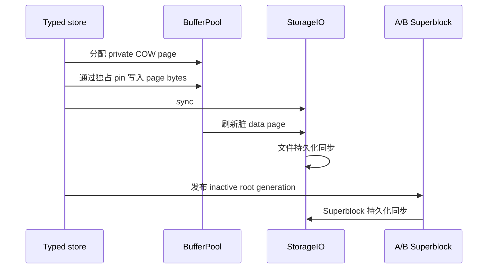

# 缓存管理

每个原生 ZYX 数据库只使用一个位于 `StorageIO` 下方的共享 `BufferPool`。它为
Metadata、Catalog、Entity、Property、B+Tree、Vector 和 LargeValue store 缓存
4 KiB raw page。原生 production 路径不再使用历史的 128 KiB `PageBufferPool`
或按实体维护的脏数据注册表。

`Database` 的缓存容量参数以字节为单位，默认 64 MiB；小于一个 4 KiB page 会被
拒绝。容量会向下对齐到完整 page，因此 resident 数据不会超过配置的字节上限。

## Page 身份与 Pin

缓存页以物理 4 KiB 对齐文件 offset 和 generation 共同标识：

```cpp
graph::storage::BufferPoolPageKey key{pageOffset, generation};
```

generation 防止缓存视图和同一物理 slot 后续复用混淆。`Pin` 是 RAII 句柄：已 pin
的 page 不能被淘汰或失效。COW writer 创建 generation 非零的 private page，经由
独占 mutable pin 修改，只发布指向新 page 的 root。



缓存不会把未验证的 bytes 变成可信数据。typed page codec 在解释 page 前仍会校验
header、长度、checksum、owner 和 generation。因此，无论命中还是未命中，损坏文件
都会 fail-closed。

## 准入、淘汰与扫描

缓存使用按字节受限的 2Q 准入策略：

- 首次访问进入 recent queue。
- 后续命中提升到 frequent queue。
- 淘汰优先选择 recent 中未 pin 的 page，再选择 frequent；脏 page 会先刷新再释放。
- `StorageIO` 的 sequential read 不进入 resident 集，因此扫描不会驱逐点查工作集。
- 调用方可预取已知 sibling page；之后的按需读取会记录 prefetch hit。

缓存不会淘汰 pinned page、覆盖待失效的 pinned page，也不会静默丢弃 dirty page。
如果没有可淘汰的 frame，操作会失败，而不会破坏 snapshot 安全性。

## 生命周期与指标

`StorageIO::sync()` 会先刷新缓存脏页，再调用平台持久化同步。`flushStream()` 在
stream 可见性边界前执行同样的刷新；存储释放时也会刷新已配置的缓存，而不会丢弃脏
数据。直接 append/reserve 操作会先刷新并失效其影响的缓存范围。

`RelocatableStorageBackend::ioStats()` 同时报告逻辑 `StorageIO` 流量和
Buffer Pool 指标：

- capacity、resident、pinned 与 dirty bytes；
- cache hit、miss 和 eviction；
- prefetch request 与按需 hit；
- Buffer Pool 产生的 raw disk read/write bytes。

这些计数将应用 I/O 与缓存回写的物理 I/O 分开，可用于评估命中率、扫描隔离、pin
压力和写放大。
