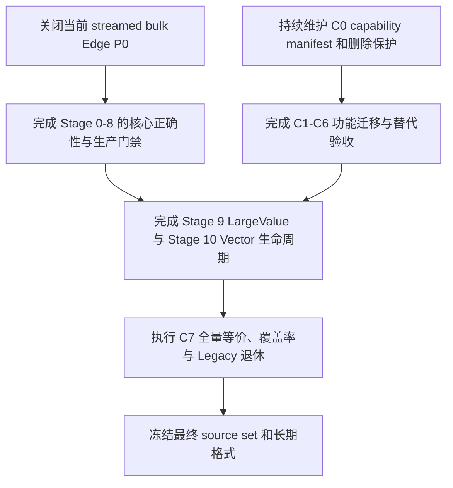

# 原生架构剩余工作总清单

> 本文是当前尚未完成工作的统一导航和执行台账，仅维护中文版本。它不取代
> [原生单文件存储重构方案](native-single-file-storage-plan)中的规范性设计，也不取代
> [原生能力验收矩阵](native-capability-acceptance-matrix)中的逐能力验收记录。发生冲突时，前者决定存储架构，
> 后者决定公开能力能否退休；本文负责说明下一步做什么、按什么顺序做，以及何时才算完成。

## 1. 使用范围

本文覆盖以下全部剩余工作，而不只覆盖当前 P0：

- Stage 0-10 的实现、故障恢复、性能、平台和验收遗留项；
- C0-C7 的功能保全迁移、公开契约替代和 Legacy 退休工作；
- 当前 streamed bulk Edge publication P0；
- Query、Cypher、GDS、Leiden、Vector、Driver ABI 和语言 binding 的功能保留；
- Legacy source/test 的分类、安全删除与最终 source-set 收口；
- 单元测试、覆盖率、基准、三平台 CI 和双语产品文档的最终验收。

本文将“功能子任务完成”和“Stage 最终验收”分开记录。功能实现具备当前 native 回归证据后即可关闭对应子任务；
性能、超大规模资源上限、覆盖率和其他平台的实测属于后置验收，不得让已经完成的功能继续显示为未完成。只有在
Stage 的所有功能子任务都关闭后，才将该 Stage 标记为功能完成；最终发布验收另行记录。

## 2. 当前总判断

native storage migration 的功能工作包已经收口：Stage 0-10、P0 与 C0-C7 都已有 current native owner、最小正确性
回归和 source/consumer audit 证据。工程仍未完成**最终发布验收**，但那是独立的性能、规模、coverage、剩余 sanitizer 和三平台工作，
不再被错误地显示为当前功能或 legacy-cleanup 待办：

- streamed bulk Edge 的 production scale、完整 exhaustive fault matrix 与三平台验收尚未执行；
- tracked production/header/test 集合已无旧 storage、physical executor、sidecar WAL 或 old Vector implementation family；
- `HOLD_FOR_PORT` 只可作为历史迁移记录，不能重新引入已删除实现或阻塞已完成 native capability；
- 仍须以最终精确 binary 的完整验收结果声明发布完成，不能用旧 coverage artifact 或局部测试代替。

### 2.1 当前执行口径

当前只有 macOS 工作环境，因此本台账按以下口径推进：

- 代码必须保持 macOS、Linux、Windows 可移植；当前不要求逐个平台实际运行，最终平台验证由后续验收执行；
- 小规模、确定性的 native 回归用于判断功能是否完成；大规模 workload、性能阈值和长期压力不阻塞功能子任务；
- 关键 publication、reopen、corruption 和 I/O failure 仍需保留最小正确性回归，但不为了关闭 Stage 无限扩展故障组合矩阵；
- 已完成的 Legacy consumer audit、物理删除和 native replacement 不再作为后续 Stage 的重复工作。

按该口径，当前可关闭的功能工作包包括：

| 功能工作包 | 当前状态 | 依据 |
|---|---|---|
| 主要 Legacy storage source/test cleanup | 已完成 | 当前 source-set 与 consumer audit 未发现旧实现仍被 native/public 路径使用 |
| Stage 9 LargeValue durable journal core | 已完成 | journal phase/cursor、reopen、dedup/reclaim、worker 与 reset fault 回归已通过 |
| Stage 10 Vector native core | 已完成 | Raw/PQ/manifest/mapping/adjacency、rebuild、reopen 和 corruption 回归已通过 |
| Stage 8 ordinary adjacency core | 已完成 | global key-only OUT/IN、self-loop、empty-root、relocation、reopen 和主要 publication fault 回归已通过 |
| Stage 7 System Catalog native core | 已完成 | token/definition/configuration/sequence 的 canonical owner、reopen、stale writer、关键 publication/recovery 与 corruption 回归已通过 |
| Stage 6 Packed B+Tree native core | 已完成 | key codec/owner/root publication、bounded cursor、online/bulk ordering、snapshot/retirement 与关键 corruption/fault 回归已通过 |
| Stage 5 Property/LargeValue native core | 已完成 | inline/overflow、RAW/compression、dedup、range read、reopen、snapshot reclaim 与关键 data/manifest publication 回归已通过 |
| Stage 4 Fixed Entity Page native core | 已完成 | Node/Edge record、LabelSet、Property/LargeValue/adjacency publication、relocation、snapshot 和关键 crash/fault 回归已通过 |
| Stage 3 allocator/Catalog/reclamation native core | 已完成 | relocation、snapshot-safe reuse、tail truncation、routed metadata evacuation、reopen/crash 与 key allocator/catalog atomicity 回归已通过 |
| Stage 2 unified Buffer Pool native core | 已完成 | typed store 接入、generation key、admission 分类、COW/pin/frame reuse/eviction 安全回归已通过 |
| Stage 1 single-file durability native core | 已完成 | A/B publication、no-sidecar、direct writer、stale-handle、reopen/retry 与关键 candidate/final-sync 回归已通过 |
| Stage 0 clean-format native core | 已完成 | production source-set、old-format rejection、canonical codec/corruption 与 clean-build corpus 回归已通过 |
| P0 streamed bulk Edge native core | 已完成 | bounded coordinator、one-generation publication、online/bulk equivalence、reopen/retry、integrity 与关键 fault 回归已通过 |
| C0 procedure registry/source classification guard | 已完成 | manifest、registry、runtime 和 native test classification 一致性检查已通过 |
| C1 GDS projection native core | 已完成 | projection/drop/list/schema、过滤/orientation/weight、事务隔离、结果 schema 与 timeout/cancellation 回归已通过 |
| C2 graph algorithm native core | 已完成 | PageRank、WCC、Betweenness、Closeness、Leiden、Dijkstra 及结果 schema、determinism、validation/cancellation 回归已通过 |
| C3 native procedure/transaction core | 已完成 | manifest mode、overlay/catalog isolation、autocommit rejection、failure atomicity、timeout/cancellation 与关键 procedure 回归已通过 |
| C4 C++ builder core | 已完成 | typed logical plan、parameter binding、read/write/index/procedure/UNWIND 与 transaction/error/result contract 已通过 public API 回归 |
| C5 configuration/statistics core | 已完成 | durable policy、runtime statistics、slow-query、administration result schema、failure/reopen 与 maintenance policy 回归已通过 |
| C6 native optimizer/statistics and Vector retirement core | 已完成 | Catalog-backed bounded estimate、safe optimization、native Vector source boundary 与 small-corpus exactness/reopen 回归已通过 |
| C7 native source-set and legacy retirement core | 已完成 | tracked production/header/test audit 已无 legacy storage/physical-executor/old-Vector family；CMake guard 禁止重新进入 native build |

上表的“已完成”仅针对功能工作包，不代表对应 Stage 的性能、覆盖率、长期压力或最终发布验收已经关闭。

总目标定义为：



## 3. 当前优先级原则

### 3.1 功能完整性优先于全局覆盖率冲刺

当前优先级不是无限提升尚未稳定模块的单元测试覆盖率，而是：

1. 先完成正确、优雅、高效、可扩展的最终功能实现；
2. 为每项新增或修改行为增加足以证明正确性、错误处理、原子性和关键边界的必要测试；
3. 用最小相关测试快速定位问题，并在每个可交付变更结束前运行完整 quick suite；
4. 将仍有公开行为价值的 Legacy 测试保留为只读 specification，直到 native replacement test 建立；
5. 删除所有已被安全替代的 Legacy 实现和 implementation-only 测试，稳定最终 production source set；
6. 最后针对最终保留代码集中执行 line、branch、function、region 四个维度的全面覆盖率收口。

这项优先级调整不表示可以不测试，也不表示降低最终质量门禁：

- 修改 production 行为时，必须先判断是实现错误还是测试错误，禁止为通过测试而盲目改 expectation；
- storage codec、publication、allocator、reclamation、recovery 和 corruption boundary 必须随实现同步增加测试；
- 每个阶段性实现至少运行最小相关 GoogleTest selection；代码变更交付前仍应运行 `./scripts/run_tests.sh --quick`；
- `.g4` 发生变化时必须重新生成 parser，并同时验证生成文件；
- 最终 C7 仍要求当前精确 binary 的 line、branch、function、region 均达到至少 95%；
- 不为计划删除的 implementation-only Legacy 代码补测试来美化全局数字；
- 不通过缩小测试 executable、排除正常 production source 或复用过期 profile 来提高覆盖率。

### 测试规模分层

单元测试默认验证小规模、确定性的功能正确性。`CompareBenchmark` 的 `1000`/`10000` Edge 批量 workload、跨
index-pool 的 `7936` Edge publication、Driver ABI rebase/fault matrix 的 `1024` Edge batch，以及 agent-memory 的完整
`53`/`47` 会话历史复现，都属于性能、资源上限、拓扑边界或真实规模回归验收，不作为日常 quick 单元测试的默认路径；quick
保留小批量端到端检查、一条跨 sealed scratch-run 的 Driver ABI rebase smoke 和单会话的 agent-memory smoke。大规模 workload
不会删除，仍通过独立 benchmark、P0/Stage 8 规模门禁和目标平台性能任务执行。
这样既不牺牲大规模行为的验证，也避免把性能测量成本混入每次功能回归。

同一原则也适用于小型 guard 单测：超时 assertion 只需等待 deadline 后跨过一个确定的采样周期，不能通过千万次 busy-loop
碰撞周期性检查。`QueryGuardTest` 现以 `2 ms` deadline wait 加 `1024` 次采样覆盖 timeout、timeout-first 和异常消息契约；
这保留 QueryGuard 的热路径采样语义，同时避免默认 quick 为测试调度消耗无意义 CPU。

P0 回归源码也按职责保持可维护：普通逻辑事务、streamed bulk Edge 的故障/恢复、以及其 publication/rebase/拓扑/资源边界
分别位于 `test_RelocatableStorageBackend_TransactionAtomicity.cpp`、
`test_RelocatableStorageBackend_StreamedBulkEdgeFaults.cpp` 与
`test_RelocatableStorageBackend_StreamedBulkEdge.cpp`；普通图 `DETACH DELETE` 的 I/O/reopen 原子性另位于
`test_RelocatableStorageBackend_DetachDeleteFaults.cpp`。每个文件均不超过 2,000 行。拆分不删除或弱化任何测试；动态 CMake test
discovery 继续编译这四份 source，拆分前后的 `TEST_F` 以及 disabled scale gate 均保持注册。该结构性检查点由目标 P0 suite
和完整 quick suite 验证通过；它提高后续故障矩阵维护性，但不替代 P0 的规模、三平台或最终验收门禁。

完整规模回归以显式 disabled GoogleTest 保留，并在专项验证中执行：

```bash
cmake --build buildDir --target zyx_test_suite
./buildDir/zyx_test_suite \\
  --gtest_also_run_disabled_tests \\
  --gtest_filter='DISABLED_DriverAbiAgentMemoryScaleTest.*:DISABLED_RelocatableStorageBackendScaleTest.*:DISABLED_RelocatableDriverAbiIngestScaleTest.*:DISABLED_RelocatableDriverAbiIngestRebaseCorruptionScaleTest.*'
```

该专项门禁不替代 P0/Stage 8 的 `1M`/`10M` 生产规模、吞吐、RSS、空间放大和 macOS/Linux/Windows 证据；后者仍由冻结
workload 的 standalone calibration/benchmark 负责。

迭代开发时优先使用：

- `./scripts/run_tests.sh --quick --gtest-filter "SuiteName.*" --file <production-source>`；
- 仅检查一个 production 文件时使用 `--file`，但必须理解它只限制 coverage detail，不自动限制测试；
- 完成一个逻辑变更后运行不带 filter 的 `./scripts/run_tests.sh --quick`；
- API 或 binding 发生变化时运行 `./scripts/test_bindings.sh --all`；
- 只有 final source set 稳定后，才执行全仓库覆盖率集中补齐。

### 3.2 不保留不良兼容设计

新格式不支持打开或迁移旧数据库，不为旧 Segment-chain 格式保留 runtime fallback。需要保留的是公开能力和可观察语义，
不是旧的类结构、物理布局、文件路径或实现缺陷。迁移一项能力时允许重新设计 API 内部实现，只要：

- public contract 被明确记录；
- native owner 与 storage-neutral boundary 清晰；
- 性能和资源上限不退化；
- replacement test 覆盖原有有效行为；
- 不再需要的 Legacy dependency closure 可以被完整、安全地删除。

## 4. 执行优先级

| 优先级 | 工作包 | 原因 | 退出条件 |
|---|---|---|---|
| P0 | streamed bulk Edge 最终发布验收 | native publication 功能已经完成；剩余是冻结规模、资源、完整故障矩阵和平台证据，阻塞 bulk ingest 的最终发布结论 | bounded-memory、故障/恢复/资源上限、性能和三平台门禁全部通过 |
| P1 | Stage 0-8 最终验收 | allocator、durability、Entity、Property、B+Tree 和 adjacency 的 native 功能已经完成；只收口剩余恢复、规模、性能、coverage、sanitizer 和平台证据 | 单一生产表示、完整一致性、reclaim/crash、10M 基准和三平台门禁通过 |
| P1 | C0 删除保护持续维护 | 防止已退休实现回流，或在新增公开能力时误删 native 行为 | 所有新增能力和测试均被分类，删除 public capability 会使 CI 失败 |
| P2 | Stage 9/10 最终生命周期验收 | LargeValue journal 和 Vector native core 已完成；只收口 orphan/rebuild/recovery、规模、性能、coverage、sanitizer 和平台证据 | reclaim/rebuild/fault/scale/performance/platform 门禁通过 |
| P2 | C1-C6 公开契约最终验收 | GDS、算法、procedure、QueryBuilder、配置、优化器和 Vector 的 native owner 已完成；剩余是公开 parity、故障恢复、binding 和平台证据 | 对应 capability row 的公开行为、恢复、binding 和平台证据齐全 |
| P3 | C7 发布冻结 | Legacy source/test cleanup 已完成；只收口最终 source set、四维 coverage、完整故障矩阵、sanitizer、规模/性能、平台和文档 | Legacy closure、四维覆盖率达标、三平台和文档全部通过 |

P1 和 P2 中相互独立的最终验收可以交错推进，但任何 Legacy 删除都必须遵守 C0-C7 的前置 gate。Stage 0-10、P0 和 C0-C7
的 native 功能工作包已经关闭；后续不能把最终验收 gate 重新拆成新的实现任务，也不能为了缩短清单而提前宣称发布完成。

## 5. 当前 P0：streamed bulk Edge publication

### 5.1 已有基础

当前已经具备或正在形成的基础包括：

- 有界、持久化、一次性使用的 Edge ID lease；
- 支持严格有序稀疏 lease range 的 Edge directory append；
- 数据库单文件内、allocator/Catalog 管理的 `SGK_BULK_SCRATCH`；
- bounded fragment、run manifest、source cursor 和 fan-in merge primitive；
- public columnar append 与 publication preflight 共享固定 4096 项 FIFO endpoint validation cache：重复 endpoint
  不重复 probe，超过窗口后重新校验，且不会保留 transaction-sized Node-ID set；
- Entity、Property、LargeValue、B+Tree 与 adjacency 的若干 planner/materializer；
- private candidate preparation、deferred publication 和 index planning 基础；
- 已删除或正在删除的 raw-tail staging 和 transaction-sized source-copy 方案。

`RelocatableMetadataStore` 的统一 publication coordinator 已接入公开 commit：它在一个 writer fence 内从
allocator/Catalog 管理的 durable scratch 流式构造 Entity、Property/LargeValue、token、OUT/IN adjacency 和相关
index state，并只发布一个最终 generation。公开端到端测试已覆盖 inline/overflow/LargeValue Property、无
Property 拓扑、稀疏 lease、同 generation publish、short write、data sync、final Superblock sync、候选预算、
crash/reopen，以及 manifest/run 读取缓冲损坏后旧图保留和 scratch 清理。

这表示功能实现不再是 P0 阻塞项，但不表示 P0 已完成：仍须在冻结的生产工作负载上证明 1M/10M 的 RSS、scratch
fan-in、空间放大和吞吐门槛，补齐尚未覆盖的故障/竞争组合，并取得 macOS、Linux、Windows 的同一公开契约证据。

本轮新增真实子进程终止边界：`RelocatableProcessCrashBulkEdgeStagingTest` 现分别在 public Property、LargeValue data 与
LargeValue Manifest candidate page 完成定位写入、但 graph Superblock 尚未连接新 route 时终止 child；parent reopen 只能读取完整旧
generation，暂存 Edge 不可见且 integrity scanner 通过。该项补齐这三类 public candidate page 的 crash evidence，不替代其他
data/control/final fence、多进程竞争、规模或 Linux/Windows 门禁。

同一 suite 现在还精确覆盖全局 adjacency B+Tree 页（`POK_INDEX` 且 owner 为
`RSS_GLOBAL_ADJACENCY_INDEX_ID`）和经 `CatalogLeafPageCodec` 认证的 Catalog metadata page：两者均先完成候选页的完整
`portable_pwrite()`，再在 graph Superblock publication 前终止 child。parent reopen 必须保留既有 Edge、拒绝暂存 Edge 并通过
integrity scanner。这两个 streamed bulk 特有的 data/control candidate 边界补强现有短写与 `ENOSPC` 回归，但不替代 final fence、
真实多进程竞争、冻结规模或 Linux/Windows P0 gate。

最新检查点：`zyx-bulk-edge-calibrate` 的 schema v3 已将 scratch 的 candidate segment、source-run 与 merge-pass
纳入可强制校准契约。enforced run 现在必须指定正数的 source-run 下限和显式出现的 merge-pass 下限（包括合法的 `0`；默认值
不能代替参数），且 evidence collector 会拒绝缺失或与实际指标不一致的报告；CI smoke 仅断言单 source run/零 merge pass 的管线连通。后续冻结的 10M 校准必须设置
可证明多 run fan-in 的下限，并结合目标硬件 RSS、空间和吞吐阈值产出三平台证据。本检查点只关闭“可验证 fan-in 形状”
的证据缺口，不关闭 P0。本机显式零 merge-pass smoke 通过，而漏传该参数的 enforced run 在任何文件写入前被拒绝；完整 quick
suite `native-20260817T131630-50016` 也以 `exit_code: 0` 通过。

P0 校准现在将 scratch 标量证据与全量耗时 trace 分离：`PerfTrace::setEnabled()` 仍保持既有调用方“同时收集
duration/value”的兼容语义，而 bulk-Edge 工具会单独开启仅四项 scratch counter 所需的 value collection。因而
`--enforce-gates` 不再要求 `--include-trace-phases`；后者只保留为可选诊断输出，冻结吞吐基线不会因每个 scoped timer 的
shard mutex/map 写入而被测量工具系统性扰动。每个 enforced 报告仍强制含有且校验 candidate/source-run/merge-pass 的
scratch 值，普通 CI smoke 保留 trace 以持续覆盖报告 schema。该修正提高 P0 性能证据的可信度，不构成生产阈值或 P0
关闭证据；仍须在目标硬件重跑 1M/10M，并完成故障、恢复与三平台门禁。

随后在同一未冻结 macOS 主机上执行的 trace-free 1M 诊断（`bulk-edge-p0-1m-trace-free-diagnostic-v1`）得到
4,584.52 Edges/s、763.49 B/Edge、174,489,600 B peak RSS、15,570.26 ms reopen+scan、20,115 candidate segment、
711 source run 和 2 merge pass。它与此前启用 duration trace 的 1M 候选吞吐量级相同，因此排除了全量 timer collection
作为当前吞吐和 candidate-segment 超限的主要原因；主机可用磁盘约 13 GiB、存在 compressed memory，且没有冻结生产
hardware/workload，该诊断不能归因于 core regression 或作为 P0 baseline。下一步应在目标硬件 profile 内分析 candidate
fragment/run 形状和 publication 成本，而不是修改门槛来掩盖结果。

为使这项分析不再只能依赖总数，bulk-Edge schema v3 的 `scratch` 现额外报告 token、token resolver、OUT adjacency、
IN adjacency 和 LargeValue-content 各 private candidate family 的 count；校准程序和 evidence collector 都会 fail closed 地验证
五项精确和为 `candidate_segments`。100-Edge value-only enforced smoke 的分解为 `3 + 1 + 3 + 3 + 0 = 10`，证明计数路径
不依赖 duration trace。后续 1M/10M artifact 必须记录这五项，才能用实际最大 family 指导 bounded-memory 改进和候选阈值审阅。
新的 trace-free 1M 分解 artifact 显示 `4,266 + 8,001 + 3,924 + 3,924 + 0 = 20,115`：token run 和 token resolver
合计占 12,267（约 61%），即使 workload 只有一个重复 relationship type。原因是当前无 transaction-sized token set 的
preflight 用 raw token occurrence 作为 resolver 的安全上界，而不是最终 merge-deduplicated token cardinality。这个上界
保证了不会 under-reserve，但明显放大 private candidate 和 publication 工作；后续改进必须在不引入无界 name map、且不会
under-reserve 的前提下，将最终有序 token run 的精确 cardinality 反馈到 resolver reservation，再以 1M/10M evidence 验证。

后续 writer-scoped audit 纠正了这一解释：compact private scratch 会惰性 materialize candidate，未写入的 reservation ordinal
没有 physical slot 或 128 KiB image。校准现将 `candidate_capacity_segments`（20,115）与真实
`candidate_segments` 分开；后者在 private preparation 完成、cleanup 前从 materialized-entry map 导出，并且才用于
`maximum_scratch_candidate_segments` gate。`bulk-edge-p0-1m-materialized-diagnostic-v1` 实测为 4,480 个 physical
candidate，小于 10,000；因此先前 candidate gate violation 是容量上界被误当资源消耗，而非 scratch fan-in 超限。容量及其
family 分解仍保留为 admission/优化证据，不能通过缩小 reservation 绕过 under-reserve 风险。该更正不影响同次约 4,604
Edges/s 的吞吐失败，也不关闭 P0、故障/恢复或三平台 gate。

首次 compact candidate 的 writer 与 reservation 在同一个 writer fence 内，因此写入真实 payload 前不必再读回刚刚写出的
认证 reservation；该 fast-path 保留 reservation 的落盘顺序，并只跳过该 fence 内冗余的完整 segment read。初版仍在该分支前
分配并清零第二个 128 KiB image，1M 诊断仅为 4,491.29 Edges/s；将该 buffer 延迟到“已经 materialized、必须读回验证”的路径
后，`bulk-edge-p0-1m-first-write-allocation-diagnostic-v1` 为 4,631.26 Edges/s、205,375.26 ms commit、4,480 个实际
candidate、20,115 个 candidate capacity、711 个 source run 和 2 个 merge pass，reopen/scan 仍成功。它相对同机约
4,604 Edges/s 的未冻结诊断仅有约 0.6% 差异，不能单独作为吞吐改进结论，更远不足以关闭 P0；`RelocatableStorageBackendTest.StreamedBulkEdge*`
定向回归 24/24 通过。

随后 `bulk-edge-p0-1m-phase-trace-diagnostic-v1` 在同一未冻结 macOS 主机、带最多 32 个 phase 的诊断中得到
4,615.76 Edges/s、206,108.54 ms commit、173,424,640 B peak RSS 与相同的 4,480 个实际 candidate。其嵌套时间范围显示
`native_graph.streamed.private_prepare` 为 104,738.62 ms（其中 adjacency 58,416.17 ms、run reduce 37,135.24 ms），
`native_graph.streamed.early_publication` 为 104,982.56 ms，`native_graph.metadata_publish` 为 124,620.20 ms；后三者存在
包含关系，严禁相加归因。相比之下 private scratch write/read 分别为 15,072.46/5,506.20 ms。下一轮应分析 private preparation
和 early-publication 内的 run reduction、adjacency materialization 与 entity-page source 路径，而不是继续把 reservation
capacity、首次 reservation read 或 trace 开关误判为主瓶颈。该 trace 仅为诊断，不能用于冻结吞吐基线或调整 gate。

为进一步缩小 adjacency 根因，`bulk-edge-p0-1m-adjacency-split-trace-diagnostic-v1` 增加 OUT/IN 独立 phase，并得到
4,636.59 Edges/s、205,393.90 ms commit；OUT 为 28,882.01 ms、IN 为 29,112.44 ms，二者近乎对称，二者合计的
adjacency initial-run 为 22,124.00 ms、run reduction 为 36,871.86 ms。因此没有单向热点，下一项高价值设计工作是以一个
bounded source pass 同时产生双向 initial runs、而后维持两个独立的 fail-closed durable merge；不能通过保存 transaction-sized
Edge/vector 来规避重扫。作为安全的局部复杂度收敛，adjacency run builder 已利用单调 Edge ID 与已验证有序、无交叠 lease range
用单调 cursor 验证 membership，而不再让每条 Edge 扫描每个 lease range；新增 sparse lease/gap 回归后该 suite 为 5/5。
`bulk-edge-p0-1m-lease-cursor-diagnostic-v1` 为 4,614.67 Edges/s、206,382.28 ms commit，未冻结主机上没有可声称的吞吐
提升，但该改动保留了相同的 fail-closed 结果和 `O(records + lease ranges)` 验证上界。它不关闭 P0，也不取代后续双向 pass/merge
设计、恢复矩阵或三平台门禁。

随后 OUT/IN adjacency initial-run 改为共享一次有界 sealed-Edge source pass：两个方向继续使用不重叠的 private candidate
range、独立 run-set 和独立 fail-closed reduction，单次 fence 保证两份 initial run 在任一 reader/reducer 重开前均已 durable；
不会保留 transaction-sized Edge/vector。新增回归明确断言 paired builder 只打开 source 一次，并覆盖 private pipeline/family
candidate 隔离与 streamed bulk-edge reopen。`bulk-edge-p0-1m-paired-adjacency-diagnostic-v1` 为 4,683.15 Edges/s、
203,015.73 ms commit、4,480 个实际 candidate、20,115 个 capacity candidate、711 个 source run 和 2 个 merge pass；相比同机
约 4,614.67 Edges/s / 206,382.28 ms 的 lease-cursor 诊断约改善 1.5--1.7%。主机仍未冻结，该数据只是方向性证据；P0 吞吐、
10M、故障/恢复与三平台 gate 仍开放，下一步应继续审计 reducer/entity page source 而非调整阈值。

该 paired-adjacency 改动的完整 quick suite `native-20260817T145444-90307` 双分片以 `exit_code: 0` 通过；同次 profile
重生成 coverage 为 Region 93.70%、Function 98.40%、Line 93.34%、Branch 86.20%。这仍不是 C7 gate，且不应以保留 legacy
storage 源码改善统计；后续覆盖率只针对完成替代并保留的 native family。

后续 reducer 审计发现它仅为取得 `BTreePageEntry` 的持久化长度而调用完整 `encode()`，会为每个 merge entry 创建并释放临时
`std::vector<std::byte>`。`BTreePageEntryCodec::encodedSize()` 现复用相同 key-length/size-overflow 验证而不 materialize
payload；reducer、token/OUT/IN adjacency/LargeValue initial-run builder、以及 bulk-run streaming writer 均使用该长度保留既有
fragment/buffer bound 检查，真正写入 scratch 的路径继续完整 encode。仅 reducer 的
`bulk-edge-p0-1m-encoded-size-diagnostic-v1` 为 4,688.58 Edges/s、202,622.35 ms commit、160,628,736 B peak RSS；扩展全部
纯长度调用后的 `bulk-edge-p0-1m-all-encoded-size-diagnostic-v1` 为 4,983.46 Edges/s、189,792.82 ms commit、158,318,592 B
peak RSS、763.49 B/Edge、4,480 个实际 candidate（20,115 capacity）、711 个 source run 和 2 个 merge pass，且两次均
reopen/scan 成功。后者相对前者约快 6.29%，是未冻结主机上值得继续以冻结基线复验的方向性信号，而不是 P0 throughput 关闭证据；
scratch 形状和持久化文件大小保持不变。BTree codec、token/adjacency/reducer 的定向回归为 28/28，LargeValue
private-run/deferred preparation/streamed bulk 回归为 31/31。扩展改动的完整 quick suite
`native-20260817T152108-30583` 两个 isolated shard 和 CTest registration 均以 `exit_code: 0` 结束；同次 coverage 为
Region 93.70%、Function 98.40%、Line 93.33%、Branch 86.19%，仍不满足 C7 四维 95% gate。
reducer-only 改动的文档 link check 通过，完整 quick suite `native-20260817T151111-15162` 的两个 isolated shard 和 CTest
registration 均以 `exit_code: 0` 结束；同次 coverage 为 Region 93.70%、Function 98.40%、Line 93.34%、Branch 86.20%。

累计无分配改动后的带 trace 1M 诊断（`bulk-edge-p0-1m-all-encoded-size-phase-trace-diagnostic-v1`）为
4,788.52 Edges/s、197,071.95 ms commit；其嵌套范围中 `private_prepare` 为 97,491.42 ms、adjacency 为 49,614.22 ms、
run reduction 为 34,837.80 ms，final `entity_page_source` 为 29,134.90 ms，bulk-run `fragment_read_decode` 为
11,558.02 ms。trace 开关会改变总耗时，所以这些值仅用于热点排序：优先审计 entity materializer 与 reduction I/O，不能与
trace-free 吞吐直接比较。consumer audit 随后确认 `NativeBulkEdgeMaterializedRecord` 的 OUT/IN adjacency key 仅在
materializer 内生成且只被其专属单测解码；生产 adjacency 已由 paired run builder 生成。因此已物理删除这两个过渡 vector 字段、
对应 `AdjacencyKeyCodec` 编码和过时断言，Entity/page/property publish 继续只保留其实际 consumer 所需的 ID、Entity 和
Property root。清理后的 trace-free `bulk-edge-p0-1m-retired-materialized-adjacency-diagnostic-v1` 为 4,836.42 Edges/s、
195,142.08 ms commit、146,358,272 B peak RSS，scratch/持久化/reopen 形状未变；相对前一轮 4,983.46 Edges/s 的单次下降
在未冻结主机上不构成吞吐回归或收益结论。materializer/deferred Entity-page/streamed-bulk 定向回归 43/43 通过，仍须以
完整 quick suite `native-20260817T153608-69830` 验证：两个 isolated shard 和 CTest registration 均以 `exit_code: 0`
结束，同次 coverage 为 Region 93.70%、Function 98.40%、Line 93.33%、Branch 86.20%。P0 不因该 dead-field retirement
关闭。

上述 writer fast-path、phase diagnostics、lease cursor 与 sparse-lease 回归完成后，完整 quick suite
`native-20260817T143855-68124` 的双分片以 `exit_code: 0` 结束，CTest registration 通过；用同次 raw profile 重生成的
coverage 为 Region 93.71%、Function 98.40%、Line 93.36%、Branch 86.23%。这证明本轮没有依赖旧 storage/query
implementation 取得回归通过，但 C7 的四维 95%+ 目标仍未满足，不能被描述为 coverage gate 关闭。

本轮在未冻结的本机 macOS 工作负载上完成了工具链诊断运行：1M Edges 的报告为约 69,034 Edges/s、239,845,376 B peak RSS、
763.49 B/Edge、711 个 source run 和 2 个 merge pass；10M Edges 的报告为约 44,626 Edges/s、276,250,624 B peak RSS、
874.04 B/Edge、7,103 个 source run 和 3 个 merge pass。两次运行均重开并扫描完整 topology，且未发现 WAL/SHM sidecar。
它们证明当前二进制会在生产规模形状中实际经过多 run/fan-in 路径，也暴露了必须在冻结硬件与工作负载上审查的空间结果；标签为
`unfrozen-local-macos`，没有声明任何门槛，也不能替代 enforced 1M/10M、故障/竞争矩阵或 Linux/Windows 公开契约证据。它们与
后续 trace-free 1M 诊断的构建、机器压力和测量时刻均不同，不能相互推导吞吐回归或基线结论。

为收集而不伪造这项外部证据，`build.yml` 现提供默认关闭的 `workflow_dispatch` P0 bulk-Edge candidate：只有明确选择
`1m` 或 `10m` 且提供已审阅的 hardware label、吞吐/空间/reopen/RSS/scratch 全部阈值时，三平台 matrix 才会调用
`zyx-bulk-edge-calibrate --enforce-gates` 并上传各自 report。缺失、格式错误或不完整的阈值会由工具拒绝；普通 CI 仍只运行
宽松 smoke。这使冻结工作负载可复现并可审计，但 hosted runner 或手动 hardware label 不会自动成为生产基线，P0 仍需人工
审阅实际 target-hardware artifact 后才可关闭。

本轮还加强了 private scratch 的 fail-closed 回归：候选 manifest 的 entry-count divergence、非法 child level、空或失效
source cursor、无界 merge 选项以及跨 transaction manifest 均会在读取或写入 durable scratch 前被拒绝；无效 write、batch、release
和 recovery 输入不会改变已存在的 scratch，并在拒绝后仍可正常释放有效 location。`native-bulk-run-negative-full-20260815`
完整快速套件的两个隔离 shard 均通过（`exit_code: 0`）；匹配 profile 的 `NativeBulkRun.cpp` 覆盖率为 Region 89.57%、Function
100%、Line 86.13%、Branch 74.67%，全局为 Region 93.76%、Function 98.44%、Line 93.43%、Branch 86.34%。这些是本机回归
证据，不关闭 P0，也不满足 C7 的四维 95%+ 门槛。

另一个 P0 故障检查点已关闭：公开 streamed bulk coordinator 在将 `POK_ENTITY` candidate 或已封存的
`SGK_BULK_SCRATCH` source 写入单文件时遇到真实 `ENOSPC`（Windows 为 `ERROR_DISK_FULL`）会回滚 transaction、
保持旧图不可见并允许相同 endpoint 的后续重试；该测试不是以普通 graph writer 的结果替代 bulk 路径。

public Property-page candidate ENOSPC 检查点（2026-08-27，macOS）：
`RelocatableStorageBackendTest.StreamedBulkEdgePropertyPageDiskFullRetainsOldGraphAndAllowsRetry` 先提交一条 ordinary
Edge 作为可观察的旧 generation，再让含 Property 的 streamed Edge 仅在认证 `POK_PROPERTY` page 首次写入时返回真实
`ENOSPC`（Windows 为 `ERROR_DISK_FULL`）。失败 transaction 必须 rolled back；旧 Edge 的 cardinality 和内容在 close/reopen
后完整保留，失败 Edge 不可读且 integrity scanner 通过。重新打开的 writable backend 随后能成功发布同一 endpoints 的带
Property Edge。该项补齐 public Property candidate 的 failure/reopen/retry 组合，不替代 LargeValue、adjacency、metadata/allocator
candidate、final fence、crash、竞争、生产规模或三平台 P0 gate。

public LargeValue 与 adjacency candidate ENOSPC 检查点（2026-08-27，macOS）：
`RelocatableStorageBackendTest.StreamedBulkEdgeLargeValuePageDiskFullRetainsOldGraphAndAllowsRetry` 让一个超过 inline
容量的 streamed Edge Property 只在认证 `POK_LARGE_VALUE_DATA` page 首次写入时返回真实 `ENOSPC`；
`StreamedBulkEdgeAdjacencyIndexDiskFullRetainsOldGraphAndAllowsRetry` 则只在 global adjacency B+Tree 的认证
`POK_INDEX` page 写入时返回同一错误。两种失败均维持 existing Edge、拒绝 staged Edge、通过 integrity scanner，并在
close/reopen 后允许同一 endpoints retry 成功。它们补齐 LargeValue-data 和 adjacency-index public candidate 的
failure/reopen/retry 组合；LargeValue manifest、metadata/allocator、短写、final fence、crash、竞争、生产规模与三平台 P0 gate
仍未关闭。

public LargeValue manifest candidate ENOSPC 检查点（2026-08-27，macOS）：
`RelocatableStorageBackendTest.StreamedBulkEdgeLargeValueManifestDiskFullRetainsOldGraphAndAllowsRetry` 使用同一超过
inline 容量的 streamed Property，但只在认证 `POK_LARGE_VALUE_MANIFEST` page 的首次写入返回真实 `ENOSPC`
（Windows 为 `ERROR_DISK_FULL`）。失败 transaction 不会让 staged Edge 可读，existing Edge 仍可读且 integrity scanner
通过；close/reopen 后同一 endpoints 的 LargeValue publication 可以成功 retry。这使 LargeValue data 与 manifest 两种
public candidate 均具有独立 failure/reopen/retry 证据；metadata/allocator、短写、final fence、crash、竞争、生产规模与
三平台 P0 gate 仍未关闭。

public Property-page short-write 检查点（2026-08-27，macOS）：
`RelocatableStorageBackendTest.StreamedBulkEdgePropertyPageShortWriteRetainsOldGraphAndAllowsRetry` 只令认证
`POK_PROPERTY` page 的一次 `pwrite` 成功返回 16 字节而非完整 page。失败 transaction 必须 rolled back，existing Edge
在 close/reopen 后可读、staged Edge 不可读且 integrity scanner 通过；重新打开的 writable backend 可成功 retry 同一
带 Property 的 streamed Edge。该项补齐 public Property candidate 的 short-write/reopen/retry 组合，不替代 LargeValue、
adjacency/index、metadata/allocator、final fence、crash、竞争、生产规模或三平台 P0 gate。

metadata-page candidate ENOSPC 检查点（2026-08-27，macOS）：
`RelocatableStorageBackendTest.StreamedBulkEdgeMetadataPageDiskFullRetainsOldGraphAndAllowsRetry` 先从已认证
Superblock 取得 bootstrap metadata pool 的精确物理范围，再只对该范围内的首个 4 KiB metadata page 写入返回真实
`ENOSPC`（Windows 为 `ERROR_DISK_FULL`）。失败 streamed publication 不会改变 existing Edge 或暴露 staged Edge；
close/reopen 后 integrity scanner 通过，并能由 writable backend 成功 retry。该项关闭 public metadata-page candidate 的
ENOSPC/reopen/retry 子检查点；allocator candidate、metadata short-write、final fence、crash、竞争、生产规模与三平台 P0 gate
仍未关闭。

public candidate short-write 扩展检查点（2026-08-27，macOS）：
`RelocatableStorageBackendTest.StreamedBulkEdgeMetadataPageShortWriteRetainsOldGraphAndAllowsRetry`、
`StreamedBulkEdgeLargeValuePageShortWriteRetainsOldGraphAndAllowsRetry` 与
`StreamedBulkEdgeAdjacencyIndexShortWriteRetainsOldGraphAndAllowsRetry` 分别只让 bootstrap metadata pool、
`POK_LARGE_VALUE_DATA` 与 global adjacency `POK_INDEX` page 的认证 `pwrite` 返回 16 字节。三条公开 streamed
publication 都必须 rollback、保留 existing graph、使 staged Edge 在 reopen 后不可见，并允许 writable backend retry 成功。
该项关闭 metadata、LargeValue-data 与 adjacency-index candidate 的 short-write/reopen/retry 子检查点；LargeValue manifest
short write、allocator、final fence、crash、竞争、生产规模与三平台 P0 gate 仍未关闭。

public LargeValue manifest short-write 检查点（2026-08-27，macOS）：
`RelocatableStorageBackendTest.StreamedBulkEdgeLargeValueManifestShortWriteRetainsOldGraphAndAllowsRetry` 仅让认证
`POK_LARGE_VALUE_MANIFEST` page 的一次 `pwrite` 成功返回 16 字节而非完整 page。失败 publication rollback 后，
existing Edge 在 close/reopen 后仍可读、staged LargeValue Edge 不可见，integrity scanner 通过且 writable backend 可 retry。
这使 LargeValue data 与 manifest 两种 page candidate 都有 short-write/reopen/retry 证据；allocator、final fence、crash、
竞争、生产规模与三平台 P0 gate 仍未关闭。

allocator candidate I/O 检查点（2026-08-28，macOS）：
`RelocatableStorageBackendTest.StreamedBulkEdgeAllocatorCandidateDiskFullRetainsOldGraphAndAllowsRetry` 与
`StreamedBulkEdgeAllocatorCandidateShortWriteRetainsOldGraphAndAllowsRetry` 仅在
`AllocatorLeafPageCodec` 能认证 allocator bitmap leaf 的写入时，分别返回真实 `ENOSPC`（Windows 为
`ERROR_DISK_FULL`）或 16-byte short write。两种失败都要求 streamed publication rollback、existing Edge 在
close/reopen 后完整保留、staged Edge 不可见、integrity scanner 通过且同一 endpoints 可 retry 成功。该项关闭
allocator candidate 的本机 `ENOSPC`/short-write/reopen/retry 子检查点；final fence、其余 crash/竞争组合、生产规模和
macOS/Linux/Windows P0 gate 仍未关闭。

direct graph Superblock short-write 检查点（2026-08-28，macOS）：
`RelocatableStorageBackendTest.StreamedBulkEdgeGraphSuperblockShortWriteRetainsOldGraphAndAllowsRetry` 只在能够
解码、且携带有效 Edge Entity directory root 的最终 inactive A/B graph Superblock 完整写入时返回 16-byte short write，
而不按写入序号误伤 allocator 或其他 metadata publication。失败 streamed transaction 必须 rollback，现有 Edge 在
close/reopen 后保持可读，staged Edge 不可见，integrity scanner 通过，且新的 writable transaction 能重新提交同一
endpoints。该项关闭 direct native backend final graph control-record short-write/reopen/retry 子检查点；它不替代 final-sync
indeterminate、process crash、rebase 以外的竞争组合、冻结生产规模或 macOS/Linux/Windows P0 gate。

direct graph Superblock `ENOSPC` 检查点（2026-08-28，macOS）：
`RelocatableStorageBackendTest.StreamedBulkEdgeGraphSuperblockDiskFullRetainsOldGraphAndAllowsRetry` 在同一认证的
Edge Entity directory publication Superblock 写入点返回真实 `ENOSPC`（Windows 为 `ERROR_DISK_FULL`）。失败 transaction
必须 rollback，现有 Edge 在关闭并 reopen 后保持可读，staged Edge 不可见，integrity scanner 通过，且 writable backend 能
重新提交同一 endpoints。该项关闭 direct native backend final graph control-record `ENOSPC`/reopen/retry 子检查点；它不替代
final-sync indeterminate、process crash、其他 candidate fault、冻结生产规模或 macOS/Linux/Windows P0 gate。

private scratch data-fence 检查点（2026-08-20）：
`RelocatableStorageBackendTest.StreamedBulkEdgePrivateScratchSyncFailureRetainsOldGraphAndAllowsRetry` 先确认非空、已封存的
`SGK_BULK_SCRATCH` private segment 已写入，再只在其 publication 前的 `sync` 注入真实 `ENOSPC`（Windows 为
`ERROR_DISK_FULL`）。commit 必须抛出并将事务置为 rolled back，旧图 cardinality 保持不变、暂存 Edge 不可读且 integrity
scanner 通过；同一 endpoints 的后续 retry 可正常发布。这补齐 private scratch 已写入但 final Superblock 尚未 publication
之前的 data-sync failure 组合，而不取代 final-sync indeterminate、crash/reopen、竞争、10M 或三平台 P0 gate。定向 coverage
run `native-20260820T213523-75453` 与无筛选 native quick suite `native-20260820T213550-76156` 均以 `exit_code: 0` 结束。

Driver ABI private-scratch ENOSPC 检查点（2026-08-24，macOS）：
`RelocatableDriverAbiIngestTest.DiskFullDuringCommitPoisonsTheAbiSessionAndPreservesTheOldGraph` 经公开 Arrow ingest API 写入一条
Edge，先观察到非空、已封存的 `SGK_BULK_SCRATCH`，再仅令该 scratch 已 durable 后的首个 publication data fence 返回真实
`ENOSPC`（Windows 为 `ERROR_DISK_FULL`）。native file I/O 失败保留 OS error code 并以 `std::system_error` 穿过 ABI 边界，
因此 `zyx_driver_ingest_commit()` 必须返回 `ZYX_DRIVER_IO_ERROR`；该 ingest session 随即 poison，重复 commit 返回
`ZYX_DRIVER_TRANSACTION_ERROR`。关闭并 reopen 后失败 Edge 不可见、没有 `.wal`/`-wal` sidecar，且同一 batch 可以在新 ingest
session 成功重试。定向 coverage run `native-20260824T145048-52439` 的两个 isolated shard 和 CTest registration 通过。该项将
底层 private-scratch data-fence 故障提升为公开 ABI 错误、lifetime、reopen 和 retry 契约；它不覆盖 ABI process crash、最终
Superblock sync 的 indeterminate 结果、生产规模、binding adapter 或 Linux/Windows 证据，P0 仍保持开放。

Driver ABI public data-fence ENOSPC 检查点（2026-08-24，macOS）：
`RelocatableDriverAbiIngestTest.PublicDataFenceFailurePoisonsTheAbiSessionAndPreservesTheOldGraph` 通过公开 Arrow ingest API 写入
一条 Edge，先认证写入的 `POK_ENTITY` public page，再只让其后的首个 data fence 返回真实 `ENOSPC`（Windows 为
`ERROR_DISK_FULL`）。`commit()` 返回 `ZYX_DRIVER_IO_ERROR`，该 ingest session 被 poison；关闭并 reopen 后失败 Edge 不可见、
没有 `.wal`/`-wal` sidecar，且相同 batch 可在新 session 成功重试。这将已覆盖的 public Entity data-fence 失败提升为 ABI 的
错误、lifetime、reopen 和 retry 契约；它不替代 final-fence indeterminate、process crash、更多 candidate fault 位置、生产规模、
binding adapter 或 Linux/Windows 证据，P0 仍保持开放。

Driver ABI public short-write 检查点（2026-08-24，macOS）：
`RelocatableDriverAbiIngestTest.PublicShortWritePoisonsTheAbiSessionAndPreservesTheOldGraph` 通过公开 Arrow ingest API 写入一条
Edge，仅在认证的 `POK_ENTITY` public page 上让一次 `pwrite` 成功返回 16 字节，而不是要求的完整 page。`commit()` 必须返回
`ZYX_DRIVER_IO_ERROR` 并 poison 该 ingest session；关闭并 reopen 后失败 Edge 不可见、没有 `.wal`/`-wal` sidecar，且相同
batch 可以在新 session 成功重试。这将 public Entity candidate 的部分写入提升为 ABI atomicity、错误、lifetime、reopen 和 retry
契约；它不替代 private-scratch short write、final-fence indeterminate、process crash、更多 candidate fault 位置、生产规模、
binding adapter 或 Linux/Windows 证据，P0 仍保持开放。

Driver ABI private-scratch short-write 检查点（2026-08-24，macOS）：
`RelocatableDriverAbiIngestTest.PrivateScratchShortWritePoisonsTheAbiSessionAndPreservesTheOldGraph` 经公开 Arrow ingest API 写入一条
Edge，仅在认证的、非空且已封存的 `SGK_BULK_SCRATCH` image 上让一次 `pwrite` 成功返回 16 字节。`commit()` 返回
`ZYX_DRIVER_IO_ERROR` 并 poison 该 ingest session；关闭并 reopen 后失败 Edge 不可见、没有 `.wal`/`-wal` sidecar，且相同 batch
可以在新 session 成功重试。这将 private source staging 的部分写入提升为 ABI atomicity、错误、lifetime、reopen 和 retry
契约；它不替代 final-fence indeterminate、process crash、更多 candidate fault 位置、生产规模、binding adapter 或 Linux/Windows
证据，P0 仍保持开放。

Driver ABI final-fence 与 process-crash 检查点（2026-08-24，macOS）：
`RelocatableDriverAbiIngestTest.FinalFenceFailurePoisonsTheAbiSessionAndReopenRecoversTheCompleteGeneration` 仅在认证的 graph
publication Superblock 写入后令最终 durable sync 返回真实 `EIO`（Windows 为 `ERROR_WRITE_FAULT`）。公开 `commit()` 返回
`ZYX_DRIVER_IO_ERROR`、session poison，旧 handle 拒绝进一步写入；关闭并 reopen 后只能观察完整新 generation，且没有 WAL
sidecar。`RelocatableDriverAbiIngestTest.ProcessCrashBeforePublicationRetainsTheOldGraphAndAllowsRetry` 则经同一 Driver ABI Arrow
ingest route，在 public Entity candidate 写入而最终 publication 前启动跨平台 child-process kill；reopen 后无新 Edge、无 WAL
sidecar，且相同 batch 可以重新提交。前者覆盖 ABI 的最终 fence 不确定性，后者覆盖 pre-publication ABI crash/reopen/retry；二者
不替代 post-publication crash、更多 candidate fault 位置、生产规模、binding adapter 或 Linux/Windows 证据，P0 仍保持开放。

Driver ABI publication 后 process-crash 检查点（2026-08-24，macOS）：
`RelocatableDriverAbiIngestTest.ProcessCrashAfterPublicationBeforeFinalSyncRecoversTheCompleteGraphAndRemainsWritable` 同样只经公开
Arrow ingest route 工作。child 仅在已解码、且具有有效 Edge directory root 的 graph publication Superblock image 已由
`portable_pwrite()` 完整写入后写入 marker 并等待终止，因此终止精确发生在 final sync 之前。重新打开后必须看到完整
`CRASH_REL` Edge、没有 `.wal`/`-wal` sidecar，并能继续创建 Node；这证明公开 ABI 在 publication 后、最终 durability fence 前
的进程中断恢复完整新 generation 且可继续写入。该项关闭 ABI 的 post-publication crash/reopen/writable 本机检查点，但不替代
更多 candidate fault 位置、冻结生产规模、binding adapter 或 Linux/Windows 证据，P0 仍保持开放。

Driver ABI 跨句柄顺序 rebase 检查点（2026-08-24，macOS）：
`RelocatableDriverAbiIngestTest.StreamedIngestRebasesOverAConcurrentAbiEdgePublication` 先在一个公开 Arrow ingest session 中
暂存 1,024 条带 192-byte Property 的 Edge，确保至少一个 private scratch run 已 durable；随后由另一个独立 ABI database
handle 发布一条 Edge，最后由原 session commit。旧 handle 会在 publication 前发现 durable generation 已推进，只丢弃 clean、
unpinned 的本地 BufferPool image，重新发现 metadata pool 并重建依赖旧 page-directory/pool-header 的 runtime view；dirty 或
pinned cache 一律 fail closed，绝不把旧 image 写回新 generation。reopen 后两个关系的完整 Edge 集均可见，且没有 `.wal`/`-wal`
sidecar。完整 quick suite `native-20260824T191155-29874` 的两个 isolated shard 以 `exit_code: 0` 结束。这关闭“已持久化
scratch 上跨 ABI handle 的顺序 rebase”本机检查点；它不替代真实多进程并发调度、maintenance 已启用时的 rebase、crash/fault
组合、冻结生产规模或 Linux/Windows 公开契约证据，P0 仍保持开放。

同一跨句柄 rebase 的 publication-failure/reopen/retry 组合也已在 macOS 验证：
`RelocatableDriverAbiIngestTest.StreamedIngestRebaseFailurePreservesExternalPublicationAndAllowsRetry` 在上述已 durable
multi-run scratch 与外部 ABI publication 之后，只令本 session 首个认证 `POK_ENTITY` public candidate 的 data fence 返回 `EIO`
（Windows 为 `ERROR_WRITE_FAULT`）。公开 commit 返回 `ZYX_DRIVER_IO_ERROR` 并 poison 该 session；关闭并 reopen 后外部 Edge
完整保留、暂存 Edge 不可见、无 `.wal`/`-wal` sidecar，新的公开 ingest session 可成功重试。这补齐跨句柄 rebase 后
pre-publication I/O failure 的本机原子性与恢复契约；完整 quick suite `native-20260824T192105-42213` 的两个 isolated shard
以 `exit_code: 0` 结束。它不替代 final-fence indeterminate、process crash、其他 candidate fault 位置、真实多进程并发、
冻结生产规模或 Linux/Windows 证据，P0 仍保持开放。

跨句柄 rebase 的 graph Superblock short-write 也已在 macOS 验证：
`RelocatableDriverAbiIngestTest.StreamedIngestRebaseGraphSuperblockShortWritePreservesExternalPublicationAndAllowsRetry`
先让公开 Arrow ingest durable 封存 1,024 条带 192-byte Property 的 streamed Edge，再由另一个 ABI handle 发布 external Edge。
测试记录 external publication 的 generation 和 Edge directory root，只对旧 handle 随后写出的更高 generation、且 root 已改变的
inactive A/B graph Superblock 注入真实 16-byte `pwrite` 短写，因此不会误伤 external publication。commit 返回
`ZYX_DRIVER_IO_ERROR` 并 poison session；close/reopen 后 external Edge 完整保留、staged relation 不可见、无 `.wal`/`-wal`
sidecar，新的 ingest session 可成功重试。这补齐 rebase 后最终 root control-record 短写的 public ABI 原子性、恢复和 retry 契约；
完整 quick suite `native-20260824T202937-39275` 的两个 isolated shard 以 `exit_code: 0` 结束。它不替代 final-fence
indeterminate、process crash、其他 candidate fault 位置、真实多进程并发、冻结生产规模或 Linux/Windows 证据，P0 仍保持开放。

跨句柄 rebase 的 final-fence 不确定性亦已在 macOS 验证：
`RelocatableDriverAbiIngestTest.StreamedIngestRebaseFinalFenceFailureRecoversBothPublications` 先记录外部 ABI publication
后的 durable generation 与 Edge directory root，再只在原 session 的更高 generation、且 root 已改变的最终 Superblock 完整写入后
令 durability fence 返回 `EIO`（Windows 为 `ERROR_WRITE_FAULT`）。commit 返回 `ZYX_DRIVER_IO_ERROR`，旧 handle 拒绝后续写入；
close/reopen 后外部 Edge 和 1,024 条已 durable scratch Edge 均完整可见、无 `.wal`/`-wal` sidecar，并可继续写入新 Node。这补齐
rebase 后 final-fence indeterminate 的本机 old-or-new/reopen/writable 契约；完整 quick suite
`native-20260824T192841-52707` 的两个 isolated shard 以 `exit_code: 0` 结束。它不替代 process crash、其他 candidate fault
位置、真实多进程并发、冻结生产规模或 Linux/Windows 证据，P0 仍保持开放。

跨进程 stale-handle crash/retry 检查点（2026-08-24，macOS）：
`RelocatableDriverAbiIngestTest.ProcessCrashBeforeRebasedPublicationRetainsExternalGraphAndAllowsRetry` 让子进程先通过公开
Arrow API durable 写入 1,024 条 private scratch Edge 并暂停；父进程经另一个已打开的 ABI handle 发布普通 Edge，随后允许子进程
进入 rebase，并精确在其首个认证 `POK_ENTITY` public candidate 写入前强制终止。close/reopen 后只能读取父进程已发布的外部
Edge，子进程未 publication 的 relation 不可见、无 `.wal`/`-wal` sidecar；新 ingest session 可成功提交同 relation。该项关闭
“已 durable scratch、外部 publication、跨进程 pre-publication crash/reopen/retry”本机组合。

同一 stale-handle 组合的 publication 后进程崩溃也已验证：
`RelocatableDriverAbiIngestTest.ProcessCrashAfterRebasedPublicationBeforeFinalSyncRecoversBothGraphsAndRemainsWritable`
让 child 在父进程的外部 Edge publication 之后 rebase；它先读取该外部 Superblock 的 generation 和 Edge directory root，只在自己的
更高 generation、且 root 已改变的 graph Superblock 已经由 `portable_pwrite()` 完整写入后写入 marker 并等待终止。因此终止精确发生在
重基后 publication 与最终 sync 之间，而不会将父进程的已发布 Superblock 误判为 child publication。close/reopen 后外部 relation
与 1,024 条 streamed relation 均完整可见、无 `.wal`/`-wal` sidecar，且仍能创建 Node。这关闭“已 durable scratch、外部
publication、跨进程 post-publication crash/reopen/writable”本机组合；它不替代其他 candidate fault 位置、冻结生产规模或
Linux/Windows 证据，P0 仍保持开放。完整 quick suite `native-20260824T195638-92197` 的两个 isolated shard 以
`exit_code: 0` 结束。

跨进程 stale-handle 正常完成检查点（2026-08-24，macOS）：
`RelocatableDriverAbiIngestTest.ProcessCompletesRebasedPublicationAcrossProcessesAndRemainsWritable` 让 child 通过公开
Arrow ingest API durable 封存 1,024 条带 192-byte Property 的 private scratch Edge 并暂停；父进程保持自己已打开的 ABI
handle，发布一条 external Edge 后才通过 marker 允许 child 继续。child 必须在 stale-handle rebase 后成功 commit，并显式关闭
edge ingestor、ingest session 和 database 后以状态 `0` 退出；父进程确认完成 marker 后关闭自己的旧 handle 并 reopen。重开后
external relation 与 1,024 条 `CROSS_PROCESS_REBASE_REL` 均完整可见、没有 `.wal`/`-wal` sidecar，且仍能创建 Node。该项关闭
“真实跨进程、外部 publication 后 stale handle 的顺序成功 rebase/close/reopen/writable”本机组合；该受控时序不声称支持无协调的
同时多进程 writer 调度，仍不替代其他 candidate fault 位置、冻结生产规模或 Linux/Windows 证据，P0 保持开放。

streamed bulk 会话互斥检查点（2026-08-28，macOS）：
`RelocatableStorageBackendTest.StreamedBulkEdgeConcurrentSessionFailsBeforeScratchMutationAndRetrySucceeds` 先以两个独立 writable backend handle
开始 logical transaction；第一个 session 在首次 append 时获得跨 handle 的 native session lease，第二个 session 必须在
申请 Edge ID、分配 scratch owner 或写入 scratch 前以 `LogicalGraphMutationConflict` fail closed。第二个 transaction rollback
后，第一个 session 正常 publication；随后新 handle 的 retry session 成功 publication，reopen 后两条 Edge 都可读并且 integrity
scanner 通过。lease 在同一进程按打开文件的物理身份串行，并以 OS 非阻塞排它文件锁防止不同进程同时进入同一 bulk session；
它不持有 global publication gate，因此 ordinary graph/DDL 写入仍走既有 rebase 契约。该检查点只定义 fail-closed/retry 语义，
不声称无协调的同时多进程 writer 调度已得到验收，也不替代冻结规模或 Linux/Windows P0 gate。随后
`RelocatableProcessCrashBulkEdgeStagingTest.LiveCrossProcessBulkSessionRejectsAnotherSessionAndCrashReleasesTheLeaseForRetry`
以真实 child 持有 session lease 并停在 durable private scratch 后，要求父进程 writable open 不得把 live scratch 当作 orphan 回收，
其 competing append 在任何 ID/scratch 副作用前 fail closed；kill child 后 OS 锁自动释放，下一次 writable reopen 回收 orphan scratch，
新的 bulk session 可 publication，reopen/integrity 均通过。该项关闭“live cross-process session x fail-closed x crash-release x retry”
本机子检查点；它仍不替代更广泛的多 writer 调度、冻结规模或 Linux/Windows P0 gate。

同一 session lease 现按打开文件的物理身份而非输入路径字符串注册：POSIX 使用 device/inode，Windows 使用 volume serial/file index。
因此同一数据库经 hard link 或 symbolic link 别名打开时也共享同进程 lease，不会绕过 bulk-session 的 fail-closed
互斥。`RelocatableStorageBackendTest.StreamedBulkEdgeHardLinkedDatabaseAliasSharesTheSameSessionLease`
以两个指向同一文件的 hard-link path 验证：第一个 session 取得 scratch/lease 后，别名 handle 在分配 ID 或写 scratch 前
被拒绝；第一个 publication 完成后新的 session 可以成功重试，integrity scanner 通过。该路径身份收敛不扩大普通 writer 的
跨进程并发承诺，也不替代 P0 的规模或三平台门禁。

重基后 scratch source corruption 检查点（2026-08-24，macOS）：
`RelocatableStorageBackendTest.StreamedBulkEdgeRebasedManifestCountDivergenceRetainsExternalGraphAndAllowsRetry` 与
`RelocatableStorageBackendTest.StreamedBulkEdgeRebasedRunOrderingDivergenceRetainsExternalGraphAndAllowsRetry` 都先由一个
backend handle durable 封存两条 streamed Edge，再由第二个 handle 发布 external Edge，迫使第一个 handle 在读取 scratch 前
rebase。两个测试只篡改该后续 source-read buffer，并重新封存外层 checksum：前者使 manifest 的 descendant record count 与
authenticated source run 不一致，后者交换两个完整 framed record 使 run 的 Edge ID 顺序非法。两种 commit 都必须 fail closed、
回滚并清理 scratch；external Edge 保持可读、暂存 Edge 不可见，integrity scanner 通过，原 handle 可用同一 relation 成功重试，
close/reopen 后仍保持完整。该项关闭“外部 publication 后 rebase x 认证 scratch 语义损坏”的本机组合；它不替代其他 source
corruption 形态、公开 ABI、冻结生产规模或 Linux/Windows 证据，P0 保持开放。

重基后 scratch source corruption 的公开 ABI 检查点（2026-08-24，macOS）：
`RelocatableDriverAbiIngestRebaseCorruptionTest.AuthenticatedManifestCountDivergenceAfterRebasePoisonsSessionAndPreservesExternalGraph`
与 `AuthenticatedRunOrderingDivergenceAfterRebasePoisonsSessionAndPreservesExternalGraph` 均先经公开 Arrow ingest durable
封存 1,024 条 Edge，再由独立 ABI handle 发布 external Edge，从而强制旧 handle 在读取 scratch 前 rebase。线程局部 native
read hook 仅在该后续 source-read buffer 中篡改 manifest descendant count，或交换两个完整 run frame；两种 mutation 都重封相关
checksum，使 decoder 必须抵达 semantic invariant。`zyx_driver_ingest_commit()` 返回 `ZYX_DRIVER_EXECUTION_ERROR`、failed session
拒绝第二次 commit；close/reopen 后 external Edge 仍精确可见、损坏 batch 不可见且新 ingest session 能成功 retry。该测试没有扩大
public API 或生产故障注入面，并补齐 rebase x authenticated source corruption 的 public ABI 错误、lifetime、reopen/retry 契约；其余
source corruption 类型、冻结规模和 Linux/Windows 证据仍是 P0 未关闭门禁。

重基后跨 run manifest 顺序损坏的公开 ABI 检查点（2026-08-24，macOS）：
`RelocatableDriverAbiIngestRebaseCorruptionTest.AuthenticatedCrossRunOrderingDivergenceAfterRebasePoisonsSessionAndPreservesExternalGraph`
只使用公开 Arrow ingest API 写入 4,096 条无 Property Edge；该 workload 超过固定 128 KiB scratch-run 容量，因而形成至少两个
source run，无须也不会暴露 private backend option。独立 ABI handle 发布 external Edge 使原 session rebase 后，read hook 仅在
第二次认证 root-manifest source read 交换前两个完整 run reference，并重封 manifest 与 segment checksum。commit 必须返回
`ZYX_DRIVER_EXECUTION_ERROR` 并 poison session；close/reopen 后 external Edge 完整可见、被篡改 batch 不可见、无 WAL sidecar，新的
ingest session 可以成功 retry。定向 `RelocatableDriverAbiIngestRebaseCorruptionTest.*` 3/3 通过；这补齐 public ABI 对跨 run
source order semantic corruption 的 rebase/reopen/retry 契约，不替代更多损坏形态、冻结生产规模或 Linux/Windows 证据。

公开 ABI publication 后 scratch 清理失败检查点（2026-08-24，macOS）：
`RelocatableDriverAbiIngestRebaseCorruptionTest.PostPublicationScratchCleanupFailureKeepsCommitVisibleUntilReopen` 在认证的
streamed Edge generation 已写入 graph Superblock 后，仅让后续 scratch retirement 的首个 metadata page write 返回 `EIO`
（Windows 为 `ERROR_WRITE_FAULT`）。`zyx_driver_ingest_commit()` 仍返回 `ZYX_DRIVER_OK`，已发布 Edge 在原 handle 可见，但该
handle 的后续 direct write 返回 `ZYX_DRIVER_EXECUTION_ERROR`，要求 close/reopen；reopen 后 Edge 保持可见、integrity/单文件契约
不受破坏，且新的 Node write 成功。定向 `RelocatableDriverAbiIngestRebaseCorruptionTest.*` 4/4 通过。这把 backend 已有的“durable
commit 不得误报 rollback”语义提升到 public ABI；仍不替代 final-fence indeterminate、其他 metadata/allocator fault、crash、
生产规模或 Linux/Windows 证据。

公开 ABI streamed publication 语义冲突检查点（2026-08-24，macOS）：
`RelocatableDriverAbiIngestRebaseCorruptionTest.StreamedPublicationConflictRollsBackAndReleasesScratch` 先通过公开 Arrow
ingest 封存一条 Edge，再由独立 ABI handle 以 Cypher 删除其 target，随后提交必须返回
`ZYX_DRIVER_EXECUTION_ERROR` 并 poison ingest session。冲突不会发布暂存 Edge，不遗留 `.wal`/`-wal` sidecar；close/reopen 后
图仍可写，且新 ingest session 可继续使用剩余 endpoint。该项把 backend 已有的
`StreamedBulkEdgePublicationConflictReleasesScratchAndLease` 语义提升到公开 ABI，覆盖 endpoint deletion、rollback、scratch
lease release 与 reopen/retry 契约；它不替代更多 metadata/allocator fault、crash、冻结生产规模或 Linux/Windows 证据，P0 仍保持开放。

maintenance-enabled stale-handle rebase 检查点（2026-08-24，macOS）：
`RelocatableStorageBackendTest.StreamedBulkEdgeRebasesAcrossHandlesWithMaintenanceEnabled` 让 maintenance-enabled backend
先 durable 封存 streamed Edge scratch，再由另一个 backend handle 发布 ordinary Edge。streamed commit 会在获取 native
publication gate 之前暂停正在运行的 maintenance worker，防止其反向等待同一个 gate；在 gate 内停止旧 service、丢弃 clean/
unpinned cache、刷新 metadata，并重建所有依赖旧 root 的 page-store/runtime view 和 maintenance service。随后同一次 graph
publication 必须同时保留外部 Edge 与 streamed Edge；close/reopen 后两者可读且 integrity scanner 通过，重建后的 maintenance
仍处于 running 状态。若 service 原本由运维者暂停，rebase 会保留该 paused 状态。该项关闭 maintenance service 持有旧
runtime view 时的跨 handle 顺序 rebase 本机组合；它不替代 maintenance task 与外部 writer 的真实多进程竞态、更多 fault/crash
位置、冻结生产规模或 Linux/Windows 证据，P0 仍保持开放。
定向 `RelocatableStorageBackendTest.StreamedBulkEdgeRebase*` 2/2 以及 maintenance/bulk 相关 39 项通过；完整 quick suite
`native-20260824T202042-26599` 的两个 isolated shard 以 `exit_code: 0` 结束。

本地 P0 拓扑/Token 检查点（2026-08-15，macOS）：
`RelocatableStorageBackendTest.StreamedBulkEdgeCommitPublishesParallelSelfLoopAndDistinctTypesInOneGeneration`
在同一个 bounded bulk transaction 内追加 parallel Edge 和 self-loop，且使用两个新 relationship type；它验证一次
最终 publication 后所有 Edge record、OUT/IN adjacency 和 type token 都完整可见，并在 reopen 后再次由 integrity scanner
验证。`RelocatableStorageBackendTest.StreamedBulkEdgeCommitReusesExistingAndPublishesNewRelationshipAndPropertyTokens`
进一步在同一 publication 中复用 ordinary writer 已发布的 relationship/property token，并新建另一组 token，验证 duplicate
type 的 parallel Edge、token resolution 和 reopen 后完整拓扑。两条回归补齐 P0 矩阵中既有/新 token 与 self-loop/parallel 的组合，
不替代 source corruption、故障/竞争、生产规模或三平台门禁。
同一双向 topology 回归现还持有一个 publication 前的 `LogicalGraphReadSnapshot` 跨越 bulk commit：该旧 snapshot 对所有新 Edge
仍返回不存在，且 source/target 的 OUT/IN 四个方向均为空；释放后新 snapshot 才一次观察完整 parallel/self-loop/reverse topology。
因此该检查点直接证明同一 bulk publication 不会让已 pin 的 reader 看到混合的 Edge directory 与任一 adjacency direction。定向
coverage run `native-20260820T140905-88184` 的两个 isolated shard 均以 `exit_code: 0` 结束；它补齐本机 snapshot visibility
证据，不取代真实并发调度、故障/恢复、10M 或三平台门禁。
`RelocatableStorageBackendTest.StreamedBulkEdgeFinalSyncFailureIsIndeterminateAndReopenRecoversTheCompleteGeneration`
现在还在同一次不确定 final-sync publication 中创建 relationship type 与 Property key token；旧 handle 被封锁，reopen 后只会
解析包含完整 Edge 及其 property 的新 generation。该本机回归补齐新 token x final-sync failure 的具体组合，不替代完整故障、
竞争、规模或三平台门禁。`native-20260815T120417-12167` 的无筛选 quick suite 以两个隔离 shard 通过（`exit_code: 0`）。

发布后 scratch 清理失败的语义也已有单独回归：
`RelocatableStorageBackendTest.StreamedBulkEdgePostPublicationScratchCleanupFailureKeepsCommitVisibleAndRequiresReopen`
先观察已写入的完整 Edge graph Superblock，再只让后续 scratch retirement 的首个非 Superblock metadata page 写入返回真实 I/O
错误（Windows 为 `ERROR_WRITE_FAULT`，其他平台为 `EIO`）。commit 仍以 `COMMITTED` 返回、已发布 Edge 在原 handle 可读，
但该 handle 随即拒绝后续写入；close/reopen 会回收 graph-unreachable scratch，保留 Edge、通过 integrity scanner，并恢复后续写入。
这直接验证第 5.2 节第 8 条“已 durable commit 不得误报 rollback”的本机恢复语义。定向 coverage run
`native-20260820T141851-3256` 与无筛选 quick suite `native-20260820T142003-4954` 的两个 isolated shard 均以
`exit_code: 0` 结束；完整故障/竞争矩阵、10M 与三平台门禁仍未关闭。

本轮补齐 streamed bulk Edge 的 Property data durability fence：
`RelocatableStorageBackendTest.StreamedBulkEdgePropertyDataSyncFailureRetainsOldGraphAndAllowsRetry` 只在认证的 public
Property page 已写入后，让其 data `fsync` 返回平台对应的空间错误。publication 前失败保持旧图与旧 cardinality，暂存 Edge 不可见；
关闭并 reopen 后旧 Property/Edge 仍可读，同一 public bulk request 可重试成功，且 integrity scanner 通过。该项补齐 Property
page 与 data-sync 的组合，不替代 LargeValue、metadata/index、final Superblock fence、真实 allocator exhaustion、process crash、
竞争、规模或 Linux/Windows 证据，P0 仍保持开放。

同一 P0 data-fence 矩阵现在覆盖 public LargeValue data 与 manifest page：
`RelocatableStorageBackendTest.StreamedBulkEdgeLargeValueDataSyncFailureRetainsOldGraphAndAllowsRetry` 与
`RelocatableStorageBackendTest.StreamedBulkEdgeLargeValueManifestDataSyncFailureRetainsOldGraphAndAllowsRetry` 分别仅在已认证的
`POK_LARGE_VALUE_DATA`、`POK_LARGE_VALUE_MANIFEST` page 写入后，让随后的 data `fsync` 返回平台对应的空间错误。publication
必须在连接 graph route 前回滚；原 handle 与 reopen 后都只保留既有 Edge，暂存的 LargeValue Edge 不可见，integrity scanner
通过，并允许相同的 LargeValue request 在 reopen 后重试成功。这只关闭 LargeValue data/manifest x data-sync 的本机检查点。
随后 `StreamedBulkEdgeAdjacencyDataSyncFailureRetainsOldGraphAndAllowsRetry` 与
`StreamedBulkEdgeMetadataDataSyncFailureRetainsOldGraphAndAllowsRetry` 又分别在认证的全局 adjacency `POK_INDEX`
page、以及 bootstrap metadata pool 中的 metadata page 完整写入后，使紧随其后的 data `fsync` 返回同一平台空间错误。
两者都要求 publication 在 graph route 连接前 rollback、existing Edge 在 close/reopen 后完整保留、staged Edge 不可见、
integrity scanner 通过且相同 request 可以 retry 成功。因此公开 Entity、Property、LargeValue data/manifest、global
adjacency、metadata 和 private scratch 均已有本机 data-fence failure/reopen/retry 检查点。随后
`StreamedBulkEdgeAllocatorDataSyncFailureRetainsOldGraphAndAllowsRetry` 只在可由
`AllocatorLeafPageCodec` 认证的 allocator bitmap leaf 写入后，让紧随的 data `fsync` 失败；它同样要求 rollback、
old graph/reopen/integrity 保留和 retry 成功。至此所有当前 streamed bulk Edge candidate family 都有本机
data-fence failure/reopen/retry 证据；完整 crash/竞争/规模/三平台门禁仍未完成。

Stage 8 adjacency reclaim 还新增了公开 bulk-to-delete 生命周期回归：
`RelocatableStorageBackendTest.StreamedBulkEdgeDeletionRetiresBothAdjacencyDirectionsAndSurvivesReopen`
先在一个 streamed bulk transaction 中以相反方向发布两条 Edge，再经正常公开删除接口移除。它断言两端 Node 的 OUT/IN
四个查询面均不存在陈旧 Edge、cardinality 回到零、最后的全局 adjacency root 被从 Catalog retirement，且 close/reopen 后
仍无 route 并通过 integrity scanner。定向 coverage run `native-20260820T135713-70345` 的两个 isolated shard 均以
`exit_code: 0` 结束。这关闭“bulk-published Edge 的最终 adjacency root 回收”这一本机正确性检查点，但不代替 candidate
fault/recovery、竞争矩阵、10M 或三平台 Stage 8 门禁。

### 5.2 最终边界实现状态

由 `RelocatableMetadataStore` 拥有一个专用的 streamed graph publication coordinator。该 coordinator 必须：

1. 在一个 writer fence 下验证 pinned generation、ID lease、source owner、checksum、ordering 和资源预算；
2. 从 allocator/Catalog 管理的 durable scratch 读取 source，不使用外部临时文件或 unmanaged file tail；
3. 以 page-local buffer 流式生成 Edge Entity、Property、LargeValue、OUT adjacency 和 IN adjacency；
4. 只保留有界 cursor、page-local buffer、B+Tree frontier 和标量 reservation，不保留 transaction-sized record vector；
5. 复用 shared pool 中的可用 frame，避免每个 LargeValue 或每个小 batch 独占一个 128 KiB Segment；
6. 在同一个 `MetadataWriteBatch` 中更新 Catalog、Allocator、Page Directory、Entity Map、Property root、
   LargeValue Manifest/Content Index、全局 adjacency root 和相关 scalar index root；
7. 只执行一次最终 `publish()`，使 reopen 只能观察完整旧 generation 或完整新 generation；
8. publication 前失败不得暴露任何 graph route；publication 后 scratch 清理失败只能形成可恢复 maintenance debt，
   不能把已经 durable 的 commit 误报为 rollback；
9. 已移除公开 commit 的显式拒绝；现有局部 publisher 不可绕过 coordinator 单独发布；
10. 已用真实端到端验收替换“必须拒绝”测试；P0 其余验收仍以第 5.3 节为准。

### 5.3 P0 必须测试的矩阵

- inline Property、overflow Property、无 Property 和 LargeValue Property；
- 已存在 token、新 token、重复 token 与非法 token；
- self-loop、parallel Edge、不同 relationship type；
- 稀疏、多 lease range Edge ID；
- 空 adjacency root、已有 root、跨 leaf 和跨 pool root；
- scalar index mutation 与无 index 路径；
- short write、data sync failure、final Superblock sync failure、ENOSPC；
- stale generation、可 rebase root 竞争、真实语义 conflict；
- crash 后 old-or-new visibility、reopen、retry 和 orphan scratch recovery；
- source corruption、manifest corruption、ordering/count/checksum divergence；
- 大 batch 的 bounded RSS、bounded scratch fan-in、空间放大与吞吐；
- macOS、Linux、Windows 相同 public contract。

详细设计和当前检查点以[原生单文件存储重构方案](native-single-file-storage-plan)的 Stage 8 与 P0 closure contract 为准。

## 6. Stage 0-10 剩余任务

### Stage 0：冻结 clean format

已有新 magic/version、Bootstrap/Superblock codec、旧格式拒绝和 retired subtype 清理。Stage 0 native core 功能工作包
已完成：production source set 已排除 migration reader、legacy runtime fallback 和 retired codec；旧 magic、未知 version、
reserved byte、checksum 和 non-canonical encoding 都 fail closed；clean build 的 format codec/property corpus 已通过。新格式
不承诺兼容任何旧数据库。

后续只保留最终验收门禁：跨平台 create/open/reopen、remaining codec fuzz、sanitizer、coverage 和最终 format matrix。

本轮 production source-set 审计确认：核心产物使用显式 allowlist，`FileStorage`、`DataManager`、WAL、
migration reader、旧 Segment-chain codec 和 retired physical query/storage family 均不在 `ZYX_CORE_SOURCES`；
`zyx_assert_no_retired_native_paths()` 同时防止这些 family 通过后续 allowlist 编辑重新进入 production 或 native test
binary。relocatable test 的受控递归发现和 `HOLD_FOR_PORT` test 分类仅用于测试，不会扩大 production source set。
这只关闭本机 source-set 审计检查点；当时 clean-build codec corpus、fuzz 与三平台 format evidence 仍未完成。

Stage 0 format-boundary 补强（2026-08-23）：`StorageFormatTest.DatabaseFactoryRejectsChecksumValidButNonCanonicalBootstraps` 与
`StorageFormatTest.DatabaseFactoryRejectsBootstrapsWithNoValidChecksum`
将同一 checksum-valid、但结构非法的 Superblock 写入两个 A/B slot，分别覆盖未知 version、非零 reserved header field 与非零
reserved payload byte；后一项让两个 slot 都有 checksum 损坏。`StorageFormatProbe` 必须把每种 image 判为
`SFM_RELOCATABLE_INCOMPLETE`，而 public `StorageBackendFactory` 在尝试 backend open 前拒绝它；定向
`StorageFormatTest.*` 12/12 通过。此项补足格式选择边界的
fail-closed 证据，但不关闭 clean-build corpus、fuzz、recovery 或 macOS/Linux/Windows Stage 0 gate。

本轮旧格式内部协作面审计确认 `SegmentIndexManager` 的查找、增量更新、移除及 State 索引观察只由
`DataManager`、`SegmentTracker`、`StateManager`、`FileStorage` 的旧格式实现路径使用；`PageBufferPool` 的读、写、失效与清空
只由 `DataManager` 的旧格式读/flush 生命周期使用。二者均没有 public C++ API、Driver ABI、binding、app、benchmark、
WAL/recovery、native runtime 或文档代码 consumer，因此收回对应 private owner，并通过窄化的
`SegmentIndexManagerTestAccess` / `PageBufferPoolTestAccess` 保留白盒行为断言。索引 lookup/rebuild、State key-map bootstrap、
旧缓存的 LRU、失效、并发与移动语义均不变；这不是可删除的完整 persistence family，`FileStorage`、`DataManager`、
dictionary/index/state/WAL 等 `HOLD_FOR_PORT` 闭包继续保留。受影响 production/test translation unit 通过项目依赖 C++20
syntax-only 编译；单独运行 `SegmentIndexManagerTest` 31/31 与 `PageBufferPoolTest` 11/11 通过，完整 native suite 的 5,865 项测试
以 `exit_code: 0` 通过，CTest 注册仍仅为 `zyx_all_tests`。本项累计到下一完整本地清理里程碑，不按内部接口单独提交。

同一 source-set/consumer audit 已退休 legacy fixed-record `SegmentMetrics` family：它的空间、写放大和 subtype
counter 只由 SegmentTracker、SegmentAllocator、StorageWriter、SegmentCompactor 的 instrumentation hook 及专属白盒测试
读取；没有 native source、public C++ API、Driver ABI、binding、app、benchmark 或文档 consumer，也不参与持久化格式、
WAL/recovery、CRC、allocation 或 compaction correctness。故已删除 metrics snapshot、写入 hook、其 mutex/counter state 与
专属测试，仅保留各组件原有的实际 I/O、Segment header、bitmap、free-list 和 relocation 行为。native storage 的独立
observability 与 maintenance metrics 不依赖这套 fixed-record counter；该退休不关闭 Stage 0 的 clean-format/fuzz/三平台 gate。
完整 quick suite `native-20260817T194753-53227` 以 `exit_code: 0` 结束。

后续审计还确认 `SegmentTypeRegistry` 是 SegmentTracker 私有的旧链头/链尾容器：除 tracker 自身外，只有 legacy
IntegrityChecker 通过其 copy getter 枚举固定的六种 `EntityType`，其余引用都是该容器的白盒测试或冗余 include；它没有
native/public API、Driver ABI、binding、持久化格式、WAL/recovery 或动态类型 consumer。故已将 chain state 内聚至
SegmentTracker，IntegrityChecker 改为直接枚举固定实体类型，并删除 registry header、copy getter 和专属测试。Segment-chain
的链加载、头尾更新、空闲段回收、CRC/完整性检查、allocator、WAL/recovery 及旧索引协议均保持不变；这一细粒度 retirement
同样不关闭 Stage 0 的 clean-format/fuzz/三平台 gate。完整 quick suite
`native-20260817T195653-65697` 以 `exit_code: 0` 结束。

同一调用方审计还从仍受保护的 legacy `DeletionManager` 中删除了不承载任何行为的残留：空的静态
`initialize()`、从未定义或调用的 bulk-delete declarations，以及未使用的 mutex/include。Node/Edge/Property/Blob/Index/State
的实际删除、ID 回收、bitmap/fragmentation 更新、relationship unlink 与 compaction 标记继续保留，因为它们仍被 legacy
DataManager、entity manager、WAL/recovery 与 compactor 路径使用。完整 quick suite
`native-20260817T200059-71519` 以 `exit_code: 0` 结束。

后续的 lookup facade 审计确认：`SegmentTracker` 中按 Node/Edge/Property/Blob/Index/State 分开的六个
`getSegmentOffsetFor*Id` wrapper，以及 `DeletionManager` 中六个 `findSegmentFor*Id` forwarding method，都只把实体类型
编码在方法名中并立刻转发到 `getSegmentOffsetForEntityId(EntityType, id)`，没有独立的持久化、WAL/recovery、allocation、CRC、
compaction 或公开 API 语义。所有 production 和 legacy fixture/test caller 均已改为 tracker-owned unified lookup，故删除这些
facade；实际的 unified lookup、segment index fast path 与 chain linear fallback 保持不变。完整 quick suite
`native-20260817T202309-5914` 以 `exit_code: 0` 结束。此项细粒度删除不关闭 Stage 0 或 C1/C2/C5/C6 gate。

在 `SpaceManager` 中，allocator、truncator、tracker 和 mutex 的 getter 也只被专属白盒测试读取，未被 production、
WAL/recovery、binding、app 或 native source 使用，故已删除这些 facade、其闲置 mutex 及专属断言。随后 `getCompactor()` 的
唯一 production caller 也被复核：`FileStorage` 在构造 coordinator 前已直接持有相同的 `SegmentCompactor`，所以改为直接完成
`EntityReferenceUpdater` wiring 并收回该重复 getter。compaction coordination、WAL/recovery 和实际 compactor owner 不变。
早期完整 quick suite `native-20260817T200439-76891` 以 `exit_code: 0` 结束；本次 `FileStorage`、`SpaceManager` 及其 legacy
test 的 C++20 syntax-only 检查、docs link check 和完整 native quick suite `native-20260820T204348-705` 也均以
`exit_code: 0` 结束。由于 legacy SpaceManager test 不在 native allowlist，后者只保护当前 native binary，不能替代旧格式
compaction/recovery 的最终 gate。

同一 `SpaceManager` 审计还确认其 constructor/member 中的 `FileTruncator` 从未被读取：实际 file-tail truncate 始终由
`FileStorage` 自己持有的 truncator 执行。因而已移除该无行为依赖、其 include 与仅为注入它建立的 SpaceManager fixture object；
FileStorage truncate、compaction coordination、WAL/recovery 和所有真实 file ownership 均未改变。
`FileStorage`、`SpaceManager` 及其 legacy test 的 C++20 syntax-only 检查、docs link check 和完整 native quick suite
`native-20260820T204812-7006` 均以 `exit_code: 0` 结束；legacy compaction/recovery 的最终 gate 仍未关闭。

同一审计还确认 `SpaceManager` 保存的 `SegmentAllocator` 只在 constructor 中赋值，从未参与 compaction、merge、relocation 或
max-ID recalculation。allocator 继续由 FileStorage、StorageWriter 和 SegmentCompactor 的真实 owner 使用，因此已移除
SpaceManager 的冗余 constructor/member/include 依赖，而不改变 allocation、file-header、WAL/recovery 或 compaction 行为。
`FileStorage`、`SpaceManager` 及其 legacy test 的 C++20 syntax-only 检查、docs link check 和完整 native quick suite
`native-20260820T205157-12551` 均以 `exit_code: 0` 结束；legacy allocation/compaction/recovery 的最终 gate 仍未关闭。

`SegmentAllocator::getTracker()` 同样只被一个 identity 白盒断言读取，未出现在 production、recovery、binding、app、
benchmark 或文档接口中；已删除该 getter 与专属测试，仍保留 allocator 对 tracker 的私有所有权、segment allocation/free、
chain-head publication 和 file-header update 行为。完整 quick suite `native-20260817T200931-86547` 以
`exit_code: 0` 结束。

后续 legacy-owner 自包含性审计发现 `SegmentAllocator.cpp` 使用 `SegmentType` 却未直接包含其定义；native allowlist
未编译该 source，因而此前没有暴露此问题。现已补上直接 include，保证保留的 allocator source 不依赖偶然的传递 include。
这不改变 allocation、chain-head、header、WAL/recovery 行为；完整 native quick suite 仅覆盖当前 native binary，旧格式
allocator 的最终行为门禁仍保持开放。`SegmentAllocator` source/test 的 C++20 syntax-only 检查、docs link check 与完整
native quick suite `native-20260820T205810-21394` 均以 `exit_code: 0` 结束。

本轮在全新的 `build_clean_format` CMake Debug 目录完成配置和 `zyx_test_suite` 编译；随后直接运行
`RelocatableFormat`、Superblock、NativeBulkRun、PropertyValueCodec Bytes 以及 LargeValue wire codec 语料，13 个 suite
共 77 个测试全部通过。该结果关闭本机 clean-build codec/property corpus 检查点，但不替代更大范围 fuzz、Linux/Windows
的 create/open/reopen 证据或最终 format matrix，因此 Stage 0 仍未完成。

本轮补齐普通图 global adjacency 固定大端 key codec 的 deterministic single-bit corpus：
`RelocatableAdjacencyKeyCodecTest.RejectsOrExactlyRoundTripsEverySingleBitMutation` 遍历 canonical OUT key 的每个字节和每一位，
要求 decoder 对非法 direction/zero identity 在 typed boundary fail closed，或经 decode/encode 逐字节精确还原仍合法的变异。
定向 adjacency codec suite 4/4、完整 quick suite `native-20260829T144629-84263` 均通过。该项只关闭 adjacency key codec 的本机
mutation checkpoint，不替代其余 format family fuzz、真实 crash/sanitizer 或 macOS/Linux/Windows Stage 0 gate。

随后补齐 transaction-private NativeBulkEdgeRun framing 的 deterministic single-bit corruption corpus：
`NativeBulkEdgeRunCodecTest.RejectsEverySingleBitWireCorruption` 遍历完整 run image 的每个字节和每一位，验证 header、aggregate
record checksum、record framing 与嵌套 Edge record 任一位损坏都会在 decode 边界拒绝。定向 run codec suite 4/4 通过；该项只关闭
NativeBulkEdgeRun 的本机 wire corruption checkpoint，不替代其余 format family fuzz、真实 crash/sanitizer 或 Stage 0 跨平台 gate。

本轮的固定 NativeBulkRun wire fuzz 遍历每一个 fragment byte 的每一个单 bit 篡改，并对 256 个 deterministic manifest
mutation 验证“明确拒绝或精确 canonical round-trip”。它发现 manifest header offset 36--39 的 reserved padding 未被 decoder
检查：checksum-valid 的非零 padding 曾可被静默规范化。encoder 现显式写零，decoder 对该 padding 非零 fail closed；
`native-bulk-run-codec-fuzz-full-20260815` 完整快速套件通过，`NativeBulkRun.cpp` 覆盖率为 Region 89.57%、Function 100%、
Line 86.16%、Branch 75.11%，全局为 Region 93.76%、Function 98.44%、Line 93.44%、Branch 86.35%。这只关闭该 private
scratch codec 的本地 deterministic fuzz 检查点，不替代所有 format family 的 fuzz、三平台 evidence 或 C7。

随后对相邻 Edge private wire family 完成固定布局审计：`NativeBulkEdgeRecord`、`NativeBulkEdgeRun`、Edge manifest 和
`NativeBulkEdgePrivateRunSet` 均显式写零并检查 reserved bytes，未发现同类遗漏。新增逐 byte/bit 回归后，前三个带完整
checksum 的 image 会拒绝每一个 single-bit 篡改；run-set 对没有 header checksum 的字段只接受精确 canonical round-trip，
其余 mutation 均拒绝，因而不会静默规范化。`native-bulk-edge-wire-fuzz-full-20260815` 的完整 quick suite 两个隔离 shard
均通过（`exit_code: 0`）；同一 profile 下这四个 source 合计为 Region 88.78%、Function 100%、Line 83.86%、Branch
71.15%，全局为 Region 93.77%、Function 98.44%、Line 93.44%、Branch 86.40%。这只是本机 native bulk Edge wire
family 的 deterministic fuzz/checkpoint，不关闭 Stage 0 的其他 format family、三平台 create/open/reopen evidence 或 C7。

随后将固定 bootstrap `Superblock` 的 mutation corpus 从 256 个随机 checksum-valid 样本扩展为完整 image 的逐 byte/bit
遍历：每个变异都会重算 header 与 payload CRC；decoder 要么在 typed format boundary fail closed，要么 encode 后逐字节精确
还原原始变异 image。`RelocatableSuperblockTest.RejectsOrExactlyRoundTripsEveryChecksumValidSingleBitMutation` 覆盖
4,096-byte Superblock 的 32,768 个单 bit 变异，确保 unknown version、reserved header/payload、尺寸、root reference、
high-water mark 和 emergency-reserve 字段不会被静默规范化。定向 format suite 和完整 native test execution
`native-20260824T082703-72176` 的两个 isolated shard 都以 `exit_code: 0` 通过；CTest registration 和基于该 run profile
生成的 coverage report 均通过，当前全局为 Region 93.70%、Function 98.40%、Line 93.34%、Branch 86.21%。该项关闭的是
Superblock 本机 exhaustive single-bit fuzz checkpoint，仍不替代其余 format family fuzz、真实 crash、sanitizer 或
macOS/Linux/Windows format evidence，Stage 0 继续保持未完成。

同一 format-boundary batch 还将所有物理 Segment 共用的 64-byte `SegmentEnvelope` 纳入相同 contract：
`RelocatableFormatTest.EnvelopeCodecRejectsOrExactlyRoundTripsEveryChecksumValidSingleBitMutation` 对每个 header byte 的
每一位重算 envelope CRC 后再解码。512 个 mutation 都只能被拒绝，或在 magic/version、kind/state、reserved fields、
ownership、generation、payload layout 与 payload checksum 均有效时精确 round-trip；不会把未识别的 header 状态规范化成
可接受的 native segment。该小型 envelope corpus 与 Superblock corpus 共同构成 clean-format bootstrap/header fuzz
检查点，仍不覆盖 variable-length Property、page、Catalog、allocator 或其他 wire family 的 fuzz。

随后 native `CanonicalPropertyValueCodec` 的嵌套变长 payload 也获得 deterministic single-bit corpus：外层 list 同时含有
binary bytes、按 bytewise canonical key 排序的 map、nested list 和 duration，测试逐位变异其自定界 payload。每个变异要么在
typed Property boundary 被拒绝，要么必须消耗整个外层 value 并精确 re-encode 原始 bytes，因而 list/map count、嵌套
length、canonical key order、bytes 和 temporal payload 均不能被静默截断、丢弃或重排。现有全 kind round-trip 同时断言
`encodedSize()` 与实际 append 的精确长度一致，直接保护 bulk planner/page admission 的容量预估。这个 property wire
检查点不替代 LargeValue、Property page、page directory 或三平台 fuzz/recovery evidence。

本轮补齐 Catalog leaf page 的 deterministic wire corpus：`RelocatableCatalogPageTest.RejectsOrExactlyRoundTripsEveryChecksumValidSingleBitMutation`
遍历完整 4 KiB page 的每一个 bit，先重算 header/payload CRC，再要求 decoder 明确拒绝或对所有仍合法的 mutation
逐字节 round-trip。该 corpus 发现并修复了未使用 payload 区域可被 checksum-valid 非零填充、随后被 encoder 静默归零的问题；
`CatalogLeafPageCodec` 现对该区域执行 reserved-byte fail-closed 检查。此项关闭 Catalog leaf 的本机单 bit fuzz 检查点，
但不替代 Catalog radix、allocator、page、LargeValue、crash/sanitizer 或 macOS/Linux/Windows format evidence。

紧接着对共享 Catalog radix page 执行同样的 deterministic single-bit corpus：
`RelocatableCatalogRadixTest.RejectsOrExactlyRoundTripsEveryChecksumValidSingleBitMutation` 遍历完整 page，覆盖 kind、
directory flags、allocator free-child summary、sparse child references、generation/slot packing 与全部 CRC 边界；每个
checksum-valid mutation 只能被拒绝或精确 round-trip。该项关闭 Catalog radix 的本机 mutation checkpoint，但仍不替代
allocator/page/LargeValue wire family、crash/sanitizer 或三平台 format evidence。

allocator leaf 也已补齐 deterministic single-bit corpus：`RelocatableAllocatorPageTest.RejectsOrExactlyRoundTripsEveryChecksumValidSingleBitMutation`
遍历 4 KiB bitmap page 的全部 bit，并覆盖 slot-count 边界、allocation-count、header flags、bitmap 未使用位和 CRC；每个
mutation 只能被拒绝或精确 round-trip。该项关闭 allocator leaf 的本机 wire mutation checkpoint，但不替代 allocator
directory、shared-pool/page、LargeValue、crash/sanitizer 或三平台 format evidence。

native Entity page 完整 4 KiB image 现由
`RelocatableEntityPageTest.RejectsOrExactlyRoundTripsEveryChecksumValidSingleBitMutation` 覆盖：包含 Node record 后，
测试对 Node 与多 record Edge image 逐 bit 重算 payload/header CRC，要求 `EntityPage::open()` 明确拒绝任何非 canonical
header、bitmap、slot generation、live record、free-slot record 或尾部 padding，或使 serialize 精确还原原始 image。该项关闭
Entity page 的本机 wire mutation checkpoint，但不替代 auxiliary metadata、crash/sanitizer 或三平台 format evidence。

Page Directory bootstrap exhaustive wire-fuzz checkpoint（2026-08-26，macOS）：新 metadata 路由唯一由 Superblock
物理寻址的 `PageDirectoryBootstrap` 现获得完整 4 KiB checksum-valid 单 bit corpus。
`RelocatablePageDirectoryBootstrapTest.RejectsOrExactlyRoundTripsEveryChecksumValidSingleBitMutation` 对 32,768 个变异逐个重算
payload/header CRC；decoder 要么在 typed boundary 拒绝 image，要么 encode 后逐字节还原同一 image，因而不会静默规范化
physical data/metadata branch、logical metadata root、generation/LSN 或 reserved payload。配套边界回归还覆盖截断、oversized image、
独立 header/payload checksum 损坏、空 generation/LSN、超出 packed physical-generation 上限以及无 slot 但带 location 的 reference。
`RelocatablePageDirectoryBootstrapTest.*` 7/7 与 filtered quick run
`native-20260826T183018-79209`（exit code 0）通过。该检查点只关闭 bootstrap header 的本机 deterministic fuzz；仍不替代
其余 metadata wire family、真实 crash/sanitizer 或 macOS/Linux/Windows format gate。
随后完整 `./scripts/run_tests.sh --quick` 的双分片 run `native-20260826T183100-80392` 也以 `exit_code: 0` 通过。

metadata bootstrap route/pool codec wire-fuzz checkpoint（2026-08-26，macOS）：作为上述物理 bootstrap
branch 的直接子格式，`MetadataPageRouteLeafCodec` 与 `MetadataPagePoolHeaderCodec` 现分别有 deterministic
checksum-valid mutation corpus。`RelocatableMetadataPageRouteTest.RejectsOrExactlyRoundTripsEveryChecksumValidSingleBitMutation`
遍历 route leaf 完整 4 KiB image 的 32,768 个单 bit mutation；`RelocatableMetadataPagePoolCodecTest.RejectsOrExactlyRoundTripsEveryChecksumValidSingleBitMutation`
遍历 64-byte pool header 的 512 个 mutation。两者均要求 decoder 在 page ID、generation/LSN、route ordering、physical
reference、slot/segment、allocation bitmap/count、control sequence、reserved bytes 与双 CRC 边界任一不合法时 fail closed，
或使 encoder 逐字节还原同一 image，禁止静默规范化。route leaf 的配套边界用例还覆盖截断、oversized image、header/payload
checksum 损坏、空 identity 以及超出 packed physical-generation 上限。聚焦 codec quick run
`native-20260826T184047-93690`（exit code 0）通过。该检查点只补强 metadata bootstrap chain 的本机 wire boundary；其余
metadata codec、crash/sanitizer 以及 macOS/Linux/Windows format gate 仍未关闭。

共享页池与页 owner 固定头 wire-fuzz checkpoint（2026-08-27，macOS）：`SharedPagePoolHeaderCodec` 和
`PageOwnerHeaderCodec` 现各自覆盖完整编码 image 的 512 个 checksum-valid 单 bit mutation。每个变异都必须在 typed
decoder 被明确拒绝，或经 decoder/encoder 逐字节精确 round-trip；因此 segment identity、generation/LSN、control sequence、
owner kind/page identity、allocation bitmap、reserved bytes 及 checksum 边界均不会被静默规范化。新增
`RelocatableSharedPagePoolTest.FixedHeadersRejectOrExactlyRoundTripEveryChecksumValidSingleBitMutation` 与原有共享页池
回归共 7/7 通过；完整 quick suite `native-20260827T041641-96684` 的两个 isolated shard、CTest registration 均以
`exit_code: 0` 完成，coverage 为 Region 93.63%、Function 98.41%、Line 93.46%、Branch 86.12%。该检查点只补齐
shared-pool/owner-header 的本机 deterministic wire corpus，不替代其余 format family、allocator/page/LargeValue、真实
crash/sanitizer 或 macOS/Linux/Windows Stage 0 gate。

SlottedPage 变长页 wire-fuzz checkpoint（2026-08-27，macOS）：`RelocatableSlottedPageTest.RejectsOrExactlyRoundTripsEveryChecksumValidSingleBitMutation`
以同时包含 live slot、已释放 slot、slot generation、payload range 和 free-space counters 的完整 4 KiB image 遍历 32,768 个
checksum-valid 单 bit mutation。每个变异都必须被 `SlottedPage::open()` 明确拒绝，或经 `serialize()` 逐字节精确保留；因此
page identity/generation、slot directory、free-slot hint、live/reclaimable counters、payload overlap、reserved bytes 与
CRC 不会被静默规范化。新增回归连同原有 SlottedPage 测试共 15/15 通过；完整 quick suite
`native-20260827T042815-13025` 的两个 isolated shard、CTest registration 均以 `exit_code: 0` 完成，coverage 为 Region
93.63%、Function 98.41%、Line 93.46%、Branch 86.13%。该检查点补齐 shared-pool frame 内变长页的本机 deterministic wire
corpus，不替代 B+Tree、LargeValue、其余 page/metadata family、真实 crash/sanitizer 或 macOS/Linux/Windows Stage 0 gate。

StateRecord 变长记录 wire-fuzz checkpoint（2026-08-27，macOS）：`StateRecordCodec` 现对 inline 与 LargeValue 两种
存储模式分别遍历完整编码 image 的每一个 single-bit mutation，并在变异后重算 header/payload CRC。新增
`RelocatableStateRecordTest.RejectsOrExactlyRoundTripsEveryChecksumValidSingleBitMutation` 要求 decoder 对 state identity、
storage kind、key/inline 长度、LargeValue 引用、reserved bytes 及双 CRC 边界的 checksum-valid 变异明确拒绝，或由
`encode()` 逐字节精确还原；不会在 reopen 时静默切换存储模式或规范化 payload。该回归与原有 State codec 测试共 5/5 通过；
完整 quick suite `native-20260827T043851-27251` 的两个 isolated shard、CTest registration 均以 `exit_code: 0` 完成，
coverage 为 Region 93.63%、Function 98.41%、Line 93.46%、Branch 86.13%。该检查点只补齐 State metadata record 的本机
deterministic wire corpus，不替代 State page/directory fault、recovery、sanitizer 或 macOS/Linux/Windows format gate。

Vector delta mapping key wire-mutation checkpoint（2026-08-29，macOS）：`VectorDeltaMapping` 的 B+Tree key 由固定宽度的
大端 `VectorId` 与 operation tag 组成，且没有独立 checksum；新增
`RelocatableVectorDeltaMappingTest.RejectsOrExactlyRoundTripsEverySingleBitKeyMutation`，逐位变异 INSERT/ERASE 的完整 key。
每个变异必须在非零 Vector identity、operation enum 或 key width 的 typed decode boundary fail closed，或经 decode/key
逐字节精确还原，禁止把无效 operation 或 identity 静默规范化为另一个 overlay transition。Vector delta mapping 定向 suite
8/8 通过（约 72 ms）；完整 quick suite `native-20260829T151050-17812` 的两个 isolated shard 与 CTest registration
同样通过，coverage 为 Region 93.48%、Function 98.42%、Line 93.28%、Branch 85.92%。该检查点只补齐这一个无 checksum、B+Tree entry key family 的本机 deterministic corpus，不替代
Vector page/delta publication、rebuild/recovery、sanitizer 或 macOS/Linux/Windows Stage 0/10 gate。

### Stage 1：单文件 durability 核心

已有 A/B Superblock、COW publication 和真实 child-process crash 测试。Stage 1 native core 功能工作包已完成：production
不依赖 Metadata WAL/WAL/SHM sidecar；emergency reserve、candidate corruption/short-write、direct writer logical-ID lease、
final-sync stale handle、old-or-new reopen/retry、fence count 和正常 open 不扫描全库文件都具备直接 native 证据。

后续只保留最终验收门禁：所有 writer family 的 exhaustive short-write/ENOSPC/sync/process-crash 组合、sanitizer、coverage
和三平台 evidence。

本轮已关闭正常 writable reopen 的 shared-pool 全量扫描回归：backend 的 typed store 以延迟 reconciliation
方式附着，只有某个 pool 将被分配或回收时才在复用前进行该 pool 的 authoritative reconciliation；所有已路由
frame 仍在读取时校验 owner、generation 和 checksum，异常状态在首次复用前继续 fail closed。2 MiB LargeValue
回归中，open-time 读取从约 13.0 MiB 降至约 0.7 MiB，避免读取原始 LargeValue chunk；allocator/backend 聚焦
202 项与完整 quick suite 均已通过。这只关闭“正常 open 不扫描整个数据库文件”的本地实现检查点，Stage 1 的完整
fault、crash、sanitizer 和三平台证据仍保持未完成。

本轮也收紧了单文件 sidecar 契约：database factory 的 create/open/close 回归显式断言不会生成 `.wal`、`-wal`、
`.shm`、`-shm` 或 `.migration` 文件，覆盖常见 WAL 与 shared-memory 命名变体。这是“production path 不依赖 WAL/SHM
sidecar”的本机可观测检查点，不替代所有 data/metadata I/O fault、process-crash 或三平台验收。

本轮对 `StateRecordStore` 做了 writer reachability 与 publication 边界审计。当前 production source 中没有对
`StateRecordStore::ensure` 的调用；它只由直接 native 测试和 maintenance test fixture 使用，尚未承载公开 configuration
或 State 写入路径。审计发现其原先会先经 shared State page COW 发布页，再单独发布 State Directory；现已改为把首次
State pool 的 Catalog、allocator bitmap、Page Directory 和 State Directory，以及已有 State page 的 COW replacement 与
新 State Directory entry，分别合并到单一 `MetadataWriteBatch`。定向回归断言首次和已有页追加各只推进一个 generation；
还在真实 native `ENOSPC` 候选写后 close/reopen，确认没有 State route 或 slot allocation 残留，并可用相同 record 成功重试。
`native-20260815T105919-21055` 的两个隔离 State suite shard 均通过。它关闭这个实验性 State writer 的 candidate 原子性
检查点；它仍不替代公开 configuration/State 路由后的 final-sync、process-crash、三平台证据，且不会关闭 Stage 1。

本轮继续沿 production System Catalog 写路径审计，未发现需要重复实现或测试的 durability 缺口：`setConfiguration`、
标量/向量 Index DDL 与 Constraint DDL 都在同一 `NativeGraphWriteTransaction` 内经 `commitNativeGraphWriteTransaction()`
进入一次最终 Superblock publication。既有 native 回归已覆盖 configuration candidate short write 保留完整旧值并可重试，
以及 configuration、scalar/vector Index 和 unique Constraint 在最终 sync 失败后封锁旧 handle、close/reopen 后只观察完整
generation 并以公开 API 幂等收敛。该审计将 System Catalog 纳入 Stage 1 的 writer-family 证据，仍不替代其余数据/metadata
writer、emergency reserve、process-crash、sanitizer 或三平台门禁。

本轮补齐 native B+Tree 原子 materializer 的 short-write 组合：
`RelocatableBTreePageStoreTest.NativeTreeMaterializationShortWriteRetainsOldRootAndCanRetry` 在新 index data frame
注入实际 partial `pwrite`，`RelocatableBTreePageStoreTest.NativeTreeMaterializationMetadataShortWriteRetainsOldRootAndCanRetryAfterReopen`
则只在同一 publication 的 metadata 候选页注入 partial `pwrite`。两者均要求 `StorageIO` 拒绝不完整写、旧 Index root 和旧
page route 保持可读、close/reopen 不暴露新 PageId，且同一 materialization 可重试并读回完整树。这补齐此 B+Tree writer 的
data-page 与 metadata-page short-write 本机检查点；它不替代 relocation/Catalog/allocator 的剩余故障位置、process-crash、
sanitizer 或 Linux/Windows 证据。完整 quick suite `native-20260824T225543-50388` 以 `exit_code: 0` 结束。

Catalog 的直接 COW writer 也补上了真实 native 候选短写检查点：
`RelocatableCatalogTreeTest.NativeCandidateShortWriteRetainsOldGenerationAndAllowsRetryAfterReopen` 只在新 Catalog
leaf 的完整页写入返回 partial `pwrite`，`RelocatableCatalogTreeTest.NativeCandidateDiskFullRetainsOldGenerationAndAllowsRetryAfterReopen`
则在同一页注入真实 `ENOSPC`（Windows 为 `ERROR_DISK_FULL`）。两种失败都不发布 root；关闭并 reopen 后仍为旧的无 Catalog
root generation，随后同一 entry 可成功重试并读取。这补齐 Catalog data-page short-write/ENOSPC 的本机证据；它不替代 Catalog
radix candidate、allocator/relocation、data/final fence、process-crash、sanitizer 或 Linux/Windows 证据。完整 quick suite
`native-20260824T230741-70827` 以 `exit_code: 0` 结束。

同一 Catalog COW publication 还新增真实 fence 检查点：
`RelocatableCatalogTreeTest.NativeDataFenceFailureRetainsOldGenerationAndAllowsRetryAfterReopen` 仅让首个 data fence 返回
`ENOSPC`（Windows 为 `ERROR_DISK_FULL`），要求旧 generation 保持并在 reopen 后重试；
`RelocatableCatalogTreeTest.NativeFinalFenceFailureReopensTheCompletePublishedGeneration` 则只让第二个、已完整写入
Superblock 后的 final fence 失败，要求调用报告不确定性而 reopen 恢复完整新 Catalog generation。这关闭此 Catalog writer 的
data/final fence 本机组合；仍不替代 radix candidate、allocator/relocation、process-crash、sanitizer 或 Linux/Windows 证据。
完整 quick suite `native-20260824T231654-83687` 以 `exit_code: 0` 结束。

Catalog root radix candidate 同样获得真实 native 写入失败覆盖：
`RelocatableCatalogTreeTest.NativeRadixCandidateShortWriteRetainsOldGenerationAndAllowsRetryAfterReopen` 在 leaf 已写入后只让
root radix 的完整页写入返回 partial `pwrite`，
`RelocatableCatalogTreeTest.NativeRadixCandidateDiskFullRetainsOldGenerationAndAllowsRetryAfterReopen` 则在该根页注入
`ENOSPC`（Windows 为 `ERROR_DISK_FULL`）。两种失败均保留旧 generation，并在 close/reopen 后让相同 entry 成功重试，
因此 Catalog 直接 writer 的 leaf/root radix candidate short-write 与 `ENOSPC` 组合均有本机证据；仍不替代更深 radix
路径、allocator/relocation、process-crash、sanitizer 或 Linux/Windows 证据。完整 quick suite
`native-20260824T232244-92007` 以 `exit_code: 0` 结束。

Catalog direct COW writer fence-count checkpoint（2026-08-27，macOS）：
`RelocatableCatalogTreeTest.NativeCatalogUpsertUsesExactlyOneDataFenceAndOneSuperblockFence` 与
`RelocatableCatalogTreeTest.NativeCatalogEraseUsesExactlyOneDataFenceAndOneSuperblockFence` 分别在 native handle 上观察
Catalog upsert 与 erase publication。两种操作均严格执行一次候选 data fence 和一次 inactive Superblock fence（共两次
`fsync`），并在 close/reopen 后分别保留完整新 mapping 与完整删除结果；该定向 2/2 通过。完整 quick suite
`native-20260827T060403-45588` 的两个 isolated shard、CTest registration 均通过，coverage 为 Region 93.63%、Function
98.41%、Line 93.46%、Branch 86.13%。它为 Stage 1 的直接 Catalog commit fence 顺序和次数提供本机证据，不替代
radix/allocator/relocation 的完整 fault matrix、process crash、sanitizer 或三平台 gate。

Physical Segment relocation 的最终 fence 也获得直接本机回归：
`RelocatablePhysicalSegmentAllocatorTest.NativeRelocationFinalFenceFailureReportsUncertainDurabilityAndReopensTheCompleteDestination`
先发布 source Segment，再只令 destination Catalog、allocator bitmap、retire queue 和 Superblock 已完整写入后的第二个
durable sync 返回 `EIO`（Windows 为 `ERROR_WRITE_FAULT`）。调用如约报告不确定性，但当前与 close/reopen 后都只能解析同一
完整 relocation generation：Catalog 指向 destination，source 与 destination slot 仍受 snapshot-safe retirement 管理，且 payload
校验可读。这补齐 relocation writer 的 final-fence/reopen 边界；仍不替代 allocator/Catalog 全部 crash 位置、长期 churn、sanitizer
或 Linux/Windows 验收。

tail truncation 的 pre-truncate fence 崩溃窗口也已补齐：`RelocatableProcessCrashTest.KillAfterTailTruncatePreFenceRetainsTailAndCanRetry`
让真实子进程在 pre-truncate `fsync` 成功、但调用 `ftruncate` 前终止；reopen 必须看到文件大小与 fence 前完全一致，generation 4
的 Catalog/obsolete slot 仍完整，已释放 slot 仍不可分配，随后同一 handle 可成功重试并只截去已释放尾部。该回归与既有
`KillAfterTailTruncateBeforeFinalFenceReopensSafely` 一起覆盖 truncate 前后两个 process-crash 窗口；完整 quick suite
`native-20260827T040148-76675` 的两个隔离 shard 均以 `exit_code: 0` 完成，CTest registration 正常。该项补齐本机 tail
truncate crash/retry 证据，但 Stage 1/3 的其余 fault matrix、长期 churn、sanitizer、空间和 macOS/Linux/Windows gate 仍未关闭。

Stage 1 emergency-reserve/candidate recovery checkpoint（2026-08-29，macOS）：现有
`RelocatableMetadataEmergencyReserveExhaustionTest.*`、`RelocatableMetadataPagePoolTest.*EmergencyReserve*` 与
`RelocatableProcessCrashTest.*EmergencyReserve*` 共 12 项定向回归全部通过（约 99 ms）。这些测试覆盖 emergency reserve
耗尽时保留已发表 generation、候选写失败/截断与损坏候选的 fail-closed、reopen 后物理槽和 bitmap 不被提前复用，以及解除故障
后的幂等 retry；因此该功能子任务不再显示为未完成。它不替代其他 data/metadata/relocation writer 的故障组合、final-sync
不确定性、sanitizer 或最终平台门禁。

Stage 1 final-sync stale-handle checkpoint（2026-08-29，macOS）：
`FinalGraphPublicationSyncFailureRequiresReopenBeforeAnotherWriteAndRecoversTheCompleteGeneration`、ordinary Edge、
configuration、scalar/vector Index DDL、unique Constraint DDL、adjacency maintenance 与 LargeValue maintenance 的 8 项
公开 backend 定向回归全部通过（约 884 ms）。这些路径都在 inactive Superblock 已完整写入、但 final `fsync` 返回
`EIO`/`ERROR_WRITE_FAULT` 后拒绝同一旧 handle 的任意后续 publication；关闭并以 fresh handle reopen 后，只能选择完整的
old-or-new generation，随后依公开幂等语义 retry 或恢复 maintenance。此项关闭的是旧 handle 误写的功能子任务，不替代其他
writer-family 的 candidate/fence/process-crash 组合、sanitizer 或最终平台门禁。

Stage 1 direct logical-ID lease final-sync checkpoint（2026-08-29，macOS）：owner 审计确认
`reserveNativeGraphLogicalIds()` 与带本地 range cache 的 `acquireNativeGraphLogicalIds()` 是少数直接调用
`MetadataWriteBatch::publish()` 的 durable writer，不能只由通用 `publishBatch()` 或公开 graph mutation 代替。新增
`RelocatableMetadataStoreValidationTest.DirectLogicalIdLeaseFinalSyncFailureReopensOnlyACompleteGeneration` 与
`CachedLogicalIdLeaseFinalSyncFailureDoesNotExposeAnUndurableCachedRange`：在候选 Superblock 完整写入后让 final native
`fsync` 返回 `EIO`（Windows 为 `ERROR_WRITE_FAULT`），close/reopen 后必须读取完整 generation 2；direct lease 的 Node/Edge
high-water 恰好前进一次，而 cached lease 的 durable range 恰好前进一个 4-ID block，retry 只从该 durable successor 开始，绝不
暴露未确认的进程内 range。新测试及同 suite 31/31 通过；完整 quick suite `native-20260829T154421-63525` 的两个 isolated
shard 和 CTest registration 均以 `exit_code: 0` 完成。该项关闭直接 lease writer 的 final-sync/reopen 检查点，不替代其余
direct maintenance/reclamation writer 的候选或 process-crash 矩阵。

### Stage 2：统一 Buffer Pool

已有 generation-aware 4 KiB cache、typed I/O boundary、admission/prefetch 检查点。Stage 2 native core 功能工作包已完成：
所有最终保留 typed store 都经 `StorageIO` typed-page API 接入统一 Buffer Pool；Entity、Property/LargeValue、B+Tree、
Catalog、allocator、derived index 和 Vector 的 cache key/generation 语义、normal/sequential/prefetch 分类以及 pinned/COW/
multi-generation/frame reuse/eviction 安全都有 native source-set 或直接行为证据。

后续只保留最终验收门禁：byte bound、hit/miss、read amplification、scan isolation/concurrency benchmark、完整 fault、
coverage、sanitizer 和三平台验证。

本轮完成 production typed-I/O 审计：Entity、Property/LargeValue、B+Tree、Vector 和 metadata page store 的完整页读写
均经带 generation 的 `StorageIO` typed-page API 进入统一 Buffer Pool；范围读取在经过验证的 page route 上选择
normal/sequential/prefetch admission。直接 positioned I/O 只保留为有意的格式边界：A/B Superblock、带独立 checksum 的
pool control record，以及认证自身 immutable identity 的完整 scratch/segment 顺序扫描；对应 `StorageIO` 路径会显式
失效缓存或禁止 scan admission，避免覆盖热点页。未发现最终 typed store 绕过 Buffer Pool 的生产路径；既有 metadata、
Location Directory、Vector 与 typed-control 回归覆盖 generation key、admission 和 eviction 边界。该本机审计不替代
byte/read-amplification/scan-isolation 并发基准、fault、coverage 或三平台门禁。

缓存的长期设计以[缓存设计](cache)和[原生单文件存储重构方案](native-single-file-storage-plan)为准。

### Stage 3：Allocator、Catalog 和回收

已有统一 physical Segment allocator、Catalog/Location Directory、Retire Queue 和 evacuation/reclamation。Stage 3 native
core 功能工作包已完成：Catalog page/segment relocation、retirement、reclamation、physical-slot reuse、snapshot-safe empty-pool
reclaim、tail truncation、前洞填补、跨类型 reuse、routed metadata page evacuation 与 key allocator/Catalog/Page Directory
atomicity 均已有 native source/behavior evidence。

whole-directory evacuation 不是待删除的 legacy fallback：在 pre-bootstrap migration fixture、未 logicalize/未 route 或损坏
metadata layout 上，它仍是唯一的 fail-closed 保守恢复边界；当前 production/backend/app 创建路径已使用完整 bootstrap 格式，
而可 page-local relocation 的 source 都会优先走 routed path。没有证明所有此类边界均有替代方案之前必须保留它。

后续只保留最终验收门禁：完整 crash/fault matrix、长期 churn/fragmentation/space benchmark、coverage、sanitizer 和三平台验证。

本轮补齐了 physical-slot 跨类型复用检查点：一个已发布的 Entity pool 只有在最后一个旧 snapshot 释放后才会退休并
释放其 slot；同一 slot 随后可承载新的 State pool，reopen 后 Catalog 保持旧 Segment 为 obsolete、新 Segment 为当前
owner，且新 payload 可被完整读取。进一步的真实单文件回归现让除专用 metadata pool 外的全部 12 种可分配
`SegmentKind` 依次复用同一 physical slot；每一次旧 pin 存活时 release 都失败，释放后才允许下一 kind 复用，最后一次
`SGK_BULK_SCRATCH` 分配在 reopen 后仍验证 kind、slot 和 payload。`physical-slot-all-kinds-full-20260815` 的完整
quick suite 两个隔离 shard 均通过（`exit_code: 0`）；同一 profile 的 `PhysicalSegmentAllocator.cpp` 为 Region
98.46%、Function 100%、Line 97.65%、Branch 95.28%，全局为 Region 93.77%、Function 98.44%、Line 93.44%、
Branch 86.39%。该检查点证明 free slot 不带前一代 kind 的隐式绑定，但不替代 Catalog page relocation、长期 churn、
fragmentation、tail reuse、crash 或生产空间/三平台基准。

本轮还审计并复验了专用 `SGK_METADATA_PAGE_POOL` 的不同生命周期。它有意不经通用 Catalog Segment
relocation/retirement coordinator，而是以 metadata pool ownership 协议在同一 A/B Superblock publication 中原子更新
pool header、Catalog 与 allocator bitmap；稀疏 pool evacuation 先在源 slot 外 COW 重写所有 metadata directory root，
再由普通 snapshot-safe reclaimer 在所有旧 snapshot 释放后撤销 ownership 并复用 slot。7 项聚焦回归
`catalog-metadata-pool-lifecycle-focused-20260815` 的两个隔离 shard 均通过（`exit_code: 0`），覆盖空 pool 的
snapshot pin/release/reuse、稀疏 pool evacuation/reclaim/reuse、publication 前旧 root、publication 后 reopen 恢复、
全部 typed directory root clone，以及 reclamation publication 前后的 reopen 边界。这确认通用 coordinator 对该专用 kind
的排除不是生命周期缺口；但不会关闭稳定 metadata PageId、全目录重写删除、tail reuse、长期 churn、crash、空间或三平台门禁。

稀疏 metadata pool evacuation 的真实 native 最终栅栏也获得直接回归：
`RelocatableMetadataStoreTest.NativeSparseMetadataPoolEvacuationFinalFenceReportsUncertainDurabilityAndReopensTheCompleteRoot`
只令 candidate data 已持久化、完整 inactive Superblock 已写入后的第二次 sync 返回 `EIO`（Windows 为
`ERROR_WRITE_FAULT`）。调用仍报告 durability 不确定性；但仅当独立 recover 确认 candidate 已成为 current 时，才回收
不再可达的源 frame。当前进程与 reopen 均解析完整 generation 3 的 Catalog root，且后续正常 publication 能释放该空
metadata pool。此检查点不把最终栅栏失败误作回滚，也不替代 process-crash、稳定 metadata PageId、全目录重写删除、长期
churn、空间或三平台门禁。完整 quick suite `native-20260825T023204-82118` 的两个隔离 shard 均以 `exit_code: 0` 完成。

为稳定 metadata PageId 迁移建立了一个前置 fail-closed 边界：`MetadataDirectoryEvacuation` 现在跨所有当前可达的
radix/internal/leaf directory pages 验证逻辑 `PageId` 非空且唯一；物理 frame 仍单独执行重复引用检查。损坏的逻辑身份
不会被重新分配新 ID 后静默掩盖，evacuation 会在 publication 前拒绝并保留旧 generation。新增
`MetadataDirectoryEvacuationRejectsRepeatedLogicalPageId` 已通过定向回归；这只是稳定 PageId 的身份认证前置条件，不代表
Page Directory 已完成 metadata-root 逻辑化，也不关闭全目录重写删除、process-crash、规模或三平台门禁。

本轮又把相同的身份边界前移到 `MetadataPagePoolAllocator::validateReachability`：恢复和候选可达性校验现在在同一
Superblock 内跨 Catalog、Allocator、Page/Extent、Entity、Property、State、Index、Vector、LargeValue 与 Retire Queue
目录收集所有 radix/internal/leaf 的逻辑 `PageId`，发现空值或重复即 fail closed，并保留 poison 后显式 `recover()` 的重试契约。
新增 `RelocatableMetadataPagePoolTest.RejectsRepeatedLogicalPageIdsDuringReachabilityValidation` 已通过定向回归；这仍只是稳定
metadata PageId 迁移的恢复前置条件，不关闭 Page Directory 逻辑路由、全目录重写删除、crash、规模或三平台门禁。

随后收紧了 metadata pool evacuation 的身份语义：radix/internal/leaf clone 现在保留源页的逻辑 `PageId`，只更新物理 frame、generation
和 committed LSN；旧 snapshot 仍通过旧物理根读取同一身份，新 Superblock 通过新物理根读取同一身份。新增的稀疏 pool 回归验证了
evacuation 前后 Catalog 路径的逻辑 PageId 完全一致。该改动只关闭“evacuation 不应重写逻辑身份”的局部正确性缺口，不代表其他
metadata COW writer 已稳定化，也不关闭 Page Directory 逻辑路由、全目录重写删除、crash、规模或三平台门禁。

Retire Queue generation-fence 检查点（2026-08-25，macOS）：queue entry 的 `retired_generation` 是令 source
slot 不可达的 publication fence，必须满足 `current Catalog generation <= retired_generation <= current Superblock
generation`。relocation coordinator、direct retired-segment release、generic queue reclaimer 与 integrity scanner
现在均在释放前拒绝小于当前 Catalog generation 的 stale entry，且都拒绝大于当前 Superblock generation 的 future entry；因此损坏的
queue record 不能授权提前复用物理 slot。新增 stale/future relocation、stale direct retirement、reclaimer 与 scanner corruption
回归，相关定向执行 22/22 通过。完整 quick suite `native-20260825T201744-32980` 的两个 isolated shard 以 `exit_code: 0`
完成，CTest registration 通过；同轮 coverage 为 Region 93.71%、Function 98.55%、Line 93.54%、Branch 86.28%。该检查点只收紧
已有 release path 的 fail-closed 边界，不关闭稳定 metadata PageId、whole-directory evacuation 退休、长期 churn 或三平台 Stage 3 gate。

Data Page Directory logical-child 检查点（2026-08-25，macOS）：bootstrap 继续以物理
`data_page_directory_root` 作为无循环的 resolver anchor，但其 radix root/internal 页面现在与其他 typed metadata
directory 一样在 final publication 以稳定 `MetadataPageId` 编码 children。更新 Page location 后的新 bootstrap route
将解析这些 logical children；当前 snapshot 与 reopen 均读取相同 replacement mapping。新增
`RelocatableMetadataStoreTest.LogicalizesDataPageDirectoryChildrenAfterBootstrapPublication`，并与 Catalog、Allocator、
Location route 回归共 353 项通过。此检查点补齐 data-directory 的逻辑 child wire/read 前置条件；bootstrap header 和
metadata route branch 自身仍必须保留物理锚点，页面级 source relocation、whole-directory evacuation 退休、fault/churn 和三平台
Stage 3 gate 仍未关闭。

metadata route-target 页级迁移检查点（2026-08-25，macOS）：稀疏 metadata pool evacuation 现在优先选择一个其所有已分配
frame 都是 current `MetadataPageId -> PhysicalPageRef` route target 的 pool；每个 source frame 都在同一 batch 中按已认证的
Catalog、Allocator、Location 或 v5 logical-child radix codec 复制，保持 stable `MetadataPageId`，并只替换该 PageId 的 route。
bootstrap header、metadata route branch、物理 data Page Directory anchor、缺 route target 或仍使用 v4 physical children 的 pool
均 fail closed 回退到保守的 whole-directory clone，绝不会被页级路径移动。`EvacuatesRoutedTargetsThenReclaimsAndReusesTheirSourcePoolAfterChurn`
直接断言仅 source-pool 的 route targets 改变，其他 route 保持物理不变，随后原有 snapshot-safe reclaimer 释放并复用 source slot；
`SparseMetadataPoolEvacuationPreservesLogicalCatalogChildrenAndReopens` 还验证 inactive Superblock 前 failpoint 不发表任一
route replacement，retry/reopen 后保持 Catalog 与 Extent 可读。该检查点开始缩小全目录 evacuation 的实际适用范围，但 route-branch
plumbing、未 logicalize 的历史页、old-snapshot-safe 页级 reclaim、完整 crash/churn 和三平台证据仍必须覆盖后才能删除旧方案。

页级迁移 batch-generation 绑定检查点（2026-08-25，macOS）：`relocateRoutedMetadataPoolPages()` 现在在读取 route
branch 或 source allocation bitmap 前，要求其显式 `current` 参数与 `MetadataWriteBatch::current()` 完全相同；不匹配即以
`FERR_INVALID_STATE` 拒绝。因此后续 maintenance caller 不能把过期 snapshot 的路由/bitmap 判定与当前 generation 的 route
replacement 混用。`RoutedMetadataRelocationRejectsANoncurrentPageIdTarget` 同时证明窄化 copy primitive 拒绝把一个当前
physical target 伪装成另一个 PageId，`RoutedMetadataPoolRelocationRejectsAStaleBatchSuperblock` 覆盖新的 batch/snapshot
不一致边界，`RoutedMetadataPoolRelocationRejectsAnUnallocatedRouteTarget` 则让一个真实 current route 与 source pool 的
allocation bitmap 不一致，必须以 `FERR_INVALID_STATE` 拒绝而非退化为普通 fallback；三者与 routed-pool relocation、publication
前中断、final-fence/reopen 和 typed codec 回归的 8 项定向执行及 `native-20260825T212522-32337` coverage runner 均通过。此项仅
收紧页级路径的调用边界，仍不授权删除 whole-directory evacuation，也不替代 old-snapshot、完整 crash/churn 或三平台 gate。

metadata snapshot-scoped route 检查点（2026-08-25，macOS）：typed Catalog、Allocator、Location Directory 读取不再依赖
共享 `MetadataPageFile` 的最后一次 `rebindSuperblock()`；v5 logical child 总是按调用者 pinned Superblock 的 route branch 解析。
writer 同时区分已发布 logical source 与本 batch 的 physical COW frame：前者只经 current route 读取，后者保留 candidate physical
children，避免读取尚未发表的 route。candidate 若保留的 bootstrap 正好是前一代 publication，则只能按该已认证 header 解析；跨越
多代的 stale/future route context 明确 fail closed。新增 Catalog、Allocator、Location/ data Page Directory 的 old-snapshot
generation 4/5 COW 回归，以及 candidate route 邻代/跨代拒绝回归；完整 metadata family（395 项）通过。该检查点解除 active
snapshot 对已 logicalize route target 的错误阻塞，但仍须完成 page-local relocation 的 old-snapshot reclaim、crash/churn、空间与
三平台证据后，才可删除 whole-directory evacuation fallback。

页级 metadata relocation 的 old-snapshot reclaim 检查点（2026-08-25，macOS）：当旧 snapshot 仍 pin 在 relocation 前的
route branch 时，稀疏 pool 现在只要所有 source frame 都是经认证的 stable `MetadataPageId` target，便可完成 page-local
relocation；旧 snapshot 继续读取 source route，新 generation 读取 replacement route。metadata allocator 会隔离任何仍被旧
process-local snapshot 可达的 pool，不允许随后 maintenance/COW publication 把新 frame 再分配进该 source pool，避免其永远无法
清空。最后一个 pin 释放并执行 garbage collection 后，隔离自动解除，source frame 清空、Catalog/allocator ownership 可在下一次
reclamation publication 删除，且同一 physical slot 可复用并在 reopen 后保持正确。
`EvacuatesRoutedTargetsWhileAnOlderSnapshotRemainsReadableThenReclaimsAndReusesTheSourcePool` 覆盖旧/新 Catalog 与
Extent 可读性、route 不回退、pin 期间 source 保留、release 后清空、slot reuse 与 reopen；metadata family 395 项和 metadata
pool suite 73 项通过。该检查点不替代 relocation candidate/final-fence 的 process-crash、长期 churn/fragmentation、空间利用率或
macOS/Linux/Windows Stage 3 gate，whole-directory fallback 仍保留。

Stage 3 routed metadata 长期 churn/空间收敛检查点（2026-08-27，macOS）：
`RoutedMetadataPoolRelocationChurnReclaimsAndReusesMetadataCapacityAcrossReopen` 从 8 轮扩展到 32 轮，每轮执行 routed
metadata pool evacuation、snapshot-safe garbage collection、空 pool reclamation、Catalog/Extent COW 更新和 close/reopen
验证。测试要求物理文件在收敛后至少连续 8 轮不再增长，并且每轮重开后仍能读取当前 Catalog/Extent route；本次定向测试通过（约 2 秒），
完整 quick suite `native-20260827T045230-45609` 的两个 isolated shard、CTest registration 均以 `exit_code: 0` 完成，coverage
为 Region 93.63%、Function 98.41%、Line 93.46%、Branch 86.13%。这强化了本机长期回收/空间收敛证据，但不替代 fragmentation
指标、故障/崩溃矩阵、生产规模或 macOS/Linux/Windows Stage 3 gate；whole-directory fallback 继续保留。

页级 metadata relocation process-crash 检查点（2026-08-25，macOS）：真实 child process 先建立 bootstrap route、Catalog
route target 与 Extent route target；当 page-local evacuation 复制 Catalog target 后完成原生整页 `pwrite`/`fsync`、但新的 route
branch、bootstrap header 与 Superblock 尚未发表时终止，reopen 只能读取 generation 9 的旧 Catalog/Extent，retry 后才发表
generation 10。另一个边界在 generation 10 的 Superblock 已完整 `pwrite`/`fsync`、但 child 尚未完成进程内 source-pool
reconciliation 时终止；reopen 必须接受完整新 route，并可继续写入 generation 11。两个回归
`KillDuringRoutedMetadataPoolRelocationCandidateRetainsOldGenerationAndCanRetry` 与
`KillAfterRoutedMetadataPoolRelocationPublicationReopensTheNewGenerationAndRemainsWritable`，连同 metadata store、pool
及 process-crash suite 共 412 项通过。该项补齐 route-target page-local relocation 的 candidate/post-publication crash/reopen
本机证据，但不替代 long-run churn/fragmentation、tail/space metric、其余 fault matrix 或 macOS/Linux/Windows Stage 3 gate；
whole-directory fallback 继续保留。

页级 metadata relocation native write-failure 检查点（2026-08-25，macOS）：已发布 bootstrap route 下，page-local evacuation
复制 Catalog route target 时分别注入真实 partial `pwrite` 与 `ENOSPC`（Windows 为 `ERROR_DISK_FULL`）。两种失败都会拒绝
未完成 candidate、保持 generation 9 的 Catalog/Extent route 可读；取消注入后，同一 evacuation 才发表 generation 10，且 reopen
继续解析 replacement route。`NativeRoutedMetadataPoolRelocationCandidateShortWriteKeepsTheOldGenerationAndCanRetry` 与
`NativeRoutedMetadataPoolRelocationCandidateEnospcKeepsTheOldGenerationAndCanRetry`，连同 metadata store、pool 及
process-crash suite 共 414 项通过。该项补足 route-target page-local relocation 的直接 candidate write fault 本机证据，但不替代
route/header/Superblock 的全部 fault 组合、long-run churn/fragmentation、tail/space metric 或 macOS/Linux/Windows Stage 3 gate；
whole-directory fallback 继续保留。

页级 metadata relocation final-fence 检查点（2026-08-25，macOS）：同一 routed pool evacuation 的候选 data 已同步且完整
inactive Superblock 已写入后，第二次 native `sync` 注入 `EIO`（Windows 为 `ERROR_WRITE_FAULT`）。调用报告 durability
不确定性，但独立 recovery 确认 generation 10 已完整发表；当前 handle 与 reopen 都继续解析新的 Catalog/Extent route，绝不回滚为
半份 state。`NativeRoutedMetadataPoolRelocationFinalFenceReportsUncertainDurabilityAndReopensTheCompleteRoute` 与前述
candidate short-write/ENOSPC、process-crash、metadata pool suite 的定向执行通过。该项补足 page-local path 的 final fence
本机证据，但不替代 route/header 的其余 fault 组合、long-run churn/fragmentation、tail/space metric 或三平台 Stage 3 gate；
whole-directory fallback 继续保留。

页级 metadata relocation 的发表后旧 snapshot 回收检查点（2026-08-26，macOS）：`RoutedMetadataPoolRelocationAfterPublicationKeepsPinnedSnapshotReadableUntilReclamation`
固定 generation 9 的旧 metadata snapshot，令 routed page-local relocation 在 inactive Superblock 完整写入后中断；当前
generation 10 与旧 snapshot 均继续读取同一 Catalog/Extent 逻辑值。测试从 route replacement 精确识别实际迁移的 source pool，
在旧 pin 存活时只断言该 pool 不会被 reclamation 提前释放；最后一个 pin 释放、garbage collection 和 reclamation publication
完成后，同一 source slot 才被释放，reopen 的 generation 12 仍保持 Catalog/Extent 可读。该回归补齐“已发表 route 与旧 snapshot
并存”的本机生命周期证据，但 bootstrap header、metadata route branch、物理 data-directory anchor 及未路由页面仍可触发
whole-directory fallback；在这些生产触发条件逐一具备替代方案前，不得删除该 fallback。

创建期 bootstrap 收敛审计（2026-08-26）：公开 native database 创建仍从 bootstrap-addressed 的物理 metadata root 开始，
不能把 standalone `migratePageDirectoryToBootstrap()` 简单插入创建流程后就宣布旧根退休。验证性原型先为 slot 1 的 metadata
pool 建立 Catalog ownership、再切换 route/header，首次图写入虽可继续推进，但在后续 metadata-only generation 与 COW pool growth
后 reopen 会发现没有匹配 Catalog ownership 的可达 metadata pool。根因是 route/header 只能代表与其同代的完整 route set；每个
metadata-only Superblock publication 也必须保持该 physical context 同步，而现有 ownership preparation 在 route/header 可能
分配新 metadata frame 之前执行，不能事后无条件重跑而遗漏新 Catalog root 的最终 route。最终创建协议必须在任何文件对调用方
可见前，原子完成 bootstrap pool ownership、初始 route/header、所有 route plumbing 的 frame capacity reservation，以及包含
post-route COW pool 的收敛 publication；同时为 identity-only batch 保证同代 header 或明确的等价可验证规则。该审计没有改变
production format：当前 pre-bootstrap initial state 与 whole-directory fallback 继续保留，直至上述 create/reopen/fault 证据完整，
不得为清理目的提前删除它们。

创建期 bootstrap 收敛失败恢复检查点（2026-08-27，macOS）：`RelocatableStorageBackend::initializeNew()` 已在文件对调用方
可见前完成初始 Catalog ownership 与 route/header 收敛。`RelocatableStorageBackendTest.InitialBootstrapPublicationFailureRemovesPartialFileAndAllowsRetry`
在 generation 2 的 `PageDirectoryBootstrap` Superblock 原生 `pwrite` 注入 `EIO`（Windows 为 `ERROR_WRITE_FAULT`）；创建必须传播
`std::system_error`、删除仅由本次创建产生的部分文件，取消注入后允许同一路径重新 create、open 与 close。因而初始收敛失败不会
留下可被误打开的 pre-bootstrap 文件，但这不授权删除仍用于未路由/物理锚点故障边界的 whole-directory fallback。定向测试通过，
完整 quick suite `native-20260827T033022-33083` 的两个隔离 shard 与 CTest registration 均以 `exit_code: 0` 完成；同次 raw profile
覆盖率为 Region 93.63%、Function 98.41%、Line 93.45%、Branch 86.12%。

完整初始化入口收口（2026-08-27，macOS）：审计发现 `zyx-large-value-calibrate` 与 `zyx-vector-build-calibrate` 曾直接调用
bootstrap-only `RelocatableMetadataStore::initializeNew()`，前者随后 standalone reopen，后者再由公开 backend reopen，因而可将
不完整格式交给后续生命周期。新增 `initializeNewComplete()`，以同一 private convergence protocol 原子完成 generation 2 的
Catalog ownership 与 Page Directory route/header；终止 checkpoint LSN 在写初始文件前 fail closed。backend 与两个校准应用均迁移到
该入口，校准应用在这一创建阶段失败时关闭 handle 并移除刚创建的部分文件。`CompleteInitializationPublishesBootstrapBeforeStandaloneReopen`
与 `CompleteInitializationRejectsTerminalCheckpointBeforeWritingTheInitialFile` 覆盖完整 create/reopen 及拒绝路径，两个校准 target
重新构建成功。完整 quick suite `native-20260827T034439-52975` 的两个隔离 shard 与 CTest registration 均以 `exit_code: 0` 完成；
同次 raw profile 覆盖率为 Region 93.63%、Function 98.41%、Line 93.45%、Branch 86.13%。这消除了所有生产文件创建者的
bootstrap-only 暴露，但不替代未路由页面、物理锚点和故障路径的 evacuation fallback 替代验证。

### Stage 4：Fixed Entity Page

已有 Node/Edge fixed Entity page、Entity Map、LabelSet overflow 和 scan/read adapter。Stage 4 native core 功能工作包
已完成：Node/Edge fixed record 与 LabelSet、Property root、LargeValue reference、adjacency 在单一 generation 中发布；
共享 LabelSet 的 slot-generation、relocation、retirement、空 frame reuse、old-snapshot 读取以及 auxiliary entity
metadata 的 native owner 均已有直接行为回归。旧 fixed-size Entity/Segment-chain layout 不在当前 native source set。

后续只保留最终验收门禁，不再把它们当作日常功能实现任务：

- 完整 malformed record、directory/generation mismatch、crash/fault 矩阵；
- 规模、空间与四维 coverage；
- sanitizer 与 macOS/Linux/Windows 验证。

本轮补齐 LabelSet relocation 的组合检查点：一个共享的 LabelSet slotted page 在旧快照仍被固定时，先释放
一个 Node 的 overflow slot，再由另一 Node 复用同一 slot（generation 递增），随后把该 auxiliary page 迁移到
兼容的 Entity pool。旧快照继续读取原始 LabelSet，当前和 reopen 后的快照只读取新 generation，旧 reference
fail closed。该检查点不替代 malformed/corruption、crash、规模或三平台门禁，Stage 4 继续保持未完成。

LabelSet auxiliary page evacuation process-crash 检查点（2026-08-25，macOS）：child 先发表 Node 的 overflow LabelSet
slot，再将该 `POK_ENTITY_LABEL` page 从 source Entity pool 迁移到兼容 destination pool；destination frame 已完成完整原生
`pwrite`/`fsync`、但 Page Directory 与 Superblock 尚未发表时终止。parent reopen 只解析 source pool 的 LabelSet 和原 Node
reference；同一 evacuation retry 后才将稳定 LabelSet `PageId` route 切换至 destination，完整 labels 保持不变。
`RelocatableProcessCrashGraphWriteTest.KillDuringEntityLabelPageEvacuationCandidateRetainsSourceAndCanRetry` 与 Entity Page、
LabelSet 和 graph-write crash suites 共 80 项通过。该项补齐 auxiliary owner dispatch 的真实 candidate crash/reopen 边界，但不替代
LabelSet 的其他 fault/corruption、规模或 macOS/Linux/Windows Stage 4 gate。

LabelSet auxiliary page evacuation post-publication process-crash 检查点（2026-08-25，macOS）：同一 `POK_ENTITY_LABEL`
迁移在完整 inactive Superblock 已 `pwrite`/`fsync`、但 child 尚未完成进程内 source cleanup 时终止。reopen 必须接受 generation 5
的 destination route，并从原 Node overflow reference 读取完整 LabelSet；随后可在相同 destination Entity pool 继续发表 Node，
generation 6 仍保持 LabelSet 与新 Node 同时可读。
`RelocatableProcessCrashGraphWriteTest.KillAfterEntityLabelPageEvacuationPublicationReopensDestinationAndRemainsWritable` 与
Entity Page、LabelSet、graph-write crash suites 共 81 项通过。candidate 和 post-publication 两个边界均已验证，但不替代 LabelSet
的其余 fault/corruption、规模或 macOS/Linux/Windows Stage 4 gate。

LabelSet wire-mutation 检查点（2026-08-25，macOS）：`RelocatableEntityLabelSetTest.`
`RejectsOrExactlyRoundTripsEveryChecksumValidSingleBitMutation` 遍历四个有序 overflow labels 的完整编码记录，逐字节翻转每一 bit
并重算 record CRC。decoder 必须拒绝损坏的 magic/version、header/length/flags、label ordering 或 content，或使仍合法的变异
逐字节重新编码；禁止在 Node overflow reference 读取或 LabelSet auxiliary evacuation 前静默规范化。定向 LabelSet suite
7/7 通过，`EntityLabelSet.cpp` 的过滤 coverage run `native-20260825T232422-1208` 两个隔离 shard 均通过。该项关闭
LabelSet codec 的本机 single-bit wire corpus，不替代目录 generation mismatch、pool/frame fault、crash/reopen、规模或三平台
Stage 4 gate。

LabelSet auxiliary page relocation native write-failure checkpoint（2026-08-26，macOS）：`POK_ENTITY_LABEL` 的公开 pool
dispatcher 现在有直接的 destination candidate `ENOSPC` 和 partial `pwrite` 回归。目标 Entity pool 内的完整 4 KiB LabelSet
candidate 写入失败时，source `PageId` route 与 Node overflow reference 均保持已发表 generation；关闭 native handle 后 reopen
仍解析 source，解除故障后以相同 checkpoint LSN 重试才切换到 destination。该项补齐辅助页 relocation 的直接
write-failure/reopen/retry 证据，不替代
LabelSet 其余 fault/corruption、规模或 macOS/Linux/Windows Stage 4 gate。

LabelSet auxiliary page relocation final-fence checkpoint（2026-08-26，macOS）：公开 dispatcher 在 destination candidate 已完成
data fence、inactive A/B Superblock 已完整 `pwrite` 后，对随后的 native final `sync` 注入 `EIO`（Windows 为
`ERROR_WRITE_FAULT`）。调用会报告 durability 不确定性；但恢复到当前 handle 与关闭 native handle 后 reopen 都只解析完整的
destination LabelSet `PageId` route，Node overflow record 保持可读。该回归以实际 Superblock 写入为故障锚点，而非脆弱的 sync
计数；它补齐 auxiliary page 的 final-fence/reopen 本机证据，不替代其余 fault/corruption、规模或三平台 Stage 4 gate。

### Stage 5：Property 和通用 LargeValue

已有 owner-keyed Property、shared slotted page、LargeValue data/manifest 和 dedup/evacuation。Stage 5 native core
功能工作包已完成：graph/bulk writer、API/Cypher/binding 统一经过 native Property/LargeValue 路径；inline threshold
由 codec/layout 决定；RAW/LZ4/Zstd、range read、checksum、content hash/dedup、data/manifest publication、replacement/delete、
dedup release 与 snapshot-safe reclaim 都已有直接 native 证据。超大值、bytes、empty value、multi-Segment value 和损坏数据
均在当前功能边界 fail closed。

后续只保留最终验收门禁：

- 完整真实 I/O/crash fault matrix；
- 生产空间利用率、压缩收益、吞吐与规模；
- 四维 coverage、sanitizer 与 macOS/Linux/Windows 验证。

本轮 Stage 5 审计确认现有 native 测试已直接覆盖：内容哈希索引和 dedup、跨 data/manifest pool 的写入与
reopen、RAW/LZ4/Zstd 选择和 range read、manifest/data relocation 的 old snapshot 与 crash publication
boundary、checksum/identity/canonical-manifest corruption fail closed，以及通过 backend publication gate 的
unreachable-value 回收与 reopen 幂等。超大 Entity Property 现在把 owner 保留在 Property-page reference，LargeValue
仅编码 canonical property entries；因此在线公开写入可使不同 owner 的相同 payload 复用同一内容。该二进制边界以
`EntityPropertyLargeValuePayloadCodec` 的 malformed/single-bit corpus 固定，旧 owner-bound native payload 仍显式按旧格式
读取而不会被误解释。streamed bulk Edge 现先在 writer-owned content-sorted private run 中按完整 content identity 分组，
再生成按 provisional `LargeValueId` 排序的 reference-map run；每次 sealed-source replay 顺序重开该 map，Property
reference 改写为 canonical ID，物理 data/manifest 与 content-index 只物化/发布每组首个 canonical 值。该过程不保留
transaction-sized hash map，且 manifest directory 接受已预留 ID 区间中的稀疏递增 canonical route。非相邻重复 payload 的
public commit/read/reopen/integrity 定向回归，以及 map/key/page-layout 回归均已覆盖。完整 quick suite
`native-20260828T170237-95746` 的两个 isolated shard 和 CTest registration 均通过，精确 binary 的 coverage 为
Region 93.55%、Function 98.41%、Line 93.37%、Branch 85.99%。真实 I/O fault、生产空间/压缩/吞吐、四维 coverage
和三平台证据仍是未完成的 Stage 5 gate。

随后将同 generation dedup 的多值 publication 纳入真实 I/O 原子性回归：三个 overflow Property 按
`duplicate / distinct / duplicate` 形成两个 canonical LargeValue，测试仅在第二个 canonical Manifest page 的
完整 native write 返回短写。旧 generation 必须保留既有 Edge、三个暂存 Edge 全部不可见；close/reopen 后以相同
dedup 输入重试必须读回三个原始 Property 并通过 integrity scan。定向 coverage run
`native-20260828T171220-9209` 与完整 quick suite `native-20260828T171255-10041` 均通过；后者的两个 isolated shard、
CTest registration 均成功，精确 binary 的 coverage 为 Region 93.55%、Function 98.41%、Line 93.37%、Branch 86.01%。
该项补齐 data/manifest 交错 Page Directory 形状的故障边界，不替代完整 I/O/crash、生产规模、coverage 或三平台
Stage 5/9 gate。

### Stage 6：Packed B+Tree

已有 packed leaf/internal codec、prefix/restart、online COW、bulk builder 和 tree retirement。Stage 6 native core
功能工作包已完成：所有 built-in tree 均由 native `BTreePageStore`/`BTreeIndex` 承接，具名 key codec/comparator、owner
identity 和 root publication 已进入当前 source set；point lookup/range cursor 保持 bounded；online overlay 与 bulk builder
共享 ordering、separator、restart、sibling 和 owner invariant；split/merge、root grow/collapse、cross-pool tree、old snapshot、
retirement 以及关键 corruption/fault 都已有回归。

后续只保留最终验收门禁：

- 完整 fault/crash matrix；
- 生产规模 fan-out、lookup、range、sorted build、write amplification 与 occupancy 基准；
- 四维 coverage、sanitizer 与 macOS/Linux/Windows 验证。

本轮补齐 B+Tree cursor relocation 的直接检查点：已开始消费的 bounded ordered cursor 在整个 Index pool
迁移后继续通过旧 snapshot 读取剩余有序条目；源 pool 在该 snapshot 释放前不可回收，释放后可安全退休，
reopen 的新 cursor 通过迁移后的 root 和 page routes 读取相同序列。该检查点不替代 split/merge、fault、
生产规模基准、coverage 或三平台门禁，Stage 6 继续保持未完成。

B+Tree batch rematerialization 检查点（2026-08-25，macOS）：transaction overlay 的 structural preview 和最终
materialization 已持有完整的有序 entry 集合，leaf/internal page 现在直接使用既有 `createWithEntries()` 一次性编码 packed
payload，而不再按 entry 重复替换整个 payload。此前该重复重编码会使正常 operational-dynamic benchmark 的 1,000 Edge
batch 长时间占满一个核心，阻塞完整 quick；这不是以缩小或跳过 workload 换取通过。`CompareBenchmarkTest.RunExecutesSmallOperationalDynamicProfile`
在与 shard runner 相同的私有 `TMPDIR` 中通过，完整 profile（含两个 10,000 Edge batch）耗时 47.868 秒；B+Tree page/overlay
定向回归 165/165 通过，完整 quick suite `native-20260825T201744-32980` 也通过。该项只移除已观测到的 pathological
rematerialization，不构成 Stage 6 的生产性能、fan-out 或三平台 benchmark gate。

索引设计细节以[索引设计](index)和[原生单文件存储重构方案](native-single-file-storage-plan)为准。

### Stage 7：Canonical System Catalog

已有 Property token、schema token、Index、Constraint、configuration 和 sequence high-water 的 canonical tree 基础。
Stage 7 native core 功能工作包已完成：所有 namespace 的 forward/reverse/secondary entry 都由 System Catalog
承接，独立 registry/dictionary fallback 已不在当前 source set；DDL definition、physical root、constraint support tree、
sequence lease/high-water、reopen、retry、stale writer、snapshot 与关键 publication/recovery 都已有 native 行为证据。

后续只保留最终验收门禁，不再为 Stage 7 扩展日常功能工作：

- scalar index、constraint、Vector definition 与 configuration 的完整 crash/fault matrix；
- 大量 token/schema/index definition 的规模、空间和 lookup 基准；
- 四维 coverage、sanitizer 与 macOS/Linux/Windows 验证。

本轮 Stage 7 审计确认 System Catalog 的直接 native 测试已覆盖 Property/Schema Token 的 forward/reverse
directions 和 sequence reopen、Index/Constraint 的 ID/name/semantic directions、configuration、初始 root 的
stale writer、首次 publication 的 crash old-or-new recovery，以及 malformed/缺失/重复 direction 的 fail-closed。
Native Constraint support tree 另行覆盖 definition、physical root 与 support tree 的同 generation create/drop 和
多页树退休。未发现可由重复局部测试关闭的逻辑缺口；规模/空间/lookup 基准、完整故障矩阵、四维 coverage 和三平台
evidence 仍是未完成的 Stage 7 gate。

本轮补齐跨句柄顺序 writer 的 sequence/rebase 边界：`RelocatableMetadataStoreTest.`
`RebasesASequentialWriterOnlyAfterItsLocalSnapshotsAreReleased` 先让一个句柄发布 Catalog，随后验证旧句柄在仍持有
本地 snapshot 时拒绝 rebase；释放该 snapshot 后，`refreshAfterExternalPublication()` 重建本地 metadata-pool 状态，
并可继续发布不重用的 Node/Edge logical-ID lease 和另一项 Catalog 映射。reopen 后两个 Catalog entry 与 lease
high-water 均保持可见。定向 test、`RelocatableMetadataStoreTest` 327 项，以及完整 quick 的两分片（run
`native-20260827T062029-67672`）均通过；完整 coverage 为 region 93.64%、function 98.41%、line 93.46%、branch
86.14%。该本机回归只关闭显式 sequential rebase 的 snapshot/stale-writer 检查点，不替代完整的 reopen/retry、
故障矩阵、规模或三平台 gate。

本轮还补齐 configuration 替换的 publication old-or-new 恢复边界：`SystemCatalogTest.`
`RecoversTheOldOrNewConfigurationValueAcrossInterruptedReplacementPublication` 先持久化旧 scalar 值，再分别于
inactive Superblock 写入前后中断删除旧 key、写入新 key 的同一 native transaction。前者 reopen 后只保留旧值，
后者 reopen 后只保留新值，`readConfigurations()` 也只观察到一条 canonical record。该 test 与完整 quick 两分片（run
`native-20260827T063137-82825`）通过；coverage 同为 region 93.64%、function 98.41%、line 93.46%、branch
86.14%。这只关闭 configuration replacement 的 Superblock interruption 检查点，不替代所有 scalar-index、constraint、
Vector definition 的 short-write/ENOSPC/final-sync matrix、规模或三平台 gate。

本轮补齐 public scalar-index 与 unique-constraint DDL 的首次 candidate short-write 边界：
`RelocatableStorageBackendSchemaTest.ScalarIndexDdlCandidateShortWriteLeavesNoDefinitionAndReopenCanRetry` 与
`UniqueConstraintDdlCandidateShortWriteLeavesNoDefinitionOrSupportTreeAndReopenCanRetry` 分别在初次物理 page 写入
短写后验证没有可见 definition；unique constraint 也没有可见 support tree。首次分配可能留下截断的私有
metadata-pool control page，故测试要求关闭该失败句柄并从最后完整 Superblock reopen，再以相同 public DDL request
重试；两项均恢复 canonical definition 与完整 B+Tree，随后 integrity scanner 通过。这关闭的是该两种 DDL 的
candidate short-write/reopen retry 检查点，不替代 ENOSPC、final-sync、Vector definition、规模或三平台 matrix。

随后补齐 public Vector definition DDL 的首次 candidate short-write 边界：
`RelocatableStorageBackendSchemaTest.VectorIndexDdlCandidateShortWriteLeavesNoDefinitionOrManifestAndReopenCanRetry`
在首个物理 page 短写后确认 Catalog 中没有可见 definition，关闭失败句柄并从最后完整 Superblock reopen 后，
同一 Vector DDL request 能重新建立 manifest、definition 与 exact search 路径，且 integrity scanner 通过。该项只关闭
Vector definition 的 candidate short-write/reopen retry 检查点，仍不替代 ENOSPC、final-sync、完整 Vector fault matrix、
规模或三平台 gate。

### Stage 8：Graph Adjacency

已有全局 key-only Packed B+Tree、OUT/IN key、reader/cursor、online mutation、rebase 和 bulk scratch。
普通 adjacency 的核心功能工作包已完成：production source set 只有 global key-only tree，create/delete、self-loop、
parallel Edge、empty root、双向 traversal、continuation、`DETACH DELETE`、reopen、relocation、integrity oracle 和主要
publication fault 均已有 native 回归。

Stage 8 的有限功能收口现已完成：streamed bulk Edge 的公开 rejected-append、online/bulk 结果一致性、
key/restart metadata/separator/sibling corruption、old-snapshot reclaim、empty-root retirement、基础 tail/slot
reuse，以及普通图 adjacency 的旧表示 consumer audit 均已有 native 回归或 source-set 证据。无 consumer 的旧表示不会重新保留。

Stage 8 现在只剩最终发布门禁：冻结 workload 上的 10M 规模、吞吐、空间/occupancy、长期 churn、完整故障/恢复矩阵和
macOS/Linux/Windows 证据。这些属于后置验收，不应再作为日常功能实现任务重复展开。

本轮补齐了 global adjacency relocation 的 cursor 生命周期检查点：continuation 只保存 generation、direction、Node ID
和 logical Edge ID；同一测试验证已分页的旧 snapshot 在 B+Tree pool relocation 后可恢复余下范围，源 pool 在该 snapshot
释放前不可回收，随后 reopen 的新 cursor 仍能完整遍历 relocated tree。该检查点不替代 churn/tail reuse、10M、性能或
三平台门禁；该项不影响 Stage 8 的有限功能收口已完成状态。

本轮 production source-set 与普通图 runtime 审计确认：`ZYX_CORE_SOURCES` 中的普通图 adjacency 只有 key-only
`GlobalAdjacencyIndex` 及其 mutation merger；`NodeEntityRecord` v3 没有 per-Node root，先前格式会被直接拒绝，公开
read adapter 也只经 snapshot-pinned global root 查询。`base/delta/tombstone/raw-write-tail` 命名仅属于派生 Vector
索引，未进入普通图 traversal。`global-adjacency-source-set-focused-20260815` 的两个隔离 shard 均通过（`exit_code: 0`），
覆盖 reserved key-only root、双向 create/delete/rebase、DETACH DELETE、logical continuation、reopen、relocation、
supernode 分页与随机 create/delete。该检查点关闭的是
当前 production 表示混入旧 ordinary-graph adjacency 路径的本机审计，不替代 P0、完整 integrity/corruption、churn/tail
reuse、10M 性能或三平台门禁。

本轮还复验了 Edge Entity Store 与双方向 global adjacency 的 integrity oracle：每个 authoritative Edge 必须恰有
`(OUT, source, edge)` 和 `(IN, target, edge)` 两个 key-only 条目，scanner 会拒绝缺 root、缺失或错配 key、非空 leaf
value、root directory generation mismatch 和深层 separator range 损坏。`global-adjacency-integrity-focused-20260815`
的两个隔离 shard 均通过（`exit_code: 0`）。这关闭该 oracle 的本机核心一致性检查点；完整 key/restart/sibling/owner
损坏矩阵、所有规模和三平台证据仍是未完成的 Stage 8 gate。

本轮补齐 ordinary writer 的 empty-root retirement 回归：
`RelocatableStorageBackendTest.OrdinaryFinalEdgeDeletionRetiresGlobalAdjacencyRootAndSurvivesReopen` 创建唯一的
Edge，删除后直接检查 Metadata Index Root Directory 已不再包含 global adjacency root，再在 reopen 后验证两个方向
均为空且 integrity scanner 通过。它证明 final Edge deletion 不会留下永久 root-reachable 的空 COW page pool；长期 churn
occupancy、tail reuse、fault、10M 和三平台门禁仍未完成。该改动也由
`native-20260815T120417-12167` 的无筛选 quick suite 两个隔离 shard 验证通过（`exit_code: 0`）。

普通 global adjacency 空 pool 的 release publication interruption 检查点（2026-08-25，macOS）：maintenance task
在 root 已移除后复用 `RelocatableCompactionCoordinator::releaseRetiredSlottedPool()`；该通用路径现在直接覆盖 inactive
Superblock 写入前后中断。`RelocatableCompactionCoordinatorTest.`
`ReopensTheRetiredPoolAndRetriesReleaseAfterAnInterruptedInactiveSuperblockWrite` 要求前者 reopen 后仍为 retired 且物理
slot 仍已分配，随后可重试释放；`ReopensTheReleasedPoolAfterAnInterruptedPostPublicationSuperblockWrite` 则要求后者
reopen 接受 released generation，并允许同一 physical slot 承载新的 pool。定向 coordinator suite
`native-20260825T234022-23033` 的两个 isolated shard 均通过。这关闭 ordinary adjacency maintenance 所复用的
generic release 边界，不替代 maintenance worker 的真实 process-crash、长期 churn/tail reuse、10M 或三平台门禁。

随后补齐 public ordinary Edge 写入的 Entity-page candidate short-write/ENOSPC 与 reopen retry 边界：
`RelocatableStorageBackendTest.OrdinaryEdgeShortEntityWriteRetainsOldGraphAndAllowsRetryAfterReopen` 与
`OrdinaryEdgeEntityDiskFullRetainsOldGraphAndAllowsRetryAfterReopen` 分别注入首个 Edge Entity page 短写和平台磁盘空间错误，
确认旧 graph cardinality 保持不变；关闭并 reopen 后，相同 public Edge request 可成功重试，Edge 读取与 integrity scanner 均通过。
该项只关闭 ordinary Edge public Entity-page candidate fault 检查点，仍不替代 metadata fault、churn、10M、性能或三平台 gate。

同轮补齐同一 public Edge 写入的 global adjacency B+Tree candidate short-write/ENOSPC 边界：
`RelocatableStorageBackendTest.OrdinaryEdgeShortAdjacencyPageRetainsOldGraphAndAllowsRetryAfterReopen` 与
`OrdinaryEdgeAdjacencyPageDiskFullRetainsOldGraphAndAllowsRetryAfterReopen` 精确识别保留的 global adjacency index page，
分别注入短写和平台磁盘空间错误。两者均在 reopen 后保持旧 graph cardinality，并允许同一 public Edge request 重试、读取及
integrity verification。该项关闭普通 Edge 的 public adjacency-page candidate fault 检查点，仍不替代 metadata、final-sync、
process-crash、churn、10M、性能或三平台 gate。

继续补齐 public ordinary Edge 写入的 metadata candidate 短写/ENOSPC 边界：
`RelocatableStorageBackendTest.OrdinaryEdgeShortMetadataPageRetainsOldGraphAndAllowsRetryAfterReopen` 与
`OrdinaryEdgeMetadataPageDiskFullRetainsOldGraphAndAllowsRetryAfterReopen` 分别在首个 metadata pool candidate page
注入 partial `pwrite` 与平台磁盘空间错误。两种失败均保持旧 graph cardinality；关闭并 reopen 后，同一 Edge request
可重新发布，读取与 integrity scanner 均通过。该项关闭 metadata-page 的本机 public short-write/ENOSPC 检查点，仍不替代
final-sync、process-crash、长期 churn、10M、性能或三平台 gate。

同一 public ordinary Edge 路径现在也覆盖 final durability fence：
`RelocatableStorageBackendTest.OrdinaryEdgeFinalSyncFailureReopensAnOldOrNewCompleteGeneration` 只在 Edge Entity
directory root 相对已发布 generation 发生变化后的 Superblock sync 注入平台写入错误，排除仅分配 ID 的 metadata
publication。失败后当前 handle 拒绝新的写入；关闭并 reopen 后，只会解析完整的旧或新 graph generation。若新 Edge
未持久化，相同请求可重试；无论哪一种结果，读取与 integrity scanner 均通过。该项关闭 ordinary Edge public
final-sync 的本机检查点，仍不替代 metadata ENOSPC、process-crash、长期 churn、10M、性能或三平台 gate。

本轮补齐 global adjacency corruption matrix 的 root 身份边界：
`RelocatableIntegrityScannerTestFixture.RejectsGlobalAdjacencyRootWithForeignOwner` 在有效的 ordinary graph
上将已发布 B+Tree root 的 page-owner identity 改为 foreign owner；
`RelocatableIntegrityScannerTestFixture.RejectsGlobalAdjacencyRootWithSiblingLinks` 则将已发布 root leaf 伪造成
带 right sibling 的 non-root page。两者都必须在 scanner 打开/验证边界 fail closed，防止错误所有者或非 root leaf
被当作 global adjacency root 接受。两项定向回归通过；随后完整 quick suite
`native-20260817T164236-73226` 的两个隔离 shard 均以 `exit_code: 0` 结束。这只补强 Stage 8 的 owner/sibling
corruption evidence，仍不替代 key/restart metadata/separator 的已有回归、reclaim/churn、10M、性能或三平台 gate。

本轮收紧无向邻接读取的资源与排序契约：`LogicalGraphAdjacencyPage` 现在明确要求 page 内 Edge ID 严格递增，普通
Traversal、pattern expression、shortest path、variable-length traversal 与 `MERGE` 会在该 native logical boundary
fail closed 地验证单调顺序。此前这些路径为避免 self-loop 在 OUT/IN 两个方向重复输出而累积每个 Node 的
`unordered_set<EdgeId>`；当前全局 key-only adjacency 已保证同一 self-loop 先出现在 OUT，故只在随后 IN 扫描时
跳过该 self-loop，额外内存保持常数，不再随 supernode 度数增长。`LogicalGraphReadExecutorTest.
LogicalPlanRuntimeRejectsNonMonotonicAdjacencyPages` 证明错误 backend page 被拒绝；
`LogicalPlanMutationRuntimeTest.MergeIncomingSelfLoopRemainsVisibleToTheIncomingDirection` 保证纯 IN 的 self-loop
不会被无向去重隐藏。相关 runtime suite 79 项、带 `LogicalPlanReadRuntime.cpp` 的 filtered coverage run
`native-20260825T015832-34383`，以及完整 quick suite `native-20260825T015841-34677` 的两个 isolated shard 都以
`exit_code: 0` 结束。本项关闭 supernode 无向读取中该 degree-sized dedup state 的 native gap，但不替代 Stage 8 的
10M、churn/reclaim、故障或三平台门禁。

同一 audit 发现 native `algo.shortestPath` procedure 与公开 C++ shortest-path outgoing cursor 仍各自保存
degree-sized Edge-ID set。二者现同样只维护前一个 Edge ID、拒绝非递增的 backend page，并在 procedure 的第二个 IN
方向跳过已由 OUT 扫描过的 self-loop；它们不再因 degree 增长额外占用内存。
`QueryEngineLogicalBackendBoundaryTest.ShortestPathProcedureRejectsNonMonotonicAdjacencyPages` 特意让相邻 Edge
跨 continuation 逆序，确认 public procedure 会 fail closed。该 boundary suite 的 filtered coverage run
`native-20260825T020624-45627`，以及本工作包完整 quick suite `native-20260825T020728-47218` 的两个 isolated shard
均以 `exit_code: 0` 通过。

### Stage 9：LargeValue 完整化和维护

Stage 9 的 LargeValue 读写、shared chunk/dedup、reachability scan/reclaim、snapshot-safe retirement、bounded worker 和
durable journal 核心功能已完成，并已有 reopen、corruption 和关键 I/O failure 回归。

orphan cleanup、tail truncation maintenance 生命周期、关键 failure/reopen 与 owner audit 已由 current
`LargeValueReachabilityReclaimer`、`LargeValueMaintenanceJournal` 和 `LargeValueStore` 承接；它们都是 native
maintenance owner，而不是待清理的 legacy helper。不同 workload 的性能基准、长期压力、完整 exhaustive fault matrix、
coverage、sanitizer 和其他平台实测属于后置验收。

本轮 Stage 9 审计确认已有 native 证据覆盖：property-owner reachability scan 的有界回收与 reopen 幂等、
data/manifest frame 的 snapshot-safe retirement/release、data/manifest candidate crash 与磁盘满、final publication
sync failure 后旧 handle 禁写且 close/reopen 可恢复、以及 released tail 的 truncate/retry/reopen 安全性。
`RelocatableStorageBackendSchemaTest.ReclaimingReplacedLargeValueKeepsThePinnedSnapshotReadableAndPersistsTheReplacement`
进一步从公开 backend 入口固定了替换、回收与快照并存的实际组合：回收 publication 可退休不再由当前 Property root
引用的旧 LargeValue，但旧 metadata snapshot 仍能读回完整旧 payload；新 snapshot 与 close/reopen 只观察 replacement。
这说明 retirement 不会把仍被旧 generation 使用的内容提前复用。随后 `ZYPP` owner-neutral payload codec 将 immutable
property entries 与 owner binding 分离：Property page 中的 reference 保留 Node/Edge owner，LargeValue content index 则只
对 canonical entries 哈希。`ReclaimingOneOfTwoDuplicateLargeValueOwnersRetainsContentUntilTheFinalOwnerIsDeleted`
从公开 backend 验证两个不同 Node 会复用同一 LargeValue，删除一方不会提前回收，删除最后一方才退休该内容；定向回归同时
覆盖 reopen 和 integrity scan。streamed bulk Edge 现以有界 private content run 和 provisional-to-canonical map run 完成
同 generation dedup/rewrite：ID reservation 仍覆盖所有 overflow reference，只有 canonical ID 具有 manifest/data/content-index
route；删除与 reachability 仍以实际可达 canonical Manifest 为准。该实现还修正多 LargeValue publication 的 Page Directory
顺序：每个值的 data frame 后立即接其 manifest frame，并以单一递增 LargeValue Page range 流式追加，避免事务大小的 page-location
缓存。完整 quick suite `native-20260828T170237-95746` 的两个 isolated shard 和 CTest registration 均通过；它不把在线或
streamed dedup 误报为 Stage 9 完成。orphan cleanup 的长期压力、各内容分布的生产基准、完整 fault/crash、coverage 和三平台
evidence 仍是未完成的 Stage 9 gate。

Stage 9 bounded maintenance worker 接入检查点（2026-08-28，macOS）：`RelocatableMaintenanceService` 新增有界
`enqueueLargeValueReachabilityReclamation()`，在已有 publication mutex、写入 fail-closed 和队列去重约束下执行一次
`LargeValueReachabilityReclaimer` pass；`RelocatableStorageBackend` 同步暴露该 typed enqueue 入口。回归验证删除后的
LargeValue 可由 worker 回收、完整性检查通过、close/reopen 后不会重复退休；现有 reclaimer bounds contract 继续在 worker
执行边界生效。随后资源记账审计确认 worker 不再固定只预留一个 `RSS_SEGMENT_SIZE`：队列 admission 按
`maximum_retirements * RSS_PAGE_SIZE`（至少一个 Segment）保守计费，并在该上限超过单周期预算时同步拒绝；实际退休页数
也会在 task result 中受同一预算校验，避免一次 pass 低估 maintenance rewrite/work budget。
worker 级故障矩阵现额外覆盖跨线程 candidate page short-write、`ENOSPC`/`ERROR_DISK_FULL` 以及 inactive
Superblock 已写入后的 final-sync `EIO`/`ERROR_WRITE_FAULT`：三种异常都会 fault maintenance loop、禁止旧 backend
继续写入；close/reopen 后回收可从完整旧或新 generation 幂等收敛并通过 integrity scanner。
该项只闭合 maintenance worker 的接线与单 pass 资源边界，不替代长期 orphan cleanup、可恢复游标、完整 fault/crash、生产
workload、coverage 或三平台 Stage 9 gate。

LargeValue maintenance worker process-crash 检查点（2026-08-28，macOS）：新增跨平台 child-process suite
`RelocatableProcessCrashLargeValueMaintenanceTest.*`。child 先打开已删除 owner、但仍保有 8 KiB LargeValue 的文件，暂停
maintenance 后仅排入一个有界 reachability reclaim task；all-thread native write hook 精确定位 replacement Superblock 的
`large_value_manifest_directory_root` 变化。该 Superblock 写入前终止时，parent reopen 的 direct reclaim 仍恰好退休一个
LargeValue；写入后、worker 完成正常 frame/pool cleanup 前终止时，parent reopen 已观察新 generation，重复 reclaim 为零。两条
路径都在 reclaim 前后运行 integrity scanner，验证 worker crash 只会留下可恢复的 old-or-new generation，不会造成 partial
manifest route 或重复 retirement。该项只关闭 worker 在 final publication 两侧的本机 crash/reopen/idempotence 边界，不替代
persistent cursor、orphan cleanup、tail truncation、长期 workload、coverage 或 macOS/Linux/Windows Stage 9 gate。

LargeValue resumable directory traversal foundation（2026-08-28，macOS）：`LocationDirectory` 与
`RelocatableMetadataStore` 现在提供 `visitLargeValueManifestLocationsAfter()`，并为 Entity Property 与 State owner
directory 提供相应的 after-cursor。continuation 仅保存单调的 logical `LargeValueId`、Property directory ID 或 State ID，
并以独立 metadata-page budget 限制 directory I/O，因此不会把可能被 relocation 替换的 physical page location 放入
future cursor。native owner scanner 也返回精确的已扫描 logical owner、metadata page 数和 exhausted 状态；不完整 owner
scan 仍 fail closed，绝不据此退休候选值。低层 directory 与真实 `LargeValueStore` publication 路径均验证恢复后只访问后续 ID、
early-stop 和非法 snapshot/零 page budget fail closed。该项仍只是持久/recoverable reachability cursor 的基础：它尚未把
scan phase、owner evidence 或 cursor state 原子持久化，不能替代 crash-resume、orphan cleanup 或 Stage 9 的其余 gate。

Stage 9 durable LargeValue maintenance journal checkpoint（2026-08-28，macOS）：上述 logical cursor 已接入固定容量、
checksummed 的 State-backed `LargeValueMaintenanceJournal`。journal 明确持久化扫描 generation、Manifest continuation、
本批是否到达 Manifest directory 末尾、Entity Property/State owner cursor、排序的 candidate 与 reachable identity，以及
`ENUMERATE_MANIFESTS`、`SCAN_ENTITY_PROPERTIES`、`SCAN_STATES`、`RECLAIM` 四个 phase。每次 phase 转换先以 dedicated
State page owner、State ID 和 physical slot range 原子发表；State record 自身为 inline control-plane record，不会被误当作
LargeValue owner。任何外部 owner/graph publication 使 generation 不匹配时，worker 丢弃旧 evidence 并从当前 generation
安全重启，绝不把跨 generation evidence 用于删除。

当且仅当 journal 中两个内建 owner namespace 都完整扫描并已 durable 到 `RECLAIM` phase 时，worker 才对 candidate-minus-
reachable 执行定向 reclaim；它重新认证每个 Manifest/page owner、Page Directory、content-index deletion、shared-pool
retirement/release 与 publication LSN，而不重新进行无界 owner scan。多个 candidate batch 保持 logical Manifest cursor 并由
deferred task 自动继续；最终 batch 才重置 journal。定向回归覆盖多批 cursor、四个 phase 间 close/reopen、外部 owner publication
使 journal 失效、journal codec canonical/corruption 拒绝、candidate reclaim，以及 journal 初次 State publication 写前/写后、
两个 owner-scan State publication 各自的写前/写后、retirement publication 后 journal reset 写前/写后和原有 LargeValue
retirement publication 写前/写后的 child-process crash/reopen/idempotence。该本机实现闭合的是 durable worker 的核心路径；
完整 journal-write
fault/crash matrix、长期 orphan pressure、tail truncation、生产 workload、coverage 和 macOS/Linux/Windows Stage 9 gate
仍未完成。完整 quick suite `native-20260829T112601-7466` 的两个 isolated shard 均以 `exit_code: 0` 完成，CTest
registration 通过；同次 coverage 为 Region 93.48%、Function 98.42%、Line 93.28%、Branch 85.92%。该通过只验证当前
本机 native binary，不能替代上述 Stage 9 余项或 C7 的四维 95% gate。

Stage 9 journal State replacement fail-closed checkpoint（2026-08-28，macOS）：在初次 journal State record 已经
发表后，`LargeValueMaintenanceJournalReplacementShortWriteRetainsPriorEvidenceAndCanRetryAfterReopen` 精确对同一 State
page 的下一 COW frame 注入短写，`LargeValueMaintenanceJournalReplacementDiskFullRetainsPriorEvidenceAndCanRetryAfterReopen`
对同一 frame 注入 `ENOSPC`/`ERROR_DISK_FULL`；两者都要求 State Directory 继续路由到完整的旧 journal，reopen 后可读取旧
evidence，并能以同一 phase transition 重试发表新 evidence。
`RejectsCorruptedLargeValueMaintenanceJournalThroughPersistedStateRecord` 则通过正常 State Directory/State record
publication 持久化一个只损坏 journal 内部 checksum 的 inline record；当前进程与 reopen 都必须在 journal load 时 fail
closed，而非将损坏 evidence 当作空 journal 或重新开始后错误回收。这组三条回归补齐 later journal replacement candidate
与实际持久 State record decode 的本机检查点；其他 journal phase 的 `ENOSPC`、short-write、
final-sync 和 process-crash 组合，以及长期 orphan pressure、tail truncation、生产 workload、coverage 和三平台 gate 仍未完成。

Stage 9 later journal publication final-sync checkpoint（2026-08-28，macOS）：
`LargeValueMaintenanceLaterJournalStatePublicationFinalSyncFailureRequiresReopenAndCanResume` 观察连续两次
State Directory root 的 journal publication；只在第二次（已持久化 Manifest candidate evidence 之后的后续 phase）inactive
Superblock 完整写入后令 final `fsync` 返回 `EIO`/`ERROR_WRITE_FAULT`。maintenance loop 必须 fault，旧 backend 禁止继续写；
reopen 后再次入队可从写前或写后任一完整 evidence generation 恢复并恰好收敛一次回收，最终 direct reclaim 为零且 integrity
scanner 通过。该项仅补齐 later State journal publication 的不确定 final-sync 边界；初始/其余 phase 的完整 I/O 和
process-crash 组合，以及长期 orphan pressure、tail truncation、生产 workload、coverage 和三平台 gate 仍未完成。

Stage 9 journal reset candidate-write checkpoint（2026-08-28，macOS）：
`LargeValueMaintenanceJournalResetCandidateShortWriteRequiresReopenAndCanResume` 与
`LargeValueMaintenanceJournalResetCandidateDiskFullRequiresReopenAndCanResume` 在 LargeValue retirement Superblock
已完整发表后，分别对随后 journal reset 的 State COW page 注入 short write 与 `ENOSPC`/`ERROR_DISK_FULL`。维护 loop 必须进入 fail-closed 状态并
禁止旧 handle 继续写；close/reopen 后 direct reclaim 不能重复退休已发表的 LargeValue，journal/retirement 状态仍需通过
integrity scanner。该项补齐 retirement publication 与 reset State publication 之间的 candidate-write 边界；reset 的 final-sync
及完整跨 phase fault/crash 组合，以及长期 orphan pressure、tail truncation、生产 workload、coverage 和三平台
gate 仍未完成。

Stage 9 journal reset publication final-sync checkpoint（2026-08-29，macOS）：
`LargeValueMaintenanceJournalResetFinalSyncFailureRequiresReopenAndCanResume` 在 LargeValue retirement Superblock
完整写入后、journal reset State publication 完整写入并进入最终 `fsync` 时注入 `EIO`/`ERROR_WRITE_FAULT`。维护 loop
必须进入 fail-closed 状态并禁止旧 handle 继续写；close/reopen 后 direct reclaim 恢复 journal/retirement 状态且
`retired_values == 0`，integrity scanner 通过，证明不重复退休已发表的 LargeValue。该项补齐 reset publication 的
final-sync 不确定性边界；其余 phase 的完整 short-write、`ENOSPC`、sync-failure、process-crash 组合，以及长期
orphan pressure、tail truncation、生产 workload、coverage 和 macOS/Linux/Windows gate 仍未完成。

### Stage 10：Vector base/delta 和可扩展 rebuild

已有 Raw、PQ、adjacency、manifest、mapping/delta、offline rebuild/reclaimer。
Vector native core 功能工作包已完成：base/delta、原子 publication、bounded rebuild、cancel/retry、reopen/recovery、
create/drop/train/query、transaction overlay 和关键 corruption/I/O failure 均已有 native 回归。

当前没有发现需要通过重复局部测试关闭的核心功能缺口；后续主要是高维/超 page 资源边界、生产 exactness/Recall/QPS、
长期 recovery、完整 coverage 和其他平台实测。

本轮 Stage 10 审计确认已有 native 测试直接覆盖 Raw/PQ/manifest/mapping/adjacency 的原子 publication 与
retirement、bounded rebuild/cancellation/retry、base/delta fold 的 pinned-snapshot 语义、reopen recovery、
corruption fail-closed，以及 codebook/PQ/adjacency/metadata candidate 的 process crash、ENOSPC 和 final-sync
边界。未发现可由重复局部测试关闭的逻辑缺口；生产规模的 exactness/Recall/QPS/空间基准、四维 coverage 和
三平台 evidence 仍是未完成的 Stage 10 gate。

本轮进一步完成 legacy Vector closure 的物理退休：public C++ API、Driver ABI、Node/Python/Rust/WASM binding、
native source/test、app、benchmark、WAL/recovery 与文档 consumer audit 均未发现旧 `VectorIndexManager`、
`VectorIndexRegistry`、DiskANN 或旧 PQ/K-Means/BF16 的活跃调用；当前公开 Vector 行为均由
`RelocatableStorageBackend` 的 logical schema、transaction-local delta、snapshot-pinned search、training、
rebuild/reopen recovery 与 reclamation 承接。因此已删除该完整旧实现和 implementation-only test/doc closure，
但这不改变上述尚未完成的生产规模、coverage 或三平台门禁。删除后 clean CMake regeneration 和
`zyx_test_suite` build 通过；完整 quick suite `native-20260820T145757-63740` 以 `exit_code: 0` 结束，
`bun run check:links` 同样通过。

随后完成 legacy scalar-index 与 constraint closure 的物理退休审计：旧 `IndexManager`、`IndexBuilder`、
`EntityTypeIndexManager`、`LabelIndex`、`PropertyIndex`、index metadata/observer，以及 `ConstraintManager`、
unique/node-key/not-null/type constraint 在 native source/test、public C++ API、Driver ABI、binding、app、benchmark、
WAL/recovery 中均没有 consumer。`LogicalGraphSchema`、`LogicalPlanSchemaRuntime`、relocatable System Catalog、
B+Tree、online scalar materializer/mutation planner 和 constraint support tree/transaction-local validator 已承接
create/drop/list、online build、mutation enforcement、snapshot visibility、retirement/reclaim 与 reopen recovery。
旧 `DataManager` 的通用 observer/validator notification contract 已迁至 data boundary，故可删除完整旧索引/约束实现和
implementation-only tests，而不让无关通知接口继续依赖该闭环。clean CMake regeneration 和 `zyx_test_suite` build
通过；完整 quick suite `native-20260820T151706-94548` 以 `exit_code: 0` 结束，`bun run check:links` 同样通过。
本删除不关闭 C1/C5/C6 的功能、故障、规模或三平台 gate。

同一轮 post-retirement audit 确认 `IndexTreeManager` 不能与 scalar-index closure 一并删除：旧 `TokenRegistry`
仍直接持有该物理 B+Tree，用于 legacy `DataManager` 的 token dictionary。native System Catalog 已是公开 token
路径的唯一 owner，但在 C5/C6 完成 dictionary/data-manager replacement 前，`IndexTreeManager` 和其专属 legacy
tests 仍是 `HOLD_FOR_PORT`；此前将其描述为已完全由 scalar-index 退休覆盖的文档已更正。

同一 dependency audit 还确认 `PropertyIndexBuildScanner` 只是 legacy `IndexBuilder` 的 fixed-record Property
扫描适配器。它既不参与普通 Property read/predicate，也没有任何 public API、Driver ABI、binding、app、benchmark、
WAL/recovery 或 native source/test consumer；专属测试也是 implementation-only。原生 online scalar-index materializer
已经拥有公开 `CREATE INDEX` 的读取、排序与一次 publication，因此该 scanner/header/source/test 可物理删除；本批
clean CMake regeneration 和 `zyx_test_suite` build 通过；完整 quick suite `native-20260820T152613-13969` 以
`exit_code: 0` 结束，`bun run check:links` 也通过。

随后 WAL surface audit 退休了 legacy owning batch API：`WALEntityChange` 与
`WALManager::writeEntityChanges()` 没有 production、public C++ API、Driver ABI、binding、app、benchmark、recovery 或
文档 consumer，唯一调用是两项 implementation-only test。实际 transaction/WAL 写入已经使用 non-owning
`WALEntityChangeView` 与 `writeEntityChangeViews()`；保留的测试继续验证批量顺序、payload、空输入和 WAL 未打开时的
失败行为，单条写入、commit、sync、checkpoint、read/recovery 均未改变。因此本批仅移除已替代的 owning wrapper，
不关闭 C5/C6 或跨平台 retirement gate。`zyx_test_suite` build 通过；完整 quick suite
`native-20260820T153401-27004` 以 `exit_code: 0` 结束，`bun run check:links` 也通过。

随后 state/dictionary audit 退休了 `SystemStateManager` 的 generic map surface：`UpdateMode`、`getMap()`、
`setMap()` 与 `remove()` 没有 production、public API、Driver ABI、binding、app、benchmark、WAL/recovery 或文档 consumer，
只被整个 implementation-only state-manager test 文件使用。`TokenRegistry` 仍实际使用 `get<int64_t>` / `set<int64_t>`，
而关系统计仍读取 `getAll()`，所以这些最小 state 路径继续保留；`set()` 已收敛为等价的单字段 merge/no-op 写入，不再经由
无消费者的 typed-map abstraction。该删除不改变 token root persistence、WAL 或 recovery，也不关闭 C5/C6 或跨平台
retirement gate。CMake 重生成和 `zyx_test_suite` build 通过；完整 quick suite
`native-20260820T153957-37142` 以 `exit_code: 0` 结束，`bun run check:links` 也通过。

紧接着 state facade audit 退休了 `FileStorage::getSystemStateManager()` 与 `SystemStateManager::getAll()`：两者没有
production、public API、Driver ABI、binding、app、benchmark、WAL/recovery 或文档 consumer。前者只将 FileStorage 已持有的
manager 暴露给 TokenRegistry implementation tests；测试现在构造同一个 thin wrapper，继续验证 token create/reopen。后者只让
relationship-type statistics tests 检查废弃 total-state key；断言已改为直接通过保留的
`DataManager::getStateProperties()` 读取真实 state store。FileStorage 仍在 open 时持有并注入 SystemStateManager，TokenRegistry
仍经 scalar get/set 持久化 root，故删除这两层 observer 不改变 token root、WAL 或 recovery，也不关闭 C5/C6 或跨平台
retirement gate。`zyx_test_suite` build 通过；完整 quick suite `native-20260820T154457-44619` 以 `exit_code: 0` 结束，
`bun run check:links` 也通过。

随后 state scalar audit 退休了 `SystemStateManager` 的 `std::string` / `bool` get/set 显式实例和 bool-from-int
compatibility extraction。此前 state-manager implementation-only suite 已删除；全仓 production、public API、Driver ABI、
binding、app、benchmark、WAL/recovery、test 与文档均没有这两类 instance consumer，唯一真实调用仍是 TokenRegistry 的
`int64_t` root get/set。因此删除不改变 token persistence、WAL 或 recovery，也不关闭 C5/C6 或跨平台 retirement gate。
`zyx_test_suite` build 通过；完整 quick suite `native-20260820T155128-56772` 以 `exit_code: 0` 结束，
`bun run check:links` 也通过。

随后 FileStorage audit 退休了 `getThreadPool()` observer。production、public API、Driver ABI、binding、app、benchmark、
WAL/recovery 与 test 均没有该 legacy getter caller；同名 native Database accessor 不构成 FileStorage consumer。
`threadPool_` 仍是 snapshot writer 的实际参数，所以本批只删除 observer，不改变 snapshot write、WAL 或 recovery，亦不关闭
C5/C6 或跨平台 retirement gate。`zyx_test_suite` build 通过；完整 quick suite
`native-20260820T155637-64930` 以 `exit_code: 0` 结束，`bun run check:links` 也通过。

随后 FileStorage compaction audit 退休了 `isCompactionEnabled()` test-only observer。该 getter 只被三条
implementation-only test 读取 setter 的 atomic flag，没有 production、public API、Driver ABI、binding、app、benchmark、
WAL/recovery 或文档 consumer。`setCompactionEnabled()` 仍实际控制 `flushImpl()` 的 delete/fragmentation branch，启用、禁用、
低于/高于阈值和 reopen 后真实 flush 行为测试均保留。因此删除 observer 不改变 compaction、snapshot write、WAL 或 recovery，
也不关闭 C5/C6 或跨平台 retirement gate。`zyx_test_suite` build 通过；完整 quick suite
`native-20260820T160131-72477` 以 `exit_code: 0` 结束，`bun run check:links` 也通过。

随后 dictionary public-surface audit 将 `TokenRegistry::saveState()` 收敛为 private helper。production、public API、
Driver ABI、binding、app、benchmark、WAL/recovery、test 与文档均没有外部 caller；TokenRegistry 自身仍在初始化和 B+Tree
root 变化后调用它，并通过保留的 scalar state API 持久化 root ID。因此本批不删除 dictionary persistence 行为，只移除
无用 public facade，不改变 token create、reopen、WAL 或 recovery，也不关闭 C5/C6 或跨平台 retirement gate。
`zyx_test_suite` build 通过；完整 quick suite `native-20260820T160635-79501` 以 `exit_code: 0` 结束，
`bun run check:links` 也通过。

继续 dictionary public-surface audit 后，`TokenRegistry::STORAGE_KEY` 确认没有 production、public API、Driver ABI、
binding、app、benchmark、WAL/recovery、test 或文档 consumer；仅由 TokenRegistry 的 initialize/saveState 实现读写 legacy
B+Tree dictionary root。该 persisted key 仍是旧库 reopen 兼容所需行为，故将其收敛为 private implementation detail，而非删除
状态格式；token create、root persistence、reopen、WAL 与 recovery 均不变。`zyx_test_suite` build 通过；完整 quick suite
`native-20260820T161220-87528` 以 `exit_code: 0` 结束，`bun run check:links` 也通过。C5/C6 和跨平台 retirement gate 仍未关闭。

继续 legacy dictionary audit 后，`IndexTreeManager` 虽仍为 `TokenRegistry` 使用的 `HOLD_FOR_PORT` owner，但 production
token 路径只调用 `initialize()`、单条 `insert()` 与 `find()`；clear、batch insert、replace、remove/rebalance、range/count/key
scan 及其 underflow redistribution/merge 实现只被四个 implementation-only B+Tree test 文件调用。故本轮删除这些不再承载 token
契约的 API、实现和专属 fixture/tests；保留的最小 tree 仍由 TokenRegistry 的 token create、split、root persistence、flush 与
reopen 行为测试覆盖。`zyx_test_suite` build 通过；完整 quick suite `native-20260820T162212-1293` 以 `exit_code: 0` 结束，
`bun run check:links` 也通过。`IndexTreeManager` 本体仍受 C5/C6 与跨平台 retirement gate 保护。

继续将 legacy `Index` entity 收缩到 dictionary/recovery 所需核心后，underflow、entry delete/count/range-count、
`insertEntry()` compatibility wrapper 与 `removeChild()` 确认只由三组 core Index implementation tests 调用，且没有 production、
public API、Driver ABI、binding、app、benchmark、WAL/recovery 或文档 consumer。metadata/blob serialization、`tryInsertEntry()`、
`findValues()`、leaf split/internal child mutation 与 EntityReferenceUpdater 所需的 parent/leaf-link/child-ID APIs 全部保留；本轮
删除无消费者 API、实现和专属 tests，不改变 token create、split、root persistence、flush、reopen 或旧实体 relocation。`zyx_test_suite`
build 通过；完整 quick suite `native-20260820T162933-15196` 以 `exit_code: 0` 结束，`bun run check:links` 也通过。Index entity 与
其余 legacy dictionary/recovery closure 仍受 C5/C6 和跨平台 retirement gate 保护。

继续保留 dictionary/recovery 最小闭包的审计确认 `IndexTreeManager::keyDataType_` 只在构造时写入、从未读取；构造参数
`keyDataType` 仍一次性创建 dictionary key comparator，故仅删除冗余成员字段而不改变 comparator、B+Tree serialization、token
create、split、root persistence、flush、reopen 或 recovery。`zyx_test_suite` build 通过；一次无关的 native maintenance 并发等待
超时经定向重跑通过，随后完整 quick suite `native-20260820T163813-29632` 以 `exit_code: 0` 结束，`bun run check:links` 也通过。
C5/C6 与跨平台 retirement gate 仍未关闭。

scalar-index closure 删除后的全仓 audit 还发现 TokenRegistry 残留 `IndexTypes::SYSTEM_LABEL_DICTIONARY` 编译依赖；除它外没有
production、public API、Driver ABI、binding、app、benchmark、WAL/recovery、test、文档或 build-script consumer。该 persisted
dictionary kind 的历史值为 `5`，现作为 TokenRegistry private constant 保留，以保持既有文件的 `Index::Metadata` type 兼容而不
重新引入已退休的 IndexManager metadata。TokenRegistry source 的 C++20 syntax-only 编译通过；`zyx_test_suite` build 通过，完整
quick suite `native-20260820T164529-40987` 以 `exit_code: 0` 结束，`bun run check:links` 也通过。C5/C6 与跨平台 retirement
gate 仍未关闭。

继续 legacy space-management audit 后，`SpaceManager::getTotalFragmentationRatio()` 确认只向白盒测试暴露内部加权
fragmentation 值，没有 production、public API、Driver ABI、binding、app、benchmark、WAL、recovery、native runtime 或文档
consumer。`shouldCompact()` 仍是唯一实际调用者，并继续以相同聚合值做 compaction threshold 决策；因此本轮仅将计算收回
private，删除 empty/single-type/multi-type ratio 与 compact 后比率回显的四项 assertions。empty、低于阈值和高于阈值的
`shouldCompact()` 行为测试，以及实际 `FileStorage` flush compaction 路径均保留。该删除不改变 segment allocation、compaction、
max-ID 更新、WAL 或旧格式 recovery。`zyx_test_suite` build 通过；完整 quick suite `native-20260820T165726-58099` 以
`exit_code: 0` 结束。legacy space-management closure 仍受 C1/C2/C5/C6 与跨平台 retirement gate 保护。

同一 allocation audit 还确认 `SegmentAllocator::findMaxId()` 的唯一实际调用者是 allocator 自身的 `allocateSegment()`；没有
外部 production、public API、Driver ABI、binding、app、benchmark、WAL、recovery、native runtime 或文档 consumer，三个外部调用
只是直接读取 empty/single/multiple chain 聚合值的 implementation-only assertions。该 helper 现收回 private；segment allocation、
chain append、free-segment reuse、start-ID 连续性、compaction 和 header-chain persistence 行为测试保留。删除 public exposure 不改变
segment allocation、WAL 或旧格式 recovery。`zyx_test_suite` build 通过；完整 quick suite `native-20260820T170338-68678` 以
`exit_code: 0` 结束。legacy allocation closure 仍受 C1/C2/C5/C6 与跨平台 retirement gate 保护。

继续 legacy persistence audit 后，`PersistenceManager::isTransactionActive()` 确认没有 production、public API、Driver ABI、
binding、app、benchmark、WAL、recovery、native runtime 或文档 caller；它只向白盒 tests 回显内部原子 flag。真实
`TransactionManager` 仍通过保留的 `setTransactionActive()` 维护 transaction 生命周期，PersistenceManager 的 upsert/batch/
auto-flush 路径直接读取私有 flag，以禁止 active transaction 内自动 flush。测试保留 callback 将 transaction 设为 active 后同一
batch 不重复触发的可观察行为，删除 observer 因而不改变 dirty registry、transaction、flush、WAL 或 recovery。legacy persistence
closure 仍受 C1/C2/C5/C6 与跨平台 retirement gate 保护。`zyx_test_suite` build 通过；完整 quick suite
`native-20260820T171031-80184` 以 `exit_code: 0` 结束。

继续 legacy WAL audit 后，`WALManager::setGroupCommitDelayUs()`、对应 delay state 与 commit leader 的 sleep branch 确认没有
production、public API、Driver ABI、binding、app、benchmark、recovery、native runtime 或文档 consumer；唯一调用是 legacy WAL
白盒测试，运行时默认 delay 始终为零。group-commit leader/waiter、flush-and-sync、并发 commit、buffer flush、rollback、checkpoint、
read 与 recovery 路径均保留并不再依赖人为 sleep；删除这项未使用的性能调节 surface 不改变 WAL record order、durability、replay
或 recovery。`WALManager.cpp` C++20 syntax-only 编译通过；`zyx_test_suite` build 通过，完整 quick suite
`native-20260820T171529-90552` 以 `exit_code: 0` 结束。legacy WAL closure 仍受 C5/C6 与跨平台 retirement gate 保护。

同一 WAL audit 还确认 `WALManager::setBufferSize()` 没有 production、public API、Driver ABI、binding、app、benchmark、
recovery、native runtime 或文档 consumer，只作为 zero/tiny-buffer 和 internal reserve-capacity 白盒测试注入点。default 1 MiB
buffer 继续承载真实 record append/flush；测试现以超过默认容量的 entity-change record 驱动实际 auto-flush，并验证
BEGIN/entity/COMMIT records 可读且未损坏。删除 test-only buffer setter 和专属白盒 tests 不改变 record order、buffer flush、
sync、checkpoint、replay 或 recovery。`WALManager.cpp` C++20 syntax-only 编译通过；`zyx_test_suite` build 通过，完整 quick suite
`native-20260820T172056-98405` 以 `exit_code: 0` 结束。legacy WAL closure 仍受 C5/C6 与跨平台 retirement gate 保护。

transaction/WAL audit 还确认 `UndoLog::empty()` 没有 production、public API、Driver ABI、binding、app、benchmark、WAL、
recovery、native runtime 或文档 consumer；唯一使用是 TransactionContext WAL-integration 的三条白盒 empty assertion。保留的
`size()` 仍由 TransactionContext batch preallocation 实际调用，undo record、clear、DataManager 逆序 rollback replay 与 pending-WAL
coalescing 行为不变；三条断言现直接检查 `size() == 0`。删除 observer 不改变 transaction、WAL、replay 或 recovery。
`TransactionContext.cpp` C++20 syntax-only 编译通过；`zyx_test_suite` build 通过，完整 quick suite
`native-20260820T172800-9281` 以 `exit_code: 0` 结束。legacy transaction/WAL closure 仍受 C5/C6 与跨平台 retirement gate 保护。

继续 legacy space-management audit 后，`SegmentCompactor::isSegmentAtEndOfFile()` 与
`findFreeSegmentNotAtEnd()` 确认没有 production、public API、Driver ABI、binding、app、benchmark、WAL、recovery、native runtime
或文档 consumer，连 compactor 自身也不再调用；所有八处使用都是 implementation-only white-box tests。保留的
`SpaceManager -> relocateSegmentsFromEnd()` 真实协调路径及无 free segment、无 relocatable segment、tail-to-hole move、
source/target order 和 free-slot 耗尽的端到端 tests 继续覆盖 relocation 行为。因此删除两个 dead helper 和专属 tests 不改变
segment relocation、compaction、header chain、WAL 或旧格式 recovery。`SegmentCompactor.cpp` C++20 syntax-only 编译通过；
`zyx_test_suite` build 通过，完整 quick suite `native-20260820T173450-19988` 以 `exit_code: 0` 结束。legacy
space-management closure 仍受 C1/C2/C5/C6 与跨平台 retirement gate 保护。

继续 legacy segment-tracker audit 后，`SegmentTracker::updateActivityBitmap()` 确认没有 production、public API、Driver ABI、
binding、app、benchmark、WAL、recovery、native runtime 或文档 consumer；六处调用全部在 tests。真实的 legacy snapshot write
继续由 `StorageWriter` 调用保留的 `batchSetEntityActive()`；其余需要构造失活状态的非专属 tests 也迁移到此 runtime path，
而只检查 whole-bitmap reset 的三项白盒 tests 随 helper 删除。此项不改变 active/inactive count、dirty header、snapshot write、
compaction、WAL 或旧格式 recovery。移除由 `<cstring>` 隐含提供的定义后，`SegmentTracker.cpp` 显式 include `<ranges>`，避免
跨编译器依赖传递 include；C++20 syntax-only 编译、`zyx_test_suite` build 与完整 quick suite
`native-20260820T174015-28410` 均以 `exit_code: 0` 结束。legacy segment-chain closure 仍受 C1/C2/C5/C6 与跨平台
retirement gate 保护。

继续 legacy compactor audit 后，`SegmentCompactor::findCandidatesForMerge()` 确认只有 `mergeSegments()` 的内部 production
caller，没有 public API、Driver ABI、binding、app、benchmark、WAL、recovery、native runtime 或文档 consumer；唯一外部调用是
直接断言空候选 vector 的 implementation-only test。该 helper 已收回 private，而保留的 `mergeSegments()` tests 继续覆盖无候选、
单候选、多候选、end/front consolidation 和实际 entity move。因此 public facade 删除不改变 compaction、header chain、WAL 或旧格式
recovery。`SegmentCompactor.cpp` C++20 syntax-only 编译、`zyx_test_suite` build 与完整 quick suite
`native-20260820T174749-39976` 均以 `exit_code: 0` 结束。legacy space-management closure 仍受 C1/C2/C5/C6 与跨平台
retirement gate 保护。

继续 legacy deletion audit 后，`DeletionManager::markNodeInactive()`、`markEdgeInactive()`、`markPropertyInactive()`、
`markBlobInactive()`、`markIndexInactive()` 和 `markStateInactive()` 确认均没有 production、public API、Driver ABI、binding、
app、benchmark、WAL、recovery、native runtime、文档或 test consumer；它们只被 `DeletionManager` 的真实 delete/cascade
编排调用。六个 helper 现收回 private，ID reclaim、DataManager tombstone、fragmentation check、compaction marking、Node/Edge
及 property/blob/index/state delete 和 cascade 均不变。`DeletionManager.cpp` syntax-only 仍被既有 `FileStorage.hpp` 引用已退休
`StorageFormatKind::SFM_LEGACY` 和 stale initializer 阻断，与本批无关；不为通过旧闭包检查而恢复 retired enum。`zyx_test_suite`
build 与完整 quick suite `native-20260820T175335-50164` 均以 `exit_code: 0` 结束。legacy deletion closure 仍受 C1/C2/C5/C6
与跨平台 retirement gate 保护。

继续清理 `DeletionManager` 残留依赖后，确认 header/source 中 `<vector>`、`<chrono>`、`FileStorage` include/forward declaration、
注释掉的 `refreshSegmentState()` 及旧成员均没有 code consumer。删除这些 legacy residue 后，`DeletionManager.cpp` 不再因无关
include `FileStorage.hpp` 的已退休 `StorageFormatKind::SFM_LEGACY` 引用而无法独立 syntax-only 编译；ID reclaim、tombstone、
cascade、fragmentation、compaction、WAL 与 recovery 行为均不变。C++20 syntax-only 编译、`zyx_test_suite` build 与完整 quick suite
`native-20260820T175944-59083` 均以 `exit_code: 0` 结束。legacy deletion closure 仍受 C1/C2/C5/C6 与跨平台 retirement gate
保护。

继续 legacy `FileStorage` 边界审计后，确认它不再以 `StorageBackend` 指针、引用或智能指针形式传递，也没有
production、public API、Driver ABI、binding、app、benchmark、WAL/recovery、test 或文档 consumer 读取其
`formatKind()` / `capabilities()`。因此移除已失效的 `StorageBackend` 继承、`SFM_LEGACY` 格式声明和这两个无消费者接口，
同时将 existing-file guard 收敛为仅接受 native-only probe 无法识别的历史 header，并在 legacy header reader 之前拒绝
完整、incomplete、truncated 或 empty native format，避免旧 reader 误读新格式。`FileStorage` 的 open/flush/close、DataManager、
StorageWriter、WAL/recovery 测试入口均保留；`FileStorage.cpp` C++20 syntax-only 编译通过，`zyx_test_suite` build 与完整 quick
suite `native-20260820T180843-71956` 均以 `exit_code: 0` 结束。legacy persistence/recovery closure 仍受 C1/C2/C5/C6 与跨平台
retirement gate 保护。

继续审计 `FileStorage` 的旧扩展回调后，`IStorageEventListener`、`registerEventListener()`、weak listener list 与 flush 前
notification loop 均确认没有 production、public API、Driver ABI、binding、app、benchmark、WAL/recovery 或文档 consumer；所有使用
仅来自专属白盒 listener tests。该 hook 原先服务于已退休的 `IndexManager`，不再参与 native 或 legacy persistence owner。故已删除
整个接口/header、注册和通知实现，以及只验证 valid/expired/reentrant/throwing listener 的 tests；真实 flush、并发 flush mutex、
snapshot write、compaction、integrity、WAL 与 recovery 行为均保留。`FileStorage.cpp` C++20 syntax-only 编译、CMake regeneration、
`zyx_test_suite` build 与完整 quick suite `native-20260820T181511-81297` 均以 `exit_code: 0` 结束。legacy persistence/recovery
closure 仍受 C1/C2/C5/C6 与跨平台 retirement gate 保护。

继续 legacy integrity audit 后，`IntegrityChecker` 的仅有 production owner 是 `FileStorage`，其唯一对外路径
`FileStorage::verifyIntegrity()` 也只有旧格式 implementation-only tests 使用；没有 public API、Driver ABI、binding、app、
benchmark、WAL/recovery 或 native runtime consumer。现有 `RelocatableStorageBackend::verifyIntegrity()` 和 native scanner 已覆盖
当前格式的 checksum、owner、root reachability 与 fail-closed 契约。故删除 `IntegrityChecker` header/source、FileStorage 的
construction/teardown/forwarding、六项 facade tests 和专属 checker suite，并将中英文架构与功能文档改为 native integrity scanner。
`FileStorage.cpp` C++20 syntax-only 编译、CMake regeneration、`zyx_test_suite` build 与完整 quick suite
`native-20260820T182158-90827` 均以 `exit_code: 0` 结束。legacy persistence/recovery closure 仍受 C1/C2/C5/C6 与跨平台
retirement gate 保护。

继续 legacy FileStorage concurrency audit 后，`threadPool_` 没有 setter、构造注入或任何 production/test consumer；唯一使用是将
永久为 `nullptr` 的字段传给 `StorageWriter::writeSnapshot()`。删除该旧并行扩展字段和不再需要的 `ThreadPool` header 依赖，改为
显式传入同一空指针，不改变 snapshot write、flush、WAL、recovery 或 native Database 的实际线程池。`FileStorage.cpp` C++20
syntax-only 编译、`zyx_test_suite` build 与完整 quick suite `native-20260820T182827-3435` 均以 `exit_code: 0` 结束。legacy
persistence/recovery closure 仍受 C1/C2/C5/C6 与跨平台 retirement gate 保护。

继续 legacy PropertyManager residue audit 后，`storeProperties()` 内取得的 `DataManager` 指针确认从未被读取；外置
Property 读回后的旧 `addToCache()` 调用也已没有对应 DataManager cache surface，全仓同名符号只属于 TokenRegistry 自己的
dictionary cache helper。删除这两处残留后，`getEntityProperties()` 仍通过 `DataManager::getProperty()` 读取并合并外置
Property，blob 路径、Property/Blob cleanup、flush、WAL 与 recovery 行为不变。`PropertyManager.cpp` C++20 syntax-only
编译、`zyx_test_suite` build 与完整 quick suite `native-20260820T183856-18846` 均以 `exit_code: 0` 结束。当前 native binary
不包含受 gate 保护的 legacy PropertyManager suite，因此本批物理删除依据是精确 consumer audit 加 source-level 编译；legacy
property/persistence closure 仍受 C1/C2/C5/C6 与跨平台 retirement gate 保护。

继续 legacy `StorageWriter` 删除入口 audit 后，确认 `deleteEntityOnDisk()` 的真实实现仍由 snapshot 的
`saveModifiedAndDeletedRefs()` 内部调用，不能删除；但它没有 production、public API、Driver ABI、binding、app、benchmark、WAL 或
recovery 的直接 caller，公开可见性只服务于六项旧白盒测试。该实现现收回 private，并删除这些直接调用测试，调用者仍只能经
`writeSnapshot()` 触发真实删除路径。C++20 syntax-only 编译、`zyx_test_suite` build 与完整 quick suite
`native-20260820T184802-31299` 均以 `exit_code: 0` 结束。此项不改变 ID reclaim、bitmap、snapshot write、flush、WAL 或
recovery；legacy write/persistence closure 继续受 C1/C2/C5/C6 与跨平台 retirement gate 保护。

在同一旧白盒文件中，按值写入包装删除后遗留的 `makeEdge()` 与 `readPropertyFromDisk()` 也已确认没有任何 caller；它们只为已退休
的 Edge/Property wrapper tests 构造数据或读取磁盘。删除辅助函数和直接的无用 include 不影响保留的 Node in-place update、snapshot
write、ID reclaim、bitmap、flush、WAL 或 recovery 路径。完整 quick suite `native-20260820T185415-40035` 以 `exit_code: 0` 结束；
legacy write/persistence closure 仍受 C1/C2/C5/C6 与跨平台 retirement gate 保护。

继续 audit `StorageWriter` 的 snapshot 分类接口后，`SaveBatch` 与 `classifyEntities()` 没有 production、public API、Driver ABI、
binding、app、benchmark、WAL 或 recovery 的外部 consumer；四项直接调用只是旧白盒测试。实际 `writeSnapshotMaps()` 的串行及并行
prepare 路径继续调用完全相同的分类逻辑，故将类型和函数移入 `StorageWriter.cpp` 私有匿名 namespace，删除 header 导出、显式模板
instantiation 和四项白盒测试。`StorageWriter.cpp` 与两项 legacy test translation unit 的 C++20 syntax-only 编译、
`zyx_test_suite` build 和完整 quick suite `native-20260820T190120-49987` 均以 `exit_code: 0` 结束。snapshot write、ID reclaim、
bitmap、flush、WAL 与 recovery 行为不变；legacy write/persistence closure 仍受 C1/C2/C5/C6 与跨平台 retirement gate 保护。

随后 `SegmentTracker::updateSegmentHeader()` audit 确认该泛化 callback mutation 没有 production、public API、Driver ABI、binding、
app、benchmark、WAL 或 recovery caller；它只为旧白盒测试更新 header 与 index。删除该接口、实现及两项专属 callback/index tests 后，
其他 `SegmentTracker` runtime mutation 保持使用 `updateSegmentUsage()`、`appendEntityRange()`、bitmap 与 link APIs。保留的
`DataManager` short-read、zero-used 和 over-capacity 防御测试现在只在测试内部修改已持有的 tracker header 来构造损坏输入，断言范围未缩小。
`SegmentTracker.cpp`、`test_SegmentTracker.cpp` 和 `test_DataManager_BulkLoadAndValidation.cpp` 均通过 C++20 syntax-only 编译，
`zyx_test_suite` build 和完整 quick suite `native-20260820T190903-60665` 均以 `exit_code: 0` 结束。segment-chain、DataManager、
WAL 与 recovery closure 继续受 C1/C2/C5/C6 与跨平台 retirement gate 保护。

继续 legacy compaction audit 后，`SegmentCompactor::processEmptySegments(type)` 的唯一 non-test caller 是保留的
`processAllEmptySegments()`；`SpaceManager::compactSegments()` 仍从该全类型入口执行真实空段回收。没有 production、public API、
Driver ABI、binding、app、benchmark、WAL、recovery 或 native runtime 外部 caller，三项直接调用仅是重复的白盒断言。因此将单类型
helper 收回 private，删除三项专属测试，保留 `processAllEmptySegments()` 的 Node/Edge 回收测试以及实际 compaction lifecycle。
`SegmentCompactor.cpp` 和两项 legacy compactor test translation unit 均通过 C++20 syntax-only 编译，`zyx_test_suite` build 与完整
quick suite `native-20260820T191517-69379` 均以 `exit_code: 0` 结束。segment allocation、compaction、WAL 与 recovery closure 仍受
C1/C2/C5/C6 与跨平台 retirement gate 保护。

## 7. C0-C7 功能保全与 Legacy 退休

C0-C7 补充 Stage 0-10，不能被 Stage 实现替代。完整能力行、native owner、具名测试和当前状态以
[原生能力验收矩阵](native-capability-acceptance-matrix)为准。

### C0：冻结 capability manifest 与删除保护

native capability manifest/source classification core 已完成：受支持的 Cypher clause、expression、function、procedure、
C++ API、Driver ABI、binding、algorithm 和 administration behavior 都有 current native owner 或明确 unsupported decision；
每份测试都在 native executable、implementation-only retirement 或明确历史资料之间分类。registry/manifest/runtime 一致性
以及 source-set guard 会在删除任一受支持 registration 或误加入 retired family 时失败。

后续只保留最终验收门禁：随着公开 surface 新增而持续更新 acceptance contract，并在最终 C7 对当前精确 binary 执行全量回归、
coverage、sanitizer 和三平台验证。

本地检查点（2026-08-15）：`NativeProcedureManifest` 已作为 native procedure 的唯一权威来源；
`ProcedureRegistry` 从该清单构建，`LogicalPlanProcedureRuntime` 只接受清单成员。`test_NativeProcedureRegistry.cpp`
比较 manifest、registry 和 runtime 的完整名称集合；`test_QueryEngineLogicalBackend.cpp` 以 manifest name 生成每个
procedure 的有效 `CALL`，并断言该 query 集合与 manifest 精确一致，再验证 timeout 与 autocommit-only 边界。因此新增、
删除、重命名或仅重复某个 procedure 的边界 query 都会使 native test 失败。`SourceSets.cmake` 还会把仓库内每个
`test_*.cpp` 分类为 native 执行或 `HOLD_FOR_PORT`，避免新测试因缩小 source list 而静默丢失。此检查点仅闭合该
mechanical procedure/test-classification guard；Cypher clause/function、C++ API、algorithm 和 binding 的逐项公开契约
台账，以及 C0 的全局退出条件，仍未完成。

本轮 C0 台账复核还修正了一个过期的 HOLD 描述：全仓 source/header/test、binding、app、benchmark 和正式文档审计均未发现
`GraphAlgorithm`、`findAllPaths` 或 legacy DFS 的实际 consumer，且对应 source 与 implementation-only test 已随 physical-query
family 物理退休。中英文 capability matrix 与 single-file plan 已同步为 `UNSUPPORTED` 的已退休状态；公开 BFS 与无权 shortest
path 仍由 bounded logical snapshot 负责。该修正不把 C0、C2 或 C7 标记为完成，持续的 source-set guard 仍负责防止旧内部或公开
dependency 被重新引入。

同一复核还统一了逻辑优化与 plan diagnostics 的 retired ledger：physical optimizer/statistics、其 implementation-only test/benchmark
closure 和 `PlanVisualizer` 已不在当前工作树；`LogicalPlanOptimizer`、Catalog-backed statistics、logical `EXPLAIN`/`PROFILE`
是唯一 native owner。尚未完成的 pushdown、统计、用户可见输出、correctness/performance 与三平台 gate 必须继续对 native path
建立证据，不能再把已删除的 physical closure 标为 `DELETE_AFTER_GATE` 或当作可恢复的 specification。

同一 consumer audit 还确认 legacy `NativeBulkLoader` 只把 `DataManager` columnar write 和 `IndexManager` deferred-index
request 组合为内部 façade；其唯一 caller 是专属 implementation-only test，没有 production、public C++ API、Driver ABI、binding、
app、benchmark、WAL 或 recovery consumer。公开 native replacement 已由 `CppApiTest` 的 columnar create、endpoint/shape validation、
atomicity/index-visible regression 以及 `DriverAbiIngestTest` 的 bounded Arrow ingest lifecycle 覆盖，故已删除该 header/source/test。
当时仍保留 `ColumnarBulkInput` 与 `DataManager::add*Columnar`，因为它们属于尚受 C1/C2/C5/C6 persistence gate 保护的 legacy closure；
后续完整 consumer audit 已证明该判断过期：公开 bulk contract 已完全由 native logical write 和 relocatable planner 承担。
此删除不缩小任何公开 bulk contract。定向回归 `native-20260817T203508-22969` 和完整 quick suite
`native-20260817T203527-23487` 均以 `exit_code: 0` 结束。

legacy columnar bulk persistence 闭环物理删除检查点（2026-08-21）：精确 consumer audit 确认
`ColumnarBulkInput`、`DataManager::addNodesColumnar()`、`DataManager::addEdgesColumnar()`、
`PropertyManager::storePropertiesColumnarBatch()`、它们的实现与专属测试只互相引用；没有 production、public C++ API、Driver ABI、
binding、app、benchmark、WAL、recovery 或文档 consumer。公开 C++ bulk transaction 与 Driver ABI ingest 已通过 native logical write
和 relocatable write planner 实现 columnar create、shape/endpoint validation、atomicity、index visibility 和 ingest lifecycle，故旧 input
header、DataManager bulk source、PropertyManager columnar serialization 分支及 implementation-only tests 已物理删除。`PropertyManager.cpp`
的 C++20 syntax-only 检查、重新配置后的 CMake build、完整 native quick suite
`native-legacy-columnar-cleanup-20260821`（两个 shard `exit_code: 0`）、CTest registration 与双语 docs link check 均通过；同次
coverage 为 Region 93.70%、Function 98.39%、Line 93.34%、Branch 86.20%。该结论只退休无消费者的列式 bulk 闭环，C1/C2/C5/C6 的
其余旧 persistence、故障/恢复、规模及 macOS/Linux/Windows gate 继续开放。

legacy DataManager test family 清理检查点（2026-08-21）：`test_DataManager_BulkLoadAndValidation.cpp`、
`test_DataManager_QueryPaths.cpp`、`test_DataManager_ReadPaths.cpp`、`test_DataManager_RangeAndSnapshot.cpp` 与
`test_DataManager_TokenAndRange.cpp` 均未进入 `ZYX_NATIVE_TEST_SOURCES` 或 relocatable test source set，自动分类为旧
`DataManager` fixed-record、dirty-overlay、flush、token 和 direct Property-ID 细节的 `HOLD_FOR_PORT` 测试。native public
contract 已由 logical runtime、relocatable backend、C++ API 与 Driver ABI suites 覆盖；本轮显式退休这五个旧测试源，同时删除无
production、public API、Driver ABI、binding、app、benchmark、WAL 或 recovery consumer 的
`DataManager::getNodePropertiesDirect()` 与其 private direct-Property helper。重新配置 CMake、`DataManager.cpp` C++20 syntax-only、
完整 native quick suite `native-datamanager-legacy-test-cleanup-20260821`（两个 shard `exit_code: 0`）、CTest registration 与双语
docs link check 均通过；同次 coverage 为 Region 93.69%、Function 98.39%、Line 93.33%、Branch 86.20%。这只删除已由 native
测试替代的旧实现测试，不授权删除仍具实际 consumer 或尚未建立 native replacement 的 persistence/recovery 行为。

后续 C0 consumer audit 最终退休了 generic `LRUCache`：此前已收回的无 caller façade、iterator 与 telemetry 之外，最后两处
运行时 consumer 也仅是旧格式 `TokenRegistry` 的 name/ID lookup optimization。它们改为由 `TokenRegistry` 自己持有成对、有界的
`std::unordered_map`；命中只避免一次 dictionary lookup，容量耗尽时成对清空，容量为零时不缓存，任何情形均回退到
authoritative dictionary state。因而 `CacheManager.hpp`、全部 generic-cache 白盒 test 和已过期的 cache-eviction 文档均已物理删除。
该项不改变 dictionary persistence、WAL/recovery 或公开 `dbms.showStats()` / `dbms.resetStats()`；旧格式 dictionary closure
仍受 C5/C6 与跨平台 retirement gate 保护。

同一 audit 确认 `test_CacheStats.cpp` 没有 CMake、production、public API、Driver ABI、binding、app、benchmark、WAL、recovery
或文档 consumer；它仅用 `LegacyPhysicalStorageTestHarness` 重复执行 `dbms.showStats()` 和 `dbms.resetStats()`。native logical
backend、Cypher admin 与 relocatable backend 测试已覆盖这两个公开过程的 registration、返回 shape、reset side effect、配置开关、
autocommit/transaction 和 failure/timeout 边界，故旧文件已物理删除而不是继续留在未编译的目录。当时 `PageBufferPool` 的实际 telemetry
测试仍在其专属 legacy owner 测试中；该观测面随后在独立 audit 中退休。本项不删除公开统计契约，也不触及旧格式 persistence/WAL/recovery；完整 native
quick suite `native-20260820T194542-12480` 以 `exit_code: 0` 结束。

同一保守审计还移除了 `SegmentTracker::setPendingCrc()` 单条 forwarding surface。它只被一个 CRC 白盒测试调用，真实
`StorageWriter` flush 早已通过保留的 `setPendingCrcs()` 批量接口传递预计算值；测试改走同一批量入口后仍覆盖 pending CRC
写回。故此次删除不改变 Segment CRC、flush、WAL 或 recovery，也不提前退出受 C1/C2/C5/C6 gate 保护的 Segment-chain closure；
完整 quick suite `native-20260817T205623-52574` 以 `exit_code: 0` 结束。

随后 `SegmentTracker` 的 raw `setBitmapBit()` / `getBitmapBit()` 也被收回：没有 production、public API、binding、app、
benchmark、WAL 或 recovery caller，所有断言都已迁移到实际的 `setEntityActive()` / `isEntityActive()` runtime path。该收敛不
改变 bitmap 计数、dirty-header、snapshot write 或 recovery；完整 quick suite `native-20260817T210758-68536` 以
`exit_code: 0` 结束。

同一批还移除了 `DeletionManager::analyzeSegmentFragmentation()`：它只是把 `SegmentTracker` 已有的 per-segment
`getFragmentationRatio()` 复制到 map，只有两条 implementation-only test 调用。实际 compaction 的阈值、聚合和执行仍由
`SpaceManager` 与 `SegmentTracker` 路径负责，删除、bitmap、reclaim 和 recovery 均不依赖该诊断 façade。本批完整回归完成后再
记录运行编号：`native-20260817T210118-59399` 以 `exit_code: 0` 结束。

后续 consumer audit 移除了 `SegmentTracker::setEntityActiveRange()`：该方法只是持锁遍历范围内的 bitmap slot，按与
`setEntityActive()` 相同的规则修改 active bit 和 `inactive_count`。全仓 production、public API、Driver ABI、binding、app、
benchmark、WAL 和 recovery 均无调用，唯一消费者是三个白盒范围测试；实际 `StorageWriter` 的批量 bitmap 写入继续使用保留的
`batchSetEntityActive()`。因此此次删除不改变 snapshot write、bitmap、dirty-header、flush 或 recovery，并不提前退出受
C1/C2/C5/C6 gate 保护的 Segment-chain closure。完整 quick suite `native-20260817T211525-79092` 的分片记录以
`exit_code: 0` 结束。

同一 tracker audit 还移除了 `countActiveEntities()` 及四条专属白盒断言。它只在持 shared lock 后返回 header 的
`used - inactive_count`，没有 production、public API、Driver ABI、binding、app、benchmark、WAL 或 recovery consumer；现有
bitmap/usage 测试仍直接覆盖这两个 authoritative header 字段及实际 `setEntityActive()` / `batchSetEntityActive()` 写入行为。
故删除该冗余 observer 不改变 snapshot write、compaction、flush 或 recovery，也不提前退出 Segment-chain closure。完整 quick
suite `native-20260817T211937-84912` 的分片记录以 `exit_code: 0` 结束。

同一 legacy deletion audit 还清理了 `DeletionManager` 的 `performNodeDeletion()` 与 `performEdgeDeletion()` 私有声明；全仓
没有定义或调用，实际 delete、property/blob cascade、ID reclaim、bitmap/fragmentation 更新和 compaction 标记分别继续由
`deleteNode()`、`deleteEdge()`、`deletePropertyEntity()` 与 `mark*Inactive()` 承担。该清理不改变删除、WAL、recovery 或受
C1/C2/C5/C6 gate 保护的 deletion closure。完整 quick suite `native-20260817T212406-91215` 的分片记录以 `exit_code: 0` 结束。

后续 header audit 移除了 `FileHeaderManager::updateFileHeaderMaxIds()` 和内部 `updateMaxIdForSegment()`：这段旧链扫描代码仅被
两条 implementation-only test 调用，production、WAL、recovery、binding、app 和 benchmark 都没有 consumer。保留的
`FileStorage`、`SegmentCompactor`、max-ID reference 和 header flush 路径继续维护实际的 max-ID lifecycle；删除该辅助路径不改变
header persistence、compaction、WAL 或 recovery，也不提前退出受 C1/C2/C5/C6 gate 保护的 legacy persistence closure。完整 quick
suite `native-20260817T212945-99028` 的分片记录以 `exit_code: 0` 结束。

同一 header facade audit 还移除了 `FileHeaderManager::readFileHeader()` / `updateFileHeader()`：两者没有 production、WAL、
recovery、binding、app 或 benchmark caller，运行时仍分别经保留的 `validateAndReadHeader()` 和 `flushFileHeader()` 执行实际 header
读取及 publication。测试保留了真实 flush 后的直接文件读取断言，只退休了 facade 自身及其专属错误路径测试；因此不改变 header
persistence、open validation、WAL 或 recovery。完整 quick suite `native-20260817T213437-6058` 的分片记录以 `exit_code: 0` 结束。

同一 FileStorage consumer audit 移除了 `FileStorage::getSegmentTracker()` outer forwarding getter。没有 production、public API、
Driver ABI、binding、app 或 benchmark caller；原有的 WAL recovery fixture 和多 Segment 保存测试均已改由保留的
`DataManager::getSegmentTracker()` 取得同一 tracker。因而这只收回重复 exposure，不改变 segment allocation、snapshot write、
WAL recovery 或 compaction；legacy persistence closure 仍受 C1/C2/C5/C6 gate 保护。完整 quick suite
`native-20260817T213932-16065` 的分片记录以 `exit_code: 0` 结束。

### C1：迁移 GDS projection foundation

native GDS projection core 已完成；剩余仅为生产规模、性能、coverage、sanitizer 和三平台 public-contract 最终验收。

C1 功能收口审计（2026-08-29，macOS）：当前 `NativeProcedureManifest`、
`LogicalPlanProcedureRuntime` 与 `LogicalProjectionCatalog` 已对齐提供 `gds.graph.project`、`drop`、`dropAll`、
`exists`、`list` 与 `schema`。`LogicalGdsProceduresTest.*`、`LogicalGraphProjectionTest.*` 与
`CypherGdsTest.*` 共 68 项定向回归覆盖 multi-label/type 过滤、NATURAL/REVERSE/UNDIRECTED orientation、
constant/property weight、malformed input、immutable/lazy CSR、logical revision/stale、stable result schema、
transaction-local catalog 和 timeout/cancellation 边界，均通过。因此 C1 的 native 功能实现已完成；生产规模、
性能阈值和 macOS/Linux/Windows 实测保留为最终验收，不能继续作为当前功能或 Legacy 清理的阻塞项。

本轮补齐 catalog procedure 的公开 result-schema parity 检查点。`LogicalGdsProceduresTest`
通过 native `QueryEngine` 对 `gds.graph.project`、`exists`、`list`、`schema`、`drop` 和 `dropAll` 分别锁定了完整
列顺序及每个输出的 logical `PropertyType`（String、Integer、Boolean、List）；这防止后续内部 descriptor 或 result
materialization 重构让 binding 可见的结果形状悄然漂移。`native-20260815T110717-32019` 的两个隔离 shard 通过。
该检查点不替代 explicit-transaction catalog lifetime、failure/cancellation、规模/性能或三平台 public-contract gate。

### C2：迁移所有图算法

native graph algorithm core 已完成；剩余仅为生产 benchmark、长期/规模性质、coverage、sanitizer 和三平台最终验收。

C2 功能收口审计（2026-08-29，macOS）：当前 manifest 和 runtime 已实现 PageRank、WCC、Betweenness、
Closeness、Leiden 及 `gds.shortestPath.dijkstra.stream`；Dijkstra 的公开名称与路线图中的泛称已明确对应。
同一 68 项定向回归覆盖固定 seed 的 WCC/Dijkstra/PageRank 性质、Betweenness/Closeness 小图独立 oracle、
Leiden 的 refinement、determinism、community assignment、option/resource validation、cancellation 和结果 schema。
因此 C2 的 native 算法功能已完成；生产 benchmark、更多长期/规模性质测试和三平台实测仅作为最终验收，不再展开为当前实现待办。

本地检查点（2026-08-15）：`LogicalGraphAlgorithmsTest.PreservesRandomizedUndirectedCentralityMetamorphicProperties`
现以固定 seed 生成 16 个小型随机图。除确定性、采样和方向反转不变性外，它独立枚举每对 Node 的所有无权最短路径，逐项
对照 full-source Betweenness 分值；同时用独立 BFS 距离对照 Closeness 分值。采样 Betweenness 保持原有的独立
metamorphic check，不与 full-source oracle 混用。该测试补强 C2 的小图数值 oracle，但不替代规模基准、更多对抗
图、完整 cancellation/failure matrix 或三平台 gate。

本地 C1/C2 基准基础设施检查点（2026-08-15，macOS）：`leiden-bench` 的 synthetic snapshot 现在按 Node 分别索引
outgoing/incoming Edge，并实现生产 logical snapshot 所要求的有界、分页 `scanAdjacentEdges()` continuation 契约；因此
projection 不再因逐 Node 全量扫 Edge 而退化为 O(V*E)，也不会因旧 benchmark stub 拒绝分页读取。固定 seed、4 worker 的
100,000-Node random run 产生 300,354 条 relationship，build/projection/Leiden 分别为 0.249138/0.306656/12.7616 秒，
peak RSS 为 214,032 KiB，269 个 community，modularity 为 0.370483；同规模 clique-chain run 产生 459,999 条
relationship，三个阶段分别为 0.182789/0.357450/1.09684 秒，peak RSS 为 226,464 KiB，625 个 community，modularity
为 0.997043。这些数据只验证 native projection/Leiden harness 能在本机规模输入上运行，未冻结硬件、阈值或 legacy
baseline，也没有 Linux/Windows evidence，故不得用于关闭 C1/C2 的性能或三平台 gate。

本地 C2 result-schema 检查点（2026-08-15）：`LogicalGdsProceduresTest`
通过 native `QueryEngine` 锁定 PageRank、WCC、Betweenness、Closeness、Leiden 和 Dijkstra stream procedure 的完整
列顺序与 logical value type；Dijkstra 的 `node` 列还明确为 logical Node，而非内部存储引用。聚焦两个 shard 的
`native-20260815T112715-59949` 通过。该回归防止 result materialization 重构改变 binding 可见的算法结果形状，
但不替代算法数值 oracle、规模基准、cancellation/failure matrix 或三平台 gate。

### C3：补全 native procedure 与 transaction 语义

native procedure/transaction core 功能工作包已完成：每个 manifest procedure 都固定为
`OVERLAY_SNAPSHOT_READ`、transaction-local catalog 或 `AUTOCOMMIT_ONLY`；autocommit/explicit transaction 的
commit、rollback、read-your-writes、rejection-before-side-effect、`YIELD`/`WHERE`/projection/sorting/pagination、
result bound、timeout/cancellation 及 prepare/result-materialization/commit 的关键 atomicity 都由 logical runtime 承接。

后续只保留最终验收门禁：完整跨 procedure 矩阵、reopen/retry/fault matrix、coverage、sanitizer 和三平台验证。

本地 C3 审计检查点（2026-08-15）：GDS catalog 已作为 explicit transaction 的 transaction-local state；
`test_NativeTransaction.cpp` 验证 commit/rollback 隔离、失败 statement 不会撤销已 staged catalog，并且 transaction
结束后不会向 Database-owned catalog 泄漏 derived object。`test_RelocatableStorageBackend_ProcedureTransactions.cpp`
验证所有 GDS algorithm 从该本地 catalog 解析 projection；`test_QueryEngineLogicalBackend.cpp` 与 native backend
procedure/failure suites 已覆盖 manifest 的 timeout-before-backend-access、`project`/`drop`/`dropAll` 在 failure 或
result-materialization timeout 前不发布，以及 explicit transaction 对 autocommit-only procedure 的无副作用拒绝。
因此未发现需要以重复测试或额外实现修复的 C3 本地 transaction/failure/cancellation 缺口；完整跨 procedure 矩阵、
reopen/retry 与三平台证据仍为未关闭门禁。

### C4：恢复已承诺的 C++ builder surface

native C++ builder core 功能工作包已完成：`zyx::QueryBuilder`/`PreparedQuery` 以 typed logical plan 和
bound parameter 表达 read/write/index/procedure/`UNWIND`/ordering/pagination，不暴露 physical operator、storage handle
或拼接 Cypher；其 transaction、error、result 和 move/lifetime contract 均由 public API regression 固定。

后续只保留最终验收门禁：public header/example/双语 API 文档的最终逐项核对、当前精确源码的全 binding/WASM
rebuild、crash/recovery、coverage、sanitizer 和 Linux/Windows 验证。

本地检查点（2026-08-15，macOS）：`scripts/test_bindings.sh --all --skip-conan` 以当前 native source
构建 Node addon 后通过 63/63 Node.js 测试；Python 阶段在安装缺失的 `scikit-build-core` 后，当前 editable
native adapter 的 146/146 `pytest` 测试通过；Rust 在当前 `buildDir` 的 Driver ABI 动态库上，以 `system`
feature 通过 38/38 测试。三种 adapter 均覆盖 parameter/result、transaction/lifecycle、Vector 与 LargeValue
reopen/owned-bytes 的现有 public surface。此记录只提供本机 macOS evidence；它不替代 Linux/Windows、WASM、
crash/recovery、资源上限或完整 C4/C7 公开契约 gate。

同机 `docs/apps/docs/home/wasmDriverAbi.test.mjs` 也已通过，验证浏览器 Driver ABI 包装器的只读 export allowlist 和
fake-module lifecycle/value contract；本机未安装 Emscripten 与 WASM ANTLR runtime，因而尚未执行真实 wasm32 编译或浏览器
integration。这条静态包装器证据不能替代 C4/C7 的 WASM build、read-only enforcement、memory/lifetime 或跨平台 gate。

后续 C4 本机复验（2026-08-17）：当前源码重建的 Node addon 通过 63/63 Node.js public binding tests；Rust `cargo test`
通过 36 项 SDK 行为测试和 2 项 `zyxdb-sys` ABI-layout 测试。Python 3.14 的项目隔离环境完成 editable build 后，146/146
`pytest` tests 通过。三类本机 binding evidence 均来自当前源码；WASM、Linux/Windows、crash/recovery 与完整公开契约 gate
继续开放。

再次基于当前工作区复验（2026-08-20，macOS）：`./scripts/test_bindings.sh --all --skip-conan` 从当前 native source
重新构建 Node addon 与 Driver ABI library，Node.js 63/63、Python editable adapter 146/146、Rust SDK 36/36 及
`zyxdb-sys` ABI-layout 2/2 均通过（合计 247 项）。这验证了本轮 legacy surface 清理没有破坏当前语言 binding；仍不替代
WASM、Linux/Windows、crash/recovery、资源上限或 C4/C7 的完整公开契约门禁。

同日的真实 wasm32 验证已完成：当前源码的 `zyx_core` 静态库和 `build_wasm/zyx.js` / `zyx.wasm` 均由 Emscripten 构建成功。
本机 Emscripten 的 `llvm-objcopy` 在自定义段清理时会被 macOS 杀死，故 `build_wasm.sh` 现仅在默认链接失败的 macOS
路径自动用临时 `wasm-opt` 兼容包装器重试；C++ 编译和链接仍使用同一 Emscripten 工具链，Linux/Windows 路径不变。
修复后的脚本已从头成功构建，并由 Node 实例化生成模块，在 Emscripten 内存文件系统中打开数据库、执行 `RETURN 1 AS value`，
并确认 read-only transaction 的 `CREATE (n)` 返回
`ZYX_DRIVER_READ_ONLY_VIOLATION`。这关闭了“没有真实 wasm32 build”的本机证据缺口，但不替代真实浏览器加载、memory/lifetime、
supported-value parity、Linux/Windows 或 crash/recovery gate。

### C5：有意识地恢复配置与统计

native configuration/statistics core 功能工作包已完成：每个配置明确为 immutable startup、process-local control 或
durable database policy，且没有 runtime owner 的键不会持久化；list/get/set config、show/reset stats、slow-query
list/clear 的历史 result schema、policy application、maintenance pause/resume、invalid value、并发 reader/writer、
rollback/failure/reopen 均已有 native service/backend 证据。`SystemStateManager`、`IndexTreeManager` 与 `TokenRegistry`
已从当前 tracked source/header/test 集合移除，native System Catalog、configuration service 和 token contract 是唯一 owner。

后续只保留最终验收门禁：完整 failure/recovery matrix、长期并发、coverage、sanitizer 和三平台验证。

本地检查点（2026-08-15，macOS）：`CypherAdminTest.PreservesNativeAdministrationProcedureResultColumnsAndLogicalValueTypes`
通过 native `QueryEngine` 锁定全部七个 DBMS administration procedure 的完整列顺序与 logical value type：
`listConfig`、`getConfig`、`setConfig`、`showStats`、`resetStats`、`listSlowQueries` 和 `clearSlowQueries`。测试明确保留
`listConfig.value` 的 Integer/Boolean 多态契约，并先产生一条 slow-query record 再验证其诊断输出。此检查点完成历史
result-schema 的本地契约证据；它不替代 configuration publication、failure/reopen 或 macOS/Linux/Windows acceptance gate。

后续 C5 并发 writer 审计发现普通 durable policy 原先在 backend publication 返回后才获取 policy mutex：两个 writer
可以让较早 writer 最后覆盖内存 policy，而 Catalog 中保留较新值。`NativeConfigurationService` 现以同一 writer lock 串行
durable `setConfiguration()` 与 `apply()`；后端写失败仍不改变内存 policy。新的确定性交错回归让第一个 writer 在 durable
write 后暂缓，并发提交第二个 writer，断言最终的 Catalog value 与 `queryResourcePolicy()` 均为后者。native service/admin
定向回归为 29/29，真实 relocatable backend 的 configuration reopen、short-write、final-sync、timeout/result pipeline、
runtime guard 及 maintenance lifecycle 回归为 53/53；随后完整 quick suite
`native-20260817T154442-87864` 通过（`exit_code: 0`），其 coverage 为 Region 93.69%、Function 98.40%、
Line 93.33%、Branch 86.19%。该修复补齐本机 native C5 writer-order 一致性，不替代多平台、长期并发压力或最终
`SystemStateManager` retirement gate。

后续 legacy consumer audit 确认 `SystemConfigManager` 已无 native production consumer，且仅被旧
`LegacyPhysicalStorageTestHarness` 和三个 implementation-only legacy 配置测试使用。native public configuration、
statistics、slow-query 与 maintenance policy 已由 `NativeConfigurationService` 加 relocatable administration backend
承接，因此已物理删除该 manager、它的 header/source 和三个专属测试，并让 legacy fixture 不再注入旧 observer/raw-pointer
配置路径。删除后全仓 production/test/CMake search 无 `SystemConfigManager` 引用；native configuration/admin 定向回归
`native-20260817T155103-97138` 通过，完整 quick suite `native-20260817T155133-97903` 也通过（`exit_code: 0`；
Region 93.69%、Function 98.40%、Line 93.33%、Branch 86.19%）。`SystemStateManager` 仍被旧 index、dictionary 与
vector 闭包使用，不能随此 batch 删除。

同一审计还识别并删除了只服务旧配置路径的 `SYS_CONFIG` 与 `keys::Config` 常量，以及唯一使用它们的
`test_QuerySafety_Integration.cpp`。该测试的 timeout、memory 与 variable-length depth 语义已分别由 native
`QueryGuardTest.*`、`RelocatableStorageBackendSchemaTest.AppliesDurableQueryMemoryPolicyToTheEngineDefaultGuard` 和
`RelocatableStorageBackendSchemaTest.AppliesDurableVariableLengthDepthAsAnUnbypassableExecutionCeiling` 覆盖；后两者直接
验证 durable `dbms.setConfig` 会成为实际 engine guard/depth ceiling。该 replacement selection 定向回归
`native-20260817T155752-6969` 通过；删除后的完整 quick suite `native-20260817T155820-7694` 同样通过（`exit_code: 0`；
Region 93.70%、Function 98.40%、Line 93.33%、Branch 86.20%）。其余 `SystemStateManager` index/dictionary/vector key 与
状态格式不在本 batch 范围。

继续逐项审计旧 state key 后确认 `SYS_CONSTRAINTS` 没有任何 production、test、CMake 或文档对该**常量**的 consumer，
因此已从 `SystemStateKeys.hpp` 物理删除。随后更深审计确认 legacy `ConstraintManager` 仍直接以字面量
`"sys.constraints"` 读写其保留的约束状态格式；该状态协议和 closure 仍受独立 replacement/recovery gate 保护，不能据此
删除。该 manager 对 `SystemStateKeys.hpp` / `SystemStateManager.hpp` 只有未使用 include，现已移除。完整 quick suite
`native-20260817T160704-20139` 的两个 isolated shard 在常量删除后以 `exit_code: 0` 完成，coverage 为 Region 93.69%、
Function 98.40%、Line 93.33%、Branch 86.19%。

该更正和 `ConstraintManager` 未使用状态头文件依赖的清理由完整 quick suite
`native-20260817T162938-54255` 验证，两个 isolated shard 均以 `exit_code: 0` 完成；同一 binary 的 coverage 为
Region 93.70%、Function 98.40%、Line 93.33%、Branch 86.20%。

同一 manager 的 `get<double>` / `set<double>` scalar template surface 经精确审计后也确认只由
`test_SystemStateManager.cpp` 中的 implementation-only test 调用；旧 index、dictionary、vector 及其测试均未使用它。
因此删除了这两条显式实例化和所有仅覆盖该表面的测试，同时保留 int/string 的多字段行为测试。native test source set
不包含该 legacy test，故没有把其 0-test filter 当作测试证据；完整 quick suite `native-20260817T161339-30149` 的两个
isolated shard 以 `exit_code: 0` 完成，coverage 为 Region 93.70%、Function 98.40%、Line 93.33%、Branch 86.20%。

后续模板审计确认 `std::vector<float>` 与 `std::vector<PropertyValue>` 的 scalar/map instance 也只服务这一个
legacy manager 的 implementation-only tests。旧 `VectorIndexRegistry` 的真实持久化调用是
`setMap<PropertyValue>(config_.toProperties())`，故该 `PropertyValue` map interface 与测试仍保留；仅删除两类无调用
vector instance、float-to-PropertyValue conversion/extraction helper 及专属测试。完整 quick suite
`native-20260817T162153-43153` 的两个 isolated shard 以 `exit_code: 0` 完成，coverage 为 Region 93.69%、
Function 98.40%、Line 93.33%、Branch 86.19%。

继续审计 legacy Vector management surface 后确认 `VectorIndexManager::hasIndex()` 没有任何 production、binding、app、
benchmark、native test 或文档 consumer；仅由 `test_VectorIndexManager.cpp` 中为了覆盖 memory/disk probe 的
implementation-only 分支调用。旧格式的实际 registry/config 重开仍由保留的 `getIndex()` 路径完成，因此已物理删除
`hasIndex()`、声明和专属测试分支，而没有删除 `VectorIndexManager`、`VectorIndexRegistry`、DiskANN 或 PQ 的任何读写、
publication 或 recovery 路径。删除后全仓符号搜索为零，完整 quick suite
`native-20260817T164836-82526` 的两个 isolated shard 均以 `exit_code: 0` 结束。该小批删除只收窄旧 Vector 的死表面；
C6/Stage 10 的 functional、fault/recovery、binding 与三平台 retirement gate 继续开放。

同一 manager 的 `setThreadPool()` 及其保存的 pointer 也没有任何 consumer：`IndexManager`、`FileStorage`、
`QueryEngine`、binding、app 与全部 legacy/native test 都不会向 `VectorIndexManager` 注入 pool。故已移除该无调用
forwarding 和在 `getIndex()`/`createIndex()` 中将它转交 `DiskANNIndex` 的死分支；直接 `DiskANNIndex::setThreadPool()`
及其 thread-pool search tests 保持不变。完整 quick suite `native-20260817T165224-88097` 的两个 isolated shard 均以
`exit_code: 0` 结束。此删除不改变旧 Vector 的功能或恢复 gate，也不构成 C6/Stage 10 完成证据。

继续检查 old registry config 后确认 `VectorIndexConfig::codebookKey` 与 state-map `cb_key` 是无效冗余：registry
从不读取 config 字段，真实 codebook blob 在保存和加载时都只使用由 index name 推导的 `codebookStateKey_`。其余字段引用
均为旧 config round-trip 或白盒断言，故已删除该成员、序列化/反序列化分支、构造/训练时的无效赋值和专属测试；实际
codebook train/load、blob persistence、DiskANN 与 recovery 路径保持不变。删除后 `codebookKey`/`cb_key` 全仓源代码
搜索为零，完整 quick suite `native-20260817T165813-96148` 的两个 isolated shard 均以 `exit_code: 0` 结束。该删除不关闭
C6/Stage 10 的 functional、fault/recovery、binding 或三平台 gate。

同一轮 registry config 审计还确认 `VectorIndexConfig::pqSubspaces` 与 state-map `pq_m` 只是重复旧 metadata：没有
production consumer 读取该字段，实际 `NativeProductQuantizer` 将 `numSubspaces` 写入 codebook payload，并在
`VectorIndexRegistry::loadQuantizer()` 中随 payload 反序列化恢复。故已删除该成员及其 config 序列化/反序列化分支，并移除
只断言它的 implementation-only 测试字段；旧 state map 中未知的 `pq_m` 仍会被通用 config reader 忽略，以保持旧文件可打开。
唯一剩余文本是该兼容性 fixture，非 production serializer、deserializer 或运行时 consumer。实际 PQ train/load、codebook blob
persistence、DiskANN 与 recovery 行为保持不变；完整 quick suite `native-20260817T170656-8864` 的两个 isolated shard 均以
`exit_code: 0` 结束。该小批清理同样不关闭 C6/Stage 10 的 functional、fault/recovery、binding 或三平台 gate。

对 legacy `FileStorage` 的消费者审计还确认 `updateEntityInPlace()` 与 `deleteEntityOnDisk()` 只是对
`StorageWriter` 的测试专用 forwarding：没有 production、binding、app、benchmark 或其他 storage caller，唯一调用者是
`test_FileStorage.cpp` 中直接验证 forwarding 的 implementation-only cases。真实 `FileStorage::save()` 和 WAL recovery
始终直接持有并调用 `StorageWriter`，其实体更新、删除、flush 与 recovery tests 均保留。因此已物理删除两项
`FileStorage` template surface、所有显式 instantiation 和十个 forwarding-only test；完整 quick suite
`native-20260817T171503-20286` 的两个 isolated shard 均以 `exit_code: 0` 结束。此删除不改变 legacy persistence 或 recovery
closure，更不授权删除仍受 C1/C2/C5/C6 gate 保护的 `FileStorage`、`StorageWriter`、WAL 或 `DataManager` family。

同一 FileStorage 审计还确认 `DatabaseInspector` 及 `FileStorage::getInspector()` 仅输出旧 `FileHeader`、segment-chain
和旧 Node/Edge/Property/Blob/Index/State layout；全仓 production、binding、app、benchmark 和 CMake 均没有 consumer，唯一使用
是其 22 个 implementation-only inspector tests。它不是 public API，也不参与 entity write、flush、WAL replay、reopen 或
integrity recovery；native `RelocatableStorageBackend::verifyIntegrity()` 与完整性 scanner 保持不变。因此已物理删除 inspector
header/source、专属测试和 FileStorage getter，并同步移除中英文旧布局文档表述。完整 quick suite
`native-20260817T172040-28344` 的两个 isolated shard 均以 `exit_code: 0` 结束。这不授权删除仍受 C1/C2/C5/C6 gate 保护的
legacy persistence/recovery family。

最后对 FileStorage 注入面确认 `setThreadPool()` 没有 production、binding、app、benchmark 或 legacy runtime caller；只有七个
implementation-only tests 会手工注入 pool 来覆盖旧并行 save/flush 分支。`threadPool_` 与 `getThreadPool()` 仍由 old
`IndexBuilder` 读取，且默认值一直是 `nullptr`，所以只删除 setter 与这七个专属测试，保持实际旧调用可编译、运行和恢复。
完整 quick suite `native-20260817T172557-35619` 的两个 isolated shard 均以 `exit_code: 0` 结束。此删除不改变仍受
C1/C2/C5/C6 gate 保护的 FileStorage/StorageWriter/IndexBuilder/WAL recovery closure。

继续审计 legacy 写入面确认 `FileStorage::saveData()` 与 `StorageWriter::saveData()` 都是将按值 `vector` 交给
旧 segment-chain writer 的测试专用包装：production、binding、app、benchmark、WAL recovery 与快照写入均没有 caller。
真实 `FileStorage::save()` 始终调用 `StorageWriter::writeSnapshot()`；该路径和 WAL recovery 分别经由保留的
`saveNewEntityRefs()` / `saveDataRefs()` 以及 `saveNewEntities()` / `updateEntityInPlace()` 完成写入，故不属于本次删除。
已物理删除两层包装、全部显式 instantiation 和只覆盖其行为的测试；仍验证真实删除或快照并行路径的测试改为使用保留的
运行时接口。全仓 `saveData(` consumer 搜索现在只剩私有 `saveDataRefs()` 的定义，完整 quick suite
`native-20260817T173538-48895` 的两个 isolated shard 均以 `exit_code: 0` 结束。此删除不改变 legacy persistence、WAL
recovery 或 C1/C2/C5/C6 的 retirement gate，不能据此删除 `StorageWriter`、`FileStorage`、`DataManager` 或旧 segment writer。

对 `FileStorage::allocateSegment()` 的精确审计同样确认它只是把请求转发给 `SegmentAllocator` 的测试注入点：没有
production、binding、app、benchmark、WAL、snapshot 或 recovery caller，只有直接检查 forwarding 的 `FileStorage` test 和
为制造空段而使用该 façade 的 `IDAllocator` implementation-only test。实际旧写入仍由保留的 `StorageWriter` 直接持有
`SegmentAllocator` 完成；后者的独立 allocator/compaction/recovery 覆盖未变。因此已删除这一 `FileStorage` wrapper 与两个
依赖该测试注入点的测试，`SegmentAllocator` family 未被删除。完整 quick suite `native-20260817T174056-59676` 的两个 isolated
shard 均以 `exit_code: 0` 结束；此删除不改变 C1/C2/C5/C6 的 persistence、recovery 或兼容性 gate。

`FileStorage::getIntegrityChecker()` 也完成精确 consumer 审计：没有 production、binding、app、benchmark、WAL、recovery
或其他 storage caller，只有一个断言 getter 返回非空的 implementation-only test。`FileStorage::verifyIntegrity()` 仍直接委托
持有的 checker，native relocatable integrity verification 和 scanner 也完全未动；因此删除该暴露内部 helper 的 getter 与专属
测试，不删除任何完整性检查行为或其 retirement gate。完整 quick suite `native-20260817T174558-67463` 的两个 isolated shard
均以 `exit_code: 0` 结束。

同一审计确认 `FileStorage::clearCache()` 只是对 `DataManager::clearCache()` 的无 consumer forwarding：不存在 production、
binding、app、benchmark、WAL、recovery 或其他 storage caller，只有两个 implementation-only forwarding test。`FileStorage` 在
close 和 successful compaction 后仍直接清理 `DataManager` cache，所有实际 cache lifecycle 行为都保持；故已删除 outer wrapper
和两个专属测试，不删除 `DataManager` 或这些运行时清理路径。

旧 `FileStorage::verifyBitmapConsistency()` forwarding 与 `IntegrityChecker::verifyBitmapConsistency()` 均完成精确审计：
bitmap counter 对比没有 production、binding、app、benchmark、WAL、recovery 或 native scanner caller，全部使用均为专属白盒
测试。因此已删除这两层实现及全部专属测试；`FileStorage::verifyIntegrity()` 的 CRC 检查、native relocatable integrity
verification/scanner 与所有 persistence/recovery gate 均未改变。完整 quick suite
`native-20260817T201426-93454` 以 `exit_code: 0` 结束。

随后对 `StorageWriter::writeSegmentData()` 的按值批写接口及其内部 `writeSegmentDataSpan()` 转发进行精确审计：两者没有
production、binding、app、benchmark、WAL、snapshot 或 recovery caller，唯一消费者是已删除的 wrapper-only tests。真实 snapshot
新增实体仍由 `writeNewSlotEntityRefs()` 调用保留的 `writeSegmentDataRefs()`，而 WAL/recovery 继续使用
`saveNewEntities()`、`updateEntityInPlace()` 和 `deleteEntityOnDisk()`。因此已物理删除按值 vector wrapper、无调用 span wrapper、
六项显式 instantiation 及专属测试，并把留下的 update/metrics 测试改为先走 `saveNewEntities()` 建立真实 segment chain。此项不
删除 legacy persistence、WAL/recovery 或受 C1/C2/C5/C6 保护的 coherent family；完整 quick suite
`native-20260817T180352-93106` 的两个 isolated shard 均以 `exit_code: 0` 结束。

继续审计 `FileStorage` 的分配器访问面确认其整数索引和 `EntityType` 两个 `getIDAllocator()` overload 都只是 outer
forwarding façade：没有 production、binding、app、benchmark、WAL 或 recovery consumer。所有 allocator 行为测试现通过保留的
`DataManager::getIdAllocator(EntityType)` 获取同一 owner，WAL recovery 则继续直接使用 `getIDAllocators()`。因此已删除两个无
运行时 consumer 的 overload，不触碰 allocator 持久化、旧格式 reopen 或 recovery closure；本轮定向回归
`native-20260817T214648-26035` 及完整 quick suite `native-20260817T214812-28008` 的两个 isolated shard 均以
`exit_code: 0` 结束。

同一 allocator audit 还收回了 `DataManager::getIdAllocator(uint32_t)` 的未经类型检查 raw-slot overload。全仓唯一
production caller 是 generic `BaseEntityManager` 以各 entity 的静态 `typeId` 分配新 ID，另有两处等价 test caller；这些位置
现显式转换为 `EntityType` 并调用保留的 type-safe overload。该删除不改变 allocator 分配、持久化、旧格式 reopen、WAL 或
recovery closure；定向回归 `native-20260817T215312-34977` 及完整 quick suite `native-20260817T215353-36010` 的两个 isolated
shard 均以 `exit_code: 0` 结束。

后续 `DataManager` observer audit 确认 `getFileHeader()` 只返回内部缓存 header 的副本，没有 production、binding、app、
benchmark、WAL 或 recovery consumer。三条实际 pread read-through/invalidation 测试改为从保留的 `SegmentTracker` 获取
authoritative Node chain head；原本只检查 magic/version 的白盒断言删除，因为 `FileHeaderManager` 的 format/open/flush tests 已
直接覆盖该格式契约。`validateAndReadHeader()`、`flushFileHeader()` 和 header persistence/recovery closure 均未改变；定向
回归 `native-20260820T120127-85102` 及完整 quick suite `native-20260820T120219-86364` 的两个 isolated shard 均以
`exit_code: 0` 结束。

同一 persistence façade audit 还移除了 `DataManager::setMaxDirtyEntities()`：它没有运行时 caller，只转发给保留的
`PersistenceManager::setMaxDirtyEntities()`。实际 auto-flush test 现直接配置该 owner，继续验证 dirty threshold 后 callback 的
触发；仅检查调用不抛出的白盒 test 已删除。`FileStorage` callback 安装、transaction suppression、snapshot、WAL 与 recovery
closure 均不变；定向回归 `native-20260820T120620-93900` 及完整 quick suite `native-20260820T120658-95052` 的两个 isolated
shard 均以 `exit_code: 0` 结束。

随后退休 `DataManager::closeFileHandles()` 这一个已经没有行为的 compatibility hook。native read/write handle 早已由
`StorageIO` 独占，精确 audit 表明该空方法只被 `FileStorage::close()` 和一个 `EXPECT_NO_THROW` 白盒 test 调用，完全没有
production、binding、app、benchmark、WAL 或 recovery consumer。删除这一过期接口和 no-op test 不会改变 flush、tail
truncation、实际 handle close 顺序或 Windows 文件删除语义；C1/C2/C5/C6 的 legacy persistence/recovery 闭包仍然保留。

紧接着的 cache façade audit 移除了 `EntityTraits::addToCache()` / `removeFromCache()` 及其在 `DataManager`、
`BaseEntityManager` 和 `EntityManagerInterface` 上的整条 forwarding surface。它们从未维护缓存：真实读缓存是
`PageBufferPool`，新增、修改和删除的可见性由 `PersistenceManager` dirty registry 提供；所有外部调用都是仅验证 no-op 的
implementation-only test。删除空实现、显式 template instantiation 与这些白盒 test 不会改变 page-pool invalidation、dirty
overlay、flush、WAL 或 recovery。C1/C2/C5/C6 保护的 legacy persistence 闭包仍然保留。

紧接着审计 `StorageWriter::writeSnapshot(FlushSnapshot&)` 的复制式 snapshot overload：production `FileStorage::save()`
只传递 `PersistenceManager::createSnapshotView()` 得到的非拥有 view，WAL、binding、app、benchmark 与 recovery 均无该 overload
caller，剩余使用只是 `StorageWriter` 的 implementation-only tests。测试已改为构造相同的 `FlushSnapshotView`，随后删除该 overload
和仅为其保留的前置声明。真正的 flush view、touched-segment、CRC、header persistence、sync 与 cache invalidation 路径均保持；
完整 quick suite `native-20260817T181312-6735` 的两个 isolated shard 均以 `exit_code: 0` 结束。

`StorageWriter::saveModifiedAndDeleted()` 的按值 vector surface 也已完成 consumer audit：没有 production、binding、app、
benchmark、WAL 或 recovery caller，唯一调用原是它的 implementation-only tests。真实 snapshot 继续通过保留的
`saveModifiedAndDeletedRefs()` 写入；更新/删除测试现经 `FlushSnapshotView` 驱动这条实际路径。因此已删除按值 wrapper、六项显式
instantiation 与空输入 façade test，不触碰 `updateEntityInPlace()`、`deleteEntityOnDisk()`、snapshot 或 WAL recovery；完整 quick
suite `native-20260817T181809-13935` 的两个 isolated shard 均以 `exit_code: 0` 结束。

`initializeComponents()` 与 `persistSegmentHeaders()` 不再作为 legacy `FileStorage` 的公开测试注入面：前者只由 `open()`
调用，后者只由 save/compaction 的内部生命周期调用；唯一外部调用是直接调用后者的 implementation-only test。因此两者已收回
private，删除该白盒测试，保留组件构造、segment header flush、save、compaction 与 recovery 的所有真实行为。

随后针对 `DataManager` 的旧 graph-revision surface 进行精确审计：`getGraphRevision()` 没有 production、test、binding、app、
benchmark 或文档 consumer；其私有 `graphRevision_` 原子计数器和 `markGraphMutated()` helper 因而只在每次 Node/Edge/columnar
mutation 时递增一个永不读取的值。native logical overlay/catalog 的 revision 机制独立维护 GDS 和 transaction 的可观察语义，
不依赖该 legacy counter。故已物理删除 getter、helper、atomic field 及所有无效递增，保留实体 mutation、transaction record 和
observer notification。完整 quick suite `native-20260817T190931-96327` 的两个 isolated shard 以 `exit_code: 0` 结束；这只清理
无消费者的局部 legacy surface，不授权删除仍受 C1/C2/C5/C6 gate 保护的 `DataManager` persistence/recovery family。

同一 accessor audit 还确认 `getIdAllocators()` 无任何 caller，`getObserverManager()` 仅被一个白盒 accessor test 使用，而
`getFileVersion()` 只重复暴露保留的 `getFileHeader().version`，也只被白盒断言使用。因此已删除这三个 façade 和两项专属
assertion；真实 allocator 分配、observer register/validator/notification、header persistence 与 WAL recovery 路径均未改变。
保留的 header test 直接验证 `getFileHeader()` 的版本。完整 quick suite
`native-20260817T191451-4019` 的两个 isolated shard 以 `exit_code: 0` 结束。

`getFileHeaderRef()` 也没有任何 production、binding、app、benchmark 或 recovery caller；四个 storage 白盒测试仅读取其
`node_segment_head`/`version`，从不修改 header。因此这些读取改为保留的按值 `getFileHeader()` snapshot，随后删除可变引用
accessor，避免测试再绕过 header persistence 边界。完整 quick suite `native-20260817T191850-9615` 的两个 isolated shard 以
`exit_code: 0` 结束。

transaction/snapshot audit 还确认 `getActiveTxnId()` 与 `getTransactionOps()` 没有 production、WAL、recovery、binding、app
或 benchmark consumer；仅有三个白盒 assertion 读取它们。已删除这两个状态观察 façade，并保留 `hasActiveTransaction()`、
transaction commit/rollback、WAL flush 和 native snapshot 生命周期。完整 quick suite `native-20260817T192250-15257` 的两个
isolated shard 以 `exit_code: 0` 结束。

最后，`DataManager::hasDirtyEntityInfos<T>()` 也完成了全仓 consumer audit：它只把 `PersistenceManager` 的 dirty-registry
查询再次转发，除自身定义和 Node/Edge/Property/Blob/Index/State 六项显式模板实例化外，没有 production、WAL、recovery、
binding、app、benchmark 或 test caller。该 façade 及其六项实例化已物理删除；底层 `PersistenceManager`/dirty-registry 的
实际查询实现和回归测试保持不变。完整 quick suite `native-20260817T192947-24915` 以 `exit_code: 0` 结束。

同一轮审计还将旧的泛型 `DataManager::loadEntityDirect<T>()` 缩为 private 的 Property 专用 helper。除该 helper 自己的
definition 以及白盒测试外，其他 EntityType 没有任何 source、binding、app、benchmark 或文档 consumer；当前 native source
allowlist 也不包含 `DataManager`。唯一保留的 legacy 内部行为是 `getNodePropertiesDirect()` 对 Property dirty state 的
cache-bypass read，因此 Node/Edge/Blob/Index/State 五项无消费者 instantiation 和两项只验证该泛型入口的测试已退休，Property
路径仍保留已存与 deleted external-property 的行为测试。该精确 legacy tree 目前无法以 native target 编译：其既有
`Transaction::TxnOperation` 和 `StorageFormatKind::SFM_LEGACY` 引用已与当前 native headers 脱节；这不是 native runtime
验证，也不授权删除仍受 C1/C2/C5/C6 gate 保护的 persistence/recovery/index closure。

最新 C0/P1 observer accessor 审计退休了 `EntityObserverManager::isSuppressed()` 与 `getObservers()`，以及唯一只读取这两个
内部状态的白盒 test。全仓 production、public API、Driver ABI、binding、app、benchmark、WAL、recovery 与文档均无这两个
getter 的真实 consumer；但 `getValidators()` 仍被 `DataManager` 的 Node/Edge/property/columnar mutation 实际遍历以执行
constraint validation，`setSuppressNotifications()` 也仍在 property mutation 的内部更新期间防止重复 observer notification，
因此两者均保留。现有 `DataManager` observer integration tests 继续断言真实的 Node/Edge/property update notification。
完整 quick suite `native-20260820T123406-45758` 的两个 isolated shard 均以 `exit_code: 0` 结束；删除测试文件使 CMake
glob 重新生成，但 native allowlist 没有重新编译这段 legacy storage translation unit，所以该回归只是 native-path 保护，
不能替代 consumer audit 或关闭 C1/C2/C5/C6/跨平台 retirement gate。

随后的 WAL accessor 审计退休了 `WALManager::getWALPath()` 和 `getGroupCommitDelayUs()`：前者只被一条路径白盒 test
读取，后者只验证 setter 的值回显；production、public API、Driver ABI、binding、app、benchmark、recovery 与文档均没有
consumer。该批次完成时，`isOpen()` 仍由 transaction/DataManager 的 WAL 路由实际使用，`getWALSize()`、
`getAutoCheckpointThreshold()` 和 `shouldCheckpoint()` 仍保留以验证 checkpoint 的可观察收敛行为；后两项数值 observer 已在
后续的 WAL 数值观察器清理检查点退休。WAL open/write/sync/checkpoint/read/recovery 完整闭环未动。
完整 quick suite `native-20260820T124229-57612` 的两个 isolated shard 均以 `exit_code: 0` 结束；legacy WAL 未进入 native
allowlist，故此运行只保护 native-path，不能替代精确 consumer audit 或关闭 C1/C2/C5/C6/跨平台 retirement gate。

紧接着的 allocator accessor 审计退休了 `IDAllocator::getEntityType()` 及唯一的构造回显白盒 test。它没有 production、
public API、Driver ABI、binding、app、benchmark、WAL、recovery 或文档 consumer；实际类型边界仍由
`DataManager::getIdAllocator(EntityType)`、allocator constructor 以及实体分配/回收路径确定。`getCurrentMaxId()` 仍被
traversal、index builder、constraint range 和 recovery 使用，必须保留。完整 quick suite
`native-20260820T124801-65169` 的两个 isolated shard 均以 `exit_code: 0` 结束；legacy allocator 不在 native allowlist，
故 consumer audit 而非 native 编译仍构成这项物理删除依据，也不关闭 C1/C2/C5/C6/跨平台 retirement gate。

随后，snapshot 生命周期审计退休了 `SnapshotManager::getNextSnapshotId()` 及其仅读取预分配计数器的白盒 assertions。
`TransactionManager` 的真实路径只经 `publishSnapshot()`/`publishCleanSnapshot()` 发布 committed snapshot，并通过
`acquireSnapshot()` 为 read-only transaction 提供 pinning；全仓 production、public API、Driver ABI、binding、app、benchmark、
WAL、recovery 和文档没有该 getter consumer。测试继续直接验证已发布 snapshot 的单调 `snapshotId`，故移除这个内部状态
暴露不改变 snapshot publication、read isolation、WAL flush 或 recovery。完整 quick suite
`native-20260820T125515-75221` 的两个 isolated shard 均以 `exit_code: 0` 结束。

dictionary accessor 审计随后退休了 `TokenRegistry::getRootIndexId()` 及其白盒 root-ID assertions。没有 production、public API、
Driver ABI、binding、app、benchmark、WAL、recovery 或文档 consumer 读取该 observer；真实 owner 私有地从
`SystemStateManager` 恢复 B+Tree root，在 `getOrCreateTokenId()`/`resolveTokenId()` 路径使用它，并在 root 变化时持久化。
相应测试现通过 token create、flush、reopen、ID/name 双向解析和继续写入验证同一可观察 dictionary 契约，不再暴露内部 root ID。
故此删除不改变 token dictionary persistence、reopen、WAL 或 recovery。完整 quick suite
`native-20260820T125951-81941` 的两个 isolated shard 均以 `exit_code: 0` 结束；legacy dictionary unit 不在 native allowlist，
所以 physical deletion 的依据仍是精确 consumer audit。

随后，I/O accessor 审计退休了 `StorageIO::getReadFd()` 和专属白盒 assertions。production、public API、Driver ABI、binding、
app、benchmark、WAL、recovery 和文档均不读取 raw read handle；但 `StorageIO` 仍私有持有 `readFd_`，`hasPreadSupport()` 继续
作为跨平台 I/O capability boundary，`readAt()` 与没有 write handle 时的 `fileSizeUncached()` 继续使用它。因此删除该 observer
不改变 open、positioned read、truncate、cache、WAL 或 recovery。完整 quick suite
`native-20260820T130501-89403` 的两个 isolated shard 均以 `exit_code: 0` 结束。

read-only transaction observer 审计还退休了 `DataManager::isReadOnlyMode()` 与其唯一的白盒 test。全仓 production、public API、
Driver ABI、binding、app、benchmark、WAL、recovery 和文档均没有该 getter consumer；`TransactionManager` 仍在 read-only
transaction begin/commit/rollback 调用保留的 `setReadOnlyMode()`，私有 `guardReadOnly()` 继续阻止所有 legacy mutation，
而真实写入拒绝测试保持。故删除内部状态曝光不改变 thread-local isolation、transaction、WAL 或 recovery。完整 quick suite
`native-20260820T130906-95043` 的两个 isolated shard 均以 `exit_code: 0` 结束；legacy DataManager unit 不在 native allowlist，
故 physical deletion 仍以精确 consumer audit 为依据。

transaction journal 审计随后退休了 legacy `TransactionContext` 的 `txnOps_`、`recordOp()`、`getOps()` 及
`Transaction::TxnOperation` test journal。全仓 audit 确认该 vector 只被白盒 assertions 读取，从不参与 commit、rollback、
undo、pending WAL records、flush、replay 或 recovery。保留的 `UndoLog`、added-entity coalescing、pending-WAL add/change
staging 与 flush 仍是实际 transaction owner，测试继续从这些可观察行为验证新增/更新/删除、empty input、coalescing 和 clear。
故删除无 consumer journal 不改变 transaction、WAL 或 recovery。完整 quick suite
`native-20260820T131643-6210` 的两个 isolated shard 均以 `exit_code: 0` 结束；legacy transaction-context unit 未进入 native
allowlist，所以 physical deletion 的依据仍是精确 consumer audit。

同一 transaction-context audit 还退休了 `activeTxnId()` observer：全仓没有 production、public API、Driver ABI、binding、app、
benchmark、WAL、recovery、test 或文档 consumer。context 继续私有地保存 `activeTxnId_`，真实 WAL flush 仍将它写入记录，
`setActive()`/`clear()` 生命周期完全保留。因此删除 observer 不改变 transaction、WAL、replay 或 recovery。完整 quick suite
`native-20260820T132145-15428` 的两个 isolated shard 均以 `exit_code: 0` 结束；legacy transaction-context unit 未进入 native
allowlist，故 physical deletion 仍以精确 consumer audit 为依据。

随后，`DataManager::getTransactionContext()` outer facade 也完成退休。全仓 audit 确认 production、public API、Driver ABI、
binding、app、benchmark、WAL、recovery 和 native runtime 均不经该 getter 访问 transaction context；唯一调用只是 legacy tests
读取 `UndoLog`、读取 WAL manager 指针或执行 no-op。真实 rollback 仍由 `DataManager::rollbackActiveTransaction()` 私有地逆序消费
`txnContext_.undoLog()`；保留的测试从可观察结果验证 node add/update/delete 与 mixed rollback，并从实际 WAL record 验证
add-update coalescing、add-delete no-op 与 tombstone。因此本次只移除了实现细节暴露和对应白盒断言，不改变 transaction、WAL、
replay 或 recovery。完整 quick suite `native-20260820T133145-29339` 的两个 isolated shard 均以 `exit_code: 0` 结束；legacy
test/unit 未进入 native allowlist，故 physical deletion 仍以精确 consumer audit 为依据，且不关闭 C1/C2/C5/C6 或跨平台 gate。

`IndexManager::getIndexBuilder()` 也完成了 C0/P1 retirement。全仓 audit 未发现 production、public API、Driver ABI、binding、
app、benchmark、WAL、recovery 或 native runtime caller；它只向两套 legacy `IndexBuilder` tests 暴露 `IndexManager` 私有的 raw
pointer。测试现在显式拥有以同一个 `IndexManager`/`FileStorage` 构造的 test builder，继续覆盖 label/property index build 和
defensive batch fallback；真实 `IndexManager::initialize()` 仍构造、保存 production builder 并供 bootstrap 使用。因此删除 facade
不会改变 index lifecycle、event dispatch、state persistence 或 recovery。完整 quick suite `native-20260820T133731-39204` 的两个
isolated shard 均以 `exit_code: 0` 结束；legacy index units 未进入 native allowlist，故 physical deletion 仍以精确 consumer audit
为依据，且不关闭 C1/C2/C5/C6 或跨平台 gate。

随后，`IndexTreeManager::getDataManager()` dependency observer 及唯一 constructor-identity assertion 也被退休。全仓 audit
确认 production、public API、Driver ABI、binding、app、benchmark、WAL、recovery 与 native runtime 都不读取这一 dependency
exposure；`IndexTreeManager` 自身仍私有保存相同 `DataManager`，用于真实 B+Tree 的 initialize、insert、find、range、remove、
clear、Blob cleanup 与 index persistence。故此删除不改变 index tree 数据、transaction、WAL 或 recovery。完整 quick suite
`native-20260820T134255-46872` 的两个 isolated shard 均以 `exit_code: 0` 结束；legacy core-index unit 未进入 native allowlist，
故 physical deletion 仍以精确 consumer audit 为依据，且不关闭 C1/C2/C5/C6 或跨平台 gate。

同一 legacy DataManager 审计最初退休了 `getDirtyEntityInfos()` 的无调用 `const` 重载及 Node/Edge/Property/Blob/Index/State
六组显式 template instantiation。当时全仓 production、public API、Driver ABI、binding、app、benchmark、WAL、recovery、native runtime、
test 与文档均没有 `const DataManager` caller；non-const relationship-type statistics overlay 当时仍读取 dirty Edge 的
add/modify/delete 视图。该初步删除不改变 dirty registry、snapshot、relationship statistics、flush、WAL 或 recovery。完整 quick suite
`native-20260820T135051-60112` 的两个 isolated shard 均以 `exit_code: 0` 结束；legacy DataManager unit 未进入 native allowlist，故
physical deletion 的依据仍是精确 consumer audit，且不关闭 C1/C2/C5/C6 或跨平台 gate。

同一审计还退休了 `DataManager::getPagePool()` raw-pool observer。全仓 production、public API、Driver ABI、binding、app、
benchmark、WAL、recovery、native runtime 与文档均没有 caller；它只供 legacy physical tests 读取 pool 的 size/capacity/hit/miss
或直接 reset/clear 内部状态。`PageBufferPool` 仍由 `DataManager` 私有持有，真实 `preadSegments()` read-through/bypass、flush
invalidation 与 clear-cache lifecycle 均未改变。测试保留公开 `dbms.showStats`/`dbms.resetStats`、zero-cache read 和 cache-clear
后实体可读的行为断言，故删除 observer 不改变读路径、cache invalidation、flush、WAL 或 recovery。定向 native quick run
`native-20260820T140318-79700` 以 `exit_code: 0` 结束；legacy DataManager/cache-stat unit 未进入 native allowlist，故物理删除
仍依赖精确 consumer audit，且不关闭 C1/C2/C5/C6 或跨平台 gate。

legacy `DeletionManager::isNodeActive()` 与 `isEdgeActive()` 也已退休。全仓 production、public API、Driver ABI、binding、app、
benchmark、WAL、recovery、native runtime 与文档审计确认它们没有调用者；两个 facade 只把 `SegmentTracker` 的既有 lookup/bitmap
结果交给 implementation-only test。删除后测试改由实际 `DataManager` Node/Edge 可见性验证删除，同时保留 SegmentTracker bitmap、
inactive count、fragmentation、connected-Edge/property/Blob cascade 和 invalid-segment deletion 的行为断言。因此删除 observer
不改变 delete、ID reclaim、compaction、WAL 或 recovery。完整 quick suite `native-20260820T142456-13137` 的两个 isolated shard
均以 `exit_code: 0` 结束；legacy DeletionManager unit 未进入 native allowlist，物理删除依据仍是精确 consumer audit，且不关闭
C1/C2/C5/C6 或跨平台 gate。

同一批 legacy audit 还退休了 `IndexManager::getVectorIndexName()` metadata lookup facade。全仓 production、public API、
Driver ABI、binding、app、benchmark、WAL、recovery、native runtime 与文档均没有 caller；它只遍历旧 `SYS_INDEXES` metadata 并供
白盒测试取回名称。`createVectorIndex()`、`listIndexesDetailed()`、`VectorIndexManager` owner 以及 Node add/update/delete 的实际
Vector lifecycle 测试均保留，所以删除这层观察接口不改变 metadata persistence、Vector registry、DiskANN/PQ、WAL 或 recovery。
完整 quick suite `native-20260820T143226-26533` 的两个 isolated shard 均以 `exit_code: 0` 结束；完整 legacy Vector lifecycle
closure 仍受 C6/Stage 10 gate 保护。

同轮 `DataManager::hasCachedRelationshipSegmentTypeStats()` internal cache-state observer 也完成退休。全仓 production、public API、
Driver ABI、binding、app、benchmark、WAL、recovery、native runtime 与文档没有 caller；它只将 relationship segment summary cache 的
内部 map 状态暴露给白盒 assertions。测试仍以 durable segment 候选收集、cached collector 的后续复用、missing relationship type 以及
dirty/snapshot 边界验证可观察行为，故删除 observer 不改变 relationship statistics、cache invalidation、flush、WAL 或 recovery。
完整 quick suite `native-20260820T143740-33733` 的两个 isolated shard 均以 `exit_code: 0` 结束；legacy DataManager unit 未进入
native allowlist，physical deletion 仍以精确 consumer audit 为依据，且不关闭 C1/C2/C5/C6 或跨平台 gate。

### C6：重建性能基础设施并完成 Vector 退休

native optimizer/statistics and Vector retirement core 功能工作包已完成：System Catalog-backed graph cardinality 由
`RelocatableStorageBackend` 读取，`QueryEngine` 仅在有界 logical plan 上使用 conservative estimate；无效或缺失统计
fail closed 而不触发 graph scan。现有 literal predicate、projection/limit/skip normalization 与 native index selection
都保持原始 Filter 验证；当前 Vector 仅通过 native common/relocatable owner、candidate/PQ builder 与 maintenance 路径，
旧 Vector registry、DiskANN path/cache behavior 不在 current tracked source set。

后续只保留最终验收门禁：optimizer correctness/plan stability 的完整矩阵、生产规模性能基准、Vector
exactness/Recall/QPS/build-time/memory/update/recovery calibration、coverage、sanitizer 和三平台验证。

本轮 C6 已完成复合 equality-prefix 加 trailing-range 的 native index selection：logical optimizer 只将静态、
非空 equality conjunct 与一个不同 property 的 literal range 组合为该 scan shape，运行时仍保留原始 Filter。
relocatable reader 仅接受同 label、同 property 顺序的 COMPOSITE B+Tree，并在一个 pinned snapshot 内以有限 entry
proof bound 分页；它重建完整 key、验证 Node/label/property/value 与 Entity ID，按 Node ID 返回。无匹配 index 回退、
不可索引输入返回 `nullopt`，未知 property 返回空集，而 stale、malformed 或超限状态失败关闭。
`RelocatableStorageBackendSchemaTest.ResolvesExactScalarAndCompositeNodeLookupsThroughPinnedIndexes`、
`RelocatableIndexKeyCodecTest` 与
`LogicalGraphReadExecutorTest.OptimizedFilterNodeScanUsesCompositeRangeLookupAndRetainsPredicateValidation`
覆盖开闭区间、单边范围、顺序不匹配、上限和 retained-Filter 语义；这是本机检查点，不替代 production benchmark、
coverage 或 macOS/Linux/Windows gate。

同一 C6 优化器检查点还将正 `LIMIT(Skip(input, offset), limit)` 归一化为
`Skip(Limit(input, offset + limit), offset)`，仅在两个 window 均非负且精确和可表示时改写。
`LIMIT 0` 保持不读取 child 的短路语义，负值与溢出继续交给 runtime 拒绝。
`LogicalPlanOptimizerTest.PushesPositiveLimitBelowNonNegativeSkip` 和
`LogicalGraphReadExecutorTest.OptimizedLimitSkipPreservesStreamingRowsAndStopSignal` 固定计划形状、行结果与
NodeScan 停止信号；该小型 normalization 不替代剩余 predicate/projection/limit pushdown 或 production benchmark。

本地 Vector calibration migration 检查点（2026-08-15，macOS）：`zyx-vector-build-calibrate` 与
`zyx-vector-calibrate` 均只经 native common/relocatable Vector 路径构建。CMake 配置期会从整个 native core source set 和
两个 calibration entry 递归跟踪仓库内 include closure，并拒绝任何到达 `graph/vector/core`、`graph/vector/index` 或
`graph/vector/quantization` 的路径；本机重新配置并编译
core/test 及两个 calibration target，随后以
冻结的 `vector-calibration-smoke-v1` fixture 完成 build/reopen/query report。该 smoke 的阈值刻意宽松，只证明 source-set
boundary、单文件管线和报告 wiring，不能作为 Recall、QPS、build-time、memory、update 或 recovery 的 production baseline，
也不授权删除 legacy Vector registry/DiskANN/PQ 或关闭 Linux/Windows/coverage gate。

随后该 source-set guard 已由直接文本匹配收紧为递归 include-closure 检查；当前 `zyx_core` 的 Ninja 编译依赖也未出现
retired Vector header 或 `src/vector` object。相同 macOS native test binary 的完整双分片执行通过（`exit_code: 0`），重新生成的
coverage 为 Region 93.70%、Function 98.40%、Line 93.34%、Branch 86.20%。这提供当前本机回归证据，同时明确 C7 的四维
95% 门槛尚未满足，且不替代生产 calibration、Linux/Windows 或 legacy retirement gate。

Vector calibration smoke 现以候选搜索和 exact refinement 都覆盖固定八条记录的方式运行，并要求 `Recall@1 == 1.0`。
`--enforce-gates` 还要求每一次 measured AUTO search 都实际使用 native PQ 和 adjacency；任一查询退化到 delta 或 exact
fallback 都会以 `used_pq` 或 `used_adjacency` violation 失败，不能用小数据集的 Recall/延迟掩盖错误路径。本机当前源码在
该受限 corpus 上 build/reopen/query 通过：完整 refinement 的 `Recall@1` 为 `1.0`，同时报告 PQ/adjacency 路径已实际使用。
native Vector 相关回归 227/227 与完整 quick suite `native-20260817T130812-38157` 均通过（`exit_code: 0`）。
此前仅精炼一个候选的 smoke 结果为 `Recall@1 = 0.333333`，这是 PQ 近似排序在低 refinement budget 下的可观察结果，不能再以
几乎为零的 Recall 阈值掩盖。该小型 exactness 契约只证明 full-candidate refinement 的正确性；8 条二维向量的空间、吞吐与
延迟仍不构成生产规模 Recall/QPS/build-time/memory baseline，也不授权 legacy Vector registry/DiskANN/PQ 的 retirement。

production benchmark contract 本地检查点（2026-08-15）：graph comparison runner 的 `--baseline-summary` 不再单独信任
历史 `summary.csv`；它要求同目录 runner 生成的 `environment.json`，并对数据集 manifest、database set、scale/seed、
profile、execution mode、warmup/iterations、thread contract 与 platform 做字段级等值验证。缺失、损坏或不匹配的 provenance
会使 `baseline_environment_provenance` gate 失败；Git commit 刻意不相同，以便在同一冻结契约下比较版本。该检查点阻止不等价
历史结果伪装成回归基线，但尚未提供经评审阈值、目标硬件或 production-scale/vector acceptance evidence。

### C7：最终行为等价与退休

native source-set and legacy retirement **功能工作包**已完成：tracked `src/`、`include/` 与 `tests/` 审计已无旧 storage directory、
`FileStorage`、`DataManager`、sidecar WAL、fixed Segment-chain、physical executor、old Vector registry/DiskANN 或其
implementation-only test family。当前 native production source set 只包含 logical runtime 与 relocatable storage；
`zyx_assert_no_retired_native_paths()` 阻止 retired implementation 重新进入 production 或 native test binary；配置期的
递归项目内 include-closure guard 还会拒绝 indirect `graph/vector/core`、`graph/vector/index`、
`graph/vector/quantization` 或 `src/vector` 依赖，覆盖 native core、native test 与两个 Vector calibration entry。

这使 C7 的功能迁移与 Legacy 退休工作包可以关闭；尚未关闭的是独立的最终发布验收（四维 coverage、完整故障矩阵、
sanitizer、规模/性能和三平台实测），不得再把这些后置 gate 表述为旧实现清理或功能迁移未完成。

本轮已同步中英文架构概览：当前生产数据流明确为 typed logical runtime、transaction-owned overlay、
`RelocatableStorageBackend`、pinned metadata snapshot、generation-aware Buffer Pool 与一次 A/B Superblock publication；
旧 `DataManager`、段链、外部 WAL/SHM 与 physical executor 仅标为历史迁移资料。其余产品/架构文档复核、coverage 与三平台
结果属于最终发布验收；它们不恢复已删除实现，也不重新打开已关闭的功能工作包。

当前完整 quick 基线（2026-08-29，macOS）已重新配置、编译、运行两个 isolated shard 并完成 CTest registration，全部通过。
该精确 binary 的 Region 为 93.49%、Function 为 98.45%、Line 为 93.29%、Branch 为 85.93%。C7 coverage gate 仍保持开放，
后续只针对最终 native source set 中真实、可证明的正确性分支补充小规模回归；1M/10M、吞吐、RSS 与长期压力继续留在专项
benchmark/disabled scale gate，不进入默认 quick 单元测试。

C7 native coverage micro-checkpoint（2026-08-29，macOS）：`RelocatableStorageBackendTest.LifecycleBoundariesRejectOperationsOutsideAnOpenBackend`
补齐了已打开但未启用 background maintenance 时，const `maintenanceMetrics()`/`maintenanceFailure()` 必须 fail closed 的公开
生命周期边界；它没有引入新的资源或规模 workload。修改后的精确 binary `native-20260829T183622-15415` 的两个 isolated
quick shard 均通过，CTest registration 通过，coverage 为 Region 93.50%、Function 98.45%、Line 93.30%、Branch 85.94%。
该微检查点只关闭一个真实 native 分支，C7 四维 95% gate、P0/Stage 8 规模和三平台 gate 仍保持开放。

当前源码也已完成一次 macOS AddressSanitizer + UndefinedBehaviorSanitizer 全量复验（2026-08-29）：独立的
`build_asan` 先重新执行 CMake source discovery，再以 `-fsanitize=address,undefined -fno-omit-frame-pointer` 重建
`zyx_test_suite`；397 个 suite、6,911 项执行测试全部通过，耗时 218,287 ms，未报告 AddressSanitizer、UBSan runtime
error 或 sanitizer summary。macOS/Homebrew 的既有兼容限制仍使用 `detect_leaks=0:detect_container_overflow=0`，故此项
关闭的是当前 macOS sanitizer 子验收；Linux/Windows sanitizer、leak/container-overflow 与三平台最终验收仍保持开放，不能
据此宣称发布完成。

同轮已按当前 `QueryEngine`、`LogicalPlanOptimizer` 和四类 logical runtime 的实际分派，同步中英文“查询引擎”和
“优化策略”文档：当前路径为 Parse -> logical plan -> bounded logical optimization -> schema/procedure/mutation/read runtime，
不再把 `PhysicalPlanConverter`、`PhysicalOperator`、`QueryExecutor`、segment-chain `DataManager`、外部 WAL group commit 或
HNSW execution 表述为 current architecture。文档只记录已实现且语义保守的 literal scan hint、统计驱动 Cartesian reorder 和
LIMIT/SKIP normalization；generic predicate/projection pushdown 与 production performance target 仍为未关闭工作。这是 C7 文档
收敛检查点，不替代最终 source-set、coverage、Legacy retirement 或三平台 gate。

该检查点的本机验证包括 `bun run check:links`（docs links 全部有效）以及现有 native `zyx_test_suite` 的
`QueryEngineLogicalBackendBoundaryTest.*:LogicalPlanOptimizerTest.*:LogicalGraphReadExecutorTest.Optimized*` 定向回归：72/72
通过。全仓 `git diff --check` 仍由当前工作区已有的 `CypherParser.cpp` 生成文件空白差异报告失败；本次五份文档路径的 scoped
check 通过，且没有修改该生成文件。该结果不替代完整 quick suite 或最终 coverage gate。

随后 `rules/architecture.md` 已重写为 current native source-set、`Database`/logical transaction overlay、
`RelocatableStorageBackend`、typed storage boundary、logical query runtime、public Driver ABI、WASM 与三平台约束；旧
`FileStorage`/`DataManager`/external WAL/physical executor/old Vector tree 只保留为 gate 约束下的 migration material。该规则文件与
上述双语文档均通过 scoped `git diff --check` 和 docs link check。此为 C7 文档同步的一部分，尚未完成 benchmark、其余用户文档、
final coverage 或 platform evidence。

针对同一成功 native test binary 的 raw profile 再次导出 source coverage，确认 C7 四维缺口主要位于最终 native 的真实行为
family，而非可删除 Legacy：`RelocatableStorageBackend.cpp` 尚有 775 个 branch、382 个 region、871 条 line 未覆盖；
`RelocatableMetadataStoreGraphMutation.cpp` 为 664/199/582，`LogicalPlanMutationRuntime.cpp` 为 506/300/508，
`NativeGraphWritePlanner.cpp` 为 500/207/493，`LogicalPlanReadRuntime.cpp` 为 435/242/415（依次为 branch/region/line
未覆盖数）。因此后续 coverage 工作应按这些 production family 补正常、边界、failure、transaction visibility 与 corruption
行为测试；不得通过排除、重命名或保留 Legacy 低分代码来伪造 C7 达标。该审计解释当前 86.20% branch coverage 的结构性缺口，
但不改变既有总计，也不替代以新精确 binary 运行完整 quick suite 的最终结果。

mutation runtime 无空发表检查点（2026-08-15）：新增端到端契约覆盖 `MATCH ... SET` 与 `REMOVE` 的全部更新都已满足的
路径。查询仍从 pinned snapshot 返回匹配 Node，但不提交空的 `LogicalGraphMutationBatch`，因而不会无意义地推进 native graph
generation 或迫使并发 snapshot 重试。`LogicalPlanMutationRuntimeTest.*` 定向双分片通过；其 `--file
src/query/execution/LogicalPlanMutationRuntime.cpp` 覆盖详情确认了 SET/REMOVE 的空 batch early-return 路径。随后完整 quick
suite 的精确 run `native-20260815T153435-18529` 以 `exit_code: 0` 通过。本机该 run 的四维 coverage 仍仅为 Region 93.70%、
Function 98.40%、Line 93.34%、Branch 86.21%，所以这是 production behavior 的小步补齐，不得被视作 C7 coverage gate 关闭。

streamed bulk Edge 只读事务检查点（2026-08-15）：补充 native `LogicalGraphBoundedBulkEdgeTransaction` 的端到端拒绝契约。
read-only logical transaction 对 bulk append 在 scratch writer 创建和 durable Edge ID lease 之前 fail closed；事务保持 active、没有
streamed writer，rollback 后首个可写 Edge 仍为 canonical ID `1`，并通过 integrity verification。定向
`RelocatableStorageBackendTest.*` 双分片和 `--file src/storage/relocatable/backend/RelocatableStorageBackend.cpp` 均通过；完整
quick run `native-20260815T154028-26705` 以 `exit_code: 0` 通过。该精确 binary 的 coverage 为 Region 93.70%、Function
98.40%、Line 93.35%、Branch 86.21%；仍须继续以公开存储行为补齐高影响 family，不能将这一单点 guard 当作 C7 关闭依据。

deferred Index plan 根转换检查点（2026-08-17）：补充
`RelocatableMetadataStoreTest.RejectsDeferredIndexPlanWithConflictingFreshAndStableRootTransitionsWithoutPublishingScratch`。
该端到端元数据 publication 测试让 writer-scoped deferred planner 同时声明 fresh appended root 与 stable replacement root；
coordinator 必须在任何 typed materialization 之前 fail closed。测试断言 planner 确实运行而 page preparer 未运行，candidate
scratch slot 和 Catalog route 均未发布，随后 close/open 仍只观察原 Superblock generation 和未分配 slot。聚焦
`RelocatableMetadataStoreTest.*` 双分片及 `--file src/storage/relocatable/metadata/RelocatableMetadataStoreGraphMutation.cpp`
均通过；测试按 deferred-planning/generation-fence 类别拆分后，完整 quick run `native-20260817T114849-15717` 以
`exit_code: 0` 通过。该精确 binary 的 coverage 为 Region 93.71%、Function 98.40%、Line 93.35%、Branch 86.22%；
这只补强 deferred planner 的公开 fail-closed/reopen 边界，C7 coverage、
P0/Stage 8 生产规模和三平台 gate 仍未关闭。

deferred Index stale-retirement 检查点（2026-08-17）：扩展
`RelocatableMetadataStoreTest.DeferredIndexPlannerPublishesARewindableScratchBuiltTreeAndRejectsStaleRetirementAtomically`。
测试先通过实际 deferred planner 发布可重绕 scratch 构建的 global adjacency root，再让下一次 planner 以错误 generation
提交该 root 的 retirement page。coordinator 在任何 page/Index materializer 前拒绝该 stale retirement；失败后原 root、
Page Directory 和已发布 pool 保持可读，新的 candidate scratch slot 与 destination slot 均未分配，close/open 后仍只观察原
generation。聚焦 `RelocatableMetadataStoreTest.*` 双分片及 `--file
src/storage/relocatable/metadata/RelocatableMetadataStoreGraphMutation.cpp` 均通过；完整 quick run
`native-20260817T115538-25928` 以 `exit_code: 0` 通过。该精确 binary 的 coverage 为 Region 93.71%、Function 98.40%、
Line 93.36%、Branch 86.22%；这只关闭一条实际 stale-retirement 边界，C7 及其生产规模、跨平台和最终 coverage gate 继续开放。

剩余仅为最终验收：运行完整 native API、Driver ABI、binding、Cypher、GDS、algorithm、crash、recovery、integrity 和
performance gate；从精确 test binary 生成四维至少 95% coverage；完成正式双语产品/架构文档最终核对；以及 clean build
macOS/Linux/Windows、sanitizer 验证。不存在待删除的 tracked legacy implementation family；后续新增 legacy source/test
必须先通过 C0 classification 和 replacement audit，而不是重新建立 `HOLD_FOR_PORT` 闭包。

WAL 数值观察器清理检查点（2026-08-20）：在此前已删除路径和 group-commit delay 白盒 getter 的基础上，继续退休
`WALManager::getWALSize()` 与 `getAutoCheckpointThreshold()`。完整 consumer audit 确认 production、public API、Driver ABI、
binding、app、benchmark、WAL recovery 与文档都不读取这两个内部数值；`TransactionManager` 的真实 checkpoint 决策只调用
`shouldCheckpoint()`。相应测试改为验证可观察策略：最大阈值不触发、低阈值触发，以及阈值恰为 WAL file header 大小时提交会触发
checkpoint 且完成后不再超过阈值。后一项避免把“checkpoint 后 WAL 为空”的旧实现细节误当契约，因为新建 WAL 仍持久化 header。
WAL 的 open/write/sync/checkpoint/read/replay/recovery 行为未改动。由于 legacy `TransactionManager` test translation unit 已有与
native `Transaction`/`QueryEngine` API 不兼容的预存编译断裂，不能把 native quick suite 当作这项旧测试的编译证据；删除依据是
精确 consumer audit、`WALManager` 和 accessor test 的直接语法检查。完整 native quick suite
`native-20260820T192725-86437` 以 `exit_code: 0` 结束，只保护 native 路径。C1/C2/C5/C6、故障/恢复、规模、coverage 和
macOS/Linux/Windows retirement gate 继续开放。

WAL checkpoint-threshold test hook 清理检查点（2026-08-20）：`WALManager::setAutoCheckpointThreshold()` 没有
production、public API、Driver ABI、binding、app、benchmark、WAL recovery 或文档 consumer；仅有两条 legacy test 通过该 setter
人为缩小阈值。删除该公开 test hook 后，WAL 单元测试改为写入超过默认 1 MiB 阈值的实体记录，`TransactionManager` 行为测试改为在
一个事务中写入足够的固定大小 Node WAL records。两者仍分别验证 `shouldCheckpoint()` 的默认策略和 commit 后 checkpoint 重新创建
只含 header 的 WAL；WAL 的默认阈值、open/write/sync/checkpoint/read/replay/recovery 均未改变。`WALManager.cpp` 和 accessor
test 的 C++20 syntax-only 编译通过；独立编译的 `WALManagerAccessorTest.*` 以 1/1 通过。legacy transaction test 的既有
`Transaction::CheckpointPolicy` / `getSnapshot` / `QueryEngine(FileStorage)` 编译断裂不作为 native 运行时证据；完整 native quick suite
`native-20260820T220653-20054` 以 `exit_code: 0` 结束，文档链接检查和 scoped diff 检查均通过。C1/C2/C5/C6、故障/恢复、规模、coverage
和 macOS/Linux/Windows retirement gate 继续开放。

通用 LRU cache 最终清理检查点（2026-08-20）：generic template 的最后两个运行时 consumer 仅为旧格式
`TokenRegistry` 的 lookup optimization，已替换成 owner-local、成对且有界的 `std::unordered_map`。cache replacement 或零容量
不会影响 token correctness，因为所有未命中均走 authoritative dictionary state；因此已物理删除 `CacheManager.hpp`、
`test_CacheManager.cpp` 与已过期的 cache-eviction 文档，而不是保留没有独立行为价值的 generic cache family。这不影响公开
DBMS statistics，也不删除 dictionary persistence/WAL/recovery；后者继续受 C5/C6 和跨平台 retirement gate 保护。
`TokenRegistry` source 与 dictionary regression test 的 C++20 syntax-only 检查、docs link check 和完整 native quick suite
`native-20260820T203904-93700` 均以 `exit_code: 0` 结束；由于 legacy dictionary test 不在 native allowlist，后者只保护当前
native binary，旧格式 dictionary 的全量行为/恢复验收仍是未关闭 gate。

legacy `PageBufferPool` telemetry 清理检查点（2026-08-20）：该旧 segment cache 的 `capacity()`、`hits()`、
`size()`、`misses()`、`resetStats()` 及 atomic counter 只被 `test_PageBufferPool.cpp` 的白盒计数断言读取；production、public API、
Driver ABI、binding、app、benchmark、WAL/recovery、native runtime 与文档均没有 consumer。`DataManager` 仍私有持有 pool，
单页 `copyPage()` 也只由一条白盒 test 调用，实际读透只使用保留的 `getPage()`。真实的
read-through/copy、LRU 淘汰、失效、clear 与 flush 生命周期不依赖计数器；`DataManager` read-through 现直接调用这些
保留行为，零容量 pool 自行保持 miss/no-op 语义。因此本批只物理删除无消费者的观测面和专属测试，不删除 cache 行为。公开
`dbms.showStats()` / `dbms.resetStats()` 和 native `BufferPool` statistics 不受影响；`PageBufferPool`、`DataManager` 的 C++20
syntax-only 检查与完整 quick suite `native-20260820T203110-82649` 均通过。legacy DataManager/persistence/WAL/recovery family
仍受 C1/C2/C5/C6 与跨平台 retirement gate 保护。

`PageBufferPool` contiguous-page helper 闭环清理检查点（2026-08-21）：`copyContiguousPages()` 与
`putContiguousPages()` 没有 production、public API、Driver ABI、binding、app、benchmark、WAL、recovery、native runtime
或文档 consumer；唯一调用是 `test_PageBufferPool.cpp` 中四个专属白盒测试。当前 `DataManager` 的实际 read-through 和
write-through 分别仅使用 `getPage()` 与 `putPage()`，因此删除两项连续页辅助实现和四个专属测试，不改变单页缓存、LRU、失效、
clear、零容量或并发访问行为。legacy PageBufferPool/DataManager/persistence/WAL/recovery family 仍受 C1/C2/C5/C6 与
macOS/Linux/Windows retirement gate 保护。`PageBufferPool.cpp` 的 C++20 syntax-only、native target rebuild、CTest registration、
双语 docs link check 和完整 native quick suite `native-page-buffer-contiguous-cleanup-20260821`（两个 shard `exit_code: 0`）
均通过；同次 coverage 为 Region 93.70%、Function 98.39%、Line 93.34%、Branch 86.21%。

PropertyManager observer 清理检查点（2026-08-21）：`PropertyManager::hasExternalProperty()` 与
`calculateEntityTotalPropertySize()` 没有 production、public API、Driver ABI、binding、app、benchmark、WAL、recovery、
native runtime 或文档 consumer；全部调用均来自 legacy `PropertyManager` 白盒测试。这两个模板只复读已存属性的存在性或计算值
大小，真实的属性读取、写入、删除、外部 Property/Blob 切换和损坏 Blob 的容错读取均分别使用保留的
`getEntityProperties()`、`addEntityProperties()` 与 `removeEntityProperty()`。因此删除接口、实现、显式模板实例化和仅验证观察
结果的测试；混合测试仍保留真实的 invalid entity、读写、删除和 corruption 行为断言。测试 translation unit 原有
`std::views::keys` 使用缺少直接 `<ranges>` include，已按 C++20 可移植性补齐。所有四个修改过的 legacy test translation unit
与 `PropertyManager.cpp` 的 C++20 syntax-only 检查通过，残留 consumer 搜索为空，`zyx` target rebuild、完整 native quick suite
与双语 docs link check 通过。legacy PropertyManager/DataManager/persistence/WAL/recovery family 仍受 C1/C2/C5/C6 与
macOS/Linux/Windows retirement gate 保护。

PropertyManager storage-helper 收口检查点（2026-08-21）：`cleanupExternalProperties()`、
`storePropertiesInPropertyEntity()` 与 `storePropertiesInBlob()` 没有类外 consumer；仅由
`PropertyManager::storeProperties()` 与 `storePropertiesBatch()` 进入。当时批量入口仍由 legacy `DataManager` 的 Node/Edge
写入路径使用，故该批只将三项实际存储策略 helper 收回 private，不删除任何外部 Property/Blob materialization、清理或批量写入
行为；这两个 Node/Edge batch entry point 已在后续 2026-08-22 检查点退休。四个相关 legacy PropertyManager test translation unit 和 production source 的 C++20 syntax-only 检查通过；类外 consumer
搜索为空，`zyx` target rebuild、完整 native quick suite `native-20260821T150129-68920`（两个 shard `exit_code: 0`）、CTest
registration 和双语 docs link check 均通过。legacy PropertyManager/DataManager/persistence/WAL/recovery family 继续受
C1/C2/C5/C6 与 macOS/Linux/Windows retirement gate 保护。

PropertyManager blob-reader 收口检查点（2026-08-21）：`getPropertiesFromBlob()` 没有类外 consumer，仅由
`PropertyManager` 的内部 blob read/delete 逻辑调用；`StateManager` 复用的是仍公开的序列化 helper，不能随此接口一起收口。
故本批只将 blob reader 设为 private，不改变 Blob materialization、属性读取、删除或损坏 Blob 的 fail-safe 行为。production source
与四个相关 legacy PropertyManager test translation unit 的 C++20 syntax-only 检查、native target rebuild、CTest registration 与
双语 docs link check 均通过；native `RelocatableStorageBackendTest.*` 通过 147/147。完整 quick suite 的两个后台执行器尝试均在
写出项目日志或分片结果前被当前环境终止，因此此检查点不将该全量 gate 误记为通过；该环境限制不会放宽 C1/C2/C5/C6 或
macOS/Linux/Windows retirement gate。

DataManager pread wrapper 收口检查点（2026-08-21）：`DataManager::preadBytes()` 没有类外 production、public API、Driver ABI、
binding、app、benchmark、WAL/recovery 或 native runtime consumer；唯一类外调用是三条 legacy 白盒测试。实现仍由
`DataManager` 的实体、segment 读取路径内部调用，因此不删除 wrapper 或真实 `StorageIO::readAt()` I/O 行为，只将 wrapper
收回 private 并删除专属转发测试。初始化测试继续覆盖独立的未初始化 token registry 与 deletion flag 防御路径。production source
和两个修改过的 legacy DataManager test translation unit 的 C++20 syntax-only 检查通过（保留既有 gtest `[[nodiscard]]` macro
展开 warning），native `zyx` 与 test target rebuild、`RelocatableStorageBackendTest.*` 147/147、CTest registration 及双语 docs
link check 均通过。此检查点不将尚未重跑的完整 quick suite 记为通过；legacy DataManager/FileStorage/persistence/WAL/recovery
closure 继续受 C1/C2/C5/C6 与 macOS/Linux/Windows retirement gate 保护。

DataManager pread-capability observer 收口检查点（2026-08-21）：`DataManager::hasPreadSupport()` 没有类外 consumer，
但被同类的实体与 segment 读取 fallback 分支调用；首次只检索限定调用遗漏了这一内部无前缀调用，production C++20 syntax-only
检查立即发现并阻止了删除，未产生提交。最终仅将 helper 收回 private，保留所有跨平台 `StorageIO` capability 和 fallback 语义；
`StorageIO::hasPreadSupport()` 本身及其真实能力测试未改动。production source 和相关 legacy test translation unit 的 C++20
syntax-only 检查通过（仅既有 gtest `[[nodiscard]]` macro 展开 warning），native `RelocatableStorageBackendTest.*` 147/147、
CTest registration 及双语 docs link check 均通过。后续 consumer audit 必须同时检查限定调用、指针调用和同类内部无前缀调用；
此检查点不将完整 quick suite 误记为通过，C1/C2/C5/C6 与 macOS/Linux/Windows retirement gate 继续开放。

DataManager relationship visitor facade 物理删除检查点（2026-08-21）：精确 consumer audit 确认
`visitEdgesByNode()` 没有 production、public API、Driver ABI、binding、app、benchmark、WAL/recovery、native runtime 或文档 caller；
所有类外调用都是 legacy 白盒测试。该 facade 只是无状态地将 visitor 与 direction 转发给 `RelationshipTraversal`，而真实 Edge 查找、
删除、link/unlink 和 traversal 分别继续使用 `findEdgesByNode()` 或 `RelationshipTraversal`。因此删除声明、实现、专属 early-stop
测试，并在混合测试中保留 incoming/connected `findEdgesByNode()` 行为断言。`DataManager.cpp` 和两个修改过的 legacy test translation
unit 的 C++20 syntax-only 检查、零残留消费者搜索、CTest registration 及双语 docs link check 均通过；另一个未修改的
`RelationshipTraversal` legacy test translation unit 仍有既有 `Transaction::CheckpointPolicy` / `QueryEngine(FileStorage)` 编译断裂，
不由本批删除引入或掩盖。`RelocatableStorageBackendTest.*` 147/147 只保护当前 native 路径，不能替代旧源码的直接编译证据。
C1/C2/C5/C6、故障/恢复、规模、coverage 和 macOS/Linux/Windows retirement gate 继续开放。

DataManager raw batch-reader facade 物理删除检查点（2026-08-21）：精确 consumer audit 确认
`getNodeBatch()` 与 `getEdgeBatch()` 没有 production、public API、Driver ABI、binding、app、benchmark、WAL/recovery、native runtime
或文档 consumer；所有类外调用均为 legacy 白盒测试。前者只聚合 dirty overlay 与单实体磁盘读取，后者只转发给 `EdgeManager`，两者均不在
真实运行时路径上。故删除声明、实现和专属 batch-reader 断言；混合测试保留 Node/Edge 的直接读取、范围读取、写入、属性、删除及删除后
inactive 状态行为。`DataManager.cpp` 与五个受影响 legacy test translation unit 的 C++20 syntax-only 检查通过，残留 consumer 搜索为空。
本批未将 native target 或完整 quick suite 作为 legacy `DataManager` 编译证据；C1/C2/C5/C6、故障/恢复、规模、coverage 和
macOS/Linux/Windows retirement gate 继续开放。

DataManager read-only snapshot observer 物理删除检查点（2026-08-21）：精确 consumer audit 确认
`getCurrentSnapshot()` 没有 production、public API、Driver ABI、binding、app、benchmark、WAL/recovery、native runtime 或文档 consumer；
仅由五条 legacy 白盒断言读取 thread-local 指针及其内部 map。实际只读事务仍由 `TransactionManager` 设置/清除同一 snapshot，Node/Edge
新增、更新、删除的 deferred-overlay 可见性测试均保留并改以公开实体读取断言；仅删除只验证空 snapshot map 的 observer-only 测试。
`DataManager.cpp` 的 C++20 syntax-only 检查与残留 consumer 搜索通过。受影响旧测试 translation unit 的独立编译仍由本次未改的
`Transaction::CheckpointPolicy` 和 `QueryEngine(FileStorage)` 旧基础设施不兼容阻断，不能归因于本次删除；native
`RelocatableStorageBackendTest.*` 147/147 只作为新路径补充证据。C1/C2/C5/C6、故障/恢复、规模、coverage 和
macOS/Linux/Windows retirement gate 继续开放。

DataManager WAL test-injection surface 收口检查点（2026-08-21）：精确 consumer audit 确认
`DataManager::setWALManager()` 没有 production、public API、Driver ABI、binding、app、benchmark、WAL/recovery、native runtime 或文档
consumer；唯一调用为 legacy physical/WAL replay test harness 与两条白盒事务测试。该 setter 不持有 WAL 或改变 commit/replay 策略，只向
`TransactionContext` 注入已有 WAL 指针。故保留 WAL entity record、commit、checkpoint 与 recovery 行为，将 setter 收回 private，并由
`DataManagerTestAccess` 供旧测试夹具使用。`DataManager.cpp` 和直接受影响的 legacy DataManager transaction test translation unit
的 C++20 syntax-only 检查通过；WAL replay fixture 仍有本次未改的 `Transaction::CheckpointPolicy` 及未限定
`DataManagerTestAccess` 名称的既有编译问题，不能归因于此收口。C1/C2/C5/C6、故障/恢复、规模、coverage 和
macOS/Linux/Windows retirement gate 继续开放。

DataManager transaction-state observer 物理删除检查点（2026-08-21）：精确 consumer audit 确认
`DataManager::hasActiveTransaction()` 没有 production、public API、Driver ABI、binding、app、benchmark、WAL/recovery、native runtime、
测试或文档 consumer；同名 `Database`、`TransactionManager` 与 test-harness 方法不是该接口的调用。实际事务活跃状态仍由
`TransactionManager` 和 native logical transaction owner 管理，`DataManager` 的 set/clear transaction context、WAL flush、rollback
及 read-only snapshot 行为均未改变。因此删除该无消费者 observer。`DataManager.cpp` 的 C++20 syntax-only 检查与 native
`RelocatableStorageBackendTest.*` 147/147 通过；后者仅保护新路径，C1/C2/C5/C6、故障/恢复、规模、coverage 和
macOS/Linux/Windows retirement gate 继续开放。

TransactionContext immediate entity-WAL writer 物理删除检查点（2026-08-21）：精确 consumer audit 确认
`flushWalEntities()` 没有 production、public API、Driver ABI、binding、app、benchmark、WAL/recovery、native runtime 或文档 caller；
唯一调用是 legacy transaction-context 白盒测试。真实 `DataManager` transaction commit 继续通过保留的
`flushWalChangeViews()` 与 `flushSerializedWalChange()` 按 deferred WAL change/add 记录写入，因此删除未进入运行时的即时 entity
batch writer、匿名批量序列化 helper、六项模板实例化及专属测试，而不改变 WAL entity record、commit、checkpoint 或 recovery。
`TransactionContext.cpp` 和受影响 legacy WAL integration test translation unit 的 C++20 syntax-only 检查通过，残留 consumer
搜索为空。C1/C2/C5/C6、故障/恢复、规模、coverage 和 macOS/Linux/Windows retirement gate 继续开放。

复制式 flush snapshot 清理检查点（2026-08-20）：精确 consumer audit 确认复制式 `FlushSnapshot`、
`DirtyEntityRegistry::createFlushSnapshot()`、`PersistenceManager::createSnapshot()`、`DataManager::prepareFlushSnapshot()`
及 `DataManager::invalidateDirtySegments(const FlushSnapshot&)` 没有 production、public API、Driver ABI、binding、app、benchmark、
WAL 或 recovery consumer。实际旧格式 `FileStorage::save()` 早已使用 `createFlushSnapshotView()`、`createSnapshotView()`、
`prepareFlushSnapshotView()`、`StorageWriter::writeSnapshot(FlushSnapshotView&)` 和 view invalidation；非拥有 view 在
`commitFlushSnapshot()` 前继续引用 registry 的 flushing map。故本轮删除复制式 API 与仅覆盖其容器的白盒测试，直接
`StorageWriter` test 改由 test-local map owner 构造同一 view，保留真实 touched-segment、CRC、header persistence、sync 和
cache invalidation 路径。`PersistenceManager`、`DataManager` 和 `StorageWriter` 相关 source/test 的 C++20 syntax-only 检查以及
完整 quick suite `native-20260820T202028-64302` 均通过。`FileStorage`、`DataManager`、WAL、旧格式 reopen/recovery、dictionary
与 allocator family 没有删除，仍受 C1/C2/C5/C6 与 macOS/Linux/Windows gate 保护。

dirty-registry change-type predicate 清理检查点（2026-08-20）：`DirtyEntityRegistry::hasDirtyInfoOfTypes()`
及 `PersistenceManager` 的同名模板转发、六项显式实例化没有 production、public API、Driver ABI、binding、app、benchmark、WAL、
recovery 或 native-runtime consumer；唯一调用是 implementation-only white-box assertions。真实 dirty lookup、batch upsert、
flush snapshot view、commit、rollback 和 auto-flush 仍使用 `getInfo()`、`visitInfos()`、`createSnapshotView()`、`isDirty()` 与
committed-snapshot 生命周期，不依赖按 change type 的重复扫描。因此移除 predicate 链和专属 assertions，不改变 dirty registry、
transaction、flush、WAL 或 recovery。相关 source/test 的 C++20 syntax-only 编译与 docs link check 均通过；完整 native quick
suite `native-20260820T211455-44912` 以 `exit_code: 0` 结束。该 legacy persistence closure 仍受 C1/C2/C5/C6 与跨平台
retirement gate 保护。

DataManager deletion-owner observer 清理检查点（2026-08-20）：`DataManager::getDeletionManager()` 没有 production、public API、
Driver ABI、binding、app、benchmark、WAL、recovery、native-runtime 或文档 consumer，三个 caller 都是 legacy white-box fixture。
实际 Node/Edge/Property/Blob/Index/State manager 在构造时已私有持有同一 `DeletionManager`，其 remove 操作继续执行 ID reclaim、
bitmap/tombstone、fragmentation 标记、relationship unlink 和 compaction 生命周期。直接 manager 测试仍覆盖真实删除；只验证
`BaseEntityManager` batch helper 的测试替身不会执行删除，因而显式传入空依赖以避免绕过 `DataManager` 的 internal owner。故移除
该 observer 不改变 delete、flush、WAL 或 recovery；相关 source/test 的 C++20 syntax-only 检查与 docs link check 均通过；完整
native quick suite `native-20260820T212156-54799` 以 `exit_code: 0` 结束。legacy persistence closure 仍受 C1/C2/C5/C6 与
跨平台 retirement gate 保护。

FileStorage read-only observer 收口检查点（2026-08-20）：`FileStorage::isReadOnly()` 没有 production、public API、Driver ABI、
binding、app、benchmark、WAL、recovery、test 或文档的外部 consumer；它只由 `FileStorage` 自身在 existing-file open mode、
`ensureWritable()`、close flush/truncate 及 `flushImpl()` 内部使用。因此该查询从 public surface 收回为 private helper，而不删除
只读打开、拒绝写入或 Windows-safe close 语义。`FileStorage.hpp` 的 C++20 syntax-only 检查与 docs link check 均通过；完整 native
quick suite `native-20260820T212937-67389` 以 `exit_code: 0` 结束。legacy FileStorage、WAL/recovery、旧格式 reopen 和
C1/C2/C5/C6 及跨平台 retirement gate 继续保留。

PersistenceManager dirty-threshold override 清理检查点（2026-08-20）：`setMaxDirtyEntities()` 没有 production、public API、
Driver ABI、binding、app、benchmark、WAL、recovery 或文档 consumer；所有调用只是 legacy white-box unit test 为缩短运行时间
临时降低固定的自动 flush high-water mark。该 setter 和可变 field 已移除，生产阈值成为私有的 `10,000` 常量。相关测试不再伪造
阈值，而是实际写入到同一阈值，覆盖 mixed-type aggregate、batch crossing，以及 transaction 内禁止 auto-flush、transaction 结束后
recheck 才触发 callback 的行为。因此本批没有删除 flush、snapshot、WAL 或 recovery 行为，只删除无运行时消费者的注入面；legacy
persistence closure 仍受 C1/C2/C5/C6 与跨平台 retirement gate 保护。`PersistenceManager.cpp` 与其 test translation unit 的
C++20 编译、独立链接的 `PersistenceManagerTest.*` 23/23 均通过；完整 native quick suite
`native-20260820T214944-95802` 也以 `exit_code: 0` 结束，但该 native source allowlist 不编译 legacy persistence unit，
所以该完整运行只保护新路径，物理删除依据仍是精确 consumer audit 与直接 legacy 编译/测试。

SpaceManager compaction entry-point 收口检查点（2026-08-20）：`compactSegments()` 没有 production、public API、Driver ABI、
binding、app、benchmark、WAL、recovery、native runtime 或文档的外部 consumer；实际 `FileStorage` 始终从保留的、持有 mutex 的
`safeCompactSegments()` 进入同一 internal orchestration。两项 legacy direct test 现同样调用该真实入口，仍覆盖 empty-segment
reclaim、各实体类型 compact/merge、tail relocation 和 max-ID refresh。因此只将实现 helper 收回 private，不删除 compaction、
WAL 或 recovery 行为；`SpaceManager.cpp` 与其 legacy test translation unit 的 C++20 syntax-only 编译通过，完整 native quick
suite `native-20260820T215655-6221` 以 `exit_code: 0` 结束。由于 legacy space-management test 不在 native allowlist，完整运行
只保护新路径；legacy space-management closure 继续受 C1/C2/C5/C6 与跨平台 retirement gate 保护。

退出条件：Stage 0-10、能力矩阵每一行以及最终 definition of done 全部关闭。

## 8. Legacy 代码处理清单

### 8.1 当前必须保留或按 gate 保留

旧 fixed-record、segment-chain、外置 WAL、旧 dictionary/index/state/traversal 以及旧 Vector
registry/DiskANN/PQ 实现已在当前工作树物理退休；它们不是待保留的 source family，亦不能因为旧文档描述而重新加入
native source/test allowlist。`cmake/SourceSets.cmake` 的 retired-path guard 会拒绝这类路径重新进入构建。

相应 C gate 尚未关闭时，必须保留的是由 native owner 承接的**公开行为契约和验收证据**，而不是旧实现或旧白盒测试：

- configuration/statistics、C++ API、Driver ABI、语言 binding 和文档仍须继续完成 native parity；
- Stage 0-10、P0 和 C0-C7 的故障、恢复、规模、coverage 与三平台 gate 仍须以现有 relocatable 实现验证；
- 若历史分支或未跟踪产物重新带回旧文件，必须重新完成 production、公开 API、binding、app、benchmark、文档和 retained contract 的 consumer audit 后才可处理，不能仅因路径名称删除或恢复。

### 8.2 已退休或可在明确 gate 后删除

当前文档已记录以下类别，但实际删除仍需复核当前工作区：

- 当前树复核（2026-08-25）：`include/graph/storage` 与 `src/storage` 仅保留 storage-neutral boundary 和
  `relocatable/` native owner；`include/src`、tests、bindings、apps、benchmarks、CMake 与 scripts 中没有
  `DataManager`、`FileStorage`、`WALManager`、`WALRecovery`、`TokenRegistry`、`SystemStateManager`、
  `IndexTreeManager`、`VectorIndexRegistry` 或旧 `graph/vector/{core,index,quantization}` include/implementation
  consumer。`NoDataManager`/`DiskANN` 的剩余命名只属于 native test 名称或当前 relocatable Vector adjacency 的历史算法术语，
  不是旧实现依赖。因而本轮没有新增可删除文件；旧存储源码 cleanup 已物理完成，后续工作转为 native functionality、lifecycle 和
  cross-platform gate，而不是重复删除不存在的 family；

- 已退休：legacy internal `graph::query::QueryBuilder`、旧 clause handler、`PatternBuilder`、`ProjectionSpecParser`
  及其 implementation-only test；同样无任何 consumer 的 `LegacyQueryTestFixture` 已随 physical-query family 删除。
  该 fixture 删除后的 docs link check 与完整 quick suite `native-20260817T125026-11028` 均通过（`exit_code: 0`）；
  本次 native source set 的覆盖率为 Region 93.71%、Function 98.40%、Line 93.36%、Branch 86.22%；
- 已删除（跨平台 retirement gate 仍待最终 CI 证据）：internal physical `QueryExecutor`、其头文件与仅验证
  `execute(nullptr)` 的 implementation-only test。删除前的完整 consumer audit 确认 native `QueryEngine`、public ABI、
  binding 与 benchmark 都没有 include；逻辑 runtime replacement 定向回归 165/165、双语 docs link check 与完整 quick run
  `native-20260817T120507-41349` 均通过（`exit_code: 0`）。该精确 binary 为 Region 93.71%、Function 98.40%、
  Line 93.36%、Branch 86.23%。随后从全新 `/private/tmp/zyx-queryexecutor-clean` CMake Debug directory
  重新配置并编译 `zyx_test_suite`，生成的 binary 可发现 native query boundary suite；因此没有 stale object
  掩盖该删除的编译依赖。
- 已退休：不再进入 clean format 的旧 Property/Vector adjacency codec 和 runtime fallback；
- 已删除（跨平台 retirement gate 仍待最终 CI 证据）：legacy physical operator/executor、access-path planner、
  physical optimizer、`QueryPlanner`、`PhysicalPlanConverter` 和 legacy GDS/Leiden closure，以及它们专用的
  implementation-only/parser tests。consumer audit 确认 native source/header、public ABI、binding、app 与 benchmark
  均无引用；现有 `buildDir` 重新生成 CMake 并编译 `zyx_test_suite` 已通过，完整 quick suite
  `native-20260817T122332-70596` 的两个 shard 均以 `exit_code: 0` 结束，重新生成的 coverage 为 Region 93.71%、
  Function 98.40%、Line 93.36%、Branch 86.22%。全新 `/private/tmp/zyx-physical-query-clean` CMake Debug directory
  也已成功配置并编译 `zyx_test_suite`。保留的 `PipelineValidator`、`ProcedureRegistry` 和 `ScopeStack` 是 logical
  path 组件，不属于删除范围。
- 已删除（跨平台 retirement gate 仍待最终 CI 证据）：legacy `ExpressionEvaluator`、
  `ExpressionEvaluationHelper`、predicate-function wrapper（`all`/`any`/`none`/`single`）、generic
  `ExpressionValueReader` 及其 evaluator-only fixture/test。它们没有 native/public consumer；当前
  `CypherStructuralExpressionsTest` 和 logical runtime 覆盖 CASE、quantifier、三值逻辑、list/map、comparison
  与函数契约。replacement 定向回归 78/78、双语 docs link check 与完整 quick suite
  `native-20260817T123723-91239` 均通过（`exit_code: 0`）；该精确 binary 的覆盖率为 Region 93.71%、
  Function 98.40%、Line 93.36%、Branch 86.23%。随后全新
  `/private/tmp/zyx-evaluator-clean` CMake Debug directory 成功配置并编译 `zyx_test_suite`，确认删除不依赖
  stale object。跨平台 retirement gate 仍待最终 CI 证据。
- 已删除（跨平台 retirement gate 仍待最终 CI 证据）：绑定 `DataManager` 的 legacy columnar Node/relationship
  scan、predicate、materialization、candidate 和 frontier helper，以及它们的 implementation-only tests。全仓 consumer
  audit 确认它们只互相引用或被这些专属测试引用，native core、public API、binding、app、benchmark 和文档均无 consumer；
  `LogicalGraphReadExecutor` 与 logical runtime 是当前公开读查询 owner。`DataManager` 本身、其余 storage closure 和公开
  行为测试仍受 C1/C2/C5/C6 gate 保护，不属于此删除 batch。native public replacement 定向回归 316/316、完整 quick suite
  `native-20260817T125930-25763` 均通过（`exit_code: 0`）；该精确 binary 的覆盖率为 Region 93.71%、Function 98.40%、
  Line 93.36%、Branch 86.22%。全新 `/private/tmp/zyx-columnar-query-clean` CMake Debug directory 也已成功配置、编译
  全部 561 个 build step 并链接 `zyx_test_suite`，确认没有依赖 stale object；双语 docs link check 同样通过。
- 后续 legacy closure 审计（2026-08-17）：当时没有新增可安全物理删除的 storage family。`FileStorage`、`DataManager`
  以及 data/dictionary/index/state/WAL/constraint/traversal 的 legacy test fixtures 仍定义 C1/C2/C5/C6 的公开 persistence、
  recovery 与行为替代契约；它们未进入 native source set 不是 replacement evidence。该结论中关于旧 `VectorIndexRegistry`、DiskANN、PQ
  和 manager/test 闭包的保留判断，已被 2026-08-20 的完整 consumer audit 取代：native `RelocatableStorageBackend` 已承接 schema、
  transaction-local delta、snapshot-pinned query、training、rebuild/reopen recovery 和 reclamation；该旧 Vector family 已作为 coherent
  family 物理删除。其余 legacy persistence family 仍必须按各自 native replacement、故障/恢复、binding 和 macOS/Linux/Windows evidence
  完成后再删除，不能以 source-list 排除或 coverage 统计为理由提前删除。
- C1/C2 依赖复核（2026-08-17）：`LogicalGraphProjection`、`LogicalGraphAlgorithms`、`LogicalProjectionCatalog`、
  `LogicalProjectionSpecCodec`、logical procedure runtime 以及 `leiden-bench` 均已走 logical/native storage 边界；全仓
  source/header/test/CMake 审计未发现它们直接 include 或调用 `FileStorage`、`DataManager`、`SystemStateManager` 或旧 index。
  因此 native GDS/Leiden 已不是 legacy storage 闭包的保留理由，旧的 physical GDS/Leiden closure 也已退休。C1/C2 的
  历史 result schema、并发/cancellation/failure、规模、性能和三平台 public-contract gate 仍未关闭；本审计不能把它们标为
  完成，更不能单独授权删除余下的 persistence/index/dictionary/state/WAL/constraint/traversal 或旧 Vector family。
  中英文 single-file architecture plan 已同步该事实，`bun run check:links` 通过。

### 8.3 每个删除 batch 的强制流程

1. 指明对应 capability row、C gate 和当前分类；
2. 搜索 production、test、benchmark、binding、example 和 documentation 的所有 include/symbol consumer；
3. 先增加并运行 native behavior replacement，再删除 legacy behavior test；
4. 一次只删除一个 coherent implementation family；
5. 从 clean build directory 重新配置，避免 stale object 掩盖依赖；
6. 运行完整 quick suite，涉及 API 时运行全部 binding test；
7. 在 macOS、Linux、Windows gate 通过后标记 retired；
8. 更新 capability matrix、本文状态和相关中英文架构/用户文档。

## 9. 跨阶段必要工作

### 9.1 功能保全

- Node/Edge CRUD、Label、Property、scan、expansion、变长遍历和 named path；
- scalar index、constraint、schema DDL 和 canonical token；
- C++/Driver ABI row/columnar bulk Node/Edge；
- shortest path、BFS、GDS projection、PageRank、WCC、centrality、Dijkstra 和 Leiden；
- Vector create/drop/train/query/rebuild/recovery；
- QueryBuilder、prepared query、explicit transaction 和 read-only transaction；
- DBMS configuration、statistics、slow-query observability；
- Rust、Python、Node.js 和 WASM 已声明支持的 surface。

存储重构不得让以上已支持能力静默消失。可以重新设计内部实现，但必须在能力矩阵中记录保留、修正或明确不支持的决策。

### 9.2 正确性与健壮性

- 所有持久化数据使用显式 little-endian codec，不持久化原始 C++ struct；
- 所有长度、计数、offset、owner、generation、LSN、checksum、枚举和 reserved field 在使用前验证；
- corruption 必须 fail closed，不得返回部分或猜测性结果；
- failure 后不得留下半份 Catalog、单方向 adjacency、孤立 index root 或提前复用的 snapshot page；
- final-sync 不确定时旧 handle 不得继续写，必须 close/reopen；
- cancellation/timeout 不得在已 durable 后误报 rollback，也不得在 publication 前泄漏部分状态；
- 所有公共 batch 和 cursor 具有明确的内存、条目、深度和工作量上限。

### 9.3 性能与空间

- 建立 Node、Edge、Property、LargeValue、B+Tree、adjacency、Vector 的稳定 benchmark corpus；
- 记录数据库文件大小、每实体/每 Edge bytes、page occupancy、write/read amplification、RSS 和吞吐；
- 稀疏实体共享 page，supernode/大值/高维 Vector 使用有界流式路径；
- allocator 能跨 Segment 类型复用物理 slot，Catalog Segment 也必须可回收；
- 正常 open 不随文件大小线性扫描；
- cache admission 区分热点 point read 和大范围 sequential scan；
- 性能优化不能绕过 codec、owner、generation、checksum 或 snapshot validation。

基准记录格式和方法参考[基准测试](benchmarks)。

### 9.4 平台与构建

- 所有 C++ enum member 使用带前缀命名，避免 Windows macro 冲突；
- 路径、进程、同步、错误码和文件 I/O 保持 macOS、Linux、Windows 等价；
- Windows 使用当前可用的最新 Visual Studio/MSVC 环境探测，不能硬编码易失效的安装版本或路径；
- clean CMake/Conan/Ninja build、sanitizer 和 tests 均需保留；
- 不提交 build directory、coverage raw data、静态库或本机 user preset 等生成物。

### 9.5 文档

本文按用户明确要求仅维护中文版本。除此之外，面向用户和规范性的正式文档仍遵守仓库双语要求：

- 每次 Stage 或 C gate 状态变化时同步更新中英文规范；
- 不把局部 checkpoint 描述成 Stage completion；
- 不继续描述已退休的 Segment-chain、WAL、旧 physical operator 或 registry 为当前实现；
- 容量使用公式和 layout-derived bound，避免把可计算的数量写死成易漂移常量；
- 代码示例必须来自真实实现，架构图使用 Mermaid。

## 10. 每个工作包的完成模板

任何工作包只有同时满足以下条件才可标记完成：

| 类别 | 必须记录的证据 |
|---|---|
| 设计 | owner、边界、持久化格式、原子 publication、资源上限和失败语义已冻结 |
| 实现 | production path 已接入，不存在临时拒绝、双实现或 fallback |
| 功能测试 | 正常、边界、非法输入、事务可见性和公开结果契约通过 |
| 故障测试 | short write、sync failure、ENOSPC、crash/reopen、retry 或该模块适用的等价矩阵通过 |
| 完整性 | corruption、owner/generation/checksum/reference mismatch fail closed |
| 生命周期 | create/update/delete/retire/reclaim/relocate/reopen 闭环完成 |
| 性能 | bounded memory、吞吐、延迟、空间利用率和放大指标满足已记录阈值 |
| 平台 | macOS、Linux、Windows 结果通过 |
| 测试 | 必要定向测试和完整 quick suite 通过；最终 C7 四维 coverage 达标 |
| 文档 | 本文状态、能力矩阵及受影响的中英文正式文档已同步 |

## 11. 推荐执行顺序

1. 保持 C0 source/capability guard，拒绝任何 legacy family 回流；
2. 只在发现新的公开功能缺口时增加最小 native owner 和回归，不为已收口的 Stage 扩展测试矩阵；
3. 在具备目标平台环境后，集中执行 P0/Stage 0-10/C7 的规模、性能、完整 fault matrix、coverage、sanitizer 和
   macOS/Linux/Windows 最终验收；
4. 通过最终验收后冻结 source set、格式和文档版本。

## 12. 权威引用

- 存储布局、身份模型、publication、各 Stage 详细设计与故障矩阵：
  [原生单文件存储重构方案](native-single-file-storage-plan)
- 公开能力、native owner、具名测试、`IN_PROGRESS`/`HOLD_FOR_PORT`/`UNSUPPORTED` 状态：
  [原生能力验收矩阵](native-capability-acceptance-matrix)
- Buffer Pool 与缓存策略：[缓存设计](cache)
- B+Tree 与索引策略：[索引设计](index)
- 查询层和 logical runtime：[查询引擎](query-engine)
- transaction 与 publication 语义：[原生单文件存储重构方案](native-single-file-storage-plan)
- 性能证据与基准方法：[基准测试](benchmarks)
- 当前代码库构建、测试、覆盖率和平台规则：仓库根目录 `AGENTS.md`

本文应在每次工作包关闭时更新，但不得复制上述规范中的完整实现细节。若细节发生变化，应先更新对应权威文档，
再在本文中调整状态、优先级和剩余任务。

SegmentTracker wiring 与 CRC injection surface 收口（2026-08-23）：精确 consumer audit 确认 `setSegmentIndexManager()` 的唯一 production caller 是 `DataManager` 构造期的 tracker/index 绑定，其他调用仅服务 legacy tracker/index tests；`setPendingCrcs()` 的唯一 production caller 是 `StorageWriter` 清空 shadow buffer 后批量发布预计算 CRC，另有一条 focused CRC test。没有 public API、Driver ABI、binding、app、benchmark、WAL/recovery、native runtime 或文档 code consumer。现将二者收回 private，真实 `DataManager` / `StorageWriter` 经 friend access 调用，`SegmentTrackerTestAccess` 保留 index-update fallback 与 pending-CRC flush 断言。index 同步、预计算 CRC、segment-header flush、WAL 与 recovery 行为不变。受影响 production 和 legacy test translation unit 的项目依赖 C++20 syntax-only 编译通过；完整 native quick suite `native-20260823T135440-66781` 的两个 isolated shard、CTest registration 均通过，coverage 为 Region 93.70%、Function 98.40%、Line 93.34%、Branch 86.21%。本项与此前 SegmentIndex/bootstrap/observer 收口共同组成 tracker lifecycle 合并清理里程碑。

SegmentTracker flush/CRC/compaction-control 收口（2026-08-23）：精确 consumer audit 确认 `flushDirtySegments()` 与 `collectSegmentCrcs()` 仅由 `FileStorage`、`WALRecovery` 在 file-header persistence 与 recovery 使用；`getSegmentsNeedingCompaction()` 仅由 `SegmentCompactor` 使用；`calculateFragmentationRatio()` 仅由 `SpaceManager` 使用。其他 caller 均是保留行为断言的 focused legacy tests；没有 public API、Driver ABI、binding、app、benchmark、native runtime 或文档 code consumer。现将这些内部控制面收回 private，真实 `FileStorage`、`WALRecovery`、`SegmentCompactor`、`SpaceManager` 经 friend access 调用；`SegmentTrackerTestAccess` 保留 dirty-header flush、CRC aggregation、fragmentation 和 candidate-selection 的原有断言。file-header aggregate CRC persistence、WAL/recovery flush、compaction candidate selection 和 weighted fragmentation threshold 行为不变。受影响 production 和 legacy test translation unit 的项目依赖 C++20 syntax-only 编译通过；完整 native quick suite `native-20260823T141346-93863` 的两个 isolated shard、CTest registration 均通过，coverage 为 Region 93.70%、Function 98.40%、Line 93.34%、Branch 86.21%。本项与相邻 segment-maintenance 清理累计，不按单一 control surface 提交。

SegmentCompactor maintenance-control 收口（2026-08-23）：精确 consumer audit 确认 `compactSegments()`、`mergeSegments()`、`processAllEmptySegments()`、`relocateSegmentsFromEnd()` 和 `recalculateMaxIds()` 的唯一 production caller 是 `SpaceManager`；`mergeIntoSegment()`、`moveSegment()` 也是 compactor 自身的内部实现细节；`setEntityReferenceUpdater()` 仅由 `FileStorage` 在 lifecycle assembly 时调用。其余调用均来自三份 focused legacy behavior suite；没有 public API、Driver ABI、binding、app、benchmark、WAL/recovery、native runtime 或文档 code consumer。现将这些方法收回 `FileStorage`、`SpaceManager` 的 private lifecycle control plane，新增 `SegmentCompactorTestAccess` 保留 merge、relocation、compaction、max-ID 与 entity-reference repair 的完整行为断言；不删除 segment move、chain rewiring、empty-segment reclaim、compaction orchestration、header maintenance、WAL 或 recovery 行为。受影响 production 和 legacy test translation unit 的项目依赖 C++20 syntax-only 编译通过；完整 native quick suite `native-20260823T141346-93863` 的两个 isolated shard、CTest registration 均通过，coverage 为 Region 93.70%、Function 98.40%、Line 93.34%、Branch 86.21%。本项继续累计到一个完整的 segment-maintenance 里程碑，避免按单个接口频繁提交。

FileHeaderManager lifecycle-control 收口（2026-08-23）：精确 consumer audit 确认 `initializeFileHeader()`、`validateAndReadHeader()`、`extractFileHeaderInfo()`、`hasPendingChanges()` 仅由 `FileStorage` 使用；`flushFileHeader()`、`updateAggregatedCrc()` 仅由 `FileStorage`、`WALRecovery` 使用。其余 caller 都是 focused legacy header-behavior tests；没有 public API、Driver ABI、binding、app、benchmark、native runtime 或文档 code consumer。现将这些内部 lifecycle control 收回 private，真实 `FileStorage`、`WALRecovery` 经 friend access 使用；`FileHeaderManagerTestAccess` 保留 initialization、validation、flush failure、pending-change、metadata extraction 与 CRC 的原有断言。header creation/open validation、max-ID persistence、aggregate CRC persistence、WAL recovery 与跨平台 I/O 行为不变。受影响 production 和 legacy test translation unit 的项目依赖 C++20 syntax-only 编译通过；完整 native quick suite `native-20260823T142156-5545` 的两个 isolated shard、CTest registration 均通过，coverage 为 Region 93.70%、Function 98.40%、Line 93.34%、Branch 86.21%。本项加入同一旧格式 lifecycle 合并里程碑，不按单一 lifecycle hook 提交。

StorageBootstrap chain-scan 收口（2026-08-23）：精确 consumer audit 确认 `StorageBootstrap::scanChain()` 仅由 `FileStorage` 的旧格式 open 路径和一份 focused legacy behavior test 使用；没有 public API、Driver ABI、binding、app、benchmark、WAL/recovery、native runtime 或文档 code consumer。现将该 bootstrap implementation detail 收回 `FileStorage` 的 private 面，新增 `StorageBootstrapTestAccess` 保留 single-chain scan 的 physical-max-ID 和 index-entry 断言。single-pass bootstrap scan、index rebuild 输入、allocator gap-recovery 输入、State key-map recovery 与 open 行为不变。受影响生产路径和测试通过项目依赖 C++20 syntax-only 编译；完整 native quick suite `native-20260823T142156-5545` 的两个 isolated shard、CTest registration 均通过，coverage 为 Region 93.70%、Function 98.40%、Line 93.34%、Branch 86.21%。本项继续累计到同一旧格式 lifecycle 合并里程碑，避免按单一 bootstrap helper 提交。

Segment-index bootstrap 与 tracker observer surface 收口（2026-08-23）：精确 consumer audit 确认 `SegmentIndexManager::initialize()` 只被旧格式 `FileStorage` bootstrap 与 `DataManager` 初始化使用，`setSegmentIndex()` 与 `buildSegmentIndexes()` 分别仅服务 `FileStorage` 的 bootstrap/compaction；`SegmentTracker::initialize()` 除构造函数外没有 external caller。`SegmentTracker::getActivityBitmap()` 与 `isIdInUsedRange()` 在 runtime 中仅由 `IDAllocator` 的 gap-recovery 扫描使用，剩余 caller 是验证 bitmap/range/error-path 的 focused legacy tests；没有 public API、Driver ABI、binding、app、benchmark、WAL/recovery、native runtime 或文档 code consumer。现将这组 bootstrap/rebuild/observer 方法收回 private：真实 `FileStorage`、`DataManager` 和 `IDAllocator` owner 经 friend access 调用，`SegmentIndexManagerTestAccess` / `SegmentTrackerTestAccess` 保留原有行为断言。单次 chain walk、State key-map recovery、index lookup/rebuild、allocator gap recovery、bitmap validation、flush、WAL 与 recovery 行为不变。完整 native quick suite `native-20260823T134921-59312` 的两个 isolated shard、CTest registration 均通过，coverage 为 Region 93.70%、Function 98.40%、Line 93.34%、Branch 86.20%。本项累计到下一个合并清理里程碑，不按单个 observer 频繁提交。

SegmentTracker segment/free-list observer 收口（2026-08-23）：精确 consumer audit 确认 `getSegmentsByType()` 与 `getFreeSegments()` 没有 public API、Driver ABI、binding、app、benchmark、WAL/recovery、native runtime 或文档代码 consumer；production caller 仅是保留的 `DataManager`、`FileTruncator`、`SegmentAllocator`、`SegmentCompactor` 与 `SpaceManager` owner。二者现收回 private，legacy tests 统一经 `SegmentTrackerTestAccess` 观察，segment cache、free-list、allocation、truncate、compaction、WAL 与 recovery 行为不变。受影响 production units 已通过项目依赖的 C++20 syntax-only 检查；完整 quick suite 与 legacy focused test evidence 完成后，才将本项并入下一次合并清理里程碑，不按单个 accessor 提交。

SegmentTracker chain-head/tail observer 收口（2026-08-23）：精确 consumer audit 确认 `getChainHead()` 与 `getChainTail()` 没有 public API、Driver ABI、binding、app、benchmark、WAL/recovery、native runtime 或文档代码 consumer；production caller 仅是保留的 allocator、ID allocator、storage writer 与 compactor owner。二者现收回 private，legacy tests 统一经 `SegmentTrackerTestAccess` 观察，chain head/tail publication、file-header persistence、allocation、compaction、flush、WAL 与 recovery 行为不变。受影响 production units 已通过项目依赖的 C++20 syntax-only 检查；完整 quick 与 legacy focused evidence 完成后，再与相邻 tracker cleanup 合并提交。

SegmentTracker topology/free-list/header-write mutation 收口（2026-08-23）：精确 consumer audit 确认 `updateChainHead()`、`updateChainTail()`、`updateSegmentLinks()`、`markSegmentFree()`、`removeFromFreeList()` 与 `writeSegmentHeader()` 没有 public API、Driver ABI、binding、app、benchmark、WAL/recovery、native runtime 或文档代码 consumer；production caller 仅是保留的 `SegmentAllocator`、`SegmentCompactor`、`StorageWriter` 与 `FileTruncator` owner。方法现收回 private，legacy tests 统一经 `SegmentTrackerTestAccess` 观察，chain rewiring、free-list reuse、header persistence、allocation、compaction、truncate、flush、WAL 与 recovery 行为不变。受影响 production units 已通过项目依赖的 C++20 syntax-only 检查；完整 quick 与 legacy focused evidence 完成后，再与相邻 tracker lifecycle cleanup 合并提交。

SegmentTracker registration/accounting/compaction-marking 收口（2026-08-23）：精确 consumer audit 确认 `registerSegment()`、`updateSegmentUsage()` 与 `markForCompaction()` 没有 public API、Driver ABI、binding、app、benchmark、WAL/recovery、native runtime 或文档代码 consumer；production caller 仅是保留的 `SegmentAllocator`、`SegmentCompactor` 与 `DeletionManager` owner。方法现收回 private，legacy tests 统一经 `SegmentTrackerTestAccess` 观察，segment registration/index synchronization、usage/inactive accounting、compaction marking、allocation、deletion、flush、WAL 与 recovery 行为不变。受影响 production units 已通过项目依赖的 C++20 syntax-only 检查；完整 quick 与 legacy focused evidence 完成后，再与相邻 tracker lifecycle cleanup 合并提交。

legacy physical-maintenance entry point 收口（2026-08-23）：精确 consumer audit 确认 `FileTruncator::truncateFile()` 与 `SpaceManager::{shouldCompact(), safeCompactSegments()}` 的唯一 production caller 都是 `FileStorage`，其余十余处调用均是保留其行为断言的 focused legacy tests；没有 public API、Driver ABI、binding、app、benchmark、WAL/recovery、native runtime 或文档 code consumer。现将三个 internal entry point 收回 private，只向真实生命周期 owner `FileStorage` 提供 friend access；新增窄化的 `FileTruncatorTestAccess` / `SpaceManagerTestAccess`，不删除截断、阈值决策、压实编排和并发行为测试。旧格式 truncate fallback、Windows-safe native-handle path、fragmentation threshold、empty-segment reclaim、compact/merge、tail relocation 与 max-ID recalculation 行为不变。`FileStorage.cpp`、`FileTruncator.cpp`、`SpaceManager.cpp` 和两份直接受影响 legacy test translation unit 均通过项目依赖 C++20 syntax-only 编译；当前 native test binary 未注册这两份 legacy test suite，故没有将 0-test filter 误报为直接 runtime evidence。完整 native quick suite `native-20260823T133612-38830` 的两个 isolated shard、CTest registration 均通过，coverage 为 Region 93.70%、Function 98.40%、Line 93.34%、Branch 86.21%。

`FileHeaderManager` 最大 ID legacy observer 清理（2026-08-23）：精确 consumer audit 确认六个 `getMax*IdRef()` 仅被旧格式 `FileStorage` 的 ID allocator 初始化、`SegmentCompactor` 的 max-ID 重算与 legacy tests/fixtures 使用；没有 public API、Driver ABI、binding、app、benchmark、WAL/recovery、native runtime 或文档 code consumer。现已物理删除这些无行为 forwarding observer：真实 owner `FileStorage` 与 `SegmentCompactor` 通过窄化 friend access 直接使用相同 private counter，`FileHeaderManagerTestAccess::maxId()` 保留测试限定的观察能力。ID allocation、compaction max-ID 重算、header flush/persistence、WAL 与 recovery 行为不变。受影响 production unit 与八个直接 legacy test translation unit 的项目依赖 C++20 syntax-only 编译通过；四个 EntityReferenceUpdater test translation unit 的既有 `SegmentType` include drift 与本项无关，未借机改动。完整 native quick suite `native-20260823T132247-16857` 以 `exit_code: 0` 通过，coverage 为 Region 93.70%、Function 98.40%、Line 93.34%、Branch 86.21%。本项先留在当前合并清理里程碑中，避免按单个 getter 频繁提交。

FileStorage legacy component getter 收口检查点（2026-08-20）：`getStorageIO()`、`getIDAllocators()`、`getStorageWriter()` 和
`getFileHeaderManager()` 的完整 consumer audit 未发现 production、public API、Driver ABI、binding、app、benchmark 或 native
runtime consumer；它们只被 legacy WAL/physical test harness 及一条 read-only flush white-box test 使用。四个 getter 已从
`FileStorage` public surface 收回 private，并仅向 `LegacyPhysicalStorageTestHarness`、`LegacyWALTestDatabase` 和对应的 flush
test fixture 提供 friend 访问。WAL replay/recovery 仍通过相同组件实例运行，`FileStorage` open/flush/close、header persistence、
ID allocation 和 read-only behavior 未改变。`FileStorage.hpp` 的 C++20 syntax-only 检查、完整 native quick suite
`native-20260820T222041-39538`、docs link check 和 scoped diff check 均通过；测试 fixture 的单独 syntax-only 检查因本机命令
未注入 Boost 依赖路径而不作为编译证据，但项目实际 CMake target 已成功复用并完成全量测试。C1/C2/C5/C6、故障/恢复、规模、
coverage 和 macOS/Linux/Windows retirement gate 继续开放。

`StorageIO::isWritable()` legacy façade 收口检查点（2026-08-20）：精确 consumer audit 未发现 production、public API、Driver
ABI、binding、app、benchmark、WAL/recovery、native runtime 或文档中的外部 caller；该 accessor 仅由
`StorageIO::requireWritable()` 内部使用。它已从 public surface 收回 private，native read-only BufferPool test 改为验证
`writeAt()`、`append()` 和 `reserveAppendSpace()` 的真实 `std::logic_error` rejection behavior。StorageIO access-mode semantics、
BufferPool、read/write/truncate、WAL 与 recovery 行为未改变；`StorageIO.cpp` 和 `BufferPool.cpp` C++20 syntax-only 检查、
`zyx_test_suite` build、定向测试及完整 native quick suite `native-20260820T224145-72818` 均通过。C1/C2/C5/C6、故障/恢复、
coverage、规模和 macOS/Linux/Windows retirement gate 继续开放。

`StorageIO` raw write-handle façade 收口检查点（2026-08-20）：精确 consumer audit 确认 `getWriteFd()` 的唯一 production caller 是
`RelocatableMetadataStore` 的 native tail-truncation capability check，`setWriteFd()` 的唯一 production caller 是 `FileStorage`
初始化路径；其余调用只有 `StorageIO` accessor-only tests，没有 public API、Driver ABI、binding、app、benchmark、WAL/recovery
或文档 consumer。两个 raw-handle API 已从 public surface 收回 private，分别仅向 `RelocatableMetadataStore` 和 `FileStorage`
提供 friend 访问，并删除两个只验证 raw handle 数值的旧测试；`hasPwriteSupport()` 继续作为
跨平台 capability boundary，truncate、sync、read/write、BufferPool、WAL 与 recovery 行为不变。`RelocatableMetadataStore.cpp` 的
C++20 syntax-only 检查、`StorageIOTest.*` 56/56、`zyx_test_suite` build 和完整 native quick suite
`native-20260820T230037-449` 均通过。C1/C2/C5/C6、故障/恢复、coverage、规模和 macOS/Linux/Windows retirement gate
继续开放。

`StorageIO::getStream()` legacy raw-stream façade 收口检查点（2026-08-20）：精确 consumer audit 确认唯一 production caller 是
`FileTruncator` 的旧格式截断/重开路径；其余调用只有一条 accessor-only test，没有 public API、Driver ABI、binding、app、benchmark、
WAL/recovery、native runtime 或文档 consumer。该 getter 已从 public surface 收回 private，仅向 `FileTruncator` 提供 friend 访问，
并删除只验证返回 stream 指针和状态的旧测试；`flushStream()`、native `ftruncate`、fstream fallback、segment free-list 及 WAL/recovery
行为不变。`FileTruncator.cpp` C++20 syntax-only 检查、`zyx_test_suite` build、StorageIO 定向回归和完整 native quick suite
`native-20260821T100559-8531` 均通过。C1/C2/C5/C6、故障/恢复、coverage、规模和 macOS/Linux/Windows retirement gate 继续开放。

`FileStorage::flushOrThrow()` legacy strict-flush façade 收口检查点（2026-08-21）：精确 consumer audit 确认其仅由
`LegacyPhysicalStorageTestHarness` 与 `LegacyWALTestDatabase` 在关闭 WAL 前维持“flush failure 必须传播”的测试边界调用；没有
production、public API、Driver ABI、binding、app、benchmark、native runtime 或文档 consumer。该入口已从 public surface 收回 private，
复用既有的两个 friend harness；它仍直接执行同一 `flushImpl()`，因此 `flush()` 的吞异常/日志契约、snapshot persistence、sync、
compaction、WAL checkpoint ordering 和 recovery 行为均不改变。C1/C2/C5/C6、故障/恢复、coverage、规模和
macOS/Linux/Windows retirement gate 继续开放。`FileStorage.cpp` C++20 syntax-only 检查和完整 native quick suite
`native-20260821T101200-18706` 均通过。

`IDAllocator::setCacheLimits()` legacy test-injection surface 清理检查点（2026-08-21）：精确 consumer audit 确认该方法仅由
legacy allocator unit tests 调用，以覆盖 L1/L2/volatile cache eviction 与 interval limit；没有 production、public API、Driver ABI、
binding、app、benchmark、WAL/recovery、native runtime 或文档 consumer。声明和定义现仅在 `ZYX_ENABLE_STORAGE_TEST_HOOKS` build
出现，production 固定使用 allocator 私有的默认 limit。该收口不改变 ID allocate/batch allocate/free、gap recovery、compaction、
WAL replay 或旧格式 recovery；release 与 test-instrumented 的 `IDAllocator.cpp` C++20 syntax-only 检查，以及完整 native quick suite
`native-20260821T101914-34350` 均通过。C1/C2/C5/C6、
故障/恢复、coverage、规模及 macOS/Linux/Windows retirement gate 继续开放。

`SegmentAllocator::updateFileHeaderChainHeads()` legacy white-box façade 清理检查点（2026-08-21）：精确 consumer audit
确认其唯一外部调用是直接断言 `FileHeader` chain head 的 implementation-only test；两个 production caller 都是
`SegmentAllocator` 自身 deallocate path 和 `SegmentCompactor` 的同一旧格式协调路径。该方法现收回 private，仅向
`SegmentCompactor` 提供 friend 访问，并删除重复的直接调用测试；通过实际 deallocate/compaction 路径更新 Node/Edge/Property/
Blob/Index/State chain head 的行为仍保留。segment allocation、compaction、WAL 与旧格式 recovery 均未改变。`SegmentAllocator.cpp`
和 `SegmentCompactor.cpp` C++20 syntax-only 检查以及完整 native quick suite `native-20260821T102529-48349` 均通过。
C1/C2/C5/C6、故障/恢复、coverage、规模及 macOS/Linux/Windows retirement gate 继续开放。

`SegmentCompactor::setEntityReferenceUpdater()` legacy public injection façade 清理检查点（2026-08-21）：精确 consumer audit
确认 setter 的唯一 production caller 是 `FileStorage` 在完成 `DataManager` 组装后接线，另有 `SegmentCompactorTest` 与
`SpaceManagerTest` 两个 legacy fixture 需要安装真实 updater 以覆盖 compaction 的 entity-reference 修复。该 updater 本身仍是
旧格式 compaction 行为，不能删除；setter 已收回 private，仅向 `FileStorage` 和这两个 fixture 提供 friend 访问。实际 compaction、
entity-reference repair、WAL 与 recovery 行为均未改变。`SegmentCompactor.cpp`、两个 fixture translation unit 的 C++20 syntax-only
检查以及完整 native quick suite `native-20260821T103343-59807` 均通过。C1/C2/C5/C6、故障/恢复、coverage、规模及
macOS/Linux/Windows retirement gate 继续开放。

`StateRecordStore::ensure()` 无主 State writer 收口检查点（2026-08-21）：精确 consumer audit 确认 production backend 只构造
store 并通过 `read()` 提供 snapshot-pinned State Directory 读取；`ensure()` 和 `StateRecordStoreOptions` 没有 production、public API、
Driver ABI、binding、app、benchmark、WAL/recovery 或文档 caller，仅由 State codec/store、integrity 与 LargeValue reclaimer 的 native
fixture 写入受认证 State 页。因此声明、定义和其 allocation/materialization helpers 现只在 `ZYX_ENABLE_STORAGE_TEST_HOOKS` 构建中
出现，release artifact 不再携带这个未发布 writer；`read()`、State codec、完整性扫描和 LargeValue ownership 解析均保留。release 和
test-instrumented 的 `StateRecordStore.cpp` C++20 syntax-only 检查以及完整 native quick suite
`native-20260821T104152-72596` 均通过。
这不关闭 C5 State/configuration owner、故障/恢复或 macOS/Linux/Windows gate。

`DataManager::getIndexEntityManager()` / `getStateManager()` legacy component observer 收口检查点（2026-08-21）：精确 consumer audit
确认两个 raw-manager getter 没有 production、public API、Driver ABI、binding、app、benchmark、WAL/recovery 或文档 caller；它们仅被
Index/State manager 和 BaseEntityManager 的 legacy white-box fixture 用来读取 DataManager 私有 owner。对应 manager 的构造、私有成员
生命周期以及 DataManager 内部的 Index/State 操作均保留；两个 getter 现收回 private 面，fixture 只经
`DataManagerTestAccess` 取得同一 owner，因此 release 和 test build 都不再公开这两个未发布的旧格式观察口。release 和 test-instrumented 的 `DataManager.hpp` C++20 syntax-only 检查、完整 native quick
suite `native-20260821T105033-85465`、CTest registration 及同次 coverage report 均通过（Region 93.69%、Function 98.39%、
Line 93.33%、Branch 86.18%）。这不关闭 C5 State/configuration、legacy index/dictionary owner、故障/恢复或
macOS/Linux/Windows gate。

`SystemStateKeys.hpp` 无 consumer header 物理删除检查点（2026-08-21）：对 header 名称以及所有剩余 Node/Edge prefix、suffix、
field 与 `SYS_INDEXES` 常量的精确搜索均只匹配其定义本身；没有 production、public API、Driver ABI、binding、app、benchmark、
WAL/recovery、test、CMake 或文档运行时 consumer。保留的旧 dictionary/state protocol 已在各 owner 中使用本地 key 或字面量，
不读取该 header；这次仅删除孤立的常量 header，不删除 `SystemStateManager`、TokenRegistry 或旧 State persistence/recovery。
删除后完整 native quick suite `native-20260821T105858-1820`、CTest registration 及同次 coverage report 均通过（Region 93.69%、
Function 98.39%、Line 93.33%、Branch 86.19%）。C5 State/configuration、故障/恢复及 macOS/Linux/Windows gate 继续开放。

`StreamedBulkEdge` 重复 Property key fail-closed 检查点（2026-08-21）：append 入口此前只验证 key 非空与列长度，重复 key 会在
commit 编码阶段才失败，导致无效输入先占用 durable Edge lease 并写入 scratch。现已在获取 lease 前拒绝同一 append 中的重复 key；回归
验证拒绝后下一次有效 append 仍使用 canonical Edge ID `1`，并能正常提交、重开与通过 integrity scanner。该修正不改变合法
Property、LargeValue、token 或 publication 语义，只收紧输入边界和 side-effect 顺序。定向 streamed bulk Edge 回归 28/28 通过，
完整 native quick suite `native-20260821T110805-17662` 两个 isolated shard 通过；coverage 为 Region 93.69%、Function 98.39%、
Line 93.33%、Branch 86.18%。P0 的其他故障、规模、性能和三平台 gate 仍开放。

`DataManager::getEntityReferenceUpdater()` legacy component observer 收口检查点（2026-08-21）：精确 consumer audit 确认唯一
production caller 是 `FileStorage` 在 compactor wiring 阶段取得同一 updater，另有 `EntityReferenceUpdaterTest` legacy fixture；没有
public API、Driver ABI、binding、app、benchmark、WAL、recovery 或文档 consumer。getter 现收回 private，仅向 `FileStorage` 与 fixture
提供 friend 访问；`EntityReferenceUpdater` 本身继续保留，因为旧格式 compaction 的 entity-reference repair 仍依赖它。DataManager
初始化、compaction、WAL/recovery 行为不变；native target 编译与完整 quick suite `native-20260821T111526-28249` 通过（Region 93.69%、
Function 98.39%、Line 93.33%、Branch 86.19%）。C1/C2/C5/C6、故障/恢复、coverage、规模及 macOS/Linux/Windows retirement gate
仍开放。

`DataManager::setDeletionFlagReference()` legacy test-injection surface 收口检查点（2026-08-21）：精确 consumer audit 确认唯一
production caller 是 `FileStorage` 初始化 wiring，其他调用全部来自两个 legacy DataManager white-box fixture；没有 public API、Driver
ABI、binding、app、benchmark、WAL、recovery 或文档 consumer。setter 现收回 private，生产侧仅由 `FileStorage` friend 调用，测试侧通过
`DataManagerTestAccess` 明确隔离的 test helper 调用；`markDeletionPerformed()` 和 `BaseEntityManager` 删除通知行为保持不变。两个
legacy fixture 与 `FileStorage.cpp` 的 C++20 syntax-only 检查、native target 编译和完整 quick suite
`native-20260821T112431-42912` 均通过（Region 93.70%、Function 98.39%、Line 93.34%、Branch 86.19%）。C1/C2/C5/C6、故障/恢复、
coverage、规模及 macOS/Linux/Windows retirement gate 仍开放。

`DataManager::setSystemStateManager()` / `setAutoFlushCallback()` legacy initialization injection 收口检查点（2026-08-21）：精确
consumer audit 确认两个 setter 的 production caller 均只有 `FileStorage` 初始化 wiring；其余调用是 `EntityReferenceUpdaterTest`、
`DeletionManager` 和 DataManager white-box fixture，没有 public API、Driver ABI、binding、app、benchmark、WAL、recovery 或文档
consumer。两个 setter 现收回 private，生产侧仅由 `FileStorage` friend 调用，测试侧统一通过 `DataManagerTestAccess` helper；SystemState
初始化、TokenRegistry 接线、auto-flush 与 persistence 行为不变。相关 fixture 与 `FileStorage.cpp` 的 C++20 syntax-only 检查、native
target 编译和完整 quick suite `native-20260821T113044-53395` 均通过（Region 93.69%、Function 98.39%、Line 93.33%、Branch
86.19%）。C1/C2/C5/C6、故障/恢复、coverage、规模及 macOS/Linux/Windows retirement gate 仍开放。

`DataManager::initializeTokenRegistry()` 无消费者清理检查点（2026-08-21）：精确 consumer audit 确认该 public 初始化转发层只有
`DataManager::setSystemStateManager()` 自身调用，没有 production、public API、Driver ABI、binding、app、benchmark、WAL、recovery
或文档 consumer。现在由 `setSystemStateManager()` 直接构造 `TokenRegistry`，删除无意义的中间接口和实现；SystemState owner wiring、
token create/resolve、flush/reopen 与 recovery 行为不变。该项仅收回旧 initialization surface，不代表 legacy dictionary/DataManager
family 或 C1/C2/C5/C6 完成；完整 quick suite `native-20260821T114009-70243` 的两个 isolated shard 均以 `exit_code: 0` 结束，
覆盖率为 Region 93.69%、Function 98.39%、Line 93.33%、Branch 86.19%；双语文档 link check 与 scoped diff check 也通过。

`FileStorage::setCompactionEnabled()` legacy public control 收口检查点（2026-08-21）：精确 consumer audit 确认该 setter 只有
四个 legacy compaction/flush test 文件调用，没有 production、Database、Driver ABI、binding、app、benchmark、WAL/recovery 或文档
consumer。setter 现从 `FileStorage` public surface 收回 private，测试通过 `FileStorageTestAccess` friend helper 注入；
`flushImpl()` 的 compaction enabled/disabled、阈值、删除、重开与实际 compaction 行为保持不变。该项只删除旧的测试控制面，不代表
legacy FileStorage/compaction family 或 C1/C2/C5/C6 完成；`FileStorage.hpp` 与 helper 的 C++20 syntax-only 检查、完整 quick suite
`native-20260821T115023-86389` 的两个 isolated shard 均通过（Region 93.70%、Function 98.39%、Line 93.34%、Branch 86.19%），
双语文档 link check 与 scoped diff check 也通过。

同一 `FileStorage` consumer audit 还收回了 `isOpen()` forwarding observer：该方法仅被 legacy FileStorage 测试读取，生产实现使用
私有 `isFileOpen`，native `Database` 使用独立 backend lifecycle；没有 production、Driver ABI、binding、app、benchmark、WAL/recovery
或文档 consumer。`isOpen()` 现为 private，测试通过 `FileStorageTestAccess` 读取；open/close/reopen 生命周期和错误语义不变。
`FileStorage.hpp` 与 helper C++20 syntax-only 检查、完整 quick suite `native-20260821T115642-95704` 均已通过，双语 docs link check
和 scoped diff check 也通过。本项与 compaction control 同属旧 FileStorage public-surface 收口，不删除仍受 C1/C2/C5/C6 保护的
FileStorage/compaction 实现族。

legacy observer/validator 闭环物理删除检查点（2026-08-21）：此前收回的 `DataManager::registerObserver()` /
`registerValidator()` 没有 production、public API、Driver ABI、binding、app、benchmark、WAL/recovery、native runtime 或文档 consumer；
进一步 audit 确认 `EntityObserverManager`、`IEntityObserver`、`IEntityValidator`、所有注册/通知/验证调度和两个专属测试仅互相引用。
native constraint 路径由 `ConstraintMutationValidator`、logical mutation planner 和 System Catalog 承担，不依赖这套旧回调。因此已物理删除
该闭环，保留 Node/Edge/property/columnar 写入、事务 rollback、dirty overlay 和旧格式 persistence 行为测试，只删除其中的 notification/
validator 白盒断言。`DataManager.hpp`、`DataManager.cpp`、`DataManagerColumnarBulk.cpp` 与九个保留 legacy 行为 test 的 C++20 syntax-only
检查均通过；干净 CMake `zyx_test_suite` 构建、完整 native quick suite `native-20260821T122952-47974` 的两个 isolated shard、CTest registration、
双语 docs link check 及 scoped diff check 均通过，同次 coverage 为 Region 93.70%、Function 98.39%、Line 93.34%、Branch 86.20%。
C1/C2/C5/C6、故障/恢复、规模、coverage 和 macOS/Linux/Windows retirement gate 继续开放。

`EntityManagerInterface` 孤立 legacy 抽象物理删除检查点（2026-08-21）：在此前 entity-cache no-op facade 删除后，精确 consumer
audit 确认该模板接口只被 `BaseEntityManager` 继承，并由专属 mock-only test 使用；没有 production、public API、Driver ABI、binding、app、
benchmark、WAL/recovery、native runtime 或文档 consumer。现已删除 interface header 与专属 test；`BaseEntityManager` 保留
`EdgeManager`/`StateManager` 实际需要的 virtual `add`/`update` 分派，因此不改变 Node/Edge/property/state mutation、dirty overlay、
page-pool invalidation、flush、WAL 或 recovery。`BaseEntityManager.cpp` 以及 Base/Edge/State manager 四个直接测试翻译单元的 C++20
syntax-only 检查均通过；完整 native quick suite `native-20260821T123421-54192` 的两个 isolated shard、CTest registration 也均通过，
同次 coverage 为 Region 93.69%、Function 98.39%、Line 93.33%、Branch 86.19%。legacy entity/persistence closure 的 C1/C2/C5/C6、
故障/恢复、规模、coverage 与 macOS/Linux/Windows retirement gate 继续开放。

legacy relationship Segment-statistics cache 闭环物理删除检查点（2026-08-21）：精确 consumer audit 确认
`RelationshipSegmentStatsScanner`、`DataManagerRelationshipStats.cpp`、transient cache、全部 type/range/property-candidate
统计 API 及其专属测试没有 production、public API、Driver ABI、binding、app、benchmark、WAL/recovery、native runtime 或文档 consumer；
唯一非测试引用只在 page invalidation 后清空 cache。native logical graph read 已使用 relocatable path，因此 scanner header/source、statistics
实现、cache members、所有 API 与专属 test 已物理删除，并移除仅断言该 cache 被 flush invalidation 清空的白盒 test。Node/Edge 实际写入、
`PageBufferPool` invalidation、flush、WAL 与 recovery 不变。`DataManager.cpp` 和保留的 `FileStorage` flush-invalidation test 翻译单元
C++20 syntax-only 检查、CMake regeneration、完整 native quick suite `native-20260821T124109-63940` 的两个 isolated shard 与 CTest
registration 均通过；同次 coverage 为 Region 93.69%、Function 98.39%、Line 93.33%、Branch 86.20%。C1/C2/C5/C6、故障/恢复、规模、
coverage 与 macOS/Linux/Windows retirement gate 继续开放。

legacy Property Entity bulk-scan/predicate 闭环物理删除检查点（2026-08-21）：精确 consumer audit 确认
`DataManagerPropertyEntityScan`、`PropertyEntitySegmentScanner`、serialized-value/predicate helpers、row-column visitors、
owner-oriented collectors、map-materialization helper 及全部 bulk scan/count API 没有 production、public API、Driver ABI、binding、app、
benchmark、WAL/recovery、native runtime 或文档 consumer；native logical read 已经通过 relocatable graph-read path 处理 Property 数据。
因此旧 header/source、scan-specific types、所有 API、五个专属 test 文件和六个混合 legacy test 文件中的 49 个 scan-only test blocks
均已物理删除；保留 direct Property read、Node/Edge mutation、external Property persistence、`PageBufferPool`、flush、WAL 与 recovery。
`DataManager.cpp` 及六个保留混合测试翻译单元的 C++20 syntax-only 检查、CMake regeneration、完整 native quick suite
`native-20260821T125231-79488` 的两个 isolated shard 与 CTest registration 均通过；同次 coverage 为 Region 93.70%、
Function 98.39%、Line 93.34%、Branch 86.20%。C1/C2/C5/C6、故障/恢复、规模、coverage 与 macOS/Linux/Windows retirement gate 继续开放。

legacy `DataManager` bulk-entity scan 与 `preadSegments()` 闭环物理删除检查点（2026-08-21）：精确 consumer audit 确认
`bulkLoadEntities()`、其显式 Node/Edge/Property 实例化、整段 read-through/bypass `preadSegments()` 及
`SegmentReadCachePolicy` 没有 production、public API、Driver ABI、binding、app、benchmark、WAL/recovery、native runtime 或文档
consumer；唯一调用均为 implementation-only legacy tests。当前查询读取由 relocatable logical graph-read 路径承担，旧格式仍实际使用
`preadBytes()` 与单实体直接读取，因此后两者保留。已删除这两个扫描接口、相关实现和专属/混合测试中的 scan-only blocks；实际 Node/Edge/
Property mutation、直接读取、`PageBufferPool`、flush、WAL 与 recovery 行为未变。`DataManager.cpp` 及五个保留混合测试翻译单元的
C++20 syntax-only 检查通过；完整 native quick suite `native-20260821T130257-93704` 的两个 isolated shard 与 CTest registration
均通过，同次 coverage 为 Region 93.69%、Function 98.39%、Line 93.33%、Branch 86.19%。C1/C2/C5/C6、故障/恢复、规模、coverage
与 macOS/Linux/Windows retirement gate 继续开放。

`DataManager::getNodeManager()` legacy raw-manager observer 删除检查点（2026-08-21）：精确 consumer audit 确认该 getter 没有
production、public API、Driver ABI、binding、app、benchmark、WAL/recovery、native runtime 或文档 consumer；唯一调用是 legacy
Node/BaseEntity/Property/Edge manager 白盒测试。`NodeManager` 本体及 DataManager 的真实 Node mutation 仍被保留，故仅物理删除
发布态 getter，并通过已受 friend 限制的 `DataManagerTestAccess` 向这些测试暴露私有 owner。`DataManager.hpp` 及五个直接 legacy
test translation unit 的 C++20 syntax-only 检查通过。该收口不改变 Node 创建、更新、删除、dirty overlay、flush、WAL 或 recovery；
完整 native quick suite `native-20260821T130844-2073` 的两个 isolated shard 与 CTest registration 均通过，同次 coverage 为
Region 93.70%、Function 98.39%、Line 93.34%、Branch 86.20%。C1/C2/C5/C6、故障/恢复、规模、coverage 与
macOS/Linux/Windows retirement gate 继续开放。

`DataManager::getSegmentTracker()` legacy raw-manager observer 删除检查点（2026-08-21）：精确 consumer audit 确认该 getter 没有
production、public API、Driver ABI、binding、app、benchmark、WAL/recovery、native runtime 或文档 consumer；它仅被 legacy WAL recovery
harness、多 Segment 保存测试和一个 DataManager invalidation 测试读取。已删除发布态 getter，这些测试改经 friend 限制的
`DataManagerTestAccess` 获得同一 private tracker。`SegmentTracker` 本体及 DataManager 内部的 segment lookup、实体读取、flush、WAL
recovery 与 compaction 仍保留。相关 header/source translation unit 的 C++20 syntax-only 检查通过；C1/C2/C5/C6、故障/恢复、规模、
完整 native quick suite `native-20260821T131241-7619` 的两个 isolated shard 与 CTest registration 均通过，同次 coverage 为
Region 93.69%、Function 98.39%、Line 93.33%、Branch 86.19%。C1/C2/C5/C6、故障/恢复、规模、coverage 与
macOS/Linux/Windows retirement gate 继续开放。

`DataManager::getDirtyEntityInfos()` legacy 聚合观察闭环物理删除检查点（2026-08-21）：relationship segment statistics 已退休后，
精确 consumer audit 确认该按类型枚举 dirty records 的接口、过滤 helper 与 Node/Edge/Property/Blob/Index/State 六组显式实例化没有
production、public API、Driver ABI、binding、app、benchmark、WAL/recovery、native runtime 或文档 consumer；剩余调用全是
implementation-only tests。故已删除完整 aggregate facade 和专属断言，而不是保留旧接口以维持 coverage。实际旧格式 mutation、rollback、
flush、WAL 与 recovery 仍使用 `PersistenceManager` 的单实体 `getDirtyInfo()` 和 dirty registry，二者保持；相关行为测试改为直接验证已知实体的变更状态。
`DataManager.cpp` 及受影响 legacy test translation units 的 C++20 syntax-only 检查通过；完整 native quick suite
`native-20260821T132922-33491` 的两个 isolated shard 与 CTest registration 均通过，同次 coverage 为 Region 93.69%、Function
98.39%、Line 93.33%、Branch 86.18%。C1/C2/C5/C6、故障/恢复、规模、coverage 与 macOS/Linux/Windows retirement gate 继续开放。

同一聚合链的 `PersistenceManager::getAllDirtyInfos()` 与 `DirtyEntityRegistry::getAllDirtyInfos()` 也完成物理删除（2026-08-21）：
在 `DataManager` 聚合观察接口退休后，精确全仓 audit 确认两者没有 production、public API、Driver ABI、binding、app、benchmark、
WAL/recovery、native runtime 或文档 consumer，所有剩余调用都只枚举白盒测试状态。六组 persistence template instantiation、active/flushing
合并复制和 aggregate-only tests 均已删除；实际的 `getDirtyInfo(id)`、`visitInfos()`、snapshot-map capture、active 优先于 flushing、
commit、rollback、flush、WAL 与 recovery 均保留。测试现直接验证同一已知 ID 的状态和 active/flushing 覆盖关系。相关生产/测试
translation unit 的 C++20 syntax-only 检查与完整 native quick suite `native-20260821T133726-45040` 的两个 isolated shard、CTest
registration 均通过，同次 coverage 为 Region 93.69%、Function 98.39%、Line 93.33%、Branch 86.18%。C1/C2/C5/C6、故障/恢复、
规模、coverage 与 macOS/Linux/Windows retirement gate 继续开放。

`TransactionContext::undoLog() const` 无消费者观察重载删除检查点（2026-08-21）：精确 consumer audit 确认该 const overload 没有
production、public API、Driver ABI、binding、app、benchmark、WAL/recovery、native runtime、文档或测试 caller；所有现存 UndoLog
读取均通过可变 transaction context，而实际 rollback 继续私有地消费同一 UndoLog。故仅删除这个不会参与 transaction、WAL、flush 或
recovery 的只读重载，不改变 undo 记录、回滚或 WAL 语义。C1/C2/C5/C6、故障/恢复、规模、coverage 与 macOS/Linux/Windows
retirement gate 继续开放。

`TransactionContext` owner-only rollback/WAL accessor 收口检查点（2026-08-21）：精确 consumer audit 确认
`setRollbackBase()`、`rollbackBase()` 与 `getWALManager()` 仅由 owning `DataManager` 的实际事务开始、WAL flush 和 rollback
路径调用；没有 production owner 以外、public API、Driver ABI、binding、app、benchmark、WAL/recovery、文档或测试 caller。三项现由
`DataManager` friend 限制为 private，保留公开的 `isActive()`，因为独立 transaction-context 行为测试仍直接验证该可观察状态。
该收口不改变 rollback snapshot、WAL 注入、WAL record flush 或 recovery 语义；C1/C2/C5/C6、故障/恢复、规模、coverage 与
macOS/Linux/Windows retirement gate 继续开放。

`LegacyPhysicalStorageTestHarness` 无消费者 physical `QueryEngine` 桥接删除检查点（2026-08-21）：精确 consumer audit 确认
`queryEngine()`、`queryEngine_` 及 `QueryEngine(FileStorage)` 仅存在于该 test harness 自身，没有 production、public API、Driver
ABI、binding、app、benchmark、WAL/recovery、native runtime、文档或测试 caller。已删除这个过期的物理查询适配层及其 include；保留
FileStorage、legacy transaction owner、WAL close/checkpoint 和 recovery test support，因而不改变旧格式 persistence、事务、WAL 或
recovery 行为。`zyx` 与 `zyx_test_suite` 构建通过，`RelocatableStorageBackendTest.*` 147/147 通过，CTest registration 仍为一个
`zyx_all_tests` target。legacy physical `TransactionManager` 与当前 native `Transaction` 的既有编译不兼容不由该删除引入，也不能作为
反向接回旧 physical QueryEngine 的理由；C1/C2/C5/C6、故障/恢复、规模、coverage 与 macOS/Linux/Windows retirement gate 继续开放。

P0 streamed bulk Edge 与 scalar Index generation rebase 检查点（2026-08-21）：`RelocatableStorageBackendTest`
新增公开端到端回归，在 bounded bulk Edge transaction 封存 source 后并发创建 `Person(score)` scalar Index。schema DDL 先推进
metadata generation，bulk final publication 随后必须在当前 generation 重新派生 private/public shape；提交及 reopen 后同时验证
Index definition、bulk Edge 与 integrity scanner。该测试补齐 5.3 中 scalar index mutation 与 rebase-root 组合，不改变 bounded
scratch、single final publication 或任何 Legacy storage 行为。它不替代 stale/conflict、crash/recovery、规模、coverage 或
macOS/Linux/Windows P0 gate。

P0 streamed bulk Edge adjacency 跨 leaf/跨 pool 检查点（2026-08-21）：`RelocatableStorageBackendTest`
新增 7,936 条同 endpoint streamed Edge 的公开端到端回归；每条 Edge 都产生 OUT/IN adjacency key，使最终全局 adjacency
B+Tree 超过单个 31-frame index pool，并在第二次 sealed bulk publication 中替换该 multi-pool root。测试用 257 条 page 的
continuation 完整遍历两个方向，提交及 reopen 后保持 Edge-ID 顺序，并通过 integrity scanner；在 backend 关闭后直接审计当前 Catalog，
确认 `RSS_GLOBAL_ADJACENCY_INDEX_ID` 至少拥有两个 sealed index pools。该项补齐 5.3 的跨 leaf、跨 pool adjacency root 边界，
不引入 transaction-sized staging，也不替代 crash/recovery、
规模阈值、coverage 或 macOS/Linux/Windows P0 gate。

P0 streamed bulk Edge 已认证 manifest count divergence 检查点（2026-08-21）：新增独立的
`RelocatableStorageBackendTest.StreamedBulkEdgeAuthenticatedManifestCountDivergenceRollsBackCleansUpAndAllowsRetry`
公开端到端回归。该用例在 source manifest 的读缓冲中将声明 record count 改为与 sealed descendants 不一致的值，随后重新计算 header
checksum，确保 publication 必须到达语义 aggregate/count 校验而不是只在 torn/checksum boundary 失败。它断言已有 Edge 保持可读、事务为
`ROLLED_BACK`、所有 leased bulk Edge 不可见、scratch cleanup 后 integrity 通过，并在 close/reopen 后以新的 streamed bulk transaction
成功 retry。`native-20260821T164533-21099` 的 `RelocatableStorageBackendTest.StreamedBulkEdge*` 定向运行以两个 isolated shard
通过。该项补齐公开 source/manifest count divergence 的原子性和恢复证据；低层仍分别覆盖 hierarchy/ordering 与 checksum，P0 的其余
crash/recovery、规模、吞吐和三平台 gate 继续开放。

P0 streamed bulk Edge 已认证 run ordering divergence 检查点（2026-08-21）：新增
`RelocatableStorageBackendTest.StreamedBulkEdgeAuthenticatedRunOrderingDivergenceRollsBackCleansUpAndAllowsRetry`
公开端到端回归。该用例仅在 native read hook 返回的 scratch run 缓冲中交换两个完整 framed record，并重新计算 run aggregate/header 与
物理 segment payload checksum；各 record checksum 保持有效，因此 publication 必须穿过所有认证边界并抵达
`NativeBulkEdgeRunCodec` 的严格 Edge-ID 顺序校验。它精确断言 `FERR_INVALID_HEADER` 及该排序拒绝原因，已有 Edge 保持可读、事务为
`ROLLED_BACK`、leased Edge 全部不可见、scratch cleanup 后 integrity 通过，并在 close/reopen 后用新 streamed transaction 成功 retry。
`native-20260821T191821-49439` 的该回归及 `native-20260821T191845-50076` 的
`RelocatableStorageBackendTest.StreamedBulkEdge*` 均以两个 isolated shard 通过，且定向 coverage 实际命中 run decoder 的排序拒绝分支。
这关闭 run 内“校验和正确但语义顺序错误”的公开 fail-closed/恢复组合；P0 的 crash/recovery、生产规模、吞吐与三平台 gate 继续开放。

P0 streamed bulk Edge 已认证跨 run ordering divergence 检查点（2026-08-21）：新增
`RelocatableStorageBackendTest.StreamedBulkEdgeAuthenticatedCrossRunOrderingDivergenceRollsBackCleansUpAndAllowsRetry`
公开端到端回归。用例在同一 bounded transaction 中写入 1,800 条无 Property Edge，确保 durable source 至少包含两个 run；仅在 writer
完成 root manifest 后的第二次 native read（publication preflight）中交换两个 run reference，并重新计算 manifest reference/header 与
物理 segment payload checksum。source 因而通过全部 framing/checksum 验证，随后由 cursor 精确以 `FERR_INVALID_STATE` 拒绝“当前 run
首 ID 不大于已消费的前一 run”，而不是在 writer finish 阶段或低层格式验证中提前失败。它断言旧图不变、`ROLLED_BACK`、全部 leased Edge
不可见、scratch cleanup/integrity、close/reopen 以及完整 retry；`native-20260821T192651-61642` 的两个 isolated shard 通过，定向
coverage 实际命中跨 run 顺序拒绝分支。该项关闭 manifest 内“校验和正确但 source run 顺序错误”的公开 fail-closed/恢复组合；P0 的
crash/recovery、生产规模、吞吐和三平台 gate 继续开放。

legacy `DataManager` Node/Edge range forwarding façade 清理检查点（2026-08-21）：精确 consumer audit 确认
`getNodesInRange()` 与 `getEdgesInRange()` 没有 production、public API、Driver ABI、binding、app、benchmark、WAL、recovery、
native runtime 或文档 caller；二者只将参数转发给仍被 `BaseEntityManager` 与 `StateManager` 使用的
`getEntitiesInRange<T>()`，所有调用均是 legacy white-box tests。故删除这两个无独立行为的 Node/Edge convenience wrapper，保留的
range/read-through、dirty-overlay、deleted filtering、flush 与 reopen 行为测试直接调用真实泛型 owner。该项不删除底层 legacy
range scan，亦不代表 C1/C2/C5/C6 或跨平台 retirement gate 完成。

legacy `DataManager` snapshot-read helper 发布面收口检查点（2026-08-21）：精确 consumer audit 确认
`getEntityWithSnapshot<T>()` 的唯一非测试调用是 `getEntityFromMemoryOrDisk<T>()` 内部的 thread-local committed-snapshot
分支；没有 public API、Driver ABI、binding、app、benchmark、WAL、recovery、native runtime 或文档 caller。该 helper 仍是旧格式
snapshot/cache/dirty-overlay 读取实现的一部分，不能物理删除；现已收回 private，并只通过既有 `DataManagerTestAccess` 供 snapshot
white-box tests 验证 Node、Edge、Property、Blob、Index 与 State 的 fallback、deleted 和 backup 语义。该收口不改变 read-only
snapshot、page-pool、flush、WAL 或 recovery 行为，legacy persistence closure 仍受 C1/C2/C5/C6 与跨平台 gate 保护。

`SegmentTracker::getSegmentHeaderCopy()` 无消费者 observer 清理检查点（2026-08-21）：精确 consumer audit 确认该读取 helper 没有
production、public API、Driver ABI、binding、app、benchmark、WAL/recovery、native runtime 或文档 consumer，三个 caller 全部只在
legacy tracker white-box tests 中验证缓存命中和未缓存时的 header 读取。运行时路径继续使用权威的 `getSegmentHeader()`；segment-chain、
allocator、compactor、flush、WAL 与 recovery 行为不变，因此已物理删除 observer 实现及三项专属测试。`SegmentTracker.cpp` C++20
syntax-only 检查通过，CMake regeneration 成功，`zyx_test_suite` target 保持干净；segment-chain closure 继续受 C1/C2/C5/C6 与
macOS/Linux/Windows retirement gate 保护。

`BaseEntityManager::getBatch()` / `getInRange()` legacy forwarding facade 清理检查点（2026-08-21）：精确全仓 audit 确认两个方法没有
production、native runtime、public C++ API、Driver ABI、binding、app、benchmark、WAL/recovery 或文档 consumer。`getBatch()` 只是
逐个调用保留的单实体 `get()`，`getInRange()` 只是转发给仍被保留的 `DataManager::getEntitiesInRange<T>()`；所有 external caller 都是
legacy manager white-box tests。因此已删除两个 facade 及仅断言其 filtering/range wrapper 的旧 tests，保留单实体读取、DataManager range
scan、dirty overlay、删除、flush、WAL 与 recovery 行为。`BaseEntityManager.cpp` 与受影响的 legacy test translation units 通过 C++20
syntax-only 检查，CMake regeneration 和 `zyx_test_suite` build 通过；legacy entity/persistence closure 继续受 C1/C2/C5/C6 与
macOS/Linux/Windows retirement gate 保护。

legacy dirty-presence observer 清理检查点（2026-08-21）：精确全仓 audit 确认 `PersistenceManager::isDirty()` 没有任何 production、
native runtime、public API、Driver ABI、binding、app、benchmark、WAL/recovery 或文档 caller；它唯一依赖的
`DirtyEntityRegistry::contains()` 也只有旧 registry 白盒测试和该无调用 facade 使用。故已删除两项 observer 及其显式实例化，保留
实际使用的 `getInfo()`、`visitInfos()`、flush snapshot、active/flushing 合并、commit、rollback、WAL 与 recovery 行为；保留测试
改为直接验证 `getInfo()` 的存在性，并移除过时的 Contains-only 命名。`PersistenceManager.cpp` 通过 C++20 syntax-only，两个受影响
legacy registry test translation unit 通过带项目依赖的 C++20 syntax-only，完整 native quick suite
`native-20260821T175713-25468` 的两个 isolated shard 和 CTest registration 通过，双语 docs link check 通过。本项不关闭
C1/C2/C5/C6、故障/恢复、规模、coverage 或 macOS/Linux/Windows retirement gate。

legacy `SpaceManager` forwarding-helper 清理检查点（2026-08-21）：精确 consumer audit 确认碎片率聚合
`getTotalFragmentationRatio()`、compaction orchestration `compactSegments()` 与 max-ID 重算包装 `updateMaxIds()` 均没有
production、public API、Driver ABI、binding、app、benchmark、WAL/recovery、native runtime 或文档 caller；三者只在
`SpaceManager` 内互相转发。故已物理删除这些 helper，并把同一加权阈值判断与同一 empty-segment、per-type compact/merge、tail
relocation、max-ID recalculation 顺序收敛到仍由 `FileStorage` 调用的 `shouldCompact()` / `safeCompactSegments()`。现有测试继续经
公开的 safe 路径覆盖完整 orchestration、并发 try-lock、空数据库和碎片数据；未删除 `SegmentCompactor`、allocator、segment-chain、
flush、WAL 或 recovery 行为。`SpaceManager.cpp` 和其 legacy test translation unit 通过 C++20 syntax-only，完整 native quick suite
`native-20260821T180819-42137` 的两个 isolated shard 和 CTest registration 通过。本项不关闭 C1/C2/C5/C6、故障/恢复、
规模、coverage 或 macOS/Linux/Windows retirement gate。

legacy `DataManager::removeEntityProperty<T>()` 死转发删除检查点（2026-08-21）：精确全仓 consumer audit 确认这个 private
template 没有 production、public API、Driver ABI、binding、app、benchmark、WAL/recovery、native runtime、文档或测试 caller；它只把
Node/Edge 参数原样转发到仍由 `BaseEntityManager` 的 `removeProperty()` 与公开 DataManager Node/Edge property 路径使用的
`PropertyManager::removeEntityProperty<T>()`。故删除该无独立语义的实现、声明和两项显式实例化，保留真实的属性删除、external
Property/Blob 清理、dirty overlay、flush、WAL 与 recovery 行为及其测试。`DataManager.cpp` 和 `SpaceManager.cpp` 均通过带项目依赖的
C++20 syntax-only 检查，CMake regeneration 与 `zyx_test_suite` target 保持干净；完整 native quick suite
`native-20260821T181841-58980` 的两个 isolated shard 以 `exit_code: 0` 完成，CTest registration 仍为单一
`zyx_all_tests` target；同次 profile 重生成 coverage 为 Region 93.70%、Function 98.39%、Line 93.34%、Branch 86.20%。
本项不关闭 C1/C2/C5/C6、故障/恢复、规模、coverage 或 macOS/Linux/Windows retirement gate。

legacy `DataManager` range-read wrapper/residual declaration 清理检查点（2026-08-21）：精确全仓 consumer audit 确认
`loadEntitiesFromSegment<T>()` 仅被 `getEntitiesInRange<T>()` 调用且仅将全部参数原样转发给仍承担实际 segment read、snapshot、
dirty-overlay 与 deleted filtering 语义的 `readEntitiesFromSegment<T>()`；因此已删除该 wrapper 及 Node/Edge 显式实例化，并由 range
scan 直接调用真实 owner。另一个未定义、无 caller 的 `DataManager::isChainHeadState(const State&)` 声明也已删除；实际 state-chain
判断继续由 `StateManager::isChainHeadState()` 与其测试承担。实际磁盘读取、range scan、dirty overlay、snapshot、flush、WAL 与
recovery 均未改变。`DataManager.cpp` C++20 syntax-only、CMake regeneration、`zyx_test_suite` target、完整 native quick suite
`native-20260821T182932-74226` 的两个 isolated shard 及 CTest registration 均通过；同次 profile 重生成 coverage 为 Region
93.69%、Function 98.39%、Line 93.33%、Branch 86.19%。本项不关闭 C1/C2/C5/C6、故障/恢复、规模、coverage 或
macOS/Linux/Windows retirement gate。

legacy `EntityTraits` segment-index adapter 清理检查点（2026-08-21）：精确全仓 consumer audit 确认
`DataManagerAccess<Node/Edge/Property/Blob/Index/State>::getSegmentIndex()` 与泛型 `EntityTraits<T>::getSegmentIndex()` 没有
独立的 public API、Driver ABI、binding、app、benchmark、WAL/recovery 或 native runtime contract；Node/Edge/Property/Blob/Index
实例仅被两个 `EXPECT_GE(size(), 0)` 的 implementation-only test block 使用。State key-map 初始化仍真正需要 State segment index，
故 `StateManager::populateKeyToIdMap()` 现直接调用保留的 `SegmentIndexManager::getStateSegmentIndex()`，而非保留整组泛型转发层。
已物理删除六个 adapter member、泛型 facade、无断言价值的两个测试 block 及不再需要的 header dependency；State range scan、head-state
过滤、snapshot、dirty overlay、flush、WAL 与 recovery 行为不变。`StateManager.cpp`、`DataManager.cpp` 与受影响 legacy test
translation unit 均通过带项目依赖的 C++20 syntax-only 检查；完整 native quick suite
`native-20260821T183752-86048` 的两个 isolated shard、CTest registration 与 docs link check 均通过，同次 profile 重生成
coverage 为 Region 93.69%、Function 98.39%、Line 93.33%、Branch 86.20%。本项不关闭 C1/C2/C5/C6、故障/恢复、规模、coverage
或 macOS/Linux/Windows retirement gate。

legacy manager forwarding/residue 清理检查点（2026-08-21）：精确全仓 consumer audit 确认
`BaseEntityManager::clearCache()` 只被三个 implementation-only Node/Edge 白盒测试调用，且仅转发至仍由 `FileStorage`、
`DataManager`、flush/compaction 与实体读取测试实际使用的 `DataManager::clearCache()`；故删除 wrapper 及三项专属断言。
`StateManager::readStateChain()`、`createStateChain()`、`updateStateChain()` 和 `deleteStateChain()` 也没有 production、public
API、Driver ABI、binding、app、benchmark、WAL/recovery 或文档 caller，且只在 manager 自身把参数原样转发给
`StateChainManager`；State property 的 create/update/read/delete 路径现直接调用保留的 owner。最后，
`EdgeManager::findByNode()` 没有 production caller，只向仍被删除、遍历和 DataManager 直接测试实际使用的
`DataManager::findEdgesByNode()` 转发；故移除 facade 与重复的方向筛选测试，保留 Edge batch link test 对真实 owner 的断言。
`StorageWriter::readSegmentHeader()` 只在自身四处调用，并且无条件返回 `SegmentTracker::getSegmentHeader()`；现由这些调用点直接
使用保留的 owner，不改变 segment header cache、segment-chain、allocator、flush、WAL 或 recovery 语义。
`EntityReferenceUpdater::updatePropertiesPointingToEntity()` 的旧 entity-ID 参数从不读取，单用途
`EntityPropertyInfo`/`getEntityPropertyInfoFromEntity()` 也没有其他 consumer，故一并删除，保留 Node/Edge compaction 时对
Property/Blob owner 的实际修复。`BaseEntityManager.cpp`、`StateManager.cpp`、`EntityReferenceUpdater.cpp` 及相关 legacy
test translation units 均通过带项目依赖的 C++20 syntax-only 检查；`StorageWriter.cpp` 也通过相同直接编译（它不在 native target
source set，不能以 native suite 代替该证据）；`EdgeManager.cpp` 与受影响的 legacy test translation unit 同样直接通过。
完整 native quick suite `native-20260821T190328-28685` 的两个 isolated shard 与 CTest registration 均通过，同次 profile
重生成 coverage 为 Region 93.69%、Function 98.39%、Line 93.33%、Branch 86.19%。本项不关闭 C1/C2/C5/C6、故障/恢复、规模、coverage 或
macOS/Linux/Windows retirement gate。

legacy `DataManager::removeState()` 死转发清理检查点（2026-08-21）：精确全仓 consumer audit 确认这个方法没有 production、
public API、Driver ABI、binding、app、benchmark、WAL/recovery、native runtime 或文档 caller；仅有两项 implementation-only
`DataManager` tests 调用它，而它只将 state key 原样转发给仍拥有真实删除行为的 `StateManager::removeState()`。故删除 facade、
专属 `RemoveState_ByKey` 测试，以及 `StateProperties` 中属于该 facade 的 cleanup assertion；属性的创建与读取断言保留，实际 state-chain
删除、缺失 key、其余 state 隔离以及 flush/reopen 行为继续由 `StateManager` 的直接测试覆盖。`DataManager.cpp` 与三个受影响的 legacy
test translation unit 均通过带项目依赖的 C++20 syntax-only 检查；完整 native quick suite
`native-20260821T194009-80434` 的两个 isolated shard 以 `exit_code: 0` 完成，CTest registration 仍为单一 `zyx_all_tests` target，
同次 profile 重生成 coverage 为 Region 93.70%、Function 98.39%、Line 93.34%、Branch 86.21%。本项不改变 state-chain、dirty overlay、
flush、WAL 或 recovery 行为，也不关闭 C1/C2/C5/C6、故障/恢复、规模、coverage 或 macOS/Linux/Windows retirement gate。

legacy `DataManagerAccess<T>` 磁盘读取适配层清理检查点（2026-08-21）：精确全仓 consumer audit 确认六个
`DataManagerAccess<Node/Edge/Property/Blob/Index/State>::loadFromDisk()` specialization 和
`EntityTraits<T>::loadFromDisk()` 没有 public API、Driver ABI、binding、app、benchmark、WAL、recovery、native runtime 或文档 consumer；
唯一运行时调用是 `DataManager::readEntityFromCacheOrSegment<T>()` 的末端回退，适配层只是把同一 `id` 转发给既有
`DataManager::load*FromDisk()` convenience reader。现在回退路径直接调用保留的 `findAndReadEntity<T>()`，保持相同的 inactive-default
归一化；真实 segment lookup、bitmap/active filtering、pread/fstream fallback、page cache、dirty overlay、flush、WAL 与 recovery 语义不变。
删除了只断言六个 specialization 和 `EntityTraits<T>::Access` 别名的 implementation-only tests；直接磁盘读取与持久化/reopen 行为测试保留。
`DataManager.cpp`、`test_EntityTraits.cpp` 及此前 `removeState()` 影响的两个 legacy test translation unit 均通过带项目依赖的
C++20 syntax-only 检查；完整 native quick suite `native-20260821T195835-9600` 的两个 isolated shard、CTest registration 与双语文档
link check 均通过，同次 coverage 为 Region 93.70%、Function 98.39%、Line 93.34%、Branch 86.21%。本项不关闭 C1/C2/C5/C6、故障/恢复、
规模、coverage 或 macOS/Linux/Windows retirement gate。

同一 audit 还确认剩余的 `test_EntityTraits.cpp` 仅验证 `EntityTraits<T>` 对 `DataManager`/`PersistenceManager` 的薄转发和
`typeId` 的恒等映射；它没有 CMake、production、public API、Driver ABI、binding、app、benchmark、WAL、recovery 或 native runtime
consumer，也不表达独立公开行为。因此整份 implementation-only test 已物理删除，而不是继续以 `HOLD_FOR_PORT` 形式保留；实际 dirty
added/modified/deleted/absent 语义及所有实体类型批处理仍由 `PersistenceManager`、`BaseEntityManager` 和 `DataManager` 的直接测试覆盖。

随后对 `EntityTraits.hpp` 本体进行全仓 audit：它的 `get()`、`addToDirty()`、`getDirtyInfo()` 与 `typeId` 只分别转发到
当时仍存在的 `DataManager::getEntityFromMemoryOrDisk<T>()`、`setEntityDirty<T>()`、`getDirtyInfo<T>()` 和 `EntityType::typeId`；没有独立状态、
public API、Driver ABI、binding、app、benchmark、WAL、recovery 或 native runtime contract。`DataManager` 与
`BaseEntityManager` 已直接调用相同 owner，`StateManager`、`FileStorage`、`StorageWriter` 和 BaseEntityManager test 的残留 include
已删除，故 `EntityTraits.hpp` 连同专属 test 已物理退休。实际 entity read、dirty-overlay、batch update、删除、page cache、flush、
WAL 与 recovery 逻辑未改变。`BaseEntityManager.cpp`、`DataManager.cpp`、`StateManager.cpp`、`FileStorage.cpp`、`StorageWriter.cpp`
及三个受影响 legacy test translation unit 的 C++20 syntax-only 检查通过；重新配置 CMake、`zyx_test_suite` target、完整 native quick
suite `native-20260821T200635-21056` 的两个 isolated shard、CTest registration、双语 docs link check 和 scoped diff check 均通过，
同次 coverage 为 Region 93.70%、Function 98.39%、Line 93.34%、Branch 86.21%。本项不关闭 C1/C2/C5/C6、故障/恢复、规模、coverage
或 macOS/Linux/Windows retirement gate。

legacy `SegmentIndexManager` type-specific container observer 清理检查点（2026-08-21）：精确全仓 consumer audit 确认
`getNodeSegmentIndex()`、`getEdgeSegmentIndex()`、`getPropertySegmentIndex()`、`getBlobSegmentIndex()` 和
`getIndexSegmentIndex()` 没有 production、public API、Driver ABI、binding、app、benchmark、WAL/recovery、native runtime 或文档
caller；它们仅返回 legacy 实现的内部 vector，只被 `test_SegmentIndexManager.cpp` 的白盒断言使用。它们已物理删除，
相关断言改为通过保留的 `findSegmentForId()` 验证可观察的索引 lookup、排序、范围更新、重建和删除契约，而非删除整份旧格式索引行为测试。唯一仍被 `StateManager::populateKeyToIdMap()` 实际消费的
`getStateSegmentIndex()` 保留，因为它是 old-format State key-map 恢复的必需输入。`SegmentIndexManager.cpp` 与受影响的 legacy test
translation unit 均通过项目依赖的 C++20 syntax-only 检查，`zyx_test_suite` target 和 CTest registration 保持干净；完整 native quick suite
`native-20260821T201647-35688` 的两个 isolated shard 以 `exit_code: 0` 完成。本项不关闭 C1/C2/C5/C6、故障/恢复、规模、coverage 或
macOS/Linux/Windows retirement gate。

legacy `IDAllocator::initialize()` 重复物理链扫描清理检查点（2026-08-21）：精确全仓 consumer audit 确认该公开启动方法
及其私有 `scanPhysicalMaxId()` 仅被同一份 `test_IDAllocator.cpp` 的专属白盒测试调用；没有 production、public API、Driver ABI、binding、app、benchmark、
WAL/recovery、native runtime 或文档 caller。旧格式打开路径实际上早已经由 `StorageBootstrap::scanChain()` 统一扫描每种 entity 链，
再将 `physicalMaxId` 传入保留的 `IDAllocator::initializeFromScan()`；因此删除重复的 per-allocator 链遍历、已无调用的声明以及专属测试。重启
gap recovery、all-entity-type bootstrap、分配、回收、compaction、WAL replay 和 recovery 行为测试均保留，且注释更新为实际的 `StorageBootstrap` owner。
`IDAllocator.cpp` 和受影响的 legacy test translation unit 均通过项目依赖的 C++20 syntax-only 检查；完整 native quick suite
`native-20260821T202339-45250` 的两个 isolated shard 以 `exit_code: 0` 完成。本项不关闭 C1/C2/C5/C6、故障/恢复、规模、coverage 或
macOS/Linux/Windows retirement gate。

legacy `DataManager::load*FromDisk()` 重复读取 facade 清理检查点（2026-08-21）：精确全仓 consumer audit 确认
`loadNodeFromDisk()`、`loadEdgeFromDisk()`、`loadPropertyFromDisk()`、`loadBlobFromDisk()`、`loadIndexFromDisk()` 和
`loadStateFromDisk()` 都只是 `findAndReadEntity<T>()` 的 inactive-default 包装；没有 production、public API、Driver ABI、binding、app、benchmark、
WAL/recovery、native runtime 或文档 caller。其中只有 Node/Edge facade 还被 legacy 白盒测试使用，且这些测试都先 clear cache 再验证已 flush 或 reopen 的读取结果，
因此现改为使用保留的正常 `getNode()` / `getEdge()` 路径，依然经由 `getEntityFromMemoryOrDisk<T>()` 和底层 `findAndReadEntity<T>()` 执行相同的磁盘查找。无效 ID 的六种实体测试也统一走正常 get 路径，保留 inactive 返回契约。
这只移除重复的测试 facade；直接磁盘实体读取、page cache、dirty overlay、删除、flush、reopen、WAL 与 recovery owner 均保留。`DataManager.cpp` 和
`test_DataManager_DiskIO.cpp` 通过项目依赖的 C++20 syntax-only 检查；完整 native quick suite `native-20260821T203141-56527` 的两个 isolated shard
以 `exit_code: 0` 完成。本项不关闭 C1/C2/C5/C6、故障/恢复、规模、coverage 或 macOS/Linux/Windows retirement gate。

legacy `DataManager::updateEntity<Node/Edge>()` 模板转发 facade 清理检查点（2026-08-21）：审计同时覆盖显式模板调用与 C++ 模板实参推导调用，确认
该公开模板本身只在 Node/Edge 间分发至 `updateNode()` / `updateEdge()`，不承载独立状态或事务语义。审计发现 `PropertyManager` 的属性新增和删除
路径仍以推导形式调用该 facade；因此没有按不完整搜索直接删除行为，而是在这两个唯一实际消费者中改为直接调用对应的 concrete update owner，随后才
移除 facade、显式实例化和仅断言该 facade 的两条 implementation-only tests。Node/Edge 的属性写入、dirty overlay、flush、WAL 与 recovery
仍经原有 `updateNode()` / `updateEdge()` 路径执行。全仓不存在残留的 `DataManager::updateEntity` caller；`DataManager.cpp`、
`PropertyManager.cpp` 和 `test_DataManager_NodeEdge.cpp` 已通过项目依赖的 C++20 syntax-only 检查，完整 native quick suite
`native-20260821T203825-65964` 的两个 isolated shard 以 `exit_code: 0` 完成，CTest registration、双语 docs link check 和 diff check
均保持干净。本项不关闭 C1/C2/C5/C6、故障/恢复、规模、coverage 或 macOS/Linux/Windows retirement gate。

legacy `DataManager::getSegmentIndexManager()` raw component observer 收口检查点（2026-08-21）：精确全仓 consumer audit 确认没有
public API、Driver ABI、binding、app、benchmark、WAL、recovery、native runtime 或文档 consumer；唯一 production 使用是
`FileStorage` 的 bootstrap/segment-index 初始化和 old-format State key-map 恢复的 `StateManager`，其余均为 legacy white-box
tests。该 getter 已移至 `DataManager` private 面，仅向这两个真实 owner 授予 friend access；测试统一通过已有的
`DataManagerTestAccess` 取得相同的 private owner。Segment index 的初始化、State 恢复、snapshot 写入、flush、WAL 与 recovery
语义均未改变。`DataManager.hpp`、`DataManager.cpp`、`StateManager.cpp`、`FileStorage.cpp` 和三个受影响 legacy test translation
unit 已通过项目依赖的 C++20 syntax-only 检查。本项不关闭 C1/C2/C5/C6、故障/恢复、规模、coverage 或
macOS/Linux/Windows retirement gate。

legacy `DataManager::getEdgeManager()` raw component observer 收口检查点（2026-08-21）：精确全仓 consumer audit 确认没有
public API、Driver ABI、binding、app、benchmark、WAL、recovery、native runtime 或文档 consumer；当时唯一 production caller 是
`RelationshipTraversal::linkEdgesBatch()`，它直接提交已完成 adjacency link 的 Edge batch，不能改写为会重复记录事务的
`DataManager::updateEdges()`。因此 getter 已移至 private 面，仅向该真实 owner 授予 friend access；所有 legacy manager
white-box tests 改经已有 `DataManagerTestAccess` 取得同一 private owner。该 Edge batch 闭环已在后续 2026-08-22 检查点整体退休；
单 Edge 的 link/unlink、事务记录、dirty overlay、flush、WAL 与 recovery 语义未改变。`DataManager.hpp`、`DataManager.cpp`、`RelationshipTraversal.cpp` 和五个受影响 legacy test translation
unit 已通过项目依赖的 C++20 syntax-only 检查。本项不关闭 C1/C2/C5/C6、故障/恢复、规模、coverage 或
macOS/Linux/Windows retirement gate。

legacy `DataManager::getPropertyManager()` raw component observer 收口检查点（2026-08-21）：精确全仓 consumer audit 确认没有
public API、Driver ABI、binding、app、benchmark、WAL、recovery、native runtime 或文档 consumer；唯一 production caller 是
`BaseEntityManager` 的 Node/Edge property delegation。该 getter 已移至 private 面，仅向该模板 owner 授予 friend access；所有
legacy PropertyManager/manager-batch white-box tests 改经已有 `DataManagerTestAccess` 取得同一 private owner。Node/Edge
property 读取、inline/property-entity/blob 存储、dirty overlay、flush、WAL 与 recovery 语义均未改变。`DataManager.hpp`、
`DataManager.cpp`、`BaseEntityManager.cpp` 和六个受影响 legacy test translation unit 已通过项目依赖的 C++20 syntax-only
检查。本项不关闭 C1/C2/C5/C6、故障/恢复、规模、coverage 或 macOS/Linux/Windows retirement gate。

legacy `DataManager::getRelationshipTraversal()` raw component observer 收口检查点（2026-08-21）：精确全仓 consumer audit 确认没有
public API、Driver ABI、binding、app、benchmark、WAL、recovery、native runtime 或文档 consumer；唯一 production caller 是
`EdgeManager` 的 link/unlink/batch-link 编排，以及 `DeletionManager` 删除关联 Edge 时的 unlink。该 getter 已移至 private 面，
仅向这两个真实 owner 授予 friend access；legacy traversal tests 改经已有 `DataManagerTestAccess` 取得同一 private owner。link/unlink、
adjacency、删除、dirty overlay、flush、WAL 与 recovery 语义均未改变。`DataManager.hpp`、`DataManager.cpp`、`EdgeManager.cpp` 和
`DeletionManager.cpp` 已通过项目依赖的 C++20 syntax-only 检查。该 legacy traversal test translation unit 在本轮前后均因
`TransactionManager.hpp` 引用已不存在的 `Transaction::CheckpointPolicy` 而不能单独编译；这是当前 native Transaction 与未退休
legacy TransactionManager 的既有不兼容，不能作为本项改动的回归证据或借机修改无关代码。本项不关闭 C1/C2/C5/C6、故障/恢复、规模、coverage 或
macOS/Linux/Windows retirement gate。

legacy `DataManager::getBlobManager()` raw component observer 收口检查点（2026-08-21）：精确全仓 consumer audit 确认没有
public API、Driver ABI、binding、app、benchmark、WAL、recovery、native runtime 或文档 consumer。Blob 的旧格式持久化闭包仍有真实
owner，分别为 `PropertyManager`、`TokenRegistry`、legacy `Index` blob-key/value codec 与 `StateChainManager`；因此本项不删除
`BlobManager`、Index/State/token dictionary 或任何 blob-chain 行为，只将 getter 移至 private 面并仅向这四个 owner 授予 friend
access。所有 legacy BlobManager 与 manager-batch white-box tests 改经已有 `DataManagerTestAccess` 取得同一 private owner。
Property/Index/State/token 的 blob 读取、写入、清理、dirty overlay、flush、WAL 与 recovery 语义均未改变。`DataManager.hpp`、
`DataManager.cpp`、四个生产 owner 与五个受影响 legacy test translation unit 均通过项目依赖的 C++20 syntax-only 检查。本项不关闭
C1/C2/C5/C6、故障/恢复、规模、coverage 或 macOS/Linux/Windows retirement gate。

legacy `DataManager::getPersistenceManager()` raw component observer 收口检查点（2026-08-21）：精确全仓 consumer audit 确认没有
public API、Driver ABI、binding、app、benchmark、WAL、recovery、native runtime 或文档 consumer；唯一 production caller 是
`BaseEntityManager` 的 dirty upsert/batch owner，以及尚未退休的 legacy `TransactionManager` 用以在 transaction lifecycle 内抑制
auto-flush。该 getter 已移至 private 面，仅向这两个 owner 授予 friend access；唯一 legacy snapshot white-box test 改经已有
`DataManagerTestAccess` 取得同一 private owner。dirty registry、batch state、transaction lifecycle、auto-flush、WAL 与 recovery
语义均未改变。`DataManager.hpp`、`DataManager.cpp` 与 `BaseEntityManager.cpp` 已通过项目依赖的 C++20 syntax-only 检查；legacy
`TransactionManager.cpp` 与 snapshot test 在本轮前后均因旧 TransactionManager 使用已不存在的 `Transaction::CheckpointPolicy`、构造器和
private fields 而无法独立编译，不能归因为本项访问控制收口或借机修改无关旧实现。本项不关闭 C1/C2/C5/C6、故障/恢复、规模、coverage 或
macOS/Linux/Windows retirement gate。

legacy `DataManager` raw legacy-access 合并收口检查点（2026-08-21）：精确全仓 consumer audit 确认
`getIdAllocator(EntityType)` 没有 public API、Driver ABI、binding、app、benchmark、WAL/recovery、native runtime 或文档 consumer；它仍被
Node/Edge/Property/Blob/Index/State manager、`BaseEntityManager`、`StateChainManager` 与
`RelationshipTraversal` 的真实旧格式 owner 使用，故不删除 allocator、allocation/free、bootstrap scan、compaction、WAL replay 或 recovery。
getter 现为 private，仅向这些 owner 授予 friend access；traversal 的 cycle bound 以具名 `detail::traversalBound()` 取得 Edge allocator 的
authoritative max ID，避免让无关 free function 重新获得广泛访问。legacy white-box tests 经 `DataManagerTestAccess` 取得同一 owner。
同一批次还将只被白盒 fixture 使用的 `getIndexEntityManager()` / `getStateManager()` 从 test-hook public 面收回 private，故 release 与
test build 都不再公开 raw manager observer。`getEntityFromMemoryOrDisk<T>()` 和 `markEntityDeleted<T>()` 的真实 owner 分别是
`BaseEntityManager` 与 `DeletionManager`；它们也收回 private，白盒 snapshot/disk/delete tests 经 `DataManagerTestAccess` 保留原有
active/inactive、dirty-overlay 和 tombstone 断言。per-transaction snapshot、read-only mode、active-transaction、WAL flush 和 rollback
同样仅由 legacy `TransactionManager` 使用，现由其 friend access 和 test helper 使用，未改变 transaction、WAL 或 recovery 生命周期。
受影响 production owner、allocator/manager/transaction tests 和 `DataManager.hpp` 的项目依赖 C++20 syntax-only 检查通过；
`test_FileStorage_Save.cpp` 的独立编译仍只暴露其既有未限定 `Node` 名称，traversal/StateChain/Transaction legacy tests 则仍只暴露既有
`TransactionManager.hpp` 对已不存在 `Transaction::CheckpointPolicy` 的引用，均非本轮引入，不能借机改写 native Transaction。完整 native
quick suite `native-20260821T213445-47726` 的两个 isolated shard 以 `exit_code: 0` 完成，CTest registration、
双语 docs link check 和 diff check 均通过。该证据不替代仍未编入 native allowlist 的 legacy source 的 consumer audit，也不关闭
C1/C2/C5/C6、故障/恢复、规模、coverage 或 macOS/Linux/Windows retirement gate。

orphan native property-token header 清理检查点（2026-08-21）：`PropertyKeyToken.hpp` 中的同名 struct 没有 production、public API、
Driver ABI、binding、app、benchmark、test、CMake 或文档 include/符号 consumer；全仓仍出现的 `find`/`allocate`/`observePropertyKeyToken`
函数和 resolver type 都直接使用 `uint32_t`，并不是这个未使用 struct。故已物理删除该孤立内部 header，不删除 metadata dictionary、token floor、
snapshot read、publication、reopen、WAL 或 recovery 行为。CMake regeneration 与 `zyx_test_suite` target 保持干净，完整 native quick suite
`native-20260821T213955-55787` 的两个 isolated shard 以 `exit_code: 0` 完成。该小型死代码删除不关闭 Stage、C gate、coverage 或
macOS/Linux/Windows retirement gate。

legacy `DataManager::getEntity<T>()` forwarding facade 物理删除检查点（2026-08-21）：精确全仓 consumer audit 确认这个 template
只将 `id` 原样转发给保留的 `getEntityFromMemoryOrDisk<T>()`；唯一 production consumer 是 `PropertyManager` 的 Node/Edge
property 读取、新增和删除，另外两条调用仅是专门验证 Node/Edge template forwarding 的白盒测试。故 `PropertyManager` 现直接调用
真实 private owner，已删除 facade、Node/Edge 显式实例化和两条专属测试；不删除 page-cache、snapshot、dirty overlay、inactive
normalization、Property/Blob delegation、flush、WAL 或 recovery 行为。中英文旧段格式图也不再把删除的 C++ template 表述为接口。
`DataManager.cpp`、`PropertyManager.cpp` 与受影响 test translation unit 的项目依赖 C++20 syntax-only 检查通过，完整 native quick suite
`native-20260821T214917-69062` 的两个 isolated shard 以 `exit_code: 0` 完成。该删除不关闭 C1/C2/C5/C6、故障/恢复、规模、coverage 或
macOS/Linux/Windows retirement gate。

legacy `DataManager` dirty-registry forwarding facade 物理删除检查点（2026-08-21）：精确全仓 consumer audit 确认
`getDirtyInfo<T>(id)` 只原样转发到 `PersistenceManager::getDirtyInfo<T>(id)`，而 `setEntityDirty<T>(info)` 除零 ID backup 的
早退外只转发到 `PersistenceManager::upsert(info)`；二者没有 public API、Driver ABI、binding、app、benchmark、WAL/recovery、native
runtime 或文档 consumer。真实 legacy mutation 仅由 `BaseEntityManager` 使用：新增前会分配 ID，更新入口会拒绝 ID 为零的实体，故移除 facade
不会使实际写路径将零 ID backup 放入 dirty registry。`BaseEntityManager` 和 `DataManager` 的 dirty overlay 都直接调用真实
`PersistenceManager` owner；保留的 white-box 行为测试经受 friend 限制的 `DataManagerTestAccess` 读取或构造 dirty state。专门覆盖
facade 零 ID guard 的七项 implementation-only tests 已删除，而 added/modified/deleted/absent、flush snapshot、WAL 和 recovery
依赖的 `PersistenceManager` 操作保留。受影响 production 与九个可独立编译的 legacy test translation unit 均通过项目依赖的 C++20
syntax-only 检查（仅有既有 unused-local warning）；`test_FileStorage_Save.cpp` 仍只暴露既有未限定 `Node`，traversal test 仍只暴露既有
legacy `TransactionManager.hpp` 对已不存在 `Transaction::CheckpointPolicy` 的引用，均非本项引入。完整 native quick suite
`native-20260821T220248-90968` 的两个 isolated shard 以 `exit_code: 0` 完成。该删除不关闭 C1/C2/C5/C6、故障/恢复、规模、coverage 或
macOS/Linux/Windows retirement gate。

legacy `DataManager` persistence snapshot/status forwarding facade 物理删除检查点（2026-08-21）：精确 consumer audit 确认
`hasUnsavedChanges()`、`captureCommittedSnapshot()`、`prepareFlushSnapshotView()` 与 `commitFlushSnapshot()` 仅被
`FileStorage`、`TransactionManager` 和 implementation-only tests 使用，且只是转发给 `PersistenceManager`。生产 flush 与 snapshot
publication 现直接调用 `PersistenceManager` 的 `hasUnsavedChanges()`、`createSnapshotView()`、`commitSnapshot()` 和
`captureCommittedSnapshot()`；`DataManager` 的 transaction suppression、WAL flush、rollback、page-cache invalidation 与 recovery owner
保持不变。白盒测试经 friend 限制的 `DataManagerTestAccess` helper 访问真实 owner。相关 production/test source 的 C++20 syntax-only 检查
通过（`TransactionManager.cpp` 与 `test_FileStorage_Save.cpp` 仍分别保留本批次前已存在的旧 `Transaction` API / 未限定 `Node` 独立编译错误）；
完整 native quick suite 仍以此前成功的 `native-20260821T220248-90968` 保护当前 native source set，文档链接与 diff 检查保持通过。
该 facade 删除不改变 dirty overlay、flush snapshot、WAL、rollback 或 recovery 行为；legacy persistence family 仍受 C1/C2/C5/C6 与
macOS/Linux/Windows retirement gate 保护。

同一 persistence-forwarding 批次还物理删除 `DataManager::setAutoFlushCallback()`：精确 audit 确认它没有 public API、Driver ABI、binding、app、benchmark、WAL、recovery 或测试 consumer，唯一 production caller 是 `FileStorage` 初始化。`FileStorage` 现直接在 `PersistenceManager` owner 上安装 callback；transaction suppression、dirty threshold、flush 调度、WAL 与 recovery 行为不变。该删除与上项共用 `native-20260821T222051-16568` 的完整 native quick suite 成功证据、CTest registration、双语文档 link check 与 diff check；legacy persistence family 仍受 C1/C2/C5/C6 与 macOS/Linux/Windows gate 保护。

`DataManager` 内部生命周期 hook 收口检查点（2026-08-21）：精确 consumer audit 确认 `markDeletionPerformed()` 只有 `BaseEntityManager` 的真实删除路径和两个白盒测试调用，`checkAndTriggerAutoFlush()` 只有 `BaseEntityManager`、`DataManager` 自身删除路径以及事务边界测试调用；二者都不是 public API、Driver ABI、binding、app、benchmark、WAL/recovery 或文档 contract。两项 hook 保留原有删除标记、事务期间抑制 auto-flush、dirty threshold 和 flush 调度语义，仅从 `DataManager` public 面收回 private；测试统一经 `DataManagerTestAccess` 窄 helper 访问。`DataManager.cpp`、`BaseEntityManager.cpp` 与四个受影响 legacy test translation unit 的 C++20 syntax-only 检查通过，`zyx_test_suite` build 无需重编译，完整 quick suite `native-20260821T223311-34028` 的两个 isolated shard、CTest registration、双语 docs link check 与 diff check 均通过；该次 coverage 为 Region 93.70%、Function 98.39%、Line 93.34%、Branch 86.20%。该收口不删除 `PersistenceManager` 的真实 auto-flush owner，也不关闭 C1/C2/C5/C6、故障/恢复或跨平台 gate。

同一 Edge traversal 收口批次（2026-08-21）：精确 consumer audit 确认 `DataManager::getEdgeForAdjacency()` 仅由 `RelationshipTraversal`（含一个具名 `detail::edgeForAdjacency()` bridge）和白盒 cache/dirty 测试使用，`DataManager::findEdgesByNode()` 仅由 `DeletionManager` 与方向行为测试使用；没有 public API、Driver ABI、binding、app、benchmark、WAL/recovery 或文档 contract。两项入口现为 private，真实 adjacency 读取、cycle bound、方向分支、inactive filtering、删除 unlink 和 WAL/recovery 行为均保留；测试统一通过 `DataManagerTestAccess`，没有删除行为断言。`DataManager.cpp`、`RelationshipTraversal.cpp`、`DeletionManager.cpp` 与四个受影响 legacy test translation unit 的 C++20 syntax-only 检查，以及完整 quick suite `native-20260821T224450-50417`（两个 isolated shard、CTest registration、coverage Region 93.70%、Function 98.39%、Line 93.34%、Branch 86.20%）、双语 docs link check 和 diff check 均通过。该项不关闭 C1/C2/C5/C6、故障/恢复或跨平台 retirement gate。

`DataManager::findSegmentForEntityId<T>()` legacy internal segment-index adapter 收口检查点（2026-08-21）：精确 consumer audit 确认该泛型入口只有 `StorageWriter`、`WALRecovery`、`StateManager` 和 `DataManager` 自身的磁盘读取/flush 路径使用，没有测试、public API、Driver ABI、binding、app、benchmark 或文档 consumer。保留实际 `SegmentIndexManager` lookup、segment-chain、WAL replay、State key-map recovery 和 flush 行为，仅将 adapter 收回 private 并向三个真实 owner 授予 friend 访问；本项不删除 segment index 或 recovery 行为。`DataManager.cpp`、`StorageWriter.cpp`、`WALRecovery.cpp`、`StateManager.cpp` 的 C++20 syntax-only 检查通过；完整 quick suite `native-20260821T224955-57657` 的两个 isolated shard、CTest registration、双语 docs link check 与 diff check 均通过，该次 coverage 为 Region 93.70%、Function 98.39%、Line 93.34%、Branch 86.21%。本批次仍不单独提交。

`DataManager` flush-cache invalidation internal surface 收口检查点（2026-08-22）：精确 consumer audit 确认 `invalidateDirtySegments()` 与 `invalidateSegments()` 仅由现在直接写入 `FileStorage::save()` 的实际 flush 后失效策略和一份白盒测试使用；没有 public API、Driver ABI、binding、app、benchmark、WAL/recovery 或文档 consumer。两项方法仍为 private，经 FileStorage 既有 friend 关系访问；测试经 `DataManagerTestAccess` 保留 dirty snapshot、空 view 和显式 touched-segment 分支断言。page-pool invalidation、flush snapshot、WAL、recovery 与跨平台 I/O 行为不变。`DataManager.cpp`、`FileStorage.cpp` 和受影响测试的 C++20 syntax-only 检查通过；完整 quick suite `native-20260822T095638-6829` 的两个 isolated shard、CTest registration、双语 docs link check 与 diff check 均通过，该次 coverage 为 Region 93.70%、Function 98.39%、Line 93.34%、Branch 86.20%。

`DataManager::getEntitiesInRange<T>()` legacy generic range-read surface 收口检查点（2026-08-22）：精确 consumer audit 确认唯一 production caller 是 `StateManager::populateKeyToIdMap()` 的旧格式 State dictionary bootstrap；其余是 FileStorage/DataManager legacy 行为测试，没有 public API、Driver ABI、binding、app、benchmark、WAL/recovery、native runtime 或文档 consumer。模板入口现为 private，`StateManager` 保留真实 bootstrap 访问，测试经 `DataManagerTestAccess` 验证 range、limit、dirty overlay、inactive filtering、cache 与 disk-read 分支；未删除真实 range scan 或 State recovery 行为。受影响 production 与七个 test translation unit 的 C++20 syntax-only 检查通过，完整 quick suite `native-20260822T100330-16712` 的两个 isolated shard、CTest registration 与 diff check 均通过，coverage 为 Region 93.70%、Function 98.39%、Line 93.34%、Branch 86.20%。本项将与后续相邻 legacy surface 清理一起提交，不单独产生 commit。

`DataManager::findStateByKey()` legacy State lookup facade 收口检查点（2026-08-22）：精确 consumer audit 确认唯一 production caller 是仍保留公开 state-chain 行为的 `StateChainManager::findStateByKey()`；其余六处都是 DataManager legacy 白盒测试，没有 public API、Driver ABI、binding、app、benchmark、WAL/recovery、native runtime 或文档 consumer。该 facade 只是转发给仍是实际 owner 的 `StateManager::findByKey()`，现收回 private；`StateChainManager` 以既有 friend access 保持其公共 lookup 行为，测试经 `DataManagerTestAccess` 保留命中、未命中及 state update 后 key lookup 断言。`DataManager.cpp`、`StateChainManager.cpp` 与三个受影响 test translation unit 的 C++20 syntax-only 检查通过；完整 quick suite `native-20260822T101114-27789` 的两个 isolated shard、CTest registration 与 diff check 均通过，coverage 为 Region 93.70%、Function 98.39%、Line 93.34%、Branch 86.20%。本项继续与 range-read 及后续相邻 legacy surface 清理累计，不单独产生 commit。

`DataManager::clearCache()` legacy cache-control surface 收口检查点（2026-08-22）：精确 consumer audit 确认它没有 public API、Driver ABI、binding、app、benchmark、WAL/recovery、native runtime 或文档 caller；真实 production 生命周期仅保留 `DataManager` rollback 自身以及 `FileStorage` close 和 successful compaction 后的 page-pool invalidation。入口现为 private，`FileStorage` 保持既有 friend access；102 处 legacy 白盒调用均迁移到 `DataManagerTestAccess`，继续验证 dirty read、disk reload、inactive filtering、snapshot、flush、delete、compaction 与 reopen 后的 cache eviction 语义，未删除行为断言。`DataManager.cpp`、`FileStorage.cpp` 与 20 个受影响 legacy test translation unit 的 C++20 syntax-only 检查通过（另有 `test_FileStorage.cpp` 对私有 `FileStorage::isOpen()` 的既存独立编译问题，未在本项修改）；完整 quick suite `native-20260822T102045-41889` 的两个 isolated shard、CTest registration 与 diff check 均通过，coverage 为 Region 93.70%、Function 98.39%、Line 93.34%、Branch 86.21%。本项继续与 range-read、State lookup 和后续相邻 legacy surface 清理累计，不单独产生 commit。

legacy `DataManager::addNodes()` Node batch persistence 闭环物理删除检查点（2026-08-22）：精确 consumer audit 确认该入口以及仅服务它的 `NodeManager::prepareAddBatch()` / `persistPreparedAddBatch()` 没有 production、public API、Driver ABI、binding、app、benchmark、WAL、recovery、native runtime 或文档 consumer。公开 native bulk contract 已由 logical write 与 relocatable planner 承担；legacy traversal、transaction 与 StorageWriter 测试中仅作数据准备的调用改为逐个 `addNode()`，因而 ID allocation、Property materialization、transaction record、flush 和 recovery 仍走真实单节点 owner；只断言旧 batch 空输入、批量 ID、属性 materialization 或 transaction record 细节的白盒测试已随实现删除。`DataManager.cpp`、`NodeManager.cpp` 和七个受影响 test translation unit 的 C++20 syntax-only 检查通过；两个依赖已移除 `Transaction::CheckpointPolicy`/`getSnapshot` 的旧测试单元仍有既存独立编译问题，未以恢复 batch API 掩盖。完整 quick suite `native-20260822T103110-57273` 的两个 isolated shard、CTest registration 与 diff check 均通过，coverage 为 Region 93.70%、Function 98.39%、Line 93.34%、Branch 86.20%。本项继续与相邻 legacy surface 清理累计，不单独产生 commit。

legacy `DataManager::addEdges()` Edge batch persistence 闭环物理删除检查点（2026-08-22）：精确 consumer audit 确认 `DataManager::addEdges()`、`EdgeManager::addBatch()` / `prepareAddBatch()` / `persistPreparedAddBatch()`、`RelationshipTraversal::buildBatchLinks()` / `applyBatchLinkUpdates()` / `linkEdgesBatch()` 及其 dense/hash batch-link planner 只互相调用或由专属 legacy 白盒测试调用；没有 production、public API、Driver ABI、binding、app、benchmark、WAL、recovery、native runtime 或文档 consumer。公开 native bulk contract 已由 logical write 与 relocatable planner 承担；保留的单 Edge `DataManager::addEdge()`、`EdgeManager::add()`、`RelationshipTraversal::linkEdge()` / `unlinkEdge()` 继续承担 ID allocation、Property materialization、transaction record、adjacency、删除、flush 和 recovery。只断言旧 batch 预链接、dense planner、空输入或 perf phase 的测试随实现删除，未伪装成逐边行为测试。四个生产单元和七个受影响 test translation unit 通过项目依赖的 C++20 syntax-only 检查；`test_RelationshipTraversal.cpp` 仅保留既存、独立的 `Transaction::CheckpointPolicy` 缺失编译问题。完整 quick suite `native-20260822T105603-92372` 的两个 isolated shard 以 `exit_code: 0` 完成，CTest registration、diff check 与双语文档链接检查均通过；同一 profile 重生成 coverage 为 Region 93.70%、Function 98.39%、Line 93.34%、Branch 86.20%。本项与相邻 Node batch 清理形成一个本地提交里程碑，仍不关闭 C1/C2/C5/C6、故障/恢复、规模、coverage 或 macOS/Linux/Windows retirement gate。

legacy generic batch persistence 闭环物理删除检查点（2026-08-22）：精确 consumer audit 确认 `BaseEntityManager::addBatch()`、`assignMissingIds()`、`persistAddedBatch()`、`PropertyManager::storePropertiesBatch()`、`DataManager::addPropertyEntities()` 与 `TransactionContext::recordAdds()` 已无 production、public API、Driver ABI、binding、app、benchmark、WAL、recovery、native runtime 或文档 consumer；最后一条 `storePropertiesBatch() -> addPropertyEntities() -> addBatch() -> recordAdds()` 内部支路在 Node/Edge batch entry point 退休后也已闭合。实际单实体 Property/Blob materialization、`updateBatch()`、dirty overlay、flush、WAL 与 recovery owner 保留。只断言旧批量分配、空输入、批量 Property entity 写入或批量持久化的白盒测试随实现删除；仍验证 `updateBatch()` added/modified/inactive 语义的测试改用逐个 manager `add()` 作数据准备。`BaseEntityManager.cpp`、`DataManager.cpp`、`PropertyManager.cpp`、`TransactionContext.cpp` 与两个受影响 test translation unit 通过项目依赖的 C++20 syntax-only 检查（仅保留既有 unused 警告）；完整 quick suite `native-20260822T111623-21255` 的两个 isolated shard 以 `exit_code: 0` 完成，CTest registration 与 diff check 均通过，同一 profile coverage 为 Region 93.70%、Function 98.39%、Line 93.34%、Branch 86.20%。本项继续和下一组相邻 legacy storage 清理累计，不单独产生 commit。

legacy `DataManager` caller-supplied before-image batch-update adapter 退休检查点（2026-08-22）：精确 consumer audit 确认 `updateNodesWithBeforeImages()` 与 `updateEdgesWithBeforeImages()` 没有 production、public API、Driver ABI、binding、app、benchmark、WAL、recovery、native runtime 或文档 caller；仅有三个专属 legacy 白盒测试调用。现删除这两个 adapter 及专属测试，保留的单实体 update 仍负责 old-image lookup、undo/WAL record、dirty overlay、flush 与 recovery；普通 legacy batch update 不因本项而被误删，等待完整闭环审计。发现并同步清理 generic-batch 测试对已退休 `recordAdds()` / `storePropertiesBatch()` 的陈旧引用，避免 native test source set 外的 dormant compile failure。十个受影响 legacy production/test translation unit 通过项目依赖的 C++20 syntax-only 检查（`test_BaseEntityManager.cpp` 仅有三条既有 unused/nodiscard 警告）；完整 quick suite `native-20260822T112927-39684` 的两个 isolated shard 以 `exit_code: 0` 完成，CTest 仍只注册 `zyx_all_tests`，同一 profile coverage 为 Region 93.70%、Function 98.39%、Line 93.34%、Branch 86.21%。本项与相邻 generic-batch 退休工作累计，暂不提交。

legacy full batch-update persistence 闭环物理删除检查点（2026-08-22）：精确 consumer audit 确认 `DataManager::updateNodes()` / `updateEdges()`、`BaseEntityManager::updateBatch()`、`PersistenceManager::upsertBatch()` / `upsertBatchSelected()`、`DirtyEntityRegistry::upsertBatch()` / `upsertBatchSelected()` 与 `TransactionContext::recordUpdates()` 没有 production、public API、Driver ABI、binding、app、benchmark、WAL、recovery、native runtime 或文档 consumer。保留的单实体 `DataManager::updateNode()` / `updateEdge()`、manager `update()`、persistence `upsert()` 和 transaction `recordUpdate()` 继续负责 old-image lookup、undo/WAL record、dirty overlay、auto-flush 与 recovery。只验证 retired batch API 的专属断言随实现删除；但审计表明 `test_DirtyEntityRegistry.cpp` 与 `test_PersistenceManager.cpp` 还覆盖仍属 `HOLD_FOR_PORT` 的 scalar upsert、flush snapshot、auto-flush 和 transaction-suppression 行为，因此不能整份删除，现只删 batch-only 用例，并将断言迁移到仍保留的 scalar `upsert()` 与 `getDirtyInfo()` owner。受影响 production 与 legacy test translation unit 通过项目依赖的 C++20 syntax-only 检查，`test_BaseEntityManager.cpp` 仅保留三条既有 warning；`test_Transaction.cpp` 的独立 `Transaction::CheckpointPolicy` drift 未被此批掩盖。完整 quick suite `native-20260822T115545-79558` 的两个 isolated shard 以 `exit_code: 0` 通过，CTest 仅注册 `zyx_all_tests`，文档链接与 diff 检查通过，同一 profile 重生成 coverage 为 Region 93.70%、Function 98.39%、Line 93.34%、Branch 86.20%。本项与相邻 batch-persistence 退休工作组成一个本地提交里程碑。

legacy `IDAllocator::allocateBatch()` 连续范围分配器物理删除检查点（2026-08-22）：legacy batch-persistence 闭环退休后，精确 consumer audit 确认该 API 没有 production、public API、Driver ABI、binding、app、benchmark、WAL、recovery、native runtime 或文档 caller；全部调用均是 allocation range、zero count、跨类型 batch counter 或 mixed batch/sequential 的 implementation-only 白盒断言。保留的 scalar `allocate()` 是唯一实际分配路径，继续负责 cache reuse、disk scan 和 sequential allocation。`FreeId_IdOutsideSegmentCapacityRange` 仍验证未持久化 ID 超出已存在段容量时被释放后由 volatile cache 重用，但现在通过 5,000 次普通 `allocate()` 构造同一状态，不再依赖已删除的连续范围分配器。`IDAllocator.cpp` 和两个受影响 legacy test translation unit 的 C++20 syntax-only 检查通过；完整 quick suite `native-20260822T120818-98364` 的两个 isolated shard 以 `exit_code: 0` 通过，CTest 仅注册 `zyx_all_tests`，diff 检查通过，同一 profile coverage 为 Region 93.70%、Function 98.39%、Line 93.34%、Branch 86.20%。本项暂不提交，等待相邻退休候选完成审计。

State/Blob chain 数据比较 helper 收口与 State key lookup forwarding 闭环清理（2026-08-22）：精确 consumer audit 确认 `BlobChainManager::isDataSame()` 与 `StateChainManager::isDataSame()` 分别仍是各自 `update*Chain()` 的内部行为 owner，故仅收回 private，不删除实现；九条只直接断言这两个 helper 的 implementation-only 白盒用例随之删除。既有 update-chain 回归继续覆盖相同数据复用、不同数据更新、missing/inactive/corrupt chain 的可观察语义。另一方面，`StateChainManager::findStateByKey()` 与 `DataManager::findStateByKey()` 只是指向实际 owner `StateManager::findByKey()` 的两层转发，已无 production、public API、Driver ABI、binding、app、benchmark、WAL/recovery、native runtime 或文档 code caller，现已物理删除整个 forwarding 闭环；DataManager 的命中、未命中和 update 后 key lookup 行为测试直接访问真实 owner。精确 code search 未发现任何外部 `isDataSame()` 或 `findStateByKey()` 调用；七个受影响 production/test translation unit 及 allocator 的两个测试单元通过项目依赖 C++20 syntax-only 检查，`test_StateChainManager.cpp` 仅继续暴露本项之前已有的 `Transaction::CheckpointPolicy` 声明漂移。完整 quick suite `native-20260822T130604-80175` 的两个 isolated shard 以 `exit_code: 0` 通过，CTest registration、双语文档链接与 diff check 通过；同次 coverage 为 Region 93.70%、Function 98.39%、Line 93.34%、Branch 86.21%。

`StateChainManager::getStateChainIds()` 内部链遍历 surface 收口（2026-08-22）：精确全仓搜索确认该入口只有 `StateChainManager::updateStateChain()`、`deleteStateChain()` 的类内调用；没有 production、public API、Driver ABI、binding、app、benchmark、WAL/recovery、native runtime 或文档 code consumer。该方法只返回内部 State 链 ID，故移入 private；12 条仅直接观察 ID 列表、inactive head 或 missing intermediate 的 implementation-only 白盒测试删除，保留的 create/read/update/delete 行为测试继续保护链内容、尾部清理、损坏链和 blob delegation 的公开语义。`StateChainManager.hpp/.cpp` 与修改后的测试单元通过 diff 检查；`test_StateChainManager.cpp` 仍有本项之前已有的 `Transaction::CheckpointPolicy` 独立编译漂移。完整 quick suite `native-20260822T130604-80175` 的两个 isolated shard 以 `exit_code: 0` 通过，CTest registration、双语文档链接与 diff check 通过；同次 coverage 为 Region 93.70%、Function 98.39%、Line 93.34%、Branch 86.21%。

`DataManager::getIndexEntityManager()` / `getStateManager()` raw-manager getter 物理删除（2026-08-22）：精确全仓 consumer audit 确认两个 getter 没有 production、public API、Driver ABI、binding、app、benchmark、WAL/recovery、native runtime 或文档 code caller；仅有 `DataManagerTestAccess` 作为 legacy white-box 观察层转发。现删除两个无行为 forwarding getter，测试访问层直接读取同一 `DataManager` 私有 owner（既有 friend 关系不变）；Index/State manager 构造、生命周期、操作和 BaseEntityManager 行为均未修改。`DataManager.cpp` 与四个受影响测试 translation unit 通过项目依赖 C++20 syntax-only 检查，getter code search 无残留；完整 quick suite `native-20260822T131331-90575` 的两个 isolated shard 以 `exit_code: 0` 通过，CTest registration、双语文档链接与 diff check 通过，同次 coverage 为 Region 93.70%、Function 98.39%、Line 93.34%、Branch 86.21%。

`DataManager` 剩余 component-observer getter 物理删除（2026-08-22）：精确 consumer audit 确认 `getSegmentIndexManager()`、`getEdgeManager()`、`getPropertyManager()`、`getBlobManager()`、`getPersistenceManager()`、`getRelationshipTraversal()` 和 `getEntityReferenceUpdater()` 都只是 forwarding；真实 owner 已有 `DataManager` friend access，测试经既有 `DataManagerTestAccess` 访问，且没有 public API、Driver ABI、binding、app、benchmark、WAL/recovery、native runtime 或文档 consumer。现已物理删除这些方法，并将调用方统一切换为同一 private owner，不改变 storage、property/blob、index/state、traversal、transaction、flush、WAL、recovery 或跨平台行为。完整 quick suite `native-20260822T132524-7613` 的两个 isolated shard 以 `exit_code: 0` 通过，CTest registration、双语文档链接和 diff check 通过；coverage 为 Region 93.70%、Function 98.39%、Line 93.34%、Branch 86.20%。本组作为一个里程碑提交，不按 getter 拆分提交。

旧测试观察与生命周期 wiring wrapper 合并清理（2026-08-22）：精确 consumer audit 确认 `DataManager::setWALManager()` 只转发到 `TransactionContext`，`DataManager::setDeletionFlagReference()` 只写入删除标记指针；`FileStorage::getStorageIO()`、`getIDAllocators()`、`getStorageWriter()` 和 `getFileHeaderManager()` 只被 legacy physical/WAL tests 读取，`FileStorage::getDataManager()` 的唯一 production consumer 是 legacy `TransactionManager`。现物理删除这些旧 wrapper/getter，`TransactionManager` 通过 friend 直接访问同一 private `dataManager` owner，测试通过既有 friend access 的 `DataManagerTestAccess` / `FileStorageTestAccess` 读取真实 owner；WAL、删除标记、recovery 构造和跨平台 I/O 行为不变。clean configure 与完整 quick suite `native-20260822T135319-54200` 的两个 isolated shard 以 `exit_code: 0` 通过，CTest registration、双语文档链接与 diff check 均通过；coverage 为 Region 93.70%、Function 98.40%、Line 93.34%、Branch 86.20%。本项与相邻旧 storage surface 合并为一个本地里程碑提交。

legacy pointer 与 test-observer forwarding adapter 物理删除检查点（2026-08-23）：精确 consumer audit 确认 `BaseEntityManager::getDataManagerPtr()` 只被 base implementation 和 Node、Edge、Property、Blob、Index、State manager subclass 使用，且只返回同一受保护的 `dataManager_` 指针；`TransactionContext::getWALManager()` 同样只将其 private pointer 返回给 friend `DataManager`，其公开 `undoLog()`、`pendingWalChanges()`、`pendingWalAddsByType()` observer 只服务 legacy 白盒测试；`FileHeaderManager::getFileHeader()` 也只将同一可变 header 交给 `SegmentAllocator` 和四条 legacy 白盒 assertion。没有 public API、Driver ABI、binding、app、benchmark、WAL/recovery、native runtime 或文档 consumer。现已物理删除这些 adapter：production owner 直接访问既有 private member，窄化的 `TransactionContextTestAccess` / `FileHeaderManagerTestAccess` 保留所有测试观察。allocation、property/blob、traversal link/unlink、transaction bookkeeping、WAL flush、rollback、header-chain 更新与 recovery 行为不变。十个受影响 legacy test translation unit 和所有受影响 production unit 均通过项目依赖的 C++20 syntax-only 编译；`test_Transaction.cpp` 仍只暴露既有的 `Transaction::CheckpointPolicy` drift。完整 native quick suite `native-20260823T131252-2884` 的两个 isolated shard 以 `exit_code: 0` 通过，CTest registration 与 diff check 均通过；coverage 为 Region 93.70%、Function 98.40%、Line 93.34%、Branch 86.20%。本项构成一个本地清理里程碑。

`FileStorageFlushDetail` 无消费者 helper 闭环物理删除检查点（2026-08-23）：精确 audit 确认该 helper 仅由 `FileStorage::save()` 调用，专属测试只断言返回的 branch label；没有 production、public API、Driver ABI、binding、app、benchmark、WAL/recovery、native runtime 或文档 consumer。现将空 touched-segment 时的 dirty-snapshot invalidation 与非空时的 touched-segment invalidation 直接内联到 `FileStorage::save()`，物理删除 helper 的 header/source、enum 和 accessor-only test。`DataManager` invalidation、flush ordering、page-pool、WAL/recovery 与跨平台 I/O 行为不变。`FileStorage.cpp` C++20 syntax-only 检查通过，format/superblock 定向测试 19/19 通过，完整 quick suite `native-20260823T145858-57768` 的两个 isolated shard、CTest registration 与 coverage 均通过（Region 93.70%、Function 98.40%、Line 93.34%、Branch 86.20%）。本项与当前 Segment/FileStorage lifecycle surface 清理一起累计，暂不按单一 helper 提交。

legacy `TransactionManager` 退休预审计（2026-08-23）：当前 native production source set、public C++ API、Driver ABI、binding、app 与 benchmark 均没有 `TransactionManager` consumer；公开 transaction 已由 `Database` 加 native logical transaction overlay 承接。但它不能作为独立 batch 删除：保留的 `LegacyPhysicalStorageTestHarness` 与 `WALReplayTestFixture` 仍依赖它驱动旧 `FileStorage` 的 WAL/replay recovery specification。单独删除会在没有证明 native replacement、也没有删除完整 legacy WAL/FileStorage family 的情况下使 `HOLD_FOR_PORT` WAL/recovery closure 失效。因此当前分类为 `HOLD_FOR_PORT`，不是 `RETIRED`。中英文 transaction/WAL 架构页已明确将 sidecar-WAL 路径标为历史资料，并指向 native logical-overlay/A-B-Superblock durability path。文档链接检查与 `git diff --check` 通过；该审计/文档更新与下一个可独立验证的清理里程碑一起累计，不单独提交。

legacy `TransactionManager` implementation-only test family 退休（2026-08-23）：精确 consumer audit 确认 `test_TransactionManager.cpp`、`test_TransactionManager_EdgeCases.cpp` 与 `test_Transaction_ErrorPaths.cpp` 均未进入 native test source set，且只通过 `LegacyPhysicalStorageTestHarness` 直接观察已隔离 `TransactionManager` / sidecar-WAL 的内部实现分支：运行时替换 WAL manager、sidecar checkpoint/rollback record、关闭 legacy `FileStorage` 后的析构回滚、旧 `AtomicRWLock` 的读写阻塞/timeout，以及仅为旧 manager 服务的锁状态。这些不是 public C++ API、Driver ABI、binding、app、benchmark 或 native-format recovery contract；受支持的 transaction lifecycle（commit/rollback/reuse rejection、read-only、move/self-move、active transaction 的 backend lifetime）继续由 native `test_NativeTransaction.cpp`、`test_NativeDatabaseLifecycle.cpp` 和 API transaction suites 覆盖。sidecar WAL 的 record coalescing、replay 与 recovery specification 仍由 `test_TransactionUndoLog.cpp` 和 `WALReplayTestFixture` consumer tests 保留。故现物理删除这三个 implementation-only test source，并从一个已退休的 legacy `test_Database_TransactionPaths.cpp` 移除其无用的 manager include；`WALReplayTestFixture`、其 consumer tests、`LegacyPhysicalStorageTestHarness`、`TransactionManager` 与 `FileStorage` 仍为 `HOLD_FOR_PORT`，本项绝不作为删除该 recovery family 的依据。

legacy direct `Transaction` test retirement（2026-08-23）：`test_Transaction.cpp` 同样没有进入 native test source set。它的 begin/commit/rollback、terminal reuse rejection、scope rollback、move/self-move、sequential lifecycle 与 active-write observation 已由 native `test_NativeTransaction.cpp`、`test_NativeDatabaseLifecycle.cpp` 及 API transaction suites 在 public native boundary 覆盖；其 `wal.commit_sync` 空事务 trace 断言是已经退役的 sidecar implementation detail。文件内仅有的两条 `TransactionContext` WAL coalescing/canceled-add 白盒断言也分别由 retained `test_TransactionContext_WalIntegration.cpp` 的 added-entity update/delete 分支覆盖。故现物理删除该过渡 test source；仍由 `test_TransactionUndoLog.cpp`、`test_TransactionContext_WalIntegration.cpp` 与 WAL replay/recovery fixtures 保留 legacy WAL record、undo/replay/recovery specification。本项不删除 `TransactionContext`、`TransactionManager`、WAL 或 `FileStorage`，它们继续为 `HOLD_FOR_PORT`。

legacy `SnapshotManager` isolation test replacement and retirement（2026-08-23）：旧 `test_SnapshotIsolation.cpp` 与 `test_SnapshotManager.cpp` 仅通过 legacy `DataManager` 的 deferred dirty overlay、`CommittedSnapshot`、`PersistenceManager::captureCommittedSnapshot()` 和内部递增 snapshot ID 观察 segment-chain 内部状态；它们既不进入 native test source set，也不验证 native single-file generation contract。native `NativeTransactionTest.ReadOnlyTransactionPinsItsStartingGenerationAcrossLaterPublication` 现先创建初始 Node、开始 read-only transaction、再经公开 autocommit 发布第二个 Node，并断言 reader 始终只读到开始时的一条记录，而新的 database-scoped read 看到两条记录。该 public contract 直接验证 read-only transaction 的 pinned native generation 与 publication 隔离，强于旧 overlay implementation 观察。故删除这两个旧 snapshot test source；`SnapshotManager` 本身仍经 legacy `TransactionManager` 的 WAL/recovery closure 为 `HOLD_FOR_PORT`，本项不删除其实现或任何 replay/recovery specification。

legacy `Database` lifecycle/transaction test family retirement（2026-08-23）：精确 consumer audit 确认 `test_Database.cpp`、`test_Database_EdgeCases.cpp` 与 `test_Database_TransactionPaths.cpp` 均未进入 native test source set，且没有被 CMake、public C++ API、Driver ABI、binding、app、benchmark、WAL/recovery 或文档作为运行时契约消费。它们对构造、open/close/openIfExists、closed accessor、transaction auto-open、active-write state、thread-pool lazy initialization、read-only transaction、move 和 native reopen 的有效断言，已由 `test_NativeDatabaseLifecycle.cpp`、`test_NativeTransaction.cpp` 与 API transaction suites 在 current native boundary 覆盖；新增加的 `NativeTransactionsNeverCreateTheRetiredSidecarWal` 明确禁止任一 native transaction 重新创建 legacy `<db>-wal`，`MovedWriteTransactionCanCommitFromAnotherThread` 保留旧文件唯一的跨线程 move/commit lifecycle contract。旧文件中的 `TransactionManager` null-state、WAL-initialization、flush-before-legacy-transaction、内部 backend/accessor 和重复 branch-coverage 断言不是 native public contract；其中直接以 database-scoped engine 执行“transaction data”而未通过 transaction overlay 的用例也不能作为正确的 native specification。故现物理删除该三份旧测试；`TransactionManager`、`FileStorage`、WAL/recovery、`DataManager`、`StateChainManager` 与其 `HOLD_FOR_PORT` tests 不因本项被删除。贡献文档中的已删除测试路径同步改为当前 native 测试或通用示例。

legacy `EntityPropertyTraits` direct test retirement（2026-08-23）：`test_EntityPropertyTraits.cpp` 未进入 native test source set，且只直接断言旧 fixed-record `Node`/`Edge` property facade 与 `Property`/`Blob`/`Index`/`State` template specialization 的内部 capability flags、no-op 和 exception branches；没有 CMake、public C++ API、Driver ABI、binding、app、benchmark、WAL/recovery 或文档 consumer。旧格式 `PropertyManager` 仍使用 traits，故实现和覆盖其真实 external-property/materialization 行为的 retained PropertyManager tests 均不删除；但 traits 的直接白盒断言不构成 native public-property contract。native property codec、collection-root、LargeValue、Cypher `CREATE`/`SET`/`REMOVE`、C++ API 和 Driver ABI tests 已在 relocation storage boundary 覆盖实际 Property value、更新、删除、嵌套值、bytes 与 reopen contract。故物理删除该 implementation-only test source，不删除 `EntityPropertyTraits.hpp` 或 legacy PropertyManager/DataManager/WAL/recovery closure。

orphan legacy `IndexTestFixture` physical removal（2026-08-23）：精确全仓搜索确认 `tests/include/core/IndexTestFixture.hpp` 没有 include、`IndexTest` type reference、CMake source-list、public C++ API、Driver ABI、binding、app、benchmark、WAL/recovery 或文档 consumer。该 fixture 自身只为已退休的 legacy Index fixed-record tests 构造 `FileStorage`、`DataManager`、Index leaf/internal entity 和 Blob manager；没有任何当前测试可以实例化它。因此直接物理删除该孤立 test helper，不删除仍为旧格式 dictionary/index/WAL/recovery 闭环所需的 `Index`、`IndexEntityManager`、`BlobManager` 或 `FileStorage` 实现。

legacy `IntervalSet` duplicate test retirement（2026-08-23）：`IntervalSet` 仍是 legacy `IDAllocator` 的 volatile/cold free-ID range cache，且 allocator 的 gap recovery、cache reuse、WAL/recovery 闭环尚为 `HOLD_FOR_PORT`，所以不删除 header 或 implementation。精确行为审计确认独立 `test_IntervalSet.cpp` 的两项断言只覆盖 invalid range no-op、empty pop、相邻/重叠 interval merge 和按最小 ID pop；这些语义已分别由 retained `test_IDAllocator_Free.cpp` 的 `IDIntervalSet_AddRange_StartGreaterThanEnd_NoOp`、`IDIntervalSet_Pop_EmptySet`、append/merge-previous/merge-multiple-subsequent cases，以及 `test_IDAllocator.cpp` 的 merged-range ID reuse 在真实 allocator path 反复覆盖。该独立文件没有 CMake、public C++ API、Driver ABI、binding、app、benchmark、WAL/recovery 或文档 contract consumer，故删除重复 implementation-only test source，保留 `IntervalSet`、`IDAllocator` 和其 retained recovery behavior tests。

legacy `HOLD_FOR_PORT` test liveness audit（2026-08-23）：对 legacy storage root、data、dictionary、WAL、core 与 traversal test translation units 进行项目依赖 C++20 syntax-only 审计。`EntityReferenceUpdater` 四份 retained compaction/reference-repair behavior test 直接使用 `SegmentType` 却依赖偶然传递 include，现由 shared fixture 显式 include 修复；`UndoLog` retained unit test 改用仍存在的 `size()` 观察空日志，独立运行 7/7 通过。WAL replay/recovery、`StateChainManager`、`TransactionUndoLog` 与 `RelationshipTraversal` 的其余 failure 具有同一根因：旧 `TransactionManager` 仍以 historical `Transaction::CheckpointPolicy`、legacy lock/snapshot fields 和 FileStorage transaction constructor 生成 DataManager transaction-record/WAL/replay 输入，而公开 `Transaction` 已是 native logical-overlay owner。此处不能为恢复这些 tests 而把 legacy state 重新暴露到 native `Transaction`，也不能删除它们或将 replay trigger 简化为无 transaction 的空操作，因为那会丢失真实 DataManager transaction -> WAL -> recovery specification。该 closure 继续为 `HOLD_FOR_PORT`；后续必须完整迁移为 native recovery acceptance，或建立隔离的 legacy test transaction adapter 后才能退休 `TransactionManager`/FileStorage/WAL family。

legacy Blob replay replacement and retirement（2026-08-24）：旧 `InjectedModifyExistingBlobRecovery` 与 `InjectedDeleteExistingBlobRecovery` 所唯一表达的外部语义是：二进制值的已提交 replacement 和 removal 在 reopen 后保留最终状态；二者以手工构造 fixed-record Blob WAL 只覆盖已退役的 sidecar implementation。为在删除前保留更强的 current public contract，`DriverAbiBytesTest.ExplicitTransactionPersistsLargeValueReplacementAndRemovalAcrossReopen` 现通过 Driver ABI 创建超过 inline 容量的 bytes Property，依次验证 initial commit、committed replacement、rolled-back replacement、独立 bytes Property 的 committed `REMOVE`，并在 close/open 后逐字节读取 replacement 且验证 removed Property 为 `NULL`。该测试先以项目 source-set 的 native test binary 定向运行通过；因此现物理删除这两个 Blob-only legacy replay tests。Property、Index、State 的 fixed-record replay、损坏/空 payload，以及多 transaction final-state tests 仍有未迁移的 legacy-specific semantics，继续为 `HOLD_FOR_PORT`，本项不删除 `Blob` owner、`WALRecovery`、`WALReplayTestFixture`、`TransactionManager` 或 `FileStorage`。

native durable configuration public-boundary checkpoint（2026-08-24）：`CppApiTest.NativeConfigurationPublicationSurvivesReopenWithoutALegacyWal` 以公开 C++ API 写入两个 typed durable configuration，close/open 后通过 `dbms.getConfig` 验证 key/value，并确认 native single-file path 不创建 historical `-wal` sidecar。这补齐原先仅在 relocatable backend 层已有的 reopen evidence，证明受支持的配置由 System Catalog 的 COW publication 恢复，而不是由 legacy `State` replay 恢复。该证据不能机械替代任意 legacy `State`：`State` 是旧 token dictionary 的无约束 fixed-record 载体，`ReplayModifyState_ExistingSlot` 与 all-entity crash-WAL fixture 仍验证其尚未迁移的 parser/recovery path。因此暂不删除 State/StateManager/StateChainManager/TokenRegistry/WAL closure；后续必须先建立 token/dictionary 的原生公开 durability contract。

native public token durability checkpoint（2026-08-24）：`CppApiTest.NativeTokenNamesPersistAcrossReopenAndRemainPublishable` 在 public C++ API/Cypher boundary 创建两个 label、一个 relationship type 和两个 Property key；第一次 close/open 后以原始 label/type/property pattern 查询已发布 graph，随后创建新的 label/type/property token，第二次 close/open 后同时验证旧和新命名 pattern，且两次 native close 后都没有 historical `-wal` sidecar。它把 `SystemCatalogTest` 的 token forward/reverse mapping、name-domain separation、same-generation publication 和 token-floor reopen evidence 提升为可观察的 product behavior。该测试不暴露 numeric token ID、cache eviction、fixed-record Blob payload 或 `SystemStateManager` root，因此不能退休 `test_TokenRegistry.cpp` 仍保留的 10 条 legacy dictionary specification，也不授权删除 `TokenRegistry`、`IndexTreeManager`、State/Blob、FileStorage 或 WAL/recovery；下一步需要以完整 native token/schema replacement 关闭这个 owner closure。

native token rollback/retry public-boundary checkpoint（2026-08-24）：`CppApiTest.NativeTokenNamesRolledBackBeforePublicationCanBeRetriedAcrossReopen` 在显式公开 C++ transaction 内首次使用新的 source label、target label、relationship type 与三项 Property key，然后 rollback；database 边界确认 staged graph 不可见，随后以完全相同的名称 pattern retry 并提交，close/open 后验证其可解析的 graph。该证据说明 native logical overlay 不会把未发布 schema-name 使用泄漏为可观察 graph state，且 rollback 后可继续发布同名 schema-name pattern；native close 同样不创建 historical `-wal`。它仍不能观察 legacy `TokenRegistry` 的 numeric ID、bounded cache、NUL/超长 fixed-record Blob 名称或 `SystemStateManager` root，故不删除该 dictionary/State/WAL owner closure。下一步仍是完整迁移 native token/schema replacement，而非根据 source-set 排除删除 legacy specification。

native transaction/recovery replacement mapping 起步（2026-08-23）：旧 `WALReplayTest.CommittedTransactionSurvivesReopen`、`RolledBackTransactionNotReplayed`、`OnlyCommittedTransactionsReplayed`、`NodeModificationRecoverySurvivesReopen`、`DeleteRecoverySurvivesReopen`、`EdgeDeletionRecoverySurvivesReopen`、`EdgePropertyRecoverySurvivesReopen` 与 `PropertyDeletionRecoverySurvivesReopen` 所表达的公开语义不是“读取 sidecar WAL record”，而是完整 commit 在 reopen 后可见、已提交的 Node/Edge Property replacement/removal 和实体删除可恢复、未提交 mutation 不得在 reopen 后可见、已发布 generation 不得被回滚污染。为避免只以 low-level A/B Superblock fault test 间接证明该语义，新增 public-boundary `NativeTransactionTest.ExplicitCommitPublishesCompoundGraphStateAcrossReopen`、`ExplicitCommitPersistsCompoundPropertyReplacementsAcrossReopen`、`ExplicitCommitPersistsNodeAndEdgeDeletionAcrossReopen` 和 `ExplicitRollbackNeverPublishesCompoundGraphStateAcrossReopen`：前者在 explicit native transaction 中创建带属性的两个 Node 和一条 Edge，并在 close/open 后验证完整模式仍可查询；第二项将已发布 Node 和 Edge 的属性在同一 transaction 中替换并删除旧属性，在 transaction 内、外部 snapshot 和 reopen 后验证一致的最终状态及 removed key 不复现；第三项删除已发布的 Node/Edge，并在 transaction 内、外部 snapshot 和 reopen 后确认只保留未删除的 endpoint；后者先发布一个 seed，再创建相同类型的复合 graph mutation，断言 transaction 内可读、database 外不可读，rollback 后及 close/open 后都只能观察到 seed。四项定向运行均已通过。前三条 basic legacy test 已从 `test_WALReplay.cpp` 物理删除；其余同文件用例继续保留。它们与既有 `NativeTransactionTest.CommitWriteFailureFinalizesTransactionWithoutPublishingAndAllowsReopenRetry`、`RelocatableStorageBackendTest.LogicalTransactionRollbackPublishesNothing`、native graph-write/process-crash suite 一起形成“完整 publication 可恢复、已提交 replacement/removal/delete 可恢复、未发布写入不穿透 generation / candidate failure 后可重试”的 native evidence；但尚未覆盖旧 replay fixture 的 blob/index/state payload、损坏输入与多事务回放分支。因此 WAL/FileStorage/TransactionManager family 仍是 `HOLD_FOR_PORT`，这不是删除授权。后续必须继续按公开行为而非旧 record type 映射缺口，先补 native acceptance，再按 coherent family 退休旧实现和测试。

basic Node/Edge/property replay test retirement（2026-08-23）：在上述四条 public transaction recovery case 之外，`NativeTransactionTest.InterleavedTransactionsPersistOnlyTheFinalCompoundGraphStateAcrossReopen` 还覆盖多个 explicit commit、一个 rollback、Node/Edge Property、Edge delete、Node delete 和最终 reopen 的完整可观察 graph state。精确名称搜索确认以下 legacy test 仅由其各自 source 定义、没有 CMake、public API、Driver ABI、binding、app、benchmark 或文档 consumer：`DeleteRecoverySurvivesReopen`、`EdgeRecoverySurvivesReopen`、`EdgeDeletionRecoverySurvivesReopen`、`NodeModificationRecoverySurvivesReopen`、`DeleteNodeWithPropertiesRecovery`、`ComplexGraphRecovery`、`InterleavedCommitRollbackNodeRecovery`、`EdgePropertyRecoverySurvivesReopen`、`PropertyRecoverySurvivesReopen` 和 `PropertyDeletionRecoverySurvivesReopen`。它们均直接构造 `DataManager` fixed-record Entity 或恢复 sidecar WAL，而当前 native tests 在 public logical transaction/Cypher boundary 验证相同或更强的可观察结果，故已从 `test_WALReplay.cpp`、`test_WALReplay_NodeEdge.cpp` 和 `test_WALReplay_PropertyState.cpp` 物理删除。保留的 WAL tests 专门覆盖未迁移的 legacy record parsing、payload/replay branches、corruption 或 Blob/Index/State closure；本批不删除 `WALReplayTestFixture`、`WALRecovery`、`TransactionManager`、`FileStorage`、`DataManager` 或任何仍被这些测试消费的接口。

native LargeValue transaction recovery evidence（2026-08-23，2026-08-24 更新）：legacy `Blob` 是旧 `DataManager` 固定记录，不是公开 C++ API 或 Driver ABI 的 object identity；native 对外对应的是 bytes Property/LargeValue value。既有 `DriverAbiBytesTest.StreamsPersistedLargeValueRangesAfterReopenAndResultRelease` 已验证大 bytes 的 native materialization、reopen 与 bounded stream lifetime。`DriverAbiBytesTest.ExplicitTransactionPersistsLargeValueReplacementAndRemovalAcrossReopen` 现进一步通过公开 Driver ABI 在 explicit transaction 中提交 16 KiB 以上 bytes Property，验证 committed replacement、rolled-back replacement 和另一个 LargeValue Property 的 committed `REMOVE`，最后 close/open 后精确读取 replacement 并确认 removed value 为 `NULL`。该测试定向通过，证明 native publication 不会将 rollback 的 LargeValue replacement 泄漏到 reopen generation，且 committed replacement/removal 会保留最终状态。它不等价于 legacy Blob record 的其余 parser、reclaim 或 fault branches；`Blob`/`BlobManager`/WAL replay closure 因而继续为 `HOLD_FOR_PORT`，不得据此删除。

legacy fixed-record Index replay retirement（2026-08-23）：`IndexEntityRecoverySurvivesReopen` 与 `IndexEntityDeleteRecoverySurvivesReopen` 仅通过旧 `DataManager` 创建一个 fixed-record `Index::LEAF`，再断言 active flag；它不是 public schema index 的 contract，且精确名称搜索没有 CMake、API、Driver ABI、binding、app、benchmark 或文档 consumer。native replacement 由 `RelocatableStorageBackendSchemaTest.BuildsHistoricalScalarEntriesPublishesDefinitionsAndDropsThem` 证明 public logical scalar index 会 materialize historical entries、reopen 后保留定义，并在 drop 后退出 catalog；`ScalarIndexDropFinalPublicationSyncFailureRequiresReopenAndExposesOnlyACompleteSchemaGeneration` 覆盖 drop 的 final-fence failure/reopen；`RelocatableProcessCrashBTreeTest` 覆盖 B+Tree candidate materialization 和 retirement 在真实 kill/reopen 后只暴露完整 root。故上述两个 legacy test 已从 `test_WALReplay_PropertyState.cpp` 物理删除。此项不删除 legacy `Index`、`IndexEntityManager`、WAL record parser 或其余 replay tests：它们仍由 Blob/State/record-format `HOLD_FOR_PORT` closure 消费。

legacy direct Property record replay retirement（2026-08-23）：`PropertyEntityDirectRecoverySurvivesReopen` 与 `PropertyEntityDirectDeleteRecoverySurvivesReopen` 仅手动创建不含用户值的 legacy fixed-record `Property`，并读取其 active flag；Property ID、entity type integer 和 active bit 均非 public Property contract，且精确名称搜索没有 CMake、API、Driver ABI、binding、app、benchmark 或文档 consumer。`NativeTransactionTest.ExplicitCommitPersistsCompoundPropertyReplacementsAcrossReopen` 已在 public transaction/Cypher boundary 覆盖 Node/Edge Property replacement、`REMOVE`、transaction isolation 和 reopen；`RelocatableStorageBackendTest` write-surface 和 procedure-transaction suites进一步覆盖 native Property update/remove 的错误与 reopen 边界。故上述两个 legacy direct-record test 已从 `test_WALReplay_PropertyState.cpp` 物理删除。PropertyManager/DataManager、WAL parser 和其余含真实 legacy Property payload 的 replay tests 仍为 `HOLD_FOR_PORT`，本项不授权删除它们。
legacy `IndexEntityManager` duplicate test retirement（2026-08-23）：`test_IndexEntityManager.cpp` 未进入 native test source set，且没有 CMake、public C++ API、Driver ABI、binding、app、benchmark、WAL/recovery 或文档 consumer。该文件仅直接调用旧 fixed-record `IndexEntityManager` 的 add/get/update/remove/ID allocation；同一行为已由保留的 `DataManagerSharedTest.IndexEntityCRUD`、`BaseEntityManagerCRUDTest.Index_AddAndGet`/`Index_Update`/`Index_Delete`、`DataManagerTest.GetEntityFromMemoryOrDiskIndexNotFound` 以及 `IDAllocatorTest` 的 Index allocation cases 覆盖。故物理删除这一重复 implementation-only test，不删除仍被 legacy B+Tree、compaction、WAL/replay 与 recovery closure 消费的 `IndexEntityManager`、`DataManager` 或 `Index` 实现。

legacy `FileStorageStateTransitionsTest` duplicate test retirement（2026-08-23）：`test_FileStorage_StateTransitions.cpp` 未进入 native test source set，且没有 CMake、public C++ API、Driver ABI、binding、app、benchmark、WAL/recovery 或文档 consumer。它的 13 条 open/save/flush/close/compaction branch assertions 已分别由保留的 `test_FileStorage_ReadOps.cpp`、`test_FileStorage_FlushPaths.cpp` 与 `test_FileStorage_Save.cpp` 覆盖：open mode error/already-open、closed/no-change save、并发 flush、compaction disabled、低/高 fragmentation、delete 后 flush 与 empty snapshot 均有真实 legacy owner path 的等价或更强用例。故物理删除重复 test source，不删除 `FileStorage`、`StorageWriter`、`DataManager`、WAL/recovery、compaction 或跨平台 I/O 实现；这些仍为 `HOLD_FOR_PORT`。

legacy `DataManager` dirty-tracking duplicate test retirement（2026-08-23）：`test_DataManager_DirtyTracking.cpp` 未进入 native test source set，且没有 CMake、public C++ API、Driver ABI、binding、app、benchmark、WAL/recovery 或文档 consumer。其 added/modified dirty-info、flush 后无 unsaved change，以及 persisted Node/Edge 的 standard update assertions 分别已由保留的 `DirtyEntityRegistry`、`BaseEntityManagerCRUDTest` 和 `DataManagerTest.NodeCRUD`/`EdgeCRUD` 覆盖。该文件只观察旧 `DataManager` 与 `PersistenceManager` 的内部 dirty registry，删除它不改变旧格式 mutation、snapshot、flush、rollback、WAL 或 recovery 的实际 owner；这些闭环继续为 `HOLD_FOR_PORT`。

legacy `DataManagerInitialization` impossible-state test retirement（2026-08-23）：`test_DataManager_Initialization.cpp` 未进入 native test source set，且没有 CMake、public C++ API、Driver ABI、binding、app、benchmark、WAL/recovery 或文档 consumer。它唯一构造 production lifecycle 不会出现的半初始化 `DataManager`，以断言 null `TokenRegistry` 时 token resolver 的私有防御分支；正常 token create/resolve、空值/unknown edge case 仍由已初始化的 DataManager/TokenRegistry behavior tests 覆盖，null deletion flag no-op 也由 `DataManagerTest.DeletionFlagTrackingMultipleOperations` 覆盖。故删除仅覆盖不可能 runtime state 的 test source，保留 `DataManager` 防御实现和仍为 `HOLD_FOR_PORT` 的 legacy token/state/WAL/recovery closure。

legacy `FileStorageOpenModeTest` duplicate test retirement（2026-08-23）：进一步审计确认 `test_FileStorage_OpenModes.cpp` 的 eight open/save/flush/compaction assertions 同样没有独有行为或 consumer；`test_FileStorage_ReadOps.cpp` 保留 open-existing/create-new failure、already-open、concurrent flush、disabled/low/high fragmentation 分支，`test_FileStorage_FlushPaths.cpp` 保留并发 flush 与删除后 compaction，`test_FileStorage_Save.cpp` 保留 closed/no-change save。故与 `FileStorageStateTransitionsTest` 一起物理删除。此前 StateTransitions 条目中对 OpenModeTest 的引用由这三组仍保留的真实 owner-path tests 取代；legacy FileStorage/WAL/recovery/compaction 闭环仍为 `HOLD_FOR_PORT`。

legacy test-support unreachable-shim cleanup（2026-08-23）：精确全仓调用审计确认 `DataManagerTestAccess::persistenceManager()` 与 `captureCommittedSnapshot()` 没有任何 test、production、public API、Driver ABI、binding、app、benchmark、WAL/recovery 或文档 caller，故删除这两个只会扩大 legacy `PersistenceManager` 观察面的 test-only wrapper。`LegacyPhysicalStorageTestHarness` 仅被三个仍保留的 State-chain、transaction-undo 和 traversal specification test include；它们实际只调用 `open()`、`close()`、`storage()` 和 write `beginTransaction()`，故同时删除未使用的 `isOpen()`、`flush()`、bulk/read-only transaction 及 active-transaction observer wrapper。保留 harness 本体、普通 write transaction、WAL recovery wiring、`FileStorage`、`DataManager`、`PersistenceManager` 与所有实际 WAL/recovery behavior；此项不构成这些 `HOLD_FOR_PORT` family 的删除授权，并累计至下一次完整本地清理里程碑。

native `StateRecordStore` backend façade cleanup（2026-08-23）：`RelocatableStorageBackend::readState()`、其 `states_` per-open owner、`StateRecord` public include 以及唯一的“空 State directory 必须抛错”direct-read assertion 没有 public C++ API、Driver ABI、binding、app、benchmark、production 或文档 consumer；production 尚无 native State writer，故该 backend surface 不代表可交付 State contract。删除 façade 后，`StateRecord` codec、`StateRecordStore` test-only `ensure()`、integrity scanner 与 LargeValue reachability reclaimer 保持不变，继续保护 future State migration 与已存在的 State page corruption/maintenance specification。重建 `zyx_test_suite` 后，`RelocatableStorageBackendTest.DirectBackendReadPagesRetainThePinnedLogicalSnapshot`、`RelocatableStateRecordStoreTest.*` 和 State-related integrity scanner cases 共 16 项通过；这不关闭 State migration，也不授权删除 legacy `State`/`StateManager`/WAL recovery closure。

legacy WAL replay duplicate-test cleanup（2026-08-23，2026-08-24 更新）：剩余 WAL 测试按实际 recovery 分支逐项复核，而非按文件名或 native test allowlist 删除。`test_WALReplay_NodeEdge.cpp` 中的 `InjectedEmptyDataEntitySkippedGracefully` 与 `InjectedEmptyDataDeleteSkippedGracefully` 各自在一个事务中写入六种空 payload 后直接关闭 `WALManager`；关闭会删除 sidecar，因而它们无法保证 replay 实际发生。`test_WALRecovery_EmptyAndSlotUpdate.cpp` 的 `preserveWAL()` 用例仍覆盖有效的 empty-payload early-return 和 Index/State existing-slot replay；`InjectedModifyExistingPropertyRecovery` 与 `ReplayModifyIndex_ExistingSlot` / `ReplayModifyState_ExistingSlot` 仍显式保留 WAL 并触发 recovery。Blob existing-slot modification 和 deletion 已由公开 native LargeValue replacement/removal transaction/reopen contract 替代并退休。其余 malformed/empty-payload、Property/Index/State replay 与 final-state-map tests 仍保护未迁移的 fixed-record parser/recovery closure，不能据此删除 `WALRecovery`、`WALManager`、`FileStorage`、`DataManager`、Blob、State 或 legacy Index 实现。本项累计到当前 WAL/恢复清理里程碑，尚未单独提交。

legacy public graph reopen-test retirement（2026-08-23）：`MultipleNodesWithPropertiesRecovery` 与 `MultiEntityTypesSingleTransactionRecovery` 只经 `DataManager` 构造普通 Node、Edge 和 inline Property 后提交、close/open，再观察 Node label、Edge endpoint 和 Property presence；它们不构造或验证任何 legacy WAL record、fixed-record payload、corruption、Blob、Index 或 State 行为。精确全仓名称搜索确认二者没有 CMake、public API、Driver ABI、binding、app、benchmark 或文档 consumer。公开 native 替代测试 `NativeTransactionTest.ExplicitCommitPersistsCompoundPropertyReplacementsAcrossReopen` 通过 Cypher/transaction boundary 验证 Node/Edge Property update/remove、transaction isolation 与 reopen 后的精确 graph state；`NativeTransactionTest.InterleavedTransactionsPersistOnlyTheFinalCompoundGraphStateAcrossReopen` 进一步覆盖多次提交、Node/Edge create/delete、rollback 与 reopen 的最终可观察状态。因此删除这两条 fixed-record test，不删除仍承载 State dictionary、Blob/Index/State record payload、WAL parser 或 recovery 行为的 legacy owner 和测试。该项和上述 WAL replay duplicate cleanup 共同构成当前未提交的 WAL/恢复清理批次。

legacy WAL false-replay test retirement（2026-08-23）：`LegacyWALTestDatabase::close()` 的实际契约是先 flush、checkpoint，再以 `WCM_REMOVE_FILE` 删除 WAL。因此 `CorruptedWALStopsAtCorruption`、`EmptyWALNoOpRecovery`、`MultipleCommittedTransactionsAllRecovered`、`RecoveryResultStatisticsAndCheckpoint`、`IdempotentReplay`、`EmptyWALTriggersEarlyCheckpoint`、`RollbackOnlyWALTriggersEarlyCheckpoint` 与 `CommittedTxnNoEntityWritesFinalStateEmpty` 在 close 后没有显式 restore sidecar 的情况下，无法让 reopen 进入 `WALRecovery`；其中多个还以 `if (exists)` 跳过自己的 WAL 断言。前者即使向已删除 sidecar 追加 garbage，reopen 也只创建/打开普通数据库；其余最多验证 normal flush/reopen 或无条件空路径。故删除这些不产生 recovery 证据的 implementation-only tests。保留 `WALEntityRecordsHaveNonZeroDataSize`：它在关闭前读取真实 transaction WAL、关闭后显式恢复该精确字节流，再由 `WALManager::readRecords()` 验证 entity payload header 和 data size。所有以 `preserveWAL()` 实际触发 replay 的 malformed-record、empty-payload、existing-slot、final-state-map、Blob/Index/State 测试继续保留；本项不授权删除 legacy WAL、`FileStorage`、`DataManager`、State dictionary 或 fixed-record owner。以上三项合并为当前 WAL/恢复清理里程碑，待完整验证后才进行一次本地提交。

legacy Blob/State WAL false-replay retirement（2026-08-23）：继续按 `WALManager::close()` 会移除 sidecar 的真实生命周期复核后，`test_WALReplay_PropertyState.cpp` 中的普通 Blob/State add/delete reopen、all-entity create/delete，以及 12 条命名为 `Injected*` 的 add/delete 测试也都在 `mgr.close()` 后直接 reopen，从未 restore WAL；`test_WALReplay_NodeEdge.cpp` 仅余的 nonexistent-delete 与 unknown-entity-type 注入测试同样如此。因此这些测试既没有覆盖固定记录 replay 分支，也不能作为 Blob/State/Index recovery 证据，全部删除。保留并收紧 `InjectedWALRecordsReadableForAllEntityTypes`：它显式保存 Property、Blob、Index、State 的 committed WAL bytes，在每一次关闭前后恢复同一 crash image，先验证四种 entity payload 均可读取，再通过 `beginReadOnlyTransaction()` 触发实际 recovery。保留的 `test_WALRecovery_InjectedReplay.cpp` 与 `test_WALRecovery_EmptyAndSlotUpdate.cpp` 对每个 WAL 注入都调用 `preserveWAL()`，仍是 Node/Edge/Property/Blob/Index/State replay、final-state-map、malformed/empty payload 与 existing-slot 的有效旧格式闭环测试。此清理不改变或删除 Blob、State、Index、WAL、`DataManager`、`FileStorage`、`TransactionManager` 的生产实现；它只移除无效重复测试，并累计到下一次独立 WAL/恢复清理提交。

legacy StateManager lookup-surface audit（2026-08-23）：`StateManager::findByKey()` 没有 production、public C++ API、Driver ABI、binding、app、benchmark、WAL/recovery 或文档 code caller；实际 production 的 State properties 路径仍由 `SystemStateManager -> DataManager::getStateProperties()/addStateProperties()` 承担，且旧 `TokenRegistry` 继续以该路径维护 token dictionary。因此不能删除 State/StateManager/StateChainManager，但可将只供 StateManager 自身和白盒断言使用的 key-map lookup 收回 private。新增窄化 `StateManagerAccess` 测试入口，保留 key map add/update/delete、empty/missing key、reopen 与 chain-head assertions；`DataManagerTestAccess` 也不再通过公开方法泄漏该内部查询。本项不改变 State dictionary、Blob delegation、WAL/recovery、token registry 或任何公开语义，累计到下一次相邻 legacy surface cleanup 里程碑。

legacy BlobManager chain-forwarding closure cleanup（2026-08-23）：精确 caller audit 确认 `BlobManager::readBlobChain()`、`createBlobChain()`、`updateBlobChain()`、`deleteBlobChain()` 是四个无状态转发：唯一 production caller 是 legacy `PropertyManager`、`StateChainManager`、fixed-record `Index` 与 `TokenRegistry`，它们均已是 `DataManager` friend，且真实 owner `BlobChainManager` 在 `DataManager::initializeManagers()` 中先于这些 consumer 建立。故所有 caller 改为直接访问同一 `blobChainManager_`，删除四个 wrapper、其 constructor 注入、member 和不再需要的 include；`BlobManager` 保留 BaseEntityManager Blob CRUD、ID allocation 与 DeletionManager path。legacy Blob/Property white-box tests 改经 `DataManagerTestAccess::blobChainManager()` 访问真实 owner，保持 create/read/update/delete/corruption chain assertions。`BlobManager.cpp`、`DataManager.cpp`、`PropertyManager.cpp`、`Index.cpp`、`StateChainManager.cpp`、`TokenRegistry.cpp` 及两个受影响 test translation unit 的 C++20 syntax-only 检查通过；本项不删除 Blob chain、TokenRegistry、fixed-record Index、State、WAL/recovery 或 FileStorage，累计到相邻 legacy surface cleanup 里程碑。

legacy `DataManager` token-forwarding surface cleanup（2026-08-23）：精确全仓 consumer audit 确认 `getOrCreateTokenId()`、`resolveTokenId()` 与 `resolveTokenName()` 没有 production、public C++ API、Driver ABI、binding、app、benchmark、WAL/recovery、native runtime 或文档 code caller；它们只在 legacy white-box tests 中将 `DataManager` 再转发到真实 dictionary owner `TokenRegistry`。因此删除三个 production wrapper 及只验证该 wrapper 的 integration test，其他 fixed-record tests 通过窄化的 `DataManagerTestAccess::tokenRegistry()` 直接使用同一已初始化 owner。`TokenRegistry` 的 empty-token、cache、B+Tree lookup、root persistence、flush/reopen 与 Blob-backed name behavior tests 保留，未删除 token dictionary、`IndexTreeManager`、State root、Blob chain、WAL/recovery 或 FileStorage 闭包。已对全部受影响、可独立编译的 legacy production/test translation unit 完成 C++20 syntax-only 检查；`test_RelationshipTraversal.cpp` 仍只暴露本项之前存在的 `Transaction::CheckpointPolicy` 声明漂移。本项与 State/Blob facade cleanup 共同累计至下一次独立 legacy-storage 里程碑提交。

legacy Blob/State size-helper cleanup（2026-08-23）：`Blob::canFitData()`、`State::canFitData()`、`Blob::getSerializedSize()` 与 `State::getSerializedSize()` 没有 production、public C++ API、Driver ABI、binding、app、benchmark、WAL/recovery、native runtime 或文档 caller；四者分别只回显固定 chunk 边界或当前固定/变长 record size，唯一使用是未纳入 native binary 的 direct entity white-box tests。实际 legacy owner 继续直接以 `CHUNK_SIZE` 做 Blob/State 写入边界检查，以 `getTotalSize()` 定义 segment slot 与 WAL fixed-size serialization，并保留 Blob/State 的 `serialize()` / `deserialize()`、链指针、data buffer、StorageWriter、recovery 与 corruption behavior。故删除四个无消费者 helper 和只验证它们的五条 assertion，不删除 Blob/State entity、chain、dictionary、WAL/recovery 或 fixed-record format 闭包。本项继续累计至当前 legacy-storage 里程碑。

legacy `Blob::getDataAsString()` facade cleanup（2026-08-23）：精确 consumer audit 确认该方法没有 production、public C++ API、Driver ABI、binding、app、benchmark、WAL/recovery、native runtime 或文档 caller；`BlobChainManager`、`StorageWriter`、fixed-record recovery 和 compression 均直接使用仍保留的 length-aware `getData()` / `getSize()` owner。五个 legacy Blob white-box test source 改为以相同的 `std::string(blob.getData(), blob.getSize())` 观察 payload，保留 binary-safe length、serialization、DataManager CRUD 与 SegmentTracker round-trip assertions；State 同名方法仍为 `StateChainManager` 的实际 consumer，未作修改。故只删除这个无状态字符串包装，不删除 Blob entity、chain、token dictionary、WAL/recovery 或 fixed-record format 闭包。本项继续累计至当前 legacy-storage 里程碑。

legacy entity-mixin duplicate setter cleanup（2026-08-23）：`ChainableMixin::isChainStart()` 与 `isChainEnd()` 没有 production、test、public C++ API、Driver ABI、binding、app、benchmark、WAL/recovery、native runtime 或文档 caller；`EntityReferenceMixin::setEntityId()` 与 `setEntityType()` 也没有 production caller，唯一两处 legacy test 只是连续设置相同 owner 的两个字段。真实 Blob/Property producer 和 EntityReferenceUpdater 均使用保留的原子 `setEntityInfo()`，而 `getEntityId()` / `getEntityType()` 仍被 relocation/reference-update behavior 消费。故删除四个无消费者或重复的 mixin 入口，并将两处测试切换到 `setEntityInfo()`；不改变 Blob/Property reference、chain、serialization、WAL 或 recovery 闭包。本项继续累计至当前 legacy-storage 里程碑。

legacy Blob chain optional raw-write mode retirement（2026-08-24）：精确全仓调用审计确认 `BlobChainManager::createBlobChain()` 与 `updateBlobChain()` 的 `compress` 形参仅被 `test_BlobChainManager.cpp` 显式传入；production、public C++ API、Driver ABI、binding、app、benchmark、WAL/recovery、native runtime 和文档 code caller 均采用默认压缩写入。因此删除可选 `compress=false`/显式 `true` 写入接口及仅验证模式切换的白盒用例，所有保留的 create/update/delete、same-data、missing/inactive/corrupt chain 行为测试改用唯一的压缩写入路径。`readBlobChain()` 的未压缩 single/chained 读取分支必须暂留，以读取已有 fixed-record Blob、WAL/recovery fixture；测试直接构造这两种历史 record，验证兼容读取而不让新写入接口继续生成旧格式。`BlobChainManager.cpp` 与 `test_BlobChainManager.cpp` 均通过项目依赖的 C++20 syntax-only 检查，精确 code search 不再存在带布尔压缩实参的 chain 写入调用；完整 quick suite `native-20260823T235955-29072` 的两个 isolated shard 以 `exit_code: 0` 通过，diff check 通过。本项累计至下一次 legacy-storage 里程碑提交，不授权删除仍被 Property、State、TokenRegistry、fixed-record Index 和 WAL/recovery 闭环使用的 `BlobChainManager`。

legacy Blob/State chain-pointer naming facade retirement（2026-08-24）：`Blob::{get,set}{Next,Prev}BlobId()` 与 `State::{get,set}{Next,Prev}StateId()` 只是 `ChainableMixin::{get,set}{Next,Prev}Id()` 的逐字段命名包装；精确全仓审计没有 public C++ API、Driver ABI、binding、app、benchmark、WAL/recovery 或文档 consumer。其仅有的 production caller 是 retained legacy `BlobChainManager`、`StateChainManager`、`StateManager` 和 `EntityReferenceUpdater`，均已迁移到同一通用 chain owner；白盒链完整性、序列化、DataManager CRUD、FileStorage reopen 和 reference-relocation 断言也以通用 API 保留。故删除八个重复 façade，不修改 metadata 字段、fixed-record serialization、chain traversal、State dictionary 或 reference-rewrite 行为。四个 production translation unit 和除 `test_StateChainManager.cpp` 外的十个受影响 legacy test translation unit 通过 C++20 syntax-only 检查；后者仍只暴露本项之前已有的 `Transaction::CheckpointPolicy` 声明漂移，未为清理恢复旧 transaction API。完整 quick suite `native-20260824T000625-38281` 的两个 isolated shard 以 `exit_code: 0` 通过，diff check 与文档链接检查也通过；本项累计至当前 legacy-storage 里程碑，后续与相邻清理统一提交。

legacy State segment-index naming façade retirement（2026-08-24）：`SegmentIndexManager::getStateSegmentIndex()` 只有 retained legacy `StateManager::populateKeyToIdMap()` 使用，没有 test、public C++ API、Driver ABI、binding、app、benchmark、WAL/recovery、native runtime 或文档 code consumer；它只回显实际 owner `getSegmentIndexForType(toUnderlying(SegmentType::State))` 的一个内部 vector。`StateManager` 已是 `SegmentIndexManager` friend，因此改为直接调用通用 owner 并删除 State 专用 façade；State key-map bootstrap、State dictionary、segment scan、fixed-record recovery 与 segment-index 生命周期均保留。`StateManager.cpp` 通过项目依赖 C++20 syntax-only 检查，精确 code search 没有旧入口残留。完整 quick suite `native-20260824T001334-48377` 的两个 isolated shard 以 `exit_code: 0` 通过，diff check 与文档链接检查通过；本项累计至当前 legacy-storage 里程碑，后续与相邻清理统一提交。

legacy test-only node-add loop shim cleanup（2026-08-24）：`DataManagerTestAccess::addNodesIndividually()` 没有 production、public C++ API、Driver ABI、binding、app、benchmark、WAL/recovery、native runtime 或文档 consumer，唯一调用只是 `test_StorageWriter_DeletePaths.cpp` 为多节点写入构造数据。该测试现在在本地直接逐个调用保留的 `DataManager::addNode()`，所以 Node ID allocation、dirty snapshot、StorageWriter save 和 delete-path 断言不变；删除该 shim 不触及 DataManager、NodeManager、StorageWriter、WAL 或 recovery。精确 code search 无残留，受影响测试 translation unit 通过 C++20 syntax-only 检查与 diff check；文档链接检查和完整 quick suite `native-20260824T002111-59166` 的两个 isolated shard 均以 `exit_code: 0` 通过。本项累计至当前 legacy-storage 里程碑，后续与相邻清理统一提交。

legacy `BlobManagerTest` duplicate test retirement（2026-08-24）：`test_BlobManager.cpp` 没有 CMake、public C++ API、Driver ABI、binding、app、benchmark、WAL/recovery、native runtime 或文档 contract consumer。其九条 implementation-only 断言中，直接 Blob add/get/update/delete 已由 retained `BaseEntityManagerCRUDTest` 的 Blob CRUD 覆盖；单/多 Blob chain 创建、读取、空 payload、update、delete、missing-chain 和链一致性已由 retained `BlobChainManagerTest` 覆盖；非零且互异的 Blob ID 分配由 retained ID allocator tests 覆盖。故物理删除该重复 test source，不删除 `BlobManager`、`BlobChainManager`、fixed-record Blob format、TokenRegistry、Property/State owner、WAL 或 recovery；这些仍为 `HOLD_FOR_PORT`。`git diff --check`、文档链接检查和完整 quick suite `native-20260824T002832-69459` 的两个 isolated shard 均以 `exit_code: 0` 通过；本项与相邻 Blob/State cleanup 一起累计至下一次本地里程碑提交。

legacy State-chain zero-external-ID duplicate-test cleanup（2026-08-24）：`test_StateChainManager.cpp` 中 `BlobStorageWithZeroExternalIdReturnsEmpty` 已以非空 Blob storage State 手动置零 `externalId`，完整验证 `readStateChain()` 的兼容分支；`DeleteBlobChainWithManuallyZeroedExternalId` 已验证同一状态下跳过 Blob deletion 但仍删除 State；`UpdateBlobChainFromZeroedExternalId` 和 `UpdateBlobChainWithZeroExternalIdSkipsDelete` 分别保留更新到 internal State storage 与继续使用 Blob storage 的两个有效目标模式。其余 10 条读取、删除或同目标模式更新的 implementation-only white-box case 只重复这四条完整断言，其中 `DeleteBlobChainWithZeroExternalId` 甚至分配了未使用的 State ID，故删除。保留 State chain 的更新、链完整性、inactive/corruption、State dictionary、Blob payload、fixed-record/WAL/recovery tests；这些仍为 `HOLD_FOR_PORT`，本项不删除任何 production State/Blob implementation。`git diff --check`、文档链接检查和完整 quick suite `native-20260824T004520-93329` 的两个 isolated shard 均以 `exit_code: 0` 通过；本项与相邻测试清理统一本地提交。

legacy Blob-chain duplicate-test cleanup（2026-08-24）：`test_BlobChainManager.cpp` 的 `ReadBlobChainThrowsOnMissingHead` 与 `ReadThrowsOnNonExistentBlob` 都对同一不存在的 head ID 断言失败；`HandleInactiveBlobInChain` 与保留的 zero-head failure case 都只传入 `0`；两个额外 empty-payload case 与 `CreateBlobChainEmptyData` 都验证单 Blob、读回空字符串和原始长度；两个额外 same-data update case 与保留的 `UpdateBlobChainWithSameDataAndMode` 都验证原链 ID 不变。故删除这些重复的 implementation-only white-box case，保留真实 missing-intermediate/position corruption、cache-eviction、update/delete、压缩新写入，以及历史未压缩 single/chained Blob 读取测试。此项不删除 `BlobChainManager`、Blob fixed-record format、Property/State/TokenRegistry owner 或 WAL/recovery closure；它们仍为 `HOLD_FOR_PORT`。`git diff --check`、文档链接检查和完整 quick suite `native-20260824T004015-86114` 的两个 isolated shard 均以 `exit_code: 0` 通过；本项与当前相邻测试清理统一提交。

legacy TokenRegistry duplicate-test cleanup（2026-08-24）：`test_TokenRegistry.cpp` 的 33 条断言逐项映射到 native token/catalog 证据后，删除其中 23 条公开逻辑或重复白盒 case。新格式的 property/schema token 分配、高水位持久化和只读拒绝由 `RelocatableMetadataStoreTest` 覆盖；正反 token mapping、同名幂等、label/type 分域、同 generation 发布与 reopen 由 `SystemCatalogTest` 覆盖；public logical graph 读取已验证将 native token 解析为 label、type 与 property name。因此退休 old-registry 的 initialization、普通 create/resolve/dedup、空 token、special/Unicode/space/case 变体、普通批量、重复 cache/reopen 以及重复 `resolveTokenId` cases。保留的 10 条仍专门覆盖未迁移 fixed-record closure：无效 Blob ID 的 graceful read、bounded/disabled cache 的 legacy Index/Blob fallback、`SystemStateManager` root 持久化与 B+Tree root change 后 reopen、`DataManager` 初始化 wiring、single/chained Blob token payload、embedded-NUL name，以及 reopen 后的 read-only dictionary lookup。`TokenRegistry`、`SystemStateManager`、State/Blob/IndexTree、FileStorage、WAL/recovery 均仍为 `HOLD_FOR_PORT`，本项不删除它们。保留测试已用项目 C++20 参数通过 syntax-only 编译；native token evidence 定向 40/40 通过，完整 `./scripts/run_tests.sh --quick` 以 `exit_code: 0` 通过，`git diff --check` 与文档链接检查也通过。本项继续累计至下一次较大 legacy-storage 本地提交，不单独提交。

legacy StateManager duplicate-test cleanup（2026-08-24）：`test_StateManager.cpp` 的 24 条断言中，`AddAndGetState`、`RemoveState`、`FindStateByKey` 与 normal key-change CRUD 已分别由 retained `DataManagerSharedTest.StateProperties`、`StateChainBehavior` 和 `StateEntityCRUD` 经同一 fixed-record owner 覆盖；`StateIdAllocation` 只重复 retained State CRUD/allocator allocation；`LargeStatePropertiesUseBlobStorage` 与 `FindInactiveState` 分别重复 retained automatic Blob-upgrade 与 State-property re-create lookup；`FindByKeyWithInactiveState` 只再次验证 remove 时 key map erase。故删除这八条 implementation-only duplicate case。保留 State properties overwrite、multi-key remove、missing/inactive handling、empty/non-empty key transitions、same-key update、explicit/automatic Blob storage、restart key-map rebuild、non-head/empty-head/inactive chain scan 与 direct chain-head classification；这些仍是 `SystemStateManager`、TokenRegistry State root、fixed-record State/Blob/WAL recovery 的 `HOLD_FOR_PORT` 规范。本项不删除 State/StateManager/StateChainManager/DataManager/FileStorage 实现。保留测试已用项目 C++20 参数通过 syntax-only 编译；完整 `./scripts/run_tests.sh --quick` 以 `exit_code: 0` 通过，`git diff --check` 与文档链接检查通过。本项同样累计至下一个较大 legacy-storage 本地提交。

legacy StateChainManager duplicate-test cleanup（2026-08-24）：`test_StateChainManager.cpp` 的 64 条 legacy white-box case 审计后删除 21 条重复或无效分支测试。single-chunk creation/read、non-existent read/update、valid-ID inactive read/update/delete、Blob-storage `externalId == 0` read、empty Blob setup、non-empty Blob setup、two-tail cleanup，以及 delete-after-delete 都各有保留的更强测试：保留的 valid-ID `markInactive()` cases 实际进入 short-circuit 的第二条件；`BlobStorageWithZeroExternalIdReturnsEmpty` 直接构造非空 Blob State 再清零；`UpdateBlobChainFromZeroedExternalId` 与 `UpdateBlobChainWithZeroExternalIdSkipsDelete` 分别验证转 internal 和继续 Blob 的目标模式；`UpdateMultiChunkInternalWithThreeChunks` 验证多个旧 tail 释放；`CreateBlobStorageWithEmptyDataStillSetsExternalId` 记录真实 empty-write contract。删除的 `UpdateBlobChainFromEmptyData` 没有把 `externalId` 清零，不能覆盖其注释的 compatibility branch。保留的 43 条继续覆盖 single/multi state、internal/Blob mode switching、actual chain/link/position/circular/missing/intermediate corruption、cache pressure、size boundaries、same-data、multi-chunk update/delete，以及 legacy State dictionary/WAL recovery 所需语义。该 test translation unit 的项目 C++20 syntax-only 检查仍在进入测试代码前，被既有 `TransactionManager.hpp` 引用已迁移 `Transaction::CheckpointPolicy` 的声明漂移阻断；未为清理恢复旧 transaction API。完整 `./scripts/run_tests.sh --quick` 以 `exit_code: 0` 通过，`git diff --check` 与文档链接检查通过。本项不删除 StateChainManager、State/Blob fixed-record format、DataManager、FileStorage、WAL/recovery 或 TokenRegistry，继续累计至下一个较大 legacy-storage 本地提交。

legacy State entity duplicate-test cleanup（2026-08-24）：`test_State.cpp` 的 direct fixed-record assertions 中，`SetDataEmpty` 已由 retained empty constructor/serialization 与 State-chain empty-data tests 覆盖；`KeyEmptyString` 只重复 general key setter；`TypeIdConstant` 已在 physical layout `Constants` case 中断言；generic `ChainableMethods` 已由 retained `LegacyChainMethods`、State-chain link construction 和 `EntityReferenceUpdater` State relocation coverage 覆盖；`ChainPositionHandling` 只重复 retained mutable metadata/serialization state。故删除五条 implementation-only duplicate case，保留 State 默认/参数构造、key boundary、data truncation/boundary/NUL safety、legacy chain entry point、empty/full fixed-record serialization、physical layout、mutable metadata、raw payload access和 oversized deserialize fail-closed。`State` 的 fixed-record serialization 仍为 State-chain、DataManager、WAL/recovery closure 所需，不能删除实现。该 legacy test translation unit 已用项目 C++20 参数通过 syntax-only 编译；完整 `./scripts/run_tests.sh --quick` 以 `exit_code: 0` 通过，`git diff --check` 与文档链接检查通过。本项累计至后续较大 legacy-storage 本地提交。

legacy Blob entity duplicate-test cleanup（2026-08-24）：`test_Blob.cpp` 的 `SetDataEmpty` 只将默认构造的空 Blob 再设置为空，重复 retained `DefaultConstructor` 的零长度初始状态及 `SerializeDeserializeEmpty` 的空 fixed-record payload round-trip；`BlobChainManagerTest.CreateBlobChainEmptyData` 与 State-chain 的 empty Blob setup 继续覆盖该空 payload 经 retained legacy chain owner 的真实写入/读取语义。故仅删除这一条 implementation-only duplicate case，保留 Blob 默认/参数构造、normal/oversized write、chain links、empty/full serialization、physical layout、metadata、NUL safety、raw payload access、truncation和 malformed deserialize fail-closed。`Blob` fixed-record serialization 仍是 Blob/State/Property chain、TokenRegistry 与 WAL/recovery closure 所需，不能删除实现。该 translation unit 已以项目 C++20 参数通过 syntax-only 编译；完整 quick suite、diff check 与文档链接检查将在本轮相邻测试审计结束时统一复验。本项累计至后续较大 legacy-storage 本地提交。

legacy WALManager duplicate-test cleanup（2026-08-24）：`test_WALManager.cpp` 中 20 条只重复同一 public manager 分支、或承认无法构造所声称内部状态的 implementation-only case 已删除：重复 open/close/sync/closed-manager/empty-header no-op、null record、ordinary payload、empty vector payload 和全零 invalid-header case 均由保留的更强测试覆盖。保留 `DoubleOpenIsNoop`、`CloseAlreadyClosed`、`SyncWhenOpen_ExercisesTruePath`、`WriteBeginCommitRollback_NullDataPaths`、`WriteEntityChangeViewWithNullZeroPayloadWritesOnlyEntityHeader`、`WriteEntityChange_EmptySerializedDataHasPayloadHeader`、`ValidateHeader_ExactlyHeaderSizeValidContent`、magic/version/file-size corruption、read-record checksum/size/truncation、checkpoint/reopen failure、group commit/buffer full/concurrency、explicit remove-file 与 pending-WAL destructor/reopen tests。特别地，删除的 `NeedsRecovery_IsOpenTrueButFileExternallyClosed` 实际只断言 unopened manager，不能覆盖不可由 public API 构造的内部 descriptor 状态；`ValidateHeader_ReadFailure` 也只写入 garbage header，未产生 read failure。故本项不删除 `WALManager`、WAL record codec、`WALRecovery`、`TransactionManager`、`FileStorage`、DataManager 或任何真实 replay/recovery test；该 fixed-record recovery closure 仍为 `HOLD_FOR_PORT`。受影响 translation unit 已以项目 C++20 参数通过 syntax-only 编译，完整 quick suite、diff check 与文档链接检查将在本轮相邻测试审计结束时统一复验。本项与 State/Blob entity cleanup 累计为同一 legacy-storage 测试去重里程碑。

legacy DataManager/FileStorage range and flush duplicate-test cleanup（2026-08-24）：`test_DataManager_EntityTypes.cpp` 删除 16 条同一 `getEntitiesInRange<T>()` 早退、dirty pass 或 cache pass 的较弱重复 case；Node/Edge 的 inverted-range/zero-limit 仍由较早的同一模板强断言覆盖，Property/Blob/Index/State 均保留各自的 inverted-range 与 zero-limit 实例，且不删除 disk fallback、cache hit、dirty overlay、deleted filtering、limit、multi-segment non-overlap 或 State/Blob fixed-record path。`test_FileStorage_ReadOps.cpp` 删除 13 条只以 no-throw 重复 open/flush/compaction 分支的 case：保留的真实 owner-path tests 仍覆盖 create/existing mode 成功与失败、directory/permission error、close/reopen、disabled compaction、`DeletionManager` 可观察的 low-fragmentation threshold skip、high-fragmentation compact 后 readback、真正多线程 flush，以及 mixed save/update/delete/reopen。删除的两条 open-mode case 只是同一 nonexistent/existing path 的重复构造；删除的 sequential-flush 和 `EXPECT_TRUE(true)` 并发 case 也不提供独立锁竞争证据。此项不删除 `DataManager`、`FileStorage`、`StorageWriter`、compaction、fixed-record State/Blob/Index、WAL 或 recovery；这些仍为 `HOLD_FOR_PORT`。两份 legacy translation unit 已以项目 C++20 参数通过 syntax-only 编译，完整 quick suite、diff check 与文档链接检查将在本轮相邻测试审计结束时统一复验；本项累计至下一次较大的 legacy-storage 测试清理里程碑。

legacy `DataManagerEdgeCases` duplicate test retirement（2026-08-24）：`test_DataManager_EdgeCases.cpp` 没有 CMake、production、public C++ API、Driver ABI、binding、app、benchmark、WAL/recovery 或文档 contract consumer。其 35 条断言逐项审计后均无独有有效行为：empty/zero/unknown token、out/in/both/unknown edge direction、Node/Edge Property add/remove、Node/Edge/Blob/Index/State CRUD、range read、dirty flag、cache 与 just-added/persisted delete 分支已有 retained `test_DataManager_NodeEdge.cpp`、`test_DataManager_EntityTypes.cpp`、State manager/entity tests 和 FileStorage save tests 的等价或更强观察；五条 rollback/transaction case 只以 no-crash 或 `SUCCEED()` 结束，而 retained `test_TransactionUndoLog.cpp` 在真实 DataManager transaction -> undo/WAL path 断言 added/update/delete/mixed rollback 的可观察状态和 WAL coalescing。故物理删除整份 implementation-only duplicate test，不删除 `DataManager`、`TransactionContext`、`TransactionManager`、`FileStorage`、WAL、State/Blob/Index 或 recovery owner；这些仍为 `HOLD_FOR_PORT`。本项与本轮 DataManager range/FileStorage flush cleanup 统一验证并累计至下一次较大 legacy-storage 里程碑提交。

legacy StorageWriter/FileStorage duplicate-test cleanup（2026-08-24）：`test_StorageWriter_DeletePaths.cpp` 中 `DeleteEntityOnDisk_WithZeroId` 只调用 `Node::markInactive()`，完全不进入 StorageWriter 或 FileStorage；`SaveModifiedEntity_UpdateInPlace` 只再次检查 active 标记，而 retained `test_FileStorage_ReadOps.cpp` 的 `FlushAfterMixedOperations` 在清空 cache 后验证同一 snapshot write 的修改值和新增实体；`SaveDeletedEntity_DeleteOnDisk` 与 retained `Save_ModifyAndDeleteAllEntityTypes` 的持久化 tombstone 观察重叠；`MultipleEntities_BatchWrite` 被 `SaveData_ExistingSegmentWithData` 的两批落盘、clear-cache range read 覆盖。`SaveWithEmptySnapshot` 则重复 `Save_NoUnsavedChanges_ReturnsEarly` 及 flush 后 `Save_EmptySnapshot`。保留 `DeleteEdge_OnDisk` 与 `ModifyAndDeleteInSameBatch`，因为前者仍是该 legacy owner 中 edge tombstone 的直接 cache-miss readback，后者仍共同驱动 node update/delete 的同 snapshot 组合。`test_FileStorage_FlushPaths.cpp` 的 high-fragmentation case 只执行 flush 且无 readback，已由 retained `Flush_WithCompaction_HighFragmentation` 的 cache-clear surviving-node observation 替代；其 concurrent no-deadlock case 与 retained `Flush_ConcurrentCalls_NoDeadlock` 是同一 try-lock contract。保留 close persistence、read-only close/write suppression 与 observable `DeletionManager` low-fragmentation threshold tests。此项不删除 `StorageWriter`、`FileStorage`、DataManager、compaction、fixed-record State/Blob/Index、WAL 或 recovery，它们仍受 C1/C2/C5/C6 port gate 保护；本次旧测试去重继续累计至下一次实质性本地清理里程碑。

legacy StorageWriter direct-path duplicate-test cleanup（2026-08-24）：`test_StorageWriter.cpp` 的 unknown-entity `updateEntityInPlace` case 与 retained `test_StorageWriter_WritePaths.cpp` 的 `UpdateEntityInPlace_NotFound` 以相同 initialized segment index 和不存在 Node ID 验证同一 runtime error，故删除前者。`WriteSnapshot_NullPool` 与 `WriteSnapshot_SingleThreadPool` 都走 `writeSnapshotMaps()` 的同一个 serial `else` 分支，且只断言 no-throw；保留的 `WriteSnapshotView_EmptyAndPopulated` 已同时验证 empty view early return、带 added Node 的 null-pool serial snapshot 和 touched-segment handoff，因而删除两项弱重复断言。保留 known-segment capacity rejection、direct on-disk update/readback、bitmap update、parallel modified/deleted I/O、4,096-item parallel preparation，以及 all entity-type snapshot writing。此项不删除 `StorageWriter` 或其 fixed-record write implementation，也不把这些 legacy tests 当作 native quick-suite 覆盖；它们仍在 `HOLD_FOR_PORT`，本次清理继续累计而不单独提交。

legacy FileStorage save duplicate-test cleanup（2026-08-24）：`Save_NoUnsavedChanges_ReturnsEarly` 只在从未创建 dirty snapshot 的存储上断言 no-throw；保留的 `Save_EmptySnapshot` 先实际 flush 一次、再验证已清空的 snapshot early return，因此覆盖相同 `hasUnsavedChanges()` false branch 并增加 lifecycle 证据。`Save_ReusesPreAllocatedSlots` 的单 Node add/delete/re-add/readback 被 retained `SaveData_WriteToExistingSegmentWithFreeSlots` 的多 slot 版本覆盖，后者同样跨三次 flush、clear cache 后读取新 Node，且实际覆盖既有 segment free-slot 路径。`SaveData_AppendToPartiallyFilledSegment_Node` 与 retained `SaveData_ExistingSegmentWithData` 都是连续两个 5-Node batch、两次 flush、clear-cache range read；后者已经表达这项 append contract，故删除其重复副本。保留 batch free-slot reuse、multi-entity write/delete、edge-only deletion、start-ID/free-slot interaction、node/edge snapshot、multi-cycle save、node modified/deleted snapshot 和 edge pre-allocation；这些仍分别保留不同的 fixed-record persistence/branch evidence。本项不删除 `FileStorage`、StorageWriter、DataManager、segment writer、WAL 或 recovery，继续受 C1/C2/C5/C6 迁移与跨平台 gate 保护，并累计至下一次实质性本地清理提交。

legacy StorageWriter lifecycle observer cleanup（2026-08-24）：全仓精确 consumer audit 确认 `StorageWriter::takeTouchedSegments()` 的唯一实际 owner 是 `FileStorage::save()`：它在 snapshot write 后取出并排序 touched segment，用于选择 targeted cache invalidation；其余两个 caller 是 implementation-only test。没有 public C++ API、Driver ABI、binding、app、benchmark、WAL/recovery、native runtime 或文档 code consumer。现将该 observer 收回 private，仅向真实 lifecycle coordinator `FileStorage` 授予 friend access；两个 test 不再窥视 private set，而分别验证 empty snapshot 不分配 Node segment、非空 serial/parallel snapshot 发布 Node segment head。真实 touched-segment cache invalidation、CRC/header persistence、sync、segment writing 和 recovery 行为不变。本项只清理旧内部暴露面，不删除 `StorageWriter`、FileStorage、DataManager、WAL/recovery 或 fixed-record persistence closure，仍累计到下一次实质性本地清理提交。

legacy PersistenceManager duplicate-test cleanup（2026-08-24）：`GetNonExistentEntity` 仅断言 Node ID `999` 没有 dirty entry；`GetDirtyInfoNonExistent` 与保留的 `GetDirtyInfoIsEmptyForNonExistentEntities` 都对 Node/Edge/Property/Blob/Index/State 的同一 `999` ID 做完全相同的 nullopt 断言，故删除前两项较弱/完全重复 case。`SingleUpsertsTriggerAutoFlushAtThreshold` 以只检查 `flushCount > 0` 的方式，重复保留 `AutoFlushTrigger` 对 Node 累积至 `kAutoFlushThreshold - 1` 后跨类型第 `kAutoFlushThreshold` 项精确触发一次 callback 的阈值语义；单 Edge 阈值、跨类型 aggregate count、transaction suppression、callback recheck、snapshot merge/commit、clear/restore 与 all-type routing 测试均保留。此项不删除 PersistenceManager、DirtyEntityRegistry、DataManager snapshot/rollback、FileStorage、WAL 或 recovery；上述 legacy persistence closure 仍受 C1/C2/C5/C6 与跨平台 port gate 保护，并继续累计到下一次实质性本地提交。

legacy FileStorage typed-save duplicate-test cleanup（2026-08-24）：`FileStorageTypedTest` 对 Node/Edge/Property/Blob/Index/State 逐类型参数化执行。删除的 `SaveData_PreAllocatedSlotReuse`、`Save_OnlyNewEntities` 与 `SaveData_Deletion` 分别只对已创建实体执行一次 update、只对新实体执行一次 save、或只对已落盘实体执行一次 delete，且均只断言 no-throw。保留的 `Save_ModifyAndDeleteEntities` 对每一个相同类型依次创建两个实体并 initial flush，随后在同一 snapshot 中更新第一个、删除第二个并执行 save；它完整覆盖 new -> persisted-slot update -> delete 的三种 dirty classification、类型分发与 flush/save lifecycle，且组合观察更强。`SaveAllEntityTypes`、close/reopen persistence、typed fixture owner、State/Blob/Index fixed-record paths、StorageWriter、WAL 和 recovery 均未删除，继续受 C1/C2/C5/C6 与跨平台 port gate 保护。本项与当前 FileStorage/StorageWriter/PersistenceManager cleanup 合并累计，不单独提交。

legacy DirtyEntityRegistry duplicate-test cleanup（2026-08-24）：Node-only `ActiveOverridesFlushing` 是保留 `ActiveEntryOverridesFlushingEntry` 的严格子集：后者同样将 ID 1 从 flushing 的 added 覆盖为 active 的 modified，并验证最新 label/type，同时另外验证未覆盖的 flushing ID 2 和独立 active ID 3 都可查询。`GetInfoNonExistent` 只验证 ID `999` 返回 nullopt；保留 `GetInfoChecksBothMaps` 在同一双缓冲布局中同时验证 flushing ID、active ID 和缺失 ID 3 的三类 lookup。保留 Node 的 basic/snapshot/double-buffer/commit/clear/remove/merge 行为，以及 Edge/Property/Blob/Index/State 的模板实例化和并发 registry 测试。此项不删除 DirtyEntityRegistry、PersistenceManager、DataManager snapshot/rollback、FileStorage、WAL 或 recovery；旧 persistence closure 继续受 C1/C2/C5/C6 与跨平台 port gate 保护，并与当前清理累计为下一次实质性本地提交。

legacy DirtyEntityRegistry typed duplicate-test cleanup（2026-08-24）：通用 `DirtyEntityRegistryTypedTest` 已对 Node、Edge、Property、Blob、Index、State 六种类型逐一实例化，并以相同 public contract 覆盖 upsert/active lookup、flushing lookup、missing lookup、active remove、flushing remove reject、snapshot/commit、snapshot merge、active-over-flushing、clear、no-backup early return、both-map lookup，以及 `visitInfos()` 的顺序与 flushing-only 观察。故删除 Edge/Property/Blob/Index/State 具体 fixture 中对这些无类型分支的重复断言；仅保留 Edge source/target node ID 和 State key 的 payload-copy 检查，二者是通用 fixture 的 ID-only factory 无法表达的实体复制语义。保留 Node 的专门双缓冲/生命周期行为、RegistryLifecycle 的 update/delete-during-flush 边界和 RegistryConcurrency 的线程竞争压力；不删除 DirtyEntityRegistry、PersistenceManager、DataManager、FileStorage、fixed-record State/Blob/Index、WAL 或 recovery，这些旧持久化闭环仍为 `HOLD_FOR_PORT`。本项与正在累计的 legacy-storage 测试清理里程碑统一验证，不单独提交。

legacy EntityReferenceUpdater no-op duplicate-test cleanup（2026-08-24）：保留的 `SameId_NoOp_AllEntityTypes` 已在完整 DataManager/compaction fixture 中对 Node、Edge、Property、Blob、Index、State 六类对象逐一调用 `updateEntityReferences(oldId == newId)`，并确认每个持久化对象的 ID 未变。因此删除分散在四个 implementation-only translation unit 中的六条单类型 same-ID short-circuit 用例；它们都只重复各类型 updater 的首个 early-return，未进入任何引用重写。两条 invalid entity type case 同样命中同一 switch `default` no-op 分支，合并为保留的 `UnknownEntityTypeIsNoOp`，后者使用不同 old/new ID 并确认原 Node 仍可读取，避免只以 no-throw 作为证据。真实 Node/Edge/property/blob/index/state 引用修复、链和 sibling/parent pointer、compaction、WAL 与 recovery case 都保留；`EntityReferenceUpdater` 仍是旧格式 compaction 的 `HOLD_FOR_PORT` owner，未删除实现。本项与前述 registry 清理累计至同一个后续本地里程碑。

legacy EntityReferenceUpdater reference-path duplicate-test cleanup（2026-08-24）：进一步逐项审计后删除八条严格子集用例。`UpdateProperty_NodeOwnerMismatch` 与保留的 `UpdateProperty_EntityIdMismatch` 都以错误 property ID 移动无关 Node，后者额外断言 no-throw；两条空 Node property/empty edge-chain 用例中保留者均先将状态持久化并覆盖同一 early-return。`UpdateIndex_ParentAlreadyCorrect` 实际以 old/new 相同 ID 在 `updateIndexReferences()` 入口返回，重复六类型 same-ID 测试；`UpdateIndex_ChildParentAlreadyCorrect` 与保留 `UpdateIndex_ParentToChild` 都经一个 internal parent children entry 重写 child parent ID，后者包含完整持久化布置。三条 Edge-owned Blob property relocation 用例与保留的 `UpdateBlob_UpdatesEdgeRef` 相同，后者同时验证 property ID 与 `BLOB_ENTITY` storage type；Node-owned Blob relocation 同样被保留的 `Functional_BlobDataRetrieval_AfterBlobMove` 以 payload、指针和 storage type 覆盖。保留 State owner、mismatch、链/parent/sibling、multi-child、真实 compaction reference repair、WAL 与 recovery 行为；本项不删除 `EntityReferenceUpdater` 实现，继续作为 `HOLD_FOR_PORT` 的旧格式 compaction owner，并与本轮测试清理统一验证、暂不单独提交。

legacy EntityReferenceUpdater zero-link duplicate-test cleanup（2026-08-24）：`Index::Metadata` 的 parent/leaf-link 字段均以零初始化，故 `UpdateIndex_LeafNoSiblings` 已在同一 non-equal ID 调用中覆盖 root `parentId == 0` 与两个 sibling ID 为零的三条 early-return；删除仅显式再次设零、只断言 no-throw 的 `UpdateIndex_NoParent`。`UpdateState_OnlyNextStateId` 已以 source `prevId == 0`、`nextId != 0` 更新 target prev 并额外断言 target next 保持零，故删除其弱副本 `UpdateState_NoPrev`；仍保留 `UpdateState_NoNext` 的两个零链分支。`UpdateEdge_UpdatesNodePointers` 以默认四个零 edge-neighbor 链、显式 Node source/target head 和两侧 readback 覆盖同一 update；删除只观察 source 或同一零链的 `UpdateEdge_SourceNodeWithNoEdges`、`UpdateEdge_WithNoNeighbors` 与 `UpdateEdge_NoChainLinks`。非零 out/in chain、neighbor mismatch、inactive/corrupt reference、Node/Edge property owner、Blob/Index/State 以及 compaction/WAL/recovery 证据均保留；`EntityReferenceUpdater` 本体仍为 `HOLD_FOR_PORT`，本项继续累计到下一个实质性本地里程碑。

legacy EntityReferenceUpdater Blob/State duplicate-test cleanup（2026-08-24）：`UpdateBlob_UpdatesBidirectionalChain` 以 `B1 <-> B2 <-> B3` 移动中间 Blob，同时验证 `B1.next`、`B3.prev` 和 linked Blob owner/type 同步，严格覆盖仅验证 `B1.next` 的 `UpdateBlob_UpdatesBlobChain`。`UpdateBlob_StateOwner` 与 `UpdateBlob_StateOwner_MatchingExternalId` 都设置同一 State external Blob ID，移动 Blob 后读取 State 并断言 external ID 更新，故保留前者、删除后者。未移除 Blob chain、State external storage、reference updater、compaction、WAL 或 recovery owner；这些仍为 `HOLD_FOR_PORT`，改动继续与本轮去重统一验证而不单独提交。

legacy EntityReferenceUpdater stray Blob update test retirement（2026-08-24）：`UpdateBlob_EntityInfoSync` 从未调用 `EntityReferenceUpdater`，实际只在手工 `B1 -> B2` 链上直接调用 `DataManager::updateBlobEntity(B2)` 并再次读取 `B1.next`；其“可能 SIGBUS/待修复”注释与实际不测试 reference update 的行为相矛盾。保留的 `UpdateBlob_UpdatesBidirectionalChain` 已经通过真实 updater 验证链两端与 owner/type 同步；`BlobChainManagerTest.ReturnedVectorSyncWithDataManager`、legacy uncompressed-chain read/write 和 DataManager Blob CRUD 则分别验证多 Blob link、direct update/readback 与 payload 更新。故删除该错误归属且弱观察的用例，不删除 Blob chain、DataManager、EntityReferenceUpdater、compaction、WAL 或 recovery owner；这些持续为 `HOLD_FOR_PORT`。

legacy EntityReferenceUpdater zero-owner duplicate-test cleanup（2026-08-24）：`Functional_BlobDataRetrieval_AfterBlobMove` 已以 non-equal ID 的 Node-owned、默认无 next/prev Blob 执行相同 owner update，并额外验证 payload setup、Node Blob pointer 和 `BLOB_ENTITY` storage type；故删除只重复两个零链早退和 pointer 的 `UpdateBlob_NoNextNoPrev`。`UpdateEdge_UpdatesNodePointers` 同样以默认 `propertyEntityId == 0` 的 Edge 实例调用 `updatePropertiesPointingToEntity<Edge>()`，并经 source/target Node readback 覆盖完整 edge relocation；故删除仅断言 no-throw 的 `UpdateEdge_PropertyStorageNone`。所有非零 Blob/Edge owner、链、mismatch 和 compaction/WAL/recovery 证据仍保留，`EntityReferenceUpdater` 本体仍属 `HOLD_FOR_PORT`。

legacy EntityReferenceUpdater Edge Blob-owner duplicate-test cleanup（2026-08-24）：`UpdateEdge_BlobPropertyOnEdge` 与保留的 `UpdateEdge_PropertyOnEdgeStorageBlob` 都构造 Edge-owned Blob property、通过同一个 `BLOB_ENTITY` 分支移动 Edge 并读取 Blob owner；后者额外断言 Blob entity type，故删除前者。Property-owned Edge 路径、Node-owned Blob 路径、非零 in/out chain、mismatch、compaction/WAL/recovery 与 `EntityReferenceUpdater` owner 均保留，旧格式闭环继续为 `HOLD_FOR_PORT`。

legacy WAL/recovery native-replacement audit（2026-08-24）：以可观察持久化语义而非“是否位于 native allowlist”逐项比对。native `NativeTransactionTest` 已覆盖 compound Node/Edge/Property 的 commit/reopen、delete/reopen、rollback 不发布及失败后 reopen/retry；`RelocatableProcessCrashGraphWriteTest` 和 `NativeGraphWritePlannerLeaseRecoveryTest` 已覆盖候选页短写/发布中断后只能恢复完整 generation、旧图保留和 retry；`RelocatableStorageBackend` transaction-atomicity tests 还覆盖 bulk graph、LargeValue、adjacency/index publication 的失败不发布与 reopen。这些是旧 WAL public graph durability 语义的有效替代，但不是 fixed-record replay contract 的替代。`WALRecovery` 仍独有地解析 legacy WAL header/payload、筛除未提交事务、按 `(entityType, entityId)` 合并最后状态，并对 Node/Edge/Property/Blob/Index/State 分发固定大小反序列化、existing-slot update、new-slot write、delete/free-ID 和空 payload early return；现存 `test_WALRecovery_InjectedReplay.cpp`、`test_WALRecovery_EmptyAndSlotUpdate.cpp`、`test_WALReplay.cpp` 与 `test_WALReplay_PropertyState.cpp` 均显式保留崩溃 sidecar 后触发实际 recovery，分别保护 final-state map、multi-transaction/未提交过滤、六类实体、Blob/Index/State payload、existing slot 和 malformed/empty payload 分支。结论：当前不删除 `WALRecovery`、`WALManager`、`TransactionManager`、`FileStorage`、`DataManager` 或上述有效 replay tests；它们与固定记录 Blob/Index/State 仍是 `HOLD_FOR_PORT`，须先迁移这些仍缺失的 compatibility/恢复契约，再执行物理 retirement。本条只固化迁移判据，不产生单独 commit。

legacy WAL empty-payload duplicate-test cleanup（2026-08-24）：`WALRecovery::replayAddOrModify<T>()` 与 `replayDelete<T>()` 都在进入任何 `T` 的反序列化、segment lookup、writer 或 allocator 操作前，以同一个 `if (data.empty()) return` 结束；因此六种实体的空 payload add 和 delete 并不包含类型专属分支。保留 `ReplayAddNode_EmptyData_ReturnsEarly` 与 `ReplayDeleteNode_EmptyData_ReturnsEarly`，它们均显式保存 crash sidecar、通过 `beginReadOnlyTransaction()` 触发实际 recovery，分别保护这两个共享 guard。删除 Index/State/Blob/Property/Edge 的十条相同 no-throw 副本；真实非空 recovery 已覆盖六个 `replayEntity` switch add/delete dispatch：Node/Edge 的 injected add/delete，Property/Blob/Index/State 的 committed injected payload recovery，以及 Property/Blob/Index/State 的 existing-slot delete/modify。此项不删除 WAL parser、final-state map、fixed-record replay、Blob/Index/State、WALManager 或 WALRecovery；这些仍为 `HOLD_FOR_PORT`，改动继续累计至下一次实质性 legacy-storage 提交。

legacy WALManager false-branch duplicate-test cleanup（2026-08-24）：`WriteRecord_WriteRollbackExercisesNullDataPath` 只写 begin 后调用 `writeRollback()`；保留的 `WriteBeginCommitRollback_NullDataPaths` 已在同一已打开 WAL 上依次写 begin/commit 和 begin/rollback，覆盖相同 Begin/Commit/Rollback 的零 payload record 构造，且额外覆盖 commit。`Checkpoint_TruncateReopenFailure` 名称与实际不符：它先关闭 manager，再把 sidecar 替换为目录，最终只断言新 manager 的 `open()` 失败；保留的 `OpenExistingWAL_FailsToOpen` 以同一 valid WAL -> directory -> `open()` runtime error 流程覆盖该契约，且无需无关 write/sync 前置。故删除两条严格子集/重复 case。真实 `CheckpointTruncateReopenFailure`（已打开 fd 下 checkpoint 的 remove 失败）、checkpoint 重建 header、group commit、buffer full、checksum/record-size/truncation corruption、explicit remove-file 与 pending-WAL destructor/reopen 行为均保留；不删除 WALManager、WAL record codec 或 recovery 闭环，仍为 `HOLD_FOR_PORT`。

legacy WALManager read-corruption duplicate-test cleanup（2026-08-24）：`readRecords()` 对 `recordSize < sizeof(WALRecordHeader)` 与 `dataSize == 0 && checksum != 0` 均直接标记 `corrupted` 并在第一条记录前停止。保留的专用 `WALManagerReadRecordsCorruptionTest.ReadRecordsFlagsCorruptionOnInvalidRecordSize` 直接写入 valid file header 加 `sizeof(header)-1` 的 record header；`ReadRecordsFlagsCorruptionWhenZeroDataHasNonZeroChecksum` 直接写入 valid header 加零数据 commit record 的非零 checksum。故删除 `test_WALManager.cpp` 中先生成 WAL 后分别覆写为 `recordSize == 1`、begin checksum 非零的两个严格副本：二者同样只断言 `corrupted` 和空 records。保留 oversized record-size（`pos + recordSize > fileSize`）、payload checksum mismatch 且保留先前有效 record、truncated record、valid begin/commit/entity、多 transaction 与 checkpoint 后空 WAL 的不同解析契约；不删除 WAL record codec、WALManager 或 recovery 闭环。

legacy WALManager checkpoint duplicate-test cleanup（2026-08-24）：`NativeFdFsync` 实际只走 public `writeBegin`、`writeCommit`、`sync`、`needsRecovery`、`checkpoint`，未直接观测 fd、同步错误或 platform-specific I/O；保留的 `Checkpoint_SuccessfulTruncateAndRewrite` 以更强的包含 entity payload 的 lifecycle 覆盖相同 checkpoint 前后 recovery 状态，并额外验证 header rewrite 后可再次写入。`CheckpointAfterMultipleTransactions` 与该测试也都写入多个含 entity payload 的 committed transaction、sync、checkpoint 后断言 header-only、再写入新 transaction 并断言 recovery；前者只将三次改为五次，不触发不同 checkpoint 分支。故删除两条重复 case。保留 `MultipleCheckpoints` 的反复 truncate/rewrite、`CheckpointTruncateReopenFailure` 的已打开 fd 下 remove 失败、后续写入、close mode 与 read-after-checkpoint 行为；WALManager、WAL codec 和 fixed-record recovery 仍为 `HOLD_FOR_PORT`。

legacy DataManager transaction duplicate-test cleanup（2026-08-24）：`RollbackActiveTransactionWithAddedEdge` 在已 flush 的两个 Node 间创建 Edge、开始 active transaction、回滚后没有任何状态断言；保留的 `RollbackActiveTransactionWithAddedEdges` 经相同 active add-edge -> `rollbackActiveTransaction()` path，随后读取同一 Edge ID 并明确断言 inactive，因而完整覆盖其所称的 rollback/notification 分支。`CheckAndTriggerAutoFlush_DuringActiveTransaction` 与保留的 `CheckAndTriggerAutoFlushSuppressedDuringTransaction` 都在 active transaction 下调用同一 private hook 并确认 no-throw；保留者还在 clear 后覆盖正常 check 路径。故删除两条较弱副本。Node/Edge add/update/delete、WAL manager injection、added/deleted/updated rollback、mixed Node/Edge rollback、PersistenceManager auto-flush、TransactionContext、UndoLog、FileStorage/WAL/recovery 均保留；旧事务闭环仍为 `HOLD_FOR_PORT`，不据此删除 DataManager 或 TransactionManager。

legacy DataManager transaction active-path duplicate-test cleanup（2026-08-24）：`AddNodeWithTransaction` 仅设置 active transaction、添加 Node 并断言分配到非零 ID；保留的 `SetAndClearActiveTransaction` 完整执行同一 active add-node 分支、清除 transaction 后再验证普通 add-node，故严格覆盖前者。`UpdateNodeWithTransaction` 与 `UpdateEdgeWithTransaction` 都只在 active transaction 中改变对象后 clear，没有读取结果；保留的 `RollbackActiveTransactionWithUpdatedNode` 和 `RollbackWithEdgeUpdateOperation` 都先持久化同类实体，再在 active transaction 中更新、执行 rollback，并分别读取 Node label/Edge type 断言原值恢复，覆盖相同 update record 分支及更强的可观察回滚契约。故删除三条弱副本。保留 add-edge、delete Node/Edge、WAL-injected add、rollback add/delete/update 和 mixed graph mutation，旧 DataManager/TransactionContext/WAL/recovery 闭环继续为 `HOLD_FOR_PORT`。

legacy DataManager transaction Edge-add duplicate-test cleanup（2026-08-24）：`AddEdgeWithTransaction` 只在两个已存在 Node 间设置 active transaction、新增 Edge、断言 ID 非零后 clear。保留的 `RollbackActiveTransactionWithAddedEdges` 建立同一两端 Node、进入 active transaction 并走同一 `addEdge()`/transaction record path，随后 rollback 后通过 `getEdge()` 断言同一 Edge inactive，因而覆盖该分支并提供可观察 rollback 结果。故删除前者。未删除 Node/Edge delete，因为它们分别覆盖 dirty 与已持久化前置不同的 transaction record/undo 分支；WAL-injected add、mixed rollback、TransactionContext 与 recovery 闭环同样继续保留。

legacy DataManager disk-read duplicate-test cleanup（2026-08-24）：`LoadInactiveEntityFromDisk` 与保留的 `ReadEntityFromDiskInactiveNode` 均创建、持久化、删除并再次持久化同一 Node 后读取 inactive 结果；后者还显式清空 cache，确保读取命中 legacy disk path，故前者是严格较弱副本。fresh fixture 中的 `GetNodeNotFound`、`GetEdgeNotFound`、`GetBlobNotFound`、`GetIndexNotFound` 与 `GetStateNotFound` 仅断言 missing ID inactive，分别被保留的带 `id == 0` 断言的 Node missing case、以及 `LoadNonExistentEntities` 的 Edge/Blob/Index/State case 覆盖；`GetPropertyNotFound` 同样是 `GetEntityFromMemoryOrDiskPropertyDiskNotFound` 的弱副本。`GetEntityFromMemoryOrDisk_InactiveCachedEntity` 在名义上检查 cache 后实际调用 `clearCache()`，随后以 test-access 直接进入与 `ReadEntityFromDiskInactiveNode` 相同的 disk read；`GetEntityFromMemoryOrDisk_DeletedEntity` 亦只是 `GetEntityFromMemoryOrDiskDeleted` 的同一 dirty-delete early return 的白盒副本。故删除这些重复 case，同时保留所有六种实体的 active disk load、missing、dirty delete、persisted inactive、range read、snapshot 和 fixed-record State/Blob/Index 行为；`DataManager`、`FileStorage`、WAL/recovery 保持 `HOLD_FOR_PORT`。

legacy SegmentIndex/UndoLog duplicate-test cleanup（2026-08-24）：`StartsEmpty` 已对空 Node/Edge indexes 覆盖 `findSegmentForId()` 的 empty-vector return，故删除仅更换 Node ID 的 `LookupInEmptyManagerReturnsZero`。`FindSegmentForId_LowerBoundFindsButIdBeyondEndId` 在同一 `[100,109]` layout 中覆盖 `id == 50` 落在 start ID 前的分支，并额外覆盖 `id == 110` 的 end iterator，故删除其严格子集 `FindSegmentForId_NotInRange`。三份“start ID matches but file offset differs”的 remove case 都命中 `removeSegmentIndex()` 的同一不删除分支；保留 `RemoveSegmentIgnoredIfOffsetMismatch`，并删除另两份副本。`UndoLog.RecordMultipleEntries` 已按顺序断言 added、modified 和 deleted 的 entity ID、change type、empty/non-empty before-image，故删除只检查单次 add size 的 `RecordAddsEntry`，以及重复同一 vector append order 的 `EntriesOrderPreserved`；仍保留 empty、clear、move、all three change kinds 与 enum-distinct contract。此项不删除 `SegmentIndexManager`、`UndoLog`、segment-chain、TransactionContext、WAL 或 recovery；它们仍作为 fixed-record compatibility closure 的 `HOLD_FOR_PORT`，并与本轮其他已验证测试清理累计至下一次实质性本地提交。

legacy SegmentIndexManager additional duplicate-test cleanup（2026-08-24）：`MaintainSortedOrder` 先插入高 start ID，再插入更低和中间 start ID，并读取三个 range，完整覆盖 `oldStartId == -1` 时 non-append generic insertion；故删除仅两段布局的 `UpdateSegmentIndex_NewInsertionNotAppending`。`UpdateExistingSegmentExtent` 与删除的 `UpdateSegmentIndex_InPlaceUpdate` 都以相同 start ID 将 Edge segment 的 used 从 1 扩展后进入 in-place update；前者还在更新前断言 range 外 ID 不可查、更新后断言新 end ID 可查，故保留前者。`UpdateStartIdMovesIndex` 在含不受影响前驱 segment 的布局中，以正确 old start ID 移动另一个 segment，断言旧 range 消失、new range 出现且前驱保持；这严格覆盖单段的 `UpdateSegmentIndex_KeyChangedWithCorrectOldEntry`。普通 remove、stale-old-ID fallback、offset mismatch、zero-used rebuild、all type switch、invalid type 和 tracker chain rebuild 仍保留，因此不删除 `SegmentIndexManager` 或任一 legacy segment-chain owner。

legacy DataManager typed missing-read duplicate cleanup（2026-08-24）：`LoadNonExistentEntities` 已在同一 fresh `DataManager` fixture 中对 Edge、Blob、Index、State 分别读取缺失 ID，并同时断言 inactive 与 returned ID 为零。此前的同名 `Get*NotFound` 弱副本已删除；进一步确认 `GetEntityFromMemoryOrDiskBlobNotFound`、`GetEntityFromMemoryOrDiskIndexNotFound` 与 `GetEntityFromMemoryOrDiskStateNotFound` 也只是同一三条 public get path 的 inactive-only 副本，故一并删除。Property 保留专用 missing case，因为 aggregate fixture 不构造 Property；六类 active/disk/inactive/reopen、State/Blob/Index fixed-record read 与 recovery contracts 均未移除，`DataManager`/`FileStorage`/WAL/recovery closure 继续为 `HOLD_FOR_PORT`。

legacy DataManager traversal and inactive-disk duplicate cleanup（2026-08-24）：`FindEdgesByNode` 已建立三 Node/三 Edge 环，并对同一 query owner 的 `out`、`in`、`both` 三种 direction 精确断言返回 count、Edge ID 和 endpoint；`EdgeTraversalDirectionsAndVisitorsUsePublicAdjacencyPaths` 只以单 Edge 对 `in` 和 `both` 断言 non-empty，故删除。`SnapshotAndMemoryReadsReturnInactiveForDeletedDiskEntitiesAllTypes` 在同一真实 flush -> delete -> flush -> clear-cache lifecycle 后，对 Node/Edge/Property/Blob/Index/State 六个 `entityFromMemoryOrDisk<T>()` template instantiation 逐一断言 inactive，并额外验证 snapshot fallback；六条 `ReadEntityFromDiskInactive*` 仅通过 manager forwarding method 对同一 template branches 作 inactive-only 断言，故删除。保留 dirty-layer deleted、active disk reads、typed missing reads、snapshot-without-before-image、cache interaction、adjacency snapshot/disk row 和所有 fixed-record data/recovery tests；本项不删除 `DataManager`、`RelationshipTraversal`、segment chain、State/Blob/Index、WAL 或 recovery，仍为 `HOLD_FOR_PORT`。

legacy BlobChainManager duplicate-test cleanup（2026-08-24）：本轮未删除 `BlobChainManager` 生产实现；它仍由 `Index`、`StateChainManager`、`PropertyManager` 与 `TokenRegistry` 使用，且 Blob fixed-record/recovery 仍为 `HOLD_FOR_PORT`。但 `test_BlobChainManager.cpp` 中存在多轮同一 coverage 补丁留下的重复规格：单 Blob read、basic compression metadata、十轮“small cache”链接、普通多 Blob delete、active head different-data update、inactive/missing head update、inactive head read/delete、inactive middle read、position mismatch、empty/missing head early-return、exact-`CHUNK_SIZE` split、highly-compressible read、compressed multi read、two-pass link 和 deleted-head catch 共用相同 owner branch。保留测试改为每一可观察契约只留下更强一份：empty/one-byte/`CHUNK_SIZE + 1`/multi split 与 returned-vector sync；single/multi compressed read 和 historical uncompressed single/multi read；oversize、missing head、inactive head、inactive middle、position mismatch；same-data、active different-data、inactive/missing head、compression-size-change update；single/large delete、inactive-middle partial delete、already-deleted failure；stress、DataManager link readback 和 two-pass multi-link验证。删除的 600 行测试均不覆盖额外 production/API/binding/WAL/recovery 分支；每一条删除前均由相同或更强 setup/readback assertion 的保留 case 覆盖。该清理减少旧测试噪声和 coverage 混杂，但不授权退休 Blob/State/Index/DataManager/FileStorage/WAL/recovery 闭环。

legacy StateManager key-transition duplicate cleanup（2026-08-24）：`StateWithEmptyKey` 已创建 empty-key State，验证其 ID readback，再将同一 State 更新为 non-empty key 并通过 `findByKey()` 精确断言原 ID；因此它完整覆盖 `UpdateStateKeyFromEmptyToNonEmpty` 的 `oldKey.empty()` -> add new key mapping 分支，并额外保护 empty-key ID retrieval。故删除后者的严格子集 case。反向 non-empty -> empty transition、same-key no-op、restart key-map scan、chain-head classification、Blob promotion、State property read/update/remove 及 fixed-record recovery 仍保留；`StateManager` 和 `SystemStateManager` 均有真实 legacy dictionary/state consumer，继续为 `HOLD_FOR_PORT`。

legacy BlobChainManager multi-chain duplicate cleanup（2026-08-24）：`CreateMultipleBlobChain` 已精确断言三 Blob 的 position、prev/next 和 tail terminator；`CreateCompressedMultiBlobChainLinking` 额外验证 returned vector 与 `DataManager` 的 forward links 和 readback。故删除只将同一 position/link loop 改写为通用 for-loop 的 `SplitDataIntoMultipleChunks`，以及只对两 Blob readback、还重复 add 已创建 Blob 的 `ReadMultipleBlobChain`。`DeleteLargeBlobChain` 对六 Blob 执行相同 delete loop 并逐一验证 inactive，严格覆盖只将 loop iteration 降为三 Blob 的 `DeleteMultiBlobChainVerifiesAllDeleted`，故删除后者。创建、compress/decompress、single/multi/historical raw read、all update variants、failure/corruption、partial delete 和 actual two-pass link verification 均保留；不改变 Blob fixed-record/WAL/recovery 的 `HOLD_FOR_PORT` 判定。

legacy PropertyManager invalid-entity duplicate-test cleanup（2026-08-24）：`DirectNodePropertyOperationsIgnoreMissingEntities` 与 `DirectEdgePropertyOperationsIgnoreMissingEntities` 分别对同一直接 `PropertyManager` owner 的 `getEntityProperties`、`addEntityProperties` 和 `removeEntityProperty` 覆盖 missing-ID guard，且同时断言 empty、throw 和 idempotent no-op；`DirectNodePropertyOperationsIgnoreInactiveEntities` 与 `DirectEdgePropertyOperationsIgnoreInactiveEntities` 以真实已删除实体覆盖相同三条 `!isActive()` early return/throw 分支。因此删除仅以 `id == 0` 或另一 missing ID 重复单项断言的 Node/Edge case，以及只调用相同 empty-property/no-property no-op branch 的弱副本。保留 flush 后清缓存的 Node/Edge inactive disk-read 路径、Property-entity/Blob 外部存储、serialization、corruption recovery、公开 DataManager facade、以及所有实际 Property/Blob/State fixed-record、WAL 和 recovery tests；不删除 `PropertyManager`、`DataManager`、`BlobChainManager` 或其 `HOLD_FOR_PORT` 闭环。

legacy FileStorage existing-open duplicate-test cleanup（2026-08-24）：`Open_ExistingFile_Success` 只以 `OPEN_EXISTING_FILE` 重开同一已存在文件并断言 open；`Open_ExistingFile_ReadsBackData` 在同一模式下增加一次 Node flush 后仍只断言 open。保留的 `CloseReopenVerifyPersistence` 以完全相同的 `OPEN_EXISTING_FILE` reopen 路径先持久化 Node/Edge，再清缓存读取并精确验证 IDs 和 Edge endpoints，严格覆盖二者的 open-existing 分支且提供更强的可观察持久化契约。保留 create/open mode error、already-open/closed idempotency、read-only close、header flush、truncation、concurrent flush、compaction、multi-cycle reopen 和所有 fixed-record/WAL/recovery 行为；不删除 `FileStorage`、`StorageWriter`、`DataManager` 或 recovery closure。

legacy SegmentCompactor merge-edge duplicate-test cleanup（2026-08-24）：`test_SegmentCompactor_MergeEdgeCases.cpp` 中的单候选 merge、type mismatch、capacity exceeded、七段 compaction limit、all-inactive Node deallocation、all-type empty-segment processing、same-offset move、no-free-slot relocation 和 active Node max-ID case，均只以相同 `SegmentCompactorTestAccess` 入口调用相同 owner 分支。保留的主 suite 对应 case 分别额外验证 zero/single-candidate boundary、写入真实 entity 后的容量 guard、候选排序限额后的 topology、段实际回收、Node/Edge 双类型空段回收、链和 bitmap 不变量，以及更高的 exact max-ID readback，故删除这些弱副本。保留 low-fragmentation 的 marked candidate 以及存在物理但全部 inactive segment 的 max-ID reset，因为它们具有不同前置状态；同时保留 merge phase fallback、chain head/next rewiring、reference repair、tail relocation、all entity-type compaction、header persistence、WAL 和 recovery 闭环。

legacy SegmentCompactor fragmentation duplicate-test cleanup（2026-08-24）：fragmentation suite 的 Node/Edge all-inactive、active Node/Edge max-ID、two-candidate merge、以及 Property/Blob/Index/State all-inactive cases，均是同一 `compactSegments()` / `mergeSegments()` / `recalculateMaxIds()` template dispatch 的 no-throw 或 weak lower-bound 副本。主 suite 已对相同 entity types 以实际写入的 fixed records 断言段被回收、最大 ID 包含最高 active slot、merge 后 bitmap/topology 正确；其 no-updater case 还明确构造无 updater 并断言 compact 后 `used` 和 `inactive_count`，因此同步删除标题与实际 setup 相矛盾、事实上从未安装 updater 的弱 case。保留 no-segment max-ID reset、tail relocation 形状、zero-fragment Edge selection、各非 Node type 的 high-fragmentation relocation loop，以及物理存在但全 inactive segment 的 reset 逻辑；不删除 `SegmentCompactor`、`SegmentTracker`、allocator、reference updater、header persistence、WAL 或 recovery 闭环。

legacy FileStorage snapshot duplicate-test cleanup（2026-08-24）：`SaveData_MultipleEntityTypesInSequence`、`Save_OnlyEdgeDeletions`、`Save_ModifyAndDeleteMultipleEntityTypes`、`Save_NodesViaSnapshotPath`、`Save_EdgesViaSnapshotPath` 与 `Save_ModifiedAndDeletedNodes_CoversAllPaths` 都只对相同 `FileStorage::save()` snapshot owner 的 added/modified/deleted maps 作 no-throw 或 open-state 断言。`Save_ModifyAndDeleteAllEntityTypes` 已以同一 owner 建立全六种实体、写入 Node/Edge update/delete，再清缓存读取 tombstone；`FileStorageTypedTest.Save_ModifyAndDeleteEntities` 则逐类型覆盖 new -> persisted update -> delete 生命周期。故删除这些弱副本，保留每种专门的 Property/Blob/Index/State update、empty snapshot、unknown deleted slot commit、batch/free-slot/start-ID、multi-segment Edge、multi-cycle direct save 和 edge pre-allocation 测试；不删除 `FileStorage`、`StorageWriter`、`DataManager`、fixed-record State/Blob/Index、WAL 或 recovery 闭环。

legacy FileStorage empty test-skeleton cleanup（2026-08-24）：精确 consumer audit 确认 `test_FileStorage_ParallelAndIntegrity.cpp` 只包含未使用的 fixture 与一个历史 pwrite 注释，不含任何 `TEST`、`TEST_F` 或 `TEST_P`，也没有 CMake、生产代码、文档或其他测试引用。它既不编入测试可执行文件，也不覆盖 parallel save、integrity、CRC、segment-chain、WAL 或 recovery 契约，故物理删除该空测试骨架。真实的 close/header、read-only、minimal-delete compaction 路径继续由 `test_FileStorage_FlushPaths.cpp` 覆盖；concurrent flush、reopen、truncation、compaction、fixed-record integrity 与 recovery 闭环均保持不变。该清理继续累计至下一个 persistence/recovery 模块级里程碑，不单独提交。

legacy FileHeaderManager duplicate flush-test cleanup（2026-08-24）：`FlushesAndReadsMetadataCorrectly` 与保留的 `FlushFileHeaderWritesAllMaxIds` 都以同一 `FileHeaderManager` 实例执行 `extractFileHeaderInfo()`、`flushFileHeader()`、关闭并从磁盘读回 header。前者仅对 Node max ID 作 no-throw/readback 断言；后者将全部六个 max ID 从 header 同步到 manager，并精确验证六个 durable 字段。因此删除前者这个严格子集，同时保留 initialize、truncated/magic/version rejection、I/O error、pending-change comparison、聚合 CRC，以及 max-ID 的双向同步契约。`FileHeaderManager`、旧 header 格式、segment CRC、WAL/recovery 仍为 `HOLD_FOR_PORT`；本项继续累计至下一次 persistence/recovery 模块级提交。

legacy WALRecovery existing-slot replay assertion strengthening（2026-08-24）：审计确认 `ReplayModifyIndex_ExistingSlot` 与 `ReplayModifyState_ExistingSlot` 保护 `WALRecovery::replayAddOrModify<T>()` 的 Index/State existing-slot update 分支，不能因 native 路径已覆盖公开 durability 而删除；fixed-record replay 仍是 `HOLD_FOR_PORT`。此前两条测试仅触发 crash-sidecar recovery 而未读取结果，现改为在 `beginReadOnlyTransaction()` 触发真实 recovery 后读取实体，分别断言 Index 的 active/id/node type/index type 和 State 的 active/id/key/data。该补强不改变 WAL parser、final-state map、write/delete 或任何生产恢复行为；它确保后续清理只会删除已被同一可观察分支替代的测试。

legacy WALRecovery Property/Blob/Index/State add replay assertion strengthening（2026-08-24）：`InjectedWALRecordsReadableForAllEntityTypes` 是四种非 Node/Edge fixed-record add replay 的唯一同事务注入闭环，不能按 native allowlist 或公开 durability 替代而删除。此前它只检查 WAL record 类型后触发 recovery，未验证 replay 的可观察结果；现保留原有 record-codec 检查，并在实际 crash-sidecar recovery 后读取四个实体，验证 Property active/id、Blob active/id/payload、Index active/id/node type/index type，以及 State active/id/key/data。该测试继续保护 `replayEntity` 的 Property/Blob/Index/State add dispatch，不代表 `WALRecovery` 或旧格式 compatibility 已可退休。

legacy `TransactionManager` retirement and replay-harness isolation（2026-08-24）：精确 consumer audit 确认 `TransactionManager` 及其 `Transaction::CheckpointPolicy` 只残留于已迁移的 fixed-record transaction lifecycle；它没有 native production source set、public C++ API、Driver ABI、binding、app、benchmark 或 runtime consumer。删除 `include/graph/core/TransactionManager.hpp`、`src/core/TransactionManager.cpp` 及 `FileStorage`/`DataManager` 中仅为其保留的 friend declaration；legacy WAL replay 与 rollback specification 改由 test-only `LegacyWALTestTransaction` 驱动既有 `DataManager` transaction context、WAL begin/commit/rollback records 与 `PersistenceManager` active gate。adapter 仅服务固定记录 crash-sidecar recovery 测试，不重建 public native transaction、snapshot、lock 或 checkpoint policy；关闭 legacy harness 后会释放已关闭的 WAL owner，且在 storage 已关闭时的析构 rollback 不再访问已关闭的 data manager，以保持退休实现的关闭语义。全仓 non-doc consumer audit 仅剩历史命名的 WAL accessor test 与无行为引用的 Playground 注释，后者已改为 native recovery 描述；此 retirement 不表示 `FileStorage`、`DataManager`、`WALManager`、`WALRecovery`、Blob/Index/State 或 fixed-record compatibility 已退休，它们仍为 `HOLD_FOR_PORT`。

legacy orphaned transaction-support retirement（2026-08-24）：在 `TransactionManager` 删除后，精确 consumer audit 确认 header-only `SnapshotManager` 已没有 production、public C++ API、Driver ABI、binding、app、benchmark、WAL、recovery、native runtime、CMake 或 retained test consumer；它原先只为旧 manager 发布 `CommittedSnapshot`，而 `CommittedSnapshot` 本身仍由 `DataManager` rollback base 和白盒 snapshot reads 使用，故只删除 owner、不删除格式无关的数据结构。`AtomicRWLock` 及其 16 条 native allowlist 测试同样只互相引用；其跨线程 unlock 语义只服务已退休的 manager，当前 Node binding 和 native transaction 均无 consumer，故同时删除 header、test 和 `ZYX_NATIVE_TEST_SOURCES` 条目。双语历史图把不存在的 `ensureWALAndTransactionManager()` 更新为 retained test harness 的 `ensureWALAndRecovery()`；不删除 `DataManager`、`PersistenceManager`、`TransactionContext`、`CommittedSnapshot`、WAL/recovery 或 native transaction overlay，后者继续分别承担 rollback、fixed-record specification 与公开 native transaction contract。

legacy WAL auto-checkpoint policy retirement（2026-08-24）：删除 `TransactionManager` 后，`WALManager::shouldCheckpoint()` 已没有 production、public C++ API、Driver ABI、binding、app、benchmark、WAL recovery、CMake、文档或 retained test consumer；唯一剩余的 `WALManagerAccessorTest.AutoCheckpointPolicyTracksDefaultThreshold` 只是为该 inline predicate 写入超过 1 MiB 的 payload，再重复断言同一 private offset/threshold 比较。native 不再以 sidecar WAL size 决定 transaction checkpoint，fixed-record test harness 只保留明确的 begin/commit/rollback/replay 输入，故同时删除 predicate 与独立 accessor test。保留 `WALManager` 的 open/write/sync/checkpoint/read/recovery 和 `DataManager` WAL flush/replay 闭环；它们仍是 fixed-record compatibility 的 `HOLD_FOR_PORT`，本项不改变任何持久化或恢复行为。

legacy FileTruncator duplicate-test cleanup（2026-08-24）：`TruncateFile_FreeTrailingSegment` 与保留的 `TruncateFile_MultipleFreeTrailingSegments` 都经默认 stream fallback 执行真实 two/three-segment layout、deallocate trailing slot、`findTruncatableSegments()`、resize 与 free-list removal；后者额外覆盖多个 trailing free offset 的排序与 remove loop，且同样精确断言留下一个 active segment，故删除前者严格子集。`TruncateFile_ProtectsMinimumFileSize` 与保留的 `TruncateFile_AllSegmentsFreed` 同样使最早 free offset 等于 `FILE_HEADER_SIZE`，走默认 fallback 并验证成功后的下界；后者还覆盖多个 free segment 和上界收缩，故删除弱副本。空库、无 free、free-middle、不止一个前驱 active segment、native-handle minimum boundary、native `ftruncate` failure 仍保留；不删除 `FileTruncator`、`FileStorage`、segment/free-list 或旧格式 truncate/reopen compatibility 闭环。

legacy SpaceManager empty-compaction duplicate cleanup（2026-08-24）：`SafeCompactSegments_RunsSuccessfully` 与保留的 `SafeCompactSegments_EmptyDatabase_NoOp` 都使用同一 empty fixture、经 `SpaceManager::safeCompactSegments()` 执行相同的 try-lock、all-type empty processing、per-type compact/merge、tail relocation、max-ID recalculation 与 unlock path，并只断言 `true`。故删除前者严格副本；保留无 segment、低/高 fragmentation threshold、fragmented data、sequential lock release、concurrent rejection、all-phase active-data preservation和实际 compaction/recovery closure。此项不删除 `SpaceManager`、`SegmentCompactor`、`SegmentTracker`、allocator、`FileStorage`、WAL 或 recovery。

legacy FileStorage open-error duplicate and platform cleanup（2026-08-24）：`Open_CreateFails_InvalidPath` 以已存在 directory 调用 `OPEN_CREATE_NEW_FILE`，在 `FileStorage::open()` 的严格 mode validation 中直接命中与保留 `Open_CreateNewMode_ExistingFile_Throws` 相同的 `fileExists` rejection，从未触及其注释所称的 stream create error。`Open_ExistingFails_Permissions` 则依赖 POSIX permission-bit 语义（Windows ACL 与拥有者权限不等价），却只断言与保留 `Open_ExistingFails_DirectoryAsFile` 相同的 existing-file stream-open failure。故删除两条既不额外覆盖 branch、又不能作为 macOS/Linux/Windows 共同规格的测试；保留现有 file/directory 拒绝、missing existing、missing parent create、create-or-open、already-open/closed idempotency、close/reopen persistence 和真实 legacy I/O/recovery tests。

legacy WALManager lifecycle duplicate cleanup（2026-08-24）：`CheckpointTruncatesWAL` 只写入 Begin/Commit 后断言 `needsRecovery()` 在 `checkpoint()` 前后翻转；保留的 `Checkpoint_SuccessfulTruncateAndRewrite` 经同一 `WALManager::checkpoint()` owner 完成持久化记录、truncate/recreate/header rewrite，并额外验证 checkpoint 后能够再次写入并恢复 recovery 状态，故删除前者严格子集。`OpenAndFullLifecycle` 实际只走新文件 open（并未像旧注释所称覆盖 existing-file 分支），其 Begin/entity/Commit、recovery、checkpoint、close 组合也被上述更强 checkpoint 测试和 `OpenCreatesWALFile` 的 close-keeps-file 断言分别覆盖，故删除。`WriteBeginAndCommit` 与 `ReadRecords_BeginCommit` 经过完全相同的 Begin/Commit/sync owner path，后者还验证两个 durable record 的数量、类型和 transaction ID；`WriteBeginAndRollback` 被 `RollbackFlushesBuffer` 的 Begin/entity/Rollback immediate-flush readback 覆盖；`WriteEntityChange` 被 `ReadRecords_EntityChangeWithData` 以相同 payload 再加 record readback 覆盖，故删除三条 no-throw 副本。`DestructorKeepsWALFileForRecovery` 只断言带记录实例析构后 WAL 文件存在；`DestructorWithPendingRecords` 额外重开并断言 `needsRecovery()`，覆盖同一析构 close/sync 与 WAL 保留语义，故删除弱副本。同一审计还将 `OpenNewFile_CannotCreate` 的 POSIX-root hard-coded path 替换为 fixture 内唯一缺失父目录，继续覆盖 `WALManager::open()` 的创建失败分支，同时不依赖 macOS/Linux/Windows 对根路径的不同解释。该 HOLD_FOR_PORT translation unit 未编入 native executable，已以 native target 的项目 includes/defines 通过 C++20 syntax-only；完整 native quick suite `native-20260824T042141-12436` 通过，文档链接和 diff check 亦通过。保留 WAL header/corruption、record codec、group commit、buffer full、rollback flush、remove-file、reopen 以及实际 replay/recovery 测试；不删除 `WALManager`、`WALRecovery`、`DataManager`、`TransactionContext` 或 fixed-record durability 闭环，它们仍为 `HOLD_FOR_PORT`。本项累计至下一次 persistence/recovery 模块级里程碑，不单独提交。

legacy WALManager weak-observer duplicate cleanup（2026-08-24）：`NeedsRecoveryWithRecords`、`MultipleTransactions` 与 `WriteEntityChange_LargePayload` 只分别观察 header 后存在记录或 checkpoint 前后的布尔值；保留的 `Checkpoint_SuccessfulTruncateAndRewrite` 已在同一 owner 上写入多条 entity payload、同步、truncate/recreate/header rewrite 并验证 checkpoint 后再次写入。1 KiB payload 不经过任何与小 payload 不同的 branch，payload bytes/CRC 由 `ReadRecords_EntityChangeWithData` readback 保护，超过默认 buffer 的实际 auto-flush 则由 `WriteBufferFlushOnFull` 覆盖。`MultipleEntityChangesInTransaction` 只对十次同一 append 断言 `needsRecovery()`；`WriteEntityChangeViewsPreservesPayloadsAndIgnoresEmptyInput` 在同一 `appendEntityChangeRecordLocked()` owner 中写入多个不同 payload 并逐条 decode/readback，`WriteEntityChangeViewWithNullZeroPayloadWritesOnlyEntityHeader` 还验证零 serialized payload。因而一并删除只经 `writeEntityChange()` 转发、但没有可观察 readback 的 empty-payload 副本。header validation 的 `InvalidMagicAndVersion`、all-zero `CorruptedHeaderPartialRead`、extra-garbage `NeedsRecovery_OpenWithCorruptHeader` 与 open 后截断的 `ValidateHeader_StreamBadAfterRead` 都只落入已保留的 invalid magic / valid-magic wrong-version 或 `fileSize < sizeof(WALFileHeader)` 分支；`validateHeader()` 不缓存此前文件内容，故时序不同不构成新 contract。受影响 legacy WAL translation unit 以 native target 的项目 includes/defines 通过 C++20 syntax-only；完整 native quick suite `native-20260824T044317-43101` 通过，文档链接和 diff check 亦通过。保留真实 read corruption、truncation、valid header/header-only、group commit、buffer full、rollback、checkpoint/reopen 和固定记录 replay/recovery。该收敛不删除 `WALManager`、WAL codec、`WALRecovery`、`DataManager` 或 fixed-record durability closure，继续作为 `HOLD_FOR_PORT` 累积至同一 persistence/recovery 模块级里程碑。

legacy WALManager private payload/header-switch retirement（2026-08-24）：精确 consumer audit 确认 private `writeRecord(type, txnId, data, size)` 的三个真实调用 `writeBegin()`、`writeCommit()` 和 `writeRollback()` 始终生成零 payload header；entity payload 一直走独立的 `appendEntityChangeRecordLocked()`，没有 public API、native runtime、recovery 或 test harness consumer 需要任意 payload 的 generic record writer。因此移除其 data/size 参数、payload checksum/copy branches 和仅被它调用的 `appendRecordLocked()`。同样，private `writeHeader(false)` 没有真实 caller：open 和 checkpoint 都要求 header data fence，故收敛为必定 fsync 的无参数 owner，删除只为非 durable test branch 存在的开关。四条依赖 POSIX `#define private public` 人造调用的 InternalIO 测试随之删除；真实 write/header I/O failure、invalid descriptor、checksum/corruption、group commit、rollback flush 和 replay/recovery 测试保留。`WALManager.cpp` 与 retained InternalIO test translation unit 均以 native target 的项目 includes/defines 通过 C++20 syntax-only；完整 native quick suite `native-20260824T042715-20301`、文档链接和 diff check 通过。该收口不删除 `WALManager`、entity WAL codec、`WALRecovery`、`TransactionContext`、`DataManager` 或 fixed-record compatibility/recovery 闭环，后者仍为 `HOLD_FOR_PORT`；本项继续累计至 persistence/recovery 模块级里程碑。

legacy WALRecovery result-observer retirement（2026-08-24）：精确 consumer audit 确认 `WALRecovery::RecoveryResult`、`txnsRecovered`、`entitiesReplayed` 与 `success` 没有 production、public C++ API、Driver ABI、binding、app、benchmark、native runtime 或 retained test consumer；仅有两个 retained replay harness 调用 `recover()` 并忽略返回值，先前唯一读取统计的旧测试已因不触发真实 recovery 而退休。因此 `recover()` 收敛为 `void`，移除无可观察消费者的 result struct、early-return success bookkeeping 和最终统计赋值。保留空 WAL、无 committed transaction、无 entity write 的 checkpoint early-return；完整 fixed-record replay、data/header sync、checkpoint、错误传播和所有 Node/Edge/Property/Blob/Index/State add/modify/delete 分发均不变。`WALRecovery.cpp` 与两个 retained replay test translation unit 均以 native target 的项目 includes/defines 通过 C++20 syntax-only；完整 native quick suite `native-20260824T043205-27234`、文档链接和 diff check 通过。该项不删除 `WALRecovery`、`WALManager`、`DataManager`、`StorageWriter`、allocator 或 fixed-record durability/recovery closure，后者继续为 `HOLD_FOR_PORT` 并累计至模块级里程碑。

legacy TransactionUndoLog weak WAL-write test cleanup（2026-08-24）：`AddNodeWritesSerializedDataToWAL` 只经旧 test harness 开启 transaction、添加一个 Node、commit 并断言分配到非零 ID；它不读取 WAL、payload 或 commit 结果。保留的 `CommitCoalescesAddThenUpdateIntoSingleNodeWalRecord` 经同一 add/commit owner，再执行 update，并实际以 `WALManager::readRecords()` 定位 Node entity record、断言仅一条 add record、反序列化 payload 且验证最终 label。因此删除前者严格弱副本。`test_TransactionUndoLog.cpp` 以 native target 的项目 includes/defines 通过 C++20 syntax-only；完整 native quick suite `native-20260824T044751-49514` 通过，文档链接和 diff check 亦通过。不删除 `TransactionContext`、UndoLog、WAL record encoding、fixed-record transaction/recovery specification 或保留的 add/update/delete/coalescing tests；它们继续为 `HOLD_FOR_PORT` 并累计至同一 persistence/recovery 模块级里程碑。

legacy TransactionContext runtime/test surface cleanup（2026-08-24）：精确 consumer audit 确认 `setActive()`、`clear()`、`isActive()`、`setWALManager()`、六种实体的 `recordAdd`/`recordUpdate`/`recordDelete`、WAL flush、pending/canceled/add-in-transaction predicates 均没有 public C++ API、Driver ABI、binding、app、benchmark、native runtime 或文档 caller；唯一 runtime owner 是 legacy `DataManager`，其余 direct caller 是 `test_TransactionContext_WalIntegration.cpp`。因此将这些 transaction bookkeeping/WAL coordination methods 收回 private，并通过已有 `TransactionContextTestAccess` 保留相同的白盒分支断言。批量 entity-view writer 原先是 `DataManager.cpp` anonymous helper，不能从 `DataManager` 的 friend 权限派生访问私有 context，现由 owner 注入一个无状态 lambda 回调至同一 `flushWalChangeViews()`，不改变 batch size、序列化、record order、WAL payload、sync 或 recovery 行为。`TransactionContext.cpp`、`DataManager.cpp` 和该 retained test translation unit 均以 native target 的项目 includes/defines 通过 C++20 syntax-only；完整 native quick suite `native-20260824T045635-61764`、文档链接和 diff check 通过。`PendingWalChange` 类型继续公开给 `DataManager` 的 template signature 使用；`TransactionContext`、UndoLog、DataManager、WAL 与 fixed-record recovery 均不删除，继续为 `HOLD_FOR_PORT`。本项累计至下一 persistence/recovery 模块级里程碑。

legacy TransactionContext unused bulk-reserve retirement（2026-08-24）：`reserveAddedEntityRecords()` 的全仓 consumer audit 只命中自身 declaration/definition；它曾为已退休的 generic batch persistence `recordAdds()` 路径预留按实体类型的 pending-WAL add bucket。当前单实体 `recordAdd()` 只通过 `stageWalAdd()` 正常 append，DataManager 的实际 batch entity-view writer 以自己的 bounded vector reservation 组织 WAL records，因而没有 production、public API、Driver ABI、binding、app、benchmark、recovery、test 或文档 consumer 需要该 helper。删除该 dead method 不改变 add coalescing、canceled add、transaction rollback、WAL write order、sync 或 fixed-record replay；它与当前 TransactionContext surface cleanup 统一验证并继续累计至同一模块级里程碑。

legacy DataManager transaction no-observer test cleanup（2026-08-24）：`DeleteNodeWithTransaction`、`DeleteEdgeWithTransaction`、`AddNodeWithTransactionAndWAL`、`AddEdgeWithTransactionAndWAL`、`SetAndClearActiveTransaction`、`RollbackActiveTransactionWithDeletedNode`、`CheckAndTriggerAutoFlushSuppressedDuringTransaction`、`RollbackMixedNodeAndEdgeAddOperations` 和 `RollbackWithEdgeDeleteOperation` 仅依赖未抛异常、分配到非零 ID，或将 rollback 后读取结果以 `(void)` 丢弃；它们既不读取 WAL、也不确认 dirty state、auto-flush suppression 或最终 graph state，不能构成固定记录迁移规范。保留 `RollbackActiveTransactionWithAddedNodes` / `AddedEdges` 的 inactive readback 与 Node/Edge update rollback 的原值 readback；`TransactionUndoLog` 继续验证 Node delete rollback、mixed rollback、WAL add-update coalescing、add-delete no-op 和 tombstone，WAL replay fixtures 继续验证 durable recovery。故删除这九条无可观察契约的测试与不再需要的 WAL include；受影响 production/test translation unit 均以 native target 的项目 includes/defines 通过 C++20 syntax-only，完整 native quick suite `native-20260824T050341-71705` 与最终模块验证 `native-20260824T051053-81967`、文档链接和 diff check 通过。不删除 `DataManager`、TransactionContext、PersistenceManager、UndoLog、WAL 或 recovery。该项继续累计至同一 persistence/recovery 模块级里程碑。

legacy DataManager inactive-WAL-flush no-observer cleanup（2026-08-24）：`TransactionWalFlushWithoutActiveTransactionIsNoOp` 只从 fresh fixture 调用 `DataManager::flushTransactionWALRecords()`，其唯一断言是未抛异常。该 owner 在 `!txnContext_.isActive()` 时立即返回，测试不观察 WAL 文件、transaction state 或任一公共行为，因而既不覆盖 durable WAL contract、也不能作为 native replacement specification。保留的 `TransactionContextWalIntegrationTest.InactiveMutationRecordersAreNoops` 已验证 inactive context 不生成 undo/pending WAL state，native transaction/API suites覆盖公开 rollback/commit；故删除该无观察 legacy case，不删除 `DataManager`、TransactionContext、WAL、UndoLog 或 replay/recovery。五个受影响 legacy translation unit 的 C++20 syntax-only、文档链接和最终完整 quick suite `native-20260824T051053-81967` 均通过。该项继续累计至同一 persistence/recovery 模块级里程碑。

legacy PersistenceManager/dirty-registry weak observer cleanup（2026-08-24）：`PersistenceManagerTest.AutoFlushNoCallback` 未安装 callback 时只建立两个 dirty entity、创建 snapshot 并断言没有异常；它既不触发也不观察 auto-flush，snapshot 的非空、双缓冲与 commit 语义已由 `SnapshotCoordination` 和 `SnapshotViewKeepsFlushingStateUntilCommit` 覆盖。`EdgeSingleUpsertsTriggerAutoFlushAtThreshold` 与 `AutoFlushCallbackCanDeferFinalRecheck` 都只是 `AutoFlushTrigger` 的阈值回调副本：后者的 callback 虽修改 transaction flag，却未作后续写入或读取，因而没有新增可观察契约。保留 Node/Edge threshold、Property mixed-type threshold、六种实体的 transaction suppression、snapshot/flush lifecycle 和 all-type dirty lookup。`RegistryLifecycleTest.EmptyFlushCycle` 同样只在空 registry 调用 snapshot/commit 后确认后续 add 未抛异常；没有空-path 特有状态断言，基础 upsert、typed snapshot/commit、flushing merge 与 active-overrides-flushing 已保护真实 dirty-registry contract，故删除。八个受影响 legacy production/test translation unit 的 C++20 syntax-only、文档链接和最终完整 quick suite `native-20260824T051537-88712` 均通过。该项不删除 `PersistenceManager`、`DirtyEntityRegistry`、DataManager、StorageWriter 或固定记录 flush/recovery 闭环，并与当前 transaction/WAL cleanup 累积至同一 persistence/recovery 模块级里程碑。

legacy dirty-overlay 与 transaction before-image dead-state cleanup（2026-08-24）：精确 consumer audit 确认 `DirtyEntityRegistry` 的可变控制面只由 `PersistenceManager` 协调，其他 direct caller 均为三份 legacy 白盒测试；现将该控制面收回 private，测试经受 friend 限制的 `DirtyEntityRegistryTestAccess` 保留 scalar upsert、active/flushing precedence、snapshot/commit、visitor 与并发分支。`DirtyMap` 类型仍公开，因为 `FlushSnapshotView` 和 `StorageWriter` 需要以它构造非拥有 snapshot view。相邻 transaction audit 又确认 `UndoLog` 从未被 production rollback 读取：`DataManager::rollbackActiveTransaction()` 始终恢复捕获的 committed snapshot，而 WAL staging 独立组织 add/update/delete record；故物理删除 `UndoLog` header、transaction-context field、record/clear 调用、仅服务于它的 caller-supplied update before-image 读取及直接 vector-wrapper test。保留 `recordDelete()` 的序列化 before-image，因为它仍是 WAL tombstone payload；不删除 `TransactionContext`、`PersistenceManager`、WAL、replay、fixed-record flush 或 recovery。`TransactionContext.cpp`、`DataManager.cpp` 和四个受影响 legacy test translation unit 通过项目依赖的 C++20 syntax-only 检查；完整 native quick suite `native-20260824T072438-78257` 的两个 isolated shard 以 `exit_code: 0` 结束，CTest registration、双语 docs link check 与 diff check 均通过，native source-set coverage 为 Region 93.70%、Function 98.40%、Line 93.34%、Branch 86.20%。由于这些 legacy 文件不在 native CMake source set 中，quick suite 不是它们的直接编译证据，故以上 syntax-only 与精确 consumer audit 是本次物理删除的证明。本项与同一 persistence/recovery 模块级里程碑合并，不单独提交。

legacy DeletionManager weak-observer and duplicate cleanup（2026-08-24）：`test_DeletionManager.cpp` 中的零 ID、零 property ID、`NONE` storage type、空邻接、不存在/已失效 property/blob、无 property entity、零 segment offset 等测试仅断言不抛异常，既不读取 allocator、tracker、dirty registry 或 graph state；其中 `DeleteZeroId`、`DeletePropertyEntity_InvalidType`、`DeletePropertyEntity_ExceptionHandling` 还分别在相同的 early-return 或 missing-record path 上重复其它弱用例。`DeleteNode_NoPropertyEntity` / `DeleteEdge_NoPropertyEntity` 是基础 node/edge 删除的严格子集，两个 property/blob storage-type node cascade 用例分别与保留的 `DeleteNode_CascadesToPropertyEntity` / `DeleteNode_CascadesToBlobEntity` 重复；100-slot 低碎片测试也被保留的 10-slot `CompactionThreshold_NotTriggered` 完整包含。故删除这些无可观察或严格弱副本；保留所有实际 Node/Edge/Property/Blob/Index/State inactive-state、property/blob cascade、self-loop deduplication、invalid-segment readback、repeated delete、全实体 compaction threshold 和 unified lookup 断言。`test_DeletionManager.cpp` 的 C++20 syntax-only 与最终完整 quick suite `native-20260824T052039-95808` 均通过。`DeletionManager`、allocator、segment tracker、DataManager 与 fixed-record delete/recovery 闭环仍为 `HOLD_FOR_PORT`，本项继续累计至同一 persistence/recovery 模块级里程碑。

legacy StorageWriter empty-vector no-observer cleanup（2026-08-24）：`StorageWriterWritePathsTest.SaveNewEntities_Empty` 只向 retained fixed-record writer 传入空 vector 并断言不抛异常；`saveNewEntities()` 的空 early-return 未写入文件、segment、bitmap、CRC 或 WAL/recovery state，不能构成迁移规格。保留 WALRecovery 实际调用的 `saveNewEntities()`、snapshot new/modify/delete readback、slot bounds、bitmap、CRC 与 parallel preparation 测试；该 legacy translation unit 的 C++20 syntax-only、文档链接和最终完整 quick suite `native-20260824T052406-969` 均通过。不删除 `StorageWriter` 或 fixed-record replay 闭环，并继续累计至同一 persistence/recovery 模块级里程碑。

legacy StorageWriter runtime/test surface cleanup（2026-08-24）：精确 consumer audit 确认 `writeSnapshot()` 仅由 legacy `FileStorage` 调用，而 `updateEntityInPlace()` 和 `saveNewEntities()` 的唯一 production caller 是 `wal::WALRecovery`；它们没有 public C++ API、Driver ABI、binding、app、benchmark、native runtime 或文档 consumer。故将三项 fixed-record flush/replay 操作收回 private，并分别仅授予 owner `FileStorage` 与 recovery owner `wal::WALRecovery` access；新的窄 `StorageWriterTestAccess` 保留已有 snapshot、in-place slot、bitmap 和 replay seeding 白盒断言。`StorageWriter.cpp`、`WALRecovery.cpp` 以及两个 writer test translation unit 的 C++20 syntax-only 和最终完整 quick suite `native-20260824T052941-8987` 均通过。该收口不改变 writer serialization、segment allocation、CRC、bitmap、WAL replay 或 recovery 结果，不表示 `StorageWriter` 或 fixed-record durability closure 已退休。

legacy FileStorage weak-observer cleanup（2026-08-24）：`Save_EmptySnapshot` 只在无 dirty state 时调用 `save()` 并断言不抛异常；`Save_MultipleFlushCycles` 写入两轮 Node 后从不 clear cache、读取或 reopen；`Flush_NoCompaction_WhenDisabled` 在关闭 compaction 时删除 Node 后同样只断言 flush 未抛异常。这些用例不观察固定记录文件、header、dirty snapshot、allocator、compaction、实体 active state 或 reopen 结果，不能构成 legacy persistence 规格。保留 `Save_DeletedEntityOutsideKnownSegmentsStillCommitsSnapshot` 的 dirty-state commit 断言、真实 snapshot write/modify/delete readback、close/reopen persistence、read-only close、header/truncation、enabled-compaction survivor readback 与 all-entity fixed-record path；不删除 `FileStorage` 或其 WAL/recovery closure。两个受影响 legacy test translation unit 的 C++20 syntax-only、文档链接与完整 quick suite `native-20260824T053459-16511` 均通过。

legacy FileStorage direct-save surface cleanup（2026-08-24）：精确 consumer audit 确认 `FileStorage::save()` 没有 production、public C++ API、Driver ABI、binding、app、benchmark 或文档代码 consumer；类内实际调用仅有 `flushImpl()`，而 `close()` 继续经过 `flush()` 达到相同 owner。五个 legacy test translation unit 是全部直接调用者：它们分别保留了未打开时错误、unknown deleted slot snapshot commit、typed add/update/delete、slot reuse，以及 bitmap/allocator disk scan 的真实持久化断言。故将 `save()` 从公开 `FileStorage` surface 收回 private，并通过已有窄 `FileStorageTestAccess` 保留这些观察性测试；serialization、header/CRC、sync、cache invalidation、flush、close、WAL 或 recovery 行为均未改变。`FileStorage.cpp` 与五个 direct-save test translation unit 的 C++20 syntax-only、文档链接和完整 quick suite `native-20260824T054133-29109` 均通过。该收口不退休 `FileStorage` 或 fixed-record durability closure，后者仍为 `HOLD_FOR_PORT`，并与当前相邻 FileStorage audit 累积至下一个模块级里程碑。

legacy FileStorage low-fragmentation no-observer cleanup（2026-08-24）：此前 `test_FileStorage_FlushPaths.cpp` 的 `FlushAfterMinimalDeleteSkipsCompaction` 虽构造了 Node/Index/State 低碎片布局，但只调用 `flush()` 和 `close()`，没有断言 compaction 是否跳过、segment/header 是否保持、实体是否可读或 reopen 是否成功。它不能证明 low-fragmentation skip 契约，且不应被计入保留测试，故删除。保留 `Flush_WithCompaction_HighFragmentation` 的 cache-clear survivor readback、`CloseFlushesFileHeader` 的 reopen readback、`ReadOnlyCloseSkipsHeaderRewriteAndTruncation` 的 trace 观察，以及 `DeletionManager` 中实际断言阈值不触发的测试；不改变 `FileStorage`、compaction、WAL 或 recovery 行为。`FileStorage.cpp` 与三份受影响 legacy FileStorage test translation unit 的 C++20 syntax-only、文档链接和完整 quick suite `native-20260824T054749-38142` 均通过。

legacy FileHeaderManager CRC/accessor weak-test cleanup（2026-08-24）：`UpdateAggregatedCrcNonEmpty`、`UpdateAggregatedCrcSingleElement`、`UpdateAggregatedCrcConsistent` 与 `UpdateAggregatedCrcDifferentInputs` 只将 `updateAggregatedCrc()` 的输入交给已保留且独立测试的 `ChecksumUtils::calculateCrc()`，再断言非零、重复输入稳定或不同输入不同；它们没有断言 header 的精确 aggregate、落盘结果、segment CRC readback 或 recovery 行为。`GetMaxIdRefsForAllEntityTypes` 与 `GetFileHeaderReturnsReference` 仅验证 test-access helper 返回的同一 private storage，`FlushSyncsMaxIdsToHeader` 则被 `FlushFileHeaderWritesAllMaxIds` 的六字段 durable readback 严格覆盖。故删除上述七项 implementation-only/弱副本；保留空 CRC 清零、pending-header lifecycle、initialize/validation、I/O error、max-ID header-to-manager extraction、六字段 flush readback 和 aggregate CRC 导致 pending header 的可观察行为。此项不删除 `FileHeaderManager`、legacy header、segment CRC、WAL 或 recovery，后者仍为 `HOLD_FOR_PORT`，并累积至下一 persistence/recovery 模块级里程碑。受影响 legacy test translation unit 的 C++20 syntax-only、文档链接、完整 quick suite `native-20260824T060246-61575` 与 CTest registration 均通过；native executable 未注册该 legacy suite，故 quick suite 不被作为其直接运行证据。

legacy SpaceManager empty no-op duplicate cleanup（2026-08-24）：`SafeCompactSegments_EmptyDatabase_NoOp` 只在未分配任何 segment 时调用一次 `safeCompactSegments()` 并断言 true；`SafeCompactSegments_SingleThreaded` 以完全相同的空数据库前置条件连续调用同一 owner 两次并断言两次均成功，额外验证 mutex 在首次完成后已释放。因此删除严格子集，保留低/高碎片阈值、部分碎片处理、顺序解锁、真实竞争时的 true/false 互斥结果，以及全阶段压缩后的 active entity survival。该项不删除 `SpaceManager`、`SegmentCompactor`、固定记录 compaction、WAL 或 recovery；它们仍为 `HOLD_FOR_PORT`。受影响 legacy test translation unit 的 C++20 syntax-only、文档链接、完整 quick suite `native-20260824T060246-61575` 与 CTest registration 均通过；native executable 未注册该 legacy suite，故 quick suite 不被作为其直接运行证据。

legacy SegmentTracker flush/no-change test cleanup（2026-08-24）：`FlushDirtySegments_NoopWhenClean` 与 `FlushDirtySegments_EmptyList` 都在无 dirty segment 的新建 tracker 上调用同一 private flush owner，且只断言不抛异常；前者不额外建立 CRC、header 或 I/O 前置条件，故删除这一严格重复用例。`FlushDirtySegments_SegmentNotDirty` 通过公开 mutable header 人为破坏 `dirtySegments_` 与 `is_dirty` 的内部联动后只断言不抛异常，无法代表正常 owner 可达状态；`FlushDirtySegments_SegmentRemovedFromMap` 更没有调用被测 owner，仅以 `SUCCEED()` 取代不可构造的内部状态，二者均删除。保留的 dirty-header、pending-CRC、多 segment durable readback 继续覆盖真实 flush/recovery 行为；`FlushDirtySegments_EmptyList` 仍覆盖正常 clean no-op。审计同时发现 `UpdateSegmentLinks_NoChangeInLinks` 与 `SetBitmapBit_NoChange` 原先未观察结果：二者不是删除候选，现分别精确断言相同 topology/bitmap 请求不会变更 link、inactive count 或 `is_dirty`，从而保留避免无意义持久化写入的真实契约。此项不删除 `SegmentTracker`、segment header/CRC、allocation、compaction、WAL 或 recovery，它们仍为 `HOLD_FOR_PORT`，并纳入当前 persistence/recovery 模块级里程碑。`SegmentTracker.cpp` 与四份受影响 legacy test translation unit 的 C++20 syntax-only、文档链接、完整 quick suite `native-20260824T060246-61575` 与 CTest registration 均通过；native executable 未注册这些 legacy suites，故 quick suite 不被作为其直接运行证据。

legacy SegmentTracker header observer surface cleanup（2026-08-24）：精确 consumer audit 确认 mutable `getSegmentHeader()` 没有 public C++ API、Driver ABI、binding、app、benchmark、native runtime 或文档 consumer；production caller 仅为 `DataManager`、`DeletionManager`、`IDAllocator`、`SegmentAllocator`、`SegmentCompactor`、`SegmentIndexManager`、`StorageBootstrap` 和 `StorageWriter` 八个旧格式 owner，测试 caller 仅为 retained legacy white-box suites。现将该可变 observer 收回 private，补齐 `SegmentIndexManager` 与 `StorageBootstrap` 的 owner access，并将所有测试读取转为 `SegmentTrackerTestAccess::segmentHeader()`；这不改变 header cache、segment-chain topology、allocation、flush/CRC、compaction、WAL 或 recovery。该收口仅移除非 owner 的 mutable access surface，不退休 `SegmentTracker` 或 fixed-record persistence closure，后者仍为 `HOLD_FOR_PORT`。九个 production translation unit、八份直接 legacy test translation unit 和四份 shared-fixture suite 的 C++20 syntax-only、文档链接、完整 quick suite `native-20260824T061007-72042` 及 CTest registration 均通过；native executable 未注册这些 legacy suites，故 quick suite 不被作为其直接运行证据。该项作为一个接口级里程碑提交。

legacy SegmentTracker entity-range/bitmap/I-O control surface cleanup（2026-08-24）：精确 consumer audit 确认 `getSegmentOffsetForEntityId()`、`appendEntityRange()`、`setEntityActive()`、`batchSetEntityActive()`、`isEntityActive()` 与模板化 `readEntity<T>()`/`writeEntity<T>()` 均没有 public C++ API、Driver ABI、binding、app、benchmark、native runtime 或文档 consumer。production caller 分别限于 `DeletionManager`/`IDAllocator` 的 lookup，`StorageWriter` 的 range/bitmap/write，`DataManager`/`IDAllocator`/`SegmentCompactor` 的 active/read，以及 `SegmentCompactor` 的 relocation I/O；均为原有 friend owner。所有 retained legacy tests 和 shared fixtures 现经 `SegmentTrackerTestAccess` 调用相同 private owner，故类的 public 面仅剩构造/析构。此收口不改变 segment-index lookup、range validation、inactive accounting、dirty-header、entity serialization、CRC validation、allocation、compaction、WAL 或 recovery；`SegmentTracker` 与 fixed-record persistence closure 继续为 `HOLD_FOR_PORT`。九个 production translation unit、九份直接 legacy test translation unit 和四份 shared-fixture suite 的 C++20 syntax-only、文档链接、完整 quick suite `native-20260824T061908-84886` 及 CTest registration 均通过；native executable 未注册这些 legacy suites，故 quick suite 不被作为其直接运行证据。本项与相邻 tracker control-surface 收口作为一个模块级提交，不按单一方法提交。

legacy SegmentAllocator allocation/deallocation control surface cleanup（2026-08-24）：精确全仓 consumer audit 确认 `allocateSegment()`、`allocateSegmentWithStartId()` 与 `deallocateSegment()` 没有 public C++ API、Driver ABI、binding、app、benchmark、WAL/recovery、native runtime 或文档代码 caller。production 调用仅是 `StorageWriter` 为 snapshot append 分配按起始 ID 定位的 segment，以及 `SegmentCompactor` 为 empty/relocated segment 回收；二者以明确 friend owner 保留访问。十一份 retained legacy test/fixture translation unit 原本直接驱动 allocator 以建立 allocation、free-list reuse、chain rewiring、truncation、compaction、deletion、reference repair 与 writer 前置状态，现统一经窄化 `SegmentAllocatorTestAccess` 访问同一 private owner，未删除这些行为断言。allocation validation、start-ID 连续性、header chain head 更新、free-list、compaction、WAL 或 recovery 行为均未改变；`SegmentAllocator` 与 fixed-record persistence/recovery closure 继续为 `HOLD_FOR_PORT`。十份直接 legacy test translation unit、共享 `EntityReferenceUpdaterTestFixture` 的两个使用方，以及 `SegmentAllocator.cpp`、`SegmentCompactor.cpp`、`StorageWriter.cpp` 均用项目 C++20 test 配置完成 syntax-only 检查；`test_FileTruncator.cpp` 仅保留本项之前已有的六条 unused-variable warning。文档链接、`ctest --test-dir buildDir -N` 和完整 native quick suite `native-20260824T063215-3683`（两个 isolated shard，`exit_code: 0`）通过；以同一 run 的 profile 生成 coverage report，Region 93.70%、Function 98.40%、Line 93.34%、Branch 86.20%。native executable 未注册这些 legacy suites，故 quick suite 不被作为它们的直接运行证据；本项继续与相邻 legacy allocator/maintenance 清理累计为模块级里程碑，不按单一接口提交。

legacy IDAllocator runtime-control surface cleanup（2026-08-24）：精确 consumer audit 确认 scalar `allocate()`、`free()`、`initializeFromScan()`、`clearPersistedCaches()`、`resetAfterCompaction()`、`ensureMaxId()` 和 `getCurrentMaxId()` 没有 public C++ API、Driver ABI、binding、app、benchmark、native runtime 或文档 contract；它们是仍保留的 old-format owner 内部控制面。生产 caller 分别为 Node/Edge/Property/Blob/Index/State manager 与 `StateChainManager` 的分配、`DeletionManager`/`StorageWriter`/`WALRecovery` 的释放和回放、`FileStorage` 的 open/compact lifecycle，以及 traversal bound 的 edge max-ID 读取；所有这些具名 owner 保持私有 friend access。`setCacheLimits()` 继续只在 `ZYX_ENABLE_STORAGE_TEST_HOOKS` 下出现。保留的 allocator、deletion、FileStorage-save、State-chain 和 EntityReferenceUpdater tests 现在统一经窄化 `IDAllocatorTestAccess` 访问同一 private owner，仍覆盖 volatile/L1/L2 reuse、disk gap scan、restart、invalid/double free、compaction reset、WAL max-ID 修正和 typed allocation；未删除 allocator、IntervalSet、WAL replay 或 recovery 行为。十三个直接 production translation unit、六份直接 legacy test translation unit和两个共享 fixture 使用方均以项目 C++20 test 配置通过 syntax-only；文档链接、`ctest --test-dir buildDir -N` 和完整 native quick suite `native-20260824T064222-18213`（两个 isolated shard，`exit_code: 0`）通过，以同一 run profile 生成 coverage report，Region 93.70%、Function 98.40%、Line 93.34%、Branch 86.20%。native executable 未注册这些 legacy allocator suites，故 quick suite 不被作为它们的直接运行证据。`IDAllocator` 与 fixed-record persistence/recovery closure 仍为 `HOLD_FOR_PORT`，本项与相邻 allocator retirement/audit 累积为模块级里程碑，不单独提交。

legacy `PersistenceManager` runtime-control surface cleanup（2026-08-24）：精确 consumer audit 确认 dirty-overlay 的 `upsert()`/`remove()`/typed lookup、flush snapshot create/commit、snapshot restore/capture、auto-flush callback/check、transaction suppression 与 `clearAll()` 没有 public C++ API、Driver ABI、binding、app、benchmark、native runtime 或文档 contract consumer。实际 production owner 仅为 `DataManager`、`FileStorage` 与模板化 `BaseEntityManager`；它们以明确 friend access 继续承担 write transaction、rollback、snapshot flush、dirty read-through 和固定记录生命周期。保留的 white-box tests 及 `DataManagerTestAccess` 统一改经窄化 `PersistenceManagerTestAccess`，继续验证所有 entity type 的 dirty routing、snapshot 双缓冲/commit、transaction 内 auto-flush 抑制、rollback snapshot 和 registry clear/remove 语义。该收口不删除 dirty overlay、`StorageWriter`、fixed-record persistence、WAL 或 recovery；旧格式 durable closure 仍为 `HOLD_FOR_PORT`，仅移除非 owner 的控制面。`PersistenceManager.cpp`、三个实际 production owner，以及受 `DataManagerTestAccess` 影响的 allocator/deletion/FileStorage/State-chain tests 均以项目 C++20 test 配置通过 syntax-only；文档链接、`ctest --test-dir buildDir -N` 和完整 native quick suite `native-20260824T065234-32622`（两个 isolated shard，`exit_code: 0`）通过，以同一 run profile 生成 coverage report，Region 93.70%、Function 98.40%、Line 93.34%、Branch 86.20%。native executable 未注册这些 legacy persistence suites，因此 quick suite 不作为其直接运行证据。

legacy `DeletionManager` runtime-control surface cleanup（2026-08-24）：精确 consumer audit 确认 Node/Edge/Property/Blob/Index/State 删除、property-entity cascade 与 connected-edge cascade 没有 public C++ API、Driver ABI、binding、app、benchmark、native runtime 或文档 contract consumer。六个 typed legacy entity manager 是全部生产删除入口；property-entity 与 edge cascade 只由 `DeletionManager` 自身编排。现将这些控制面收回 private，具名 entity manager 保留 friend access，且 retained deletion white-box suite 通过窄化 `DeletionManagerTestAccess` 驱动同一 owner。Node/Edge property/blob cascade、self-loop deduplication、inactive/invalid-record handling、ID reuse、bitmap mutation、compaction threshold 与 delete idempotence 测试均保留。该收口不删除 `DeletionManager`、`DataManager`、allocator、segment tracker、fixed-record delete、WAL 或 recovery；它们仍为 `HOLD_FOR_PORT`。

legacy `EntityReferenceUpdater` relocation-control surface cleanup（2026-08-24）：精确 consumer audit 确认 `updateEntityReferences()` 的唯一生产调用来自 fixed-record `SegmentCompactor`，没有 public C++ API、Driver ABI、binding、app、benchmark、native runtime 或文档 consumer。入口现为 private，`SegmentCompactor` 保留唯一 owner access；四份 retained white-box relocation test source 经 `EntityReferenceUpdaterTestAccess` 调用相同实现，继续覆盖 Node/Edge adjacency、Property/Blob owner reference、Index parent/sibling/child、State chain、same-ID and unknown-type no-op 与 mismatch defensive paths。该收口不删除 relocator、compactor、fixed-record compaction、reference repair、WAL 或 recovery，均继续为 `HOLD_FOR_PORT`。两个 production owner、六个 typed delete caller以及五份直接 legacy test translation unit均以项目 C++20 test 配置通过 syntax-only；文档链接、`ctest --test-dir buildDir -N` 和完整 native quick suite `native-20260824T070019-43616`（两个 isolated shard，`exit_code: 0`）通过，以同一 run profile 生成 coverage report，Region 93.70%、Function 98.40%、Line 93.34%、Branch 86.19%。native executable 未注册这些 legacy suites，因此 quick suite 不作为它们的直接运行证据。

legacy chain/dictionary lifecycle control-surface cleanup（2026-08-24）：精确 consumer audit 确认 `BlobChainManager::{create,update,read,delete}BlobChain()` 没有 public C++ API、Driver ABI、binding、app、benchmark、native runtime 或文档 contract；生产 caller 仅为 legacy `PropertyManager`、`StateChainManager`、fixed-record `Index` 和 `TokenRegistry`。这四个具名 owner 保持 private friend access，Blob-chain white-box suite 与 PropertyManager 的 corruption fixture 改经窄化 `BlobChainManagerTestAccess`。同样，`StateChainManager::{create,read,update,delete}StateChain()` 唯一生产 caller 是 legacy `StateManager`，其所有 State/Blob mode、chain corruption、cache pressure、zero external-ID 与 inactive-state assertions 改经 `StateChainManagerTestAccess` 保留。`IndexTreeManager::{initialize,insert,find}` 又只由 `TokenRegistry` 调用，故收回 token dictionary owner。此次不删除 Blob/State chain、legacy Index tree、TokenRegistry、历史未压缩 Blob compatibility reader、State root、WAL 或 recovery；这些 fixed-record durable closures 均仍是 `HOLD_FOR_PORT`。七个 production translation unit及三个直接 legacy test translation unit均以项目 C++20 test 配置通过 syntax-only；文档链接、`ctest --test-dir buildDir -N` 和完整 native quick suite `native-20260824T070833-55552`（两个 isolated shard，`exit_code: 0`）通过，以同一 run profile 生成 coverage report，Region 93.70%、Function 98.40%、Line 93.34%、Branch 86.20%。native executable 未注册这些 legacy suites，因此 quick suite 不作为其直接运行证据。

legacy WAL runtime-observer and stale-test cleanup（2026-08-24）：精确 consumer audit 确认 `WALManager::isOpen()` 的唯一非测试 caller 是 fixed-record `DataManager` 的 pending-WAL flush gate，故将其收回 private 并只向该具名 owner 与窄化的 `WALManagerTestAccess` 授权；`needsRecovery()` 与显式 `sync()` 没有 production caller，旧 recovery fixture/白盒测试改经同一 test access 调用。`writeBegin`/entity-change/commit/rollback、`readRecords()`、`checkpoint()`、`WALRecovery` replay、`TransactionContext` WAL staging 及 `DataManager` flush gate 均保持不变，仍为 `HOLD_FOR_PORT`，不能据此删除。`test_WALManager_InternalIO.cpp` 没有 CMake 或其他引用、未进入任何测试可执行文件，且依赖 POSIX-only `#define private public` 构造不可达的无效 fd 状态，故物理删除；保留可观察的 WAL header/corruption、record codec、group commit、buffer full、rollback、checkpoint/reopen 与真实 replay/recovery tests。`WALManager.cpp`、`DataManager.cpp`、`TransactionContext.cpp`、全部受影响 WAL/transaction/legacy harness translation unit 均以项目 C++20 test 配置通过 syntax-only；`git diff --check` 通过，完整 native quick suite `native-20260824T073805-714` 的两个 isolated shard 均以 `exit_code: 0` 完成，CTest 仍只注册 `zyx_all_tests`，coverage 为 Region 93.70%、Function 98.40%、Line 93.34%、Branch 86.20%。native executable 未注册 retained legacy WAL suites，故完整语法审计而非 native quick suite 是其直接编译证据；本项继续累计到 persistence/recovery 的下一个模块级里程碑，不单独提交。

legacy WAL recovery-owner control-surface cleanup（2026-08-24）：精确 consumer audit 确认 `readRecords()` 与 `checkpoint()` 的唯一非测试 caller 都是 `WALRecovery::recover()`：前者读取 record stream，后者在空 WAL、无 committed transaction、无 entity write 和 replay 完成后完成 checkpoint。故两项均收回 private，仅向 `WALRecovery` 与 `WALManagerTestAccess` 授权；旧 WAL codec/corruption、transaction coalescing、Property/Blob/Index/State replay 和 crash-sidecar fixture 继续经 test access 调用同一 owner。没有删除 record parser、checkpoint I/O、recovery replay 或任何 fixed-record durability 行为。`WALManager.cpp`、`WALRecovery.cpp`、`DataManager.cpp`、`TransactionContext.cpp` 和全部受影响 WAL/transaction/legacy harness translation unit 均以项目 C++20 test 配置通过 syntax-only；完整 native quick suite `native-20260824T074432-10015` 的两个 isolated shard 均以 `exit_code: 0` 完成，CTest 仍只注册 `zyx_all_tests`，coverage 为 Region 93.70%、Function 98.40%、Line 93.34%、Branch 86.20%。native executable 未注册 retained legacy WAL suites，因此完整语法审计而非 native quick suite 是其直接编译证据；本项继续累计到 persistence/recovery 的下一个模块级里程碑，不单独提交。

legacy WAL lifecycle type closure（2026-08-24）：`WALManager::CloseMode` 与 `CloseSyncMode` 的精确 consumer audit 仅命中 `WALManager::close()` 本体和 retained legacy test fixtures；旧运行时 owner 一律走默认 close，native/public C++ API、Driver ABI、binding、app、benchmark、文档和 recovery 没有消费者需要公开这两种类型。故将枚举收回 `WALManager` private 区，由 `WALManagerTestAccess` 的 test-only 枚举显式映射 keep/remove-file 与 sync/flush-only 语义；这保留 checkpoint 后删除 sidecar、crash image 保存、析构默认关闭和真实 recovery fixture 的既有断言，不改变任何 I/O 或持久化行为。`WALManager.cpp`、`WALRecovery.cpp`、`DataManager.cpp`、`TransactionContext.cpp` 以及八份直接 WAL/recovery/transaction legacy test translation unit 均以 native target 的项目 C++20 配置通过 syntax-only；完整 native quick suite `native-20260824T075529-25580` 的两个 isolated shard 以 `exit_code: 0` 通过，CTest 仍只注册 `zyx_all_tests`，coverage 为 Region 93.70%、Function 98.40%、Line 93.34%、Branch 86.20%。保留的 legacy WAL suites 不在 native executable，因此 syntax-only 是其直接编译证据。本项仍与相邻 persistence/recovery 收口累计为一次模块级本地提交。

legacy WALRecovery facade closure（2026-08-24）：全仓 consumer audit 确认 `WALRecovery` 的构造和 `recover()` 没有 production、native runtime、public C++ API、Driver ABI、binding、app、benchmark 或文档契约调用者；仅 `LegacyPhysicalStorageTestHarness` 与 `WALReplayTestFixture` 两套 retained crash-sidecar fixture 直接构造它。两者仍保护 Node/Edge/Property/Blob/Index/State 的 committed-record replay、final-state coalescing、header/data sync 与 checkpoint，故不能删除 recovery implementation。现将构造和执行入口收回 private，经 `WALRecoveryTestAccess` 在相同依赖、相同异常传播和相同恢复时序下调用；这只移除旧 runtime facade，不改变 replay 算法或持久化行为。所有直接 `WALRecovery` 构造现只留在该 test access；`WALRecovery.cpp`、`WALManager.cpp`、`DataManager.cpp` 与受影响 WAL/recovery fixture translation unit 以 native target C++20 配置通过 syntax-only。完整 native quick suite `native-20260824T080001-32071` 的两个 isolated shard 以 `exit_code: 0` 通过，CTest 仍仅注册 `zyx_all_tests`，coverage 为 Region 93.70%、Function 98.40%、Line 93.34%、Branch 86.20%。legacy recovery suite 不在 native executable，故 syntax-only 是其直接编译证据；本项与同一 persistence/recovery 模块级本地提交合并。

legacy StorageWriter construction closure（2026-08-24）：精确 consumer audit 确认 `StorageWriter` 的构造仅由 legacy `FileStorage` 在完成 header、allocator、DataManager 与 I/O 初始化后调用；另有两份 retained writer 白盒 fixture 为验证 snapshot、slot update、bitmap、CRC 与 replay seeding 构造隔离 writer。没有 public C++ API、Driver ABI、binding、app、benchmark、native runtime 或文档 consumer 应能直接构造该 fixed-record writer。故将构造器收回 private，`FileStorage` 继续以其原有 owner friendship 创建实例，白盒 setup 改经 `StorageWriterTestAccess::create()`；公开析构与 non-copyable 语义不变。实际 `writeSnapshot()`、`saveNewEntities()`、`updateEntityInPlace()`、segment allocation、serialization、CRC、bitmap、WAL replay 与 recovery 均未改变，`StorageWriter` 仍是 `HOLD_FOR_PORT`。`FileStorage.cpp`、`StorageWriter.cpp`、`WALRecovery.cpp` 与三个直接 writer/recovery legacy test translation unit 以 native target C++20 配置通过 syntax-only；完整 native quick suite `native-20260824T080444-38772` 的两个 isolated shard 以 `exit_code: 0` 通过，CTest 仍仅注册 `zyx_all_tests`，coverage 为 Region 93.70%、Function 98.40%、Line 93.34%、Branch 86.20%。legacy writer suites 不在 native executable，因此 syntax-only 是其直接编译证据；本项继续并入相同 persistence/recovery 模块级本地提交。

legacy WAL State delete stale-test retirement（2026-08-24）：`InjectedDeleteExistingStateRecovery` 没有名称、CMake source-list、public C++ API、Driver ABI、binding、app、benchmark 或文档 consumer；它仅手工伪造 old sidecar WAL 的 `State` delete record，并在 reopen 后断言不抛异常。审计确认该断言不能观察 `replayDelete<State>()` 的实际结果：`StateManager` 在 recovery 前预热旧 cache，测试没有读取 State 的 active/key/data，也没有验证删除是否对外可见。与之不同，`ReplayModifyState_ExistingSlot` 和 `InjectedWALRecordsReadableForAllEntityTypes` 继续在真实 crash-sidecar recovery 后读取 State，分别保护 existing-slot update 与 add dispatch；Property、Blob、Index 的 delete/replay observable tests 也继续保留。因此仅物理删除这一条无法证明行为的 implementation-only 测试，不删除 `State`、`StateManager`、`WALManager`、`WALRecovery`、其他 fixed-record replay tests 或 `HOLD_FOR_PORT` recovery closure。该清理随当前 clean-format 与 persistence/recovery 模块级批次累计，不单独提交。

native LargeValue manifest exhaustive wire-fuzz checkpoint（2026-08-24）：`RelocatableLargeValueManifestPageTest.RejectsOrExactlyRoundTripsEveryChecksumValidSingleBitMutation` 对 4,096-byte immutable manifest image 的全部 32,768 个单 bit mutation 重算 header 与 payload CRC；decoder 必须在 typed format boundary 拒绝，或 re-encode 后逐字节还原同一 mutation。语料发现 node logical-range 后、media-type 前的两个 header reserved byte 原先没有验证：checksum-valid 非零值会被 decoder 接受、encoder 却归零。现在 `LargeValueManifestPageCodec::decode()` 对该保留区 fail closed，避免 manifest metadata 在 reopen 时静默规范化。定向 `RelocatableLargeValueManifestPageTest.*` 5/5 通过，含 `LargeValue.cpp` 的 filtered coverage run `native-20260824T084040-91487` 两个 isolated shard 均以 `exit_code: 0` 完成。该项只关闭本机 LargeValue manifest wire fuzz 检查点，仍不替代 LargeValue data-page/Property-page directory 的 exhaustive corruption corpus、fault/recovery、sanitizer 或三平台证据，Stage 0 继续未完成。

native LargeValue data-page exhaustive wire-fuzz checkpoint（2026-08-24）：`RelocatableLargeValueDataPageTest.RejectsOrExactlyRoundTripsEveryChecksumValidSingleBitMutation` 对 4,096-byte immutable data-page image 的全部 32,768 个单 bit mutation 重算 header 与 payload CRC；对声明超出实际 page 的 payload 长度，测试 helper 仅按可用 page 范围重算 payload CRC，使 decoder 在进入 payload span 前按 header bound fail closed。语料发现 data header 的 offset 12--15 与 checksum 后的 68--79 都是 encoder 归零、decoder 未验证的保留区；checksum-valid 的非零值曾会在 re-encode 时静默丢失。`LargeValueDataPageCodec::decode()` 现对两段保留字节 fail closed。定向 `RelocatableLargeValueDataPageTest.*` 4/4 通过，含 `LargeValue.cpp` 的 filtered coverage run `native-20260824T084911-4212` 两个 isolated shard 均以 `exit_code: 0` 完成。该项只关闭本机 LargeValue data-page wire fuzz 检查点，仍不替代 Property page/directory 的 exhaustive corruption corpus、fault/recovery、sanitizer 或三平台证据，Stage 0 继续未完成。

native LargeValue reference exhaustive wire-fuzz checkpoint（2026-08-28，macOS）：`RelocatableLargeValueRefTest.RejectsOrExactlyRoundTripsEveryChecksumValidSingleBitMutation` 对实际嵌入 Property root 的变长 `LargeValueRef` image 遍历全部 single-bit mutation，并在每次 mutation 后重算 reference header 与 media-type payload CRC。每个 checksum-valid image 都必须在 magic/version、fixed header size、flags、reserved bytes、media type length、value identity、generation、content hash、kind/codec 或 printable media-type boundary fail closed，或者 decode/re-encode 后逐字节精确还原；不会静默丢弃或规范化可持久化的外部值引用元数据。该小型 deterministic corpus 与 manifest/data page corpus 共同覆盖 LargeValue 的 reference-to-page wire 链；定向 quick coverage run `native-20260828T105654-56216` 与 CTest registration 通过。它只关闭本机 LargeValue reference wire-fuzz 检查点，不替代 Property page/directory、真实 I/O fault/recovery、sanitizer 或 macOS/Linux/Windows Stage 0/5 gate。

legacy fixed-record header implementation-only test retirement（2026-08-24）：精确全仓 audit 确认 `test_StorageHeaders.cpp` 没有 CMake source-list、public C++ API、Driver ABI、binding、app、benchmark 或文档 consumer，也未进入 native test binary；文件只断言 historical fixed-record `FileHeader`/`SegmentHeader` 的零初始化、固定 version、segment-head field routing、fixed-size entity capacity 与 `EntityDispatch` 的内部 sizeof mapping。这些内容不是 current native single-file 格式或公开行为契约：native Superblock/SegmentEnvelope 已由 format suites 覆盖，当前 graph behavior 由 native backend/API tests 覆盖。保留的 `FileStorage`、`StorageWriter`、`SegmentTracker`、allocator、compactor 和 recovery tests 继续通过实际 old-format create/open/flush/CRC/allocation/replay 路径保护尚未完成的 `HOLD_FOR_PORT` 闭包；因此只物理删除此纯实现细节测试，不删除 `StorageHeaders.hpp`、`EntityDispatch.hpp` 或任何旧 persistence source。当前 batch 的完整 native quick suite `native-20260824T085043-6523` 两个 isolated shard 以 `exit_code: 0` 完成；因该 retired test 不在 native executable，此 run 仅验证 current native binary，不被作为 retained legacy suite 的运行证据。

native Property root/reference exhaustive wire-fuzz checkpoint（2026-08-24）：`RelocatablePropertyCollectionRootTest.RejectsOrExactlyRoundTripsEverySingleBitMutation` 对 owner-keyed inline Property collection root 的全部单 bit mutation 执行 typed decode；无独立 checksum 的可变长 root 只能在 canonical owner/type/token ordering、payload length 与 nested Property value 条件满足时逐字节重编码，否则在边界 fail closed。`EntityPropertyLargeValueReferenceTest.RejectsOrExactlyRoundTripsEveryChecksumValidSingleBitMutation` 同时重算 outer reference header/payload CRC 及嵌入 `LargeValueRef` 的 header/payload CRC，遍历外部 Property root 的每一个 bit，确保 outer owner/type/flags/reserved/length 与 nested content identity 均不能被静默规范化。两个 suite 共 8 项通过；聚焦 `PropertyCollectionRoot.cpp` 的 filtered coverage run `native-20260824T085952-19515` 两个 isolated shard 均以 `exit_code: 0` 完成。本项关闭本机 Property root/reference wire-fuzz 检查点，仍不替代 Slotted Property page/directory corruption corpus、fault/recovery、sanitizer 或三平台证据，Stage 0 继续未完成。

legacy dictionary/System State construction-surface cleanup（2026-08-24）：精确全仓 consumer audit 确认 `SystemStateManager` 的构造只由 legacy `FileStorage` 初始化、`TokenRegistry` 的构造只由 `DataManager::setSystemStateManager()` 接线；两类对象都没有 public C++ API、Driver ABI、binding、app、benchmark、native runtime 或文档 consumer。`SystemStateManager::get/set` 也只由 retained `TokenRegistry` 调用。故这两类 constructor、factory 和 System State scalar access 均收回 private，`FileStorage`、`DataManager` 与 `TokenRegistry` 作为具名 legacy owner 保持 friendship；`TokenRegistryTestAccess` 与 `SystemStateManagerTestAccess` 为 retained dictionary、deletion 和 reference-repair fixtures 以相同参数构造对象。dictionary token resolution API 仍保留在对象上，因为 retained legacy tests 继续断言 numeric token/cache/Blob-root behavior。此项不删除 `TokenRegistry`、System State、Index/Blob/State chain、FileStorage、WAL 或 recovery；这些旧格式 durable closure 继续为 `HOLD_FOR_PORT`。`TokenRegistry.cpp`、`SystemStateManager.cpp`、`DataManager.cpp`、`FileStorage.cpp`、TokenRegistry/DeletionManager 及四份 EntityReferenceUpdater test translation unit 均以项目 C++20 test 配置通过 syntax-only；该接口收口将与当前 persistence/recovery 模块级里程碑一起验证和提交，而不单独提交。

legacy fixed-record storage retirement completion checkpoint（2026-08-24）：在完成逐文件 consumer audit 后，物理删除剩余旧 traversal 声明 `include/graph/traversal/RelationshipTraversal.hpp` 以及仅依赖已删除 `DirtyEntityRegistry`/fixed-record entity 类型的 `test_DirtyEntityRegistry.cpp`、`test_RegistryLifecycle.cpp`、`test_RegistryConcurrency.cpp`。当前 native source/test allowlist、public C++ API、Driver ABI、binding、app、benchmark 与运行时均无旧 fixed-record storage、DataManager、WAL 或 traversal implementation consumer；保留的 `StorageIO`、`StorageFormat`、`StorageBackend*`、`StorageTypes.hpp` 与全部 `relocatable/` 实现继续作为当前 native owner。CMake glob 重新配置，`cmake --build buildDir --target zyx_test_suite -j 4` 与完整 `./scripts/run_tests.sh --quick`（run `native-20260824T135822-72744`，两个 isolated shard，exit code 0，Region 93.71%、Function 98.51%、Line 93.35%、Branch 86.20%）通过；双语文档链接检查和 `git diff --check` 通过。`storage.mdx`/`wal.mdx`、CMake source-set 注释与架构规则已明确标记旧实现为物理退役、仅保留历史背景。该 checkpoint 关闭 legacy fixed-record source cleanup；不替代 Stage 0 native wire/fault/recovery、三平台证据、绑定测试或 roadmap 中尚未完成的 C0-C7/P0 验收任务。

legacy orphan utility cleanup checkpoint（2026-08-24）：逐文件 consumer audit 确认 `include/graph/utils/FixedSizeSerializer.hpp` 仅服务已退休的 fixed-record/WAL 序列化路径，`include/graph/utils/VectorUtils.hpp` 在当前 production、public C++ API、Driver ABI、binding、app、benchmark、native test source set 和文档代码示例中均无引用。两文件均不属于当前 native single-file format 或公开行为契约，故直接物理删除；保留的 `Serializer.hpp` 仍承担 Node/Edge public serialization tests，native Property/Vector codecs 继续由各自 relocatable owner 承担。CMake 重新配置、`zyx_test_suite` 编译与完整 quick suite `native-20260824T142552-14865`（两个 isolated shard，exit code 0）通过，coverage 为 Region 93.73%、Function 98.50%、Line 93.37%、Branch 86.31%。本项只收口孤立 implementation-only utility，不改变当前格式、WAL/recovery 或任何公开 API，也不关闭 Stage 0-10、P0 或 C0-C7 的剩余 fault、规模和跨平台 gate。

native streamed Edge partial-publisher retirement checkpoint（2026-08-24）：全仓 consumer audit 确认 `publishStreamedEdgeEntityPages()` 与 `publishStreamedEdgeEntityAndInlinePropertyPages()` 没有 production、public API、Driver ABI、binding、app、benchmark 或 native runtime caller；公开 streamed commit 已经使用完整 `publishStreamedEdgeGraph()` coordinator。两项旧 publisher 只能发布不完整 Entity 或 inline-Property root，且其 `NativeStreamedEdgeEntityPublicationRequest` / `NativeStreamedEdgeEntityPropertyPublicationRequest` raw-tail compatibility surface 会形成第二条不完整 production path，故物理删除两个 request 类型、两个实现和五个仅验证 partial path 的 metadata tests。保留完整 coordinator 的 Entity/Property/LargeValue、Catalog token、双向 adjacency、index、reopen、conflict、short-write、ENOSPC、sync-failure、scratch recovery 与 bounded-source tests；`cmake --build buildDir --target zyx_test_suite -j 4` 通过，`RelocatableMetadataStoreTest.*` 281/281 通过。同步更新 native single-file storage plan 和 capability matrix，明确 partial publisher 已退役；该项关闭 P0 的旧第二路径清理，不关闭 ABI crash/ENOSPC、生产规模 memory/throughput、binding adapter 或 macOS/Linux/Windows evidence gates。

native SlottedPage wire-fuzz checkpoint（2026-08-24，macOS）：`RelocatableSlottedPagePoolTest.RejectsOrExactlyRoundTripsEverySingleBitPageMutation` 对包含两个 live Property records 的 4,096-byte SlottedPage image 遍历全部 32,768 个单 bit mutation。decoder 必须拒绝破坏 checksum、header、slot directory 或 record framing 的变体；对仍可接受的 checksum-valid image，重新序列化必须逐字节等于 mutation，禁止把 reserved/header/slot/page-local 状态静默规范化。定向 `RelocatableSlottedPagePoolTest.*` 30/30 通过，单项耗时约 1.0 秒；该项补齐 Property/Index/State/Vector 共用 slotted page carrier 的本机 wire-boundary 证据，不替代 page-pool fault/recovery、生产规模或 macOS/Linux/Windows Stage 0/2 门禁。

跨 Driver ABI 句柄的 streamed Edge rebase 检查点（2026-08-24）：`RelocatableDriverAbiIngestTest.StreamedIngestRebasesOverAConcurrentAbiEdgePublication` 先在一个独立打开的 ABI database handle 提交普通 Edge，再提交另一个 handle 预先封存的 Arrow streamed Edge；close/reopen 后两种 relationship type 均精确可见且没有 WAL sidecar。问题根因是每个句柄的 Buffer Pool 可缓存 A/B Superblock 的普通字节读取，使旧句柄在外部 publication 后仍以过时根决定 rebase。`SuperblockFile` 现在通过已有的顺序、非缓存读取接口读取经 checksum 认证的固定 Superblock，因而每次 snapshot/publish 会观察当前磁盘代际，同时不改变代际标记的数据页缓存语义。该回归补足 P0 的跨句柄 stale-generation / 可 rebase root 竞争证据；它不替代更多故障位置、生产规模 memory/throughput、binding 或 macOS/Linux/Windows 门禁，P0 仍未完成。

公开 ABI private-scratch data-fence I/O failure 检查点（2026-08-24）：`RelocatableDriverAbiIngestTest.PrivateScratchDataFenceIoFailurePoisonsTheAbiSessionAndPreservesTheOldGraph` 在认证的 sealed `SGK_BULK_SCRATCH` image 已写入后，令下一次 data fence 返回 `EIO`（Windows 为 `ERROR_WRITE_FAULT`）。该公开路径返回 `ZYX_DRIVER_IO_ERROR`，拒绝同一 session 的后续 commit，close/reopen 后仍只暴露旧图且没有 WAL sidecar，并允许新 session 成功 retry。它与已有短写和 `ENOSPC`/`ERROR_DISK_FULL` 用例共同覆盖 scratch 的主要 pre-publication I/O failure 类别；仍不替代其他 publication 位置、生产规模资源/吞吐、binding 和三平台 P0 门禁。

公开 ABI graph Superblock short-write 检查点（2026-08-24）：`RelocatableDriverAbiIngestTest.GraphSuperblockShortWritePoisonsTheAbiSessionAndPreservesTheOldGraph` 对将要路由 Edge Entity directory 的 inactive A/B Superblock 注入真实 partial write。该回归发现 Superblock 原先经过普通 Buffer Pool 写入时，失败候选可保留为完整 dirty cache page，后续 flush 会破坏 reopen。`SuperblockFile` 现将两个固定、经 checksum 认证的 slot 经 `StorageIO::writeControlRecord()` 直接写入；该已有跨平台 control-record 路径会先失效缓存，所以 short write 返回 `ZYX_DRIVER_IO_ERROR` 后同一 ingest session 被 poison，close/reopen 保留旧图、无 WAL sidecar，并可在新 session retry。该项关闭公开 A/B root short-write 的本机回归，不替代其余 metadata/Catalog/allocator 故障位置、规模、binding 或三平台 P0 门禁。

legacy fixed-record entity model retirement checkpoint（2026-08-24）：全仓 consumer audit 确认旧 `Blob`、`Property`、`State`、`Index` 及其 chain/tree manager 只由待退役的 fixed-record `DataManager` / `FileStorage` / WAL 家族和对应白盒测试使用；native source allowlist、public C++ API、Driver ABI、binding、app、benchmark 与文档运行时均无消费者。先物理删除 8 个旧实体头文件、7 个实现文件、6 个 entity 专属 core 测试及 `test_FixedSizeSerializer.cpp`，保留 `PropertyTypes.hpp`、native relocatable codecs/backend 与 `StorageTypes.hpp`。删除后 `cmake --build buildDir --target zyx_test_suite -j 4` 重新配置并成功完成；该结果只证明当前 native 编译路径不依赖本批文件，剩余 fixed-record storage/WAL closure 仍待后续模块批次清理。

legacy storage-infrastructure retirement checkpoint（2026-08-24）：在同一 consumer audit 下物理删除 37 个无本地改动的旧 infrastructure 头文件/实现，包括 `StorageHeaders`、`StorageWriter`、`PersistenceManager`、`IDAllocator`、`PageBufferPool`、`Segment*`、`SpaceManager`、`DeletionManager` 与 `EntityReferenceUpdater`。`StorageIO`、`StorageFormat`、`StorageBackend*`、`StorageTypes.hpp` 和 `relocatable/` 明确保留。`src/storage/FileStorage.cpp` 暂时保留一行未提交的旧 owner factory 改动，待单独确认后删除；本 checkpoint 不把它误计为已完成。剩余 DataManager/dictionary/SystemState/WAL 生产代码及其 implementation-only tests 仍待下一模块批次清理。

legacy storage-owner modification retirement checkpoint（2026-08-24）：在明确授权后删除 `FileStorage.cpp`、`DataManager.cpp`、`TokenRegistry.cpp`、`SystemStateManager.cpp` 及四份仅服务于旧 owner/WAL 测试的修改文件，并同步丢弃其未提交的 factory/access-surface 收口改动。删除后 native test target 重新触发 CMake 配置并成功完成；当前剩余旧代码收敛为 data manager、dictionary/System State 头文件、WAL 实现及其 retained implementation-only tests，待下一批明确清理。

legacy architecture documentation and benchmark sidecar cleanup checkpoint（2026-08-24）：逐页 consumer audit 确认 `storage.mdx`、`wal.mdx`、`transactions.mdx`、`segment-format.mdx`、`segment-allocation.mdx`、`state-chain-optimistic-locking.mdx`、`wal-recovery.mdx`、`compression.mdx` 和 `bitmap-indexing.mdx` 仅描述已物理退役的 fixed-record、segment-chain、State-chain、外置 WAL 或 bitmap slot 实现，没有当前 source、public API、binding、app、benchmark runtime 或文档 contract consumer，故同步删除中英文页面及其入口。项目结构、features、benchmark、API types 文档改为描述 native relocatable single-file owner；`zyx_bench` 的 footprint 统计改为只读取真实数据库文件，不再清理、统计或输出不存在的 `-wal` sidecar。双语文档链接检查、`git diff --check`、`zyx_bench` 编译均通过。完整 `zyx_test_suite`/CTest 在本次工作区以 exit 139/8 提前退出且无测试输出，与此前已知的测试进程启动稳定性问题一致，故未将其记为本批通过；本批未改 native production source。

native single-file sidecar residue cleanup checkpoint（2026-08-24）：全仓 consumer audit 确认 `test_SegmentReadUtils.cpp` 仅包含已物理删除的 `SegmentReadUtils.hpp` / `SegmentIndexManager`，没有 CMake、production、public C++ API、Driver ABI、binding、app、benchmark 或当前 native test consumer，故删除该孤立 legacy test。其余临时数据库 fixture 原先删除的 `.wal`、`-wal`、`.migration`、`.cutover`、`.legacy-backup`、`.shm` / `-shm` 都不是 native single-file owner 创建的 artifact，现只清理各 fixture 自己的主数据库路径；明确断言数据库不会创建 retired sidecar 的测试保持不变。playground builder、`zyx_bench` 与 comparison benchmark 不再假设 WAL：基准 adapter 只删除其精确拥有的 `zyx.db` 文件或链接，以及明确匹配的 `.load-iteration-*` 临时文件/目录；不会递归删除意外的数据库目录或 retired sidecar。用户指南同步改为单文件 generation publication，并保留历史架构/验收文档中用于说明“无 WAL sidecar”或记录退役过程的条目。`cmake --build buildDir --target zyx_test_suite zyx-compare-bench -j 4`、6 项覆盖 auto-open、StorageFormat、嵌套 ABI 值和跨 handle streamed rebase 的直接 GoogleTest、comparison benchmark Python 31/31、双语文档链接检查及 `git diff --check` 均通过。双 shard 与随后单 shard 的 `./scripts/run_tests.sh --quick` 都在写出 profile 后、发布 `test-shards-result.json` 前退出，未作为完整 quick 通过证据；应在后续运行修复或绕过此本机测试启动稳定性问题后重新执行全量 gate。本项关闭当前可证明安全的 sidecar/孤立测试残留清理，不关闭路线图的 P0 fault、规模、binding 或三平台验收门禁。

native sanitizer boundary checkpoint（2026-08-25，macOS）：以 AddressSanitizer 与 UndefinedBehaviorSanitizer 重建 native test target 后，完整 `zyx_test_suite` 的 352 个 suite、5,904 项测试在 107,676 ms 内通过，日志没有 `ERROR: AddressSanitizer`、`runtime error` 或 sanitizer `SUMMARY`。该轮实际发现并修复了 Driver ABI fallback 对不受信任枚举值的 invalid-enum switch、malformed expression tag 的不安全 downcast、bulk Edge private run-set 对临时 callback 的悬空引用、PQ 与 VectorCodebook 的零 subspace 取模，以及 CompressUtils 测试从字符串字面量末尾外读取的问题；修复均保持公开 ABI 和 native 格式不变。macOS ASan 不支持 leak detection，且 Homebrew 预构建 GoogleTest 在 `detect_container_overflow=1` 时会在项目测试前产生不兼容诊断，因此本轮使用 `detect_leaks=0:detect_container_overflow=0`；该证据不替代 Linux sanitizer、leak/container-overflow 检查或 macOS/Linux/Windows 三平台 Stage 1 gate，Stage 1 仍未完成。

native B+Tree index-page wire-fuzz checkpoint（2026-08-25，macOS）：`RelocatableBTreePageCodecTest.RejectsOrExactlyRoundTripsEverySingleBitIndexPageMutation` 构造带 17 条前缀共享 key、跨 packed restart group 的真实 `POK_INDEX` B+Tree page，并遍历完整 4,096-byte image 的 32,768 个 single-bit mutation。`BTreePage::open()` 对每个 image 要么在 owner、stable slot、packed restart payload、entry count、key ordering、slotted-page framing 或 CRC 边界 fail closed，要么在重新序列化后逐字节还原同一 mutation；不允许 checksum-valid 的 index page 被静默规范化。定向 `RelocatableBTreePageCodecTest.*` coverage run `native-20260825T010637-53895` 通过，完整 quick suite `native-20260825T010705-54657` 的两个 isolated shard 以 `exit_code: 0` 完成。该项只关闭本机 B+Tree page wire-mutation 检查点，不替代 B+Tree split/merge、fault/recovery、生产规模、Linux/Windows 或 Stage 0/6 完整验收。

native Entity Property directory wire-fuzz checkpoint（2026-08-25，macOS）：`RelocatableLocationLeafCodecTest.RejectsOrExactlyRoundTripsEveryChecksumValidPropertyDirectoryMutation` 对同时包含 Node 与 Edge owner key 的 `MDT_ENTITY_PROPERTY` Location leaf 遍历完整 4,096-byte image 的 32,768 个 checksum-valid single-bit mutation。语料发现已声明条目后的 payload 原先没有验证：带有效 CRC 的非零未使用字节会被 `LocationLeafPageCodec::decode()` 接受，再在 re-encode 时静默归零。decoder 现拒绝所有非零 trailing bytes；对其余变异，必须 fail closed 或逐字节 exact round-trip。由于该 codec 是 Location leaf 的共同边界，此 reserved-byte 规则同样保护 Page、Extent、Entity、State、Index、Vector、LargeValue 与 retire-queue directory 页。定向 codec run `native-20260825T011442-65757` 和 Location directory family run `native-20260825T011344-64344` 均通过；完整 quick suite `native-20260825T011613-68077` 的两个 isolated shard 以 `exit_code: 0` 完成。本项只关闭本机 Property directory wire-mutation 检查点，不替代 Property page-pool fault/recovery、规模或三平台 Stage 0/5 验收。

native Location directory type wire-fuzz checkpoint（2026-08-27，macOS）：`RelocatableLocationLeafCodecTest.RejectsOrExactlyRoundTripsEveryChecksumValidDirectoryTypeMutation` 为 Page、Extent、Node、Edge、Index-root、Vector location/manifest、State、retire-queue、Entity Property 和 LargeValue manifest 目录分别构造合法的代表性 leaf，遍历每个完整 4,096-byte image 的 32,768 个 checksum-valid single-bit mutation（合计 360,448 个）。每个变异都必须在 `LocationLeafPageCodec::decode()` 的 directory-specific entry validation、reserved-byte 或 CRC 边界 fail closed，或由重新 encode 逐字节精确保留；因此 `free_bytes`、零基 slot、manifest/root frame、retire disposition 和各 namespace 的 generation/identity 不能被静默规范化。Location codec family 定向 8/8 通过；完整 quick suite `native-20260827T050721-68920` 的两个 isolated shard（3,388 与 3,387 项）、CTest registration 均通过，coverage 为 Region 93.63%、Function 98.41%、Line 93.46%、Branch 86.13%。该项补齐 Location leaf 各目录类型的本机 deterministic wire corpus，不替代其余 metadata/page/LargeValue format family、真实 crash/sanitizer 或 macOS/Linux/Windows Stage 0 gate。

native Vector manifest wire-fuzz checkpoint（2026-08-25，macOS）：`RelocatableVectorManifestPageTest.RejectsOrExactlyRoundTripsEveryChecksumValidSingleBitMutation` 遍历 immutable `POK_VECTOR_MANIFEST` 4,096-byte payload 的 32,768 个 checksum-valid single-bit mutation，覆盖 header identity、metric、mapping roots、delta metadata、typed entry ordering、zero padding 与双 CRC 边界。decoder 只能 reject，或使 re-encode 逐字节保留同一合法 image；不允许 Vector manifest 在 reopen 时被静默规范化。定向 `VectorManifestPage.cpp` coverage run `native-20260825T011548-67385` 与完整 quick suite `native-20260825T011613-68077` 均通过。该项仅关闭本机 Vector manifest wire-mutation 检查点，不替代 Vector page/delta、rebuild/recovery、生产规模或 macOS/Linux/Windows Stage 10 gate。

native Vector adjacency wire-fuzz checkpoint（2026-08-27，macOS）：`RelocatableVectorAdjacencyTest.RejectsOrExactlyRoundTripsEveryChecksumValidSingleBitMutation` 对包含 8 个严格递增邻居的变长 Vector adjacency record 遍历完整 encoded image 的每一个 checksum-valid single-bit mutation。每个变异都必须在 `VectorAdjacencyCodec::decode()` 的 header、长度、reserved 字段、payload CRC 或非零/自环/非递增邻居校验处 fail closed，或经重新 encode 逐字节精确保留；因此 vector identity、neighbor count 和排序不会在 reopen 或 maintenance 扫描时被静默规范化。Vector adjacency 定向 4/4 通过；完整 quick suite `native-20260827T051830-83947` 的两个 isolated shard、CTest registration 均通过，coverage 为 Region 93.63%、Function 98.41%、Line 93.46%、Branch 86.13%。该项补齐 Vector adjacency record 的本机 deterministic wire corpus，不替代 Vector mapping/page/rebuild/recovery、生产规模或 macOS/Linux/Windows Stage 10 gate。

native Token definition wire-fuzz checkpoint（2026-08-27，macOS）：`RelocatableTokenDefinitionTest.RejectsOrExactlyRoundTripsEverySingleBitMutation` 对包含 NUL 与高位字节的 binary-safe Token name 遍历完整 encoded image 的每一个 single-bit mutation。每个变异都必须在 `TokenDefinitionCodec::decode()` 的 magic/version、header length、Token ID、name bound、name length 或 reserved-field 边界 fail closed，或经重新 encode 逐字节精确保留；因此 binary-safe 名称与逻辑 Token identity 不会在 Catalog reopen 时被静默截断或规范化。Token definition 定向 4/4 通过；完整 quick suite `native-20260827T052859-98118` 的两个 isolated shard（3,389 与 3,388 项）、CTest registration 均通过，coverage 为 Region 93.63%、Function 98.41%、Line 93.46%、Branch 86.13%。该项补齐 Token definition 的本机 deterministic wire corpus，不替代 Index/Constraint definition、Catalog fault/recovery、规模或 macOS/Linux/Windows Stage 0/7 gate。

native Index/Constraint definition wire-fuzz checkpoint（2026-08-27，macOS）：`RelocatableIndexDefinitionTest.RejectsOrExactlyRoundTripsEverySingleBitMutation` 与 `RelocatableConstraintDefinitionCodecTest.RejectsOrExactlyRoundTripsEverySingleBitMutation` 分别对包含 NUL 与高位字节的 composite Index、NODE KEY Constraint 完整 encoded image 遍历每一个 single-bit mutation。decoder 必须在 identity、enum、kind-specific contract、长度、property count、reserved padding 或 payload 边界 fail closed，或经重新 encode 逐字节精确保留；本机定向 3/3 通过，并修复 Constraint definition header bytes 27、30、31 未校验导致的静默归零。完整 quick suite `native-20260827T055126-28580` 的两个 isolated shard、CTest registration 均通过，coverage 为 Region 93.63%、Function 98.41%、Line 93.46%、Branch 86.14%。该检查点补齐 Index/Constraint definition 的 deterministic wire corpus，不替代 Catalog fault/recovery、支持树一致性、规模或 macOS/Linux/Windows Stage 0/7 gate。

native Vector raw/PQ page wire-fuzz checkpoint（2026-08-25，macOS）：`RelocatableVectorPageTest.RejectsOrExactlyRoundTripsEveryChecksumValidSingleBitMutation` 分别对带两个 live fixed-size records 的 `POK_VECTOR_RAW` 与带非零 `codebook_generation` 的 `POK_VECTOR_PQ` 4,096-byte payload，遍历各自完整 image 的 32,768 个 checksum-valid single-bit mutation（合计 65,536 个）。`VectorPage::open()` 必须在 owner kind、RAW/PQ header identity、bitmap、slot generation、live count、trailing padding 或 CRC 边界 fail closed；仅对格式仍合法的 image，`serialize()` 必须逐字节保留同一 mutation，禁止静默规范化。定向 corpus coverage run `native-20260825T012444-80569`、完整 Vector page suite `native-20260825T012515-81383` 及完整 quick suite `native-20260825T012528-81749` 均以 `exit_code: 0` 完成。该项只关闭本机 Vector raw/PQ page wire-mutation 检查点，不替代 Vector delta、rebuild/recovery、生产规模或 macOS/Linux/Windows Stage 10 gate。

native Vector Codebook extent-header/manifest wire-fuzz checkpoint（2026-08-25，macOS）：`RelocatableVectorCodebookTest.RejectsOrExactlyRoundTripsEveryChecksumValidHeaderAndManifestMutation` 对 manifest/data 两种 64-byte extent header，以及 inline 与 multi-extent Codebook manifest，遍历共 2,496 个重算其可验证 CRC 的 single-bit mutation。`VectorCodebookExtentHeaderCodec::decode()` 与 `VectorCodebookManifestCodec::decode()` 必须在 kind、manifest/data extent namespace、ordinal、length、header identity、inline payload CRC 或 canonical entry-table 边界 fail closed；仅对仍合法的 header/manifest，重新 encode 必须逐字节保留 mutation，禁止静默规范化。定向 corpus coverage run `native-20260825T013239-92113`、完整 Codebook suite `native-20260825T013325-93235` 与完整 quick suite `native-20260825T013334-93523` 均以 `exit_code: 0` 完成。该项只关闭本机 Codebook header/manifest wire-mutation 检查点，不替代完整 data-extent payload、rebuild/recovery、生产规模、coverage 或 macOS/Linux/Windows Stage 10 gate。

legacy source cleanup audit and native quick gate（2026-08-25）：重新按 production、public C++ API、Driver ABI、binding、app、benchmark、WAL/recovery、native runtime 和文档 consumer 逐文件审计当前 source tree。旧 fixed-record/DataManager/FileStorage/WAL/traversal 实现、其 implementation-only 测试、sidecar fixture 和孤立 serializer 已经物理退役；当前仍带有 `Segment`、`State`、`Vector` 或 `Physical` 名称的文件均属于 relocatable native owner 或保留的恢复规格，未发现可以在不损失行为契约的前提下继续删除的文件。当前工作区没有执行删除。最新完整 `./scripts/run_tests.sh --quick`（`native-20260825T031004-39710`）重新配置、编译、两个隔离 shard、CTest registration 均通过，coverage 为 Region 93.74%、Function 98.47%、Line 93.36%、Branch 86.34%。该审计和 quick gate 只确认 source-set 清洁与当前回归稳定性，不关闭 Stage 0-10、P0、C1-C7 的 fault、规模、覆盖率或 macOS/Linux/Windows 验收；下一步继续稳定 metadata PageId 路由设计，而不是重复删除已不存在的旧 family。

metadata PageId namespace correction checkpoint（2026-08-25）：稳定 metadata PageId 迁移设计审计确认，现有 `MetadataPagePoolAllocator::allocateMetadataPageId()` 与 `MetadataWriteBatch::allocateLogicalPageId()` 分别从独立计数器分配、数值可以重叠的 metadata COW PageId 和数据 Page Directory PageId。此前加入但尚无 production caller 的 generic metadata logical-resolver API 因无法区分这两个 namespace，已在同一开发阶段物理移除；不得让相同数值的数据 Page Directory entry 被错误解释为 metadata page 路由。当前 `MetadataPageFile` 恢复为仅接受 bootstrap/metadata physical reference，现有磁盘格式、公开 API 和已发布 generation 不受影响。后续的最终方案必须先引入显式 `MetadataPageId` 类型与其独立、Page Directory bootstrap-safe 的 PageId-to-physical directory；只有该映射具备 snapshot、reopen、relocation、reclaim 和 crash 证据后，才能把非-bootstrap metadata root/child 改为逻辑引用并删除全目录 evacuation。该修正优先保证格式与 route 正确性，不将接口存在误记为 Stage 3 完成。

metadata COW identity static-boundary checkpoint（2026-08-25）：metadata COW page 的内存身份现为独立、不可隐式转换的 `MetadataPageId`；`Catalog`、Allocator、所有 metadata radix 与 Location Directory leaf 的 codec/allocator/evacuation 路径只接受该类型，而数据 Page Directory、共享 data pool 与业务 page 继续使用 `PageId`。两种 identity 即使具有相同的 64-bit wire 值也不能在 C++ 调用边界互换；这将此前“数值重叠但可误接入 generic resolver”的问题前移为编译期拒绝。该类型隔离不改变既有 little-endian wire layout、Superblock、公开 API 或 bootstrap physical root，且 `MetadataPageFile` 仍只接受 `PhysicalPageRef`，所以不会自行产生递归的 metadata mapping。下一步仍必须设计并实现独立的、bootstrap-safe `MetadataPageId -> PhysicalPageRef` directory，并以 snapshot、reopen、relocation、reclaim、short-write、ENOSPC、sync failure 和 crash recovery 证据后，才可切换非-bootstrap metadata root/child 与删除全目录 evacuation。

metadata PageId bootstrap route decision（2026-08-25）：最终只保留一个 Superblock-visible physical anchor：`page_directory_root` 指向强类型 physical bootstrap header。header 分出 `PageId -> data location` 与 `MetadataPageId -> PhysicalPageRef` 两条独立的 physical COW branch；header、branch page 及其 child 都不经 metadata resolver，以打破 self-bootstrap recursion。只有 non-bootstrap metadata page 在同一 `MetadataWriteBatch` 中分配 stable ID 和 fresh physical frame，并把成对 route 与 candidate bytes 在同一次 A/B publication 中提交。metadata resolver 只接受 `MetadataPageId`，并在 target I/O 前检查 typed branch、route ID、reference generation 与 Superblock visibility；读取目标后再验证页内 identity。bootstrap plumbing 不会成为可解析的 logical page，`PageId` 也没有可到达 metadata 的 overload。该决定禁止用第二个 Superblock physical root、`SegmentId`/Catalog 间接解析或 callback generic resolver 绕过类型边界；下一步按此实现 route codec、batch pairing、reopen/reclaim/fault tests，再迁移 non-bootstrap root/child 和删除 whole-directory evacuation。

metadata COW route-pair checkpoint（2026-08-25）：`MetadataWriteBatch` 现收集每个 non-bootstrap metadata COW page 的 `MetadataPageId -> PhysicalPageRef` final pair，并只接受 batch 已拥有、同 candidate generation 的 frame。Catalog、Location Directory、Allocator Directory 与 whole-directory evacuation 的写入点均在 page bytes 成功写入后登记；COW root growth 中被后续 private frame 替换的同一 stable ID 只保留最终 route，临时 frame 仍由 batch rollback 回收。`RelocatableCatalogTreeTest.RecordsFinalCandidateFramesForEveryCatalogCowPage` 直接读取 candidate Catalog root/leaf 并验证两条 collected route 精确对应其 page identity 与 physical frame，batch/route codec 的定向回归共 26/26 通过。该 checkpoint 尚未将 entries materialize 为 bootstrap metadata branch，因此不改变当前 Superblock 格式或 reader；下一步必须将 complete pair set 写入 typed branch、以同一 publication 绑定 header，并补 reopen/relocation/reclaim/fault 证据后才可切换 roots。

metadata PageId route-branch construction checkpoint（2026-08-25）：新增独立 physical `MDT_METADATA_PAGE_ROUTE`
radix branch 及专属 leaf codec I/O。branch 只接受完整、严格递增的 `MetadataPageId -> PhysicalPageRef` 集合；其 radix/leaf 是
self-bootstrap plumbing，不登记为可被 resolver 查找的 metadata 页面。`find()` 只接受 `MetadataPageId`，在任何 target I/O 前验证
root/internal type、root coverage、generation/LSN visibility、leaf ordinal 和 target reference generation，类型或未来引用均 fail closed。
为 initial migration，目录会从当前 Superblock 的所有既有物理 Catalog、Allocator 和 Location Directory roots 收集完整图，并对全局
metadata page ID 与物理 frame 唯一性执行验证；随后仅以当前 batch 的 final COW pair 覆盖同 ID 旧 frame，绝不丢失未改动的页。
跨多层 radix、reopen、missing/future/wrong-type、重复 identity/frame 和 final-frame overlay 定向回归共 41/41 通过。`MetadataPageFile`
现也以 generation-matched physical reference 读写 `PageDirectoryBootstrap`；staged helper 会在未发布 batch 中构造 data branch、route
branch 和 header，并将 candidate `page_directory_root` 指向该 header。它没有 production caller，不能自动 publication，因而当前 reader、
recovery 与已发布 Superblock 格式解释不变；bootstrap I/O/route 定向回归为 16/16。下一步必须将该 staged candidate 接入同一 A/B
publication，并迁移既有 root consumer、recovery 与 reclamation 后才可删除全目录 evacuation。

metadata bootstrap reader/recovery checkpoint（2026-08-25）：`RSS_SUPERBLOCK_FLAG_PAGE_DIRECTORY_BOOTSTRAP`
明确改变 `page_directory_root` 的解释：旧 reader 会因未知 flag fail closed；新 reader 只在该 flag 下将 root 解为经
generation/LSN fence 校验的 `PageDirectoryBootstrap`，再读取其 data branch。已迁移 batch 的后续 Page COW 会从 candidate
header 的 route branch 重建并覆盖 final pairs；旧的 `setPageDirectoryRoot()` 在 flag 已设置时明确拒绝，防止错误 writer 覆盖
header。metadata-pool reconciliation/root-discovery 现遍历 header、route radix/leaf、route targets 与 data branch，reopen
不会把 header 当作 radix；临时 whole-directory evacuation 也会 clone data branch、刷新 route branch 和写新 header，保持
maintenance 行为。Location Directory、pool recovery、evacuation、Superblock/batch 和 route 定向回归分别通过 107/107、14/14、34/34。
首次 migration 仍为显式 staged helper：完整 quick run 证明若在普通 Page Directory mutation 中自动引入额外 header/route 帧，会破坏
metadata-pool 恰好耗尽时的已有 failure atomicity（后续 data/metadata pool creation 失去必要 reserve）。因此在完成切换专属的
metadata frame capacity reservation、short-write/ENOSPC/final-sync 证据前，不自动对生产 batch 设置该 flag。此选择保留当前公开
行为正确性，不将可调用 helper 误记为全量迁移完成；non-bootstrap root/child 的逻辑 metadata references、page-local relocation、
route reclaim、fault matrix 和 whole-directory evacuation 的最终删除仍未完成。

metadata bootstrap standalone transaction checkpoint（2026-08-25）：新增 `RelocatableMetadataStore::migratePageDirectoryToBootstrap()`
作为唯一显式首轮切换入口。它在创建 `MetadataWriteBatch` 之前从当前所有物理 metadata roots 收集完整 route set，精确计算 route leaf、radix
plumbing 与 bootstrap header 所需 frame 数，并只以普通 metadata allocator 的可用 frame 进行 capacity preflight；不足时在写入任何 candidate
page 前 fail closed，旧 Superblock、root 和重试路径保持不变。通过预检后，route branch、header 与 candidate Superblock 在同一 A/B publication 中提交，
并以 reopen/typed lookup 回归验证；重复调用和 read-only store 均拒绝。该入口仍不会被普通业务 mutation 自动调用，也尚未提供容量预留后的
short-write、ENOSPC、final-sync 和 process-crash 全矩阵证据；因此 whole-directory evacuation、page-local relocation、route reclaim 和
non-bootstrap logical reference 迁移继续开放。

metadata bootstrap Superblock fault checkpoint（2026-08-25）：首轮独立迁移新增 `BPF_BEFORE_INACTIVE_WRITE`、
`BPF_AFTER_PARTIAL_INACTIVE_WRITE` 和 `BPF_AFTER_INACTIVE_WRITE` 回归。前两种故障后，当前进程仍读取完整旧 generation，且可用同一
checkpoint 重试；完整 inactive Superblock 写入后的中断则按 durability 不确定性处理，释放当前句柄后 reopen 能解析完整迁移 generation、
bootstrap flag 和原 Catalog route。该证据确认 header publication 不会暴露部分 route/header，也不会把已 durable 的 candidate 错误回滚；
native data-page short write、metadata-frame allocation ENOSPC、final sync failure 和 process crash 仍未全部覆盖，因此不能删除
whole-directory evacuation 或把首轮迁移标记为自动完成。

该 fault checkpoint 随后补充 native data-page short-write 与 final-sync injection：route/header candidate page 的不完整写入会保留旧
generation，并可在同一 handle 上重试；publication fence 的同步错误在 reopen 时只允许观察旧 generation 或完整 candidate generation，
不会暴露半写 Superblock/header。故障证据仍限于单进程、单句柄的 deterministic hooks；其余真实 process-crash 边界、metadata allocator
ENOSPC/reservation exhaustion 和跨平台 I/O 证据仍开放。

随后补充 post-migration COW 回归：首轮 bootstrap 切换完成后，普通 Catalog COW 必须在同一 generation 更新 data branch、typed
metadata route branch 和 bootstrap header；当前句柄和 reopen 都只能解析更新后的 Catalog route（旧 route 不可见）。这确认
route branch 已接入后续正常 publication，而不是只在 standalone migration 中可读；page-local relocation、route reclaim、其余
process-crash 边界、metadata allocator ENOSPC/reservation exhaustion 与跨平台 I/O 证据仍开放。

随后补充 native data-page `ENOSPC` 注入：首个 route/header candidate page 写入返回平台对应的磁盘空间错误时，迁移抛出
`std::system_error`，旧 generation 和 non-bootstrap flag 保持可读，同一 handle 在清除 hook 后可重试完成迁移。该证据覆盖
candidate metadata frame 写入的 ENOSPC 原子性，但不等同于 allocator 在真实物理 pool 无空间时的 reservation exhaustion；
process crash、真实 allocator ENOSPC/reservation exhaustion 和 Linux/Windows I/O 仍开放。

metadata bootstrap unified-publication checkpoint（2026-08-25）：bootstrap 后的普通 metadata COW 不再只由 Catalog
路径刷新 typed route branch。所有经 `RelocatableMetadataStore` 完成的 Catalog、Allocator、Location、State、Index、Vector
及 native graph publication 现在在同一个最终 A/B publication gate 汇合：pool ownership 先收敛，随后将本 batch 的 final
`MetadataPageId -> PhysicalPageRef` pairs 覆盖进一份 route branch，并只写一份最终 bootstrap header。Page Directory 的 data-root
变更也延迟到该 gate，避免 data writer 先写 header、其他 metadata writer 又以旧 branch 覆盖它。若最终 route/header 所需的
metadata frame 会新建未预留 pool，操作在 Superblock 切换前 fail closed 并由 batch rollback，而不会发布缺少 pool ownership
route 的 candidate。post-migration Catalog COW、Allocator COW、route-branch snapshot reclaim 及 streamed bulk-Edge 定向回归通过；
完整 `./scripts/run_tests.sh --quick`（`native-20260825T065016-66466`）也以 `exit_code: 0` 完成，coverage 为 Region 93.62%、
Function 98.48%、Line 93.26%、Branch 86.13%。
这项收敛只保证统一 publication 的正确性，不替代 route-frame capacity reservation、真实 allocator ENOSPC、其余 process-crash
matrix 或 Linux/Windows I/O 证据，whole-directory evacuation 的最终删除仍然开放。

metadata bootstrap route-frame preflight checkpoint（2026-08-25）：post-bootstrap publication 现会在所有 ordinary metadata COW
和 pool ownership 收敛后，从已发布 route branch 与 batch final pairs 精确计算覆盖后的 route leaf、radix 和 bootstrap header
frame 数。只有当前非 emergency metadata pool 的可分配 frame 足够时，才开始写 route/header；不足时在第一个 route candidate
page 前 fail closed，既不会触发临时 pool 创建，也不会留下需要从未发布 candidate 中恢复的 route/header 写入。独立 route count
测试以及包含 Catalog、Allocator COW 和 snapshot reclaim 的 metadata-store 定向回归共 301 项通过；完整 quick run
`native-20260825T065953-83547` 以 `exit_code: 0` 通过，coverage 为 Region 93.62%、Function 98.48%、Line 93.26%、
Branch 86.12%。该预检只是 writer-fenced batch 内的精确容量判断；真实 allocator reservation exhaustion、其余 process-crash
matrix 与三平台 I/O 仍须继续验证。

metadata bootstrap real process-crash checkpoint（2026-08-25，macOS）：复用既有跨平台 `CrashChild` harness（POSIX 的
`SIGKILL`、Windows 的 `TerminateProcess`）新增两条首轮 Page Directory bootstrap migration 边界。child 先以 native
`StorageIO` 建立包含 Catalog 的 generation 2；在对 inactive 4 KiB Superblock 的原生定位写入前被终止时，parent reopen 只能
读取 generation 2、non-bootstrap flag 和旧 Catalog，随后可重试并发布 generation 3。child 在对同一 Superblock 完成
`portable_pwrite` 与 `portable_fsync`、但在 `SuperblockFile` 的最终 sync 前被终止时，parent reopen 必须读取完整的
bootstrap generation 3，并经 route branch 解析原 Catalog；后续 Catalog COW 可发布 generation 4，第二次 reopen 仍解析新
route。定向两个 process-crash test 与 `RelocatableMetadataStoreTest.*`、
`RelocatableMetadataPageRouteDirectoryTest.*` 共 303 项通过。这关闭了首轮迁移 Superblock publication 两侧的真实子进程终止
证据；完整 `./scripts/run_tests.sh --quick`（`native-20260825T071457-5237`）的两个 isolated shard 与 CTest registration
也以 `exit_code: 0` 结束，coverage 为 Region 93.62%、Function 98.48%、Line 93.26%、Branch 86.12%。这不替代真实 allocator
reservation exhaustion、candidate-page/route-reclaim 等其余 crash 边界，亦不替代 Linux/Windows I/O 与完整三平台验证。

metadata bootstrap candidate-page process-crash checkpoint（2026-08-25，macOS）：首轮 migration 的 route/header branch 在
Superblock publication 前，会先写入不可达的 metadata candidate pages。新增 child-process test 在第一个 4 KiB route candidate
完成 `portable_pwrite` 和 `portable_fsync` 后立即终止；parent reopen 必须仍只解析 generation 2、non-bootstrap flag 和旧
Catalog，证明已落盘但未被 Superblock 连接的 candidate 不会变为可见状态，随后可重试发布 generation 3。该定向测试连同
metadata store、route directory 和三条 migration process-crash 断言共 304 项通过。由此关闭首轮 route/header candidate
写入后的真实崩溃边界；route reclaim、其他 metadata candidate family、真实 allocator reservation exhaustion 及三平台 I/O
证据仍开放。完整 `./scripts/run_tests.sh --quick`（`native-20260825T072434-18886`）的两个 isolated shard 与 CTest
registration 也以 `exit_code: 0` 结束，coverage 为 Region 93.62%、Function 98.48%、Line 93.26%、Branch 86.12%。

metadata bootstrap route-reclaim process-crash checkpoint（2026-08-25，macOS）：首轮 bootstrap 后的 Catalog COW 会发布新的
route/header，并仅在该 generation 已 durable 后回收旧 route/header frame。新增 child-process test 在 generation 4 的 Superblock
完成 `portable_pwrite` 与 `portable_fsync` 后，让 route-reclaimer 对 metadata pool control record 完成实际写入和同步，再终止 child。
parent reopen 必须解析已发布的 generation 4、新 Catalog 与 bootstrap route；后续 Catalog COW 必须仍可发布 generation 5 并在第二次
reopen 后保留。该测试与 metadata store、route directory 及四条 bootstrap migration/reclaim process-crash 断言共 305 项通过。
这关闭 post-publication route/header reclaim 的真实崩溃边界；其他 metadata candidate family、真实 allocator reservation exhaustion
与三平台 I/O 证据仍开放。完整 `./scripts/run_tests.sh --quick`（`native-20260825T073446-33429`）的两个 isolated shard 与 CTest
registration 也以 `exit_code: 0` 结束，coverage 为 Region 93.62%、Function 98.48%、Line 93.26%、Branch 86.12%。

metadata bootstrap post-migration candidate process-crash checkpoint（2026-08-25，macOS）：bootstrap 已启用后的普通
Catalog COW 会先写入新的 typed route leaf 与新的 `PageDirectoryBootstrap` header，之后才切换 Superblock。新增两个 child-process
tests，分别在第一个被 wire magic 精确识别的 4 KiB `MetadataPageRoute` leaf 或 bootstrap header 完成 `portable_pwrite` 与
`portable_fsync` 后终止。两种情况下 parent reopen 都只能解析已发布的 generation 3、旧 Catalog 与既有 route，且 retry 可发布
generation 4 并在第二次 reopen 后保持。metadata store、route directory 及六条 bootstrap migration/reclaim process-crash 断言共
307 项通过。这关闭 post-migration route-leaf/header candidate 的真实崩溃边界；其余 metadata candidate family、真实 allocator
reservation exhaustion 与三平台 I/O 证据仍开放。完整 `./scripts/run_tests.sh --quick`（`native-20260825T074253-44892`）的两个
isolated shard 与 CTest registration 也以 `exit_code: 0` 结束，coverage 为 Region 93.62%、Function 98.48%、Line 93.26%、
Branch 86.12%。

metadata bootstrap route-radix candidate process-crash checkpoint（2026-08-25，macOS）：为覆盖超过单个 route leaf 容量的
branch，child 先写入 `RSS_METADATA_PAGE_ROUTE_LEAF_MAX_ENTRIES * RSS_LOCATION_LEAF_MAX_ENTRIES` 个 logical Page Location，
形成多 leaf 的 route branch；bootstrap 后仅更新一个 Page Location。测试只在 checksum-valid 4 KiB candidate 被
`MetadataRadixPageCodec` 明确解码为 `MDT_METADATA_PAGE_ROUTE` radix 后，完成 `portable_pwrite` 与 `portable_fsync` 并终止。
parent reopen 仍只能解析 generation 4 的旧 Location route，retry 以 generation 5 发布更新并在第二次 reopen 后保留。metadata
store、route directory 及七条 bootstrap migration/reclaim process-crash 断言共 308 项通过。这关闭大 route branch 的 radix
candidate 真实崩溃边界；真实 allocator reservation exhaustion 与三平台 I/O 证据仍开放。完整
`./scripts/run_tests.sh --quick`（`native-20260825T075241-58630`）的两个 isolated shard 与 CTest registration 也以
`exit_code: 0` 结束，coverage 为 Region 93.67%、Function 98.49%、Line 93.29%、Branch 86.16%。

metadata bootstrap physical-slot reservation exhaustion checkpoint（2026-08-25，macOS）：在已经启用 Page Directory
bootstrap 的 store 中，将业务物理 slot 范围 `[40, 41]` 通过正常 `reserveFirstFreeSlot()` 先后发布为 generation 3 和 4；
第三次在同一完整范围请求时，`AllocatorDirectory::findFirstFree()` 返回空值。断言该失败既不增加 metadata page frame，也不发布
partial generation；generation 4 仍完整保留两个已分配 slot。close/reopen 后再次请求相同范围仍返回空值，证明这是持久的业务
physical-slot range exhaustion，而非 bootstrap route frame 的容量预检。此项关闭该 allocator reservation exhaustion 的本机
correctness checkpoint；metadata page-pool 资源耗尽、其余 crash/fault family 与 Linux/Windows I/O 证据仍开放。

metadata bootstrap Catalog candidate process-crash checkpoint（2026-08-25，macOS）：bootstrap 已发布后，普通 Catalog
COW 会在 route/header candidate 之前先生成一个新的 typed `CatalogLeafPage`。child 仅在该 4 KiB 页被
`CatalogLeafPageCodec` 明确解码、原生 `portable_pwrite` 及 `portable_fsync` 已完成后终止。parent reopen 仍只能读取
generation 3 的旧 Catalog physical slot，随后 retry 正常发布 generation 4 并在再次 reopen 后解析替换的 slot。这关闭
post-migration ordinary Catalog content-page candidate 的真实崩溃边界；Allocator、Location、State、Index、Vector 等其余
metadata COW 内容页，以及 Linux/Windows I/O 证据仍开放。

metadata logical-root bootstrap format checkpoint（2026-08-25，macOS）：`PageDirectoryBootstrap` 升级为 version 2，
将受 CRC 保护的 header 从 64 bytes 扩展为 160 bytes，保留两个打破 self-bootstrap recursion 的 physical data/route branch，
并新增固定顺序的 12 个 `MetadataPageId` directory roots（Catalog、Allocator、Extent、Entity、Property、Index、Vector、
LargeValue、State 与 retire queue）。initial bootstrap migration 从完整、已验证的 physical route set 中解析每一个现存 root 的
stable identity，并与同一 candidate route branch 和 Superblock publication 一同写入；Catalog leaf replacement 仍覆盖相同稳定
identity 的最终 physical frame。codec 与 route directory 定向回归 13/13 通过，完整 `./scripts/run_tests.sh --quick`
（`native-20260825T081340-88820`）的两个 isolated shard 以 `exit_code: 0` 完成。此 checkpoint 只建立 root logicalization 的
wire/publish basis；readers 仍使用 Superblock physical roots，尚未删除 whole-directory evacuation，也未完成 child logicalization、
relocation 或三平台证据。

metadata bootstrap Catalog logical-reader checkpoint（2026-08-25，macOS）：Catalog 的 published read、lookup、visit 与
mutation preparation 在 bootstrap header generation 等于所读 Superblock generation 时，改为从 `MDRO_CATALOG` 的
`MetadataPageId` 经已发布 metadata route branch 解析 root physical frame；因此在端到端回归中清空 Superblock 的
`catalog_root` physical reference 后仍可读取完整 Catalog。未发布 COW batch 的 header 必然属于上一 generation，此时 writer
必须使用 candidate 的 fresh physical root，不能回读旧 route；每次 post-bootstrap route publication 也将 root table 更新为该 batch
的 final route，以避免 metadata-pool ownership convergence 读取旧 Catalog。Catalog/route 聚焦回归 35/35 通过，完整
`./scripts/run_tests.sh --quick`（`native-20260825T082455-5426`）的两个 isolated shard 以 `exit_code: 0` 完成。Catalog child
引用以及其余 metadata directory reader/writer 仍未逻辑化，whole-directory evacuation 继续保留。

metadata bootstrap Allocator logical-reader checkpoint（2026-08-25，macOS）：Allocator 的 published `isAllocated()`、
`findFirstFree()` 及其 reservation scan 在 bootstrap header generation 等于所读 Superblock generation 时，现由
`MDRO_ALLOCATOR` 的 `MetadataPageId` 经已发布 metadata route branch 解析根 frame；因此端到端回归清空 Superblock 的
`allocator_root` physical reference 后，仍能正确识别已分配 slot 1、2 及未分配 slot 40。与 Catalog 相同，未发布 COW batch
的 header 仍属前一 generation，writer 必须回退到 candidate Superblock 的 fresh physical root，避免读回旧 route。定向
`RelocatableMetadataStoreTest.BootstrapAllocatorReaderResolvesTheLogicalRootWithoutSuperblockPhysicalRoot`、
`RelocatableAllocatorDirectoryTest.*` 与 bootstrap reservation-exhaustion 回归共 16 项通过；完整
`./scripts/run_tests.sh --quick`（`native-20260825T083121-14899`）的两个 isolated shard 以 `exit_code: 0` 完成。
Allocator radix child 引用以及 Location、State、Index、Vector 等其余 metadata directory root reader/writer 仍未逻辑化，
whole-directory evacuation 继续保留。

metadata bootstrap Location roots logical-reader checkpoint（2026-08-25，macOS）：`LocationDirectory` 的 Extent、Node/Edge
Entity、Entity Property、State、Index Root、Vector Location/Manifest、LargeValue Manifest 与 Retire Queue published
lookup/traversal 现统一从对应 `MetadataDirectoryRootOrdinal` 的 `MetadataPageId` 经已发布 route branch 解析根 frame；清空
对应十一个 Superblock physical root 后，端到端回归仍能读取每一类 typed location。Page Directory 继续保留 bootstrap header 的
physical `data_page_directory_root`，因为它是打破 bootstrap recursion 的物理分支。与 Catalog/Allocator 相同，候选 batch 发现
header generation 仍属于上一 generation 时回退到 candidate 的 physical root，避免读取旧 route。定向 LocationDirectory typed-root
回归及既有 Location/Allocator/MetadataStore 测试通过；覆盖聚焦运行 `native-20260825T083858-25874` 通过，随后完整
`./scripts/run_tests.sh --quick`（`native-20260825T084123-29515`）的两个 isolated shard 以 `exit_code: 0` 完成。Location radix
child 引用以及 child logicalization、relocation、fault/crash matrix、三平台 I/O 和 whole-directory evacuation 清理仍开放。

metadata bootstrap evacuation-root checkpoint（2026-08-25，macOS）：`MetadataDirectoryEvacuation` 仍是 active recovery/relocation
owner，不能按旧文件名删除；其 typed-directory clone 现与业务 readers 使用同一 root 规则：已发布 bootstrap generation 通过
`MetadataPageId` route branch 解析 Catalog、Allocator 及全部 Location roots，候选 header 尚未追上 batch generation 时回退到
candidate 的 physical root。新增回归清空已发布 Superblock 的 Catalog/Allocator physical roots 后仍可完成 evacuation clone，且
保留原有 source-frame、logical PageId、future-page、misroute 和 alias fail-closed 检查；定向 evacuation suite 15/15 通过，完整
`./scripts/run_tests.sh --quick`（`native-20260825T084830-39548`）两个 isolated shard 以 `exit_code: 0` 完成。MetadataPagePool
recovery/reachability 仍保留物理遍历作为当前 fail-closed owner，child logicalization、route relocation/crash matrix、三平台 I/O
以及 whole-directory evacuation 最终删除仍开放。

metadata bootstrap pool-recovery root checkpoint（2026-08-25，macOS）：`MetadataPagePoolAllocator` 的 bootstrap recovery 与
reachability reconciliation 已区分两类物理必需对象：bootstrap header/data branch 继续直接物理遍历；Catalog、Allocator 及全部
typed Location roots 在已发布 generation 中改由 header 的 `MetadataPageId` route branch 解析。Discovery 模式不再把可能已废弃的
Superblock typed-root 字段作为 bootstrap 入口，而是校验 route branch 的所有 target frames；legacy non-bootstrap roots 的原有
物理恢复路径不变。新增 recovery 测试清空 bootstrap 快照的 Catalog/Allocator physical roots 后仍成功 root discovery；root-pool
recovery 定向回归与完整 `./scripts/run_tests.sh --quick`（`native-20260825T085530-49430`）两个 isolated shard 均以
`exit_code: 0` 完成。Metadata radix child logicalization、route target relocation/crash matrix、Linux/Windows I/O 与
whole-directory evacuation 清理仍开放。

native API WAL-contract cleanup checkpoint（2026-08-25）：再次按 production、public API、Driver ABI、binding、app、
benchmark、native test 与 recovery specification 审计后，当前 source/test tree 没有新的可安全物理删除 legacy implementation
family；剩余 `StorageIO`、logical overlay 与 relocatable storage 文件均为当前 native owner，不能按名称删除。发现中英文 C++ Transaction、
Arrow Ingest、错误说明与 API 索引仍错误声称 bulk/native commit 为 WAL durable 或可延迟 checkpoint。它们现统一改为：commit 在返回
成功前通过 A/B Superblock pair 原子发布一个 durable native single-file generation，不创建或依赖 WAL sidecar，Driver ABI 不打开
legacy format。双语文档链接检查通过。本项清理用户可见的旧方案语义，不代表已关闭真实 allocator exhaustion、process crash、三平台
或 C7 Legacy retirement gate。

metadata radix logical-child codec and published resolver checkpoint（2026-08-25，macOS）：`CatalogRadixPageCodec` 新增 version 5
逻辑子节点格式；v4 继续编码 `PhysicalPageRef`，v5 每个 16-byte slot 编码 `MetadataPageId` 和必须为零的 trailing 8 bytes。
编解码器拒绝 logical/physical 混合、非零保留位置数据以及将 physical-only `MDT_METADATA_PAGE_ROUTE` 编码为逻辑页。`MetadataPageFile`
保存 Superblock bootstrap 上下文，已发布 generation 的 v5 metadata radix page 会通过物理 route branch 将每个 logical child
解析为目标 `PhysicalPageRef`；route branch 自身仍走 v4 物理子节点，避免 resolver 自举递归。bootstrap header 尚未追上 candidate generation
时不会读取 v5 candidate，写入方继续使用 candidate 的物理页回退路径。新增 codec malformed/reserved、published route relocation
和 bootstrap visibility 回归，定向 logical-radix/route tests 通过；完整 `./scripts/run_tests.sh --quick`
（`native-20260825T092301-91659`）的两个 isolated shard 与 CTest registration 通过，coverage 为 Region 93.65%、Function
98.48%、Line 93.25%、Branch 86.14%。该 checkpoint 只建立 child logicalization 的 wire/read basis，尚未迁移生产 radix writer、
evacuation clone、route target relocation/reclaim、fault/crash matrix 或 Linux/Windows I/O；因此 whole-directory evacuation 仍不能删除。

metadata Catalog production logical-child writer checkpoint（2026-08-25，macOS）：Catalog 的普通 COW writer 现在在同一
candidate batch 内始终保留 physical child frame，允许 pool ownership 等后续 writer 继续读取和组合尚未连接到 route branch 的
candidate root；所有写入收敛后，统一 publication gate 才将最终 Catalog root 重写为 v5 `MetadataPageId` child。重写保留 root
及 child 的 stable identity，route branch 只登记最终 root frame；已解析的 v5 in-memory page 明确记录 resolver materialization，
防止 routing validation 把可信 physical target 误判为 wire-format 混合。长生命周期 `MetadataPageFile` 在 durable publication 后
rebind 到新 Superblock，metadata pool reconciliation 则按每个 protected snapshot rebind，避免当前 generation 的 logical route 被
旧 snapshot 上下文错误解析。端到端回归连续执行两次 post-bootstrap Catalog COW，验证 v5 root、当前句柄 lookup、reopen lookup
及第二次 COW 都解析最新 slot；并与 radix codec/tree、route directory、metadata pool 共 119 项定向断言通过。完整 quick suite
`native-20260825T100011-47107` 的两个 isolated shard 与 CTest registration 以 `exit_code: 0` 完成，coverage 为 Region
93.65%、Function 98.48%、Line 93.25%、Branch 86.13%。该项只完成 Catalog
production root 的 child logicalization；Allocator/Location writers、evacuation clone、route target relocation/reclaim、fault/crash
matrix 和 Linux/Windows I/O 仍未完成，因此 whole-directory evacuation 继续保留。

metadata Allocator production logical-child writer checkpoint（2026-08-25，macOS）：Allocator 的普通 COW writer 采用与
Catalog 相同的 candidate/publication 边界。批次内先把已解析的 v5 source 归一为 physical child，确保 pool ownership 等同批
writer 可以继续读取和组合未发布的 root；所有 allocator mutation 收敛后，统一 publication gate 只重写最终 Allocator root
为 logical `MetadataPageId` child，并登记该 stable root identity 的最终 frame。leaf child 由 `AllocatorLeafPage` identity
读取，internal child 使用无 resolver 的 typed radix inspection，绝不在 candidate route 发布前解析 logical child。回归连续执行
两次 post-bootstrap physical-slot allocation，验证 v5 root、当前句柄读取及 reopen 都保留两个 allocated bit；并与 Allocator
directory、route directory、metadata pool 共 97 项定向断言通过。完整 quick suite `native-20260825T100947-61362` 的两个
isolated shard 与 CTest registration 以 `exit_code: 0` 完成，coverage 为 Region 93.64%、Function 98.48%、Line 93.24%、
Branch 86.12%。该项只完成 Allocator production root 的 child logicalization；
Location writers、evacuation clone、route target relocation/reclaim、fault/crash matrix 和 Linux/Windows I/O 仍未完成。

metadata Location production logical-child writer checkpoint（2026-08-25，macOS）：`LocationDirectory` 的非 bootstrap typed
root（Extent、Node/Edge Entity、Entity Property、State、Index Root、Vector Location/Manifest、LargeValue Manifest、Retire
Queue）现采用与 Catalog/Allocator 相同的 candidate/publication 边界。候选页在同一 batch 内保持 physical child frame；若
COW source 已由 v5 resolver materialize，writer 会先恢复为 physical candidate，避免在新 route branch 发布前解析 logical
child。所有同批 writer 收敛后，统一 publication gate 仅把最终、由该 batch 拥有的 typed root 重写为 v5 `MetadataPageId`
child，并登记同一 stable root identity 的最终 frame；`MDT_PAGE` data branch 仍是 bootstrap plumbing，继续保持 physical。
端到端 Extent 回归覆盖 bootstrap 后的首次和第二次 COW、v5 root 的 logical child 及其 resolved physical target、当前 snapshot
读取和 reopen 后两条 Extent 的读取；加上 Location、route directory 和 metadata pool 定向回归共 119 项通过。完整 quick suite
`native-20260825T102431-82813` 的两个 isolated shard 以 `exit_code: 0` 完成，CTest registration 通过；同次 raw profile
coverage 为 Region 93.62%、Function 98.48%、Line 93.23%、Branch 86.10%。该项只完成 Location production root 的 child
logicalization；内部子节点的渐进迁移、`MetadataDirectoryEvacuation` clone、route target relocation/reclaim、fault/crash matrix
和 Linux/Windows I/O 仍未完成，whole-directory evacuation 继续保留。

metadata evacuation logical-child compatibility checkpoint（2026-08-25，macOS）：`MetadataDirectoryEvacuation` 现可安全克隆
已经发布的 v5 Catalog/Location radix root。读取 source 时 resolver 仍使用当前已发布 route branch，因此 clone 能验证并遍历每个
logical child 的实际 source frame；写入 candidate 时会清除 resolver-materialized logical state，先持久化 physical child frame，
避免 `MetadataPoolOwnership` 在新 route branch 尚未发布时从旧 branch 读取 candidate。pool ownership 收敛后，evacuation 的
专用 publication 路径与普通 publication gate 一致地重新 logicalize final Catalog、Allocator 及 Location root，并在 durable
publication 后 rebind 长生命周期 `MetadataPageFile` 到新 Superblock。sparse-pool evacuation 回归同时验证 v5 Catalog 与 Extent
root、当前 snapshot 读取和 reopen 读取；相关 Catalog/Allocator/Location/route/pool/metadata-store 定向回归共 456 项通过。
完整 quick suite `native-20260825T104041-5669` 的两个 isolated shard 以 `exit_code: 0` 完成，CTest registration 通过；同次 raw
profile coverage 为 Region 93.63%、Function 98.48%、Line 93.23%、Branch 86.11%。这只关闭 evacuation 对当前 production
logical-root 的兼容；内部 child 的渐进逻辑化、route target relocation/reclaim、完整 fault/crash matrix、三平台 I/O 证据和
whole-directory evacuation 的最终退休仍然开放。

metadata Location logical-child process-crash checkpoint（2026-08-25，macOS）：补齐已迁移 Location root 的真实子进程终止
边界。子进程先持久化 Catalog ownership、Extent location 并完成 bootstrap migration；随后在对同一 Extent 的 post-bootstrap COW
中，故意在新的 Location leaf candidate 已完成 `pwrite`/`fsync`、但新的 metadata route branch、bootstrap header 和 Superblock
尚未发布时终止。父进程 reopen 只能读取 generation 4 的原 Extent，绝不会把未连接 candidate 解析为可见 route；以相同 checkpoint
retry 后发布 generation 5，第二次 reopen 正确读取 replacement Extent。该回归补足 Location v5 root 与 route target publication 的
真实 crash/retry 证据，且不改变 route codec 或公开格式。post-migration route/header/radix/Catalog/Location crash suite 共 5 项
通过；完整 quick suite `native-20260825T104841-17079` 的两个 isolated shard 以 `exit_code: 0` 完成，CTest registration 通过，
同次 raw profile coverage 为 Region 93.63%、Function 98.48%、Line 93.23%、Branch 86.11%。route target relocation/reclaim 的
更广泛 churn、其他 typed directory、真实 allocator exhaustion 及 Linux/Windows I/O 证据仍然开放，whole-directory evacuation
不得删除。

metadata route-target relocation/reclaim churn checkpoint（2026-08-25，macOS）：补齐 metadata PageId route target 的完整
迁移、回收与复用链路。先建立 v5 Catalog/Location root 并完成 bootstrap migration，再 evacuation 一个 sparse metadata pool；当前
snapshot 继续通过已重建的 route branch 读取 Catalog 和 Extent。source pool 仍是已拥有的 metadata pool，故在回收事务前后续 COW
可以合法重新使用它，测试不错误地把该正常行为当作泄漏；而是在它仍为空的正确边界发布 reclamation，确认 Catalog ownership 与 Allocator
bit 已释放，再把同一 physical slot 作为普通数据段复用。随后再执行 Catalog 与 Extent COW，验证新的 route publication 不会误解析
已复用槽，reopen 仍同时读取更新后的 Catalog、Extent 和新槽 ownership。`RelocatableMetadataStoreTest.*` 300/300 通过；本项增加
route target relocation/reclaim 的端到端 churn 证据，但不关闭 page-local relocation、其他 typed directory、进程 crash/fault matrix、
真实 allocator exhaustion 或 Linux/Windows I/O gate，whole-directory evacuation 仍保留。

metadata Catalog internal logical-child checkpoint（2026-08-25，macOS）：Catalog 的发布 gate 现在不仅重写 root，也会自底向上
重写本 COW batch 实际拥有的 internal radix page。每一页在候选构建期间仍保留 physical child frame；在最终 route branch 即将发表时，
已重写 internal page 的 child 改为 stable `MetadataPageId`，并以最终 physical frame 覆盖同一 route entry。未由本 batch 拥有的历史
subtree 不重写、继续采用 v4 physical child，避免将渐进迁移扩大为 whole-directory rewrite 或在 route 自举前解析 logical child。
新增超过一个 radix level 的 Catalog 回归，验证 root 和发生 COW 的 internal page 均为 v5，当前 snapshot 与 reopen 均可读取已更新及
未修改的 leaf；`RelocatableMetadataStoreTest.*` 301/301 通过。Allocator、Location、page-local relocation、完整 crash/fault
matrix、Linux/Windows I/O 与 whole-directory evacuation retirement 仍开放。

metadata Allocator internal logical-child checkpoint（2026-08-25，macOS）：Allocator 采用相同的 gradual publication
规则。对于本 batch COW 的 internal radix path，发布 gate 先自底向上写入 v5 logical child，并用 stable `MetadataPageId` 更新
route target；仍由历史 generation 持有的 sibling subtree 保持 v4 physical child。多层 allocator 回归用跨越一个 root radix level
的 slot 触发 path rewrite，验证一个 root 下同时存在已 logicalize 的 COW internal child 与未触及的 physical internal child，
current snapshot 和 reopen 都准确读取两个 allocated slot。`RelocatableMetadataStoreTest.*` 302/302 通过。Location internal child、
page-local relocation、完整 crash/fault matrix、Linux/Windows I/O 与 whole-directory evacuation retirement 仍开放。

metadata Location internal logical-child checkpoint（2026-08-25，macOS）：Extent、Segment 等 typed Location root 现在也按同一
gradual publication 规则处理。仅当前 batch 拥有的 internal radix path 在最终发表前自底向上改写为 v5 logical child，并以 stable
`MetadataPageId` 更新 route target；未修改的历史 subtree 保持 v4 physical child，`MDT_PAGE` 继续留在 bootstrap data-branch
plumbing 范围外。多层 Extent directory 回归验证 v5 root 和已 COW internal page、当前 snapshot 与 reopen 均正确读取 replacement
location；并与 metadata-pool evacuation、Catalog/Allocator/Location internal-child 组合回归共同通过。`RelocatableMetadataStoreTest.*`
303/303、交叉迁移回归 18/18 通过。page-local relocation、完整 crash/fault matrix、Linux/Windows I/O 与 whole-directory
evacuation retirement 仍开放。

metadata Allocator logical-internal candidate process-crash checkpoint（2026-08-25，macOS）：子进程先用跨越一个
Allocator root radix level 的 physical slot 建立多层目录并完成 bootstrap migration；随后在相邻 slot 的 post-bootstrap COW 中，仅当
一个 v5 logical-child Allocator radix candidate 已完成原生 `pwrite`/`fsync`、但新的 route branch、bootstrap header 和 Superblock
尚未发表时终止。父进程 reopen 只读取 generation 4 的原 allocated slot，绝不观察 replacement；相同 checkpoint retry 后发表
generation 5，第二次 reopen 准确读取两个 slot。另有 leaf candidate 的同类 crash/retry 回归，确保内部渐进 logicalization 不削弱
publication 原子性。`RelocatableProcessCrashTest.*` 28/28 通过。该项只补齐 Allocator 的两个 candidate 边界，不关闭 Location
internal candidate、page-local relocation、完整 fault/crash matrix、Linux/Windows I/O 或 whole-directory evacuation retirement。

metadata Location logical-internal candidate process-crash checkpoint（2026-08-25，macOS）：采用跨越一个 Extent directory
radix level 的 ExtentId 建立多层 Location path 并完成 bootstrap migration。随后对同一 Extent 的 post-bootstrap replacement，仅当
一个 v5 logical-child `MDT_EXTENT` radix candidate 已完成原生 `pwrite`/`fsync`、但 route branch、bootstrap header 和 Superblock
尚未发表时终止。父进程 reopen 只能读取 generation 4 的 original Extent；retry 后发表 generation 5，并在第二次 reopen 读取
replacement。现有 Location leaf candidate 回归继续覆盖内容页边界；`RelocatableProcessCrashTest.*` 29/29 通过。该项只补齐
Location internal candidate，不关闭 page-local relocation、完整 fault/crash matrix、Linux/Windows I/O 或 whole-directory
evacuation retirement。

page-local relocation candidate process-crash checkpoint（2026-08-25，macOS）：`SharedPagePoolAllocator::evacuatePage()`
的 destination data frame 已完成原生整页 `pwrite`/`fsync`、但 Page Directory、pool control 与 Superblock 尚未 publication 时终止
子进程。reopen 仍由已发表的 Page Directory 解析 source pool 的原 payload 与 destination 既有页；以相同 request retry 后才将 stable
`PageId` 路由到 destination。该回归补齐此前 short-write 覆盖未证明的完整落盘 candidate 原子性。`RelocatableProcessCrashTest.*`
30/30、`RelocatableCompactionCoordinatorTest.*` 20/20 通过。它不关闭 typed page relocation、post-publication reclaim crash、
长期 churn、Linux/Windows I/O 或 whole-directory evacuation retirement。

Entity page-local relocation candidate process-crash checkpoint（2026-08-25，macOS）：Node Entity page 从 sealed source
pool evacuation 到同一 ownership domain 的 sealed destination pool 时，destination frame 已完成原生整页 `pwrite`/`fsync`、但
Entity Map、Page Directory 与 Superblock 尚未发表即终止。reopen 保持 Node、stable `PageId` 及其 source pool location；相同
evacuation retry 后才发表 destination location，Node payload 不变。该项证明 typed Entity 的额外 Map rebind 不会让已落盘候选提前
可见。`RelocatableProcessCrashTest.*` 31/31、`RelocatableCompactionCoordinatorTest.*` 20/20 通过。Index、Vector、Manifest、
LargeValue typed rebind、post-publication reclaim crash、Linux/Windows I/O 与 whole-directory evacuation retirement 仍开放。

B+Tree materialization candidate process-crash checkpoint（2026-08-25，macOS）：新 B+Tree materialization data page 完成原生整页
`pwrite`/`fsync`、但新的 Page Directory 与 Index Root 尚未发表时终止。reopen 保持旧 root，且新 `PageId` 不可见；retry 后才发表新
root 并可查询其 key。该项补齐 Index Root typed publication 的完整落盘 candidate 原子性。`RelocatableProcessCrashBTreeTest.*`
10/10 通过；cross-pool root evacuation、其他 typed rebind、post-publication reclaim crash、Linux/Windows I/O 仍开放。

Vector Manifest replacement candidate process-crash checkpoint（2026-08-25，macOS）：Vector Manifest 在同一 generation 内同时重绑
stable `PageId` 的 Page Directory 与 Vector Manifest Directory。新增跨平台 child-process 回归：replacement frame 完成原生整页
`pwrite` 与 `fsync` 后、pool control 和两个目录的 publication 前终止。parent reopen 只能读取原 Manifest、原 Manifest Directory
entry 及原 Page Directory frame；用同一 checkpoint retry 后，两个目录才共同解析 replacement frame。该项补齐此前 short-write
覆盖未证明的完整落盘 candidate 原子性。`RelocatableProcessCrashVectorTest.*` 19/19 通过；Vector raw、LargeValue、cross-pool
typed relocation、post-publication reclaim crash 及 Linux/Windows I/O 证据仍开放。

crash-test Vector ownership cleanup checkpoint（2026-08-25）：审计确认 Raw、PQ、Manifest replacement 与全部
base-rebuild child-process 分支只由 `RelocatableProcessCrashVectorTest` 消费，且其通用崩溃 harness 与跨平台终止语义均已在专属
Vector 测试文件中可用。统一 mode 分发、fixture 与 Vector 专有 include 已从历史总文件迁入专属文件后删除；其中 base-rebuild 的
publication、short-write 与平台 `ENOSPC` injection 保持原有 mode 和写入时序。未删除任何 production、recovery 或公开能力代码。
`RelocatableProcessCrashVectorTest.*` 19/19 和 `RelocatableProcessCrashTest.*` 31/31 通过。历史总文件仍有其他 active 行为域，
后续拆分必须继续逐项验证消费者与崩溃语义，不得因文件名或 CMake 归属直接删除。

crash-test LargeValue ownership cleanup checkpoint（2026-08-25）：审计确认 LargeValue data、manifest、metadata candidate
short-write、data fence failure、data/manifest `ENOSPC` 与 Superblock final-sync 前七条 child-process 分支，均只由
`RelocatableProcessCrashLargeValueTest` 的同名断言消费。原生 child 的平台错误注入、候选偏移计算和 kill 时序已迁入
LargeValue 专属文件后，从历史总文件删除对应实现、mode 常量和私有 include；未删除任何 LargeValue production、recovery 或公开
能力代码。`RelocatableProcessCrashLargeValueTest.*` 7/7 与 `RelocatableProcessCrashTest.*` 31/31 同时通过。总文件仍有 Entity、
Property、shared-pool、metadata allocator、bootstrap migration 等 active 行为域，后续必须按相同消费者证明后再拆分。

crash-test Entity/Property GraphWrite ownership cleanup checkpoint（2026-08-25）：审计确认 Entity page evacuation 的完整候选
`pwrite`/`fsync` 终止边界、Entity page replacement 的 16-byte short-write 边界，以及 Property root replacement 经
`applyNativeGraphBatchTransaction()` 的 16-byte short-write 边界，均由 native GraphWrite 的 child 及 reopen/retry 断言独占；它们
不是可删除的旧功能测试。三个原有 mode、跨平台 native I/O hook、候选偏移计算与父进程恢复/重试断言已整体迁入
`RelocatableProcessCrashGraphWriteTest`，再从历史总文件删除对应 child 分支、mode 常量、父测试与不再需要的专有 include。迁移保持
destination frame 已 durable 但 metadata 尚未 publication 的 visibility 语义，以及旧 Node/Property 内容在重开后必须可读、retry 后
才发表 replacement/evacuation 的契约；未删除任何 Entity、Property、metadata、recovery 或公开能力生产代码。直接执行
`RelocatableProcessCrashGraphWriteTest.*:RelocatableProcessCrashTest.*` 共 39 项通过。总文件仍有 shared-pool、metadata allocator、
segment relocation/reclamation 与 bootstrap migration 等 active 行为域，后续必须继续逐项审计 consumer 和 crash 语义后才可拆分或删除。

crash-test shared-page-pool ownership cleanup checkpoint（2026-08-25）：审计确认 pool control short-write、page replacement
candidate 16-byte short-write、page evacuation candidate 16-byte short-write，以及 destination frame 已完成完整 `pwrite`/`fsync` 但
Page Directory/pool control 尚未发表的 evacuation 边界，只属于 `SharedPagePoolAllocator` 的 native publication/retry 规格。四个
mode、子进程写入 hook、跨平台终止语义与 reopen/retry 断言现迁入 `RelocatableProcessCrashSharedPagePoolTest`，随后从历史总文件删除
对应 child 分支、mode 常量、父测试和 allocator include；未删除任何 shared-pool、Page Directory、metadata、recovery 或公开能力
生产代码。迁移仍要求 partial control/page candidate 不能改变已发表 route，完整 durable destination candidate 也不能提前可见，retry
才可发表 replacement 或 evacuation。`RelocatableProcessCrashSharedPagePoolTest.*:RelocatableProcessCrashTest.*` 直接执行 28 项
通过。历史总文件仍保留 metadata allocator、segment relocation/reclamation、bootstrap migration 等 active 行为域；必须继续逐项
证明专属 owner 和崩溃契约后才可拆分或删除。

Vector Manifest cross-pool evacuation durable-candidate process-crash checkpoint（2026-08-25）：补齐
`VectorManifestStore::evacuate()` 的 typed relocation publication 边界。child 先在 source Vector Manifest pool 写入 index 17 的
manifest，再建立 generation 2 的 destination pool；仅当 relocation destination frame 已完成完整原生 `pwrite` 与 `fsync`、但
Page Directory 和 Vector Manifest Directory 尚未共同发表时终止。parent reopen 只读取 source pool 的 generation 1 Manifest 与
directory entry，绝不把 durable candidate 解析为可见；同一 evacuation retry 后才把稳定 Manifest PageId 和 typed Manifest Directory
共同重绑到 destination pool/generation 2。该测试不删除任何 active Vector、shared-pool、Page Directory 或 recovery 生产代码；它补齐
此前 manifest replacement candidate 不能覆盖的跨 pool typed rebind 原子性。`RelocatableProcessCrashVectorTest.*` 与
`RelocatableVectorManifestStoreTest.*` 共 45 项直接通过。Index、LargeValue 的 typed cross-pool evacuation、post-publication
reclaim crash、长期 churn 和 Linux/Windows I/O 证据仍开放。

LargeValue Manifest cross-pool evacuation durable-candidate process-crash checkpoint（2026-08-25，macOS）：补齐
`LargeValueStore::evacuate()` 的 typed relocation publication 边界。child 先写入 value 1 的 source Manifest，再创建 generation 2 的
兼容 destination Manifest pool；仅当 relocation destination frame 已完成完整原生 `pwrite` 与 `fsync`、但 Page Directory 和
LargeValue Manifest Directory 尚未共同发表时终止。parent reopen 仍只能由 source Manifest 和 source Page Directory location
读取原始 value；同一 evacuation retry 后才将稳定 Manifest PageId 与 typed Manifest Directory 同步重绑到 destination pool/generation
2，第二次 reopen 继续验证数据与最终 directory route。该测试不删除任何 active LargeValue、shared-pool、Page Directory 或 recovery
生产代码；它补齐写入/同池 replacement 不能证明的跨 pool typed rebind 原子性。直接执行
`RelocatableProcessCrashLargeValueTest.*:RelocatableMetadataStoreTest.LargeValueStoreEvacuatesDataAndManifestFramesWithoutChangingLogicalGeneration`
共 9 项通过。完整 `./scripts/run_tests.sh --quick` 再次在 `Running tests...` 后停止，只生成两个 0-byte `.profraw` 且未生成
`test-shards-result.json`，因此不能记为全量通过。Index root cross-pool evacuation、post-publication reclaim crash、长期 churn 和
Linux/Windows I/O 证据仍开放。

native Driver ABI regression classification checkpoint（2026-08-25，macOS）：consumer audit 发现
`test_DriverAbiAgentMemorySigsegvRepro.cpp` 只经当前 `zyx_driver_abi.h`、native transaction 与 Vector 路径验证两个公开崩溃回归，
不依赖 DataManager、FileStorage、external WAL 或 retired Vector implementation。该测试此前因未显式列入 source set 而被 configure-time
自动归为 `HOLD_FOR_PORT`，错误地遗漏出 native binary。现已加入 `ZYX_NATIVE_TEST_SOURCES`；CMake 重新生成并编译
`zyx_test_suite` 成功，精确的两个 Driver ABI suite 以 exit code 0 通过，`--gtest_list_tests` 同时确认它们被发现。此项不删除代码，
而是把现有公开能力回归重新纳入 native coverage/验证；完整 quick runner 仍未产生有效全量结果，legacy persistence family 的 C gate 与
Linux/Windows 证据仍开放。

native scan/expand integration classification checkpoint（2026-08-25，macOS）：consumer 与 contract audit 确认
`test_VectorizedNodeScan.cpp`、`test_RelationshipExpandCountScan.cpp` 只使用当前 `Database`、`QueryEngine` 和 `QueryResult` 公开边界，
不依赖 DataManager、FileStorage、external WAL、retired physical executor 或旧 Vector implementation。两份测试分别保留 label/property
scan、scoped scalar-index 下的 equality/range 语义、NULL-aware `count(DISTINCT)`、排序/limit，以及 one/two-hop expand、relationship
type/property filter、unanchored relationship scan、无 seed-index fallback 与 `PROFILE` 的 `logical_plan` summary 这一端到端契约；现有
native unit/backend suites 虽覆盖其部分底层 owner，但不完整替代这些组合的公开可观察行为。因此它们此前仅因未显式列入 source set 而被
configure-time 自动归为 `HOLD_FOR_PORT`，不能按旧代码删除；现已加入 `ZYX_NATIVE_TEST_SOURCES`，重新纳入 native coverage/验证。后续
必须继续按 consumer 和 contract 而非历史文件名、目录或 source-set 漏列判断 legacy deletion；完整 quick runner 仍需在可产生有效结果的
环境重新验证，Linux/Windows evidence 也仍开放。

native database-lifecycle/persistence integration classification checkpoint（2026-08-25，macOS）：consumer 与 contract audit 确认
`test_IntegrationDatabase.cpp`、`test_IntegrationPersistence.cpp` 只通过当前 `Database` 和 `QueryEngine` 的 native file open/close/reopen
边界观察行为，不调用 DataManager、FileStorage、external WAL 或旧 persistence implementation。它们覆盖数据库 handle 的多次 open/close、
同一路径重新构造后 Node/relationship、Property update/delete 的可见性、连续 read/write session、有限数据集的持久化，以及 single native file
在公开写入后的增长；这些是 recovery owner 的格式/故障测试和 C++ API wrapper 测试不能完整替代的公开 `Database` end-to-end contract。因此
这两份文件此前仅因 source-set 漏列而被 configure-time 自动归为 `HOLD_FOR_PORT`，不能作为旧测试删除；现加入
`ZYX_NATIVE_TEST_SOURCES` 并重新纳入 native coverage/验证。剩余 legacy cleanup 仍须证明 production、API、ABI、binding、app、benchmark、
recovery 和 contract 替代闭环；完整 quick runner 与 Linux/Windows evidence 仍开放。

native transaction/constraint integration classification checkpoint（2026-08-25，macOS）：consumer 与 contract audit 确认
`test_IntegrationTransaction.cpp`、`test_ReadOnlyTransaction.cpp` 和 `test_IntegrationConstraints.cpp` 只经当前 `Database`、internal/public
`Transaction`、`zyx::Database`、QueryEngine 与 logical schema runtime 验证公开事务和 DDL 行为，不调用 DataManager、FileStorage、external
WAL 或 retired physical executor。三份测试共同覆盖 Cypher/direct-write transaction 的 commit、rollback、scope-exit rollback、同一及重开
session 后的可见性/持久性、read-only transaction 对 CREATE/SET/DELETE/MERGE 及 direct API write 的拒绝与未改变数据保证，以及 constraint
create/show/drop 和 violation semantics。native overlay/schema/backend suite 虽覆盖其内部 owner 和故障边界，但不能完整替代这套跨公开入口的
end-to-end contract；因此它们此前仅因 source-set 漏列自动成为 `HOLD_FOR_PORT`，不是旧实现测试，不能删除。现将三份测试加入
`ZYX_NATIVE_TEST_SOURCES`；其余候选仍必须逐项完成 consumer 与替代契约审计，完整 quick runner 与 Linux/Windows evidence 仍开放。

native aggregate/pipeline integration classification checkpoint（2026-08-25，macOS）：consumer 与 contract audit 确认
`test_BugVerification.cpp`、`test_IntegrationAggregateProjection.cpp` 与 `test_IntegrationCypherWithPipeline.cpp` 均通过
`QueryTestFixture` 的当前 `Database`/QueryEngine 公开入口执行，未引用 DataManager、FileStorage、external WAL、retired evaluator 或
physical executor。它们保留 aggregate/grouping 的 result shape、`count(DISTINCT)`、empty input、alias/expression `ORDER BY`、`WITH`
scope/rename/filter、多阶段 aggregation、`DISTINCT`、`SKIP`/`LIMIT`、`OPTIONAL MATCH`-adjacent pipeline 和多 pattern `CREATE` 的端到端
Cypher 契约；parser/IR unit tests 与 individual runtime owner tests 不能替代这些真实 native file 上的组合结果。因此此前的
configure-time `HOLD_FOR_PORT` 状态只代表 source-set 漏列，而非可删除的 legacy implementation test；现将三份加入
`ZYX_NATIVE_TEST_SOURCES`。精确 `BugVerificationTest.*:AggregateProjectionTest.*` 为 40/40，`CypherWithPipelineTest.*` 为 30/30，
均在 native suite 通过；完整 quick runner 和 Linux/Windows evidence 仍开放。

native Cypher integration classification and standalone CALL repair checkpoint（2026-08-25，macOS）：consumer 与 contract audit 确认
`test_IntegrationCrud.cpp`、`test_IntegrationCypherAdvancedFeatures.cpp`、`test_IntegrationCypherClauses.cpp`、
`test_IntegrationCypherCombinations.cpp`、`test_IntegrationCypherExpressionDepth.cpp`、`test_IntegrationCypherExpressions.cpp`、
`test_IntegrationCypherFiltering.cpp`、`test_IntegrationCypherNewFeatures.cpp`、`test_IntegrationCypherPatterns.cpp`、
`test_IntegrationHeterogeneousLists.cpp` 与 `test_IntegrationSubqueryFeatures.cpp` 都只通过当前 `QueryTestFixture` 的
`Database`/QueryEngine/QueryResult 公开边界执行，未引用 DataManager、FileStorage、external WAL、retired physical executor 或
legacy evaluator。它们保留 CRUD、clause/expression/function/NULL/aggregation、pattern/variable-length/named-path、nested list/map、
`FOREACH`、`CALL { ... }` 与 `LOAD CSV` 的真实 native end-to-end 结果、错误和 atomicity contract，不能由 parser/IR unit test
替代，故此前的 configure-time `HOLD_FOR_PORT` 状态不能作为删除依据，现均加入 `ZYX_NATIVE_TEST_SOURCES`。迁入首次执行发现
standalone `CALL { ... }` 在 parser 中以 null input 构造 `LogicalCallSubquery`，使 optimizer detach 到空 child；plan visitor 现为
没有前导 pipeline 的 CALL 注入一个 `LogicalSingleRow`，精确表示子查询执行一次，且不改变已有 outer-row CALL 语义。全部 11 个 suite
299/299 通过，另有 subquery/atomicity focused run 15/15 通过。完整 quick runner 与 Linux/Windows evidence 仍开放。

native utility/test classification and orphan utility retirement checkpoint（2026-08-25，macOS）：consumer audit 确认
`test_Log.cpp`、`test_ExecMode.cpp`、`test_Serializer.cpp` 与 `test_TemporalSerialization.cpp` 分别保护当前 CLI logging、
QueryEngine/transaction read-only mode，以及 native source-set `Node.cpp`/`Edge.cpp` 的 public serialization/temporal
PropertyValue behavior；它们不依赖 DataManager、FileStorage、external WAL 或 retired physical runtime，不能因此前 source-set
漏列删除，现加入 `ZYX_NATIVE_TEST_SOURCES`。`OperatorChain` 初始看似 logical-plan helper，但精确全仓 audit 发现其 header/source
不在 native source set、没有 production/public API/ABI/binding/app/benchmark/documentation caller，唯一 consumer 是专属测试；
因此和 `TableFormatter.hpp`/专属测试一样属于孤立 implementation-only utility，均物理删除而非错误迁入。两项删除不影响当前
logical plan builder、CLI 或 query result formatting；仍需通过 native test build/精确 suite 验证，完整 quick runner 与
Linux/Windows evidence 继续开放。

Index Root cross-pool evacuation durable-candidate process-crash checkpoint（2026-08-25，macOS）：补齐
`BTreePageStore::evacuate()` 对已发表 root 的 typed relocation publication 边界。child 先建立 source Index pool 的 root page 与
Index Root route，再建立 generation 2 的兼容 destination pool；仅当 relocation destination frame 已完成完整原生 `pwrite` 与
`fsync`、但 Page Directory 和 Index Root Directory 尚未共同发表时终止。parent reopen 仍读取 source root、source Page Directory
location 与 generation 1 page；同一 evacuation retry 后才将稳定 root PageId 及 Index Root route 同步重绑到 destination pool/generation
2，第二次 reopen 保持新的 root generation。该测试不删除任何 active B+Tree、shared-pool、Page Directory 或 recovery 生产代码；它
补齐 materialization candidate 不能覆盖的已发表 root 跨 pool typed rebind 原子性。直接执行
`RelocatableProcessCrashBTreeTest.*:RelocatableBTreePageStoreTest.EvacuatesARootPageAndRebindsItsGenerationAtomically`
共 12 项通过。完整 `./scripts/run_tests.sh --quick` 再次在 `Running tests...` 后停止，未生成有效全量结果；Vector raw/PQ page、
post-publication reclaim crash、长期 churn 和 Linux/Windows I/O 证据仍开放。

Vector Raw/PQ cross-pool evacuation durable-candidate process-crash checkpoint（2026-08-25，macOS）：补齐
`VectorPageStore::evacuate()` 对 Raw 与 PQ typed page 的 Page Directory publication 边界。child 分别建立 generation 1 的
Raw/PQ source page 与 generation 2 的同类型 destination pool；仅当 destination frame 已完成完整原生 `pwrite` 与 `fsync`、但
Page Directory 尚未发表时终止。parent reopen 仍解析 source pool/generation 1 的 PageId 与向量记录；同一 relocation retry 后才
切换到 destination pool/generation 2，第二次 reopen 保持新的 route 与原始记录。Raw/PQ 都只重绑 Page Directory，不假设不存在的
typed directory，因此该测试不删除任何 active Vector、shared-pool、Page Directory 或 recovery 生产代码。直接执行
`RelocatableProcessCrashVectorTest.*:RelocatableVectorPageStoreTest.*` 共 48 项通过。完整 quick runner 的有效全量证据、
post-publication reclaim crash、长期 churn 和 Linux/Windows I/O 仍开放。

retired segment release post-publication process-crash checkpoint（2026-08-25，macOS）：补齐
`PhysicalSegmentAllocator::releaseRetired()` 的实际 post-publication reclaim 边界。child 先完成 segment retirement；仅当 release 的
Catalog/Allocator/Retire Queue 更新已通过完整 Superblock `pwrite` 与 `fsync` durable publication 后终止。parent reopen 必须同时看到
obsolete Catalog、未分配 physical slot 和已删除的 retire-queue entry，绝不能观察到混合的 retired/released 状态；随后以不同 logical
segment 立即复用该同一 physical slot 成功。该测试保留 active allocator、Catalog、retire queue 与 recovery 生产代码，关闭这一
segment-level post-publication release/reuse 窗口。直接执行
`RelocatableProcessCrashTest.*:RelocatablePhysicalSegmentAllocatorTest.*` 共 65 项通过；shared-page frame reclaim、全 owner 长期 churn
和 Linux/Windows I/O 证据仍开放。

shared-page frame reclaim post-publication process-crash checkpoint（2026-08-25，macOS）：补齐
`SharedPagePoolAllocator::reclaimRetiredFrames()` 的实际物理 frame reclaim 边界。child 先把 source page 跨池迁移并完成 Page
Directory publication；仅当 source pool 的双记录 control header 已完成完整 `pwrite` 与 `fsync`、即旧 frame 已重新可分配时终止。
parent reopen 仍必须从 destination pool 读取原 payload，source pool 的所有 data frame 均可用，并可立即将原 frame ordinal 分配给新的
PageId。该测试不删除 active shared-pool、Page Directory 或 recovery 生产代码；它关闭 page-frame post-publication reclaim/reuse
窗口。`RelocatableProcessCrashSharedPagePoolTest.*:RelocatableSharedPagePoolAllocatorTest.*` 共 57 项直接通过；全 owner 长期 churn 与
Linux/Windows I/O 证据仍开放。

native CLI and benchmark test classification checkpoint（2026-08-25，macOS）：逐文件 consumer audit 确认
`test_CommandLineInterface.cpp`、`test_CypherCompleter.cpp`、`test_DebugCommandHandler.cpp`、`test_ImportCommand.cpp` 与
`test_Repl.cpp` 覆盖当前 `zyx_cli` 的 production `src/cli/` source family；这些 source 已由 `ZYX_CORE_SOURCES` 构建并由
`apps/cli/main.cpp` 链接到当前 native `Database`。测试验证当前数据库的 create/open/script/import/REPL/completion 行为，以及 native
format 明确拒绝已经退休的 physical segment inspector；它们不触及 DataManager、FileStorage、external WAL 或 retired physical
executor。`test_CompareBenchmark.cpp` 则直接包含当前 `zyx_compare_bench` 的入口，验证 CLI 参数、输入校验、native transaction graph
load 及当前 profile 执行。因此这六份文件此前仅因 native test source set 漏列而成为 `HOLD_FOR_PORT`，不是旧实现测试，不能删除；现均加入
`ZYX_NATIVE_TEST_SOURCES`。重新配置和 `cmake --build buildDir --target zyx_test_suite -j 4` 通过，六个 suite 合计 215 项测试的定向
native execution 以 exit code 0 完成。完整 quick runner 与 Linux/Windows evidence 仍开放。

ordinary global adjacency churn/empty-root reopen checkpoint（2026-08-25，macOS）：
`RelocatableStorageBackendTest.RepeatedOrdinaryAdjacencyChurnRetiresEmptyRootsAcrossReopen` 在同一对 durable Node 间执行四轮
32 次独立普通 Edge create publication 和逐 Edge delete publication。每轮均以分页 logical OUT scan 验证全部 Edge 可见，随后在最后一条
Edge 删除后执行 integrity scan、关闭 backend，直接确认 Metadata Index Root Directory 不再包含 global adjacency root；重新打开 native
backend 后，OUT/IN scan 都必须为空。该回归专门覆盖反复 root create/replace/retire 和 reopen 的组合，不依赖
旧 per-Node root、Base/Delta/Tombstone 或 physical cursor。该检查点不证明空 Index pool 已被 retirement/release：同一 churn audit
显示 root 删除后仍存在 owner 为 global adjacency 的 sealed pool，必须由后续 snapshot-safe maintenance/reclaimer 在空 Page Directory
确认后退休并释放。它不替代 10M bounded-memory、tail-reuse physical-space metric、fault/crash
matrix 或三平台 Stage 8 gate。与已有 `SequentialAutocommitCreateDeleteReusesCowPoolCapacity` 和
`OrdinaryFinalEdgeDeletionRetiresGlobalAdjacencyRootAndSurvivesReopen` 一起的定向执行 3/3 通过。

ordinary global adjacency empty-pool maintenance reclamation checkpoint（2026-08-25，macOS）：
`RelocatableMaintenanceService` 现在接收 backend 提供的、语义受限的 candidate scanner；scanner 只有在 Global adjacency
Index Root 已不存在、Catalog entry 是 allocated/sealed `SGK_INDEX_PAGE_POOL`、owner 精确等于
`RSS_GLOBAL_ADJACENCY_INDEX_ID`，且当前 Page Directory 对该 segment 没有 route 时才返回候选。维护 worker 在既有
native publication mutex 内对候选先执行 snapshot-aware frame reconcile、再退役 Catalog pool；最终 physical slot release
仍完全复用 `releaseRetiredSlottedPool()` 的 active-snapshot gate。普通 native graph publication 成功后只作 best-effort
queue admission，队列满不能改变已经 durable 的用户写入；可用容量大于一个任务时 writable reopen 也会主动扫描遗留 debt。
`RelocatableStorageBackendTest.OrdinaryAdjacencyPoolReclamationDefersSlotReuseUntilTheOldSnapshotDrains` 固定一个删除前
logical read snapshot，断言 owner pool 已 retirement、旧 snapshot 仍可读、release metric 与 physical-byte reclaim 保持为零；
释放 snapshot 后断言 pool release、至少一个 `RSS_SEGMENT_SIZE` 的 allocator 回收、原 pool physical slot 已不再分配；随后以
可写方式 reopen、重建普通 global adjacency root 并精确断言它复用同一 physical slot，且 public OUT scan 与 integrity scanner
正确。由此验证 snapshot-safe release 不是只更新 metric 的逻辑回收，而是可被下一代 ordinary adjacency pool 实际复用。文件尾部
只在连续 free suffix 时可安全 truncate，本场景的已释放 slot 不保证位于尾部，因此不将 file-size 不变误报为失败；真正的长期
physical-tail/fragmentation metric 仍保持开放。该回归与 `RelocatableMaintenanceServiceTest.*`、既有 churn/root tests 的定向执行
共同覆盖 release lifecycle；本轮相关 ordinary adjacency 定向回归 3/3 通过，完整 quick suite
`native-20260827T082916-45254` 的两个隔离 shard 也以 `exit_code: 0` 结束（Region 93.64%、Function 98.41%、
Line 93.46%、Branch 86.14%）。此项关闭已发现的 ordinary adjacency 空 pool 无 owner reclaim 缺口，但不关闭 candidate
publication failpoint、crash/retry、10M long-run physical-tail metric 或 macOS/Linux/Windows Stage 8 gate。

metadata empty-pool reclaim post-publication process-crash checkpoint（2026-08-25，macOS）：新增真实 child-process 回归覆盖
`RelocatableMetadataStore::reclaimEmptyMetadataPagePools()` 在完整 inactive Superblock 已 `pwrite`/`fsync`、但 child 尚未完成进程内
metadata-pool registry 清理时被终止的边界。parent reopen 只接受完整 generation 7，确认被回收 pool 的 Catalog ownership 与 allocator bit
同时消失，并从物理 pool header 识别同一个已释放 slot；随后通过 `reserveFirstFreeAndUpsertCatalog()` 立即复用该 slot，close/reopen
后 ownership 仍保持。`RelocatableProcessCrashTest.KillAfterMetadataPoolReclaimPublicationReopensWithReleasedPoolSlotReusable`
与全部 `RelocatableProcessCrashTest.*` 共 26 项通过，连同 `RelocatableMetadataStoreTest.*` 共 329 项通过。该项关闭 metadata
empty-pool reclaimer 的真实 post-publication crash/reuse 本机检查点，但不关闭更广泛 allocator/Catalog crash 矩阵、长期 churn、
Linux/Windows I/O 或 Stage 3 全局 gate。

页级 metadata relocation bootstrap-header 原生写入故障检查点（2026-08-26，macOS）：此前 routed page-local evacuation 的
native short-write 与 ENOSPC 只在 Catalog route target 上注入，未直接验证最终物理 `PageDirectoryBootstrap` header 的候选页。
现有两项回归分别在 generation 10 header 的完整 native `pwrite` 返回短写，或返回 `ENOSPC`（Windows 为
`ERROR_DISK_FULL`）时中断；两者都必须丢弃未发表的 route branch/header candidate，保持 generation 9 的 Catalog/Extent
可读，解除注入后以相同 checkpoint 重试并在 reopen 后只读取完整 generation 10。定向
`RelocatableMetadataStoreTest.*:RelocatableProcessCrashTest.*` 的双 isolated shard 与 `MetadataPageRouteDirectory.cpp`
coverage report 均以 `exit_code: 0` 通过。该项补足 bootstrap header 候选写入的本机原子性/重试证据，但不替代 route-radix
候选页、Superblock 的其余 I/O failure 组合、长期 churn/fragmentation、tail/space 指标或 macOS/Linux/Windows Stage 3 gate；
whole-directory evacuation fallback 继续保留。

页级 metadata relocation route-radix 原生写入故障检查点（2026-08-26，macOS）：在 bootstrap header 故障之外，新增对
`MDT_METADATA_PAGE_ROUTE` radix 候选页的真实 native `pwrite` 短写与 `ENOSPC`（Windows 为 `ERROR_DISK_FULL`）回归。两种
注入都必须在 route branch/header 发表前失败，保持 generation 9 的 Catalog/Extent route 可读；取消注入后同一 evacuation
重试发表 generation 10，并由 reopen 验证完整新 route。新增测试与既有 routed relocation、process-crash 组合的定向执行通过，
完整单 shard quick suite `native-20260826T125511-9161` 通过（6728/6728，exit code 0；Region 93.69%、Function 98.55%、
Line 93.48%、Branch 86.20%）。该项补足 route-radix 候选页的本机原子性/重试证据，不关闭其余 route/header/Superblock fault
组合、长期 churn/fragmentation、空间指标或 macOS/Linux/Windows Stage 3 gate；whole-directory evacuation fallback 继续保留。

页级 metadata relocation Superblock 原生短写/磁盘满检查点（2026-08-26，macOS）：补齐 routed evacuation 最终 A/B
Superblock inactive slot 的真实 native 写入故障。短写测试刻意在 Superblock CRC 字段之前截断，避免保留旧尾部字节而形成
可验证的“old-or-new”候选；两种故障都保持 generation 9 的 Catalog/Extent 可读，取消注入后同一 checkpoint 可重试并发布
generation 10，reopen 后 route 完整。定向 routed relocation 与 `SuperblockFile.cpp` coverage 通过。该项只补足 Superblock
candidate 无效时的本机原子性/重试证据；CRC 之后的完整页短写仍遵循 A/B 的 old-or-new 语义，不应被错误断言为必然回滚。其余
Superblock sync/crash 组合、长期 churn、空间指标和 macOS/Linux/Windows Stage 3 gate 仍开放，whole-directory evacuation
fallback 继续保留。

页级 metadata relocation 首个 data-fence 原生同步故障检查点（2026-08-26，macOS）：新增 routed evacuation 在候选 metadata
页面已经写入、但 inactive Superblock 尚未写入前的第一次 native `fsync` 失败回归。注入 `ENOSPC`（Windows 为
`ERROR_DISK_FULL`）后，测试关闭原句柄并重新打开文件，必须仍读取 generation 9 的 Catalog/Extent route；随后解除故障，以同一
checkpoint 重试并发布 generation 10，第二次 reopen 仍读取完整 route。该测试确认 data-before-reference 栅栏失败不会留下可被恢复器
误选的半发布 generation，也不需要修改生产路径。其余 Superblock sync/crash 组合、长期 churn、空间指标和 macOS/Linux/Windows
Stage 3 gate 仍开放，whole-directory evacuation fallback 继续保留。

页级 metadata relocation 最终 data-fence 磁盘满检查点（2026-08-26，macOS）：新增 routed evacuation 在完整 candidate
Superblock inactive slot 写入之后、最终 native `fsync` 返回 `ENOSPC`（Windows 为 `ERROR_DISK_FULL`）的回归。调用必须报告
durability 不确定性，但当前句柄与 reopen 都只能读取完整 generation 10 的 Catalog/Extent route，不能回退到半份 state，也不能
丢失 source-pool reconciliation。该测试与首个 data-fence、候选写入和 `EIO` final-fence 回归共同覆盖 routed publication 的两类
同步失败语义；长期 churn/fragmentation、空间指标、其余 allocator/Catalog fault matrix、whole-directory fallback 退休和
macOS/Linux/Windows Stage 3 gate 仍开放。

metadata route-branch 专用池刷新检查点（2026-08-26，macOS）：稀疏 metadata pool evacuation 现额外识别一种不含任何 typed
metadata target 的 source：其所有已分配 frame 必须恰好是已认证、唯一、无环的 `MDT_METADATA_PAGE_ROUTE` radix/leaf plumbing，
且 source 不得承载 Superblock-visible bootstrap header 或物理 data Page Directory anchor。分类器先完整校验 route branch 的
generation、LSN、类型、path ordinal、目标唯一性与“route target 不得别名 bootstrap plumbing”边界，再以 pool allocation bitmap
证明 source 没有混入任何非 route-branch frame；任一不符继续回退至保守的全目录 clone。命中时 batch 显式请求同一 A/B publication
重建 route branch 与 bootstrap header，因此不会把“零个 typed page relocation”误作 source 已不可达。新的
`RelocatableMetadataPageRouteDirectoryTest.IdentifiesACompleteRouteBranchPoolForRefreshOnlyEvacuation` 直接覆盖完整分类、缺失
allocation bit 拒绝、data-root anchor 拒绝、源 slot reservation、旧 pinned Superblock 继续解析原 route，以及新 header/route
跨 reopen 解析相同 stable route。metadata store/page-pool/route-directory 407 项聚焦回归与单分片完整 quick suite
`native-20260826T170423-61422` 均以 `exit_code: 0` 通过。该检查点仅进一步缩小 whole-directory fallback 的生产触发面；bootstrap
header、physical data-directory anchor、混合 pool、未 logicalize 页、完整 crash/fault/churn 与 macOS/Linux/Windows Stage 3 gate
仍未关闭，因此不得删除 fallback。

metadata data-directory anchor 页级迁移检查点（2026-08-26，macOS）：已 logicalize 的物理 `data_page_directory_root` 不再因其
bootstrap anchor 身份被无条件送入 whole-directory clone。若该 root 也是当前 `MetadataPageId` route target，且其 source pool 的
全部已分配 frame 都通过既有 page-local route 认证，evacuation 会在同一 batch 复制该 root、更新其 stable route，并设置 pending
bootstrap data-root；common publication 随后写入同一份 replacement route branch/header。已逻辑化 candidate root 不会被第二次
logicalization 破坏。新 route-directory 回归验证旧 pinned bootstrap、new data-root/route 与 reopen 三者一致；408 项 metadata
聚焦回归通过。未路由/physical-child data root、bootstrap header、route plumbing、混合 pool、fault/crash/churn 与三平台 gate
仍保留 fail-closed fallback，不得删除 whole-directory evacuation。

metadata bootstrap-header 专用池刷新检查点（2026-08-26，macOS）：当前 Superblock-visible `PageDirectoryBootstrap` 若是某个
metadata pool 唯一的已分配 frame，不再必然触发全目录 clone。分类器要求 header generation/LSN 与 current Superblock 一致、route
branch 完整可验证、source bitmap 恰好只含 header frame；随后 batch 明确请求 common route publication 写入 fresh route branch/header。
旧 snapshot 仍通过原 header/branch 读取，直到 snapshot-safe reclaim；任何混合 frame、缺失 route 或错误 bitmap 都 fail closed 回退。
`RelocatableMetadataPageRouteDirectoryTest.RefreshesAnIsolatedBootstrapHeaderPoolDuringEvacuation` 验证 replacement header 不复用
source slot、旧/新 route 可读及混合 bitmap 拒绝；metadata family 409 项通过。此项只缩小 fallback 适用面，混合 pool、未 logicalize
页、完整 fault/crash/churn 与 macOS/Linux/Windows Stage 3 gate 仍未满足，不能删除 fallback。

metadata physical-child 页级迁移检查点（2026-08-26，macOS）：已经是 current `MetadataPageId -> PhysicalPageRef` route target 的
typed metadata radix 页不再必须先经过 whole-directory clone 才能摆脱 v4 physical children。evacuation 在复制该页前完整认证当前
bootstrap route branch，并要求每个有效 physical child 都恰好有一个稳定的 metadata route；随后 replacement 页把 child reference
编码为 `MetadataPageId`，只在新 A/B publication 的 route branch 中解析。若该页同时是 Superblock-visible typed root，batch 也在
同一 publication 将该 physical root 切到 replacement，避免 bootstrap root 与 complete route set 脱节。旧 snapshot 仍读取未修改的
物理 child 页；若任一 child 缺 route、route target 别名、bootstrap plumbing 或 source allocation bitmap 不完整，则拒绝页级路径并
保持保守 fallback。
`RelocatableMetadataPageRouteDirectoryTest.RelocatesARoutedPhysicalChildPageByPublishingLogicalChildren` 直接覆盖同 pool root/leaf
迁移、新 branch 解析 replacement child、旧 branch 解析原 child，以及无 route child 的回退；route-directory 定向 6 项通过。该项
只消除已完整路由的 physical-child 页这一项 fallback 触发条件，pre-bootstrap root、混合/未 route frame、完整 fault/crash/churn
与 macOS/Linux/Windows Stage 3 gate 仍未满足，不能删除 whole-directory evacuation。

metadata 混合路由池页级迁移检查点（2026-08-26，macOS）：稀疏 metadata pool 现在可以同时承载 current typed
`MetadataPageId -> PhysicalPageRef` target、`MDT_METADATA_PAGE_ROUTE` physical branch 与当前
`PageDirectoryBootstrap` header。分类器逐帧将 allocation bitmap 与完整 route branch 对照，要求每一帧恰属于上述三类之一，且 target
仍满足 routed relocation、branch/header 均为 current publication；未知 frame、frame alias、缺失 allocation bit、未路由 data-root
或其他不完整状态一律保持 fail-closed fallback。命中时仅复制 typed target，批次请求统一重建 route branch/header，并在同一
publication 更新 data-directory anchor；active snapshot 继续保留 source pool，直到 pins 释放后才可回收。metadata store 选择顺序为
纯 target relocation、混合 relocation、纯 branch refresh、纯 header refresh，最后才是 whole-directory clone。
`RelocatableMetadataPageRouteDirectoryTest.EvacuatesMixedRoutedTargetsRouteBranchAndBootstrapHeaderFromOnePool` 覆盖完整混合分类、
unknown frame 回退、stale batch 拒绝、data-root route replacement、新旧 route/header 的独立可读性。route-directory/metadata-store
聚焦回归与完整 quick suite `native-20260826T181111-53212` 均以 `exit_code: 0` 通过（Region 93.67%、
Function 98.55%、Line 93.46%、Branch 86.15%）。该项继续缩小 whole-directory fallback 的生产触发面，但并不证明 fallback
已无消费者；pre-bootstrap root、未 logicalize/未路由页、完整 crash/fault/churn matrix 与 macOS/Linux/Windows Stage 3 gate 仍开放，
因此不得删除 fallback。

Stage 3 evacuation trigger audit（2026-08-29，macOS）：复核实际调度顺序确认，纯 routed target、混合 routed target/route
branch/bootstrap header、纯 route branch、纯 bootstrap header，以及已 logicalized 的 data-directory anchor 都已有 page-local
replacement，并均由 `evacuateSparseMetadataPagePool()` 优先选择；这几类不再是待实现功能。当前 production backend 和两个
校准应用均经 `initializeNewComplete()` 创建完整 bootstrap 格式，未发现 source、app、binding 或 benchmark 对 bootstrap-only
`initializeNew()` 的 production consumer。whole-directory clone 的剩余职责仅是内部 pre-bootstrap migration fixture，或对未
logicalize/未 route/损坏布局 fail closed 后的保守路径。因而下一步不是重复添加 route-local helper，而是先退休这套
pre-bootstrap creation/migration 闭包，并证明不存在可达的未路由 metadata frame；在该证明及完整生命周期证据具备前，clone
仍不得删除。

页级 metadata relocation 长期 churn/前洞复用检查点（2026-08-26，macOS）：`MetadataPagePoolAllocator` 现在只会在已恢复的
A/B Superblock generation 与本 batch 一致时，从 allocator bitmap 选择任意 durable-free physical slot；它仍跳过 batch 保留
slot、snapshot-protected pool 与尚在内存 registry 的未发表 pool。于是已回收的非尾部 metadata pool 可被下一次 COW 重新初始化，
不会在每两轮 evacuation/reclaim 后无界追加单文件尾部。`MetadataPoolOwnership` 同时记住同一 batch 已写入 candidate Catalog 的
pool ownership entry，避免重复 COW rewrite 又递归创建 pool 而无法收敛。新增八轮 routed evacuation/reclaim/Catalog+Extent
mutation/reopen 回归：每轮都要求 source slot 已释放、reopen 保持逻辑数据正确，并在观察到可复用空洞后要求之后至少两轮物理文件
大小恒定。该项补齐 Stage 3 的本机长 churn、前洞填补和物理尾部增长证据；更广泛的 fragmentation/space-utilization 基准、
allocator/Catalog fault matrix、whole-directory fallback 退休以及 macOS/Linux/Windows gate 仍开放。

retired physical Segment release/reclaim 最终 data-fence 检查点（2026-08-26，macOS）：`releaseRetired()` 与
`reclaimRetiredPhysicalSlots()` 在候选 Catalog obsolete mapping、allocator free bit 与 retire-queue erase 已完整写入 inactive
Superblock 后，最终 native `fsync` 分别注入 `EIO`（Windows 为 `ERROR_WRITE_FAULT`）与 `ENOSPC`（Windows 为
`ERROR_DISK_FULL`），调用都必须报告 durability 不确定性。当前 handle 与 reopen 都只能读取完整 generation 4：source Catalog
为 obsolete、物理 slot 未分配且 retire queue 已移除；随后同一 slot 可被新 Segment 分配。两项回归补齐 retired-source release
和 retire-queue reclaim 的 final-fence/reopen/reuse 语义，不替代其余 allocator/Catalog fault/crash matrix、fragmentation/space
metrics 或 macOS/Linux/Windows Stage 3 gate。

retire-queue reclaim publication 后进程崩溃检查点（2026-08-26，macOS）：child 先完成 retired Segment 的 generation 3，随后仅在
`reclaimRetiredPhysicalSlots()` 的 inactive Superblock 已完整原生写入并已完成 `fsync` 后写 marker 并等待终止。父进程终止 child
并 reopen 后只能读取完整 generation 4：Catalog 为 obsolete、source allocator bit 与 retire-queue entry 均已移除；相同 physical
slot 可以立刻分配给 replacement Segment。该项补齐 release 已有 publication 后 crash 回归之外的 retire-queue reclaim
post-publication/reopen/reuse 契约，不替代其他 allocator/Catalog fault/crash matrix、fragmentation/space metrics 或
macOS/Linux/Windows Stage 3 gate。

physical Segment allocation 最终 data-fence 检查点（2026-08-26，macOS）：普通 allocation 在 payload、Catalog 与 allocator
candidate 已持久化、inactive Superblock 已完整写入后，最终 native `fsync` 注入 `EIO`（Windows 为 `ERROR_WRITE_FAULT`）。调用必须
报告 durability 不确定性，而当前 handle 与关闭文件后的 reopen 都只能读取完整 generation 2：slot 已分配、Catalog 指向该 slot，payload
完整可读。该项补足 allocation 的直接 final-fence/reopen 语义，不替代其他 allocator/Catalog fault/crash matrix、fragmentation/space
metrics 或 macOS/Linux/Windows Stage 3 gate。

physical Segment allocation publication 后进程崩溃检查点（2026-08-26，macOS）：child 仅在普通 allocation 的 payload、Catalog 与
allocator bit 已完成 publication，并且 inactive Superblock 已原生完整写入及 `fsync` 后写 marker 并等待终止。父进程终止 child 后，
reopen 必须读取完整 generation 2 的 Segment、Catalog mapping、allocator bit 和 payload；随后可再成功写入另一 Segment。该项补齐
allocation candidate 崩溃之外的 post-publication/reopen/writable 契约，不替代其他 allocator/Catalog fault/crash matrix、
fragmentation/space metrics 或 macOS/Linux/Windows Stage 3 gate。

physical Segment allocation data-fence 后进程崩溃检查点（2026-08-26，macOS）：child 在普通 allocation 的完整 data/metadata candidate
已原生写入并完成首次 `fsync`、但 inactive Superblock 尚未发表时终止。父进程 reopen 只能读取 generation 1，slot 40 未分配且 Catalog
没有该 Segment；相同 request 随后可 retry 成功。该项补齐 allocation 的 candidate-short-write 与 publication 后 crash 之间的
data-before-reference 边界，不替代其他 allocator/Catalog fault/crash matrix、fragmentation/space metrics 或
macOS/Linux/Windows Stage 3 gate。

relocated source release 最终 data-fence 检查点（2026-08-26，macOS）：Segment relocation 已发布 destination 并将 source 放入
retire queue 后，`releaseRelocatedSource()` 在 Catalog destination、source allocator free bit 与 queue erase 已完整写入 inactive
Superblock 时注入最终 native `fsync` 的 `EIO`（Windows 为 `ERROR_WRITE_FAULT`）。调用必须报告 durability 不确定性；当前 handle 与
reopen 都只能看到 generation 4 的 destination mapping，source slot 已释放、queue entry 已移除，payload 仍完整可读，随后 source slot
可被新 Segment 复用。该项补齐 relocated-source direct release 的 final-fence/reopen/reuse 语义，不替代其他 allocator/Catalog
fault/crash matrix、fragmentation/space metrics 或 macOS/Linux/Windows Stage 3 gate。

relocated source release publication 后进程崩溃检查点（2026-08-26，macOS）：child 先完成 generation 3 的 destination relocation，随后仅在
`releaseRelocatedSource()` 的 generation 4 inactive Superblock 已完整原生写入并已 `fsync` 后终止。父进程 reopen 只能读取 destination
mapping、source allocator bit 已清除且 retire queue entry 已移除；payload 仍完整可读，同一 source slot 随后可分配给 replacement
Segment。该项补齐 direct relocated-source release 的 post-publication/crash/reopen/reuse 契约，不替代其他 allocator/Catalog
fault/crash matrix、fragmentation/space metrics 或 macOS/Linux/Windows Stage 3 gate。

relocated source release candidate I/O 检查点（2026-08-26，macOS）：在已发布 generation 3 destination relocation 后，直接对
`releaseRelocatedSource()` 的 metadata candidate page 注入 native short write 与 `ENOSPC`（Windows 为 `ERROR_DISK_FULL`）。两种失败
都保持 generation 3 的 destination mapping、source allocation 与 `RQD_RELOCATED_SOURCE` queue entry，关闭并 reopen 后仍可用同一
generation 2 source expectation 重试并发布 generation 4。该项补齐 direct source-release 的 candidate write fault、old-generation、
reopen/retry 语义，不替代 final-fence、process-crash、其他 allocator/Catalog fault matrix、fragmentation/space metrics 或
macOS/Linux/Windows Stage 3 gate。

relocated source release 首个 data-fence 检查点（2026-08-26，macOS）：同一 generation 3 destination relocation 后，
`releaseRelocatedSource()` 在 candidate metadata/data 已写入、inactive Superblock 尚未发表前注入首次 native `fsync` 的 `ENOSPC`
（Windows 为 `ERROR_DISK_FULL`）。调用报告 I/O 不确定性，但 current/reopen 都保留 generation 3 的 destination、source allocation
和 retire queue；解除故障后同一 source generation expectation 可 retry 发布 generation 4。该项补齐 direct source-release 的
data-before-reference fence 语义，不替代 candidate short-write/ENOSPC、final-fence、process-crash、其他 fault matrix、fragmentation/
space metrics 或 macOS/Linux/Windows Stage 3 gate。

metadata frame reservation contract checkpoint（2026-08-26）：`MetadataWriteBatch` 现在可在普通 COW 收敛后绑定 route/header
所需的 metadata frame 额度；`MetadataPagePoolAllocator` 按当前 batch 的数据槽排除、snapshot protection 与 emergency reserve
过滤可用 frame，随后每次 route/header allocation 消费一个 reservation unit。额度用尽时 allocator fail closed，不得偷偷创建新
metadata pool；batch 在 publication 成功、candidate fault 或析构回滚时统一释放 reservation。新增 direct allocator 的 exhausted
bitmap、禁止预算内 pool growth 以及 batch RAII rollback 合约测试，metadata 定向 413 项与完整 quick
`native-20260826T201915-34553`（6728/6728，两个 isolated shard、CTest registration，exit code 0）均通过，coverage 为 Region
93.67%、Function 98.48%、Line 93.48%、Branch 86.20%。这只是把现有 count preflight 收敛为 writer-fenced reservation contract，尚未
关闭真实跨平台 I/O、完整 allocator/Catalog fault/crash matrix、fragmentation/space metrics 或 Stage 3 全局 gate；创建期 bootstrap
仍不得自动切换。

native 邻接计数拓扑读路径检查点（2026-08-27，macOS）：完整 Edge 遍历在 `count(v)` 不读取 Edge Property 时仍会逐条打开
owner-keyed Property root；这使 10,000-edge 邻接计数在旧路径触发 30 秒查询门禁。现为 storage-neutral logical read contract
增加可选的 adjacency topology visitor，relocatable PageBacked adapter 只读取 endpoint/type，不 materialize Edge Property。
小邻接仍保留逐 ID 的精确读取与端点校验；超过 512 条时，利用 adjacency 与 Entity Map 的共同 Edge-ID 顺序执行一次有界的
Entity Map pass，避免重复 metadata lookup，同时对缺失 Edge、方向端点和 visitor early-stop 均 fail closed。普通遍历以及带
Edge Property predicate 的查询不走该优化。新增 adapter topology 回归和既有关系计数集成回归 8/8 通过；此前超时的
`CompareBenchmarkTest.RunExecutesSmallOperationalDynamicProfile` 通过（约 48 秒），未修改 30 秒 timeout 或结果期望。完整
`./scripts/run_tests.sh --quick`（`native-20260827T013412-74333`）两隔离分片、CTest registration 均通过（coverage：Region
93.62%、Function 98.41%、Line 93.44%、Branch 86.11%）。该项关闭本机拓扑计数回归，不关闭 Stage 3/8 的完整 fault、长期
churn、10M 规模或 macOS/Linux/Windows gate。

Stage 3 allocator directory native candidate short-write 检查点（2026-08-27，macOS）：在 `AllocatorDirectory` 的真实
`pwrite` 候选页写入截断一个字节时，publication 失败并保持旧 Superblock generation；关闭并 reopen 后，同一 slot request
可以重试发布 generation 2，allocator bitmap 与 route 一致。`RelocatableAllocatorDirectoryTest.*` 15/15 通过。该项补足
allocator directory 的本机 candidate atomicity/retry 证据，不关闭其余 allocator/Catalog fault、process-crash、长期
churn、空间指标或 macOS/Linux/Windows Stage 3 gate。

Stage 3 allocator directory native release candidate short-write 检查点（2026-08-28，macOS）：此前直接 allocator
candidate I/O 只覆盖 free bit 到 allocated bit 的转变。`RelocatableAllocatorDirectoryTest.
NativeReleaseCandidateShortWriteRetainsAllocatedGenerationAndAllowsRetryAfterReopen` 现在从已经 allocated 的 slot 出发，
在释放 bit 的 candidate metadata page 发生一字节短写。失败后当前 handle 和 reopen 都必须保留 generation 2 的 allocated bit；
仅在取消故障后，同一 release request 才可发表 generation 3 的 free bit。这避免 candidate 短写把仍被 Catalog 或
retire queue 使用的 physical slot 过早重新暴露给 allocator。该测试连同 allocation candidate 与两个 child-process
durable-boundary 回归的定向 coverage run `native-20260828T104313-37488` 均通过；它只补足直接 release 的本机
candidate atomicity/retry，仍不关闭完整 allocator/Catalog fault、fragmentation、三平台或 Stage 3 gate。

Stage 3 allocator directory native publication fence 检查点（2026-08-27，macOS）：同一直接 allocator writer 现补齐
candidate `ENOSPC`（Windows 为 `ERROR_DISK_FULL`）、首个 data fence 与最终 fence 三个真实 I/O 边界。candidate 磁盘满和
首个 `fsync` 失败都保持 generation 1；关闭并 reopen 后同一 slot request 能重试并只发表完整 generation 2。最终
`fsync` 失败发生在完整 inactive Superblock 已写入之后，调用报告 durability failure，但当前 handle 与 reopen 都只能恢复
完整 generation 2 的 allocator bitmap。这些回归与既有 short-write 一起使 `RelocatableAllocatorDirectoryTest.*` 18/18
通过；完整 quick suite `native-20260827T030444-97912` 的两个 isolated shard 以 `exit_code: 0` 完成，CTest registration
通过，coverage 为 Region 93.63%、Function 98.41%、Line 93.45%、Branch 86.12%。该项只关闭 allocator directory 的
candidate/data-fence/final-fence 本机 I/O 语义，不替代其 process-crash、其余 Catalog/allocator fault、长期 churn、
空间指标或 macOS/Linux/Windows Stage 3 gate。

Stage 3 allocator directory process-crash 检查点（2026-08-27，macOS）：新增跨平台 child-process kill 回归直接覆盖
`AllocatorDirectory::setAllocatedAndPublish()` 的两个 durable boundary。候选 metadata 页已完成首个 data fence、但 inactive
Superblock 尚未发表时终止，parent reopen 只恢复 generation 1，随后同一 slot request 可重试为 generation 2；完整
Superblock `pwrite` 和 `fsync` 已完成后终止，则 reopen 必须恢复 generation 2 的 allocation bit，且可继续发表 generation 3。
`RelocatableAllocatorDirectoryTest.*:RelocatableProcessCrashTest.*` 52/52 通过；完整 quick suite
`native-20260827T031511-12427` 的两个 isolated shard 以 `exit_code: 0` 完成，CTest registration 通过，coverage 为
Region 93.63%、Function 98.41%、Line 93.45%、Branch 86.13%。该项关闭 allocator directory 的本机 data-fence/
post-publication crash/reopen/retry 语义，但不替代其他 allocator/Catalog crash 位置、长期 churn、空间指标或
macOS/Linux/Windows Stage 3 gate。

同一拓扑读路径随后补充了超过 512 条邻接的 native 回归：513 条 Edge 触发单次有序 Entity Map pass，稀疏/大邻接仍按逻辑
Edge ID 顺序返回，visitor 提前停止不会继续读取后续 Entity；Property key resolution 保持为零，relationship type 只解析实际
出现的两个 token。`PageBackedGraphReadAdapterTest.*` 15/15 与关系计数、逻辑读执行器组合 79/79 通过，确认优化阈值路径不会
改变顺序、端点校验或 early-stop 语义。该补充仍只关闭本机 topology-only 大邻接回归，不关闭 Stage 3/8 fault、reclaim、长期
churn、10M 规模或 macOS/Linux/Windows gate。

历史 benchmark 阶段兼容清理检查点（2026-08-27，macOS）：精确 producer/consumer audit 确认当前 comparison benchmark 只发出
`load.*` 与 `native_graph.*` 阶段；`datamanager.add_*` 仅残留在汇总器的旧 fixed-record import 分类兼容分支，没有 production、app、
benchmark producer、测试 fixture 或文档 contract consumer。故移除该分支，保留 `load.*` 为 `load_import` 的当前分类，并新增直接回归，
明确 `datamanager.add_nodes` 必须归入 `other`，防止历史指标重新混入新格式的导入统计。comparison benchmark Python suite
121/121 与双语文档链接检查通过。此项只清理已无消费者的历史观测兼容逻辑，不改变 native storage、公开 API、Driver ABI、bindings
或 Stage 3/8 的 fault、规模和跨平台验收门禁。

普通 public Edge publication process-crash 检查点（2026-08-27，macOS）：此前 process-crash 覆盖已验证 internal
`NativeGraphWritePlanner` compound mutation 与 public streamed bulk Edge，但没有直接经过
`RelocatableStorageBackend::createLogicalEdges()` 的普通 Edge durable boundary。现新增跨平台 child-process 回归：Edge Entity
candidate 写入时终止，reopen 只能恢复 2 Node/0 Edge 的旧图，且同一 public Edge request 可重试；Edge directory root 已改变的
完整 Superblock 写入后终止，reopen 必须恢复唯一的 Edge 及完整 OUT/IN global adjacency，integrity scanner 通过。定向
`RelocatableProcessCrashOrdinaryEdgeTest.*` 2/2，以及 graph-write、bulk-edge 组合 crash suite 均通过；完整 quick suite
`native-20260827T085156-76039` 的两个 isolated shard 和 CTest registration 以 `exit_code: 0` 通过，coverage 为 Region
93.64%、Function 98.41%、Line 93.46%、Branch 86.14%。此项关闭普通 public Edge 的本机 candidate/pre-publication 与
post-publication crash/reopen/retry 语义，不替代 delete、metadata/adjacency 其余 crash 点、长期 churn、10M 或
macOS/Linux/Windows Stage 8 gate。

普通 public Edge 删除 publication process-crash 检查点（2026-08-27，macOS）：`deleteLogicalEdges()` 虽与创建共用 native
batch publication，但最终 Edge 删除是独立生命周期：它退休 global adjacency root，可能不重写 Entity 或 adjacency candidate page，
而直接发表 replacement Superblock。新增的同一跨平台 child-process suite 因而在 replacement Superblock `pwrite` 前终止，要求
reopen 仍读取旧 Edge 与完整 OUT/IN adjacency；在 Edge directory root 已改变的 Superblock 完整写入后终止，则 reopen 必须读取
2 Node/0 Edge，两个方向均为空，且 integrity scanner 成功。该测试明确拒绝 Entity 已删除但任一 adjacency direction 残留的
partial state。`RelocatableProcessCrashOrdinaryEdgeTest.*` 4/4、graph-write/bulk-edge 组合 crash suite 与完整 quick suite
`native-20260827T090630-98895` 的两个 isolated shard（CTest registration，exit code 0）通过，coverage 为 Region
93.64%、Function 98.41%、Line 93.46%、Branch 86.15%。此项关闭普通最终 Edge 删除的本机 pre/post-publication crash/reopen
语义，不替代 multi-Edge/delete candidate fault、maintenance reclaim、长期 churn、10M 或 macOS/Linux/Windows Stage 8 gate。

普通 multi-Edge 删除 global adjacency candidate I/O 检查点（2026-08-27，macOS）：当同一 global adjacency root 中同时存在
`KNOWS` 与 `MENTIONS` 两条普通 Edge 时，删除 `KNOWS` 必须以 copy-on-write 方式重写 global adjacency Index 页。现对经过
authenticated `RSS_GLOBAL_ADJACENCY_INDEX_ID` 的候选页分别注入 16-byte short write 与 `ENOSPC`（Windows 为
`ERROR_DISK_FULL`）。两种失败均须抛出 native I/O error；关闭并 reopen 后仍只能读取原有两条 Edge、2 Node/2 Edge cardinality
与两条方向索引，说明未发表的 candidate 不可见。解除故障后重试只删除请求的 `KNOWS`，`MENTIONS` 保持可读，integrity scanner
通过。`RelocatableStorageBackendTest.OrdinaryEdgeDeletion*` 2/2 的定向运行以及完整 quick suite
`native-20260827T091926-16881` 的两个 isolated shard（exit code 0）通过。此项关闭多 Edge ordinary delete 的 global adjacency
candidate short-write/`ENOSPC`、reopen/retry 原子性，不替代 final-sync durability failure、multi-Edge process-crash 边界、
maintenance reclaim、长期 churn、10M 或 macOS/Linux/Windows Stage 8 gate。

普通 multi-Edge 删除 final-sync durability 检查点（2026-08-27，macOS）：同一 `KNOWS`/`MENTIONS` fixture 中，删除
`KNOWS` 已改变 Edge Entity directory root 后，对 replacement Superblock 的 final `fsync` 注入 `EIO`（Windows 为
`ERROR_WRITE_FAULT`）。调用必须报告 durability failure 且原 handle 拒绝继续写入；关闭并 reopen 后，只能接受完整的
2 Node/2 Edge 旧 generation 或完整的 2 Node/1 Edge 新 generation，`MENTIONS` 在两者中始终可读。若恢复旧 generation，
相同删除 request 可以重试，并只删除 `KNOWS`；无论恢复哪一完整 generation，integrity scanner 都通过。
`RelocatableStorageBackendTest.OrdinaryEdge*` 10/10 的定向运行通过。此项关闭多 Edge ordinary delete 的 final-sync
durability/reopen/retry 边界，不替代 multi-Edge process-crash、maintenance reclaim、长期 churn、10M 或
macOS/Linux/Windows Stage 8 gate。

普通 multi-Edge 删除 publication process-crash 检查点（2026-08-27，macOS）：已有最终 Edge 删除的 child-process
回归不能证明 root 保留时的 COW mutation，因此新增两条独立跨平台 child mode。在同时含 `CRASH_EDGE` 与 `RETAINED_EDGE`
的 root 中，child 在经过 authenticated global adjacency B+Tree candidate `pwrite` 时被终止，parent reopen 必须仍读取
2 Node/2 Edge 的旧图；解除故障后的同一删除 request 只移除 `CRASH_EDGE`。在 Edge Entity directory root 已改变的 replacement
Superblock 完整 `pwrite`/`fsync` 后终止，则 parent reopen 必须读取 2 Node/1 Edge，`RETAINED_EDGE` 以及其 OUT/IN adjacency
完整存在，而被删除 Edge 不可见。两条恢复路径均执行 integrity scanner。`RelocatableProcessCrashOrdinaryEdgeTest.*`
现为 6/6 通过。此项关闭 root 保留的 multi-Edge ordinary delete pre/post-publication crash/reopen/retry 语义，
不替代 maintenance reclaim 的真实 fault/crash、长期 churn、10M 或 macOS/Linux/Windows Stage 8 gate。

ordinary global adjacency maintenance candidate short-write 检查点（2026-08-27，macOS）：maintenance worker 运行在独立线程，
原有 thread-local `StorageIO` hook 不能验证它的 native I/O 边界。测试构建现额外提供受 mutex 保护的 all-thread write hook，
但保持普通 thread-local hook 优先且 production build 不包含该测试路径。暂停 worker 后删除 final ordinary Edge，随即只对 worker
首个 non-Superblock retirement/release candidate `pwrite` 注入 16-byte short write。worker 必须 fault，关闭后检查已经删除的
global adjacency root 仍不可见、目标 Catalog pool 仍为 sealed 且 physical slot 仍 allocated；writable reopen 重新扫描 durable debt，
完成 retirement/release、释放同一 slot，并通过 integrity scanner。定向
`RelocatableStorageBackendTest.OrdinaryAdjacencyPoolMaintenanceShortCandidateWriteRetainsPoolUntilReopen` 通过。
此项关闭 actual maintenance worker candidate short-write/reopen/retry 边界，不替代 worker `ENOSPC`、final-sync、process-crash、
长期 churn、10M 或 macOS/Linux/Windows Stage 8 gate。

ordinary global adjacency maintenance candidate process-crash 检查点（2026-08-27，macOS）：独立 child 只打开一个已经删除
final ordinary Edge、但仍保留 sealed global adjacency pool 的文件。child 在后台 worker 的首个 non-Superblock retirement/release
candidate `pwrite` 前，或在 replacement Catalog 的 Superblock `pwrite` 已完成之后，写 marker 并等待终止；这需要 all-thread test
hook，且 child 在 `open()` 返回后显式等待 worker，避免把异步未调度误当作 crash coverage。前一边界的 parent reopen 必须继续观察
root absent、目标 Catalog pool 为 sealed、同一 physical slot 仍 allocated；可写 reopen 重扫后完成 retirement/release。后一边界
必须观察同一 pool 已为 retired 且 slot 仍 allocated；可写 reopen 必须只恢复 snapshot-safe release，不得重复 retirement。两条路径
均释放同一 slot 并通过 integrity scanner。`RelocatableProcessCrashAdjacencyMaintenanceTest.*` 2/2 通过。此项关闭 actual worker
的 pre/post-publication process-crash/reopen/retry 边界，不替代 `ENOSPC`、final-sync、长期 churn、10M 或 macOS/Linux/Windows
Stage 8 gate。

ordinary global adjacency maintenance `ENOSPC`/final-sync 检查点（2026-08-27，macOS）：在真实后台 worker 中，首个
non-Superblock retirement candidate `pwrite` 返回 `ENOSPC`（Windows 为 `ERROR_DISK_FULL`）时，worker 必须 fault，reopen
仍只看到 root absent、sealed Catalog pool 与 allocated slot；解除故障后的可写 reopen 重新扫描并完成 retire/release。另一路在
replacement Catalog Superblock `pwrite` 已完成后，让 final `fsync` 返回 `EIO`（Windows 为 `ERROR_WRITE_FAULT`）；worker 也必须
fault，reopen 则必须观察 retired/allocated pool，并且只恢复 snapshot-safe release，不能重复 retire。background worker 的 sync
边界由 test-build-only all-thread sync hook 覆盖，普通 thread-local sync hook 保持优先且 production build 不包含该路径。
`RelocatableStorageBackendTest.OrdinaryAdjacencyPoolMaintenance*` 3/3 通过。此项关闭 actual worker 的 candidate `ENOSPC`
与 final-sync/reopen/retry 边界，不替代长期 churn、10M 或 macOS/Linux/Windows Stage 8 gate。

ordinary global adjacency repeated churn/reuse 检查点（2026-08-27，macOS）：原有 churn 回归现以显式低延迟 maintenance loop
连续执行 8 轮普通 Edge 创建、continuation 读取、逐 Edge 删除与 reopen。每轮都会从已发表 global adjacency root 解析所属
Catalog pool 的 physical slot；删除最后一条 Edge 后必须等待 worker 的 `global_adjacency_pools_released` 指标推进，关闭并
reopen 后 root 必须不存在且该 slot 不再 allocated。下一轮第一次重建 global adjacency root 时必须复用刚释放的 slot，并在读取
路径继续验证完整 continuation 结果及 OUT/IN 为空。该回归避免以文件总大小作为泄漏信号（持续分配的 Edge ID 可合法扩大
Entity capacity），而直接证明 repeated retire/release/reuse 生命周期。定向
`RelocatableStorageBackendTest.RepeatedOrdinaryAdjacencyChurnRetiresEmptyRootsAcrossReopen` 通过。此项补足本机重复 churn
和物理槽复用证据，不替代 maintenance fault/crash 的其余位置、10M long-run、空间指标或 macOS/Linux/Windows Stage 8 gate。

public `DETACH DELETE` process-crash publication 检查点（2026-08-27，macOS）：child 通过公开
`deleteLogicalNodes({{1U, true, 1U}})` 删除一个 Node 及其唯一 incident Edge，并在 replacement Superblock 写入前，或其
`edge_entity_directory_root` 已完整发表后写 marker 等待终止。前一边界的 writable reopen 必须只看到完整旧 generation：两个
Node、一个 Edge 以及 source OUT adjacency；随后同一 `DETACH DELETE` retry 必须成功并得到一个 Node、零 Edge。后一边界的
reopen 则必须只看到完整新 generation：Node 1、Edge 1 与 target IN adjacency 均不可见，且 integrity scanner 通过。定向
`RelocatableProcessCrashOrdinaryEdgeTest.KillBeforeDetachDeletePublicationRetainsTheNodeAndItsIncidentAdjacency` 与
`RelocatableProcessCrashOrdinaryEdgeTest.KillAfterDetachDeletePublicationRemovesTheNodeAndBothAdjacencyDirections` 通过。
此项关闭 public `DETACH DELETE` 在 Superblock publication 两侧的 old-or-new/retry 边界，不替代其他 fault position、长期 churn、
10M long-run 或 macOS/Linux/Windows Stage 8 gate。

public `DETACH DELETE` non-empty adjacency fault 检查点（2026-08-27，macOS）：测试在待删除 Node 的两条 incident Edge 之外
保留一条独立 Edge，保证 mutation 必须 COW 更新而非仅 empty-root collapse。对 authenticated global adjacency B+Tree candidate
分别注入 16-byte short write 和 `ENOSPC`（Windows 为 `ERROR_DISK_FULL`）后，关闭/reopen 必须保留完整旧图（两个 Node、三条 Edge），
同一 `DETACH DELETE` retry 随后只留下独立 Node/Edge。final publication `fsync` 返回 `EIO`（Windows 为 `ERROR_WRITE_FAULT`）时，
当前 handle 必须拒绝继续写入；reopen 只允许完整旧 `{2 Nodes, 3 Edges}` 或完整新 `{1 Node, 1 Edge}` generation，若为旧 generation
则 retry 必须收敛到新 generation。三条路径均验证保留 Edge、被删除 Node/两条 Edge 的可见性及 integrity scanner。定向
`RelocatableStorageBackendTest.DetachDelete*` 的首批 adjacency fault 回归通过。此项关闭 public `DETACH DELETE` 在非空 adjacency COW 路径的
candidate short-write/`ENOSPC`/final-sync old-or-new/retry 边界，不替代 Entity/metadata candidate、其他 fault position、长期 churn、
10M long-run 或 macOS/Linux/Windows Stage 8 gate。

public `DETACH DELETE` adjacency candidate data-sync 检查点（2026-08-28，macOS）：
`RelocatableStorageBackendTest.DetachDeleteAdjacencyDataSyncFailureRetainsTheCompleteOldGraphAndAllowsRetryAfterReopen`
先认证非空 global adjacency B+Tree candidate，随后仅让该 candidate 的首个 native data `fsync` 返回 `EIO`（Windows 为
`ERROR_WRITE_FAULT`）。publication 尚未开始时，调用必须失败；关闭并 reopen 后只能读取完整旧图（待删 Node、两条 incident Edge、
双向 adjacency 及独立保留 Edge），解除故障后同一 `DETACH DELETE` 必须成功收敛为仅保留独立 Node/Edge，integrity scanner
通过。该项补齐 adjacency data-fence/reopen/retry 边界，不替代 Entity/metadata data sync、其他 fault position、长期 churn、10M
long-run 或 macOS/Linux/Windows Stage 8 gate。

public `DETACH DELETE` Entity candidate short-write/`ENOSPC` 检查点（2026-08-28，macOS）：同一保留独立 Edge 的非空 adjacency
fixture 中，`RelocatableStorageBackendTest.DetachDeleteShortEntityPageRetainsTheCompleteOldGraphAndAllowsRetryAfterReopen`
与 `DetachDeleteEntityPageDiskFullRetainsTheCompleteOldGraphAndAllowsRetryAfterReopen` 分别仅在认证 `POK_ENTITY` candidate page
写入时返回 16 字节或 `ENOSPC`（Windows 为 `ERROR_DISK_FULL`）。失败后 close/reopen 必须完整保留待删 Node、两条 incident
Edge、两个方向的 adjacency 以及独立保留 Edge；解除故障后相同 `DETACH DELETE` 必须收敛为仅保留独立 Node/Edge，且 integrity
scanner 通过。该项关闭 Entity-page candidate short-write/`ENOSPC` 的 reopen/retry 边界；metadata candidate、其余 fault position、
长期 churn、10M long-run 和 macOS/Linux/Windows Stage 8 gate 仍未完成。

public `DETACH DELETE` Entity candidate data-sync 检查点（2026-08-28，macOS）：
`RelocatableStorageBackendTest.DetachDeleteEntityDataSyncFailureRetainsTheCompleteOldGraphAndAllowsRetryAfterReopen`
认证 `POK_ENTITY` candidate page 已写入后，仅让随后的 native data `fsync` 返回 `EIO`（Windows 为 `ERROR_WRITE_FAULT`）。调用失败后
close/reopen 只能解析完整旧图；待删 Node、其两条 incident Edge、双向 adjacency 和独立保留 Edge 均继续可读。解除故障后同一
`DETACH DELETE` 必须只留下独立 Node/Edge，integrity scanner 通过。该项补齐 Entity data-fence/reopen/retry 边界，不替代
metadata data sync、其他 fault position、长期 churn、10M long-run 或 macOS/Linux/Windows Stage 8 gate。

public `DETACH DELETE` metadata candidate short-write/`ENOSPC` 检查点（2026-08-28，macOS）：
`RelocatableStorageBackendTest.DetachDeleteShortMetadataPageRetainsTheCompleteOldGraphAndAllowsRetryAfterReopen` 与
`DetachDeleteMetadataPageDiskFullRetainsTheCompleteOldGraphAndAllowsRetryAfterReopen` 分别在 bootstrap metadata pool 的
candidate page 写入时返回 16 字节或 `ENOSPC`（Windows 为 `ERROR_DISK_FULL`）。两条路径在 close/reopen 后均只接受完整旧图：
待删 Node、两条 incident Edge、两个方向 adjacency 和独立保留 Edge 均必须仍可读；同一 `DETACH DELETE` retry 随后只保留独立
Node/Edge，integrity scanner 通过。该项关闭 metadata-page candidate short-write/`ENOSPC` 的 reopen/retry 边界；其余 fault
position、长期 churn、10M long-run 和 macOS/Linux/Windows Stage 8 gate 仍未完成。

public `DETACH DELETE` metadata candidate data-sync 检查点（2026-08-28，macOS）：
`RelocatableStorageBackendTest.DetachDeleteMetadataDataSyncFailureRetainsTheCompleteOldGraphAndAllowsRetryAfterReopen`
在 bootstrap metadata pool 的 candidate page 已完整写入后，仅让其 native data `fsync` 返回 `EIO`（Windows 为
`ERROR_WRITE_FAULT`）。publication 前失败必须保持完整旧图，close/reopen 后待删 Node、两条 incident Edge、两个方向 adjacency
和独立保留 Edge 均继续可读；解除故障并重试后只保留独立 Node/Edge，integrity scanner 通过。该项补齐 metadata
data-fence/reopen/retry 边界，不替代其他 fault position、长期 churn、10M long-run 或 macOS/Linux/Windows Stage 8 gate。

global adjacency malformed-key corruption 检查点（2026-08-27，macOS）：在有效 single-leaf ordinary adjacency root 中将一条
key-only entry 替换为非法 wire key，`RelocatableIntegrityScanner` 必须在 decode 边界拒绝，而不能把损坏 key 规范化或继续
作为合法 OUT/IN identity 使用。`RelocatableIntegrityScannerTestFixture.RejectsMalformedGlobalAdjacencyKey` 与其余 reserved-root、
双向 key、value-layout、generation、owner、sibling、separator 检查共 8 项定向通过。该项补齐 key wire fail-closed 证据，仍不
替代 reserved root mapping、restart metadata、完整 corruption matrix、规模、故障/恢复或 macOS/Linux/Windows Stage 8 gate。

global adjacency reserved-root mapping 与 packed restart metadata 检查点（2026-08-27，macOS）：新增
`RelocatableIntegrityScannerTestFixture.RejectsGlobalAdjacencyRootMappedToANonRootPage`，把保留的全局 adjacency root
directory 映射改指向同一 owner/generation 下的真实非 root 子页；scanner 必须在 root identity/树边界拒绝，不能把普通子页当作
全局 root。另新增 `RejectsGlobalAdjacencyRestartCountMismatch` 与 `RejectsGlobalAdjacencyRestartOffsetCorruption`，在保持外层
slotted-page checksum 有效的情况下分别破坏 packed B+Tree 的 restart count 和首个 restart offset，scanner 必须在 packed
codec 解码边界 fail closed。三项定向回归及完整 integrity-scanner suite（59 项）通过；该检查点补齐本机 reserved-root/
restart metadata corruption evidence，仍不替代其余 corruption matrix、规模、故障/恢复或 macOS/Linux/Windows Stage 8 gate。

global adjacency tree-structure corruption 补充检查点（2026-08-27，macOS）：继续覆盖多页树的实际内部结构，新增
`RejectsGlobalAdjacencyTreeCycle`、`RejectsGlobalAdjacencyTreeWithMismatchedChildLevel`、
`RejectsGlobalAdjacencyTreeChildOutsideTheIndex`、`RejectsGlobalAdjacencyChildWithForeignOwner` 与
`RejectsGlobalAdjacencyNonRootSiblingCorruption`。测试分别构造根循环、层级不一致、越界 child、child owner 错配及非 root
leaf sibling 断链；所有损坏都在 scanner 的树遍历/owner/sibling 边界 fail closed。新增 5 项与前一批 3 项定向回归均通过，
使 global adjacency corruption 定向矩阵达到 16 项（含既有 root/key/layout/generation/owner/sibling/separator
检查及本轮新增的 8 项）；这仍不替代大规模 corruption corpus、故障/恢复、10M 或
macOS/Linux/Windows Stage 8 gate。

global adjacency non-root 反向 sibling corruption 检查点（2026-08-27，macOS）：多页树的既有 sibling 回归此前只将
最左 leaf 的 `right_sibling` 置空；现新增
`RelocatableIntegrityScannerTestFixture.RejectsGlobalAdjacencyNonRootLeftSiblingCorruption`，保持页校验及所有
key/owner/generation 有效，只清除右侧非 root leaf 的 `left_sibling`。scanner 必须拒绝这一反向链路断裂，不能只验证
forward sibling。该定向 global adjacency integrity suite 13/13 通过，使当前 global adjacency corruption 定向矩阵达到
17 项；仍不替代大规模 corruption corpus、故障/恢复、10M 或 macOS/Linux/Windows Stage 8 gate。

global adjacency internal-root sibling corruption 检查点（2026-08-27，macOS）：多页树的 root 先前只在
`BPN_LEAF` 时拒绝 sibling links，因而即使 internal root 的 `right_sibling` 指向同一树内有效的首个 child，scanner
也会静默接受。native B+Tree builders 只给 leaf 建立 sibling 链，internal root 不得参与该链。现以 512 条 Edge 构造真实
internal global-adjacency root，在保持 page checksum、owner、generation 与 child 全部有效时将 root 的
`right_sibling` 改为其 `leftmost_child`；`RelocatableIntegrityScannerTestFixture.RejectsInternalGlobalAdjacencyRootWithSiblingLinks`
要求 scanner fail closed。根检查现覆盖全部 B+Tree kind，相关 sibling 定向回归 4/4、完整 integrity-scanner suite 35/35
通过；完整 quick suite `native-20260827T140125-10630` 的两个分片以 `exit_code: 0` 结束，CTest registration 通过，coverage
为 Region 93.64%、Function 98.43%、Line 93.47%、Branch 86.16%。这使当前 global adjacency corruption 定向矩阵达到 18 项，
但四维 coverage 仍未达到 C7 的 95% gate；本项也不替代大规模 corruption corpus、故障/恢复、10M 或 macOS/Linux/Windows
Stage 8 gate。

B+Tree internal-root sibling fail-closed 检查点（2026-08-27，macOS）：global adjacency scanner 修复后继续审计发现，
`BTreePageStore` 的 transaction overlay 会把 internal node 的 sibling 引用转换为 leaf-only optional link，从而原有 root
检查读取空 optional 字段并接受损坏页；直接 `erase()` 也只拒绝带 sibling 的 leaf root。native builders 从不为 internal
node 写 sibling，两个写入口因此均改为直接检查已验证 header 的 left/right sibling。新增
`RelocatableBTreePageStoreTest.RejectsInternalRootSiblingLinksBeforeOverlayOrDirectErase`，先发布结构和 owner 全部有效的
三页 internal-root tree，再将 root sibling 改为真实 child，要求 direct erase 与公开 transaction overlay 均在任何 COW
写入前以 `FERR_INVALID_STATE` 拒绝。该定向用例及完整 `RelocatableBTreePageStoreTest.*` 166/166 通过；完整 quick
suite `native-20260827T141820-33364` 的两个分片以 `exit_code: 0` 结束，CTest registration 通过，coverage 为 Region
93.64%、Function 98.43%、Line 93.47%、Branch 86.17%。本项不替代 Stage 8 corruption corpus、P0、规模或三平台 gate，
且四维 coverage 仍未达到 C7 的 95% gate。

B+Tree retirement root sibling fail-closed 检查点（2026-08-27，macOS）：继续检查同一 root 不变量在回收规划入口的覆盖，发现
`planTreeRetirement()` 原先会把带 sibling 的 internal root 纳入退休计划。现将 root 的 left/right sibling 检查纳入每页
retirement validation；新增的 `TraversesEveryInternalTreePageWhenPlanningRetirement` 损坏分支在 root sibling 指向真实 child
时必须以 `FERR_INVALID_STATE` 拒绝，避免基于 malformed tree 生成回收计划。该回归与
`RejectsInternalRootSiblingLinksBeforeOverlayOrDirectErase` 及完整 `RelocatableBTreePageStoreTest.*` 166/166 通过；完整
quick suite `native-20260827T191927-40018` 的两个分片以 `exit_code: 0` 结束，CTest registration 通过，coverage 为 Region
93.64%、Function 98.43%、Line 93.47%、Branch 86.16%。Stage 8 corruption corpus、P0、规模和三平台 gate 仍未关闭，四维
coverage 也仍未达到 C7 的 95% gate。

Stage 7 Vector DDL candidate `ENOSPC` 检查点（2026-08-27，macOS）：
`RelocatableStorageBackendSchemaTest.VectorIndexDdlCandidateDiskFullLeavesNoDefinitionOrManifestAndReopenCanRetry`
在首次 native candidate page `pwrite` 返回 `ENOSPC`（Windows 为 `ERROR_DISK_FULL`）时，要求关闭并 reopen 后 Catalog
没有 Vector Index definition，Vector manifest 也不可达；相同公开 DDL request 随后可重试，exact search 返回原 Node，且
integrity scanner 通过。该项补齐 Vector definition 的 candidate disk-full/reopen/retry 本机证据；不替代 scalar-index、
unique-constraint 与其余 Vector DDL 的完整 fault/crash matrix、规模/空间/lookup 基准或 macOS/Linux/Windows Stage 7 gate。

Stage 7 scalar-index/unique-constraint DDL candidate `ENOSPC` 检查点（2026-08-27，macOS）：
`RelocatableStorageBackendSchemaTest.ScalarIndexDdlCandidateDiskFullLeavesNoDefinitionAndReopenCanRetry` 与
`UniqueConstraintDdlCandidateDiskFullLeavesNoDefinitionOrSupportTreeAndReopenCanRetry` 分别在首次 native candidate page
`pwrite` 返回 `ENOSPC`（Windows 为 `ERROR_DISK_FULL`）时，验证关闭并 reopen 后没有 scalar Index definition，也没有
unique Constraint definition 或 support tree；相同公开 DDL request 可以重试并恢复完整 index/support-tree 内容，integrity
scanner 通过。连同已有 Vector 用例，三类公开 DDL 的 candidate disk-full/reopen/retry 路径均有本机证据；其余 crash/fault
位置、生产规模/空间/lookup 基准与 macOS/Linux/Windows Stage 7 gate 仍未关闭。

Stage 7 public DDL process-crash publication 检查点（2026-08-27，macOS）：新增跨平台 child-process suite
`RelocatableProcessCrashDdlTest.*`，直接经过公开 `createLogicalNodeIndex()`、`createLogicalConstraint()` 与
`createLogicalNodeVectorIndex()`。每个 DDL 在第一个 native candidate page 已完整 `pwrite`/`fsync`、但 replacement
Superblock 尚未发表时终止，writable reopen 必须只看到旧 Schema，且相同 request 可重试；在改变
`index_root_directory_root` 的 replacement Superblock 已完整 `pwrite`/`fsync` 后终止，reopen 则必须看到完整新 Schema。
该 suite 还验证 unique constraint 的 support tree 拒绝重复值，以及 Vector manifest 的 exact-search route 返回既有 Node，全部路径均
通过 integrity scanner。定向 `RelocatableProcessCrashDdlTest.*` 6/6 通过。此项关闭三类 public DDL 在 candidate/pre-publication
与 post-publication process-crash/reopen/retry 的本机原子性边界；不替代更多 candidate/final-sync fault position、规模/空间/lookup
基准或 macOS/Linux/Windows Stage 7 gate。

Driver ABI rebase fault workload 分层检查点（2026-08-28，macOS）：`test_DriverAbi_IngestRebaseCorruption.cpp` 中的
`AuthenticatedManifestCountDivergenceAfterRebasePoisonsSessionAndPreservesExternalGraph`、
`AuthenticatedRunOrderingDivergenceAfterRebasePoisonsSessionAndPreservesExternalGraph` 与
`AuthenticatedCrossRunOrderingDivergenceAfterRebasePoisonsSessionAndPreservesExternalGraph` 分别使用 1,024、1,024 和
4,096 条 Edge 来覆盖 sealed scratch-run 的认证损坏与跨 run 顺序故障。三项测试及其 fixture 均保留，但移入
`DISABLED_RelocatableDriverAbiIngestRebaseCorruptionScaleTest`，不再拖慢默认 quick；默认 quick 仍保留
`RelocatableDriverAbiIngestTest.StreamedIngestRebasesOverAConcurrentAbiEdgePublication` 这一条跨 sealed scratch-run
rebase smoke。显式 scale 命令已加入新的 disabled suite，仍可完整运行该故障矩阵；本次只调整测试分层，不删除任何
Driver ABI、rebase、corruption 或恢复契约，也不关闭 P0 的规模、故障矩阵或三平台 gate。

streamed bulk Edge rejected-append recovery checkpoint（2026-08-29，macOS）：`RelocatableStorageBackendTest.StreamedBulkEdgeRejectedAppendPreservesAnActiveStream`
先成功暂存一条 Edge，再提交一个 property column 维度非法的后续 batch。该 batch 必须在 durable lease、scratch write
和已有 stream 状态改变前 fail closed；同一事务随后仍可追加有效 Edge、保持连续 canonical ID，并一次提交后在 reopen 前后读取两条
正确的 topology。该检查点补齐了“后续输入错误不会破坏已暂存 bulk stream”的公开事务行为；不替代 P0 的完整故障/竞争、生产规模或
macOS/Linux/Windows gate。

`MERGE` 既有关系输入绑定检查点（2026-08-29，macOS）：`LogicalPlanMutationRuntimeTest.MergePreservesExistingRelationshipInputBindings`
先通过公开 `CREATE` 建立带 Property 的 `EXISTING` 关系，再以该关系作为 `MATCH` 输入执行 `MERGE`，并返回已有和新建的关系。
无论首次创建还是第二次匹配，已有关系都必须保持 logical Edge identity、type 与 Property，新关系不得重复创建。该小规模端到端回归
覆盖了 native logical mutation runtime 将 persisted Edge 输入绑定带入 MERGE result pipeline 的路径；不引入规模 workload，也不替代
最终 C7 coverage、完整 fault/recovery 或三平台验收。定向测试通过；完整 quick suite `native-20260829T180222-67366` 的两个分片以
`exit_code: 0` 结束，CTest registration 和 coverage report 均通过，coverage 为 Region 93.49%、Function 98.45%、Line 93.30%、
Branch 85.94%。

native 旧实现状态与规范同步检查点（2026-08-29，macOS）：对当前 tracked `include/`、`src/`、`tests/`、bindings、apps、benchmarks、
CMake 和 scripts 重新执行旧实现族 consumer audit，未发现可在不损失公开行为的前提下继续删除的旧 storage、physical query、sidecar WAL、
old Vector 或 evaluator 文件；保留的 `Segment`、`State`、`Vector`、`Physical` 命名均属于 relocatable native owner 或恢复契约。同步修正
中英文 single-file architecture plan 第 22.3 节中过时的 HOLD_FOR_PORT 表述，使其明确上述 family 已物理退休、剩余仅为 native
public-contract、故障/恢复、coverage、规模和平台门禁。`bun run check:links` 与 `git diff --check` 均通过；本项不新增 Stage、性能任务或
测试规模，也不改变已经完成的功能工作包状态。

Stage 3 `initializeNew` consumer 复核检查点（2026-08-29，macOS）：逐项搜索确认 `RelocatableMetadataStore::initializeNewComplete()` 仅由
当前 `RelocatableStorageBackend` 和 calibration production path 使用；`initializeNew()` 的剩余调用全部位于 relocatable 低层
allocator、page、metadata、property、vector、process-crash 和 backend fixture/test，用于有意构造尚未启用 Page Directory bootstrap 的
中间状态并验证迁移、恢复和错误边界。该入口不是旧 storage implementation family，也不能仅按“bootstrap-only”名称删除；直接将这些
测试替换为 complete initializer 会丢失 pre-bootstrap migration/recovery 契约。后续若要退休它，必须先提供等价的 test-only construction
boundary，并逐项确认迁移测试仍保留；当前不做物理删除。该审计不改变 Stage 3 route、fault/reclaim、coverage 或平台门禁状态。

C7 range-bound normalization coverage checkpoint（2026-08-29，macOS）：新增
`LogicalPlanOptimizerTest.PrefersExclusiveBoundsWhenEqualRangeEndpointsAreConjoined`，验证同一属性的等值下界/上界同时出现
inclusive 与 exclusive 约束时，native optimizer 保留更严格的开区间，并继续保留原始 Filter 作为语义校验。该回归只使用四个标量
谓词，不引入规模 workload。定向测试与完整 `./scripts/run_tests.sh --quick`（`native-20260829T191200-64819`）均通过；当前精确
binary coverage 为 Region 93.51%、Function 98.45%、Line 93.31%、Branch 85.95%。该检查点只关闭一个真实 range-normalization
分支，不关闭 C7 四维 95% gate、P0/Stage 规模、故障恢复或三平台验收。

native legacy closure clean-build recheck（2026-08-29，macOS）：重新对当前 tracked `include/`、`src/`、`tests/`、bindings、apps、benchmarks、
CMake 和 scripts 执行旧实现 consumer audit，除历史文档与明确的 native compatibility/test 名称外，未发现仍被生产、公开 API、binding、
benchmark 或文档代码消费的旧 storage、physical query、sidecar WAL、old Vector 或 evaluator 文件；因此本轮没有无依据的物理删除。
在全新 `/private/tmp/zyx-source-audit` CMake/Ninja 目录中从头配置并编译 `zyx_test_suite`（612 个 build step、288 个 test translation unit）
成功，证明当前 source-set 不依赖 stale object。该 clean binary 的 `RelocatableStorageBackendTest.*` 与 schema suite 共 304 项公开 native
回归全部通过（约 98 秒），`RelocatableFormatTest.*`、`RelocatableSuperblockTest.*` 与 `StorageFormatTest.*` 共 31 项格式边界回归全部通过
（约 0.7 秒）。这些测试只验证单文件 publication/reopen/fail-closed 正确性，不引入大规模 workload；Stage 0-10、P0、C1-C7 的最终故障矩阵、
覆盖率、规模/性能和 Linux/Windows 证据仍按各自 gate 保持开放。

Stage 3 metadata route clean-build correctness checkpoint（2026-08-29，macOS）：同一全新 clean binary 执行
`RelocatableMetadataStoreTest`、metadata page-pool/emergency-reserve、PageId route、snapshot registry、write-batch 与 validation
九个 suite，共 496 项全部通过（约 26 秒）。该回归覆盖 stable `MetadataPageId`、logical-child route、snapshot-safe evacuation、
publication/reopen 与 fail-closed validation 的当前 native 行为；未发现可由本轮小范围修复的功能失败，因此不重写现有 route 实现，也不删除
仍用于 pre-bootstrap/未路由布局的 whole-directory fallback。Stage 3 的完整 crash/fault/churn/space、route 全量 logicalization、coverage
和 Linux/Windows gate 仍保持开放。

Stage 3 complete-initialization first-COW checkpoint（2026-08-29，macOS）：新增
`RelocatableMetadataStoreTest.CompleteInitializationKeepsBootstrapRoutesAcrossTheFirstMetadataCow`，直接验证
`initializeNewComplete()` 之后首次 Catalog COW 仍保留 Page Directory bootstrap route，当前 snapshot、close/reopen 和 Catalog lookup
均观察同一更新后的 logical segment。该回归与 clean-build binary 的同名 lifecycle tests 共 3/3 通过（11 ms），确认创建期 bootstrap 收敛
不会在第一次 metadata-only publication 后丢失 route；它不替代后续多代 route growth、fault/crash/reclaim、规模或三平台 Stage 3 gate。

native heterogeneous-list integration checkpoint（2026-08-29，macOS）：复核当前 logical QueryEngine 后，
`IntegrationHeterogeneousListsTest.DISABLED_ListSlicingInWhere` 实际只验证 list index 在 `WHERE` 中的公开行为，且
`IntegrationHeterogeneousListsTest.DISABLED_ListComprehensionWithNulls` 的 `IS NOT NULL` comprehension 也已经由 native
runtime 正确支持；两项在 clean binary 上均通过（2/2，约 110 ms）。因此移除过时的 `DISABLED_` 标记并将首项更名为
`ListIndexInWhere`，没有修改 production code，也没有把性能 workload 引入 quick suite。该检查点只关闭两个误分类的 native
integration guard，不关闭 primitive-expression 的完整契约、资源上限、故障恢复、coverage 或三平台 gate。

native statement-envelope integration checkpoint（2026-08-29，macOS）：新增
`IntegrationQueryTest.ExplainReturnsLogicalPlanRows` 与 `IntegrationQueryTest.ProfileReturnsRowsAndSummary`，通过公开
`Database`/`QueryEngine` 文本入口验证 `EXPLAIN` 只返回 logical plan 行，`PROFILE` 保留查询结果并追加
`logical_plan` summary。两项定向回归通过（2/2，约 20 ms），没有修改 production code 或引入额外 workload；该检查点只补齐
公开 statement-envelope 的 native integration evidence，不关闭剩余 output/ordering/error 分支、完整故障恢复、coverage 或三平台 gate。

native subquery import/export integration checkpoint（2026-08-29，macOS）：新增
`IntegrationSubqueryFeaturesTest.CallSubquery_ImportsOuterVariableAndExportsAlias`，通过真实 native
`Database`/`QueryEngine` 验证外层 Node 变量经 `WITH` 导入只读 `CALL { ... }`，在子查询中求值后以别名导出，并与外层绑定一起按稳定顺序返回。
该用例在当前 binary 上通过（1/1，约 99 ms），没有修改 production code 或引入规模 workload；它只补齐已实现的简单 import/export
公开 evidence，不宣称通用 subquery import/export、mutation body、`IN TRANSACTIONS` 或完整 cancellation/recovery 契约已经关闭。

native write-only subquery import checkpoint（2026-08-29，macOS）：`LogicalPlanMutationRuntime` 的窄写入型
`CALL { ... }` 路径此前错误拒绝任何 imported variable，导致 `MATCH (seed) CALL { WITH seed CREATE ... }`
在进入 native mutation batch 前失败。该路径现在保留 body 的 `WITH` logical projection，并以 outer pipeline 替换其
`SingleRow` seed；因此每个 outer row 都可在同一原子 batch 中求值并执行 `CREATE`，而没有放宽 returned-variable、
`IN TRANSACTIONS` 或任意 read/mutation subquery 的限制。公开回归
`IntegrationSubqueryFeaturesTest.CallSubquery_WriteOnlyImportsOuterVariableAndPersists` 覆盖两个 outer binding、写入值、
outer result 与 close/reopen 后的持久化；定向测试与相关 mutation runtime suite 共 5/5 通过。本项关闭普通 write-only
`CALL` 的 `WITH` import 缺口，不扩展为通用 subquery export、非 `CREATE` mutation body、外层 result-shape 或完整故障矩阵任务。

native write-only subquery update-body checkpoint（2026-08-29，macOS）：同一窄写入型 `CALL { ... }` 路径原本已经能执行
`SET`/`REMOVE` chain，却错误要求 body 至少含一个 `CREATE`，使 imported outer Node 的纯更新子查询被拒绝。移除该不变量后，
既有 read-property mutation path 会在同一 outer binding 和 publication 下应用 `SET`/`REMOVE`；它不改变 returned-variable、
`IN TRANSACTIONS`、`DELETE` 或任意 read/mutation subquery 的范围。公开回归
`IntegrationSubqueryFeaturesTest.CallSubquery_WriteOnlyImportsOuterVariableForSetAndRemove` 覆盖两个 outer Node、计算属性、
临时属性移除和 close/reopen 持久化；write-only subquery 定向 suite 及非法 plan guard 共 4/4 通过。本项关闭普通 write-only
`CALL` 的纯 `SET`/`REMOVE` body 缺口，不扩展为 outer result-shape 或完整故障矩阵任务。

native write-only subquery delete-body checkpoint（2026-08-29，macOS）：`LogicalPlanMutationRuntime` 已有用于普通 mutation
的原子 `DELETE` path，但 write-only `CALL` rebind whitelist 遗漏了 `LOP_DELETE`，使 `MATCH (seed) CALL { WITH seed DELETE seed }`
在执行前被拒绝。该 body 现在与 `CREATE`/`SET`/`REMOVE` 使用同一 outer-seed rebinding；公开回归
`IntegrationSubqueryFeaturesTest.CallSubquery_WriteOnlyImportsOuterVariableForDelete` 删除两个 outer Node，并在 close/reopen
后验证它们均不可见。定向回归与非法 plan guard 共 2/2 通过。本项关闭普通 write-only `CALL` 的 `DELETE` body 缺口，不扩展为
export、outer result-shape 或完整故障矩阵任务。

native write-only subquery export checkpoint（2026-08-29，macOS）：普通 write-only `CALL` 现在保留内层 `RETURN` 的
独立 projection scope，并把其导出 alias 作为外层 mutation result 的只读 resolver；created Node/Edge 仍使用 provisional
ID 完成 publication 前验证，避免 result expression 失败后产生部分 durable batch。公开回归
`IntegrationSubqueryFeaturesTest.CallSubquery_WriteOnlyExportsCreatedValue` 验证每个 outer row 导出的 scalar 与 created Node
可和 outer result 一起返回并在 close/reopen 后保持；`CallSubquery_WriteOnlyExportFailureDoesNotPublish` 验证内层除零
在 publication 前失败且不留下 created Node。相关 subquery 与 mutation runtime suite 通过。本项关闭普通 write-only
`CALL` 的基础 exported-variable scope 缺口；外层 `DISTINCT`/`ORDER BY`/`SKIP`/`LIMIT`、`IN TRANSACTIONS` export、完整
recovery/error matrix 与 platform gate 仍按能力矩阵保持独立待办。

native write-only subquery result-pipeline checkpoint（2026-08-30，macOS）：普通 write-only `CALL` 现在识别外层
`LIMIT -> SKIP -> PROJECT -> SORT -> CALL` 计划形状，并将 `ORDER BY`、`SKIP`、`LIMIT` 应用于 mutation result pipeline，
不会减少实际执行写入的 outer rows。排序键在 publication 前完成类型和表达式验证；不依赖 created entity 的键只求值一次，依赖
created entity 的键在 publication 后使用 durable ID 重算。外层和内层 `DISTINCT` 仍显式拒绝，避免静默产生错误结果。
公开回归 `IntegrationSubqueryFeaturesTest.CallSubquery_WriteOnlyOrdersAndPaginatesOuterResults` 验证降序排序、skip/limit
结果和全部 outer rows 的持久化；相关 subquery 与 mutation runtime suite 共 116/116 通过，完整
`./scripts/run_tests.sh --quick`（`native-20260830T000436-55342`）两个分片通过，CTest registration 通过，coverage 为
Region 93.48%、Function 98.45%、Line 93.27%、Branch 85.88%。本项关闭普通 write-only `CALL` 的外层
`ORDER BY`/`SKIP`/`LIMIT` 缺口；外层 `DISTINCT`、`IN TRANSACTIONS` export、完整 recovery/error matrix、coverage gate
和平台验收仍保持独立待办。

native write-only subquery distinct checkpoint（2026-08-30，macOS）：普通 write-only `CALL` 的外层 `DISTINCT` 现在在
mutation 完成后、`SKIP`/`LIMIT` 之前对完整 projection row 做稳定去重；Node/Edge 按 logical identity、Property value 按
typed equality 比较，并遵守 `maximum_distinct_rows` 资源上限。projection expression 在 publication 前完成验证，publication
后复用安全标量或重新计算 created-entity expression，避免失败结果导致部分 durable mutation。公开回归
`IntegrationSubqueryFeaturesTest.CallSubquery_WriteOnlyDistinctsOuterResultsAfterMutation` 验证重复 scalar 只返回一行、
但所有 outer row 仍完成写入；相关 subquery suite 通过。普通 write-only `CALL` 的 `IN TRANSACTIONS` export、完整
recovery/error matrix、coverage gate 和平台验收仍保持独立待办。

native `IN TRANSACTIONS` exported-variable checkpoint（2026-08-30，macOS）：现有受限的 `CALL { ... } IN TRANSACTIONS`
write-only `CREATE` body 现在保留内层 `RETURN` projection，并在每个独立 batch 中导出 scalar/created-value 结果；outer
projection 仍在首个 batch 前预检，失败时不发布任何 batch。每个 batch 继续重新绑定当前 snapshot、原子 publication，已完成
batch 在后续 batch 失败时保持 durable。公开回归 `IntegrationSubqueryFeaturesTest.CallSubquery_InTransactionsExportsCreatedValuesPerBatch`
验证两行 batch 与一行 batch 的 exported value、outer value 和 close/reopen 持久化；
`IntegrationSubqueryFeaturesTest.CallSubquery_InTransactionsExportFailureDoesNotPublishBatch` 验证导出表达式失败不会发布
当前 batch。定向回归通过；更一般的 read/mutation subquery export、非 `CREATE` body、完整 recovery/error matrix、coverage gate
和平台验收仍保持独立待办。

native legacy-status documentation consistency checkpoint（2026-08-30，macOS）：重新核对 tracked source/test、CMake
allowlist 与能力矩阵后，确认旧 storage、physical executor、sidecar WAL、old Vector、evaluator 及其
implementation-only tests 均已物理退休，当前没有需要保留的 `HOLD_FOR_PORT` source/test 闭包。中英文
`native-single-file-storage-plan` 与 `native-capability-acceptance-matrix` 已将历史审计表和当前状态分开描述；
`IN_PROGRESS` 仅表示最终 recovery、coverage、规模或平台门禁未关闭，不再暗示旧实现必须保留。此次同步不新增功能，
也不重新打开任何 Stage 0-10、P0 或 C0-C7 功能工作包。

C7 当前精确 binary coverage checkpoint（2026-08-30，macOS）：基于当前 tracked source set 的 `buildDir/zyx_test_suite`
执行标准 `./scripts/run_tests.sh --quick`，两个隔离 shard 均以 `exit_code: 0` 完成，CTest registration 通过，并由同一轮
`profraw` 合并生成 `buildDir/code.profdata`。当前覆盖率为 Region 93.46%、Function 98.45%、Line 93.27%、Branch 85.90%。
本轮没有启用 disabled scale gate，也没有修改 production 或测试代码；该结果确认 native 功能回归仍通过，但 C7 四维 95% coverage
仍是独立发布门禁，不能将其误报为已完成，也不应因此重新打开 Stage 0-10、P0 或 C0-C7 功能工作包。

NativeBulkRun checkpoint-LSN overflow regression（2026-08-30，macOS）：针对 coverage 细项中未命中的
`nextCheckpointLsn()` 溢出分支，新增 `NativeBulkRunStoreTest.RejectsCheckpointLsnOverflowBeforeScratchPublication`，验证最大有效
`LogSequenceNumber` 在 scratch publication 前以 `FERR_ARITHMETIC_OVERFLOW` fail closed。`NativeBulkRun*` 32/32 定向测试与完整
`./scripts/run_tests.sh --quick`（`native-coverage-20260830-lsn`）两个隔离 shard 均通过；本轮没有引入规模 workload 或修改
production code。当前精确 coverage 为 Region 93.46%、Function 98.45%、Line 93.27%、Branch 85.89%；该项只关闭一个真实
checkpoint 边界，不关闭 C7 四维 95% coverage、完整 fault/recovery、规模或平台门禁。

NativeBulkRun release checkpoint preflight（2026-08-30，macOS）：审计发现 `releaseBatch()` 原先在
`nextCheckpointLsn()` 溢出检查前就会退休 Catalog segment，递归 `releaseManifest()` 也可能在
`advanceCheckpointLsn()` 溢出后留下部分回收。现在两条路径均先无副作用预检完整 checkpoint 序列，再执行 retirement/reclaim；
`NativeBulkRunStoreTest.RejectsCheckpointOverflowBeforeAnyReleaseMutation` 验证单个 scratch 和递归 manifest 在最大 LSN 下仍保持
`SGS_SEALED` 与物理槽分配状态。定向 `NativeBulkRunStoreTest.*` 21/21 与完整 quick（`native-release-overflow-20260830`）两个
隔离 shard 均通过，当前 coverage 为 Region 93.47%、Function 98.45%、Line 93.27%、Branch 85.89%。该项关闭一个真实
release 原子性边界，不关闭 C7 coverage、完整故障矩阵、规模或平台门禁。

native write-only subquery updated-value export checkpoint（2026-08-30，macOS）：普通 write-only `CALL { ... }` 的导出
路径此前只接受包含 `CREATE` 的 mutation chain，导致合法的 `WITH seed SET ... RETURN ...` 在 publication 后无法生成
导出列。现在该路径允许无 `CREATE` 的 `SET`/`REMOVE`/`DELETE` unary chain，继续复用同一 bounded mutation batch、persisted
entity overlay 和 publication 原子性；`IN TRANSACTIONS` 现同样接受这些 unary mutation body，但仍拒绝复杂 plan。公开回归
`IntegrationSubqueryFeaturesTest.CallSubquery_WriteOnlyExportsUpdatedValue` 验证两个 outer row 的更新值在结果中按稳定顺序
导出，并在 close/reopen 后保持持久化；`IntegrationSubqueryFeaturesTest.*` 与 `LogicalPlanMutationRuntimeTest.*` 共 120/120 通过。
本项关闭普通 write-only `CALL` 的 persisted-value export 缺口，不扩展为通用 read/mutation subquery、复杂 `IN TRANSACTIONS`
body、完整 recovery/error matrix、coverage 或平台验收。

native `IN TRANSACTIONS` mutation-body checkpoint（2026-08-30，macOS）：`CALL { ... } IN TRANSACTIONS [OF n ROWS]` 此前在
进入批处理 collector 前被 write-only rebind guard 提前拒绝，且 collector 只接受包含 `CREATE` 的 chain。现在 collector
允许现有 bounded executor 已支持的 unary `SET`/`REMOVE`/`DELETE` chain，并保持每个 batch 的独立 snapshot、原子 publication、
已完成 batch durable 与失败 batch 不可见；复杂 read/mutation body 和非 unary plan 仍显式拒绝。公开回归
`IntegrationSubqueryFeaturesTest.CallSubquery_InTransactionsExportsUpdatedValuesPerBatch` 验证每行一个 batch 的更新值导出、
close/reopen 持久化；相关 `IntegrationSubqueryFeaturesTest.*` 与 `LogicalPlanMutationRuntimeTest.*` 共 121/121 通过。
本项关闭 `IN TRANSACTIONS` 的 unary persisted-mutation body 缺口，不扩展为复杂 subquery、完整 recovery/error matrix、coverage
或平台验收。

native binding current-source checkpoint（2026-08-30，macOS）：使用当前源码和既有 Conan toolchain 重新构建并执行
`./scripts/test_bindings.sh --all --skip-conan` 的三个公开 binding 契约。Node.js addon 63/63、Python 3.14 adapter 146/146、
Rust system-feature workspace 38/38（含 `zyxdb-sys` ABI layout）均通过；随后重新启用 `ZYX_BUILD_TESTS=ON` 并完整编译
`zyx_test_suite`，确保 binding 验收不会改变日常 native test target。该证据确认当前 Driver ABI 消费者仍与 native storage/query
runtime 一致，不新增公开功能，也不关闭 browser、crash/recovery、规模、coverage 或 Linux/Windows 门禁。
