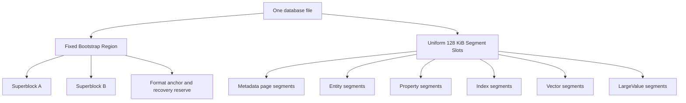
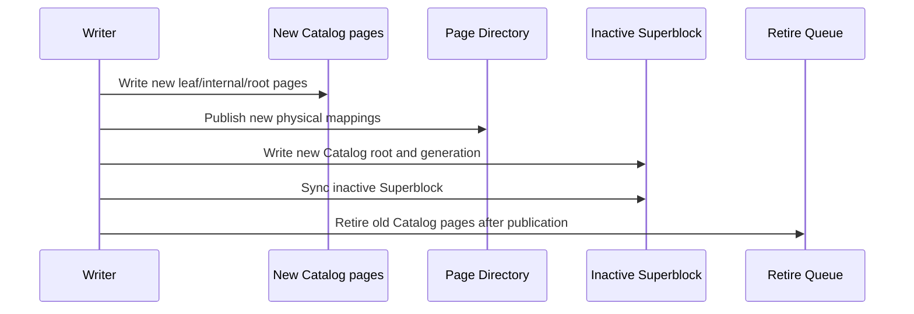
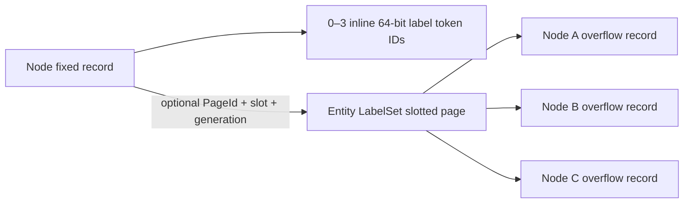

# 原生单文件存储重构方案

> 本文是 ZYX 长期存储架构的规范性设计和实施计划。它优先于其他文档中的历史 Stage、legacy storage、migration、兼容性说明。本文定义的格式尚未全部实现；实现完成前不得把历史实现描述为最终架构。

## 1. 决策边界

### 1.1 硬性前提

- 一个数据库始终只有一个数据库文件；不拆分 data/meta 文件。
- 不支持旧数据库打开、在线迁移、离线迁移或旧格式兼容。
- 旧数据库可以直接丢弃；新格式使用全新的 format version 和 magic。
- 数据库必须支持 macOS、Linux 和 Windows。
- 所有持久化整数、枚举、浮点和引用使用显式 little-endian codec，不持久化 C++ struct 的原始内存布局。
- 所有阶段都必须有独立测试、崩溃恢复测试和覆盖率门禁。

### 1.2 非目标

- 不保留 legacy `FileStorage`、legacy `DataManager`、legacy physical query execution。
- 不保留 migration checkpoint、cutover、legacy backup 或 `.migration` sidecar。
- 不为代码、图片、音频、PDF 等业务场景创建专用物理存储引擎。
- 不为 Catalog、Property、Vector 分别维护相互隔离且不能互相复用的物理 free list。
- 不继续在现有格式 v16 上通过兼容分支叠加补丁；Stage 0 重新冻结 clean format。

## 2. 总体目标

最终架构必须同时满足：

- 固定物理 Segment 仍可跨类型回收和复用；
- Catalog、Page Directory、Allocator、Property、B+Tree、Vector 和 LargeValue 均可 COW、搬迁和回收；
- 单个 Node/Edge 的更新不会复制完整 128 KiB Segment；
- 小事务不会为一条实体独占一个 128 KiB Segment；
- 热点查询通过统一 Buffer Pool 命中已校验的 page view；
- 数据库打开复杂度与文件总大小无关，不扫描整个文件发现 Catalog；
- 不相交写事务不会因为全局 Superblock generation 改变而无条件冲突；
- 大型文本和二进制值可自动外置、分块、压缩、去重、范围读取和回收；
- B+Tree 不因通用 entry 头部和临时 vector materialization 产生不必要开销；
- Vector 的单条 mutation 不会使整个 PQ/ANN generation 失效；
- 所有 publication 都能在任意崩溃点恢复为完整旧 generation 或完整新 generation。

## 3. 核心术语和身份模型

| 概念 | 含义 | 是否改变物理位置 |
|---|---|---|
| `EntityId` | Node 或 Edge 的逻辑业务身份 | 不变 |
| `SegmentId` | 逻辑 Segment 身份 | 不变 |
| `PageId` | 逻辑 page 身份 | 不变 |
| `PhysicalSlot` | 文件中 128 KiB Segment 的物理槽位 | 可以变化 |
| `FrameIndex` | Segment 内 4 KiB page frame 的位置 | 可以变化 |
| `Generation` | COW 版本和 snapshot 安全边界 | 单调递增 |
| `LargeValueId` | 通用外置大值的逻辑身份 | 不变 |

所有持久化引用使用逻辑身份。物理引用只用于 Bootstrap Region 直接定位根 page，以及 Page Directory 自身的自举路径。

## 4. 单文件物理布局

### 4.1 文件布局

数据库文件采用固定的 Bootstrap Region 加统一 Segment Space：



Bootstrap Region 建议固定为一个 128 KiB 对齐区域，包含：

- format magic 和版本；
- Superblock A/B；
- database UUID；
- 固定 recovery anchor；
- 少量 metadata emergency reserve 描述；
- 未来格式扩展保留字段。

Bootstrap Region 永远不参与普通 Segment 分配。它是固定格式入口，不属于任何 `SegmentKind`，因此“所有 Segment 都可回收”的要求仍然成立。

### 4.2 Segment 和 page

- 每个普通物理 Segment 固定为 128 KiB，并按文件偏移对齐。
- Segment 内部由一个显式 envelope 和若干 4 KiB frame 组成。
- 可用 frame 数由 envelope、checksum、alignment 和 page header 的实际布局 solver 计算，不能由业务代码硬编码。
- Fixed Entity、B+Tree、Property、Vector、LargeValue 均以 4 KiB page 为主要 COW 和缓存单位。
- 大型连续对象只在固定 Segment 内使用多个连续 frame 或多个 Segment，不能改变全局物理 Segment 大小。

### 4.3 SegmentKind 与 page subtype

物理槽位的分配不绑定未来类型。当前 generation 的 Segment envelope 记录 `SegmentKind`，page header 记录更细的 subtype。

推荐的长期 SegmentKind：

| SegmentKind | 作用 |
|---|---|
| `SGK_METADATA_PAGE_POOL` | Catalog、Page Directory、Allocator、System Catalog、Retire Queue 等 metadata page |
| `SGK_ENTITY_PAGE_POOL` | 混合容纳 Node/Edge fixed page 与 Node LabelSet slotted page |
| `SGK_PROPERTY_PAGE_POOL` | slotted Property page |
| `SGK_INDEX_PAGE_POOL` | packed B+Tree page |
| `SGK_VECTOR_RAW_POOL` | raw vector page |
| `SGK_VECTOR_PQ_POOL` | PQ code page |
| `SGK_VECTOR_ADJACENCY_POOL` | vector adjacency page |
| `SGK_VECTOR_MANIFEST_POOL` | vector manifest page |
| `SGK_LARGE_VALUE_DATA_POOL` | 通用 LargeValue chunk |
| `SGK_LARGE_VALUE_MANIFEST_POOL` | 通用 LargeValue manifest/index |

`SGK_CATALOG` 不再作为不可回收的专用物理池。Catalog page 使用 `SGK_METADATA_PAGE_POOL` 中的 `MPK_CATALOG` subtype。这样一个 metadata segment 可以混合容纳多种 metadata page，也可以在完全释放后复用为任意其他 SegmentKind。

普通图 adjacency 是内建 Packed B+Tree，因此使用 `SGK_INDEX_PAGE_POOL`。`SGK_VECTOR_ADJACENCY_POOL` 只保留给 ANN 图状态；两者不能仅因都使用 adjacency 一词就共享 codec、owner kind、root 或维护策略。

## 5. Bootstrap、根目录和 Page Directory

### 5.1 Superblock 根引用

A/B Superblock 是唯一的 publication root。每个 Superblock 记录：

- `format_version`；
- `generation`；
- `committed_file_end`；
- `allocator_root_physical_ref`；
- `page_directory_root_physical_ref`；
- `catalog_root_page_id`；
- `system_catalog_root_page_id`；
- `index_root_directory_root_physical_ref`；
- `retire_queue_root_page_id`；
- 逻辑 ID high-water marks；
- checksum。

Superblock 不保存整个目录，也不随着目录增长而移动。它只保存固定数量的根引用。

### 5.2 Page Directory

Page Directory 是：

```text
PageId -> PhysicalSlot + FrameIndex + Generation + page metadata
```

Page Directory 自身采用 COW radix/tree。Superblock 直接保存 Page Directory root 的物理引用，从而打破“要通过 Page Directory 才能找到 Page Directory”的自举循环。

其他普通对象只持有 PageId。Catalog、Property、B+Tree、Vector、LargeValue 的 page 搬迁只需要更新 Page Directory 的相关 leaf 和 COW 路径，逻辑 PageId 不变。

### 5.3 Catalog

Catalog 的逻辑内容是：

```text
SegmentId -> SegmentDescriptor
```

SegmentDescriptor 至少包含：

- current physical slot；
- owner 或 pool identifier；
- generation；
- frame summary；
- kind/state/flags。

`SegmentId` 可以由 radix leaf ordinal 和 entry position 派生，不应在每条 entry 中重复存储。retired physical slot 放入 Retire Queue，不继续塞入普通 Catalog entry。

## 6. 单文件 allocator 和 Catalog 回收

### 6.1 独立 AllocatorRoot

Allocator 不能把 Catalog 当成唯一权威来源，否则会形成：


因此 Superblock 必须直接保存独立的 `AllocatorRoot`。AllocatorRoot 采用 COW tree，管理：

- free Segment runs；
- free metadata frames；
- allocated slots；
- current reservations；
- retired extents；
- committed file end；
- free-space summary。

### 6.2 Reservation

一个写事务根据旧 AllocatorRoot 预留物理 frame/segment：

1. 在进程内 reservation manager 中锁定候选位置；
2. 写入新的 Catalog、Page Directory、Allocator 和业务 page；
3. 在新的 AllocatorRoot 中将 reservation 标记为 allocated；
4. 事务失败时，旧 AllocatorRoot 仍然认为未发布 reservation 为空闲；
5. 事务成功后，通过 Superblock publication 使新 AllocatorRoot 生效。

数据库接近 ENOSPC 时必须保留可轮换的 metadata emergency reserve，确保还有空间完成一次 recovery/reclaim publication。该 reserve 不是固定物理段，可以在安全后回收并重新分配。

### 6.3 Catalog page 回收

Catalog 更新使用 COW：



旧 page 只有在以下条件同时满足时才可以进入 free space：

- 不再被当前 root reachability 引用；
- 没有 active snapshot 可以从旧 root 到达它；
- retire generation 已越过 oldest active snapshot generation；
- 新 AllocatorRoot 已经持久化记录该物理位置可复用。

### 6.4 Segment 级回收与 evacuation

如果 metadata segment 所有 frame 都 retired：

```text
metadata segment -> Retire Queue -> Free Segment Tree
```

如果只剩少量 live page：

1. 计算 live frame density；
2. 低于阈值时启动 Metadata Evacuator；
3. 将 live page 复制到新的 metadata frame；
4. 保持 PageId 不变，只更新 Page Directory 的物理位置；
5. COW 发布新的目录 root；
6. snapshot-safe 后释放原 Segment。

释放后的 PhysicalSlot 不保留 Catalog 类型，可以分配为 Property、Vector、Index、Entity 或 LargeValue Segment。

## 7. Durability 和 publication

最终格式不依赖 Metadata WAL。由于所有可见 page 都是 fresh-page COW，A/B Superblock 已经足够作为单文件的原子 publication point。Metadata WAL 只作为 Stage 0/1 过渡实现，在 Stage 1 完成后删除 production path。

最终提交顺序：

1. 写入新的业务 data page/segment；
2. 写入新的 metadata page；
3. 同步文件数据；
4. 写入 inactive Superblock；
5. 同步 Superblock；
6. 老 generation 进入 Retire Queue，等待 snapshot-safe reclamation。

publication 前不能覆盖任何仍可能被旧 Superblock 或旧 snapshot 引用的 page。

崩溃后只允许出现：

- 完整旧 generation；或
- 完整新 generation。

未被有效 Superblock 引用的新 page 可以成为可重建的空间泄漏，但不能造成逻辑损坏。

## 8. Buffer Pool

建立唯一的 raw-page Buffer Pool，所有存储子系统共享：

- Metadata；
- Catalog/Page Directory；
- Entity；
- Property；
- B+Tree；
- Vector；
- LargeValue。

Buffer Pool 必须提供：

- pin/unpin；
- generation-aware key；
- dirty/private COW page；
- 2Q 或 CLOCK-Pro eviction；
- sequential scan isolation；
- sibling/page prefetch；
- 校验一次、缓存 validated page view；
- 按字节而非按 entry 管理容量；
- Windows、macOS、Linux 一致的 read/write/flush 行为。

`cache_size` 必须真正连接到该 Buffer Pool，并以字节为单位（默认 64 MiB，最小一个 4 KiB page）。typed store 构造不得触发全量 reconcile 或隐式磁盘扫描；recovery/reconcile 只允许由 database-open coordinator 执行一次。

## 9. Fixed Entity 重构

### 9.1 Page 布局

Node 和 Edge 改为 4 KiB fixed entity page：


128 KiB Segment 只作为 page container，不再是单个实体的 COW 单位。

### 9.2 Entity Map

EntityId 不再直接决定物理 slot。专用 Entity Map 保存：

```text
EntityId -> PageId + slot + optional slot generation
```

Segment generation 不在每个实体 entry 中重复存储，由同一 snapshot 的 Catalog/Page Directory 提供。

删除一个实体后，slot 可以被任意新的 EntityId 复用。Entity full scan 按 page/bitmap 扫描，不逐实体遍历宽泛 Location Directory。

### 9.3 Node/Edge record

Node/Edge fixed record 应删除：

- Property ID；
- Property storage type；
- 依赖 Property ID reservation 的字段；
- 过度占用空间的重复 logical ID（在 page-local ID array 已足够时）。

Node label 使用 3 个 inline 64-bit token ID，加一个可选的单页 `EntityLabelSet` 记录，不再保留历史的六标签限制。3 个 inline slot 和 64-bit Token ID 是明确的 format design；单页 overflow capacity 是由 page-layout 常量计算出的派生值，不能在 store、测试或文档中再次复制结果数字。

Edge record 最终只保留 source NodeId、target NodeId、关系类型 Token ID 和必要状态，并且是这些字段唯一的权威副本。Node record 不保存入向/出向 adjacency root，Edge record 不保存 adjacency list link。普通图 adjacency 由独立维护的内建 Packed B+Tree 提供。

### 9.4 Node label 布局

Node fixed record 保存：

- `inline_label_count`，取值范围为 0–3；
- 3 个 64-bit `inline_label_ids`；
- 可选 `label_overflow = PageId + slot_id + slot_generation`。

完整标签集合必须是非零、严格递增且无重复的 schema token ID。0–3 个标签全部 inline，且 overflow reference 必须为空；4 个或更多标签将 canonical sequence 的前 3 个 token ID 保留在 fixed record，其余 token ID 以同样顺序存入一个 `EntityLabelSet` 记录。fixed record 不重复保存总标签数；overflow record header 保存自己的元素数量。



一个 4 KiB LabelSet slotted page 可以保存多个不同 Node 的 overflow record；不得为每个 Node 独占一个 page。每条 overflow record 只属于一个 Node，不做跨 Node dedup。record 不重复保存 NodeId，Node fixed record 中的稳定引用是唯一 ownership edge。LabelSet page 使用 `POK_ENTITY_LABEL` subtype，Node/Edge fixed page 使用 `POK_ENTITY` subtype。两种 page 可以共同放入 `SGK_ENTITY_PAGE_POOL`，不新增专用 128 KiB Label Segment，也不得借用 `SGK_PROPERTY_PAGE_POOL`。

### 9.5 单页容量和明确上限

LabelSet 使用显式 little-endian 64-bit Token ID 数组，不采用压缩、变长整数或 chunk chain。8-byte Token ID 是当前 format 的基础字段宽度，Node record、Schema Token Registry、LabelSet codec 和 Label Index 必须保持一致。

单条 overflow record 的容量由 `RSS_PAGE_OWNER_MAX_PAYLOAD_BYTES`、`RSS_SLOTTED_PAGE_HEADER_BYTES`、16-byte `RSS_SLOTTED_PAGE_SLOT_BYTES`、`RSS_ENTITY_LABEL_SET_HEADER_BYTES`、record alignment 和 `sizeof(uint64_t)` 推导。规范性判断是编码后的完整 LabelSet record 能否放入一个空的 typed slotted page；实现必须通过共享的 encoded-size/capacity solver 完成预检，而不是比较手写的标签数量。

`RSS_ENTITY_LABEL_SET_MAX_OVERFLOW_LABELS` 是该 solver 的派生结果，`RSS_ENTITY_MAX_LABELS` 等于 3 个 inline slot 与 overflow capacity 之和。该规则仅约束由多个 layout constant 组合计算出的结果，例如某次实现中的最大标签数：不得将其作为独立的数值契约复制到持久化数据、业务分支、测试或文档中。诊断工具可以显示该值，但必须从共享 solver 获得。

与之相对，稳定的 format 事实应明确保留。64-bit Token ID、16-byte slot entry、3 个 inline slot 和 page size 定义了 on-disk codec，应在文档与测试中直接体现。基础 layout constant 变化时，只修改其唯一代码定义并按持久化兼容规则更新 format version；之后所有 codec、allocator 和测试都通过同一 solver 获得全部派生上限。

最大可编码 overflow 必须成功，`RSS_ENTITY_LABEL_SET_MAX_OVERFLOW_LABELS + 1` 必须在分配 page、写 candidate frame 或发布 metadata 之前以明确的容量错误失败。当前方案不预留也不实现多 record、多 page 或 chunked LabelSet。

### 9.6 放置、更新与空间复用

LabelSet placement 使用按 `PageOwnerKind` 隔离的 best-fit free-space index。每个索引项至少跟踪 contiguous free bytes、reclaimable bytes 和可复用 dead-slot 数量。插入成本为 record bytes；仅当没有 dead slot 可复用时才额外包含 16-byte `RSS_SLOTTED_PAGE_SLOT_BYTES`，避免保守估算跳过实际可用的 page。选择顺序为：

1. 优先选择已有 `POK_ENTITY_LABEL` page 中能容纳 `record bytes + slot entry` 的最小空闲区；
2. 如果总空闲空间足够但不连续，先在 candidate COW image 中 compact，再重试；
3. 如果没有现有 page 可容纳，优先在已有 `SGK_ENTITY_PAGE_POOL` 的空 frame 中追加 LabelSet page；
4. 只有所有匹配的 Entity pool 都没有可用 frame 时，才分配新的 Entity pool Segment。

free-space index 必须按 page subtype 过滤，不能把同一 Entity Segment 内的 fixed Node/Edge page 当作 slotted page 打开。placement hint 不是写入授权；metadata writer 必须在 pinned generation 下重新验证 Page Directory、Catalog、owner kind、owner LSN 和可用 COW frame。

已有 LabelSet page 的更新始终写入新 COW frame。candidate frame 可以来自源 Segment，也可以来自另一个同 owner domain 的 `SGK_ENTITY_PAGE_POOL`；后者仍保留原 `PageId`，只切换 Page Directory location。源 pool 没有空 frame 时不得因此拒绝一个本可完成的标签更新。

标签更新先尝试在原 page 内完成。缩短记录直接复用原 capacity；增长时依次尝试相邻空闲区、移动 page-local payload、compact 后重试，并保持 `PageId + slot_id + slot_generation` 不变。payload offset 只存在于 slot entry 中，因此 page 内移动不修改 Node record。如果 compact 后仍放不下，则在另一个 LabelSet page 创建新 slot，并在同一个事务中更新 Node overflow reference、删除旧 slot。减少到 3 个或更少标签时清空 overflow reference 并删除旧 slot。

slot 被删除后进入 dead 状态，并在复用时递增 generation，旧缓存或陈旧引用因此会 fail closed。较小的新记录可以使用已释放 slot；compact 会合并 page-local 碎片，因此不会永久保留原记录大小造成的空洞。LabelSet page 变空后进入 snapshot-safe retirement；Entity Segment 的所有 frame 都不再可达后，普通 Segment evacuation/reclamation 流程可以回收该物理槽位并跨 SegmentKind 复用。

### 9.7 原子性、读取与索引一致性

一次标签 mutation 的 Node fixed page、LabelSet page、Page Directory 和 Label Index delta 必须由同一个 metadata transaction 和同一个 Superblock generation 发布。禁止先独立发布 overflow page，再发布指向它的 Node；也禁止先删除旧 slot，再切换 Node reference。提交前失败不得留下可达 orphan，提交后旧 snapshot 继续通过旧 Page Directory root 读取旧 Node 和旧 LabelSet frame。

读取过程最多增加一次 4 KiB page lookup：先通过 Entity Map 读取 Node fixed record；若 overflow reference 非空，再以 `PageId` 通过 Page Directory 和 Buffer Pool 定位 LabelSet page，并校验 `POK_ENTITY_LABEL`、page generation、slot generation、record checksum、canonical ordering 和容量边界。Buffer Pool key 使用逻辑 PageId 与 snapshot generation；LabelSet page 的物理 relocation 只更新 Page Directory，不改 Node reference。

integrity scanner 必须交叉验证：每个非空 Node overflow reference 恰好解析到一个 live LabelSet slot；每个 live LabelSet slot 恰好被一个 Node 引用；两个 Node 不得共享同一 slot；空引用不得携带部分 PageId/slot/generation；Label Index 中该 Node 的 token 集合必须与 inline 加 overflow 的 canonical union 完全一致。标签更新直接比较 old/new canonical set 生成 Label Index add/remove delta，不扫描整个 Label Index。

## 10. Property Store

### 10.1 Property identity

Property identity 统一为：

```text
(EntityKind, EntityId) -> PropertyRoot
```

没有 Property 就没有 Directory entry。不再为每次 Property mutation 预先分配独立 PropertyId，也不在 Node/Edge record 中保存 Property reference。

### 10.2 多级 Property 表示

| 规模 | 表示 | 目标 |
|---|---|---|
| 很小 | inline Property value | 避免额外 page 读取 |
| 小/中 | slotted Property page | 单实体有限范围更新 |
| 大集合 | per-key record 或小型 Property tree | 单 key 更新不复制全集 |
| 大 value | `LargeValueRef` | 分块、压缩、范围读取 |

更新一个 key 不应复制整个 Property collection。Slotted page 的 shrink 需要支持容量回收、hysteresis 和 page-pressure compaction。

### 10.3 Property Directory cache

placement cache 不能按全局数据库 generation 全量失效。使用 per-pool/per-shard version、free-space class index 和增量更新。

## 11. 通用 LargeValue

代码、图片、JSON、PDF、音视频和模型文件都使用统一的 `LargeValueStore`，不建立 `CodeObjectStore` 或 `ImageStore`。

推荐层次：

```text
Value
    -> InlineValue
    -> LargeValueRef

LargeValueStore
    -> LargeValueManifest
    -> LargeValueChunk/Extent
```

`LargeValueRef` 保存：

- logical object id；
- generation；
- uncompressed size；
- content hash；
- text/bytes kind；
- 非空、可打印 ASCII 且受格式上限约束的 media type；
- codec；
- checksum information。

`LargeValueRef::generation` 和 `LargeValueManifest::generation` 是不可变的
逻辑 generation：它们标识 value 内容，compactor 仅搬迁物理 frame 时不得改变。
`PageLocation::generation`、`PageOwnerHeader::generation` 和
`LargeValueManifestLocation::generation` 则标识当前物理 pool/frame 的
generation。两套语义不能当作同一个版本号直接比较。

### 11.1 Cypher 与 Driver ABI

普通 Cypher 继续使用属性赋值：

```cypher
CREATE (f:CodeFile {
    path: $path,
    content: $content,
    content_type: "text/x-c++src"
})
```

小值自动 inline，大值自动 externalize。Binary 数据通过通用 bytes 参数表达，不引入 `Code`、`Image` 等底层 ValueKind。

超大数据通过通用 Driver ABI 流式接口写入和读取：

- begin external value；
- write chunk；
- finish/abort；
- read range；
- read stream。

当前 ABI 为结果 bytes 和 value reference 提供有界 pull stream。调用方传入
`(offset, length)` 范围，反复读入应用方拥有的 buffer；范围耗尽后才返回
`ZYX_DRIVER_DONE`。stream 自己拥有不可变的 bytes snapshot，因此打开后可以
关闭源 result。这样每次 ABI copy 都有明确上限，native LargeValue range
reader 仍负责 chunk 级 I/O 和解压。

LargeValue 创建和 Property reference 必须在同一事务中发布。

### 11.2 分块和压缩

- 默认 chunk 建议从 32 KiB 开始，范围可调为 16–64 KiB；
- 很小的值通常不压缩；
- 代码、JSON、SQL、日志优先使用 LZ4 或 Zstd；
- PNG、JPEG、ZIP 等已压缩格式默认保存 raw；
- 每个 chunk 独立 checksum 和 codec；
- range read 只解压相关 chunk；
- `content_hash` 基于未压缩原始字节，用于去重；
- `normalized_hash` 仅用于相似代码分析，不用于物理合并。

### 11.3 代码分析数据模型

源文件优先只存储一次：


| 实体 | 主要字段 |
|---|---|
| `CodeFile` | path、language、commit、content hash、LargeValueRef、line index ref |
| AST/Function Node | file id、start byte、end byte、line range、symbol metadata |
| 独立 CodeSnippet | LargeValueRef、language、content hash、normalization metadata |

AST 节点优先保存源文件范围，而不是复制完整代码正文。

### 11.4 回收

LargeValue 使用 immutable object：

```text
new chunks -> new PropertyRoot -> Superblock publication
-> old object enters Retire Queue
-> snapshot-safe reachability reclaim
```

多个实体共享同一个 content hash 时，必须通过 reachability 或引用信息确认最后一个引用消失后才能回收。

### 11.5 搬迁与 snapshot 安全

LargeValue 使用稳定的 `PageId`，而不是物理 pointer。data page 搬迁只发布新的
Page Directory location；manifest page 搬迁则在同一个 COW/Superblock publication
中同时发布新的 Page Directory location 和对应的 `LargeValueManifestLocation`
route。两类搬迁都会将物理 owner 改为目标 pool generation，但保持逻辑
`LargeValueRef` 与 manifest generation 不变。

因此 old snapshot 会通过旧 directory root 读取旧 frame，而 newer snapshot 会
解析新 route 和新 frame。source pool 在最后一个 current page 搬迁后退休，但只有
所有仍可能解析旧 root 的 snapshot 释放后，物理 slot 才能真正释放。

## 12. Packed B+Tree

B+Tree 使用专用 packed page codec：

- leaf/internal 分离；
- packed offset array；
- on-disk canonical key order；
- prefix compression 和 restart points；
- raw page view binary search；
- range cursor，不 materialize 整页 entry vector；
- scalar leaf 的 EntityId 从复合 key 后缀解码，不重复存 value。

Property index 的排序 key 保持：

```text
(PropertyValue, EntityId)
```

EntityId 保证重复 PropertyValue 的稳定排序和唯一定位，不应为了去重而删除。需要消除的是物理重复编码和宽泛 entry header。

Bulk builder 和 online mutation 必须共享同一套 page invariant、separator rule、split/merge rule 和 corruption checks。

实现必须支持具名 key codec 和 comparator，而不是把 Property index 假设固化进树中。普通图 adjacency 特化使用固定逻辑字段 `(direction, NodeId, EdgeId)` 和空 value；comparator 依次按 direction、无符号 NodeId、无符号 EdgeId 排序，磁盘 codec 仍通过显式格式 codec 写入每个整数。容量、fan-out、restart interval、separator 大小和每页 entry 数都必须由编码字节与共享 page layout solver 推导。

每棵树拥有稳定的逻辑 `IndexId`；COW root PageId 和 root generation 存放在 Index Root Directory 中。普通 adjacency 树使用一个永不与用户索引冲突的保留内建 `IndexId`。这样 Superblock 仍保持定长：它发布 Index Root Directory root，而该 snapshot 的 directory 定位 adjacency root。空树以缺少 adjacency root entry 表示，而不是保留一个永久空 page。

## 13. System Catalog

删除 sealed/dynamic 双体系，建立一个 canonical mutable System Catalog：

```text
(property-key, name)       -> token
(property-token, token)    -> name
(schema-name, kind, name)  -> schema token
(schema-token, kind, token)-> definition
(index-id, id)             -> definition
(index-name, name)         -> id
(index-schema, signature)  -> id
(constraint-id, id)        -> definition
(constraint-name, name)    -> id
(sequence, kind)           -> high-water mark
```

forward、reverse、secondary entry 在同一个 metadata transaction 中原子更新，不保留人工高位 dynamic namespace 和 sealed tombstone registry。

### 13.1 Schema Token 名称与 ID

标签名称和 relationship type 名称只存储在 canonical System Catalog，不写入 Node、Edge、LabelSet 或 Label Index。System Catalog 维护两个逻辑方向：名称与 kind 到 `SchemaTokenId`，以及 kind 加 `SchemaTokenId` 到包含 canonical 名称的 definition。前向索引用于 query bind，反向 definition 用于返回标签名称、检查 catalog 完整性和管理操作；执行阶段只携带 Token ID。

名称是 UTF-8 byte string，长度边界由唯一的共享 System Catalog name-limit format constant 定义。该边界必须同时满足 API 语义上限、definition record 上限、前向索引 key 上限、反向 definition 上限和目标 B+Tree fan-out；Cypher、Driver ABI、System Catalog codec 和 lookup API 必须共享它。不得把 persisted length field 的理论范围或“单条 entry 勉强能放进空 page”的大小直接当作公开名称上限。

`SchemaTokenId` 使用明确的 64-bit little-endian wire field。共享名称上限与相关 key/record overhead 使用各自唯一的格式常量；任何由它们计算出的 B+Tree entry 或 page capacity 都只通过共享 solver 使用，不在文档或调用方复制结果数字。未知 definition version 或超过统一名称边界的输入一律 fail closed。

名称在 canonical definition 中是权威值；前向 B+Tree 为实现 collision-free name lookup 仍需要保存可比较的名称 key。这个按唯一 schema token 发生的有限重复是有意的，并通过 leaf prefix compression、internal separator truncation 和 dictionary cache 控制；名称不得再复制到每个实体或 Label Index entry。

## 14. Graph Adjacency

普通图 adjacency 与 Vector ANN adjacency 是相互独立的数据结构。普通图 adjacency 使用一棵全局内建 Packed B+Tree；Vector adjacency 继续使用第 15 节的 Vector 专用方案。

### 14.0 规范性实现边界

普通图在持久化层只能有一种 adjacency 表示：保留的全局、key-only Packed B+Tree。这是格式不变量，而不是 planner 偏好。每个实现阶段和后续优化都必须保持以下约束：

- 格式保留的 `RSS_GLOBAL_ADJACENCY_INDEX_ID` 是唯一的普通图 adjacency `IndexId`；它通过 snapshot-pinned Index Root Directory 解析唯一 adjacency root，绝不向用户或 secondary index 分配；
- Node record 不拥有 adjacency root 或 adjacency key，Edge record 不拥有邻居 link、物理 page 位置或重复的 adjacency payload；
- 每条 live Edge 恰好拥有一个 `ADJ_OUT` key 和一个 `ADJ_IN` key；二者与权威 Edge 的变更必须在同一 metadata generation 中 commit 或移除；
- B+Tree page 只包含路由/separator 数据或 key-only adjacency entry，绝不混合存放 Node 或 Edge record；
- page relocation 只修改逻辑 `PageId` 的 Page Directory route；绝不重写 Edge、Node、cursor continuation 或 parent child reference。

per-Node chain、per-Node root、Base/Delta/Tombstone 层级、adjacency tail page 和 Edge-to-Edge 双向链表均为已退役设计。它们不是 fallback、compatibility reader 或优化候选项。若将来有测量结果证明需要专用 access path，必须新增具有独立 identity 的 derived index，并为它定义 codec、root、publication、reclamation、integrity 与 benchmark gate；不得改变全局 adjacency tree 的语义或 payload。

### 14.0.1 结构决策记录

“全局 Packed B+Tree”只描述普通图 adjacency 的访问路径；它不表示把 Node 和 Edge record 混放进 B+Tree page，也不表示 Edge record 直接成为 B+Tree leaf value。下表是 clean format 的强制选择：

| 方案 | 决策 | 原因 |
|---|---|---|
| 一棵全局 key-only tree | 采用 | 低阶 Node 共享 leaf，高阶 Node 顺序跨 leaf；只维护一个 root、codec、publication 与 retirement lifecycle。 |
| 分别维护 outgoing/incoming tree | 不采用 | `direction` prefix 已给出两个有序 access range；拆成两棵 tree 只会增加 root-directory、COW 与回收状态，不能减少一次 Edge mutation 必需的两条 key。 |
| per-Node root 或 per-Node B+Tree | 不采用 | 会重新引入长期稀疏 root/tail page、更多 root publication，以及超级节点专用结构；小度数 Node 无法共享编码空间。 |
| Edge 双向链表或 Edge chain | 不采用 | 插入/删除会改写 Node head 和相邻 Edge，扩大事务写集合，并使 relocation、快照和完整性校验耦合到关系之间的物理链接。 |
| 在 adjacency leaf 中嵌入 Edge record 或覆盖性 Edge payload | 不采用 | 会制造第二份 endpoint/type/state 权威副本，混淆 Entity 与 Index codec/lifecycle，并使任何被镜像的关系字段更新扩大 B+Tree 写放大。 |

因此，B+Tree leaf 可以同时装下多个 Node 的 **adjacency key range**，但不会装下这些 Node 或 Edge 的实体 record。一次 expansion 先流式读取 `EdgeId`，仅在查询确实需要 endpoint、type、state 或 Property 时，才从同一 snapshot 的 Edge Entity Store 解析相应 record。这个二阶段读取是有意的：它将顺序 adjacency 扫描与实体 materialization 的成本分离，并避免将不需要的 Edge 字段带入每个 index entry。

### 14.1 权威数据与 key schema

Edge Entity Store 是权威数据源：

```text
EdgeId -> sourceNodeId + targetNodeId + relationshipTypeId + state
```

adjacency 树是二级访问路径，逻辑 schema 为：

```text
(direction, NodeId, EdgeId) -> empty
```

这里只有一棵 tree 和一个 root，而不是每个 direction 或每个 Node 各有一棵 tree。`direction` 是第一个 key component，因此 outgoing 和 incoming access path 是同一棵 tree 中互不重叠的有序 range。这样可保持统一 codec、一次 publication boundary 和一套 reclamation lifecycle，同时不引入长期稀疏的 root hierarchy。

每条 live directed Edge 必须恰好包含两个 entry：

```text
(ADJ_OUT, sourceNodeId, EdgeId) -> empty
(ADJ_IN,  targetNodeId, EdgeId) -> empty
```

`AdjacencyDirection` 是持久化的带前缀 enum；未知值在所有平台上都必须 fail closed。NodeId 和 EdgeId 是正 64-bit 逻辑 ID。routing NodeId 必然属于 key，但空 value 是规范要求：tree 不保存另一端 endpoint，也不把 relationship type/state 作为 Edge payload 存储。第一版不能添加 covering value。未来如果度量结果证明需要 type-qualified access path，应新增拥有独立 identity 和 lifecycle 的 derived index，而不是静默修改该 key。

comparator 按 `direction`、无符号 `NodeId`、无符号 `EdgeId` 定义 canonical ordering。同一 `(direction, NodeId)` 的 entry 因而形成一个连续 range，并按确定顺序排列。prefix compression 会消除该范围内重复的 direction/NodeId 字节。多个低阶 Node 共享一个 leaf，不允许一个 Node 或 direction 独占 4 KiB tail page。超级节点可连续跨越任意数量的 leaf，不存在 per-Node size limit。

物理边界必须严格。Entity page 存放固定 Node/Edge record；adjacency leaf 只存放排序 key 与空 value；adjacency internal page 只存放 separator 与逻辑 child PageId。因此，一个 B+Tree leaf 可以容纳多个 Node 的 range，但绝不包含这些 Node 或 Edge record。这是 packed layout 的含义，而不是把图实体放入 B+Tree 的设计。

### 14.2 Root 所有权和物理放置

全局树在 Index Root Directory 中使用保留的内建 adjacency `IndexId`。snapshot 的解析路径为：

```text
Superblock -> Index Root Directory -> adjacency IndexId -> B+Tree root PageId + root generation
```

root entry 和所有 B+Tree page 都属于同一个 metadata generation。adjacency leaf/internal page 使用普通 Packed B+Tree codec、`SGK_INDEX_PAGE_POOL` 和 adjacency 专属 owner identity。它们绝不能与 Node record、Edge record 或 Vector adjacency 共用 page。Page 搬迁保持逻辑 PageId 不变，只修改 Page Directory route；tree reference 和 Edge record 都无需改写。

空图不存在 adjacency root entry。第一条 Edge 的 transaction 创建初始 tree 并发布 root entry；删除最后一条 Edge 时，在 new generation 中原子删除 root entry。old snapshot 仍保留 old root，只有满足 snapshot safety 后才释放其物理 page。最终普通图格式不存在 per-Node Root page、Root write-tail hint、Base/Delta chain、Tombstone、merge threshold、merge debt 或 recovery cursor。

### 14.3 读取路径与 cursor contract

出向和入向扩展分别 lower-bound seek 到 `(direction, NodeId)` 的第一个 key，然后推进到 prefix 改变为止。复杂度为 `O(log E + degree)` 次比较及与输出成正比的工作量。root/internal page 使用 normal Buffer Pool admission；range scan 消费的 leaf 使用 sequential admission。cursor 对右 sibling 做有界 prefetch，不能 pin 无界 route。

cursor 直接从经过校验的 page view 读取压缩 key，只保留当前 leaf pin、restart/search state、prefix bound 和逻辑 continuation key；不能 materialize 完整 leaf 或完整 adjacency range。continuation 为 `(snapshot generation, direction, NodeId, last EdgeId)`，并严格从 `last EdgeId` 之后恢复。它绝不暴露 PageId、slot 或 physical offset。过期或外来的 continuation 应按公开 cursor contract fail closed，或从逻辑 lower bound 重新开始。

degree/count 等只依赖 adjacency 的操作可以只统计 entry，不读取 Edge record。需要返回 Edge 字段时，通过 snapshot-pinned Edge Entity Map 解析每个 EdgeId，并校验 Edge live 且 endpoint 与扫描 prefix 匹配。关系类型过滤第一阶段读取权威 Edge record；必须按 page 批量化并利用 locality，不能对每个 key 发起无约束随机读取。

无向扩展独立打开两个有界 range，再合并结果。self-loop 的语义必须明确：一个 self-loop 含一个 `ADJ_OUT` 和一个 `ADJ_IN` entry；只有 Cypher 语义要求返回一条关系时，无向 operator 才按 EdgeId 去重。

### 14.4 Mutation 与 publication

创建一条 Edge 时，必须基于同一 pinned generation 规划 Edge record、Entity Map entry、`ADJ_OUT` insert 和 `ADJ_IN` insert。两个 key mutation 通过同一个 B+Tree COW overlay 应用，所有 replacement page、replacement adjacency root、metadata root 和 inactive A/B Superblock 在一次 commit 中发布。崩溃后只能看到完整 old generation 或完整 new generation，禁止只看到一个方向。

全局 root 是物理 publication point，而不是用户可见的 conflict domain。publication 前，transaction layer 必须针对 current root 重新验证 sorted final-state overlay；并发 adjacency commit 已推进 root 时，它应重试/rebase 该 overlay。只有 duplicate/deleted Edge identity、权威 endpoint 已改变等语义矛盾才报告 conflict，不能仅因另一 writer 替换了全局 root 而失败。rebase 工作量和 retry 次数由 transaction policy 限制。

删除一条 Edge 时，先解析权威旧 endpoint，再通过同一 overlay erase 两个精确 adjacency key，同时删除 Edge record 和 Entity Map entry，并原子发布结果。普通图删除不追加逻辑 Tombstone。COW 退休 page 进入公共 generation-aware Retire Queue，只有旧 snapshot 释放后才能复用。

`DETACH DELETE` 对出入两个方向执行有界 range scan，对包含 self-loop 的 EdgeId 去重，在准备 publication 前校验 transaction limit，并提交一个 bulk final-state plan。每条 Edge record 和对应两个 entry 都必须恰好删除一次。并发或 stale-root publication 在可见前被拒绝，由 transaction layer 从新 snapshot 重试。

Bulk ingest 为每条已校验 Edge 生成两个 key，按 canonical comparator 排序和去重，再交给共享 bulk/overlay page builder。已有序 run 应执行 merge，不能逐 key 重复 insert。online 与 bulk path 必须共享 leaf fill、restart、separator、checksum、split/merge 和 owner invariant。容量和内存由配置的 transaction/run limit 约束；未来若需要 external sort，只能使用单数据库文件内的受控区域或有界进程临时内存，不能演变为第二个持久数据库 artifact。

### 14.5 空间、维护与可选 write buffer

删除使用普通 Packed B+Tree underflow 处理。Sibling redistribution 或 merge 在 candidate COW image 中完成；空 leaf 和折叠的 internal root 通过公共 page reclamation path 退休。Page occupancy policy 使用 codec 提供的 byte count，而不是固定 entry count。正确性不依赖后台全树 compact；若实际 byte occupancy 低于策略，可执行有界 maintenance rebuild，并一次发布 replacement root、snapshot-safe 地退休 old tree。

第一版生产实现必须使用普通全局 Packed B+Tree。只有基准证明孤立 Edge mutation 的 COW write amplification 无法接受时，后续阶段才可在同一 canonical tree 前增加一个有界全局 write buffer。该决策必须有记录阈值，并保持统一 logical cursor、双 entry 原子可见性、有界内存、确定性 recovery 和单文件约束。per-Node delta chain 以及此前的 Base/Delta/Tombstone hierarchy 不能作为 fallback。

### 14.6 Integrity 要求

Integrity scanner 在一个 pinned snapshot 内验证：

- 每条 live Edge 恰好有匹配的 `ADJ_OUT` 和 `ADJ_IN` entry；
- 每个 adjacency entry 都解析到一条 live Edge，并且 endpoint 与 direction/NodeId 一致；
- 不存在 duplicate、missing、foreign、zero-ID 或 unknown-direction key；
- key order、prefix/restart encoding、separator、sibling link、page ownership、generation、LSN 和 CRC 全部有效；
- 保留 adjacency IndexId 至多有一个 current root，且用户 definition 不能占用；
- 所有 reachable page 都属于该 root，retired/unreachable page 由公共 reclaimer 正确分类。

快速 open 只按需校验 root 和 page structure，不扫描全部 Edge。完整双向交叉校验是带有界内存进度的显式 integrity/maintenance 操作，不是普通 startup 要求。

## 15. Vector

### 15.1 Manifest

Vector Manifest 只保存 O(1) metadata：

- dimensions/metric；
- total record count；
- Raw/PQ/Adjacency mapping roots；
- codebook root/generation；
- base/delta generations；
- ANN entry point；
- allocation tail hints。

Manifest 不列举全部 Raw/PQ page。Page Directory 和 mapping root 是权威 inventory。

### 15.2 Mapping

mapping 直接返回：

```text
(PageId, slot, generation)
```

不能只返回 page 后再在 page 内线性搜索 VectorId。

Vector delta mapping 使用固定的 typed key `(VectorId, Operation)`，leaf value 保存对应的 `NodeId`。因此
`INSERT` 和 `ERASE` 都能在有界的语义映射点查中证明 Node-to-Vector、Vector-to-Node 和 Raw Location
的一致性，不依赖扫描整个 semantic mapping；同一个 VectorId 同时出现两种 operation 必须 fail closed。

### 15.3 Online mutation

Vector 使用 immutable base + mutable delta：

```text
base ANN/PQ generation
delta vectors
tombstones
query merge
background rebuild
atomic base replacement
```

新 vector 不应使整个 PQ/Adjacency generation 失效。已有 codebook 时只计算对应 vector 的 PQ code；邻接进入 delta graph 或局部 repair。

delta 的 entry count 和 mapping page 数量必须分别受限。达到维护阈值时应调度 base rebuild，而不是无限增长或
静默拒绝用户写入；在 rebuild 完成前，查询以 `base - tombstones + exact inserts` 合并结果。

### 15.4 Rebuild

Vector rebuild 在 unpublished private pages 中完成，最后一次性发布：

- Raw/PQ/Adjacency mapping roots；
- codebook root；
- base/delta manifest；
- entry point；
- retire queue。

Adjacency builder 使用 Vamana/DiskANN/HNSW 类受控候选算法，不允许对所有 source/candidate 执行 O(N²) 比较。

## 16. Legacy 和 migration 清理

Stage 0 之后，以下内容不进入生产 source set：

- legacy `FileStorage`、`DataManager` 和 physical query path；
- `OfflineMigrationCoordinator`、cutover、checkpoint、sidecar；
- `Legacy*` storage classes；
- sealed/dynamic 双 registry；
- legacy Blob semantic claim/reclamation；
- State migration subsystem；
- `SFM_LEGACY` 和 legacy magic probe；
- legacy backend pointer 和 legacy QueryEngine constructor；
- `database migrate` 和 `database cutover` CLI。

具有长期价值的 maintenance builder 不删除，而是移到：

```text
src/storage/relocatable/maintenance/vector/
src/storage/relocatable/maintenance/index/
```

例如 Vector adjacency builder、PQ builder、scalar index materializer。

生产 CMake 必须从递归 glob 改成显式 source set，避免被删除的 legacy 文件重新进入最终 binary。

## 17. 组件边界和建议目录

建议的长期模块边界：

```text
storage/relocatable/format/
    DiskCodec, Superblock, SegmentEnvelope, PageHeader

storage/relocatable/allocation/
    PhysicalAllocator, AllocatorTree, Reservation, FreeSpaceIndex

storage/relocatable/metadata/
    PageDirectory, Catalog, SystemCatalog, RetireQueue, Recovery

storage/relocatable/cache/
    BufferPool, PageView, Prefetch, Eviction

storage/relocatable/entity/
    EntityPage, EntityMap, EntityLabelSet, EntityScan, EntityMutation

storage/relocatable/property/
    EntityPropertyDirectory, PropertyCollectionRoot, PropertyCollectionRootStore, PropertyValueCodec, LargeValue

storage/relocatable/index/
    PackedBTree, BTreeCursor, BulkBuilder, IndexDirectory, AdjacencyKeyCodec

storage/relocatable/adjacency/
    GlobalAdjacencyIndex, AdjacencyCursor, AdjacencyMutationPlanner, AdjacencyIntegrity

storage/relocatable/vector/
    Raw, PQ, Manifest, DeltaIndex, Search

storage/relocatable/maintenance/
    Reclaimer, Compactor, Evacuator, VectorBuilder
```

`RelocatableMetadataStore.cpp` 等超大聚合文件应按上述职责拆分；transaction coordinator 只负责协调 root changes，不直接实现每种 page codec。

## 18. Stage 0-10 实施计划

### Stage 0：冻结 clean format

工作项：

- 定义新的单文件 magic、format version 和 bootstrap layout；
- 明确旧文件一律拒绝打开；
- 删除 migration/legacy public API、CLI、production source；
- 统一 root descriptor 和 logical/physical reference；
- 建立显式 CMake source sets；
- 更新中英文架构文档和 format matrix。

依赖：无。

测试门禁：新文件创建、旧 magic 拒绝、损坏 header 拒绝、三平台 build、format codec fuzz。

当前实现检查点：format v3 / Superblock v30 已移除 retired Property root、已退役的 `PropertyPage`/`PropertyRecordCodec` 布局和旧的逐 Vector adjacency directory root。生产 source set 不再包含 `VectorAdjacencyStore`、`VectorAdjacencyLocation`、`MDT_VECTOR_ADJACENCY`、`PropertyPage` 或 `PropertyRecordCodec`；Entity Property 只经 owner-keyed root 或有类型的 `LargeValue` reference 解析，Vector 邻接只经 immutable typed page、manifest 和 per-index mapping tree 解析。旧格式版本被拒绝打开，不能作为 migration 或 runtime fallback。

### Stage 1：单文件 durability 核心

工作项：

- A/B Superblock 和 fixed Bootstrap Region；
- Page Directory root 和 Allocator root 物理自举；
- COW root publication；
- 删除 production Metadata WAL；
- reservation 与 metadata emergency reserve；
- crash recovery 只恢复旧或新 generation。

性能门禁：一次 commit 最多一次 data sync 和一次 Superblock sync；正常 open 不扫描文件。

当前 Stage 1 证据：`RelocatableProcessCrashTest` 会创建直接的操作系统子进程：POSIX 使用 `fork()` 并在子进程
执行 crash workload，Windows 使用 `CreateProcessW` 启动当前测试二进制。子进程仅创建并操作一个 native database
file，在数据已同步但尚未发布新的 Superblock，或新的 Superblock 已完成 publication 后等待。父进程使用平台原生的
强制终止 API 杀死子进程，再重新打开该数据库文件，分别验证只能恢复完整旧 generation 或完整新 generation。
这个测试刻意不依赖 shell，也不把同步 marker 当作数据库 artifact。POSIX 实现不会重新执行 ASan-instrumented
test binary，因此同一个真实 child-process 边界也可在 sanitizer 下测试。它只证明这两个 Superblock publication
边界的真实进程 kill/reopen 行为；第 19 节要求的短写、torn page、ENOSPC 与完整 crash 矩阵仍是独立的发布门禁。

当前 macOS 的 ASan 与 ASan+UBSan test configuration 都会把 test-only native I/O fault-injection seam 编译进
`zyx_core`；每个 configuration 下 Stage 1 targeted group（330 tests）均通过。这只是本机 sanitizer 证据，不能替代
三平台 sanitizer 与 full-suite 的发布门禁。

测试构建中的 `StorageIO::ScopedNativeWriteHookForTesting` 与 `StorageIO::ScopedNativeSyncHookForTesting` 只在
test-instrumented core 内启用，并且分别是线程局部、RAII 作用域化的 native-write 与 native-sync seam；release core
不编译这些分支，正常 `pwrite` 热路径和 durable-sync 路径保持直接调用。`RelocatableSuperblockFileTest` 通过写入 seam
对真实数据库文件执行部分 inactive-Superblock 写入，验证写入立即失败且当前与 reopen recovery 都只能选择旧
generation；同一测试还在写入 inactive Superblock 之前注入 native sync failure，并验证 recovery 仍只能选择旧
generation。这已经覆盖 Superblock 的实际 short-write 和 pre-publication sync 行为；data page、metadata page 与
ENOSPC 的完整故障矩阵仍须独立完成。
同一测试还在平台 native-write 边界模拟 POSIX `ENOSPC` 或 Windows `ERROR_DISK_FULL` 的失败返回，并验证不能发布
新 generation。这是 Superblock publication 的磁盘满失败语义，不替代 allocator emergency reserve、data page 或
metadata page 耗尽的完整 ENOSPC 矩阵。

`RelocatablePhysicalSegmentAllocatorTest` 还会在真实 native database file 上分别对新 data Segment 和 COW metadata
page 注入 partial write 与 POSIX `ENOSPC` / Windows `ERROR_DISK_FULL`。每个场景均验证事务内存中的 current snapshot
仍是旧 generation，关闭并重新打开后仍不可见未完成的 Catalog/Allocator 映射，并可用同一个 logical Segment ID 和
physical slot 重试。它覆盖了 data-before-metadata 途中两类真实 I/O 失败，但不等同于完整的 torn-page、sync failure、
metadata emergency reserve 耗尽或所有 writer 路径的故障矩阵。

同一 native allocator suite 现在还覆盖 data Segment 和 COW metadata 已写入、但 inactive Superblock 仍不可写入前的
真实 native durable-sync 失败。一次性 `fsync` / `FlushFileBuffers` 失败必须使整个未发布 suffix 恢复到 batch 开始时的
精确文件长度；当前 generation 保持旧值，关闭重开后同一个 logical Segment ID 和 physical slot 可以重试。若 durable-sync
持续失败，以后的 rollback sync 也无法证明回收结果，allocator 必须 fail-closed 并拒绝在当前进程复用这些物理位置；关闭重开
只从已发布 root 恢复，忽略不可达尾部，再继续安全写入。该证据覆盖 publish 前 durability fence 与 cleanup failure，仍不替代
完整的 data/metadata torn-page、所有 writer、emergency-reserve 耗尽和跨平台故障矩阵。

`NativeSuccessfulAllocationUsesExactlyOneDataFenceAndOneSuperblockFence` 直接度量成功的 native physical allocation
路径，而不是孤立地调用 Superblock；它断言平台 durable-sync 恰好发生两次：所有 candidate data 与 COW metadata 写完后一次，
inactive Superblock 写完后一次。已发布 generation durable 之后的 metadata-frame 回收只更新内存中的可用性；下一次正常
publication 必需的 data fence 会持久化这些可复用 frame 的 header。该测试会立即关闭并 reopen，证明 recovery 会在这些
bookkeeping 被复用前重建它们。这补齐了成功路径的 sync-count 断言，但它只是 Stage 1 的一项性能门禁，不能单独代表
Stage 1 已完成。

`StorageFormatTest.DatabaseFactoryCreatesNoMetadataWalOrMigrationSidecar` 通过 public factory 创建、打开并关闭数据库，
随后验证唯一的数据库 artifact 就是请求的 database file：历史 `.wal` / `-wal` 和 `.migration` sidecar 均不存在。backend
factory 只接受完整的 native relocatable format，且拒绝历史文件，因此这是 production path 断言，而不是测试专用的
storage 配置。

`RelocatableMetadataStoreTest.ReopenFollowsPublishedRootsInsteadOfScanningAnUnreachableTailSlot` 会在一个有效
publication 之后追加一个 sealed 但不可达的 physical tail Segment，通过 native positioned-read path reopen，并记录每次
read。任何 open-time read 与该不可达 tail 重叠都会使测试失败。因此它证明 normal open 按已发布的 root 定位，
而不是按文件长度扫描以发现 metadata；该测试并不声称 root-reachable metadata page 的读取数量为常数。

`RelocatableCompactionWorkloadTest` 与 `RelocatableCompactionCoordinatorTest` 的夹具只创建一个临时 database file，
不再创建未使用的测试 `.wal`。两者通过实际 native positioned-I/O handle 执行；前者以独立 reader、writer、compactor
线程验证 pinned snapshot 在 page relocation 后仍读取旧 frame，且 source pool 只能在 reader release 后释放。此组 23 个
测试在本地连续运行 25 次均通过。这是 native-I/O 并发回归证据，仍不能替代 TSan、三平台并发运行或完整的故障矩阵。
macOS `native-storage-tsan` CI gate 会将这两个 suite 和 `RelocatableMaintenanceService` 的并发维护场景用
`-fsanitize=thread` 运行；本地同一 TSan filter 的 24 个测试已通过。该 gate 提供持续 race-detection，而非把一次性
sanitizer 结果误记为所有平台的并发验收。

### Stage 2：统一 Buffer Pool

工作项：

- 4 KiB raw page cache；
- pin/unpin、generation key、dirty COW page；
- 2Q/CLOCK-Pro；
- sequential scan isolation；
- prefetch；
- 所有 typed store 迁移到 Buffer Pool。

测试门禁：pinned page 不被淘汰、多 generation 并存、缓存命中与 eviction 计数准确、内存上限生效。

当前检查点（不是 Stage 完成声明）：`RelocatableStorageBackend` 已在 open 时启用 byte-bounded 的 4 KiB
`BufferPool`，普通 `StorageIO` 读写因而经过缓存；`SharedPagePoolAllocator` 已将已验证的连续 page route
提交给 prefetch。`BufferPoolTest` 覆盖 pin、COW private page、2Q 队列、eviction、顺序 bypass、prefetch、
read-only、truncate 与损坏保护。

typed I/O boundary 已经落地：`StorageIO::readAt/writeAt(BufferPoolPageKey, ...)` 只接受完整、4 KiB 对齐且
generation 非零的 page；带有相同物理 offset 但不同 generation 的 entry 绝不共用。typed write 若发现同一物理
page 的旧 generation 已被 pin 或仍是 private COW，会 fail closed；未 pin 的旧 entry 会先安全落盘并从 cache
移除。因此 physical frame 复用不能静默向旧 snapshot key 返回新 bytes。`MetadataPageFile` 已是第一个迁移的
production typed store，所有 Catalog、allocator、location directory metadata page 的完整读写均通过该 boundary。
其 typed reader 只接受三个已定义的 `BufferPoolReadHint` 值，并在解析 physical reference 之前拒绝未知 enum。
`RelocatableMetadataPageFileTest.UsesGenerationTaggedBufferPoolEntriesForCowMetadataPages` 验证两个 COW frame
同时驻留、hit telemetry、陈旧 generation 仍会由 codec 拒绝、旧 frame 在新 frame 可见后仍可被正确读取；
`ValidatesAndForwardsDemandReadHintsBeforeResolvingReferences` 覆盖受校验的 hint boundary。当前完整 profile 中，
`MetadataPageFile.cpp` 的 line、region、branch、function 覆盖率均为 100.00%。

`SharedPagePoolAllocator` 是第二个 production 迁移点。pool control page、owned data page、reconciliation、
retirement/reactivation、fresh-pool 清零和 cross-pool COW preparation 现在只通过 durable pool generation
作为 key 读写完整 4 KiB page；该 allocator 中已不存在 raw partial-byte I/O。只修改 owner 或 frame bitmap 时，
完整 page rewrite 会保留未修改 payload，并继续遵守既有 data-before-root-publication 顺序。
`RelocatableSharedPagePoolAllocatorTest.KeepsPoolControlAndOwnedPagesUnderTheirDurableGenerationKeys` 证明新写入的
control/data page 以 durable generation key 命中 cache，且不发生磁盘读取。其他 contract test 覆盖 prefetch
校验、fresh-pool 中断后的 suffix materialization、陈旧 cross-pool source/owner、未分配 frame 和已满 destination
pool。用于区分 fixed-record Entity segment 的过时运行时分支已删除：format v25 只接受 native Entity page pool。
完整隔离测试已通过。

shared-pool demand-read boundary 现在接收经过校验的 `BufferPoolReadHint`；未知 enum 会在任何 directory lookup
之前 fail closed。sequential demand read 让 pool-control page 继续走 normal 热点 metadata 路径，仅将 owned data
page 标记为 transient。`EntityPageStore` 的固定 Node/Edge 扫描使用该边界，并为 Entity Map 中连续的同一 `PageId`
run 只保留一个已解码 Entity page，因此同页多个 record 只发生一次顺序物理读取，而不是每个 Entity 读取一次；point
read 继续使用默认 normal admission policy。独立的
`EntityPageStoreScanCacheTest.NodeScansStreamOneMapLeafAndOneEntityFramePerContiguousRun` 与
`EdgeScansStreamMapAndEntityFramesWhilePointReadsRemainResident` 证明重复 full/resumable scan 对一个连续 run 会重读
一个 4 KiB Entity Map leaf 和恰好一个 4 KiB owned frame，同时热点 root/control metadata 仍驻留；后续 point read
会按 normal admission 同时驻留 Map leaf 与 Entity page，第二次读取命中两者。
`RejectsUnknownDemandReadHintsBeforeRouteLookup` 覆盖 fail-closed enum boundary。99 个聚焦 Shared-page/Entity/read-adapter
测试和完整 two-shard quick run 均通过。加入该 API 后，`SharedPagePoolAllocator.cpp` 当前按显式 exclusion 规则计算的
line、region、branch、function 覆盖率分别为 99.69%、99.72%、97.87%、100.00%。

Location directory traversal 现在与 point lookup 独立分类。`visitUntil`、可续读 `visitAfter` 和批量 Entity ID
absence proof 会用 normal admission 保留已发布 radix root，但所有 internal/leaf descendant 都通过
`BPRH_SEQUENTIAL` 读取。每次读取后仍强制校验 magic、version、尺寸、reserved bytes、checksum、generation、LSN、
directory type、route ordinal 和重复 physical reference。
`LocationDirectoryScanCacheTest.KeepsRootResidentAndStreamsDeepDescendantsTransiently` 构造含两个 internal page 和四个
leaf 的两层 radix：第一次遍历读取全部七页，重复 full/resumable traversal 命中 root 并恰好重读六个 transient
descendant，随后 point lookup 会按 normal admission 驻留并复用自己的 internal/leaf page。
`StreamsEntityRangeAbsenceProofDescendantsTransiently` 证明 range absence validation 使用相同策略；
`RejectsInvalidTypedEntryWidthsAndPublicTraversalArguments` 覆盖持久化宽度边界和 public fail-closed 参数。158 个相关
metadata/Entity/read 测试及完整 two-shard quick run 全部通过。当前完整 profile 中，`LocationDirectory.cpp` 的
line、region、branch、function 覆盖率分别为 99.08%、97.69%、95.07%、100.00%。

B+Tree 读取遍历现在也在树边界应用同一区分。root 与 internal routing page 使用 normal admission，point lookup 的
最终 leaf 同样按 normal 驻留；只有 range scan 最终下降到的 leaf 和后续 right-sibling leaf 使用
`BPRH_SEQUENTIAL`。因此 shared pool-control page 与 Page Directory/Catalog routing 保持热点，而扫描 leaf 是
transient。hint 在 route resolution 前校验，既有 page codec、owner、generation、LSN、separator、sibling 和 cycle
检查仍会在把字节解释为 tree page 前执行。
`BTreeIndexScanCacheTest.KeepsRoutingPagesResidentAndStreamsLeafChainTransiently` 构造两层 internal page 和四个相连
leaf：重复扫描恰好重读四个 transient 4 KiB leaf，同时保留 root、internal、control 和 routing page；后续 point
lookup 会按 normal admission 驻留并复用一个 leaf。`RejectsAnInvalidReadHintBeforeResolvingThePageRoute` 证明未知
hint 在 fail closed 前不会产生磁盘读取或 cache miss。184 个相关 B+Tree/SlottedPage 测试和完整 two-shard quick run
全部通过。`BTreeIndex.cpp` 当前 line、region、branch、function 覆盖率分别为 98.26%、98.99%、97.73%、100.00%。
这完成了 B+Tree point/range 读取的 admission 分类，但没有完成外层 Stage 2 门禁：`BTreePageStore.cpp` 仍为
97.04% line、95.10% region、90.21% branch、100.00% function，`SlottedPagePool.cpp` 仍为 91.02% line、
86.34% region、87.16% branch、96.77% function。

普通图 adjacency 继承已经建立的 B+Tree admission boundary：root/internal routing page 保持 normal admission，
point probe 的最终 leaf 同样 normal admission，而 `(direction, NodeId)` range 至多将起始 leaf 以 normal admission
读入。所有 right-sibling leaf（包括有界 prefetch）都保持 sequential。这样共享起始 leaf 的稀疏 Node 能复用
Buffer Pool，同时一次长 supernode scan 最多只留下一个 4 KiB resident leaf。Page Directory、Catalog、Index Root
Directory、pool-control page 和 routing page 保持热点。`GlobalAdjacencyIndexCacheTest` 构建了一个具有四个 leaf 的
多层 supernode range，证明重复 scan 恰好重读三个 sequential sibling leaf、resident bytes 不增加，同时复用 routing
path 和起始 leaf。`BTreeIndexScanCacheTest` 还证明不支持的 initial-leaf hint 会在 root resolution 前失败。不存在
Base/Delta 专用 cache path。

LabelSet overflow 不是 page chain 或一次性顺序扫描。Node fixed record 持有稳定的
`PageId + slot_id + slot_generation` 点查引用，而且同一个 `POK_ENTITY_LABEL` slotted page 可以容纳多个 Node 的
overflow record；相邻 Node 读取因此可能复用同一 owned frame。它继续使用默认 normal admission，Page Directory、
Catalog、pool-control 与 LabelSet owned frame 都作为点查工作集保留，同时仍在解释 record 前校验 pool/location、owner
kind、generation、LSN、slotted-page codec、slot generation、LabelSet checksum 与 canonical ordering。
`RelocatableEntityLabelSetStoreTest.SharedLabelPageRemainsResidentAcrossNodePointReads` 在完成两次原子 Node/LabelSet
publication 后才启用 Buffer Pool，并先预热 Entity Map、Page Directory、Catalog 与 pool control：第一个 Node 的
overflow read 恰好产生一个 4 KiB owned-frame miss，第二个共享该 page 的 Node 以及再次读取第一个 Node 都没有新增
disk read 或 miss，resident bytes 保持不变且 hit 递增。完整 LabelSet suite 的 10 个测试全部通过。因此 LabelSet 的
Stage 2 admission 分类已经完成；它不应为了统一“overflow”命名而被错误标记为 transient。

LargeValue capacity planning 不再维护第二份 SharedPagePool envelope/header decoder。metadata writer 已改为调用
`SharedPagePoolAllocator::availableFrameCountUnderWrite()`；当调用方已经持有 writer fence 时，其 static
`readPoolHeader()` overload 是完整 control-page bytes 与 Catalog ownership 的唯一校验路径。
`RelocatableSharedPagePoolAllocatorTest.CountsOnlyCurrentSealedSharedPools` 证明连续执行 member/under-write 两次
capacity query 时得到两次 Buffer Pool hit、零 miss 和零 disk-read bytes。
`RelocatableMetadataStoreTest.LargeValueCapacityPlanningReusesTheExistingSharedDataPool` 则独立证明第二个 LargeValue
复用当前 data pool；与此无关的首次 manifest/index pool I/O 不会被错误地纳入该 cache 断言。

LargeValue range read 按遍历位置分类 page admission。directory-routed root Manifest 与第一个命中的 data page
使用 normal admission，使短范围的重复读取保留有价值的 point-read working set；其后的每个 data page 和所有被遍历的
non-root Manifest node 都使用 sequential admission。因此完整读取代码、文本或媒体时不会把无界数量的 4 KiB frame
留在缓存中。`LargeValueRangeReadRetainsOnlyItsFirstDataPage` 会连续两次读取同一个多 page RAW chunk，并证明第二次
只重新加载后续 data frame，resident bytes 保持不变。

`VectorPageStore::read` 现在也暴露相同的 typed admission 边界，不再把每个 Vector page 隐式当作热点页。ANN 和精确候选
读取会显式使用 normal admission，因为它们按图结构驱动的 PageId 进行非连续访问。批量或校验读取器如果顺序流式读取冷 Vector
page，必须显式请求 sequential admission。`RelocatableVectorPageStoreTest.SequentialReadDoesNotRetainAColdVectorPage`
会先预热一个 point-read page，然后两次以 sequential admission 读取另一个 Vector page；每次读取都会发生一次 data-page I/O，
且都不会增长 Buffer Pool resident bytes。这样既保留了 point-read reuse，也确保未来的 scan 不会意外保留无界的 Vector
working set。

`MetadataPagePoolAllocator` 是第三个 production 迁移点。durable pool generation 已知后，control-page 读取、
frame bitmap rewrite、Catalog identity binding 和新 pool 创建均使用一次完整、generation-keyed 的 4 KiB 读写。
Bootstrap/root discovery 尚无可信 generation，因此只允许一次完整的 raw 4 KiB control-page read，并在解释内容前
校验 envelope、header、checksum 与 ownership；不会回退为局部 envelope/header read。raw write 仅保留给未发布
完整 Segment 清零或失败 batch 的未发布 suffix 清零。创建新 pool 时先预留 128 KiB slot，再写入一个完整 typed
control page，不再由两次 partial header write 和一次末字节 tail-extension 拼接。

`RelocatableMetadataPagePoolTest.KeepsControlPageUpdatesUnderTheDurablePoolGenerationKey` 证明第二次 frame allocation
与一次直接 typed control-page read 共得到三次 cache hit、零 miss 和零 disk-read bytes。
`RejectsShortRawControlPageReadsDuringPoolDiscovery` 与
`RejectsShortTypedControlPageReadsDuringCatalogRegistration` 证明 generation 未知和已知的短读都会在解释 header 前
fail closed。typed-I/O 测试已拆入独立源文件，使每个测试文件均低于 2000 行。68 个 MetadataPagePool 测试、322 个
扩大的 metadata/allocator 测试以及完整 quick suite 均通过。当前完整 profile 中，`MetadataPagePool.cpp` 的
line、region、branch、function 覆盖率分别为 99.55%、98.03%、95.26%、100.00%。

`PhysicalSegmentAllocator` 是第四个 production 迁移点。一个 128 KiB extent image 会先作为完整零填充 candidate
构造，再按 Catalog generation key 写成恰好 32 个完整、对齐的 4 KiB page。读取会验证全部 32 个 page，包括逻辑
payload 之外的零填充字节，并使用 Buffer Pool sequential hint，避免 extent scan 淘汰热点查 page。完整 Segment
搬迁会在 source generation 下读取完整 source image，校验 envelope、Catalog identity、LSN、尺寸和 payload
checksum，再在递增后的 destination generation 下写入完整 destination image。该 allocator 已不再执行 partial raw
envelope/header/payload I/O，也不再进行 untyped 的整 Segment copy。

`RelocatablePhysicalSegmentAllocatorTypedIOTest.WritesOnlyCompleteGenerationTaggedExtentPages` 观察全部物理写入，
证明 durable extent image 由全部 32 个 page-aligned full-page write 组成；metadata reservation 最多可以另外用一次
单字节写扩展尚未发布的文件尾。`RejectsAShortReadInAnUnusedTrailingExtentPage` 只保存 1 字节 payload，却将第二个
物理 page 的读取截短，证明未使用的 trailing page 仍属于必须验证的 durable image，且短读会 fail closed。
`SequentialExtentReadsDoNotRetainScanPages` 启用 512 KiB Buffer Pool，对同一 extent 连续读取两次并观察到全部 64 次
物理 page read，证明 sequential page 在 unpin 后不会驻留。两个 PhysicalSegmentAllocator suite 的 30 个测试全部
通过；要求的完整 quick run 也通过两个隔离 GoogleTest shard 和唯一 CTest registration。当前完整 profile 中，
`PhysicalSegmentAllocator.cpp` 的 line、region、branch、function 覆盖率分别为 97.67%、98.45%、97.12%、100.00%。

这仍然只是检查点，不是 Stage 2 完成声明。固定 Entity data page、Entity Map metadata traversal、B+Tree
point/range read 与共享 LabelSet point read 已具备明确的 typed admission，
但其他剩余 typed store 仍须逐条明确 point/scan/prefetch 分类。同一个当前 full profile 中，
`RelocatableMetadataStore.cpp` 的 line、
region、branch、function 覆盖率为 97.11%、87.60%、72.19%、97.57%；其 transaction facade 分支必须继续拆分或
补测后才能通过最终四维门禁。Entity、Property、LargeValue 和 Vector 的剩余 hot path 也必须全部完成
typed-I/O migration，B+Tree page-store、共享 slotted-page 与未来 global-adjacency 的覆盖率缺口也必须通过四项 95% 门槛。

这个 typed write path 尚未把普通 publication 错误地接到 `allocatePrivate()`：后者还没有 production 的
"root publication complete" 状态转换。metadata 的可见性仍严格由 COW root publication 决定。除已完成分类的
B+Tree 与 adjacency read traversal 外，接下来仍须按 Entity auxiliary、Property、LargeValue 和 Vector 逐类迁移；
每条剩余 typed scan 都须提供并测试自己的 admission hint。
仅有通用 cache 或只迁移 metadata 都不满足 Stage 2 的 generation-aware COW 和 hot-path migration 要求。

### Stage 3：Allocator、Catalog 和回收

工作项：

- `SGK_METADATA_PAGE_POOL`；
- 删除 metadata pool discovery；
- Catalog COW tree；
- hierarchical free-space summary；
- Retire Queue；
- Catalog page/segment reclaim；
- metadata evacuation；
- 跨 SegmentKind physical slot reuse。

性能门禁：分配 O(log N) 或摊销 O(1)；open 复杂度与文件大小无关；Catalog 历史空间可回收。

当前检查点：生产 `RelocatableMetadataStore` 已从 A/B Superblock 的已发布 metadata roots 重建 metadata-page pool，
不会为发现 pool 而按文件长度扫描全部物理 slot。不可达尾部 slot 不参与 writable 或 read-only open；只有由当前
root 可达的 metadata page 会被校验和恢复。Catalog 管理的 metadata pool、COW Allocator/Catalog root、
snapshot-safe 空 pool 回收、Catalog entry 删除、跨 `SegmentKind` 的 PhysicalSlot 复用和稀疏 metadata pool
evacuation 已经实现。

为保持 publication 边界可审计，Catalog slot reservation、Segment retirement、Segment relocation 与 Retire Queue
批量回收分别由专用的 pre-publication coordinator/reclaimer 执行。它们只校验和暂存 Catalog、Allocator、Directory
变化；metadata facade 仍独占 writer guard、metadata pool ownership publication、A/B Superblock publication 与
post-publication snapshot reclamation。任何 source/destination 不一致、重复 logical Segment queue entry 或尝试释放
当前 Catalog mapping 的情况都必须 fail closed，不能将不完整 relocation 暴露为可回收空间。

在 metadata directory 仍使用物理 bootstrap reference 的 Stage 3，evacuator 有意采用保守实现：确认没有本地
active snapshot 后排除源 pool，校验并将所有可达 metadata directory root 重写到新的 COW frame，发布一个新的 A/B
Superblock generation，随后才清空源 frame。下一次空 pool 回收事务会删除源 Catalog ownership 和 Allocator bit。
该过程具备崩溃安全性，并会使物理 slot 可复用；但它是临时的全目录重写。Stage 4 引入稳定 metadata PageId
directory 后，应改为 page-local relocation，使 evacuation 工作量与源 pool 的 live frame 数成正比。分层 free-space
summary 已改为每个 COW allocator radix page 持久化、受 checksum 覆盖的 free-child 位图：为假的 child 会跳过其
已满子树，缺失 child 则按规范表示全空闲范围。恢复时会递归校验每一个 summary bit 与 allocator bitmap leaf 一致，
不一致即拒绝已发布 generation。正常 Retire Queue 已能以一个原子 publication 写入 relocation/retirement，且在同一
reclaim publication 中删除 queue entry 和 allocator bit，并具备 Superblock 写入前/后的崩溃测试。Stage 3 仍须取得完整的
恢复、损坏注入、性能及覆盖率跨平台证据后才能结束。

### Stage 4：Fixed Entity Page

工作项：

- 4 KiB Node/Edge page；
- page-local bitmap；
- Entity Map；
- free slot 跨 EntityId 复用；
- 4 KiB page COW；
- 3 个 inline 64-bit Node label 与单页 LabelSet overflow；
- typed best-fit、slot reuse、page-local compact 与空 LabelSet page retirement；
- Node page、LabelSet page 和 Label Index delta 原子发布；
- 由共享 layout solver 强制单页 LabelSet 上限且不实现 chunk chain；
- 删除 Property 引用字段；
- 删除 Node record 的出入向 adjacency Root 字段和 Edge record 的全部 list-link 字段；
- entity page evacuation。

当前检查点：`EntityPage`、page-local bitmap、slot generation、Entity Map、4 KiB COW 和跨 pool 的 entity-page
evacuation 已实现。`EntityLabelSetStore` 现已提供显式 LabelSet codec、`POK_ENTITY_LABEL` subtype、canonical label
校验、typed best-fit placement、复用 dead slot 时不重复计入 slot-directory entry、page-local compact/rewrite、空
LabelSet-page retirement，以及一次原子的 Node/LabelSet publication plan。`planNodeLabels()` 被 snapshot pin 固定且不产生
publication side effect：它返回精确的 Node Entity Map location、replacement Node record、旧/新 overflow reference，以及
typed LabelSet auxiliary frame。`EntityPageStore` 只有在接收到完全匹配的 Node update 时才接受这些 frame；它会在写入
candidate frame 前校验 logical Node identity、page、slot generation 和 replacement record，并将由此产生的 Page Directory
与 Entity Map 修改通过同一 generation 发布。过渡期的 `updateNodeLabels()` wrapper 也复用这个 plan 和 batch boundary。
allocator 会将 generation 耗尽的 dead slot 视为不可复用，因而陈旧 stable slot reference 不会解析到之后的 LabelSet record。直接删除 native Entity page 也会在同一个
metadata generation 中删除对应的 owner-keyed Entity Property Directory entry；较早的 pinned snapshot 会一直保留旧映射，直至
正常回收。`NativeScalarIndexMutationPlanner` 现会从完整的旧/新 label set 暂存 Label Index delta，并通过同一个
`NativeGraphWriteTransaction` 与对应的 Node page、LabelSet page、Entity Map 和 B+Tree root 一起发布。可写
`RelocatableStorageBackend` 的普通逻辑 mutation batch 已路由到 `NativeGraphMutationExecutor`，因此 inline 与
overflow label 能经由 native read path 端到端可见，且不可能在已发布的 Label Index root 之外单独可见。回归测试已覆盖
逻辑创建、标签替换、删除、替换前的 pinned snapshot 以及 reopen。
`NativeScalarIndexMutationPlanner` 还将关系 type、单 Property 与 composite Property 索引的语义维护从 fixed-record
representation 中抽离：它只以 snapshot-pinned token、owner-keyed Property root 和逻辑 Entity ID 生成 B+Tree mutation，
并通过同一个 `NativeGraphWriteTransaction` 发布。Vector 不会被错误地当作 scalar index 处理；它仍由 Stage 10 的
base/delta writer 负责。build-pending（尚无 B+Tree root）的定义会继续等待 initial builder，而不会被写入部分 mutation
stream。
同一边界还会以 canonical Property bytes 为 UNIQUE/NODE KEY support tree 生成 digest+EntityId entry；active constraint
缺失已发布 root 时 fail-closed，而不会把约束 mutation 降级成无索引写入。
`ConstraintMutationValidator` 已将 UNIQUE、NODE KEY、NOT NULL、Property type、批内最终状态、support-tree
collision bound 与 canonical support-tree transition 收敛为不依赖物理格式的实现。已退役的 fixed-record coordinator
没有 production implementation 或 source-set entry；`PageBackedConstraintMutationAdapter` 会从 native Entity Map、
owner-keyed Property root 和同一 snapshot 的 B+Tree root 构造 native 输入，因此 native writer 不会复制或漂移约束语义。
`NativeGraphMutationExecutor` 是与之对应的 native logical-batch 边界。提供 `SystemCatalog` 时，它会在同一个
`NativeGraphWriteTransaction` 内分配此前未出现过的 Property、label 和 relationship-type 名称；未提供时则只接受
snapshot-bound 的已解析 token，供聚焦下层测试使用。label 和 relationship-type lookup 显式区分 token domain，因而同一个
可见名称不会经由含糊的 callback 被解析。该 executor 会校验 batch shape、保留已取消 creation 的 ID reservation、应用
Node/Edge/Label/Property 最终状态、执行有界 DETACH deletion、校验 constraint，并在一个 generation 内暂存 scalar index 和
support-tree transition。陈旧的 logical fence 会在准备任何 candidate frame 前失败。对于可写 native backend，它已经是
production logical graph writer。token 分配与 graph state 共享同一 generation。Stage 7 已将 DDL definition 路由到
canonical catalog，使 definition record、initial tree build 和所有 secondary key 都使用这一个 transaction boundary。
`NativeVectorMutationPlanner` 现会为 Node 创建、完整 Property 替换、标签替换和删除计算由 snapshot 固定的
Vector 语义差分。它比较 canonical BF16 值而不是源语言的值对象身份，因此物理表示相同的 Vector 不会触发派生写入。
executor 会在同一个 native transaction 内暂存相应的 bootstrap 或 delta，并将 graph change、semantic mapping tree、raw
location 和 Manifest 作为一个 generation 发布。mapping/Manifest pair 不完整时仍会 fail-closed；Stage 10 剩余的是达到生产
质量的 derived rebuild 和证据门禁，而不是第二套 graph-write representation。
`EntityPageStore` 可以将多个 Node/Edge page 的 COW 替换、Entity Map
插入/删除、最终空 page retirement，以及向已有 shared Entity pool 追加新的 Node/Edge page 合并为一次 metadata
generation；同一 pool 的候选 frame 会先整体预检和写入，再切换 Page Directory 与 Entity Map roots。该 transaction
也可以在相同 publication 中从重叠 allocation range 预留多个新 physical pool，或以相同的完整新 Entity-pool reservation
将多个初始 typed frame（例如 Node/Edge page 与 LabelSet page）打包到同一个 pool。分组 reservation 只创建一个
Catalog entry 和一个 physical slot，但每个 PageId 均获得不同 frame；pool 只初始化一次，随后再一起发布 Page Directory、
Entity Map、Catalog 与 Allocator root。相同 SegmentId 出现 owner、generation、state 或 allocation range 不一致的声明时，
必须在准备任何 frame 前失败。故障注入发生在 Superblock publication 前，或任一 pool 的准备失败时，所有已发布 pool 都会
立即 reconcile，进程内重试也只能看到完整旧代；inactive Superblock 已完整写入时则按 A/B recovery 规则看到完整新代。
`EntityPageStore::applyNativeGraphBatchTransaction` 现可与 Entity batch 一起消费 snapshot-pinned 的 owner-keyed
Property-root plan：它会在一次 Native Graph metadata publication 之前 materialize Entity 与 Property frame，返回新近可达的
Property location；若 Property root 的 Node/Edge owner 既未发布、也未在同一 transaction 中插入，则拒绝该 orphan root。
原生读取底座现已直接遍历 snapshot-pinned Entity Map：有界 Node/Edge scan、可续读的 Node scan 与 adjacency
continuation 只保留 logical ID，不会回退到 physical-page scan 或 fixed record。`PageBackedLogicalGraphReadAdapter`
会从同一个 pinned metadata generation 解析 label、relationship type 与 Property key，并在 `LogicalGraphNode` 和
`LogicalGraphEdge` 上直接输出 owner-keyed Property entry；因此 query predicate 不再必须进行第二次 Property-ID lookup。
该下层边界已覆盖 snapshot、reopen、损坏的 Entity-Map kind、continuation、重复名称、record bound 与 metadata-page
bound。其余 legacy-shaped backend read wrapper 也从同一个 native adapter 重建视图，而不是读取 retired fixed record；
只要记录形状无法在不截断数据的前提下表示，wrapper 就会明确拒绝。后端的 Property-key 和 schema-token 查询辅助方法
同样只通过 `SystemCatalog` 解析。这避免了一个 logical snapshot 混合 Entity page、legacy fixed record 或独立发布的
token registry。`LogicalGraphTransactionOverlay` 对所有 Node/Edge Property 都采用这一表示：它直接输出 owner-keyed
entry，绝不分配或解析 virtual Property ID。替换、删除和 read-your-writes 校验都使用与 native Entity/Property page
相同的 owner-keyed 形状；transaction-local 不再存在可能暴露陈旧值的 Property-ID bridge。
直接后端 facade 也不再公开按 Property-ID 读取 root 或按物理 extent 读取、搬迁外置值的入口；它只以 owner-keyed
LargeValue 路径构造 Property store，因此任何新调用方都不能在 graph-storage boundary 重新接入 legacy Property-ID 或
绕过 Page Directory/Manifest Directory 的外置值读取。
当前清理检查点已从 production source set 删除 `PropertyCollectionOverflowReference`、`PropertyPageStore` 与已退役的
`PropertyPage`/`PropertyRecordCodec` 布局；所有旧 Property wire record 都不再具有 codec 或 writer。format v24 进一步删除 Property-ID metadata directory、逻辑
Property-ID high-water mark 和所有对应的 metadata API。它们原有的 Superblock 字节位置不再承载任何字段，必须为零；
decoder 遇到非零值、已退役的 directory enum 或无法解析为 owner-keyed root / `LargeValue` reference 的 Property slot
时都会 fail closed。这样既不移动后续 bootstrap 字段，也不会把旧数据库误解释为新格式。
`LargeValueReachabilityReclaimer` 通过显式 media ownership scanner registry 枚举每一种已注册 owner 的 reference，并在同一
pinned snapshot 中重新认证 Manifest 路由、owner、media type 和 generation。未注册 media 或任何不一致都会 fail closed，
不会准备 retirement publication。旧 fixed-segment writer、fixed-record store 与旧 graph write transaction 的 production 接口
和实现也已删除；它们不能作为 logical graph mutation 的 fallback。format v25 删除 residual fixed-record Entity metadata bridge，并将 Location
leaf 升级为 v3：原生 Entity Map 使用 `EntityPageLocation`，旧 leaf v2 一律拒绝，不能将旧 fixed-record 位置误解码为
PageId/slot-generation。native source set 中已没有旧格式测试或 production bridge；Stage 4 剩余的验收工作是
fault、性能与跨平台 coverage 证据。

性能门禁：单 Node/Edge update 不复制 128 KiB；小事务不独占 128 KiB Segment；删除后的空间可复用。

标签测试门禁：0/1/3 标签、首次 overflow、`RSS_ENTITY_MAX_LABELS` 和 `RSS_ENTITY_MAX_LABELS + 1` 等边界；超限输入 fail-before-allocation；重复、零值、乱序和损坏记录拒绝；多个 Node 共享一个 LabelSet page；同页增长、移动与 compact 后 slot reference 稳定；跨页迁移只原子更新目标 Node；缩回 inline 后旧 slot 不可达；空 page retirement；snapshot、reopen、owner-kind mismatch、陈旧 slot generation、Superblock publication 前后故障注入；基础 layout constant 改变后测试边界自动跟随 solver；以及 macOS、Linux、Windows 四个覆盖率维度均达到 95%+。

### Stage 5：Property 和通用 LargeValue

工作项：

- `(EntityKind, EntityId)` Property identity；
- 删除 Property ID reservation；
- inline/slotted/per-key/chunked 多级 Property；
- `LargeValueStore`、manifest、chunk、content hash；
- text/bytes ValueKind；
- LZ4/Zstd/raw policy；
- range read 和 Driver ABI streaming；
- LargeValue snapshot-safe reclaim。

功能门禁：Cypher 普通 Property 赋值自动 externalize；代码、图片、JSON、任意 bytes 使用同一物理结构。

当前检查点：原生 Entity Property Directory 已按 `(EntityKind, EntityId)` 定位，Entity root 使用独立的
owner-keyed codec，不再持久化冗余的 `PropertyId`。首个 page 的 materialization 会在一个 COW generation 中同时
发布 Catalog、Page Directory、Entity Property Directory、Allocator state 和 Superblock；替换和删除也在同一代中
发布 page image 与 directory delta。该路径会拒绝 legacy Property-overflow wire record，通过 COW 保持旧 snapshot
可读，并且已有 Superblock 写入前/后的全有或全无崩溃测试。删除一个 Property Page 的最后一个 root 时，会先将源
frame 标记为 retired，并在同一个 native graph generation 中同时删除 Page Directory 与 Entity Property Directory
entry；若该 page 仍有其他 live root，则保持普通 COW replacement。旧 snapshot 会一直保留 retired frame，直到其
释放；随后普通 shared-pool reconciliation 使 frame 可复用，空 Property pool 则可进入正常的 Catalog
retirement/release 流程。standalone `eraseEntity` helper 也改为使用相同的 native graph transaction，不再保留另一条
空 page COW 语义。底层 native Entity-page batch 已可接收这些 snapshot-pinned Property plan（包括首个 Property pool
的分配）；只要 slotted-page layout 容纳，就会将多个新 root 打包到一个首 page，只有共享容量计算表明无法容纳时才分配另一个 pool。对于同一已发布 Property page 的多个新建、替换或删除 root，planner 会从同一 pinned source 重放全部最终状态，生成且只生成一个 page-local COW replacement；多个 `LargeValue` 引用会在同一个 generation 内与对应的目录 entry 一起发布。这样 `MATCH` 多行 `CREATE`、`SET` 和 `REMOVE` 不会产生同源 replacement 冲突，容量不足的新 root 则转入同一原子批次中的新 pool。因此新 Node/Edge 与其首个 root 能在一个 generation 中变为可达，且无需调用 `ensureEntity`。production native graph writer 会将这些 owner-keyed plan 交给与 Node/Edge 同一批的 Entity-page batch。超大的逻辑 Property root 会自动 externalize 到 `LargeValue`：小型 owner-keyed reference、Property Directory entry、LargeValue manifest、data page 与 graph entity 会在同一 generation 中变为可达。逻辑 graph boundary 已覆盖创建、替换、pinned snapshot 读取、reopen，以及删除后不存在 dangling Property-directory entry。`LargeValue` 的独立存储基础已经落地：`LargeValueId` 通过独立 COW manifest directory 路由到逻辑
manifest `PageId` 和 generation。writer 现在会对每个 chunk 独立应用压缩策略。桌面构建显式链接 LZ4 和 Zstandard；如果没有达到
配置的最小节省比例，chunk 会回退为 RAW；压缩结果与原文等长或更大时绝不会被标记为压缩 codec。Manifest 记录 aggregate codec
（`RAW`、单一 codec 或 `MIXED`），每个 chunk 记录自己的 codec、逻辑/物理字节数以及两份 checksum。Native graph 的 Property
发布会在小型引用变得可达前计算精确的物理 stored-page 预留数，materialization 还会在写入 frame 前再次校验该预留。空值也有
manifest 和 SHA-256(empty)，多页值可跨任意多个 data pool，范围读取只打开相交的 data frame，并保留完整读取的 SHA-256 校验。
WASM 在 codec 库明确提供前保持 RAW-only。public C++ API、Cypher `bytes()` function 与 Driver ABI 已具备通用 binary
Value 支持；ABI 还为顶层 result bytes 和嵌套 value reference 提供有界 range stream。typed live-page evacuation
已经实现：data page 只 rebind Page Directory，manifest page 则在同一 publication 中同时 rebind Page Directory 和
LargeValue Manifest Directory。逻辑 generation 保持不可变；old snapshot 继续读取 source frame，source pool 则等待
这些 snapshot 释放后才会被释放。direct fault-injection test 与 coordinator-level data/manifest pool evacuation test
覆盖 publication、reopen、retirement 和 release boundary。Native graph publication validator 会先验证 Manifest root 与首个
manifest-pool frame 的一致性，
然后只通过统一的 manifest-pool inventory 记录该 frame 一次，避免合法 root 被误判为重复物理 frame。通用 shared chunk
pool 与持久化 dedup 已在 Stage 9 检查点实现；Stage 5/9 在正式验收前仍须取得跨平台四维 coverage、durability/fault-injection
和生产规模性能门禁证据。

### Stage 6：Packed B+Tree

工作项：

- leaf/internal 专用 page codec；
- prefix compression；
- restart points；
- raw page binary search；
- cursor/range iterator；
- EntityId 去重编码；
- online/bulk builder 共享 invariant；
- specialized Entity Map codec；
- 为 built-in tree 提供具名 key codec/comparator 和 empty-value leaf entry；
- 保留 built-in IndexId ownership，并原子替换 Index Root Directory entry；
- 使用 batched sorted overlay mutation，在一个 COW path plan 中插入/删除多个 key。

性能门禁：point lookup 与 range cursor 都不完整 materialize page；长 key、重复 prefix 和 empty-value 规模测试通过；sorted batch 不为每个 key 分别执行一次 root-to-leaf traversal；每页 fan-out 提升且四项 coverage 均达标。

### Stage 7：Canonical System Catalog

工作项：

- 合并 property key、schema、index、constraint registry；
- 删除 sealed/dynamic/tombstone 双体系；
- DDL 与 physical root 同一事务原子发布；
- sequence high-water mark 统一管理。

当前检查点：`SystemCatalog` 是 Property-key 与 schema-token 的 forward/reverse mapping、Index 和 Constraint definition、
name 与 semantic secondary direction，以及 durable sequence high-water mark 的唯一权威 namespaced native B+Tree root。
它在读取时验证 bootstrap record 和所有 forward/reverse/secondary direction，因此缺失、歧义或不匹配的 entry 都会 fail
closed。`SystemCatalogWriteSession` 会缓存 first-root entry，并且只有 enclosing native graph transaction 显式 finish 时
才发布整个 root；已有 root 使用该 transaction 的 local B+Tree overlay。`NativeGraphMutationExecutor` 已能原子分配名称并
发布对应 graph state，且同名 label 与 relationship type 保持独立 domain。Node scalar-index batch、Vector Index 的
create/drop，以及 Constraint 的 create/drop 都在这同一个 transaction 中分配或删除 definition，并发布或回收相应的
physical root。Constraint support-tree planning 只通过 snapshot-pinned canonical resolver 解析 Property token，不再有
sealed/dynamic dictionary fallback。native scalar 和 Vector reclaimer 同样只把 canonical Catalog 作为 definition source：
缺失 canonical definition 表示可回收的 logical DROP，而 namespace 外未知 ID 一律 fail closed。测试覆盖首次发布、重复分配、
reopen、陈旧 first-root conflict、缺失 bootstrap 拒绝、graph/token 原子可见性、multi-page support-tree retirement，以及
before/after-Superblock DROP recovery。

过时的 Index/Constraint registry 实现、所有独立 migration reader、dynamic Property-key dictionary 与
schema-token registry 已被删除。native maintenance reader 直接通过 snapshot-pinned `SystemCatalog` 解析
Property token，不再重建或缓存一套独立 token registry。fixed-record coordinator bridge 也已删除；production code
不得重新引入对任何已退役 registry 或 record representation 的 compatibility fallback。

一致性门禁：forward/reverse/secondary entries 不出现部分发布；名称、ID、signature 三类 lookup 使用同一 root。

### Stage 8：Graph Adjacency

工作项：

- 保留 built-in adjacency IndexId 并冻结 adjacency key codec；
- 实现 `(ADJ_OUT, sourceNodeId, EdgeId)` 与 `(ADJ_IN, targetNodeId, EdgeId)` empty-value entry；
- 用一棵全局 Packed B+Tree 替换 per-Node root 和 Base/Delta/Tombstone 存储；
- 增加 snapshot-pinned outgoing、incoming、undirected、degree 和 continuation cursor；
- 原子发布 Edge record、Entity Map、两个 adjacency mutation、replacement root 和 metadata root；
- 并发 adjacency publication 推进全局 root 时，重新验证并有界地 rebase 语义无冲突 writer 的 sorted final-state overlay；不能将这个物理 root 变化暴露为语义 transaction conflict；
- 实现 sorted bulk create、bulk delete 和有界 `DETACH DELETE` final-state planning；
- 通过公共 Retire Queue 回收 COW-retired leaf/internal page，并折叠空 root；
- 增加 Edge Entity Store 与两个 adjacency direction 的 integrity 交叉校验；
- 删除普通图 Root record/page codec、write-tail hint、chunk/delta/tombstone codec、merger、recovery cursor 和 maintenance debt。

Stage 8 内部实施顺序：

1. 冻结 key comparator、owner identity、保留 IndexId、派生容量测试和 root publication contract。
2. 实现只读 tree construction 与 range cursor，并以 Edge Entity Store 作为 oracle 对比结果。
3. 通过同一个 transaction-local B+Tree overlay 路由 create/delete，实现针对更新 root 的有界 rebase，并在所有 publication boundary 周围增加 crash injection。
4. 增加 bulk ingest 与 `DETACH DELETE`，覆盖 self-loop 去重和 transaction resource bound。
5. 将全部 logical graph reader 和 Cypher expansion/count operator 切换到新 cursor。
6. 删除旧 adjacency format/code path，提升 clean format version，并拒绝所有 retired page subtype/field。
7. 完成 integrity、reclamation、coverage、跨平台和生产规模性能门禁后，才能宣布 Stage 8 完成。

只有 production source set 中普通图 adjacency 只剩一种表示--保留的全局 key-only tree--时，Stage 8 才算完成。旧格式在验证 read path 时可以作为 test oracle，但在 cutover 后必须从 shipped source set 中移除；它既不是 migration reader，也不是 runtime fallback。

当前检查点：Node 和 Edge ID 已经改为从有界、持久化的范围 lease 中取得。每个 in-memory remainder 由 metadata store 级协调器持有，而不是由单个 planner 持有，因此共享同一数据库的独立 planner 会在每种实体 ID 空间中按同一个有序流发放 ID。lease 只推进单文件 Superblock 的 high-water mark，不会扰动任何图 root；rollback 或进程崩溃后的未使用 ID 会被刻意保留为空洞，而不会重新发放。logical transaction 的 preview 会先取得持久化范围，stage 必须消费完全相同的范围；creation-identity plan 因此携带显式、有序的范围，不会再由可能已过期的 snapshot high-water mark 重建 ID。Entity writer 会在准备 frame 前接管并验证这些范围，拒绝格式错误、重叠、未持久化或未获授权的 ID。协调器只保留尚未结案的进程内 capability：commit 必须精确 claim 范围，rollback/conflict 则将其永久废弃；二者都不会让 ID 重新可用。因此，两个陈旧但仅涉及 adjacency 的 writer 现在可以在当前全局 root 上对互不冲突的 Node 创建、Edge 创建或 Edge 删除执行 rebase。rebase 会重新验证所有已有源 Node/Edge，并保证两个方向的 key 在同一 publication 中可见；重复删除或权威记录已经变化仍属于语义冲突。这仍不是通用 graph-write rebase：Property、scalar index、constraint、schema 和 Vector-derived mutation 在能够安全重放前，仍需要各自的最终态 source fence。不得仅因接受了更新的 Superblock 就放宽这些栅栏。

普通图的 cutover 已在 production source set 中完成：native CMake allowlist 对普通图 adjacency 只包含
`AdjacencyKeyCodec` 和 `GlobalAdjacencyIndex`。不存在 per-Node Root、Base/Delta/Tombstone、migration reader
或 runtime fallback。名称中单独出现的 Vector Base/Delta 与 Vector adjacency 是派生索引实现，不是普通图
adjacency 表示。旧数据库文件被明确地不支持。

功能门禁：已 commit Edge 同时在两个方向可见，aborted/torn publication 在两个方向都不可见；delete 会同时移除两个方向；self-loop、parallel Edge、missing Node、stale snapshot、empty-tree transition 与 `DETACH DELETE` 都正确。两个仅在全局 root publication 上竞争的语义无冲突 writer 经由有界 rebase path 收敛；两条 Edge 都不得出现只在一个方向可见的状态。

性能门禁：稀疏图共享 leaf，不产生 per-Node 4 KiB 浪费；扩展复杂度为 `O(log E + degree)`；supernode traversal 接近顺序 leaf I/O 且 cursor 内存有界；sorted bulk ingest 避免 per-key tree descent；单 Edge COW byte amplification、range-read page amplification 与 churn 后 occupancy 均满足记录阈值。

覆盖率门禁：key codec/comparator、cursor、mutation planner、publication、integrity scanner 与 reclamation 在 macOS、Linux 和 Windows 上的 line、branch、function、region 均至少达到 95%。

当前验证证据包含一个由布局推导的 supernode 测试：它使用真实 key-only packed leaf codec 测量容量，创建比该容量
多一条的 Edge，并验证分页 cursor 和 reopen 后的 outgoing/incoming 遍历不会漏掉或重复任何 Edge。该测试还保留
pinned old snapshot 的 continuation，在 new generation 删除一条 Edge，并证明 old cursor 仍读取原有后缀，而 current
snapshot 和 reopen 读取删除后的结果。另一项确定性伪随机 create/delete oracle 会在 reopen 前后将每个全局 adjacency
range 与权威 Edge Entity Store 比较。这些只是功能
回归测试，不能替代跨平台 coverage、fault 和生产规模性能门禁。

### Stage 9：LargeValue 完整化和维护

工作项：

- 通用 shared chunk pool；
- content-hash dedup 和 immutable reference accounting；
- native Entity-Property namespace 的 media type policy；
- LargeValue 写入吞吐与 range-read latency 门禁；
- maintenance builder 保持在 native `maintenance/` source set 中。

Stage 5 现在通过实例级的 media ownership scanner registry 提供保守的 typed
reachability reclaim。native Entity-Property scanner 默认注册；未来 owning
namespace 只需提供一个 typed scanner，在共享且显式的 owner-location budget 内枚举
自己的 durable reference。reclaimer 自持有已注册 scanner handle，并会在保留前依据 directory-routed Manifest
重新认证每个上报的 reference；scanner 声明的 media type 必须与上报 reference 完全一致，
否则整个 pass fail-closed。它拒绝重复 media registration，并对未注册 media
fail-closed 地继续保留。每个 pass 都校验 Manifest 和 data-page route；发现重复
Page ID 或物理 owner/location 元数据不匹配时 fail closed；随后在一个 publication
中原子退休所有 frame 和对应 Manifest Directory route，并退休空的 typed pool。
只有活动 snapshot 全部释放后才释放物理 slot。live-page evacuation 也已经实现：
`RelocatableCompactionCoordinator` 对 data page 走 Page Directory-only move，
对 manifest page 走配对的 Manifest Directory/Page Directory move。coordinator
test 覆盖 source-pool retirement、old snapshot 下的延迟 release、current read
和 reopen。logical 16/32/64/128 KiB extent class 现在只决定 immutable chunk
target，不改变固定物理 Segment 大小。root-first 的 multi-level Manifest tree
移除了单 page chunk-count 上限；range read 只下降到重叠的 child range，再在
leaf chunk 中二分查找，对有效树的遍历复杂度为 `O(log N + touched chunks)`。
integrity scanner 会校验每个 routed root、递归 child range、data-page owner
和唯一可达性，拒绝 cycle、重复 child、route mismatch，以及孤儿 Manifest 或
data page。共享的 `SGK_LARGE_VALUE_DATA_POOL` namespace 现已启用：多个
immutable value 可以共享 page frame，但每个 data frame 仍保存所属的 `ValueId`。
data pool 的 Catalog owner 必须是共享 namespace owner；以单个 `ValueId` 作为 data-pool
owner 的布局不是 clean format 的合法变体，读取、完整性扫描和回收都会 fail closed。
pool retirement 按 page 粒度、snapshot-safe 地执行；只有 Page Directory 证明
不存在任何 current route 时，才能退休整个 shared pool。

persistent content dedup 也已实现。保留的内部 B+Tree key 包含 format version、
kind、media-type 的长度和字节、logical byte length、完整 SHA-256 digest，以及
canonical `ValueId`；绝不使用截断 hash。候选对象在复用前会重新读取 Manifest 和
logical byte 做认证，codec 刻意不属于 logical content identity。
`LargeValueWriteOptions` 公开有界 candidate budget，
`LargeValueDedupLookupResult` 与 `LargeValueWriteResult` 公开扫描 candidate 数量及
hit/miss 状态。新 reference、其 data/Manifest page 和 content-index entry 在一个
metadata generation 内发布；复用 reference 在 Property record 可达前还会在 writer
下再次校验。

reclaimer 会在同一个 generation 中删除 content-index entry、Manifest Directory
route，以及所有 data/Manifest page。其 COW content-index 删除由扫描到的 generation
fence 保护，并显式接收 Index-pool allocation range。只读 integrity scanner 现在验证
每一个 routed Manifest 都有且只有一个 canonical content-index entry，同时 index 中没有
mismatch 或 orphan entry。public scalar-index staging 会拒绝该保留内部 index ID。

ownership scanner registry、公开 dedup bound/observability，以及 combined deletion
publication 的 before/after-Superblock fault-injection 已完成。
`zyx-large-value-calibrate` 现在会创建一个全新的单文件数据库，测量 unique write、
submitted-write amplification、持久化 dedup 的 hit/miss 和 candidate 工作量、
range-read latency/I/O、space amplification 与 peak RSS；在输出带版本 JSON report 前，
它还会校验 byte-exact range read 和 reopen 后的 dedup。该工具会拒绝已存在的目标数据库，
并要求显式且有限的资源预算，因此 calibration 不会静默复用旧数据或在没有边界的情况下执行。
`collect_native_storage_evidence.py` 会验证并哈希 LargeValue report、Vector report、
它们各自的单文件 smoke database，以及 lifecycle transcript。CI 会以明确宽松的 smoke
threshold 运行这些流程，并将结果标为 `ci-smoke`；这证明的是 pipeline wiring，不能当作
production performance 的结论。发布前的 baseline 仍需要声明 target hardware、冻结的
production-scale input、经评审的 threshold，以及最终的 cross-platform acceptance evidence。
maintenance builder 已位于 native `maintenance/` source set 中。reclaimer 对 Manifest
Directory route、递归 Manifest node、typed owner location、data page、Page Directory route
和 retirement 使用相互独立的上限；合法的多级 LargeValue 不会仅因为 tree node 较多就错误
消耗 route 或 manifest-node budget。

空间门禁：略大于 4 KiB 的值不会独占两个 128 KiB Segment；超大对象不受单 Manifest page 上限限制；chunk 回收不破坏 snapshot。

### Stage 10：Vector base/delta 和可扩展 rebuild

工作项：

- O(1) Manifest；
- mapping 直接保存 PageId/slot；
- validated cached page view；
- base+delta PQ/ANN；
- tombstone merge；
- 支持所有声明 Vector metric 的 metric-aware Vamana/DiskANN/HNSW-style builder；
- 小索引使用可配置 exact threshold；超出阈值时使用有界 candidate-pruned 构图，degree、candidate
  budget 和 pruning alpha 都是 backend 限制而非隐藏常量；
- 将 PQ、adjacency、两个 typed mapping root 和 delta retirement 在同一次原子 rebuild publication 中发布；
- backend 打开时从持久化 Manifest delta cardinality 推导 rebuild debt；临时 maintenance queue 满时，不能将
  已提交的 Vector mutation 错报为回滚，也不能丢失后续 rebuild；
- vector maintenance source set。

性能门禁：单 vector mutation 不使全量 derived state 失效；大索引构建不为 O(N²)；PQ/adjacency/delta 的可见性
不能暴露 partial generation；报告 QPS、Recall、构建时间、峰值内存、I/O 和空间放大。

当前 Stage 10 检查点（这是实现证据，不代表 Stage 已完成）：持久化 delta policy 已分成三个独立边界。
`vector_delta_rebuild_threshold` 只在已提交 overlay 超过阈值后安排 offline base rebuild；它不会被误用为
离线重建的硬扫描上限。独立的 `maximum_vector_delta_overlay_entries` 是 writer 与 rebuild reader 共用的
语义硬上限；如果一次 mutation 会超过它，则在 publication 前失败，而临时 maintenance queue 无法接收任务时，
已提交的 graph mutation 及其持久化 rebuild debt 仍然保留。单一常驻的 durable-recovery cursor 在同一个有界
队列条目中交替检查 adjacency 与按 Manifest Directory 游标续扫的 Vector debt；因此即使队列容量为一，debt 也会在当前
进程内被重新发现和执行，而不是只能等待下一次 reopen。`maximum_vector_delta_pages` 则限制 delta B+Tree
的 retirement 与 rebuild planning。Writable backend 会拒绝零值、无界值和逆序边界，也会拒绝无法放进配置的
tree page budget 的 overlay cap。

delta capacity solver 根据当前固定宽度 leaf layout、internal-page fan-out，以及 dense B+Tree 所需的所有
internal level 推导 entry ceiling。因此它不嵌入猜测的 entry 数量；调整 page-layout constant 后，允许的上限会
自动随之变化。普通 delta-fold rebuild 会先按旧映射自身的 Vector ID 和 page record 校验 PQ/adjacency，再执行
retirement；只有幂等 retry 才要求与当前 canonical records 完全相等。Manifest 如果声明了 delta mapping identity
却没有对应的已发布 root，会 fail closed，不会静默丢弃 overlay。当前证据包括持久化重开恢复测试、threshold/cap/
page-budget 校验、capacity-solver 测试、missing-root 损坏覆盖，以及 snapshot-safe retirement 测试。

可复现的 Vector calibration 路径现在也严格保持单文件：build 和 query 工具只接收 database path，其 I/O 与空间测量只
覆盖这一个文件。CI evidence collector 只记录一个带 checksum 的 `smoke_data_file`，如果尝试描述第二个 metadata-WAL
artifact 则会拒绝。其本地 smoke pipeline 创建数据库、重开它进行 query calibration、验证 gate 通过，并发布 evidence
manifest。这只是 pipeline evidence，不是生产性能批准。historical online-index DDL 同样分离有界的全量 Node scan budget
(`maximum_online_index_scan_nodes`) 与有界的 output-entry budget (`maximum_online_index_entries`)：稀疏的 label 或
Property 不会让完整扫描被误判为截断，也不会引入无界扫描。

## 19. 测试和覆盖率门禁

每个 Stage 只有在以下条件全部满足后才能进入下一阶段：

- macOS、Linux、Windows 全量 build/test；
- line、branch、function、region 均达到 95% 以上；
- codec、B+Tree、slotted page、allocator 操作具备 fuzz/property tests；
- ASan、UBSan；并发模块增加 TSan；
- 真实子进程 kill/reopen crash test；
- torn data page、metadata page、inactive Superblock 测试；
- reader/writer/compactor 并发测试；
- 长 snapshot 下 generation-aware reclamation；
- ENOSPC、short write、read-only open、文件尾截断失败；
- Windows `FlushFileBuffers`/`SetEndOfFile`；
- macOS/Linux `fsync`/`fdatasync`；
- 1M/10M 级 allocator、Entity scan、B+Tree、LargeValue、Vector 基准。

Stage 8 还必须包含：针对随机 create/delete batch 的 Edge-store/adjacency property oracle；每个 crash injection point 的精确双向可见性；self-loop 与 parallel Edge；低阶 Node leaf sharing；跨多个 leaf 的 supernode；cursor 在 split、merge、relocation、reopen 和 old snapshot 上恢复；root create/collapse；有界 `DETACH DELETE`；sorted-bulk/online equivalence；以及 key、restart metadata、separator、sibling、owner identity 与保留 root mapping 的 corruption test。

当前不接受无法对应到当前 binary 的旧 coverage artifact。每个 Stage 都必须重新生成 profile，并确认 object/profile 没有 mismatch。

## 20. 性能和空间基线

每次 Stage 完成时保存以下基线：

| 维度 | 指标 |
|---|---|
| 写放大 | 单 Node、Property key、Edge 加两个 adjacency key、B+Tree entry、Vector mutation 的物理写入字节 |
| 读放大 | 点查、范围查、低阶 Node expansion、supernode expansion 的 page read 数 |
| 缓存 | hit ratio、eviction、scan pollution、pinned bytes |
| 空间 | live bytes、free bytes、retired bytes、fragmentation |
| 回收 | retire-to-free 延迟、evacuation 吞吐、跨类型复用率 |
| 启动 | open latency 与文件大小关系 |
| 索引 | fan-out、point lookup、range scan、bulk build |
| Adjacency | 每条 Edge 的编码字节、leaf byte occupancy、create/delete COW bytes、bulk throughput、每次 expansion 的 page 数、cursor peak memory、supernode tail latency |
| LargeValue | 压缩比、写入吞吐、range read latency |
| Vector | build time、peak memory、Recall、QPS、derived-state update cost |

任何 Stage 不得只以“测试通过”作为完成标准；必须同时有空间和性能对比。

## 21. 完成定义

当且仅当以下条件全部满足，才可以把新格式标记为 production default：

1. 单文件 Bootstrap、A/B Superblock、Page Directory、AllocatorRoot 能独立恢复；
2. Catalog 普通 page 和 segment 可以在 snapshot-safe 后回收；
3. 释放的 PhysicalSlot 可以跨 SegmentKind 复用；
4. 不存在 production legacy/migration backend；
5. Buffer Pool 覆盖所有存储热路径；
6. Entity、Property、B+Tree、Adjacency、LargeValue、Vector 达到各自 Stage 的验收门；
7. 所有四个覆盖率维度达到 95%+；
8. 三个平台通过 crash、ENOSPC、short write、read-only 和 reopen 矩阵；
9. 文档、format codec、测试 fixture 和 CMake source set 使用同一 clean-format 口径；
10. 任何未知格式、未知 SegmentKind、未知 page subtype、未知 LargeValue codec 都 fail closed。
11. 普通 adjacency 只有一个保留的全局 Packed B+Tree root；production 中不再存在 per-Node Root/Base/Delta/Tombstone 或 Edge-link format。

在此之前，当前实现只能被称为 staged experimental implementation，不应承诺长期格式稳定性。
