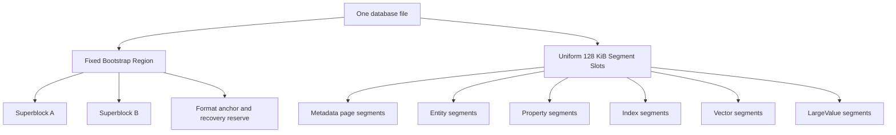
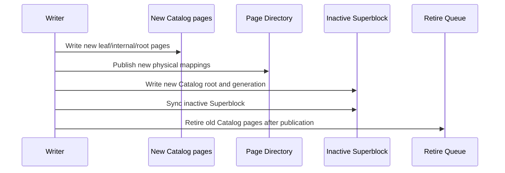
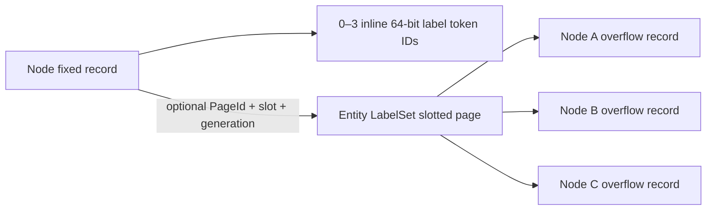

# 原生单文件存储规范

> 本文保留现行单文件格式规则和明确标注的设计目标，不再是独立实施清单。后续任务、准入和进度唯一以[架构调整与通用性能实施方案](optimization)为准。旧 Stage/P/C 流水记录已移出文档站；旧百分比、测试数量和“未开始”描述不代表当前工作树。

更新：2026-10-22。继续使用 COW/A-B 发布；不引入 WAL。当前实施唯一遵循[核心性能方案](optimization) `core-cost-20261022` 的 P0–P7。本页的 PageId、owner、generation、快照、字节编码、发布与回收不变量继续有效；改变布局或接口前必须修订具体条款并版本化，不能默默放宽 reader 校验。

状态区别：第 2 节通用“不相交写事务”仍是目标；已有受限 blind patch rebase 不等于通用冲突放宽。字段暂存与 ROW/混合布局的实际能力按源码和能力矩阵核对，本文后续带日期的 R 系列记录仅是历史格式证据，不再授予任务或进度。第 14 节 key-only 是现行格式，不是对未来格式的永久限制。

版本值以 `RSS_FORMAT_VERSION`、Superblock 与对应 codec 的当前源码为准，它们属于不同版本空间；不在此复制会过期的数字。

2026-10-22 校验合同：普通读写对实际访问页检查 CRC、身份、类型、代际、路由范围和可见性，发布前验证新修改路径。未变化子树按快照内精确不可变引用复用，不承诺无关提交发现未访问页新发生的损坏；首次访问及显式完整 integrity 负责发现。全局完整性检查仍拒绝重复、别名、孤立和损坏，原子提交、持久化、旧快照与回收保证保持。

## 1. 决策边界

### 1.1 硬性前提

- 一个数据库始终只有一个数据库文件；不拆分 data/meta 文件。
- 不支持旧数据库打开、在线迁移、离线迁移或旧格式兼容。
- 格式不兼容时明确拒绝旧文件；不得自动删除用户数据库。版本变更范围按实际 codec 变化确定。
- 数据库必须支持 macOS、Linux 和 Windows。
- 所有持久化整数、枚举、浮点和引用使用显式 little-endian codec，不持久化 C++ struct 的原始内存布局。
- 运行受影响模块的必要功能测试；格式/写入改动补对应故障恢复测试。当前不运行全量单元测试，不设置覆盖率门禁。

### 1.2 非目标

- 不保留 legacy `FileStorage`、legacy `DataManager`、legacy physical query execution。
- 不保留 migration checkpoint、cutover、legacy backup 或 `.migration` sidecar。
- 不为代码、图片、音频、PDF 等业务场景创建专用物理存储引擎。
- 不为 Catalog、Property、Vector 分别维护相互隔离且不能互相复用的物理 free list。
- 不向临时格式叠加无界兼容分支；按新方案的格式演进合同明确版本与拒绝策略，原有 Stage 0 不再是执行入口。

## 2. 总体目标

最终架构必须同时满足：

- 固定物理 Segment 仍可跨类型回收和复用；
- Catalog、Page Directory、Allocator、Property、B+Tree、Vector 和 LargeValue 均可 COW、搬迁和回收；
- 单个 Node/Edge 的更新不会复制完整 128 KiB Segment；
- 小事务不会为一条实体独占一个 128 KiB Segment；
- 热点查询通过统一 Buffer Pool 命中已校验的 page view；
- 数据库打开复杂度与文件总大小无关，不扫描整个文件发现 Catalog；
- 不相交写事务不会因为全局 Superblock generation 改变而无条件冲突；
- 大型文本和二进制值可自动外置、分块、压缩、去重、范围读取和回收；
- B+Tree 不因通用 entry 头部和临时 vector materialization 产生不必要开销；
- Vector 的单条 mutation 不会使整个 PQ/ANN generation 失效；
- 所有 publication 都能在任意崩溃点恢复为完整旧 generation 或完整新 generation。

## 3. 核心术语和身份模型

| 概念 | 含义 | 是否改变物理位置 |
|---|---|---|
| `EntityId` | Node 或 Edge 的逻辑业务身份 | 不变 |
| `SegmentId` | 逻辑 Segment 身份 | 不变 |
| `PageId` | 逻辑 page 身份 | 不变 |
| `PhysicalSlot` | 文件中 128 KiB Segment 的物理槽位 | 可以变化 |
| `FrameIndex` | Segment 内 4 KiB page frame 的位置 | 可以变化 |
| `Generation` | COW 版本和 snapshot 安全边界 | 单调递增 |
| `LargeValueId` | 通用外置大值的逻辑身份 | 不变 |

所有持久化引用使用逻辑身份。物理引用只用于 Bootstrap Region 直接定位根 page，以及 Page Directory 自身的自举路径。

## 4. 单文件物理布局

### 4.1 文件布局

数据库文件采用固定的 Bootstrap Region 加统一 Segment Space：



Bootstrap Region 建议固定为一个 128 KiB 对齐区域，包含：

- format magic 和版本；
- Superblock A/B；
- database UUID；
- 固定 recovery anchor；
- 少量 metadata emergency reserve 描述；
- 未来格式扩展保留字段。

Bootstrap Region 永远不参与普通 Segment 分配。它是固定格式入口，不属于任何 `SegmentKind`，因此“所有 Segment 都可回收”的要求仍然成立。

### 4.2 Segment 和 page

- 每个普通物理 Segment 固定为 128 KiB，并按文件偏移对齐。
- Segment 内部由一个显式 envelope 和若干 4 KiB frame 组成。
- 可用 frame 数由 envelope、checksum、alignment 和 page header 的实际布局 solver 计算，不能由业务代码硬编码。
- Fixed Entity、B+Tree、Property、Vector、LargeValue 均以 4 KiB page 为主要 COW 和缓存单位。
- 大型连续对象只在固定 Segment 内使用多个连续 frame 或多个 Segment，不能改变全局物理 Segment 大小。

### 4.3 SegmentKind 与 page subtype

物理槽位的分配不绑定未来类型。当前 generation 的 Segment envelope 记录 `SegmentKind`，page header 记录更细的 subtype。

推荐的长期 SegmentKind：

| SegmentKind | 作用 |
|---|---|
| `SGK_METADATA_PAGE_POOL` | Catalog、Page Directory、Allocator、System Catalog、Retire Queue 等 metadata page |
| `SGK_ENTITY_PAGE_POOL` | 混合容纳 Node/Edge fixed page 与 Node LabelSet slotted page |
| `SGK_PROPERTY_PAGE_POOL` | slotted Property page |
| `SGK_INDEX_PAGE_POOL` | packed B+Tree page |
| `SGK_VECTOR_RAW_POOL` | raw vector page |
| `SGK_VECTOR_PQ_POOL` | PQ code page |
| `SGK_VECTOR_ADJACENCY_POOL` | vector adjacency page |
| `SGK_VECTOR_MANIFEST_POOL` | vector manifest page |
| `SGK_LARGE_VALUE_DATA_POOL` | 通用 LargeValue chunk |
| `SGK_LARGE_VALUE_MANIFEST_POOL` | 通用 LargeValue manifest/index |
| `SGK_BULK_SCRATCH` | 事务私有、同文件 bounded-sort fragment；永不对图可见，若未发布则在可写打开时回收 |
| `SGK_QUERY_SCRATCH`（15） | 显式启用的查询私有、同文件 spill extent；与 bulk scratch 分离，永不进入公开 Page/Extent 目录 |

`SGK_CATALOG` 不再作为不可回收的专用物理池。Catalog page 使用 `SGK_METADATA_PAGE_POOL` 中的 `MPK_CATALOG` subtype。这样一个 metadata segment 可以混合容纳多种 metadata page，也可以在完全释放后复用为任意其他 SegmentKind。

普通图 adjacency 是内建 Packed B+Tree，因此使用 `SGK_INDEX_PAGE_POOL`。`SGK_VECTOR_ADJACENCY_POOL` 只保留给 ANN 图状态；两者不能仅因都使用 adjacency 一词就共享 codec、owner kind、root 或维护策略。


### 4.4 查询 scratch 开发格式

默认构建使用 Segment envelope 版本 **5** 与 Superblock 版本 **31**；隔离实验构建另见 4.5。查询 scratch 注册 kind **15**，bulk scratch 保持 kind **14**。这是不兼容的开发格式变更：4/30 版本文件会被拒绝，不执行迁移，也不重写旧 A/B 根。稳定格式采用门槛仍待验收。

`query_scratch_enabled` 默认为 `false`。显式启用的原生 Sort 路径使用归属验证的私有句柄、经过校验的版本 1 行/run block、稳定输入序号与有界双路归并。不支持的行或排序在首次 spill 前保留内存执行，已封存 run 后遇到则明确失败；不会重放已消费输入。物理只读文件不能分配、发布或回收 scratch，也不会退回宿主临时文件。

私有 extent 在 I/O 前按完整 128 KiB 物理段准入：每会话 128 MiB、每个已打开文件身份的 `maximum_database_query_scratch_bytes`（默认 1 GiB）、每进程 2 GiB。硬链接和符号链接别名共享已打开文件身份。最多允许 64 个域、每域 64 个活跃 scratch 会话；资源准入不等待。资源锁会在进入元数据发布门锁前释放。成功持久回收后返还 extent 额度；不确定的 I/O 保留孤儿占用，直到独占、归属验证的可写恢复完成。损坏的 payload 或公开目录引用会阻止回收。Metadata COW extent 有独立归属，不包含在此私有 extent 配额中。

完整性扫描把 sealed 私有 scratch 报告为需要所有者静止或可写恢复。物理只读打开不执行清理。排序、分区 DISTINCT/UNION、共享预算及故障合同已在上一轮验收；聚合状态和哈希连接仍无通用 spill。见 `benchmarks/architecture-design/decisions/20261016-s53-budget-and-spill-acceptance/`，后续变更按 R6 保护这些能力。

### 4.5 隔离的混合属性实验格式

`ZYX_EXPERIMENTAL_HYBRID_PROPERTY_FORMAT` 默认 OFF。以下矩阵描述默认与隔离格式边界；R3最终准入仅限[优化计划](optimization)登记的显式成本门禁cohort，不授予自动布局切换。版本定义仍以 `Format.hpp`／`Superblock.hpp` 为准。

| 构建 | Segment profile／envelope 版本 | Superblock 版本／header 字节 | 属性路由范围 |
|---|---:|---:|---|
| 默认 OFF | 5 | 31／336 | 现行 ROW；描述符物理根必须为零，拒绝 kind 16 |
| 隔离 ON | 7 | 33／352 | ROW 及显式受控 hybrid 候选；非空根仅由内部候选协调器发布 |

修订的隔离配置为7／33，明确拒绝此前实验6／32文件，不原地迁移。两种构建互相拒绝对方的文件，不迁移、不重解释旧 A/B 字节。实验 Superblock 在 offset 336..351 新增 `hybrid_property_descriptor_root` 的 16 字节物理引用；metadata emergency reserve 从 header 末尾开始，实验偏移 352，默认偏移 336，宽度均为 32 字节。描述符是 metadata pool 内独立认证的 4096 字节物理 frame（32 字节 header、192 字节 payload、其余为零），不分配 routed MetadataPageId，不属于既有逻辑目录根。数据库／物理根／generation／LSN／CRC 和旧 pin 的恢复、完整性及回收检查适用；第八个图语义 fence 包含该根，两种格式的 token 不同。

八个字段命名空间按 Node owner／column／extension／group、Edge owner／column／extension／group 的固定顺序保留 IndexId `0x8000000000000030`..`0x8000000000000037`。它们与 schema definition 范围、全局邻接、System Catalog、Vector mapping 前缀及 LargeValue content index 不重叠；普通图事务的标量 upsert／erase／create（两入口）／drop 均拒绝它们，默认构建也保留此身份范围。描述符请求在准备数据前验证每个非零 IndexId 与其 ordinal 精确匹配，不能绑定其他字段角色或普通索引。最终字段 reader 仍须核对固定 namespace、pin 下目录及实际根页／物理池代际，不能仅信 frame CRC。

字段图像使用现有 PROPERTY SegmentKind 和隔离构建的 `POK_HYBRID_PROPERTY=16`；13–15 是退役邻接 owner 编码，继续拒绝。独立 allocate／append／replace／evacuate 不授予该 owner kind 写权限。内部候选协调器须在 writer pin 下认证实际 Entity／ROW／字段源及精确数据库、generation、描述符 fence，并持有最多1 MiB账户；普通单组转换最多64 owner／4096实际成员；显式纯列cohort可在同一个至多1 MiB账户内合并最多8个连续组、512 owner，每组仍最多4096实际成员，并在完整候选空间／峰值／文件准入后一次发布。不能把将来组的收益借给单组前缀。只准备请求不得发布或消费持久 ID；显式候选发布必须先保留所有目的槽，在写入数据帧后，以同一次 A/B 更新字段／目录／描述符、Page Directory、Catalog、allocator 和精确退役队列。默认公开建库仍使用格式31 ROW；实验格式33的原生事务可显式暂存受控转换，普通读写在同一语义fence下协调已有混合布局。没有自动转换或默认采用。

受控 ROW→hybrid 可创建或复用认证的独立字段大值。新身份的所有数据／manifest 帧、manifest 目录与内容索引必须同批发布；同批重复内容只分配一个身份。内容索引使用既有 U64 叶布局，修改已有树只 COW 变化路径，不整树重建；当前映射与页 owner 分别认证根及子页的物理代际。仅当前全部页均被替换／移除的源池可整池退休，旧 pin 阻止释放。受控逆转换可复用或新建完整 ROW carrier；新 carrier 的数据、manifest、内容索引和 ROW 引用同批发布，复用原 version-3 owner-neutral 字节，PMR 编码与原 codec 完全一致。显式字段生命周期支持大值 SET/REMOVE 及受控 owner 删除：先认证选中大值的完整内容和单字段 token，再同批发布新的数据/manifest/内容索引或字段/实体移除。no-op 沿用 ROW 递归相等语义，NaN 即使字节相同仍发布；内容去重可复用同一大值身份。丢弃的引用不直接退休全局身份，旧 manifest/内容索引保留给精确可达性 GC，不能从本批引用差集推断全局无引用。直接有界 GC 按稳定逻辑 owner 顺序合并 ROW owner 和 native 成员，逐项用 Manifest 认证引用，并要求所有已登记媒体扫描完整结束。私有回收凭据绑定数据库、generation、描述符及精确删除身份；writer 复核后才发布内容索引／Manifest／Page 退役。部分扫描或并发写均不能授权删除。native immutable data／manifest 及保留内容索引池支持受限协调、空池退役和 pin 保护释放；通用写入及协调仍受保护。native 持久日志 GC 使用保留的等宽 `.v2` State 身份，payload 仍为原 version-1。通用 State writer 不能创建该身份。普通 journal 值只可开始／重置 manifest 枚举；owner 进度必须携带绑定源数据库／generation／描述符且未被修改的私有推进凭据。每次恢复非枚举阶段及最终回收，均须匹配当前已持久化的受保护证据。native 活跃时忽略旧 ROW `.v1` 进度，并在重置时迁移身份。有界候选窗口会认证并保留窗口外引用。State COW 复用前检查全部31个物理位置及全部活跃快照路由；被旧pin钉满的池改用新池，并在pin排空后释放。描述符和字段语义fence不变。规范inline journal控制记录可与owner删除共存，删除推进generation使扫描失效；未知derived State仍受保护。inline 字段只按显式转换建列，后续写不自动重新晋升；no-op 遵循 ROW 的递归类型／值相等语义。当前已验证范围及剩余准入见[优化计划](optimization)。

一般显式转换或受控字段批次处理一个64-ID组，沿用每组4096个实际成员和1 MiB工作上限；专门的纯列cohort例外是上述最多8组共享同一账户及同一次发布。这些不是数据库生命周期容量上限。多个组及Node／Edge命名空间共享描述符绑定目录。新增或移除一组时，已有树仅进行私有脏路径COW，保留其他前缀／根；缺少描述符绑定的孤立Index Root仍拒绝。逆转换仅检查选定组，并在移除其专用字段帧前证明全部存活记录恰好属于该组的认证记录。共享源池只有在所有当前帧均被替换／移除时才退役，其他路由仍引用的帧会保留该池。有限的精确目录清点证明选定前缀覆盖整树时，可以直接整树退役。逆转换仅在全部命名空间消失后清除描述符。通用schema／derived-state协调和生产采用仍待完成。

受控Node删除还会认证inline／overflow标签，将共享LabelSet页的槽删除合并成一份私有图像，保留其他Node的稳定槽。LabelSet、固定Node、Entity Map及原生字段原子发布；空标签页移除当前路由，完整退役Entity池仅在旧pin排空后释放。schema／derived State及通用拓扑协调仍受保护。

最终读路径在原pin／I/O epoch内复用最多两个认证组与原账户内的可选列窗口。完整实体只有在实际字段等于组内列、且没有扩展目录时走一次有界列目录遍历；最多保留一个认证字段页，在回调前复制标量位。混合／稀疏路径保持原认证，物理完整性读取绕过保留缓存。成员资格始终检查身份、token、live和全部未用位；至少48个完整owner证明所有列合格，否则逐列验证。字段写准备仅复用同一source pin的已认证描述符／读取器，不新增权限或wire。预算／取消／旧pin与原子发布规则保持。最终逐进程时延、SET尾延迟限制及Kuzu差距见[优化计划](optimization)。

## 5. Bootstrap、根目录和 Page Directory

### 5.1 Superblock 根引用

A/B Superblock 是唯一的 publication root。当前 v4 staged format 的每个 Superblock 记录：

- `format_version`；
- `generation`；
- `committed_file_end`；
- `allocator_root_physical_ref`；
- `page_directory_root_physical_ref`；
- `catalog_root_physical_ref`；
- 其他 typed metadata directory root 的 physical reference；
- `index_root_directory_root_physical_ref`；
- `retire_queue_root_physical_ref`；
- 逻辑 ID high-water marks；
- checksum。

Superblock 不保存整个目录，也不随着目录增长而移动。它只保存固定数量的根引用。当前所有 metadata
directory 都使用 physical bootstrap reference；这是 Stage 3 的临时表示，不得误解为普通数据页已经拥有稳定
metadata PageId。Stage 4 引入稳定 metadata PageId directory 后，除为打破自举循环而保留的 Page Directory
bootstrap root 外，其余 metadata root 才迁移为逻辑引用，并允许 page-local relocation。

### 5.2 Page Directory

Page Directory 是：

```text
PageId -> PhysicalSlot + FrameIndex + Generation + page metadata
```

Page Directory 自身采用 COW radix/tree。Superblock 直接保存 Page Directory root 的物理引用，从而打破“要通过 Page Directory 才能找到 Page Directory”的自举循环。当前 staged format 的其他 metadata root 也仍是 physical
reference；稳定 metadata PageId directory 完成后才会收敛为只有这条 bootstrap root 需要直接物理寻址。

最终 bootstrap 是一个强类型的物理 header，而不是 generic resolver。它的数据分支只映射
`PageId -> data-page location`，metadata 分支只映射 `MetadataPageId -> PhysicalPageRef`。两个分支、各自的
COW page 和 header 都保持物理链接，因此 lookup 不会先解析执行 lookup 的 directory。每个 non-bootstrap metadata
writer 必须从同一个 `MetadataWriteBatch` 取得 ID/reference pair，在 metadata 分支记录该 pair，先使所有 candidate
bytes durable，再发布唯一的 A/B Superblock generation。resolver 只接受 `MetadataPageId`，并在暴露 bytes 前验证分支类型、
route identity、reference generation、visibility fence 和 target page identity。bootstrap header 与 bootstrap-branch frame
只是内部物理 plumbing，绝不作为该 resolver 接受的值。这样数值相同的 `PageId` 与 `MetadataPageId` 仍彼此独立，既不会递归
路由，也不会把 data-directory entry 解释为 metadata。

2026-10-15 解码元数据读取契约：缓存视图不可变，编码器在准入前校验 ID 严格排序。有效 ID 的 `(id - 1) / leaf_capacity` 单调，因此检查首尾即可证明每条记录均属于选中的叶序号；该捷径仅用于解码后的只读视图，可变 COW 校验继续扫描全部条目。单点及批量元数据路由查找均在返回命中前检查叶页 ID 范围，不能因命中前部记录而漏掉后部错误路由。这会比原单点查找更早拒绝损坏尾部，不改变有效查询结果或磁盘格式。CRC、代际、可见性、目录类型、所选物理引用及 IO 变更纪元失效机制仍必须执行。

2026-10-17 Catalog 点查范围：必需及可选点查先校验所访问页的完整 codec 字节，再仅解析所请求的逻辑子路由；继续验证目录类型、PageId 路由、generation、LSN 可见性及叶序号。单次点查不保证发现未访问分支的缺失路由；完整遍历及 integrity 扫描负责检查这些全局不一致。可变 COW 准备与完整遍历保持完整子路由解析，磁盘格式和发布协议不变。

在迁移开始前，恢复与 evacuation 必须对同一 Superblock 当前可达的全部 metadata radix、internal 和 leaf page 执行逻辑
`PageId` 非空且全局唯一校验；重复身份或无效身份必须在 publication 前 fail closed，不能通过重新分配新 ID 掩盖损坏。

在 staged format 中，metadata pool evacuation 也必须保留被复制页的逻辑 `PageId`，只切换物理 frame、generation 和 committed LSN；
旧 snapshot 通过旧物理根继续读取同一身份，新 Superblock 通过新物理根读取同一身份。其他 metadata COW writer 在稳定目录迁移完成
前仍不能据此移除现有物理根协议。

其他普通对象只持有 PageId。Catalog、Property、B+Tree、Vector、LargeValue 的 page 搬迁只需要更新 Page Directory 的相关 leaf 和 COW 路径，逻辑 PageId 不变。

### 5.3 Catalog

Catalog 的逻辑内容是：

```text
SegmentId -> SegmentDescriptor
```

SegmentDescriptor 至少包含：

- current physical slot；
- owner 或 pool identifier；
- generation；
- frame summary；
- kind/state/flags。

`SegmentId` 可以由 radix leaf ordinal 和 entry position 派生，不应在每条 entry 中重复存储。retired physical slot 放入 Retire Queue，不继续塞入普通 Catalog entry。

## 6. 单文件 allocator 和 Catalog 回收

### 6.1 独立 AllocatorRoot

Allocator 不能把 Catalog 当成唯一权威来源，否则会形成：


因此 Superblock 必须直接保存独立的 `AllocatorRoot`。AllocatorRoot 采用 COW tree，管理：

- free Segment runs；
- free metadata frames；
- allocated slots；
- current reservations；
- retired extents；
- committed file end；
- free-space summary。

### 6.2 Reservation

一个写事务根据旧 AllocatorRoot 预留物理 frame/segment：

1. 在进程内 reservation manager 中锁定候选位置；
2. 写入新的 Catalog、Page Directory、Allocator 和业务 page；
3. 在新的 AllocatorRoot 中将 reservation 标记为 allocated；
4. 事务失败时，旧 AllocatorRoot 仍然认为未发布 reservation 为空闲；
5. 事务成功后，通过 Superblock publication 使新 AllocatorRoot 生效。

数据库接近 ENOSPC 时必须保留可轮换的 metadata emergency reserve，确保还有空间完成一次 recovery/reclaim publication。该 reserve 不是固定物理段，可以在安全后回收并重新分配。当它已经提供 published COW frame 时，在 descriptor 仍作为权威 bootstrap identity 的短暂阶段，它可以合法地成为 root-reachable metadata pool。checksummed Metadata Pool header 会记录 `EMERGENCY_RESERVE_ORIGIN` format flag，因此 recovery 只接受带有该来源且已消费的 reserve，仍会拒绝伪造的普通 pool alias。rotation 会在同一 generation 内发布新的 tail reserve，并把旧 reserve 提升为普通 Catalog ownership。successor 正常在物理尾部 append；若未发布 rotation 在失败或进程强杀后留下候选，则仅当 recovered AllocatorRoot 将该文件最后一个完整 physical slot 明确标记为空闲时，才可以覆盖复用该 slot。实现不得通过文件长度推断可达性、不得覆盖 allocated/root-reachable slot，也不得复用其后仍有物理数据的 slot。这样既保持 COW publication，又消除了中断候选造成永久单-slot 空洞的问题。

该规则同样适用于每一次普通 Metadata Pool allocation，而不仅是 reserve rotation。`MetadataWriteBatch` 会在 metadata-page allocator 的整个生命周期中携带其 current published Superblock。在创建新 pool 前，allocator 只有在最终 physical slot 不属于已注册的 reachable pool、未被同一 batch 预留为 data、且该 batch current AllocatorRoot 明确将其标记为空闲时才可复用。partial candidate byte sequence 或 zero-filled reservation 本身永远不是覆盖 slot 的依据。这样，普通 pool creation 被中断后重新 open 仍可安全重试，不会把跳过的文件尾变为永久空洞。

### 6.3 Catalog page 回收

Catalog 更新使用 COW：



旧 page 只有在以下条件同时满足时才可以进入 free space：

- 不再被当前 root reachability 引用；
- 没有 active snapshot 可以从旧 root 到达它；
- retire generation 已越过 oldest active snapshot generation；
- 新 AllocatorRoot 已经持久化记录该物理位置可复用。

### 6.4 Segment 级回收与 evacuation

如果 metadata segment 所有 frame 都 retired：

```text
metadata segment -> Retire Queue -> Free Segment Tree
```

如果只剩少量 live page：

1. 计算 live frame density；
2. 低于阈值时启动 Metadata Evacuator；
3. 将 live page 复制到新的 metadata frame；
4. 保持 PageId 不变，只更新 Page Directory 的物理位置；
5. COW 发布新的目录 root；
6. snapshot-safe 后释放原 Segment。

释放后的 PhysicalSlot 不保留 Catalog 类型，可以分配为 Property、Vector、Index、Entity 或 LargeValue Segment。

## 7. Durability 和 publication

当前生产路径不依赖 Metadata WAL。所有已发布可见页受 fresh-page COW 保护，A/B Superblock 是单文件原子发布点。历史过渡 WAL 已退出生产路径，后续方案继续保留 COW，不重新引入 WAL。

最终提交顺序：

1. 写入新的业务 data page/segment；
2. 写入新的 metadata page；
3. 同步文件数据；
4. 写入 inactive Superblock；
5. 同步 Superblock；
6. 老 generation 进入 Retire Queue，等待 snapshot-safe reclamation。

publication 前不能覆盖任何仍可能被旧 Superblock 或旧 snapshot 引用的 page。

崩溃后只允许出现：

- 完整旧 generation；或
- 完整新 generation。

未被有效 Superblock 引用的新 page 可以成为可重建的空间泄漏，但不能造成逻辑损坏。

## 8. Buffer Pool

建立唯一的 raw-page Buffer Pool，所有存储子系统共享：

- Metadata；
- Catalog/Page Directory；
- Entity；
- Property；
- B+Tree；
- Vector；
- LargeValue。

Buffer Pool 必须提供：

- pin/unpin；
- generation-aware key；
- dirty/private COW page；
- 2Q 或 CLOCK-Pro eviction；
- sequential scan isolation；
- sibling/page prefetch；
- 校验一次、缓存 validated page view；
- 按字节而非按 entry 管理容量；
- Windows、macOS、Linux 一致的 read/write/flush 行为。

`cache_size` 必须真正连接到该 Buffer Pool，并以字节为单位（默认 64 MiB，最小一个 4 KiB page）。typed store 构造不得触发全量 reconcile 或隐式磁盘扫描；recovery/reconcile 只允许由 database-open coordinator 执行一次。

## 9. Fixed Entity 重构

### 9.1 Page 布局

Node 和 Edge 改为 4 KiB fixed entity page：


128 KiB Segment 只作为 page container，不再是单个实体的 COW 单位。

### 9.2 Entity Map

EntityId 不再直接决定物理 slot。专用 Entity Map 保存：

```text
EntityId -> PageId + slot + optional slot generation
```

Segment generation 不在每个实体 entry 中重复存储，由同一 snapshot 的 Catalog/Page Directory 提供。

删除一个实体后，slot 可以被任意新的 EntityId 复用。Entity full scan 按 page/bitmap 扫描，不逐实体遍历宽泛 Location Directory。

### 9.3 Node/Edge record

Node/Edge fixed record 应删除：

- Property ID；
- Property storage type；
- 依赖 Property ID reservation 的字段；
- 过度占用空间的重复 logical ID（在 page-local ID array 已足够时）。

Node label 使用 3 个 inline 64-bit token ID，加一个可选的单页 `EntityLabelSet` 记录，不再保留历史的六标签限制。3 个 inline slot 和 64-bit Token ID 是明确的 format design；单页 overflow capacity 是由 page-layout 常量计算出的派生值，不能在 store、测试或文档中再次复制结果数字。

Edge record 最终只保留 source NodeId、target NodeId、关系类型 Token ID 和必要状态，并且是这些字段唯一的权威副本。Node record 不保存入向/出向 adjacency root，Edge record 不保存 adjacency list link。普通图 adjacency 由独立维护的内建 Packed B+Tree 提供。

### 9.4 Node label 布局

Node fixed record 保存：

- `inline_label_count`，取值范围为 0–3；
- 3 个 64-bit `inline_label_ids`；
- 可选 `label_overflow = PageId + slot_id + slot_generation`。

完整标签集合必须是非零、严格递增且无重复的 schema token ID。0–3 个标签全部 inline，且 overflow reference 必须为空；4 个或更多标签将 canonical sequence 的前 3 个 token ID 保留在 fixed record，其余 token ID 以同样顺序存入一个 `EntityLabelSet` 记录。fixed record 不重复保存总标签数；overflow record header 保存自己的元素数量。



一个 4 KiB LabelSet slotted page 可以保存多个不同 Node 的 overflow record；不得为每个 Node 独占一个 page。每条 overflow record 只属于一个 Node，不做跨 Node dedup。record 不重复保存 NodeId，Node fixed record 中的稳定引用是唯一 ownership edge。LabelSet page 使用 `POK_ENTITY_LABEL` subtype，Node/Edge fixed page 使用 `POK_ENTITY` subtype。两种 page 可以共同放入 `SGK_ENTITY_PAGE_POOL`，不新增专用 128 KiB Label Segment，也不得借用 `SGK_PROPERTY_PAGE_POOL`。

### 9.5 单页容量和明确上限

LabelSet 使用显式 little-endian 64-bit Token ID 数组，不采用压缩、变长整数或 chunk chain。8-byte Token ID 是当前 format 的基础字段宽度，Node record、Schema Token Registry、LabelSet codec 和 Label Index 必须保持一致。

单条 overflow record 的容量由 `RSS_PAGE_OWNER_MAX_PAYLOAD_BYTES`、`RSS_SLOTTED_PAGE_HEADER_BYTES`、16-byte `RSS_SLOTTED_PAGE_SLOT_BYTES`、`RSS_ENTITY_LABEL_SET_HEADER_BYTES`、record alignment 和 `sizeof(uint64_t)` 推导。规范性判断是编码后的完整 LabelSet record 能否放入一个空的 typed slotted page；实现必须通过共享的 encoded-size/capacity solver 完成预检，而不是比较手写的标签数量。

`RSS_ENTITY_LABEL_SET_MAX_OVERFLOW_LABELS` 是该 solver 的派生结果，`RSS_ENTITY_MAX_LABELS` 等于 3 个 inline slot 与 overflow capacity 之和。该规则仅约束由多个 layout constant 组合计算出的结果，例如某次实现中的最大标签数：不得将其作为独立的数值契约复制到持久化数据、业务分支、测试或文档中。诊断工具可以显示该值，但必须从共享 solver 获得。

与之相对，稳定的 format 事实应明确保留。64-bit Token ID、16-byte slot entry、3 个 inline slot 和 page size 定义了 on-disk codec，应在文档与测试中直接体现。基础 layout constant 变化时，只修改其唯一代码定义并按持久化兼容规则更新 format version；之后所有 codec、allocator 和测试都通过同一 solver 获得全部派生上限。

最大可编码 overflow 必须成功，`RSS_ENTITY_LABEL_SET_MAX_OVERFLOW_LABELS + 1` 必须在分配 page、写 candidate frame 或发布 metadata 之前以明确的容量错误失败。当前方案不预留也不实现多 record、多 page 或 chunked LabelSet。

### 9.6 放置、更新与空间复用

LabelSet placement 使用按 `PageOwnerKind` 隔离的 best-fit free-space index。每个索引项至少跟踪 contiguous free bytes、reclaimable bytes 和可复用 dead-slot 数量。插入成本为 record bytes；仅当没有 dead slot 可复用时才额外包含 16-byte `RSS_SLOTTED_PAGE_SLOT_BYTES`，避免保守估算跳过实际可用的 page。选择顺序为：

1. 优先选择已有 `POK_ENTITY_LABEL` page 中能容纳 `record bytes + slot entry` 的最小空闲区；
2. 如果总空闲空间足够但不连续，先在 candidate COW image 中 compact，再重试；
3. 如果没有现有 page 可容纳，优先在已有 `SGK_ENTITY_PAGE_POOL` 的空 frame 中追加 LabelSet page；
4. 只有所有匹配的 Entity pool 都没有可用 frame 时，才分配新的 Entity pool Segment。

free-space index 必须按 page subtype 过滤，不能把同一 Entity Segment 内的 fixed Node/Edge page 当作 slotted page 打开。placement hint 不是写入授权；metadata writer 必须在 pinned generation 下重新验证 Page Directory、Catalog、owner kind、owner LSN 和可用 COW frame。

已有 LabelSet page 的更新始终写入新 COW frame。candidate frame 可以来自源 Segment，也可以来自另一个同 owner domain 的 `SGK_ENTITY_PAGE_POOL`；后者仍保留原 `PageId`，只切换 Page Directory location。源 pool 没有空 frame 时不得因此拒绝一个本可完成的标签更新。

标签更新先尝试在原 page 内完成。缩短记录直接复用原 capacity；增长时依次尝试相邻空闲区、移动 page-local payload、compact 后重试，并保持 `PageId + slot_id + slot_generation` 不变。payload offset 只存在于 slot entry 中，因此 page 内移动不修改 Node record。如果 compact 后仍放不下，则在另一个 LabelSet page 创建新 slot，并在同一个事务中更新 Node overflow reference、删除旧 slot。减少到 3 个或更少标签时清空 overflow reference 并删除旧 slot。

slot 被删除后进入 dead 状态，并在复用时递增 generation，旧缓存或陈旧引用因此会 fail closed。较小的新记录可以使用已释放 slot；compact 会合并 page-local 碎片，因此不会永久保留原记录大小造成的空洞。LabelSet page 变空后进入 snapshot-safe retirement；Entity Segment 的所有 frame 都不再可达后，普通 Segment evacuation/reclamation 流程可以回收该物理槽位并跨 SegmentKind 复用。

### 9.7 原子性、读取与索引一致性

一次标签 mutation 的 Node fixed page、LabelSet page、Page Directory 和 Label Index delta 必须由同一个 metadata transaction 和同一个 Superblock generation 发布。禁止先独立发布 overflow page，再发布指向它的 Node；也禁止先删除旧 slot，再切换 Node reference。提交前失败不得留下可达 orphan，提交后旧 snapshot 继续通过旧 Page Directory root 读取旧 Node 和旧 LabelSet frame。

读取过程最多增加一次 4 KiB page lookup：先通过 Entity Map 读取 Node fixed record；若 overflow reference 非空，再以 `PageId` 通过 Page Directory 和 Buffer Pool 定位 LabelSet page，并校验 `POK_ENTITY_LABEL`、page generation、slot generation、record checksum、canonical ordering 和容量边界。Buffer Pool key 使用逻辑 PageId 与 snapshot generation；LabelSet page 的物理 relocation 只更新 Page Directory，不改 Node reference。

integrity scanner 必须交叉验证：每个非空 Node overflow reference 恰好解析到一个 live LabelSet slot；每个 live LabelSet slot 恰好被一个 Node 引用；两个 Node 不得共享同一 slot；空引用不得携带部分 PageId/slot/generation；Label Index 中该 Node 的 token 集合必须与 inline 加 overflow 的 canonical union 完全一致。标签更新直接比较 old/new canonical set 生成 Label Index add/remove delta，不扫描整个 Label Index。

## 10. Property Store

> 当前原生写者支持逐键 set/remove 和最终状态折叠，但大的 ROW owner 集合仍可能整体重编码，不保证无关大字段字节免于重写。10.2 保留目标表示；获准生产 ROW 放置策略见 10.4。MIXED/列组权威仍被拒绝，须独立通过原生生命周期及格式门禁。

### 10.1 Property identity

Property identity 统一为：

```text
(EntityKind, EntityId) -> PropertyRoot
```

没有 Property 就没有 Directory entry。不再为每次 Property mutation 预先分配独立 PropertyId，也不在 Node/Edge record 中保存 Property reference。

### 10.2 多级 Property 表示

| 规模 | 表示 | 目标 |
|---|---|---|
| 很小 | inline Property value | 避免额外 page 读取 |
| 小/中 | slotted Property page | 单实体有限范围更新 |
| 大集合 | per-key record 或小型 Property tree | 单 key 更新不复制全集 |
| 大 value | `LargeValueRef` | 分块、压缩、范围读取 |

更新一个 key 不应复制整个 Property collection。Slotted page 的 shrink 需要支持容量回收、hysteresis 和 page-pressure compaction。

### 10.3 Property Directory cache

placement cache 不能按全局数据库 generation 全量失效。使用 per-pool/per-shard version、free-space class index 和增量更新。

### 10.4 获准生产 ROW 放置

原生后端对新物化的 owner 集合默认启用 `adaptive_property_row_chunks`。`PropertyRowChunkPolicy` 保留按 token 排序的规范字节和唯一权威 owner-keyed Property Directory。合格 RAW 根在大字段 token/值头之后及字段体之后设置有界逻辑切点，相邻小字段仍共享 chunk。通用页成本规则要求首次使用 chunk 更小，数据/Manifest/目录/catalog 估计分配增加不超过 5%。最多 2048 字段和 4096 切点参与；压缩、小集合、过宽或成本不合格时保持普通 ROW，不丢字段。

已有引用值及内容去重命中保留不可变布局，不自动重打包、不增加规范副本或持久 group/token 命名空间。通用流式/批量调用者可继续使用均匀 extent，reader 接受两种显式偏移布局。切点只是写者临时策略，不是新增序列化 codec 标志。快照认证、实际键枚举、派生索引维护、COW 发布和可达性退役不变。完整 owner 替换仍可能写入无关大字段字节；O3/O5 及稳态验收仍待完成。

## 11. 通用 LargeValue

代码、图片、JSON、PDF、音视频和模型文件都使用统一的 `LargeValueStore`，不建立 `CodeObjectStore` 或 `ImageStore`。

推荐层次：

```text
Value
    -> InlineValue
    -> LargeValueRef

LargeValueStore
    -> LargeValueManifest
    -> LargeValueChunk/Extent
```

`LargeValueRef` 保存：

- logical object id；
- generation；
- uncompressed size；
- content hash；
- text/bytes kind；
- 非空、可打印 ASCII 且受格式上限约束的 media type；
- codec；
- checksum information。

`LargeValueRef::generation` 和 `LargeValueManifest::generation` 是不可变的
逻辑 generation：它们标识 value 内容，compactor 仅搬迁物理 frame 时不得改变。
`PageLocation::generation`、`PageOwnerHeader::generation` 和
`LargeValueManifestLocation::generation` 则标识当前物理 pool/frame 的
generation。两套语义不能当作同一个版本号直接比较。

### 11.1 Cypher 与 Driver ABI

普通 Cypher 继续使用属性赋值：

```cypher
CREATE (f:CodeFile {
    path: $path,
    content: $content,
    content_type: "text/x-c++src"
})
```

小值自动 inline，大值自动 externalize。Binary 数据通过通用 bytes 参数表达，不引入 `Code`、`Image` 等底层 ValueKind。

超大数据通过通用 Driver ABI 流式接口写入和读取：

- begin external value；
- write chunk；
- finish/abort；
- read range；
- read stream。

当前 ABI 为结果 bytes 和 value reference 提供有界 pull stream。调用方传入
`(offset, length)` 范围，反复读入应用方拥有的 buffer；范围耗尽后才返回
`ZYX_DRIVER_DONE`。stream 自己拥有不可变的 bytes snapshot，因此打开后可以
关闭源 result。这样每次 ABI copy 都有明确上限，native LargeValue range
reader 仍负责 chunk 级 I/O 和解压。

`DriverAbiBytesTest.StreamsPersistedLargeValueRangesAfterReopenAndResultRelease`
是该边界的 native 端到端 acceptance checkpoint：它持久化一个超过 inline
容量的 binary Property，关闭并重新打开单一数据库文件，打开严格的子范围 stream，
释放其源 result，并验证之后完整 pull 的字节精确性。这证明的是持久化
`LargeValueRef` 路径，而不仅是内存参数回显；性能、fault injection、binding
adapter 和三平台门禁仍未关闭。

LargeValue 创建和 Property reference 必须在同一事务中发布。

### 11.2 分块和压缩

- 通用均匀 extent 保留已配置的 16/32/64/128 KiB 类；Manifest 保存显式连续偏移与长度，最后一个或显式切点 chunk 可以更小。原生 Property ROW 使用 10.4 的有界准入策略，比较延迟/资源调优留到最终性能门禁；
- 很小的值通常不压缩；
- 代码、JSON、SQL、日志优先使用 LZ4 或 Zstd；
- PNG、JPEG、ZIP 等已压缩格式默认保存 raw；
- 每个 chunk 独立 checksum 和 codec；
- range read 只解压相关 chunk；
- `content_hash` 基于未压缩原始字节，用于去重；
- `normalized_hash` 仅用于相似代码分析，不用于物理合并。

### 11.3 代码分析数据模型

源文件优先只存储一次：


| 实体 | 主要字段 |
|---|---|
| `CodeFile` | path、language、commit、content hash、LargeValueRef、line index ref |
| AST/Function Node | file id、start byte、end byte、line range、symbol metadata |
| 独立 CodeSnippet | LargeValueRef、language、content hash、normalization metadata |

AST 节点优先保存源文件范围，而不是复制完整代码正文。

### 11.4 回收

LargeValue 使用 immutable object：

```text
new chunks -> new PropertyRoot -> Superblock publication
-> old object enters Retire Queue
-> snapshot-safe reachability reclaim
```

多个实体共享同一个 content hash 时，必须通过 reachability 或引用信息确认最后一个引用消失后才能回收。

### 11.5 搬迁与 snapshot 安全

LargeValue 使用稳定的 `PageId`，而不是物理 pointer。data page 搬迁只发布新的
Page Directory location；manifest page 搬迁则在同一个 COW/Superblock publication
中同时发布新的 Page Directory location 和对应的 `LargeValueManifestLocation`
route。两类搬迁都会将物理 owner 改为目标 pool generation，但保持逻辑
`LargeValueRef` 与 manifest generation 不变。

因此 old snapshot 会通过旧 directory root 读取旧 frame，而 newer snapshot 会
解析新 route 和新 frame。source pool 在最后一个 current page 搬迁后退休，但只有
所有仍可能解析旧 root 的 snapshot 释放后，物理 slot 才能真正释放。

## 12. Packed B+Tree

B+Tree 使用专用 packed page codec：

- leaf/internal 分离；
- packed offset array；
- on-disk canonical key order；
- prefix compression 和 restart points；
- raw page view binary search；
- range cursor，不 materialize 整页 entry vector；
- scalar leaf 的 EntityId 从复合 key 后缀解码，不重复存 value。

Property index 的排序 key 保持：

```text
(PropertyValue, EntityId)
```

EntityId 保证重复 PropertyValue 的稳定排序和唯一定位，不应为了去重而删除。需要消除的是物理重复编码和宽泛 entry header。

Bulk builder 和 online mutation 必须共享同一套 page invariant、separator rule、split/merge rule 和 corruption checks。

实现必须支持具名 key codec 和 comparator，而不是把 Property index 假设固化进树中。普通图 adjacency 特化使用固定逻辑字段 `(direction, NodeId, EdgeId)` 和空 value；comparator 依次按 direction、无符号 NodeId、无符号 EdgeId 排序，磁盘 codec 仍通过显式格式 codec 写入每个整数。容量、fan-out、restart interval、separator 大小和每页 entry 数都必须由编码字节与共享 page layout solver 推导。

每棵树拥有稳定的逻辑 `IndexId`；COW root PageId 和 root generation 存放在 Index Root Directory 中。普通 adjacency 树使用一个永不与用户索引冲突的保留内建 `IndexId`。这样 Superblock 仍保持定长：它发布 Index Root Directory root，而该 snapshot 的 directory 定位 adjacency root。空树以缺少 adjacency root entry 表示，而不是保留一个永久空 page。

## 13. System Catalog

删除 sealed/dynamic 双体系，建立一个 canonical mutable System Catalog：

```text
(property-key, name)       -> token
(property-token, token)    -> name
(schema-name, kind, name)  -> schema token
(schema-token, kind, token)-> definition
(index-id, id)             -> definition
(index-name, name)         -> id
(index-schema, signature)  -> id
(constraint-id, id)        -> definition
(constraint-name, name)    -> id
(sequence, kind)           -> high-water mark
```

forward、reverse、secondary entry 在同一个 metadata transaction 中原子更新，不保留人工高位 dynamic namespace 和 sealed tombstone registry。

### 13.0 Graph 基数统计

System Catalog 还保存一对 snapshot-pinned 的逻辑 Node/Edge 基数。持久化值采用非零编码，因此空图可与无效 B+Tree leaf
value 区分；缺少整对记录表示旧文件的统计不可用，而只存在一侧必须 fail closed。普通图 mutation 与 streamed bulk Edge 的
最终 Catalog/adjacency/Entity publication 都在同一 A/B generation 更新该对计数；bulk 路径只在已有完整统计时增加 Edge
计数，绝不从逻辑 ID high-water mark 推断旧文件的基数。

### 13.1 Schema Token 名称与 ID

标签名称和 relationship type 名称只存储在 canonical System Catalog，不写入 Node、Edge、LabelSet 或 Label Index。System Catalog 维护两个逻辑方向：名称与 kind 到 `SchemaTokenId`，以及 kind 加 `SchemaTokenId` 到包含 canonical 名称的 definition。前向索引用于 query bind，反向 definition 用于返回标签名称、检查 catalog 完整性和管理操作；执行阶段只携带 Token ID。

名称是 UTF-8 byte string，长度边界由唯一的共享 System Catalog name-limit format constant 定义。该边界必须同时满足 API 语义上限、definition record 上限、前向索引 key 上限、反向 definition 上限和目标 B+Tree fan-out；Cypher、Driver ABI、System Catalog codec 和 lookup API 必须共享它。不得把 persisted length field 的理论范围或“单条 entry 勉强能放进空 page”的大小直接当作公开名称上限。

`SchemaTokenId` 使用明确的 64-bit little-endian wire field。共享名称上限与相关 key/record overhead 使用各自唯一的格式常量；任何由它们计算出的 B+Tree entry 或 page capacity 都只通过共享 solver 使用，不在文档或调用方复制结果数字。未知 definition version 或超过统一名称边界的输入一律 fail closed。

名称在 canonical definition 中是权威值；前向 B+Tree 为实现 collision-free name lookup 仍需要保存可比较的名称 key。这个按唯一 schema token 发生的有限重复是有意的，并通过 leaf prefix compression、internal separator truncation 和 dictionary cache 控制；名称不得再复制到每个实体或 Label Index entry。

## 14. Graph Adjacency

> 以下 key-only、空 payload 和单树条款规定现行文件格式。其对未来方案的永久限制由新方案 R5 取代：允许比较覆盖树与分段派生邻接，但须先完成一致性、损坏处理、快照、原子维护和回收设计。派生覆盖字段不天然等于第二份权威；现行 reader 的主记录回查在替代协议验收前仍保留。

普通图 adjacency 与 Vector ANN adjacency 是相互独立的数据结构。普通图 adjacency 使用一棵全局内建 Packed B+Tree；Vector adjacency 继续使用第 15 节的 Vector 专用方案。

### 14.0 规范性实现边界

普通图在持久化层只能有一种 adjacency 表示：保留的全局、key-only Packed B+Tree。这是格式不变量，而不是 planner 偏好。解释现行格式的 reader/writer 必须保持以下约束；未来版本按 R5 及格式合同变更：

- 格式保留的 `RSS_GLOBAL_ADJACENCY_INDEX_ID` 是唯一的普通图 adjacency `IndexId`；它通过 snapshot-pinned Index Root Directory 解析唯一 adjacency root，绝不向用户或 secondary index 分配；
- Node record 不拥有 adjacency root 或 adjacency key，Edge record 不拥有邻居 link、物理 page 位置或重复的 adjacency payload；
- 每条 live Edge 恰好拥有一个 `ADJ_OUT` key 和一个 `ADJ_IN` key；二者与权威 Edge 的变更必须在同一 metadata generation 中 commit 或移除；
- B+Tree page 只包含路由/separator 数据或 key-only adjacency entry，绝不混合存放 Node 或 Edge record；
- page relocation 只修改逻辑 `PageId` 的 Page Directory route；绝不重写 Edge、Node、cursor continuation 或 parent child reference。

per-Node chain、per-Node root、Base/Delta/Tombstone 层级、adjacency tail page 和 Edge-to-Edge 双向链表均为已退役设计。不恢复这些旧实现作为 fallback 或兼容 reader。新的分段布局不是恢复旧代码；是否替换或新增访问路径由 R5 原型和格式演进合同决定，必须定义 codec、root、publication、reclamation、integrity 与准入条件。

### 14.0.1 结构决策记录

“全局 Packed B+Tree”只描述普通图 adjacency 的访问路径；它不表示把 Node 和 Edge record 混放进 B+Tree page，也不表示 Edge record 直接成为 B+Tree leaf value。下表记录现行格式选择；未来变更须经过 R5 及格式合同 准入：

| 方案 | 决策 | 原因 |
|---|---|---|
| 一棵全局 key-only tree | 采用 | 低阶 Node 共享 leaf，高阶 Node 顺序跨 leaf；只维护一个 root、codec、publication 与 retirement lifecycle。 |
| 分别维护 outgoing/incoming tree | 不采用 | `direction` prefix 已给出两个有序 access range；拆成两棵 tree 只会增加 root-directory、COW 与回收状态，不能减少一次 Edge mutation 必需的两条 key。 |
| per-Node root 或 per-Node B+Tree | 不采用 | 会重新引入长期稀疏 root/tail page、更多 root publication，以及超级节点专用结构；小度数 Node 无法共享编码空间。 |
| Edge 双向链表或 Edge chain | 不采用 | 插入/删除会改写 Node head 和相邻 Edge，扩大事务写集合，并使 relocation、快照和完整性校验耦合到关系之间的物理链接。 |
| 在 adjacency leaf 中嵌入 Edge record 或覆盖性 Edge payload | 不采用 | 现行协议没有独立可信的覆盖读取合同，增加 payload 仍需回查，并增加写入成本；R5 将重新设计和验证派生覆盖协议，不再将所有覆盖数据一概视为第二份权威。 |

因此，B+Tree leaf 可以同时装下多个 Node 的 **adjacency key range**，但不会装下这些 Node 或 Edge 的实体 record。一次 expansion 先流式读取 `EdgeId`，仅在查询确实需要 endpoint、type、state 或 Property 时，才从同一 snapshot 的 Edge Entity Store 解析相应 record。这个二阶段读取是有意的：它将顺序 adjacency 扫描与实体 materialization 的成本分离，并避免将不需要的 Edge 字段带入每个 index entry。

### 14.1 权威数据与 key schema

Edge Entity Store 是权威数据源：

```text
EdgeId -> sourceNodeId + targetNodeId + relationshipTypeId + state
```

adjacency 树是二级访问路径，逻辑 schema 为：

```text
(direction, NodeId, EdgeId) -> empty
```

这里只有一棵 tree 和一个 root，而不是每个 direction 或每个 Node 各有一棵 tree。`direction` 是第一个 key component，因此 outgoing 和 incoming access path 是同一棵 tree 中互不重叠的有序 range。这样可保持统一 codec、一次 publication boundary 和一套 reclamation lifecycle，同时不引入长期稀疏的 root hierarchy。

每条 live directed Edge 必须恰好包含两个 entry：

```text
(ADJ_OUT, sourceNodeId, EdgeId) -> empty
(ADJ_IN,  targetNodeId, EdgeId) -> empty
```

`AdjacencyDirection` 是持久化的带前缀 enum；未知值在所有平台上都必须 fail closed。NodeId 和 EdgeId 是正 64-bit 逻辑 ID。routing NodeId 必然属于 key，但空 value 是规范要求：tree 不保存另一端 endpoint，也不把 relationship type/state 作为 Edge payload 存储。当前格式 writer 不能添加 covering value。R5 及格式合同可以定义新版本或具有独立 identity 的派生访问路径，必须明确 lifecycle，不能静默改变该 key 的解释。

comparator 按 `direction`、无符号 `NodeId`、无符号 `EdgeId` 定义 canonical ordering。同一 `(direction, NodeId)` 的 entry 因而形成一个连续 range，并按确定顺序排列。prefix compression 会消除该范围内重复的 direction/NodeId 字节。多个低阶 Node 共享一个 leaf，不允许一个 Node 或 direction 独占 4 KiB tail page。超级节点可连续跨越任意数量的 leaf，不存在 per-Node size limit。

物理边界必须严格。Entity page 存放固定 Node/Edge record；adjacency leaf 只存放排序 key 与空 value；adjacency internal page 只存放 separator 与逻辑 child PageId。因此，一个 B+Tree leaf 可以容纳多个 Node 的 range，但绝不包含这些 Node 或 Edge record。这是 packed layout 的含义，而不是把图实体放入 B+Tree 的设计。

### 14.2 Root 所有权和物理放置

全局树在 Index Root Directory 中使用保留的内建 adjacency `IndexId`。snapshot 的解析路径为：

```text
Superblock -> Index Root Directory -> adjacency IndexId -> B+Tree root PageId + root generation
```

root entry 和所有 B+Tree page 都属于同一个 metadata generation。adjacency leaf/internal page 使用普通 Packed B+Tree codec、`SGK_INDEX_PAGE_POOL` 和 adjacency 专属 owner identity。它们绝不能与 Node record、Edge record 或 Vector adjacency 共用 page。Page 搬迁保持逻辑 PageId 不变，只修改 Page Directory route；tree reference 和 Edge record 都无需改写。

空图不存在 adjacency root entry。第一条 Edge 的 transaction 创建初始 tree 并发布 root entry；删除最后一条 Edge 时，在 new generation 中原子删除 root entry。old snapshot 仍保留 old root，只有满足 snapshot safety 后才释放其物理 page。最终普通图格式不存在 per-Node Root page、Root write-tail hint、Base/Delta chain、Tombstone、merge threshold、merge debt 或 recovery cursor。

### 14.3 读取路径与 cursor contract

出向和入向扩展分别 lower-bound seek 到 `(direction, NodeId)` 的第一个 key，然后推进到 prefix 改变为止。复杂度为 `O(log E + degree)` 次比较及与输出成正比的工作量。root/internal page 使用 normal Buffer Pool admission；range scan 消费的 leaf 使用 sequential admission。cursor 对右 sibling 做有界 prefetch，不能 pin 无界 route。

cursor 直接从经过校验的 page view 读取压缩 key，只保留当前 leaf pin、restart/search state、prefix bound 和逻辑 continuation key；不能 materialize 完整 leaf 或完整 adjacency range。continuation 为 `(snapshot generation, direction, NodeId, last EdgeId)`，并严格从 `last EdgeId` 之后恢复。它绝不暴露 PageId、slot 或 physical offset。过期或外来的 continuation 应按公开 cursor contract fail closed，或从逻辑 lower bound 重新开始。

degree/count 等只依赖 adjacency 的操作可以只统计 entry，不读取 Edge record。需要返回 Edge 字段时，通过 snapshot-pinned Edge Entity Map 解析每个 EdgeId，并校验 Edge live 且 endpoint 与扫描 prefix 匹配。关系类型过滤第一阶段读取权威 Edge record；必须按 page 批量化并利用 locality，不能对每个 key 发起无约束随机读取。

无向扩展独立打开两个有界 range，再合并结果。self-loop 的语义必须明确：一个 self-loop 含一个 `ADJ_OUT` 和一个 `ADJ_IN` entry；只有 Cypher 语义要求返回一条关系时，无向 operator 才按 EdgeId 去重。

### 14.4 Mutation 与 publication

创建一条 Edge 时，必须基于同一 pinned generation 规划 Edge record、Entity Map entry、`ADJ_OUT` insert 和 `ADJ_IN` insert。两个 key mutation 通过同一个 B+Tree COW overlay 应用，所有 replacement page、replacement adjacency root、metadata root 和 inactive A/B Superblock 在一次 commit 中发布。崩溃后只能看到完整 old generation 或完整 new generation，禁止只看到一个方向。

R4 的目标是区分物理根发布与逻辑冲突：根据当前根验证最终态依赖并有界安全重建。这不是当前普通事务的完整保证；普通事务仍比较图根 fence，不相交修改也可能冲突。新隔离/冲突协议实现并测试前，不得直接删除 fence。

删除一条 Edge 时，先解析权威旧 endpoint，再通过同一 overlay erase 两个精确 adjacency key，同时删除 Edge record 和 Entity Map entry，并原子发布结果。普通图删除不追加逻辑 Tombstone。COW 退休 page 进入公共 generation-aware Retire Queue，只有旧 snapshot 释放后才能复用。

`DETACH DELETE` 对出入两个方向执行有界 range scan，对包含 self-loop 的 EdgeId 去重，在准备 publication 前校验 transaction limit，并提交一个 bulk final-state plan。每条 Edge record 和对应两个 entry 都必须恰好删除一次。并发或 stale-root publication 在可见前被拒绝，由 transaction layer 从新 snapshot 重试。

Bulk ingest 为每条已校验 Edge 生成两个 key，按 canonical comparator 排序和去重，再交给共享 bulk/overlay page builder。已有序 run 应执行 merge，不能逐 key 重复 insert。online 与 bulk path 必须共享 leaf fill、restart、separator、checksum、split/merge 和 owner invariant。容量和内存由配置的 transaction/run limit 约束；未来若需要 external sort，只能使用单数据库文件内的受控区域或有界进程临时内存，不能演变为第二个持久数据库 artifact。

### 14.5 空间、维护与可选 write buffer

删除使用普通 Packed B+Tree underflow 处理。Sibling redistribution 或 merge 在 candidate COW image 中完成；空 leaf 和折叠的 internal root 通过公共 page reclamation path 退休。Page occupancy policy 使用 codec 提供的 byte count，而不是固定 entry count。正确性不依赖后台全树 compact；若实际 byte occupancy 低于策略，可执行有界 maintenance rebuild，并一次发布 replacement root、snapshot-safe 地退休 old tree。

当前生产实现使用全局 Packed B+Tree。后续 buffer 或分段布局由 R4/R5 及格式合同决定，必须涵盖 cursor、原子可见性、有界资源、恢复和回收。write buffer 不是已批准的任务，也不得恢复旧 per-Node delta 实现作为 fallback。

### 14.6 Integrity 要求

Integrity scanner 在一个 pinned snapshot 内验证：

- 每条 live Edge 恰好有匹配的 `ADJ_OUT` 和 `ADJ_IN` entry；
- 每个 adjacency entry 都解析到一条 live Edge，并且 endpoint 与 direction/NodeId 一致；
- 不存在 duplicate、missing、foreign、zero-ID 或 unknown-direction key；
- key order、prefix/restart encoding、separator、sibling link、page ownership、generation、LSN 和 CRC 全部有效；
- 保留 adjacency IndexId 至多有一个 current root，且用户 definition 不能占用；
- 所有 reachable page 都属于该 root，retired/unreachable page 由公共 reclaimer 正确分类。

快速 open 只按需校验 root 和 page structure，不扫描全部 Edge。完整双向交叉校验是带有界内存进度的显式 integrity/maintenance 操作，不是普通 startup 要求。

## 15. Vector

### 15.1 Manifest

Vector Manifest 只保存 O(1) metadata：

- dimensions/metric；
- total record count；
- Raw/PQ/Adjacency mapping roots；
- codebook root/generation；
- base/delta generations；
- ANN entry point；
- allocation tail hints。

Manifest 不列举全部 Raw/PQ page。Page Directory 和 mapping root 是权威 inventory。

### 15.2 Mapping

mapping 直接返回：

```text
(PageId, slot, generation)
```

不能只返回 page 后再在 page 内线性搜索 VectorId。

Vector delta mapping 使用固定的 typed key `(VectorId, Operation)`，leaf value 保存对应的 `NodeId`。因此
`INSERT` 和 `ERASE` 都能在有界的语义映射点查中证明 Node-to-Vector、Vector-to-Node 和 Raw Location
的一致性，不依赖扫描整个 semantic mapping；同一个 VectorId 同时出现两种 operation 必须 fail closed。

### 15.3 Online mutation

Vector 使用 immutable base + mutable delta：

```text
base ANN/PQ generation
delta vectors
tombstones
query merge
background rebuild
atomic base replacement
```

新 vector 不应使整个 PQ/Adjacency generation 失效。已有 codebook 时只计算对应 vector 的 PQ code；邻接进入 delta graph 或局部 repair。

delta 的 entry count 和 mapping page 数量必须分别受限。达到维护阈值时应调度 base rebuild，而不是无限增长或
静默拒绝用户写入；在 rebuild 完成前，查询以 `base - tombstones + exact inserts` 合并结果。

### 15.4 Rebuild

Vector rebuild 在 unpublished private pages 中完成，最后一次性发布：

- Raw/PQ/Adjacency mapping roots；
- codebook root；
- base/delta manifest；
- entry point；
- retire queue。

Adjacency builder 使用 Vamana/DiskANN/HNSW 类受控候选算法，不允许对所有 source/candidate 执行 O(N²) 比较。

## 16. Legacy 和 migration 清理

退休只针对实现，绝不能隐式删除已经记录的功能。如果一个 legacy 文件仍是某项已支持 API、Cypher 过程、
算法、管理操作或性能契约的唯一实现或唯一测试，那么必须保留它作为迁移参考，或者先用 storage-neutral
验收测试固化其行为。第 22 节是执行本轮清理时强制遵守的功能保全与删除门禁。

Stage 0 之后，以下内容不进入生产 source set：

- legacy `FileStorage`、`DataManager` 和 physical query path；
- `OfflineMigrationCoordinator`、cutover、checkpoint、sidecar；
- `Legacy*` storage classes；
- sealed/dynamic 双 registry；
- legacy Blob semantic claim/reclamation；
- State migration subsystem；
- `SFM_LEGACY` 和 legacy magic probe；
- legacy backend pointer 和 legacy QueryEngine constructor；
- `database migrate` 和 `database cutover` CLI。

具有长期价值的 maintenance builder 不删除，而是移到：

```text
src/storage/relocatable/maintenance/vector/
src/storage/relocatable/maintenance/index/
```

例如 Vector adjacency builder、PQ builder、scalar index materializer。

生产 CMake 必须从递归 glob 改成显式 source set，避免被删除的 legacy 文件重新进入最终 binary。

## 17. 组件边界和建议目录

建议的长期模块边界：

```text
storage/relocatable/format/
    DiskCodec, Superblock, SegmentEnvelope, PageHeader

storage/relocatable/allocation/
    PhysicalAllocator, AllocatorTree, Reservation, FreeSpaceIndex

storage/relocatable/metadata/
    PageDirectory, Catalog, SystemCatalog, RetireQueue, Recovery

storage/relocatable/cache/
    BufferPool, PageView, Prefetch, Eviction

storage/relocatable/entity/
    EntityPage, EntityMap, EntityLabelSet, EntityScan, EntityMutation

storage/relocatable/property/
    EntityPropertyDirectory, PropertyCollectionRoot, PropertyCollectionRootStore, PropertyValueCodec, LargeValue

storage/relocatable/index/
    PackedBTree, BTreeCursor, BulkBuilder, IndexDirectory, AdjacencyKeyCodec

storage/relocatable/adjacency/
    GlobalAdjacencyIndex, AdjacencyCursor, AdjacencyMutationPlanner, AdjacencyIntegrity

storage/relocatable/vector/
    Raw, PQ, Manifest, DeltaIndex, Search

storage/relocatable/maintenance/
    Reclaimer, Compactor, Evacuator, VectorBuilder
```

`RelocatableMetadataStore.cpp` 等超大聚合文件应按上述职责拆分；transaction coordinator 只负责协调 root changes，不直接实现每种 page codec。

## 18. 当前实现与验证导航

后续实施统一见 [COW 图数据库性能重构实施方案](optimization)的 R0–R7；旧 S0–S6 已按原范围完成。仅运行必要的受影响模块测试，格式/写入变化仍需原子发布、旧快照、重开、故障、完整性及回收验证。实际平台与源码身份随证据记录，当前参考为 Linux x86_64，不沿用旧 macOS-only 执行约束。

生产邻接保持 17 字节键的全局树与权威 Edge 记录。有序源节点批次复用绑定快照的 NativeReadSession，仅对缺失记录做目录批量读取，恢复邻接顺序并检查端点；捕获记录及缓冲持续计费。首次访问仍需主记录认证，冷遍历 IO 未被覆盖索引消除。覆盖树/共享分段实验没有生产准入；未来切换按 R5 完成协议、版本及全生命周期验证。

已实现有界属性名批量解析、不可变元数据路由分支复用、发布回收批次合并和行属性压缩选择。这些是现有基础，不能按旧中间记录重新列为待实现。具体准入见 `benchmarks/architecture-design/decisions/20261018-route-reuse-final-admission/`；不以历史测试数量证明后续改动正确。

原生文件长度上限默认 1 TiB，完整性和回收工作区上限各默认 8 MiB（实现入口 `RelocatableStorageBackendOptions`）。文件上限针对逻辑长度，非物理占用或维护预留保证；别名可写句柄遵循相同配置。工作区与长期积压是不同指标，不得由工作区有界推断旧版本保留量有界。受保护 scratch 清理与资源退款继续遵守已实现的恢复合同。

公开消费者见[能力矩阵](native-capability-acceptance-matrix)，独立发布边界见[发布事项](native-remaining-work-roadmap)。此页的目标段落不等于已实现；以当前代码、具名测试和带源码身份的验收确定能力。

## 19. 历史记录

本次清理前的完整规范与 S0–S6 过程记录原样保存在 `benchmarks/architecture-design/archive/20261019-completed-s0-s6/zh/`，上级 manifest 保存 SHA-256。更早记录在 `20261011-completed-optimization/` 和 `20261009-superseded-plans/`。这些是审计历史，不是实施入口；旧的待批准、待测试和中间百分比不再表示当前状态。


#### 2026-10-20 原生候选池复用与恢复补充

实验格式32的正向转换／字段修改／受控实体与 LabelSet 删除可在元数据私有影子容量中选定已认证的共享池空闲帧，保留精确旧 pin，最终共同发布；每池31帧，固定容量提示只作候选。接收池不得同批退役，同批后续追加不得再清理为孤儿。变化根按实际物理池代际绑定。中断物理写入与可写重开通过写锁内流式验证／恢复再允许新发布；普通未适配写与一般原生池 reconciliation 仍拒绝。默认格式31不变，完整成本及生产准入仍未完成。证据：`benchmarks/architecture-design/decisions/20261020-r32-native-pool-filling/`。


只读 allocation census 另按完整128KiB池核对全部持久allocator位、Catalog、退役／搬迁源和应急元数据reserve；缺失归属／遍历不完整不授权布局，元数据framing包含在完整池内，文件high-water单列。当前只提供已分配成本观测，不是转换前估计器或生产准入凭据。证据：`benchmarks/architecture-design/decisions/20261020-r32-full-allocation-census/`。


格式32显式正向转换可按元数据私有签发的源／完整准备候选实配判断10%字节及准入峰值／文件阈值，拒绝保持ROW。最终metadata／route仅准备一次，刷出dirty页后观察、再选择A/B发布。它允许私有I/O，不是无分配预测；原WRITE／StorageIO硬上限仍有效。无描述符的ROW源在放弃／重开后也须恢复未发布追加再写。默认31未切换。证据：`benchmarks/architecture-design/decisions/20261020-r32-prepublication-allocation-admission/`。

### 2026-10-20 R3.2：完整 map 显式事务暂存与相同槽位更新

证据：`benchmarks/architecture-design/decisions/20261020-r32-map-transactions/`。新增显式 MERGE／REPLACE 暂存入口：合并保留未指定字段，替换删除省略字段；只对真实变化生成字段更新，区分 stored NULL 与缺失，沿用 ROW 的 signed-zero／NaN（含嵌套）比较。活的 propertyless native owner 可认证；大值不变时复用，局部删除不推断全局退役。空合并与相等 map 是有来源 fence 的无写入提交。暂存值归同一预算所有，取消／额度拒绝不遗留半个请求，move／rollback／冲突释放所有权。

宽 map 定向测试发现同长度 extension SET 先删除再插入导致 locator 改变、多写目录帧。修复为认证旧记录后在私有 COW 页保留同一槽位覆盖；仅增长需重新放置时更新定位。192 字段 map 修改一个字段最多准备字段／group 两帧，旧 pin 与全库完整性保持有效。保留失败日志，未放宽帧数断言。

新增12个定向测试。仅验证38个相关模块，默认530项通过；候选799项通过、1项条件跳过。未跑全量单测或中间性能基准，仅验证Linux。入口仍限单个64-ID组、64个owner、输入4096字段、最多64个实际变更和1MiB；不是通用无界map事务。schema／统计／查询索引／未知State及通用拓扑协调、同执行器对照与R5／R7仍待完成，生产保护保持。**总计13/24（54.2%），无验收增长，不提交、不推送。**

### 2026-10-20 R3.2：未知 State 发布保护与同执行器正确性对照

证据：`benchmarks/architecture-design/decisions/20261020-r32-state-query-parity/`。新回归真实复现未知State存在时字段／map修改仍能发布；原来只有owner删除检查。现将同一有界State census移到全部字段修改的共同发布入口，保留规范maintenance journal、拒绝未知派生State／未来代际／不完整census；拒绝前不写私有帧，不更改根／属性／State，原额度退款。未知State并未获得通用写入支持，schema／派生索引保护未移除。

增加同一LogicalPlanReadRuntime执行器的端到端正确性对照：通过公开backend建立schema／属性索引、64节点与64条多重边，用相同查询依次核对ROW、Node候选、Node＋Edge候选、两次逆转换后的结果。覆盖范围过滤、count／sum、字符串与缺失NULL、OPTIONAL与聚合、多重边遍历、ORDER／LIMIT，基线64节点及sum2016有独立断言。每次只读重开后执行，不执行性能采样。初版夹具漏填分页边界，修正为显式正值，失败日志保留。

最终仅运行39个相关模块：默认531通过；候选802通过、1个条件跳过。未跑全量单测或中间性能基准，仅验证Linux。这是小规模语义对照，不代替完整形状／空间矩阵、同条件性能结论及生产准入。schema／统计／查询索引的写入协调、通用拓扑与剩余R5／R7继续待办。**总计13/24（54.2%），没有验收增长，不提交、不推送。**

### 2026-10-20 R5.1：从最终 Edge 状态协调覆盖树双向更新

证据：`benchmarks/architecture-design/decisions/20261020-r5-covered-final-state-coordinator/`。为既有覆盖树实验根增加显式事务协调入口，从最终Edge创建／删除记录生成两个方向的派生变化，不再要求调用方重复抄写endpoint／type。发布前逐项核对旧方向与权威Edge完全一致，新Edge不能覆盖已有候选键；同事务先创建后删除不留下派生记录。保持主Edge认证和全候选integrity；不安装默认backend路由，不新增持久格式或保留IndexId。

入口只允许非schema／非内部保留命名空间、最多64个变化Edge及同一最多1MiB账户；直接手工修改同一候选根与自动协调不可混用。成功后封住继续暂存（含move之后），拒绝／取消后必须成功重试或rollback，不能忽略错误只提交主Edge。PMR合并器／边界缓冲受此账户约束，既有事务暂存和WRITE硬限制保持原合同；没有把局部额度宣称为全部发布内存。

新增4个回归覆盖自环、多重边、最终状态、旧pin、移交封口、命名空间、额度／取消／变更数量拒绝与可重试、合法CRC错误反向项的拒绝及防止失败后漏维护提交。既有只读重开与A/B两种故障测试改走协调入口，断言仍核对主Edge及两方向一致。

40个相关模块的扩大回归：默认545通过，候选816通过／1项条件跳过。随后收口失败提交保护与命名空间，重新构建两种格式并各跑覆盖树14项，均通过。未跑全量单测或中间性能基准，仅验证Linux。原始候选根构建仍显式，完整backend type索引／统计／overlay协调、访问计划／留出负载与R7准入继续待办。**总计13/24（54.2%）；没有验收增长，不提交、不推送。**

### 2026-10-21：R5覆盖邻接协议原型边界

R5.1协议／完整生命周期原型的字节、故障检测与资源合同见`benchmarks/architecture-design/decisions/20261021-r5-lifecycle-protocol/protocol-zh.md`。它复用既有key-only Packed BTree与Index Root／Page Directory，不新增持久metadata根或格式版本；两种构建均可使用显式实验入口。候选root属于调用方实验namespace，默认图读取仍走canonical key-only邻接。只读对照入口自行认证并保留真实pin，不接受外部报告授予权限；真实overlay仅在测试transaction内暂存，不能写只读文件。Node-only与Edge双向／type索引／统计、A/B、旧pin、空root重建、搬迁／退役已验证；生产writer hook、持久采用协议、成本规划与R7准入仍未完成。


### 2026-10-21 R3.3 整批准入与 R7.1 最终候选冻结

证据：`benchmarks/architecture-design/decisions/20261021-r33-cohort-prefix-admission/`。首组转换的实际候选2097152字节高于源1835008，门禁正确拒绝；不能借用未来8组的收益。现增加显式最多8个连续64-ID组的纯列维护转换，每组仍最多4096成员、整体最多512所有者，仍共用同一个至多1MiB账户。全部私有图像、ROW移除、目录、退休与完整成本在一个MetadataWriteBatch内，只在最终空间／峰值／文件门禁通过后发布一次A/B。无新增持久编码／格式、自动晋升或资源额度。已清空ROW页及时只保留ID，避免保存无用页体。

原生事务路径的8项定向检查通过，另有共享额度拒绝1项、公共接入1项通过；候选9个生命周期模块290/290，默认9/9，默认格式提前拒绝1项。分批验证，不是一次总和运行。覆盖完整发布、部分／完整A/B、取消、后续非纯列组、整批收益不足、低额度退款与旧pin。成熟整体源1835008、候选1441792（−21.43%），退休1179648、峰值2621440、文件7208960；字段393216、混合目录262144、元数据393216、实体131072，bootstrap／应急各131072。默认自适应ROW公共接口建库另验证2621440→2097152（−20%）：全部512所有者旧／新值、重开、聚合、64字段完整实体、普通更新、重复／缺失相关OPTIONAL及关闭后拥有型输出均通过。最初误用只读QueryEngine构造器的fixture失败保留，未将它归因于存储。

R5最终候选选择canonical key-only树与有界主记录复用，覆盖／共享分段不自动生产采用；完整理由见`20261021-r52-final-path-selection/`。R3／R5的最终时延和保护准入仍未提前验收。

**R7.1已验收，总进度16/24（66.7%）。** 最终源delta、before／after二进制与静态引擎库、构建选项及必要模块／完整规模正确性冻结在`20261021-r71-final-candidate/`。medium原19项加修复后的失败项、holdout20项均保持正确，按不同二进制来源记录；两套图索引8MiB只读核验及各6项原始／优化计划对照通过。secondary-index输入另完成每套2次DDL及4个受影响语义合同（12/12）；DDL的实际返回为“Index created”，初始零行oracle错误已单列保留，没有重复已成功DDL。通用完整性扫描的8MiB资源拒绝仍明确不是通过。仅Linux／必要模块，无全库单测。尚未启动新的正式计时窗口。按用户规则，进度增长后提交并推送，随后继续R7统一读写／资源／稳态／Kuzu验收。
