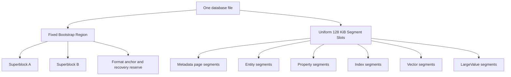
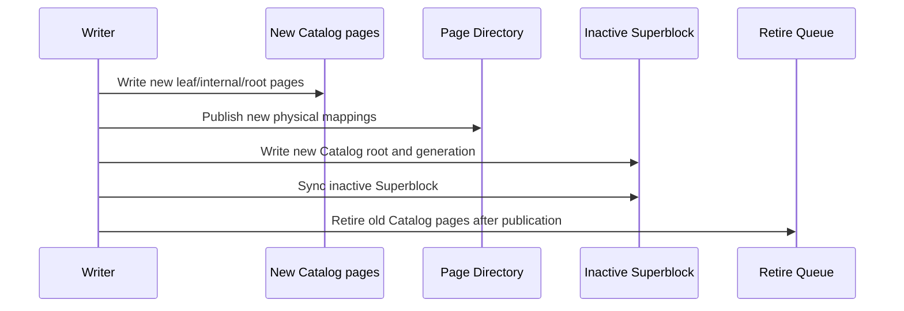
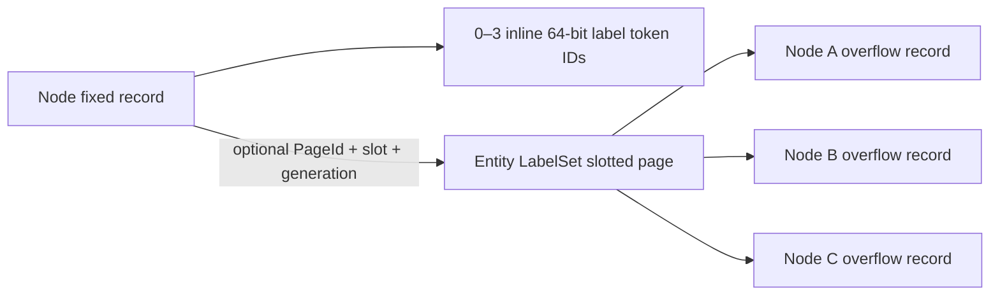

# 原生单文件存储重构方案

> 本文是 ZYX 长期存储架构的规范性设计和实施计划。它优先于其他文档中的历史 Stage、legacy storage、migration、兼容性说明。本文定义的格式尚未全部实现；实现完成前不得把历史实现描述为最终架构。

## 1. 决策边界

### 1.1 硬性前提

- 一个数据库始终只有一个数据库文件；不拆分 data/meta 文件。
- 不支持旧数据库打开、在线迁移、离线迁移或旧格式兼容。
- 旧数据库可以直接丢弃；新格式使用全新的 format version 和 magic。
- 数据库必须支持 macOS、Linux 和 Windows。
- 所有持久化整数、枚举、浮点和引用使用显式 little-endian codec，不持久化 C++ struct 的原始内存布局。
- 所有阶段都必须有独立测试、崩溃恢复测试和覆盖率门禁。

### 1.2 非目标

- 不保留 legacy `FileStorage`、legacy `DataManager`、legacy physical query execution。
- 不保留 migration checkpoint、cutover、legacy backup 或 `.migration` sidecar。
- 不为代码、图片、音频、PDF 等业务场景创建专用物理存储引擎。
- 不为 Catalog、Property、Vector 分别维护相互隔离且不能互相复用的物理 free list。
- 不继续在现有格式 v16 上通过兼容分支叠加补丁；Stage 0 重新冻结 clean format。

## 2. 总体目标

最终架构必须同时满足：

- 固定物理 Segment 仍可跨类型回收和复用；
- Catalog、Page Directory、Allocator、Property、B+Tree、Vector 和 LargeValue 均可 COW、搬迁和回收；
- 单个 Node/Edge 的更新不会复制完整 128 KiB Segment；
- 小事务不会为一条实体独占一个 128 KiB Segment；
- 热点查询通过统一 Buffer Pool 命中已校验的 page view；
- 数据库打开复杂度与文件总大小无关，不扫描整个文件发现 Catalog；
- 不相交写事务不会因为全局 Superblock generation 改变而无条件冲突；
- 大型文本和二进制值可自动外置、分块、压缩、去重、范围读取和回收；
- B+Tree 不因通用 entry 头部和临时 vector materialization 产生不必要开销；
- Vector 的单条 mutation 不会使整个 PQ/ANN generation 失效；
- 所有 publication 都能在任意崩溃点恢复为完整旧 generation 或完整新 generation。

## 3. 核心术语和身份模型

| 概念 | 含义 | 是否改变物理位置 |
|---|---|---|
| `EntityId` | Node 或 Edge 的逻辑业务身份 | 不变 |
| `SegmentId` | 逻辑 Segment 身份 | 不变 |
| `PageId` | 逻辑 page 身份 | 不变 |
| `PhysicalSlot` | 文件中 128 KiB Segment 的物理槽位 | 可以变化 |
| `FrameIndex` | Segment 内 4 KiB page frame 的位置 | 可以变化 |
| `Generation` | COW 版本和 snapshot 安全边界 | 单调递增 |
| `LargeValueId` | 通用外置大值的逻辑身份 | 不变 |

所有持久化引用使用逻辑身份。物理引用只用于 Bootstrap Region 直接定位根 page，以及 Page Directory 自身的自举路径。

## 4. 单文件物理布局

### 4.1 文件布局

数据库文件采用固定的 Bootstrap Region 加统一 Segment Space：



Bootstrap Region 建议固定为一个 128 KiB 对齐区域，包含：

- format magic 和版本；
- Superblock A/B；
- database UUID；
- 固定 recovery anchor；
- 少量 metadata emergency reserve 描述；
- 未来格式扩展保留字段。

Bootstrap Region 永远不参与普通 Segment 分配。它是固定格式入口，不属于任何 `SegmentKind`，因此“所有 Segment 都可回收”的要求仍然成立。

### 4.2 Segment 和 page

- 每个普通物理 Segment 固定为 128 KiB，并按文件偏移对齐。
- Segment 内部由一个显式 envelope 和若干 4 KiB frame 组成。
- 可用 frame 数由 envelope、checksum、alignment 和 page header 的实际布局 solver 计算，不能由业务代码硬编码。
- Fixed Entity、B+Tree、Property、Vector、LargeValue 均以 4 KiB page 为主要 COW 和缓存单位。
- 大型连续对象只在固定 Segment 内使用多个连续 frame 或多个 Segment，不能改变全局物理 Segment 大小。

### 4.3 SegmentKind 与 page subtype

物理槽位的分配不绑定未来类型。当前 generation 的 Segment envelope 记录 `SegmentKind`，page header 记录更细的 subtype。

推荐的长期 SegmentKind：

| SegmentKind | 作用 |
|---|---|
| `SGK_METADATA_PAGE_POOL` | Catalog、Page Directory、Allocator、System Catalog、Retire Queue 等 metadata page |
| `SGK_ENTITY_PAGE_POOL` | 混合容纳 Node/Edge fixed page 与 Node LabelSet slotted page |
| `SGK_PROPERTY_PAGE_POOL` | slotted Property page |
| `SGK_INDEX_PAGE_POOL` | packed B+Tree page |
| `SGK_VECTOR_RAW_POOL` | raw vector page |
| `SGK_VECTOR_PQ_POOL` | PQ code page |
| `SGK_VECTOR_ADJACENCY_POOL` | vector adjacency page |
| `SGK_VECTOR_MANIFEST_POOL` | vector manifest page |
| `SGK_LARGE_VALUE_DATA_POOL` | 通用 LargeValue chunk |
| `SGK_LARGE_VALUE_MANIFEST_POOL` | 通用 LargeValue manifest/index |
| `SGK_BULK_SCRATCH` | 事务私有、同文件 bounded-sort fragment；永不对图可见，若未发布则在可写打开时回收 |

`SGK_CATALOG` 不再作为不可回收的专用物理池。Catalog page 使用 `SGK_METADATA_PAGE_POOL` 中的 `MPK_CATALOG` subtype。这样一个 metadata segment 可以混合容纳多种 metadata page，也可以在完全释放后复用为任意其他 SegmentKind。

普通图 adjacency 是内建 Packed B+Tree，因此使用 `SGK_INDEX_PAGE_POOL`。`SGK_VECTOR_ADJACENCY_POOL` 只保留给 ANN 图状态；两者不能仅因都使用 adjacency 一词就共享 codec、owner kind、root 或维护策略。

## 5. Bootstrap、根目录和 Page Directory

### 5.1 Superblock 根引用

A/B Superblock 是唯一的 publication root。当前 v4 staged format 的每个 Superblock 记录：

- `format_version`；
- `generation`；
- `committed_file_end`；
- `allocator_root_physical_ref`；
- `page_directory_root_physical_ref`；
- `catalog_root_physical_ref`；
- 其他 typed metadata directory root 的 physical reference；
- `index_root_directory_root_physical_ref`；
- `retire_queue_root_physical_ref`；
- 逻辑 ID high-water marks；
- checksum。

Superblock 不保存整个目录，也不随着目录增长而移动。它只保存固定数量的根引用。当前所有 metadata
directory 都使用 physical bootstrap reference；这是 Stage 3 的临时表示，不得误解为普通数据页已经拥有稳定
metadata PageId。Stage 4 引入稳定 metadata PageId directory 后，除为打破自举循环而保留的 Page Directory
bootstrap root 外，其余 metadata root 才迁移为逻辑引用，并允许 page-local relocation。

### 5.2 Page Directory

Page Directory 是：

```text
PageId -> PhysicalSlot + FrameIndex + Generation + page metadata
```

Page Directory 自身采用 COW radix/tree。Superblock 直接保存 Page Directory root 的物理引用，从而打破“要通过 Page Directory 才能找到 Page Directory”的自举循环。当前 staged format 的其他 metadata root 也仍是 physical
reference；稳定 metadata PageId directory 完成后才会收敛为只有这条 bootstrap root 需要直接物理寻址。

最终 bootstrap 是一个强类型的物理 header，而不是 generic resolver。它的数据分支只映射
`PageId -> data-page location`，metadata 分支只映射 `MetadataPageId -> PhysicalPageRef`。两个分支、各自的
COW page 和 header 都保持物理链接，因此 lookup 不会先解析执行 lookup 的 directory。每个 non-bootstrap metadata
writer 必须从同一个 `MetadataWriteBatch` 取得 ID/reference pair，在 metadata 分支记录该 pair，先使所有 candidate
bytes durable，再发布唯一的 A/B Superblock generation。resolver 只接受 `MetadataPageId`，并在暴露 bytes 前验证分支类型、
route identity、reference generation、visibility fence 和 target page identity。bootstrap header 与 bootstrap-branch frame
只是内部物理 plumbing，绝不作为该 resolver 接受的值。这样数值相同的 `PageId` 与 `MetadataPageId` 仍彼此独立，既不会递归
路由，也不会把 data-directory entry 解释为 metadata。

在迁移开始前，恢复与 evacuation 必须对同一 Superblock 当前可达的全部 metadata radix、internal 和 leaf page 执行逻辑
`PageId` 非空且全局唯一校验；重复身份或无效身份必须在 publication 前 fail closed，不能通过重新分配新 ID 掩盖损坏。

在 staged format 中，metadata pool evacuation 也必须保留被复制页的逻辑 `PageId`，只切换物理 frame、generation 和 committed LSN；
旧 snapshot 通过旧物理根继续读取同一身份，新 Superblock 通过新物理根读取同一身份。其他 metadata COW writer 在稳定目录迁移完成
前仍不能据此移除现有物理根协议。

其他普通对象只持有 PageId。Catalog、Property、B+Tree、Vector、LargeValue 的 page 搬迁只需要更新 Page Directory 的相关 leaf 和 COW 路径，逻辑 PageId 不变。

### 5.3 Catalog

Catalog 的逻辑内容是：

```text
SegmentId -> SegmentDescriptor
```

SegmentDescriptor 至少包含：

- current physical slot；
- owner 或 pool identifier；
- generation；
- frame summary；
- kind/state/flags。

`SegmentId` 可以由 radix leaf ordinal 和 entry position 派生，不应在每条 entry 中重复存储。retired physical slot 放入 Retire Queue，不继续塞入普通 Catalog entry。

## 6. 单文件 allocator 和 Catalog 回收

### 6.1 独立 AllocatorRoot

Allocator 不能把 Catalog 当成唯一权威来源，否则会形成：


因此 Superblock 必须直接保存独立的 `AllocatorRoot`。AllocatorRoot 采用 COW tree，管理：

- free Segment runs；
- free metadata frames；
- allocated slots；
- current reservations；
- retired extents；
- committed file end；
- free-space summary。

### 6.2 Reservation

一个写事务根据旧 AllocatorRoot 预留物理 frame/segment：

1. 在进程内 reservation manager 中锁定候选位置；
2. 写入新的 Catalog、Page Directory、Allocator 和业务 page；
3. 在新的 AllocatorRoot 中将 reservation 标记为 allocated；
4. 事务失败时，旧 AllocatorRoot 仍然认为未发布 reservation 为空闲；
5. 事务成功后，通过 Superblock publication 使新 AllocatorRoot 生效。

数据库接近 ENOSPC 时必须保留可轮换的 metadata emergency reserve，确保还有空间完成一次 recovery/reclaim publication。该 reserve 不是固定物理段，可以在安全后回收并重新分配。当它已经提供 published COW frame 时，在 descriptor 仍作为权威 bootstrap identity 的短暂阶段，它可以合法地成为 root-reachable metadata pool。checksummed Metadata Pool header 会记录 `EMERGENCY_RESERVE_ORIGIN` format flag，因此 recovery 只接受带有该来源且已消费的 reserve，仍会拒绝伪造的普通 pool alias。rotation 会在同一 generation 内发布新的 tail reserve，并把旧 reserve 提升为普通 Catalog ownership。successor 正常在物理尾部 append；若未发布 rotation 在失败或进程强杀后留下候选，则仅当 recovered AllocatorRoot 将该文件最后一个完整 physical slot 明确标记为空闲时，才可以覆盖复用该 slot。实现不得通过文件长度推断可达性、不得覆盖 allocated/root-reachable slot，也不得复用其后仍有物理数据的 slot。这样既保持 COW publication，又消除了中断候选造成永久单-slot 空洞的问题。

该规则同样适用于每一次普通 Metadata Pool allocation，而不仅是 reserve rotation。`MetadataWriteBatch` 会在 metadata-page allocator 的整个生命周期中携带其 current published Superblock。在创建新 pool 前，allocator 只有在最终 physical slot 不属于已注册的 reachable pool、未被同一 batch 预留为 data、且该 batch current AllocatorRoot 明确将其标记为空闲时才可复用。partial candidate byte sequence 或 zero-filled reservation 本身永远不是覆盖 slot 的依据。这样，普通 pool creation 被中断后重新 open 仍可安全重试，不会把跳过的文件尾变为永久空洞。

### 6.3 Catalog page 回收

Catalog 更新使用 COW：



旧 page 只有在以下条件同时满足时才可以进入 free space：

- 不再被当前 root reachability 引用；
- 没有 active snapshot 可以从旧 root 到达它；
- retire generation 已越过 oldest active snapshot generation；
- 新 AllocatorRoot 已经持久化记录该物理位置可复用。

### 6.4 Segment 级回收与 evacuation

如果 metadata segment 所有 frame 都 retired：

```text
metadata segment -> Retire Queue -> Free Segment Tree
```

如果只剩少量 live page：

1. 计算 live frame density；
2. 低于阈值时启动 Metadata Evacuator；
3. 将 live page 复制到新的 metadata frame；
4. 保持 PageId 不变，只更新 Page Directory 的物理位置；
5. COW 发布新的目录 root；
6. snapshot-safe 后释放原 Segment。

释放后的 PhysicalSlot 不保留 Catalog 类型，可以分配为 Property、Vector、Index、Entity 或 LargeValue Segment。

## 7. Durability 和 publication

最终格式不依赖 Metadata WAL。由于所有可见 page 都是 fresh-page COW，A/B Superblock 已经足够作为单文件的原子 publication point。Metadata WAL 只作为 Stage 0/1 过渡实现，在 Stage 1 完成后删除 production path。

最终提交顺序：

1. 写入新的业务 data page/segment；
2. 写入新的 metadata page；
3. 同步文件数据；
4. 写入 inactive Superblock；
5. 同步 Superblock；
6. 老 generation 进入 Retire Queue，等待 snapshot-safe reclamation。

publication 前不能覆盖任何仍可能被旧 Superblock 或旧 snapshot 引用的 page。

崩溃后只允许出现：

- 完整旧 generation；或
- 完整新 generation。

未被有效 Superblock 引用的新 page 可以成为可重建的空间泄漏，但不能造成逻辑损坏。

## 8. Buffer Pool

建立唯一的 raw-page Buffer Pool，所有存储子系统共享：

- Metadata；
- Catalog/Page Directory；
- Entity；
- Property；
- B+Tree；
- Vector；
- LargeValue。

Buffer Pool 必须提供：

- pin/unpin；
- generation-aware key；
- dirty/private COW page；
- 2Q 或 CLOCK-Pro eviction；
- sequential scan isolation；
- sibling/page prefetch；
- 校验一次、缓存 validated page view；
- 按字节而非按 entry 管理容量；
- Windows、macOS、Linux 一致的 read/write/flush 行为。

`cache_size` 必须真正连接到该 Buffer Pool，并以字节为单位（默认 64 MiB，最小一个 4 KiB page）。typed store 构造不得触发全量 reconcile 或隐式磁盘扫描；recovery/reconcile 只允许由 database-open coordinator 执行一次。

## 9. Fixed Entity 重构

### 9.1 Page 布局

Node 和 Edge 改为 4 KiB fixed entity page：


128 KiB Segment 只作为 page container，不再是单个实体的 COW 单位。

### 9.2 Entity Map

EntityId 不再直接决定物理 slot。专用 Entity Map 保存：

```text
EntityId -> PageId + slot + optional slot generation
```

Segment generation 不在每个实体 entry 中重复存储，由同一 snapshot 的 Catalog/Page Directory 提供。

删除一个实体后，slot 可以被任意新的 EntityId 复用。Entity full scan 按 page/bitmap 扫描，不逐实体遍历宽泛 Location Directory。

### 9.3 Node/Edge record

Node/Edge fixed record 应删除：

- Property ID；
- Property storage type；
- 依赖 Property ID reservation 的字段；
- 过度占用空间的重复 logical ID（在 page-local ID array 已足够时）。

Node label 使用 3 个 inline 64-bit token ID，加一个可选的单页 `EntityLabelSet` 记录，不再保留历史的六标签限制。3 个 inline slot 和 64-bit Token ID 是明确的 format design；单页 overflow capacity 是由 page-layout 常量计算出的派生值，不能在 store、测试或文档中再次复制结果数字。

Edge record 最终只保留 source NodeId、target NodeId、关系类型 Token ID 和必要状态，并且是这些字段唯一的权威副本。Node record 不保存入向/出向 adjacency root，Edge record 不保存 adjacency list link。普通图 adjacency 由独立维护的内建 Packed B+Tree 提供。

### 9.4 Node label 布局

Node fixed record 保存：

- `inline_label_count`，取值范围为 0–3；
- 3 个 64-bit `inline_label_ids`；
- 可选 `label_overflow = PageId + slot_id + slot_generation`。

完整标签集合必须是非零、严格递增且无重复的 schema token ID。0–3 个标签全部 inline，且 overflow reference 必须为空；4 个或更多标签将 canonical sequence 的前 3 个 token ID 保留在 fixed record，其余 token ID 以同样顺序存入一个 `EntityLabelSet` 记录。fixed record 不重复保存总标签数；overflow record header 保存自己的元素数量。



一个 4 KiB LabelSet slotted page 可以保存多个不同 Node 的 overflow record；不得为每个 Node 独占一个 page。每条 overflow record 只属于一个 Node，不做跨 Node dedup。record 不重复保存 NodeId，Node fixed record 中的稳定引用是唯一 ownership edge。LabelSet page 使用 `POK_ENTITY_LABEL` subtype，Node/Edge fixed page 使用 `POK_ENTITY` subtype。两种 page 可以共同放入 `SGK_ENTITY_PAGE_POOL`，不新增专用 128 KiB Label Segment，也不得借用 `SGK_PROPERTY_PAGE_POOL`。

### 9.5 单页容量和明确上限

LabelSet 使用显式 little-endian 64-bit Token ID 数组，不采用压缩、变长整数或 chunk chain。8-byte Token ID 是当前 format 的基础字段宽度，Node record、Schema Token Registry、LabelSet codec 和 Label Index 必须保持一致。

单条 overflow record 的容量由 `RSS_PAGE_OWNER_MAX_PAYLOAD_BYTES`、`RSS_SLOTTED_PAGE_HEADER_BYTES`、16-byte `RSS_SLOTTED_PAGE_SLOT_BYTES`、`RSS_ENTITY_LABEL_SET_HEADER_BYTES`、record alignment 和 `sizeof(uint64_t)` 推导。规范性判断是编码后的完整 LabelSet record 能否放入一个空的 typed slotted page；实现必须通过共享的 encoded-size/capacity solver 完成预检，而不是比较手写的标签数量。

`RSS_ENTITY_LABEL_SET_MAX_OVERFLOW_LABELS` 是该 solver 的派生结果，`RSS_ENTITY_MAX_LABELS` 等于 3 个 inline slot 与 overflow capacity 之和。该规则仅约束由多个 layout constant 组合计算出的结果，例如某次实现中的最大标签数：不得将其作为独立的数值契约复制到持久化数据、业务分支、测试或文档中。诊断工具可以显示该值，但必须从共享 solver 获得。

与之相对，稳定的 format 事实应明确保留。64-bit Token ID、16-byte slot entry、3 个 inline slot 和 page size 定义了 on-disk codec，应在文档与测试中直接体现。基础 layout constant 变化时，只修改其唯一代码定义并按持久化兼容规则更新 format version；之后所有 codec、allocator 和测试都通过同一 solver 获得全部派生上限。

最大可编码 overflow 必须成功，`RSS_ENTITY_LABEL_SET_MAX_OVERFLOW_LABELS + 1` 必须在分配 page、写 candidate frame 或发布 metadata 之前以明确的容量错误失败。当前方案不预留也不实现多 record、多 page 或 chunked LabelSet。

### 9.6 放置、更新与空间复用

LabelSet placement 使用按 `PageOwnerKind` 隔离的 best-fit free-space index。每个索引项至少跟踪 contiguous free bytes、reclaimable bytes 和可复用 dead-slot 数量。插入成本为 record bytes；仅当没有 dead slot 可复用时才额外包含 16-byte `RSS_SLOTTED_PAGE_SLOT_BYTES`，避免保守估算跳过实际可用的 page。选择顺序为：

1. 优先选择已有 `POK_ENTITY_LABEL` page 中能容纳 `record bytes + slot entry` 的最小空闲区；
2. 如果总空闲空间足够但不连续，先在 candidate COW image 中 compact，再重试；
3. 如果没有现有 page 可容纳，优先在已有 `SGK_ENTITY_PAGE_POOL` 的空 frame 中追加 LabelSet page；
4. 只有所有匹配的 Entity pool 都没有可用 frame 时，才分配新的 Entity pool Segment。

free-space index 必须按 page subtype 过滤，不能把同一 Entity Segment 内的 fixed Node/Edge page 当作 slotted page 打开。placement hint 不是写入授权；metadata writer 必须在 pinned generation 下重新验证 Page Directory、Catalog、owner kind、owner LSN 和可用 COW frame。

已有 LabelSet page 的更新始终写入新 COW frame。candidate frame 可以来自源 Segment，也可以来自另一个同 owner domain 的 `SGK_ENTITY_PAGE_POOL`；后者仍保留原 `PageId`，只切换 Page Directory location。源 pool 没有空 frame 时不得因此拒绝一个本可完成的标签更新。

标签更新先尝试在原 page 内完成。缩短记录直接复用原 capacity；增长时依次尝试相邻空闲区、移动 page-local payload、compact 后重试，并保持 `PageId + slot_id + slot_generation` 不变。payload offset 只存在于 slot entry 中，因此 page 内移动不修改 Node record。如果 compact 后仍放不下，则在另一个 LabelSet page 创建新 slot，并在同一个事务中更新 Node overflow reference、删除旧 slot。减少到 3 个或更少标签时清空 overflow reference 并删除旧 slot。

slot 被删除后进入 dead 状态，并在复用时递增 generation，旧缓存或陈旧引用因此会 fail closed。较小的新记录可以使用已释放 slot；compact 会合并 page-local 碎片，因此不会永久保留原记录大小造成的空洞。LabelSet page 变空后进入 snapshot-safe retirement；Entity Segment 的所有 frame 都不再可达后，普通 Segment evacuation/reclamation 流程可以回收该物理槽位并跨 SegmentKind 复用。

### 9.7 原子性、读取与索引一致性

一次标签 mutation 的 Node fixed page、LabelSet page、Page Directory 和 Label Index delta 必须由同一个 metadata transaction 和同一个 Superblock generation 发布。禁止先独立发布 overflow page，再发布指向它的 Node；也禁止先删除旧 slot，再切换 Node reference。提交前失败不得留下可达 orphan，提交后旧 snapshot 继续通过旧 Page Directory root 读取旧 Node 和旧 LabelSet frame。

读取过程最多增加一次 4 KiB page lookup：先通过 Entity Map 读取 Node fixed record；若 overflow reference 非空，再以 `PageId` 通过 Page Directory 和 Buffer Pool 定位 LabelSet page，并校验 `POK_ENTITY_LABEL`、page generation、slot generation、record checksum、canonical ordering 和容量边界。Buffer Pool key 使用逻辑 PageId 与 snapshot generation；LabelSet page 的物理 relocation 只更新 Page Directory，不改 Node reference。

integrity scanner 必须交叉验证：每个非空 Node overflow reference 恰好解析到一个 live LabelSet slot；每个 live LabelSet slot 恰好被一个 Node 引用；两个 Node 不得共享同一 slot；空引用不得携带部分 PageId/slot/generation；Label Index 中该 Node 的 token 集合必须与 inline 加 overflow 的 canonical union 完全一致。标签更新直接比较 old/new canonical set 生成 Label Index add/remove delta，不扫描整个 Label Index。

## 10. Property Store

### 10.1 Property identity

Property identity 统一为：

```text
(EntityKind, EntityId) -> PropertyRoot
```

没有 Property 就没有 Directory entry。不再为每次 Property mutation 预先分配独立 PropertyId，也不在 Node/Edge record 中保存 Property reference。

### 10.2 多级 Property 表示

| 规模 | 表示 | 目标 |
|---|---|---|
| 很小 | inline Property value | 避免额外 page 读取 |
| 小/中 | slotted Property page | 单实体有限范围更新 |
| 大集合 | per-key record 或小型 Property tree | 单 key 更新不复制全集 |
| 大 value | `LargeValueRef` | 分块、压缩、范围读取 |

更新一个 key 不应复制整个 Property collection。Slotted page 的 shrink 需要支持容量回收、hysteresis 和 page-pressure compaction。

### 10.3 Property Directory cache

placement cache 不能按全局数据库 generation 全量失效。使用 per-pool/per-shard version、free-space class index 和增量更新。

## 11. 通用 LargeValue

代码、图片、JSON、PDF、音视频和模型文件都使用统一的 `LargeValueStore`，不建立 `CodeObjectStore` 或 `ImageStore`。

推荐层次：

```text
Value
    -> InlineValue
    -> LargeValueRef

LargeValueStore
    -> LargeValueManifest
    -> LargeValueChunk/Extent
```

`LargeValueRef` 保存：

- logical object id；
- generation；
- uncompressed size；
- content hash；
- text/bytes kind；
- 非空、可打印 ASCII 且受格式上限约束的 media type；
- codec；
- checksum information。

`LargeValueRef::generation` 和 `LargeValueManifest::generation` 是不可变的
逻辑 generation：它们标识 value 内容，compactor 仅搬迁物理 frame 时不得改变。
`PageLocation::generation`、`PageOwnerHeader::generation` 和
`LargeValueManifestLocation::generation` 则标识当前物理 pool/frame 的
generation。两套语义不能当作同一个版本号直接比较。

### 11.1 Cypher 与 Driver ABI

普通 Cypher 继续使用属性赋值：

```cypher
CREATE (f:CodeFile {
    path: $path,
    content: $content,
    content_type: "text/x-c++src"
})
```

小值自动 inline，大值自动 externalize。Binary 数据通过通用 bytes 参数表达，不引入 `Code`、`Image` 等底层 ValueKind。

超大数据通过通用 Driver ABI 流式接口写入和读取：

- begin external value；
- write chunk；
- finish/abort；
- read range；
- read stream。

当前 ABI 为结果 bytes 和 value reference 提供有界 pull stream。调用方传入
`(offset, length)` 范围，反复读入应用方拥有的 buffer；范围耗尽后才返回
`ZYX_DRIVER_DONE`。stream 自己拥有不可变的 bytes snapshot，因此打开后可以
关闭源 result。这样每次 ABI copy 都有明确上限，native LargeValue range
reader 仍负责 chunk 级 I/O 和解压。

`DriverAbiBytesTest.StreamsPersistedLargeValueRangesAfterReopenAndResultRelease`
是该边界的 native 端到端 acceptance checkpoint：它持久化一个超过 inline
容量的 binary Property，关闭并重新打开单一数据库文件，打开严格的子范围 stream，
释放其源 result，并验证之后完整 pull 的字节精确性。这证明的是持久化
`LargeValueRef` 路径，而不仅是内存参数回显；性能、fault injection、binding
adapter 和三平台门禁仍未关闭。

LargeValue 创建和 Property reference 必须在同一事务中发布。

### 11.2 分块和压缩

- 默认 chunk 建议从 32 KiB 开始，范围可调为 16–64 KiB；
- 很小的值通常不压缩；
- 代码、JSON、SQL、日志优先使用 LZ4 或 Zstd；
- PNG、JPEG、ZIP 等已压缩格式默认保存 raw；
- 每个 chunk 独立 checksum 和 codec；
- range read 只解压相关 chunk；
- `content_hash` 基于未压缩原始字节，用于去重；
- `normalized_hash` 仅用于相似代码分析，不用于物理合并。

### 11.3 代码分析数据模型

源文件优先只存储一次：


| 实体 | 主要字段 |
|---|---|
| `CodeFile` | path、language、commit、content hash、LargeValueRef、line index ref |
| AST/Function Node | file id、start byte、end byte、line range、symbol metadata |
| 独立 CodeSnippet | LargeValueRef、language、content hash、normalization metadata |

AST 节点优先保存源文件范围，而不是复制完整代码正文。

### 11.4 回收

LargeValue 使用 immutable object：

```text
new chunks -> new PropertyRoot -> Superblock publication
-> old object enters Retire Queue
-> snapshot-safe reachability reclaim
```

多个实体共享同一个 content hash 时，必须通过 reachability 或引用信息确认最后一个引用消失后才能回收。

### 11.5 搬迁与 snapshot 安全

LargeValue 使用稳定的 `PageId`，而不是物理 pointer。data page 搬迁只发布新的
Page Directory location；manifest page 搬迁则在同一个 COW/Superblock publication
中同时发布新的 Page Directory location 和对应的 `LargeValueManifestLocation`
route。两类搬迁都会将物理 owner 改为目标 pool generation，但保持逻辑
`LargeValueRef` 与 manifest generation 不变。

因此 old snapshot 会通过旧 directory root 读取旧 frame，而 newer snapshot 会
解析新 route 和新 frame。source pool 在最后一个 current page 搬迁后退休，但只有
所有仍可能解析旧 root 的 snapshot 释放后，物理 slot 才能真正释放。

## 12. Packed B+Tree

B+Tree 使用专用 packed page codec：

- leaf/internal 分离；
- packed offset array；
- on-disk canonical key order；
- prefix compression 和 restart points；
- raw page view binary search；
- range cursor，不 materialize 整页 entry vector；
- scalar leaf 的 EntityId 从复合 key 后缀解码，不重复存 value。

Property index 的排序 key 保持：

```text
(PropertyValue, EntityId)
```

EntityId 保证重复 PropertyValue 的稳定排序和唯一定位，不应为了去重而删除。需要消除的是物理重复编码和宽泛 entry header。

Bulk builder 和 online mutation 必须共享同一套 page invariant、separator rule、split/merge rule 和 corruption checks。

实现必须支持具名 key codec 和 comparator，而不是把 Property index 假设固化进树中。普通图 adjacency 特化使用固定逻辑字段 `(direction, NodeId, EdgeId)` 和空 value；comparator 依次按 direction、无符号 NodeId、无符号 EdgeId 排序，磁盘 codec 仍通过显式格式 codec 写入每个整数。容量、fan-out、restart interval、separator 大小和每页 entry 数都必须由编码字节与共享 page layout solver 推导。

每棵树拥有稳定的逻辑 `IndexId`；COW root PageId 和 root generation 存放在 Index Root Directory 中。普通 adjacency 树使用一个永不与用户索引冲突的保留内建 `IndexId`。这样 Superblock 仍保持定长：它发布 Index Root Directory root，而该 snapshot 的 directory 定位 adjacency root。空树以缺少 adjacency root entry 表示，而不是保留一个永久空 page。

## 13. System Catalog

删除 sealed/dynamic 双体系，建立一个 canonical mutable System Catalog：

```text
(property-key, name)       -> token
(property-token, token)    -> name
(schema-name, kind, name)  -> schema token
(schema-token, kind, token)-> definition
(index-id, id)             -> definition
(index-name, name)         -> id
(index-schema, signature)  -> id
(constraint-id, id)        -> definition
(constraint-name, name)    -> id
(sequence, kind)           -> high-water mark
```

forward、reverse、secondary entry 在同一个 metadata transaction 中原子更新，不保留人工高位 dynamic namespace 和 sealed tombstone registry。

### 13.0 Graph 基数统计

System Catalog 还保存一对 snapshot-pinned 的逻辑 Node/Edge 基数。持久化值采用非零编码，因此空图可与无效 B+Tree leaf
value 区分；缺少整对记录表示旧文件的统计不可用，而只存在一侧必须 fail closed。普通图 mutation 与 streamed bulk Edge 的
最终 Catalog/adjacency/Entity publication 都在同一 A/B generation 更新该对计数；bulk 路径只在已有完整统计时增加 Edge
计数，绝不从逻辑 ID high-water mark 推断旧文件的基数。

### 13.1 Schema Token 名称与 ID

标签名称和 relationship type 名称只存储在 canonical System Catalog，不写入 Node、Edge、LabelSet 或 Label Index。System Catalog 维护两个逻辑方向：名称与 kind 到 `SchemaTokenId`，以及 kind 加 `SchemaTokenId` 到包含 canonical 名称的 definition。前向索引用于 query bind，反向 definition 用于返回标签名称、检查 catalog 完整性和管理操作；执行阶段只携带 Token ID。

名称是 UTF-8 byte string，长度边界由唯一的共享 System Catalog name-limit format constant 定义。该边界必须同时满足 API 语义上限、definition record 上限、前向索引 key 上限、反向 definition 上限和目标 B+Tree fan-out；Cypher、Driver ABI、System Catalog codec 和 lookup API 必须共享它。不得把 persisted length field 的理论范围或“单条 entry 勉强能放进空 page”的大小直接当作公开名称上限。

`SchemaTokenId` 使用明确的 64-bit little-endian wire field。共享名称上限与相关 key/record overhead 使用各自唯一的格式常量；任何由它们计算出的 B+Tree entry 或 page capacity 都只通过共享 solver 使用，不在文档或调用方复制结果数字。未知 definition version 或超过统一名称边界的输入一律 fail closed。

名称在 canonical definition 中是权威值；前向 B+Tree 为实现 collision-free name lookup 仍需要保存可比较的名称 key。这个按唯一 schema token 发生的有限重复是有意的，并通过 leaf prefix compression、internal separator truncation 和 dictionary cache 控制；名称不得再复制到每个实体或 Label Index entry。

## 14. Graph Adjacency

普通图 adjacency 与 Vector ANN adjacency 是相互独立的数据结构。普通图 adjacency 使用一棵全局内建 Packed B+Tree；Vector adjacency 继续使用第 15 节的 Vector 专用方案。

### 14.0 规范性实现边界

普通图在持久化层只能有一种 adjacency 表示：保留的全局、key-only Packed B+Tree。这是格式不变量，而不是 planner 偏好。每个实现阶段和后续优化都必须保持以下约束：

- 格式保留的 `RSS_GLOBAL_ADJACENCY_INDEX_ID` 是唯一的普通图 adjacency `IndexId`；它通过 snapshot-pinned Index Root Directory 解析唯一 adjacency root，绝不向用户或 secondary index 分配；
- Node record 不拥有 adjacency root 或 adjacency key，Edge record 不拥有邻居 link、物理 page 位置或重复的 adjacency payload；
- 每条 live Edge 恰好拥有一个 `ADJ_OUT` key 和一个 `ADJ_IN` key；二者与权威 Edge 的变更必须在同一 metadata generation 中 commit 或移除；
- B+Tree page 只包含路由/separator 数据或 key-only adjacency entry，绝不混合存放 Node 或 Edge record；
- page relocation 只修改逻辑 `PageId` 的 Page Directory route；绝不重写 Edge、Node、cursor continuation 或 parent child reference。

per-Node chain、per-Node root、Base/Delta/Tombstone 层级、adjacency tail page 和 Edge-to-Edge 双向链表均为已退役设计。它们不是 fallback、compatibility reader 或优化候选项。若将来有测量结果证明需要专用 access path，必须新增具有独立 identity 的 derived index，并为它定义 codec、root、publication、reclamation、integrity 与 benchmark gate；不得改变全局 adjacency tree 的语义或 payload。

### 14.0.1 结构决策记录

“全局 Packed B+Tree”只描述普通图 adjacency 的访问路径；它不表示把 Node 和 Edge record 混放进 B+Tree page，也不表示 Edge record 直接成为 B+Tree leaf value。下表是 clean format 的强制选择：

| 方案 | 决策 | 原因 |
|---|---|---|
| 一棵全局 key-only tree | 采用 | 低阶 Node 共享 leaf，高阶 Node 顺序跨 leaf；只维护一个 root、codec、publication 与 retirement lifecycle。 |
| 分别维护 outgoing/incoming tree | 不采用 | `direction` prefix 已给出两个有序 access range；拆成两棵 tree 只会增加 root-directory、COW 与回收状态，不能减少一次 Edge mutation 必需的两条 key。 |
| per-Node root 或 per-Node B+Tree | 不采用 | 会重新引入长期稀疏 root/tail page、更多 root publication，以及超级节点专用结构；小度数 Node 无法共享编码空间。 |
| Edge 双向链表或 Edge chain | 不采用 | 插入/删除会改写 Node head 和相邻 Edge，扩大事务写集合，并使 relocation、快照和完整性校验耦合到关系之间的物理链接。 |
| 在 adjacency leaf 中嵌入 Edge record 或覆盖性 Edge payload | 不采用 | 会制造第二份 endpoint/type/state 权威副本，混淆 Entity 与 Index codec/lifecycle，并使任何被镜像的关系字段更新扩大 B+Tree 写放大。 |

因此，B+Tree leaf 可以同时装下多个 Node 的 **adjacency key range**，但不会装下这些 Node 或 Edge 的实体 record。一次 expansion 先流式读取 `EdgeId`，仅在查询确实需要 endpoint、type、state 或 Property 时，才从同一 snapshot 的 Edge Entity Store 解析相应 record。这个二阶段读取是有意的：它将顺序 adjacency 扫描与实体 materialization 的成本分离，并避免将不需要的 Edge 字段带入每个 index entry。

### 14.1 权威数据与 key schema

Edge Entity Store 是权威数据源：

```text
EdgeId -> sourceNodeId + targetNodeId + relationshipTypeId + state
```

adjacency 树是二级访问路径，逻辑 schema 为：

```text
(direction, NodeId, EdgeId) -> empty
```

这里只有一棵 tree 和一个 root，而不是每个 direction 或每个 Node 各有一棵 tree。`direction` 是第一个 key component，因此 outgoing 和 incoming access path 是同一棵 tree 中互不重叠的有序 range。这样可保持统一 codec、一次 publication boundary 和一套 reclamation lifecycle，同时不引入长期稀疏的 root hierarchy。

每条 live directed Edge 必须恰好包含两个 entry：

```text
(ADJ_OUT, sourceNodeId, EdgeId) -> empty
(ADJ_IN,  targetNodeId, EdgeId) -> empty
```

`AdjacencyDirection` 是持久化的带前缀 enum；未知值在所有平台上都必须 fail closed。NodeId 和 EdgeId 是正 64-bit 逻辑 ID。routing NodeId 必然属于 key，但空 value 是规范要求：tree 不保存另一端 endpoint，也不把 relationship type/state 作为 Edge payload 存储。第一版不能添加 covering value。未来如果度量结果证明需要 type-qualified access path，应新增拥有独立 identity 和 lifecycle 的 derived index，而不是静默修改该 key。

comparator 按 `direction`、无符号 `NodeId`、无符号 `EdgeId` 定义 canonical ordering。同一 `(direction, NodeId)` 的 entry 因而形成一个连续 range，并按确定顺序排列。prefix compression 会消除该范围内重复的 direction/NodeId 字节。多个低阶 Node 共享一个 leaf，不允许一个 Node 或 direction 独占 4 KiB tail page。超级节点可连续跨越任意数量的 leaf，不存在 per-Node size limit。

物理边界必须严格。Entity page 存放固定 Node/Edge record；adjacency leaf 只存放排序 key 与空 value；adjacency internal page 只存放 separator 与逻辑 child PageId。因此，一个 B+Tree leaf 可以容纳多个 Node 的 range，但绝不包含这些 Node 或 Edge record。这是 packed layout 的含义，而不是把图实体放入 B+Tree 的设计。

### 14.2 Root 所有权和物理放置

全局树在 Index Root Directory 中使用保留的内建 adjacency `IndexId`。snapshot 的解析路径为：

```text
Superblock -> Index Root Directory -> adjacency IndexId -> B+Tree root PageId + root generation
```

root entry 和所有 B+Tree page 都属于同一个 metadata generation。adjacency leaf/internal page 使用普通 Packed B+Tree codec、`SGK_INDEX_PAGE_POOL` 和 adjacency 专属 owner identity。它们绝不能与 Node record、Edge record 或 Vector adjacency 共用 page。Page 搬迁保持逻辑 PageId 不变，只修改 Page Directory route；tree reference 和 Edge record 都无需改写。

空图不存在 adjacency root entry。第一条 Edge 的 transaction 创建初始 tree 并发布 root entry；删除最后一条 Edge 时，在 new generation 中原子删除 root entry。old snapshot 仍保留 old root，只有满足 snapshot safety 后才释放其物理 page。最终普通图格式不存在 per-Node Root page、Root write-tail hint、Base/Delta chain、Tombstone、merge threshold、merge debt 或 recovery cursor。

### 14.3 读取路径与 cursor contract

出向和入向扩展分别 lower-bound seek 到 `(direction, NodeId)` 的第一个 key，然后推进到 prefix 改变为止。复杂度为 `O(log E + degree)` 次比较及与输出成正比的工作量。root/internal page 使用 normal Buffer Pool admission；range scan 消费的 leaf 使用 sequential admission。cursor 对右 sibling 做有界 prefetch，不能 pin 无界 route。

cursor 直接从经过校验的 page view 读取压缩 key，只保留当前 leaf pin、restart/search state、prefix bound 和逻辑 continuation key；不能 materialize 完整 leaf 或完整 adjacency range。continuation 为 `(snapshot generation, direction, NodeId, last EdgeId)`，并严格从 `last EdgeId` 之后恢复。它绝不暴露 PageId、slot 或 physical offset。过期或外来的 continuation 应按公开 cursor contract fail closed，或从逻辑 lower bound 重新开始。

degree/count 等只依赖 adjacency 的操作可以只统计 entry，不读取 Edge record。需要返回 Edge 字段时，通过 snapshot-pinned Edge Entity Map 解析每个 EdgeId，并校验 Edge live 且 endpoint 与扫描 prefix 匹配。关系类型过滤第一阶段读取权威 Edge record；必须按 page 批量化并利用 locality，不能对每个 key 发起无约束随机读取。

无向扩展独立打开两个有界 range，再合并结果。self-loop 的语义必须明确：一个 self-loop 含一个 `ADJ_OUT` 和一个 `ADJ_IN` entry；只有 Cypher 语义要求返回一条关系时，无向 operator 才按 EdgeId 去重。

### 14.4 Mutation 与 publication

创建一条 Edge 时，必须基于同一 pinned generation 规划 Edge record、Entity Map entry、`ADJ_OUT` insert 和 `ADJ_IN` insert。两个 key mutation 通过同一个 B+Tree COW overlay 应用，所有 replacement page、replacement adjacency root、metadata root 和 inactive A/B Superblock 在一次 commit 中发布。崩溃后只能看到完整 old generation 或完整 new generation，禁止只看到一个方向。

全局 root 是物理 publication point，而不是用户可见的 conflict domain。publication 前，transaction layer 必须针对 current root 重新验证 sorted final-state overlay；并发 adjacency commit 已推进 root 时，它应重试/rebase 该 overlay。只有 duplicate/deleted Edge identity、权威 endpoint 已改变等语义矛盾才报告 conflict，不能仅因另一 writer 替换了全局 root 而失败。rebase 工作量和 retry 次数由 transaction policy 限制。

删除一条 Edge 时，先解析权威旧 endpoint，再通过同一 overlay erase 两个精确 adjacency key，同时删除 Edge record 和 Entity Map entry，并原子发布结果。普通图删除不追加逻辑 Tombstone。COW 退休 page 进入公共 generation-aware Retire Queue，只有旧 snapshot 释放后才能复用。

`DETACH DELETE` 对出入两个方向执行有界 range scan，对包含 self-loop 的 EdgeId 去重，在准备 publication 前校验 transaction limit，并提交一个 bulk final-state plan。每条 Edge record 和对应两个 entry 都必须恰好删除一次。并发或 stale-root publication 在可见前被拒绝，由 transaction layer 从新 snapshot 重试。

Bulk ingest 为每条已校验 Edge 生成两个 key，按 canonical comparator 排序和去重，再交给共享 bulk/overlay page builder。已有序 run 应执行 merge，不能逐 key 重复 insert。online 与 bulk path 必须共享 leaf fill、restart、separator、checksum、split/merge 和 owner invariant。容量和内存由配置的 transaction/run limit 约束；未来若需要 external sort，只能使用单数据库文件内的受控区域或有界进程临时内存，不能演变为第二个持久数据库 artifact。

### 14.5 空间、维护与可选 write buffer

删除使用普通 Packed B+Tree underflow 处理。Sibling redistribution 或 merge 在 candidate COW image 中完成；空 leaf 和折叠的 internal root 通过公共 page reclamation path 退休。Page occupancy policy 使用 codec 提供的 byte count，而不是固定 entry count。正确性不依赖后台全树 compact；若实际 byte occupancy 低于策略，可执行有界 maintenance rebuild，并一次发布 replacement root、snapshot-safe 地退休 old tree。

第一版生产实现必须使用普通全局 Packed B+Tree。只有基准证明孤立 Edge mutation 的 COW write amplification 无法接受时，后续阶段才可在同一 canonical tree 前增加一个有界全局 write buffer。该决策必须有记录阈值，并保持统一 logical cursor、双 entry 原子可见性、有界内存、确定性 recovery 和单文件约束。per-Node delta chain 以及此前的 Base/Delta/Tombstone hierarchy 不能作为 fallback。

### 14.6 Integrity 要求

Integrity scanner 在一个 pinned snapshot 内验证：

- 每条 live Edge 恰好有匹配的 `ADJ_OUT` 和 `ADJ_IN` entry；
- 每个 adjacency entry 都解析到一条 live Edge，并且 endpoint 与 direction/NodeId 一致；
- 不存在 duplicate、missing、foreign、zero-ID 或 unknown-direction key；
- key order、prefix/restart encoding、separator、sibling link、page ownership、generation、LSN 和 CRC 全部有效；
- 保留 adjacency IndexId 至多有一个 current root，且用户 definition 不能占用；
- 所有 reachable page 都属于该 root，retired/unreachable page 由公共 reclaimer 正确分类。

快速 open 只按需校验 root 和 page structure，不扫描全部 Edge。完整双向交叉校验是带有界内存进度的显式 integrity/maintenance 操作，不是普通 startup 要求。

## 15. Vector

### 15.1 Manifest

Vector Manifest 只保存 O(1) metadata：

- dimensions/metric；
- total record count；
- Raw/PQ/Adjacency mapping roots；
- codebook root/generation；
- base/delta generations；
- ANN entry point；
- allocation tail hints。

Manifest 不列举全部 Raw/PQ page。Page Directory 和 mapping root 是权威 inventory。

### 15.2 Mapping

mapping 直接返回：

```text
(PageId, slot, generation)
```

不能只返回 page 后再在 page 内线性搜索 VectorId。

Vector delta mapping 使用固定的 typed key `(VectorId, Operation)`，leaf value 保存对应的 `NodeId`。因此
`INSERT` 和 `ERASE` 都能在有界的语义映射点查中证明 Node-to-Vector、Vector-to-Node 和 Raw Location
的一致性，不依赖扫描整个 semantic mapping；同一个 VectorId 同时出现两种 operation 必须 fail closed。

### 15.3 Online mutation

Vector 使用 immutable base + mutable delta：

```text
base ANN/PQ generation
delta vectors
tombstones
query merge
background rebuild
atomic base replacement
```

新 vector 不应使整个 PQ/Adjacency generation 失效。已有 codebook 时只计算对应 vector 的 PQ code；邻接进入 delta graph 或局部 repair。

delta 的 entry count 和 mapping page 数量必须分别受限。达到维护阈值时应调度 base rebuild，而不是无限增长或
静默拒绝用户写入；在 rebuild 完成前，查询以 `base - tombstones + exact inserts` 合并结果。

### 15.4 Rebuild

Vector rebuild 在 unpublished private pages 中完成，最后一次性发布：

- Raw/PQ/Adjacency mapping roots；
- codebook root；
- base/delta manifest；
- entry point；
- retire queue。

Adjacency builder 使用 Vamana/DiskANN/HNSW 类受控候选算法，不允许对所有 source/candidate 执行 O(N²) 比较。

## 16. Legacy 和 migration 清理

退休只针对实现，绝不能隐式删除已经记录的功能。如果一个 legacy 文件仍是某项已支持 API、Cypher 过程、
算法、管理操作或性能契约的唯一实现或唯一测试，那么必须保留它作为迁移参考，或者先用 storage-neutral
验收测试固化其行为。第 22 节是执行本轮清理时强制遵守的功能保全与删除门禁。

Stage 0 之后，以下内容不进入生产 source set：

- legacy `FileStorage`、`DataManager` 和 physical query path；
- `OfflineMigrationCoordinator`、cutover、checkpoint、sidecar；
- `Legacy*` storage classes；
- sealed/dynamic 双 registry；
- legacy Blob semantic claim/reclamation；
- State migration subsystem；
- `SFM_LEGACY` 和 legacy magic probe；
- legacy backend pointer 和 legacy QueryEngine constructor；
- `database migrate` 和 `database cutover` CLI。

具有长期价值的 maintenance builder 不删除，而是移到：

```text
src/storage/relocatable/maintenance/vector/
src/storage/relocatable/maintenance/index/
```

例如 Vector adjacency builder、PQ builder、scalar index materializer。

生产 CMake 必须从递归 glob 改成显式 source set，避免被删除的 legacy 文件重新进入最终 binary。

## 17. 组件边界和建议目录

建议的长期模块边界：

```text
storage/relocatable/format/
    DiskCodec, Superblock, SegmentEnvelope, PageHeader

storage/relocatable/allocation/
    PhysicalAllocator, AllocatorTree, Reservation, FreeSpaceIndex

storage/relocatable/metadata/
    PageDirectory, Catalog, SystemCatalog, RetireQueue, Recovery

storage/relocatable/cache/
    BufferPool, PageView, Prefetch, Eviction

storage/relocatable/entity/
    EntityPage, EntityMap, EntityLabelSet, EntityScan, EntityMutation

storage/relocatable/property/
    EntityPropertyDirectory, PropertyCollectionRoot, PropertyCollectionRootStore, PropertyValueCodec, LargeValue

storage/relocatable/index/
    PackedBTree, BTreeCursor, BulkBuilder, IndexDirectory, AdjacencyKeyCodec

storage/relocatable/adjacency/
    GlobalAdjacencyIndex, AdjacencyCursor, AdjacencyMutationPlanner, AdjacencyIntegrity

storage/relocatable/vector/
    Raw, PQ, Manifest, DeltaIndex, Search

storage/relocatable/maintenance/
    Reclaimer, Compactor, Evacuator, VectorBuilder
```

`RelocatableMetadataStore.cpp` 等超大聚合文件应按上述职责拆分；transaction coordinator 只负责协调 root changes，不直接实现每种 page codec。

## 18. Stage 0-10 实施计划

### Stage 0：冻结 clean format

工作项：

- 定义新的单文件 magic、format version 和 bootstrap layout；
- 明确旧文件一律拒绝打开；
- 删除 migration/legacy public API、CLI、production source；
- 统一 root descriptor 和 logical/physical reference；
- 建立显式 CMake source sets；
- 更新中英文架构文档和 format matrix。

依赖：无。

测试门禁：新文件创建、旧 magic 拒绝、损坏 header 拒绝、三平台 build、format codec fuzz。

当前实现检查点：format v3 / Superblock v30 已移除 retired Property root、已退役的 `PropertyPage`/`PropertyRecordCodec` 布局和旧的逐 Vector adjacency directory root。生产 source set 不再包含 `VectorAdjacencyStore`、`VectorAdjacencyLocation`、`MDT_VECTOR_ADJACENCY`、`PropertyPage` 或 `PropertyRecordCodec`；Entity Property 只经 owner-keyed root 或有类型的 `LargeValue` reference 解析，Vector 邻接只经 immutable typed page、manifest 和 per-index mapping tree 解析。旧格式版本被拒绝打开，不能作为 migration 或 runtime fallback。

确定性的 Superblock codec property corpus 现在覆盖随机 4 KiB page，以及对 canonical page 执行单字节修改后重新计算 checksum 的输入。每个输入只能 fail-closed 并抛出 `FormatException`，或者 decode 后 re-encode 为逐字节完全相同的 page。该测试发现了真实的 canonicality 缺陷：带非零未使用 payload byte 的 checksummed v30 page 会被接受，但其 decoded value 再次编码时会静默清零这些 byte。decoder 现在会在 metadata emergency reserve 之后拒绝 reserved payload tail 中的非零 byte。此检查点证明 codec fuzz 边界可复现，但不能被视为 Stage 0 完成声明；当前完整回归仅在本机通过，三平台 format 证据仍是强制门禁。

`StorageFormatTest.DatabaseFactoryRejectsChecksumValidButNonCanonicalBootstraps` 与 `StorageFormatTest.DatabaseFactoryRejectsBootstrapsWithNoValidChecksum` 还在 production factory 边界验证：A/B 两个 slot 都写入 checksum 有效但结构非法的 Superblock，包括未知 version、非零 reserved header field 和非零 reserved payload byte；另一项则让两个 slot 都有 checksum 损坏。每种 image 都被判为 incomplete，并在 backend 打开前拒绝。这补充 codec 层验证，不关闭 Stage 0 的 clean-build、fuzz、recovery 或三平台门禁。

### Stage 1：单文件 durability 核心

工作项：

- A/B Superblock 和 fixed Bootstrap Region；
- Page Directory root 和 Allocator root 物理自举；
- COW root publication；
- 删除 production Metadata WAL；
- reservation 与 metadata emergency reserve；
- crash recovery 只恢复旧或新 generation。

性能门禁：一次 commit 最多一次 data sync 和一次 Superblock sync；正常 open 不扫描文件。

当前 Stage 1 证据：`RelocatableProcessCrashTest` 会创建直接的操作系统子进程：POSIX 使用 `fork()` 并在子进程
执行 crash workload，Windows 使用 `CreateProcessW` 启动当前测试二进制。子进程仅创建并操作一个 native database
file，在数据已同步但尚未发布新的 Superblock，或新的 Superblock 已完成 publication 后等待。父进程使用平台原生的
强制终止 API 杀死子进程，再重新打开该数据库文件，分别验证只能恢复完整旧 generation 或完整新 generation。
这个测试刻意不依赖 shell，也不把同步 marker 当作数据库 artifact。POSIX 实现不会重新执行 ASan-instrumented
test binary，因此同一个真实 child-process 边界也可在 sanitizer 下测试。它只证明这两个 Superblock publication
边界的真实进程 kill/reopen 行为；第 19 节要求的短写、torn page、ENOSPC 与完整 crash 矩阵仍是独立的发布门禁。

macOS 的 ASan+UBSan configuration 会把 test-only native I/O fault-injection seam 编译进 `zyx_core`。其聚焦的
native 风险组覆盖 transaction finalization、storage-backend lifecycle、process crash/reopen、LargeValue、Vector、
compaction 与 maintenance；195 个测试在两个 sanitizer 下均通过。这已成为 CI 必须通过的 gate，同时也只是本机
sanitizer 证据，不能替代三平台 sanitizer 与 full-suite 的发布门禁。

测试构建中的 `StorageIO::ScopedNativeWriteHookForTesting` 与 `StorageIO::ScopedNativeSyncHookForTesting` 只在
test-instrumented core 内启用，并且分别是线程局部、RAII 作用域化的 native-write 与 native-sync seam；release core
不编译这些分支，正常 `pwrite` 热路径和 durable-sync 路径保持直接调用。`RelocatableSuperblockFileTest` 通过写入 seam
对真实数据库文件执行部分 inactive-Superblock 写入，验证写入立即失败且当前与 reopen recovery 都只能选择旧
generation；同一测试还在写入 inactive Superblock 之前注入 native sync failure，并验证 recovery 仍只能选择旧
generation。这已经覆盖 Superblock 的实际 short-write 和 pre-publication sync 行为；data page、metadata page 与
ENOSPC 的完整故障矩阵仍须独立完成。
同一测试还在平台 native-write 边界模拟 POSIX `ENOSPC` 或 Windows `ERROR_DISK_FULL` 的失败返回，并验证不能发布
新 generation。这是 Superblock publication 的磁盘满失败语义，不替代 allocator emergency reserve、data page 或
metadata page 耗尽的完整 ENOSPC 矩阵。

`RelocatablePhysicalSegmentAllocatorTest` 还会在真实 native database file 上分别对新 data Segment 和 COW metadata
page 注入 partial write 与 POSIX `ENOSPC` / Windows `ERROR_DISK_FULL`。每个场景均验证事务内存中的 current snapshot
仍是旧 generation，关闭并重新打开后仍不可见未完成的 Catalog/Allocator 映射，并可用同一个 logical Segment ID 和
physical slot 重试。它覆盖了 data-before-metadata 途中两类真实 I/O 失败，但不等同于完整的 torn-page、sync failure、
metadata emergency reserve 耗尽或所有 writer 路径的故障矩阵。
`RelocatableProcessCrashTest.KillDuringSegmentCandidateShortWriteRetainsThePublishedGeneration` 更进一步：child 在新
Segment 的首个 4 KiB candidate page 实际写入 16 byte 后、尚未返回 allocator error handling 前被强制终止。新 handle
reopen 后只能恢复旧 Superblock generation，既看不到 Catalog/Allocator mapping，也可在相同 logical Segment ID 和
physical slot 重试。这是未完成 candidate 的真实进程边界证据，不替代 metadata-page、relocation 和其余 writer 的同类矩阵。
`RelocatableProcessCrashTest.KillDuringMetadataPageCandidateShortWriteRetainsThePublishedGeneration` 对同一 publication
中的首个 MetadataPageFile COW candidate page 应用相同的 16-byte short-write/强杀边界；reopen 同样只能看到旧
generation 并可重试。它证明 MetadataPageFile 不会在 COW candidate 变为 Superblock-reachable 前破坏已发布 metadata，
但不替代其他 metadata writer、relocation 或 sync-failure 矩阵。
`RelocatablePhysicalSegmentAllocatorTest.NativeRelocationDestinationShortWriteRetainsSourceAndReopenCanRetry`、
`NativeRelocationDestinationDiskFullRetainsSourceAndReopenCanRetry` 与
`NativeRelocationPrePublicationSyncFailureRetainsSourceAndReopenCanRetry` 分别在完整 Segment relocation 的首个目标
4 KiB page 写入、目标页 `ENOSPC`/`ERROR_DISK_FULL` 和 publication 前 data fence 注入真实 native failure。三者均断言
进程内和 fresh-handle reopen 后 Catalog 仍路由到原 physical slot、原 payload 可读、目标 slot 未分配且同一 relocation
能够重试。`RelocatableProcessCrashTest.KillDuringSegmentRelocationCandidateShortWriteRetainsThePublishedSource` 则在
child 对目标 page 实际写入 16 byte 后、尚未返回任何错误处理前强制终止；parent reopen 后同样只能解析已发布 source。
这补齐了完整 Segment relocation destination 的短写、磁盘满、首次 data-fence failure 和实际进程 kill 边界；typed
retirement/reclaim、metadata emergency reserve、tail truncation 与其他 writer 的矩阵仍是独立 gate。
`NativeRetiredSegmentReleaseMetadataShortWriteRetainsTheRetireQueueAndReopenCanRetry` 与
`NativeRetireQueueReclaimMetadataShortWriteRetainsTheRetiredSlotAndReopenCanRetry` 还分别覆盖 explicit retired-slot
release 与正常 Retire Queue reclaimer 的真实 metadata candidate 短写。两者都在关闭重开后保留 retirement 的完整旧
generation：slot 仍被分配、Catalog 仍为 retired、queue entry 仍存在，随后才能安全重试 release/reclaim。这是两个
retirement writer 的短写边界。reclaimer 还由
`NativeRetireQueueReclaimMetadataDiskFullRetainsTheRetiredSlotAndReopenCanRetry` 与
`NativeRetireQueueReclaimPrePublicationSyncFailureRetainsTheRetiredSlotAndReopenCanRetry` 覆盖 candidate 的
`ENOSPC`/`ERROR_DISK_FULL` 和首次 data-fence failure，均保持同一旧 generation 并允许 reopen 后重试。
`NativeRetiredSegmentReleaseMetadataDiskFullRetainsTheRetireQueueAndReopenCanRetry` 与
`NativeRetiredSegmentReleasePrePublicationSyncFailureRetainsTheRetireQueueAndReopenCanRetry` 将等价的磁盘满和首次
data-fence 断言应用于 explicit release：失败的 release 不会在其 COW metadata generation 发布前释放 physical slot 或
消费 Retire Queue entry，关闭重开后可重试同一次 release。
`RelocatableProcessCrashTest.KillDuringRetiredSegmentReleaseCandidateShortWriteRetainsTheRetireQueue` 增加了
explicit release 的真实进程边界：metadata candidate 实际写入 16 byte 后强制杀死 child，reopen 仍只看到 retired
Catalog entry、已分配 slot 与 Retire Queue entry，之后可安全重试 release。
`KillDuringRetireQueueReclaimCandidateShortWriteRetainsTheRetiredSlot` 证明正常 Retire Queue reclaimer 也满足等价
不变量。metadata emergency-reserve 矩阵仍未关闭。
`EmergencyReserveRotationPrePublicationSyncFailureRetainsTheDescriptorAndReopenCanRetry` 现覆盖已消费 reserve
提供 published COW metadata 后，reserve rotation 的真实首次 data-fence failure。它发现并固化了必要的 recovery
不变量：已消费 reserve 在 rotation 前可以合法地 root-reachable，但 bootstrap descriptor/header identity 与 reserve-origin flag 必须精确匹配。
successor 写入或 fence 失败会保持旧 descriptor 与 allocator route 为权威；reopen 后可以转向新的 reserve，而不会将已消费
reserve 误判为 corruption。`KillDuringEmergencyReserveRotationCandidateRetainsTheConsumedReserve` 随后在 child 对 successor
control page 实际写入 16 byte、但 publication 前强制终止。reopen 后保留已消费 reserve 与旧 allocator root，并在重试时复用
root-free 的物理尾 slot，而不是越过不可达 candidate 继续 append。该测试证明中断 reserve rotation 不会改变可达性，也不会留下永久
单-slot 文件空洞。`KillDuringEmergencyReserveRotationCleanupRetainsPublishedRootsAndReusesTheTailOnRetry` 覆盖互补的
失败 cleanup 边界：它先让普通 pool 的 native 写入以 `ENOSPC`/`ERROR_DISK_FULL` 失败，从而消费 reserve；随后在 successor
control page 已创建后令 rotation 的首次 data fence 失败。child 恰在尚未发布尾部的 `truncate` 调用处被强制终止，此时 cleanup
尚未完成。reopen 后仍保留 generation 2、已消费的 slot 2 reserve 和旧 AllocatorRoot，slot 3 仍为 root-free。重试 rotation
必须通过复用 slot 3 发布 generation 3，而不能 append slot 4。这证明候选或 cleanup 的中断都不会产生可达的部分 reserve
rotation，也不会留下永久的尾部空洞。`RelocatableMetadataEmergencyReserveExhaustionTest.NativeDiskFullWithAnExhaustedReserveRetainsThePublishedGenerationAndCanRetry`
随后阻断每一次普通 pool native write，并将一次 Catalog publication 推进到超过 normal pool 与 reserve 合计 frame capacity。测试证明
reserve 耗尽会 fail closed：不会出现新的 Superblock，provisional tail 被截断，旧 descriptor 与 allocator bit 仍为权威；空间恢复后
reopen 使用完全相同的请求即可成功。reserve 耗尽 cleanup 过程中强制 kill 的边界仍属于更广泛的 writer crash matrix。
`RelocatableMetadataEmergencyReserveExhaustionTest.ReopenReusesOnlyTheRootFreeUnpublishedMetadataTailBeforeAppendingAnotherPool`
会在物理尾部持久化 partial 且 root-unreachable 的普通 Metadata Pool candidate，随后从 published roots reopen，并强制创建新的 pool。
它证明 batch-scoped allocator 会复用该精确的 free tail slot，而不是 append 到更后的 pool 并永久遗留 candidate slot。
`RelocatableProcessCrashTest.KillDuringMetadataPoolCandidateReusesTheRootFreePhysicalTailOnRetry` 将该不变量推进到真实
进程边界：child 在普通 pool 的 slot 3 control page 已实际写入 16 bytes、但尚未返回 cleanup 或发布路径时被强制终止。
parent 从旧 Superblock roots 重开后确认 slot 3 仍为 free；同一 Catalog publication retry 必须在 slot 3 完成，而不能追加
slot 4。allocator 的 batch context 按 candidate generation 关联到各自的 published Superblock，因此已经 publication 但对象
仍存活的 batch、以及仅用于验证的未发布 batch，都不会把另一 generation 的 root-free tail 判定污染为错误的全局状态。
`RelocatableTailTruncationTest.NativeTruncateFailureLeavesTheReleasedTailIntactAndCanRetryAfterReopen` 使用
`StorageIO::ScopedNativeTruncateHookForTesting` 在真正的 native tail truncate 边界返回 `ENOSPC`/`ERROR_DISK_FULL`：文件
长度保持不变，重开仍可验证已释放 slot，故障移除后才会缩短尾部。production path 也改为经
`StorageIO::truncate()`，使 Buffer Pool tail invalidation、native error conversion 与 test seam 不再被直接
`portable_ftruncate` 绕过。
`NativePreTruncateSyncFailureLeavesTheReleasedTailIntactAndCanRetryAfterReopen` 现验证首次 durable fence 失败会返回
`VTTS_IO_ERROR` 且不会缩短尾部。最终 fence 失败也不会被误报为成功：
`NativePostTruncateSyncFailureReportsUncertainDurabilityAndReopensSafely` 验证它会以本地已缩短的长度返回
`VTTS_IO_ERROR`，并且由于该 suffix 已发布为空闲，reopen 仍安全。
`RelocatableProcessCrashTest.KillAfterTailTruncateBeforeFinalFenceReopensSafely` 会在 native truncate 返回、最终
durability fence 前强杀 child；reopen 仍解析已发布的 obsolete Catalog entry 和 free physical slot，不会有任何逻辑
可达数据指向被截断 suffix。

`RelocatableSharedPagePoolAllocatorFaultTest.ReplacementCandidateShortWriteKeepsOldRouteAndFrameReusable` 在真实 native
I/O 下将 replacement candidate 的完整 4 KiB 写入截断到 owner header 结束前。Pool control 尚未更新，因此 close/reopen
只能解析旧 Page Directory route；未完成 candidate 不可达，同一 replacement 可在相同目标 frame 重试。该证据仅覆盖
unpublished candidate data page。replacement、cross-pool evacuation 和 typed retirement 的 source owner 已改为不可变：
Page Directory publication 是唯一的 reachability transition，故发布前不再覆盖仍由旧 generation 解析的 source page。
`ReplacementDoesNotRewriteItsPublishedSourceOwner` 与 `EvacuationDoesNotRewriteItsPublishedSourceOwner` 在真实 native
I/O 下断言这两条路径不会写入 source frame。pool-control 现保存两个带 checksum 与单调 sequence 的 control record；
writer 通过 generation-tagged `StorageIO::writeControlRecord` 只定点覆写 inactive record，reader 选择完整且 sequence
最新的 record。该写入会先使该物理页的所有 Buffer Pool view 失效；因此它不会经由 generic generation-zero cache
写入，也不会在失败后由陈旧整页 cache image 覆盖幸存 record。`ReplacementControlShortWriteRetainsThePreviousCompleteRecord`
在真实 native I/O 下将该 inactive-record 写入截断，验证 reopen 仍解析旧 Page Directory route 并可在同一 frame 重试。
`EvacuationControlShortWriteRetainsTheSourceRoute` 对 cross-pool destination control 执行同样验证，确保 source route
仍为唯一可达映射。`RelocatableProcessCrashTest.KillAfterPoolControlShortWriteRecoversTheOldPageRoute` 进一步在 child
对 inactive control record 执行短写后强制终止进程；parent 使用全新 handle reopen，并验证旧 Page Directory route
与旧 payload 完整可读。`ReplacementPrePublicationSyncFailureRetainsTheOldRoute` 还会注入首次 native durable-sync
失败，验证未发布的 candidate/control 不会改变可见 route，reopen 后同一 frame 可重试。
`ReplacementControlDiskFullRetainsTheOldRoute` 与
`EvacuationDestinationControlDiskFullRetainsTheSourceRoute` 分别在 replacement control 和 cross-pool destination
control 写入边界模拟 POSIX `ENOSPC` / Windows `ERROR_DISK_FULL`，两者均在 reopen 后保留旧的完整 route 并可重试。
其余 typed writer 的 ENOSPC 及完整 all-writer matrix 仍是独立 gate。

`RelocatableProcessCrashTest.KillDuringSharedPoolReplacementCandidateShortWriteRetainsOldRouteAndCanRetry`
补齐了 typed replacement data page 自身缺失的进程边界。child 在 replacement frame 实际写入 16 byte 后、allocator 尚未
处理 short write 或修改 pool control 前被强制终止。fresh-handle reopen 必须仍把 `PageId(91)` 路由到原 frame 和原 payload，
且 allocated frame 数仍为 1；重试相同 replacement 后才使用 frame 2 并发布新 payload。这样 typed COW data-frame path
也获得与 metadata candidate 相同的完整 old-or-new generation 保证。

`RelocatableProcessCrashTest.KillDuringSharedPoolEvacuationCandidateShortWriteRetainsSourceAndCanRetry` 将同样的
真实 16 byte candidate-write/强杀边界应用于 cross-pool evacuation。reopen 后 `PageId(91)` 必须仍位于 source pool 并保留原
payload，同时 destination 预先存在的 `PageId(92)` 仍必须是唯一 allocated frame。只有后续 retry 才能分配 destination 的
frame 2 并发布 Page Directory move。因此 torn destination frame 不能暴露半完成的 evacuation route，也不能破坏任一 pool 的
已发布 frame inventory。

`RelocatableProcessCrashTest.KillDuringEntityPageReplacementCandidateShortWriteRetainsNodeAndCanRetry` 将同一边界
提升到 Entity writer：child 已写入 replacement Entity frame 的 16 byte、但 Entity Map、Page Directory 和 Superblock 尚未
publication 时被强制终止。fresh-handle reopen 后仍必须通过原 Entity Map route 读取完整旧 Node，并且 `PageId(101)` 仍定位到
原 frame；相同的 Node update retry 才能复用 frame 2 并发布新 Node。这证明 Entity-page COW 不能只因下层 SharedPagePool
候选 frame 已短写就暴露半完成的实体或稳定 Entity Map 映射；Property、LargeValue 和 Vector writer 仍需各自的进程故障矩阵。

`RelocatableProcessCrashTest.KillDuringPropertyPageReplacementCandidateShortWriteRetainsRootAndCanRetry` 将真实
16 byte candidate-write/强杀边界应用于 owner-keyed Property mutation。child 已为 replacement slotted Property page 写入
候选 frame、但 Entity Property Directory、Page Directory 和 Superblock 尚未 publication 时被终止。reopen 后旧 root 和其
原 page route 必须仍可读；相同 root replacement retry 才能复用 frame 2，并将同一 logical Property `PageId` 路由到新 frame。
因此下层共享 pool 的候选短写不能让 owner-keyed Property directory 暴露新 slot、丢失旧 root 或产生部分 publication。

`PropertyPagePoolDurabilityTest.ExistingPoolAppendDiskFullRetainsThePublishedRootAndCanRetryAfterReopen` 覆盖已发布
Property pool 的下一个 data frame 写入在 POSIX `ENOSPC` 或 Windows `ERROR_DISK_FULL` 失败的边界。重开后首个 root 和
pool 的空闲 frame inventory 仍是权威，第二个 root 没有变为可达；移除故障后，同一 root mutation 在原 frame 上重试并只发布
一次。这是现有 pool append 的真实磁盘满/reopen/retry 证据，不替代 Property replacement 或 metadata publication
矩阵。
`PropertyPagePoolDurabilityTest.ExistingPoolAppendSyncFailureRetainsThePublishedRootAndCanRetryAfterReopen` 进一步
使同一 append 的首次 native data fence 失败。失败后 reopen 仍只看到首个 root，随后 retry 才发布第二个 root；这关闭
existing-pool append 的 pre-publication sync 边界。

`PropertyPagePoolDurabilityTest.ExistingPageReplacementDiskFullRetainsThePublishedRootAndCanRetryAfterReopen` 对已发布
Property root 的同页 COW replacement 注入精确 candidate data-frame 的 POSIX `ENOSPC` 或 Windows `ERROR_DISK_FULL`。
失败后，重开仍通过原 logical `PageId` 路由到旧 frame 并返回旧 root；retry 才将同一 `PageId` 路由到 replacement frame。
`ExistingPageReplacementSyncFailureRetainsThePublishedRootAndCanRetryAfterReopen` 对同一 replacement 的首次 native data
fence 施加失败，验证相同的旧路由、reopen 和 retry 不变量。它们与已有的
`KillDuringPropertyPageReplacementCandidateShortWriteRetainsRootAndCanRetry` 共同覆盖 Property replacement 的 candidate
短写、磁盘满、pre-publication data-fence 与真实进程强杀边界。
`PropertyPagePoolDurabilityTest.ExistingPageReplacementMetadataDiskFullRetainsThePublishedRootAndCanRetryAfterReopen`
随后允许 replacement data candidate 完成 materialize，但令 Metadata Pool COW publication page 返回 native
`ENOSPC`/`ERROR_DISK_FULL`。当前读取与 reopen 后读取均保留旧 Property root 和 Page Directory route；retry 才首次发布
replacement。`PropertyPagePoolDurabilityTest.ExistingPageReplacementFinalSyncFailureReportsUncertainDurabilityAndReopensTheCompleteRoot`
只令最终 inactive-Superblock durable sync 失败。调用会报告持久化状态不确定，但当前读取与 reopen 后读取都必须解析完整的
replacement Property root 和 Page Directory route。Property writer 剩余门禁是完整跨平台故障矩阵。

`RelocatableBTreePageStoreTest.NativeTreeMaterializationDiskFullRetainsOldRootAndCanRetry` 将同一 native 磁盘满边界
应用于 B+Tree 的两页 immutable materialization：第一个新 leaf/root candidate 返回 `ENOSPC`/`ERROR_DISK_FULL` 时，旧
Index Root 仍是唯一可达 root，尚未发布的逻辑 `PageId` 也不被消耗；重开后重试使用相同 PageId 发布完整 tree。这证明
B+Tree data candidate 不能先于 Index Root Directory/Superblock 可达。
`RelocatableBTreePageStoreTest.NativeTreeMaterializationSyncFailureRetainsOldRootAndCanRetry` 还令同一批次的首次
native data fence 失败；旧 root 和未消耗的 PageId 同样在 reopen 后保留，并由 retry 完成 publication。该 B+Tree writer
还由 `RelocatableProcessCrashBTreeTest.KillDuringTreeMaterializationCandidateShortWriteRetainsOldRootAndCanRetry`
覆盖真实子进程在首个 B+Tree candidate page 实际写入 16 byte 后被强制终止的边界。fresh-handle reopen 仍只解析旧
Index Root，`PageId(102)` 不会变为可达，retry 才发布完整的两页 tree。
`RelocatableBTreePageStoreTest.NativeTreeMaterializationFinalSyncFailureReportsUncertainDurabilityAndReopensCompleteTree`
随后只令 inactive Superblock 的最终 durability fence 失败。materialization 调用会报告持久化状态不确定，但当前句柄和
fresh reopen 都必须选择完整的新 Index Root 及其可读的两页 tree，绝不能暴露混合的 root/page 集合。
`RelocatableBTreePageStoreTest.NativeTreeMaterializationMetadataDiskFullRetainsOldRootAndCanRetryAfterReopen`
随后允许 candidate B+Tree page 完成 materialize，只令随后的 Metadata Pool COW page 返回 native
`ENOSPC`/`ERROR_DISK_FULL`。当前句柄和 fresh-handle recovery 都保留旧 Index Root，且不存在新的 Page Directory route；
retry 才是第一次完整 tree publication。
`RelocatableProcessCrashBTreeTest.KillDuringTreeMaterializationMetadataCandidateShortWriteRetainsOldRootAndCanRetry`
补上对应的真实进程边界：tree data frame 已先写入，随后 child 向 Metadata Pool COW candidate 写入 16 byte，并在 cleanup 或
publication 前被强制终止。fresh recovery 仍只能选择旧 root，且没有新的 page route；retry 才是第一次完整 tree publication。
`RelocatableProcessCrashBTreeTest.KillDuringTreeRetirementMetadataCandidateShortWriteRetainsOldRootAndCanRetryAtomically`
覆盖相反的 lifecycle：System Catalog 已删除 scalar Index definition 后，reclaimer 准备在一个 metadata publication 中同时
删除旧 Index Root 和退休全部可达 tree page。child 向该 publication 的首个完整 Metadata COW candidate 仅写入 16 byte 后被
强制终止；fresh reopen 必须仍能通过旧 root 读取旧 B+Tree，随后 retry 才能原子删除 root mapping 与 tree page。该测试禁止
把不完整 reclaim 误解释为已提交的 DROP，但不替代其他 typed writer 的 fault/crash/retry 矩阵。
`RelocatableProcessCrashBTreeTest.TreeRetirementMetadataDiskFullRetainsOldRootAndCanRetryAtomicallyAfterReopen` 与
`TreeRetirementFirstDataFenceFailureRetainsOldRootAndCanRetryAtomicallyAfterReopen` 将对应的 `ENOSPC`/`ERROR_DISK_FULL`
和首个 native data-fence failure 应用于同一 DROP-reclaim publication：current handle 与 fresh reopen 都保留旧 root 和
完整 page，随后 retry 才能退休它们。`TreeRetirementFinalPublicationFenceReportsUncertainDurabilityAndReopensAtomically`
验证相反的最终 fence 语义：调用返回 durability-uncertain error，但完整 inactive Superblock 已写入时，current handle 与
fresh reopen 都必须解析完整的 root/page retirement，而不能形成混合 generation。三者共同覆盖 B+Tree retirement 的
metadata-candidate 磁盘满、pre-publication fence 和 post-publication fence 边界，仍不替代其他 typed writer 的矩阵。
B+Tree writer 仍需完成完整跨平台矩阵。

`RelocatableProcessCrashBTreeTest.KillDuringStructuralMutationCandidateShortWriteRetainsTheCompleteOldCrossPoolTreeAndCanRetry`
和 `KillAfterStructuralMutationSuperblockWriteBeforeFinalSyncRecoversOnlyACompleteTreeGeneration` 将真实强杀证明扩展到在线
scalar-index structural split，而不是 tree retirement。child 从 root/left leaf 位于不同 pool 的三条长 key 树开始；插入中间
key 必须重写 leaf 并提升 separator。前者在这个 transaction 的首个完整 4 KiB structural candidate 只写入 16 byte 后终止；
fresh reopen 仍只读取完整旧三键树，retry 才发布完整四键树。后者在同一 structural publication 的 inactive Superblock 已完整
写入、final durability fence 前终止；fresh reopen 只能选择完整旧树或完整新树，绝不能得到 partial tree 或错误 value；retry
随后收敛为唯一正确的四键树。这提供该 writer 的 candidate 与 post-Superblock process 边界，完整逐 owner、三平台 fault
matrix 仍保持开放。

`NativeGraphWritePlannerDurabilityTest.DiskFullDuringCompoundGraphCandidateRetainsTheOldGenerationAndCanRetryAfterReopen`
将真实 native `ENOSPC`/`ERROR_DISK_FULL` 施加到一次 compound graph write 的首个 Entity candidate frame。该 transaction
同时暂存两个 Node、一条 Edge、双向 global adjacency 以及 Node/Edge 的 owner-keyed Property root。失败后的 fresh reopen
不暴露任何 Node、Edge、adjacency Index Root 或 Property directory entry；新 transaction 随后可以完整重试并同时发布所有
关系。logical Node/Edge ID lease 的 high-water 可以先于这一 mutation 独立持久化，且故意不复用，因此 recovery 以该 lease
generation 为 base 验证“没有 graph mutation publication”，而不是错误地要求回退 logical ID。
`NativeGraphWritePlannerDurabilityTest.PrePublicationSyncFailureDuringCompoundGraphRetainsTheOldGenerationAndCanRetryAfterReopen`
随后让该 aggregate write 的首个 native data fence 失败。当前句柄与 fresh reopen 都保留 lease 后的旧 graph generation，且不暴露
任何 Node、Edge、adjacency root 或 Property directory entry；完整 retry 才会将它们一起发布。相反，
`NativeGraphWritePlannerDurabilityTest.PostPublicationSyncFailureDuringCompoundGraphReportsUncertainDurabilityAndReopensCompleteGeneration`
让最终 native Superblock durability fence 失败。transaction 正确报告持久化状态不确定，但当前句柄与 fresh reopen 都解析到完整新代，
包括两个 Entity record、两个 adjacency direction 和两个 owner-keyed Property root。下文已覆盖
Property/adjacency/user scalar-index candidate 的短写/进程强杀边界；该 aggregate writer 的剩余门禁是完整跨平台故障矩阵。

公开 `RelocatableStorageBackend` 在底层 publication 结果之上增加了一条调用方安全规则：任一 native writer 在最终
publication 可能已经改变 Superblock 后抛出时，当前 backend handle 就会进入禁止写入状态。调用方关闭并重新打开 backend 前，
后续 graph write、显式 logical write transaction 获取、configuration write、scalar/Vector Index 与 constraint DDL、Vector
training/rebuild、reclamation、maintenance enablement 和 compaction enqueue 都会在进入工作前被拒绝。backend 会在 transaction
边界比较完整的 base/post-error Superblock：没有推进 publication 的 validation 或 planning 失败仍可重试，而已经推进或无法读取的
post-error root 会保守地视为不确定。graph mutation 仍保留更窄的 graph-fence 比较，以避免 durable logical-ID lease 这类仅
metadata 的 publication 错误地禁止后续 graph retry。reopen 恢复最新完整 A/B generation 并清除此保护，因此调用方不会在无法
确定的结果上继续暂存下一次写入。
如果 graph-fence 的恢复检查本身抛出异常，backend 也走同一保守分支：将当前 handle 标记为 write-poisoned，而绝不把检查失败
误认为“没有 graph root 改变”。即使当前 handle 无法 decode post-error metadata 状态，graph 专用路径也因此与通用 transaction
publication guard 保持一致。
`RelocatableStorageBackendTest.FinalGraphPublicationSyncFailureRequiresReopenBeforeAnotherWriteAndRecoversTheCompleteGeneration`
验证 graph path。`RelocatableStorageBackendSchemaTest.ConfigurationFinalPublicationSyncFailureReportsUncertainDurabilityAndReopensTheCompleteNewValue`
通过 durable configuration 注入 final native fence failure，验证同一 handle 会在 allocation 前拒绝上述 DDL/transaction write
surface，并验证 reopen 只会暴露一个完整 configuration generation。它只是 coordinator contract checkpoint，不会关闭剩余 all-writer
或三平台 durability matrix。

`NativeGraphWritePlannerDurabilityTest.TornInactiveSuperblockDuringCompoundGraphPublicationRetainsTheOldGenerationAndCanRetryAfterReopen`
还会在 aggregate publication 的 inactive A/B Superblock 部分写入后中断。即使所有 candidate graph page 都已经 materialize，
fresh recovery 仍拒绝 torn header、保留 lease 后的旧 generation 且不暴露 graph mutation，并允许完整 retry。
`NativeGraphWritePlannerDurabilityTest.DiskFullDuringCompoundGraphPropertyCandidateRetainsTheOldGenerationAndCanRetryAfterReopen`
与 `DiskFullDuringCompoundGraphAdjacencyCandidateRetainsTheOldGenerationAndCanRetryAfterReopen` 会通过经过校验的
`POK_PROPERTY` 或 `POK_INDEX` owner header 精确选择首个完整 candidate page，而非按通用写入序号。
`DiskFullDuringCompoundGraphScalarIndexCandidateRetainsTheOldGenerationAndCanRetryAfterReopen` 则进一步解码经过校验的
packed B+Tree page，只让请求的 user scalar-index ID 的 candidate 失败；此时 global adjacency tree 已完成 materialize。每个测试都
注入 native `ENOSPC`/`ERROR_DISK_FULL`，证明 fresh reopen 不暴露任何部分 graph、adjacency、Property 或 scalar-index state，
retry 才发布完整关系。
`NativeGraphWritePlannerDurabilityTest.DiskFullDuringCompoundGraphLabelSetCandidateRetainsTheOldGenerationAndCanRetryAfterReopen`
将该矩阵扩展到 typed `POK_ENTITY_LABEL` frame。它创建一个标签集合超过 inline record capacity 的 Node，因此同一 transaction
必须同时暂存 overflow LabelSet page、Node、Edge、两个 adjacency direction 以及 owner-keyed Property。向该 LabelSet
candidate 注入真实 native `ENOSPC`/`ERROR_DISK_FULL` 后，reopen 不能使上述任一逻辑对象可达；后续 retry 才能完整发布这次 graph
mutation，并读回 canonical 的完整 label set。这关闭了 compound writer 的 LabelSet-candidate ENOSPC 单元，不替代仍然开放的
short-write、torn-page、规模和三平台矩阵。
`NativeGraphWritePlannerDurabilityTest.DiskFullDuringCompoundGraphMetadataCandidateRetainsTheOldGenerationAndCanRetryAfterReopen`
覆盖一个不同的 publication-side failure 边界：Entity、LabelSet、Property、adjacency 和 user scalar-index candidate page 已经
materialize 后，只让 bootstrap metadata pool 中首个完整的 4 KiB COW page 返回 native `ENOSPC`/`ERROR_DISK_FULL`。fresh reopen
仍保留旧 generation，且不暴露任何 Entity、LabelSet、Property directory entry、adjacency root 或 scalar Index root；retry 才是首次
完整 publication。该测试证明 data page 的持久化本身不能绕过一致的 Catalog/Page Directory/root metadata publication 而使 compound
graph mutation 可达。
`RelocatableProcessCrashGraphWriteTest.KillDuringCompoundGraphEntityCandidateShortWriteRetainsNoGraphMutationAndCanRetry`
进一步在该 aggregate transaction 的 Entity candidate 实际写入 16 byte 后、任何错误处理或 metadata publication 之前，
强制终止 OS child process。fresh-handle reopen 保留独立持久化的 ID lease generation，但不暴露 Node、Edge、双向
adjacency root 或任一 owner-keyed Property directory entry；后续完整 transaction retry 才同时发布它们。这是 aggregate
graph writer 的真实 pre-publication process-kill 证据，不替代 final-fence 与跨平台 crash 矩阵。LabelSet 专用 child mode
`KillDuringCompoundGraphLabelSetCandidateShortWriteRetainsNoGraphMutationAndCanRetry` 会创建带 overflow LabelSet 的
Node，并且只会在其 `POK_ENTITY_LABEL` candidate 已写入 16 byte 后停止。reopen 不会暴露 Node、Edge、adjacency 或
Property state；retry 会完整发布它们并读回 canonical overflow label set。其余 child mode，
`KillDuringCompoundGraphPropertyCandidateShortWriteRetainsNoGraphMutationAndCanRetry` 和
`KillDuringCompoundGraphAdjacencyCandidateShortWriteRetainsNoGraphMutationAndCanRetry`，只会在 `POK_PROPERTY` 或
`POK_INDEX` candidate page 被精确写入 16 byte 后停止。它们证明此前 Entity candidate（对于 adjacency 还包括 Property
candidate）已经物理写入后，依然满足相同的旧代 recovery 与完整 retry 不变量。
`KillDuringCompoundGraphScalarIndexCandidateShortWriteRetainsNoGraphMutationAndCanRetry` 还会解析 packed B+Tree
candidate，只有其经过校验的 Index ID 为 user scalar index、且 global adjacency tree 已 materialize 时才终止 child。reopen
既不暴露该 scalar Index Root，也不暴露任何 graph mutation；retry 会将 scalar tree 与 graph object 原子发布。
`KillDuringCompoundGraphMetadataCandidateShortWriteRetainsNoGraphMutationAndCanRetry` 补充相应的真实 process 边界：
child 同时暂存 overflow LabelSet、Node/Edge Property、双向 adjacency 与 user scalar index，随后在 bootstrap metadata pool 的
首个完整 4 KiB COW candidate 实际写入 16 byte 后被终止。fresh reopen 不会暴露 graph object，也不会暴露任何 LabelSet、Property、
adjacency 或 scalar-index metadata route；retry 才是首次完整 publication。这证明 metadata COW 开始后 recovery 不依赖 writer
正常的 exception cleanup。
`RelocatableProcessCrashGraphWriteTest.KillAfterCompoundGraphSuperblockWriteBeforeFinalSyncRecoversOnlyACompleteGeneration`
覆盖互补的最终 publication process 边界：child 已完整写入 inactive Superblock、但尚未执行 final durability fence 时被强制
终止。fresh reopen 只能选择完整旧 generation（所有 Node、Edge、两个 adjacency direction、owner-keyed Property root 和
user scalar Index 均不可见）或完整新 generation（它们全部可读）；不允许混合可见性。若恢复为旧 generation，后续完整
transaction 可以重试并原子发布同一组 graph capability。

`RelocatableProcessCrashLargeValueTest.KillDuringDataCandidateShortWriteRetainsPublishedValuesAndCanRetry` 进一步
覆盖 LargeValue writer 的已有 shared data-pool append。child 先发布 `ValueId(1)`，然后对 `ValueId(2)` 的准确 data-frame
candidate 写入 16 byte 后强制终止，发生在 Manifest Directory、Page Directory、content index 和 Superblock publication 之前。
fresh-handle reopen 仍必须读取完整 `ValueId(1)`、保留 `next_large_value_id == 2`；重试相同写入才发布 `ValueId(2)`，且两个
immutable value 均可完整读取。这证明不可达 LargeValue data candidate 不会消耗 logical identity、污染 persistent dedup index
或损坏此前已发布的数据；Manifest candidate、同步失败与 `ENOSPC` 仍需各自的 writer-level 证据。

`RelocatableProcessCrashLargeValueTest.KillDuringManifestCandidateShortWriteRetainsPublishedValuesAndCanRetry`
覆盖同一 writer 的后续 Manifest candidate：第二个值的 data frame 已准备后，child 仅写入其 Manifest frame 的 16 byte 即被
强制终止。reopen 仍保留第一个值和未推进的 logical ID；retry 才会发布第二个值。因此已准备的数据 frame 不会因 torn Manifest
或缺失 Manifest Directory/content-index publication 变为可达。
`RelocatableProcessCrashLargeValueTest.DataFenceFailureRetainsPublishedValuesAndCanRetryAfterReopen` 还使第二个
LargeValue publication 的首次 native data fence 返回 POSIX `ENOSPC` 或 Windows `ERROR_DISK_FULL`，并在 child 完成
failure cleanup 后强制终止。reopen 后第一个值仍可读取且 logical ID 未推进；同一写入重试才发布第二个值。这是 LargeValue
writer 的真实 data-fence failure/reopen/retry 证据；精确 data/manifest write `ENOSPC` 仍需补齐。
`RelocatableProcessCrashLargeValueTest.DataCandidateDiskFullRetainsPublishedValuesAndCanRetryAfterReopen` 使第二个
value 的精确 4 KiB data-frame native write 返回 POSIX `ENOSPC` 或 Windows `ERROR_DISK_FULL`。child 在失败路径完成后被
强制终止；reopen 仍保持第一个 value 与未推进的 logical ID，retry 才发布第二个 value。因此 data-frame 磁盘满不能污染
Manifest Directory、Page Directory 或 content index；Manifest-frame 的精确磁盘满仍需独立证据。
`RelocatableProcessCrashLargeValueTest.ManifestCandidateDiskFullRetainsPublishedValuesAndCanRetryAfterReopen` 对第二个
value 的精确 4 KiB Manifest-frame native write 注入相同的 POSIX `ENOSPC` / Windows `ERROR_DISK_FULL`。此时 data frame
已准备，但 Manifest Directory、Page Directory、content index 和 Superblock 尚未 publication；reopen 仍仅解析第一个 value，
同一 retry 才能发布第二个 value。这关闭了 LargeValue data/Manifest candidate 的精确磁盘满边界。
`RelocatableMetadataStoreTest.LargeValueStoreFinalSyncFailureReportsUncertainDurabilityAndReopensTheCompleteImmutableValue`
随后只令第二个 immutable value 的 inactive Superblock 最终 durability fence 失败。write 会报告持久化状态不确定，但当前
句柄和 fresh reopen 都必须同时解析完整的 data frame、Manifest Directory entry 与 content-index identity。对相同内容的
retry 必须 deduplicate 到这个已发布的 value，而不是产生重复 immutable object。LargeValue writer 仍需完成跨平台矩阵。
`RelocatableProcessCrashLargeValueTest.KillAfterSuperblockWriteBeforeFinalSyncRecoversOnlyACompleteLargeValueGeneration`
将同一最终 publication 边界提升为真实进程测试：child 完整写入 inactive Superblock 后、最终 sync 前被强制终止。fresh reopen
允许恢复完整旧 generation 或完整新 generation；若是新 generation，第二个 immutable value 的 data、Manifest Directory、
content index 与 `next_large_value_id == 3` 必须同时可见；若是旧 generation，则第二个 value 完全不可见且 high-water mark
仍为 2。无论哪一种，retry 都必须读取或 deduplicate 到 `ValueId(2)`，绝不能出现只发布 Manifest、data 或 dedup identity 的
混合状态。
`RelocatableMetadataStoreTest.LargeValueStoreMetadataDiskFullRetainsPublishedValueAndCanRetryAfterReopen` 覆盖互补的
publication 前路径：第二个 value 的 data 与 Manifest frame 已完成 materialize，随后仅令发布其 directory 与 content-index
state 的 Metadata Pool COW page 返回 native `ENOSPC`/`ERROR_DISK_FULL`。当前句柄和 reopen 后都只保留第一个 value，且
`next_large_value_id == 2`；retry 才首次发布 `ValueId(2)`，不应发生 deduplication。
`RelocatableProcessCrashLargeValueTest.KillDuringMetadataCandidateShortWriteRetainsPublishedValuesAndCanRetry` 补齐对应的
process-kill 边界：第二个 value 的 data 与 Manifest candidate 已准备后，仅写入将发布 directory 的 Metadata Pool COW
candidate 的 16 bytes，随后强制终止 child。reopen 后仍只能看到 `ValueId(1)` 且 `next_large_value_id == 2`；retry 才首次
发布不发生 deduplication 的 `ValueId(2)`。LargeValue writer 剩余门禁是完整跨平台矩阵。

`RelocatableProcessCrashVectorTest.KillDuringVectorRawReplacementCandidateShortWriteRetainsOldPageAndCanRetry` 将真实
16 byte candidate-write/强杀边界应用于 `VectorPageStore` 的 RAW page COW replacement。reopen 后 `PageId(101)` 必须仍
读取旧 raw Vector record；同一 replacement retry 才复用 frame 2 并发布新 record。该证据覆盖 RAW typed writer，不能替代
PQ、Vector Manifest、adjacency mapping 或其 compound rebuild publication 的故障矩阵。
`RelocatableProcessCrashVectorTest.KillDuringVectorPqReplacementCandidateShortWriteRetainsOldPageAndCanRetry` 对独立的
`SGK_VECTOR_PQ_POOL` 执行同一真实强杀边界。reopen 后旧 PQ record、`POK_VECTOR_PQ` 和 immutable `codebook_generation`
仍为权威；retry 才将同一 logical `PageId` 发布到 frame 2。这证明 RAW 与 PQ 不能因共享 COW machinery 而被错误合并为
同一个 typed-writer 验收项。
`RelocatableVectorPageStoreTest.RawReplacementDiskFullRetainsThePublishedPageAndCanRetryAfterReopen` 与
`PqReplacementDiskFullRetainsThePublishedPageAndCanRetryAfterReopen` 补上相应的精确 native-write disk-full 边界。
两者均只在 replacement 的第二个 4 KiB frame 注入 POSIX `ENOSPC` 或 Windows `ERROR_DISK_FULL`，验证已发布的
`PageId` 在当前 handle 与全新 reopen 中仍解析为原 bytes 和第一个 frame，然后重试并写入同一个第二 frame。因而
RAW 与 PQ replacement candidate 分别具备 torn-write 和 disk-full/retry 证据；它们不能替代 Vector Manifest、mapping
或 compound rebuild writer 的故障矩阵。
它们也不覆盖初始 immutable adjacency-pool writer。`RelocatableVectorAdjacencyPageStoreTest.NativeDiskFullDuringMaterializationRetainsNoPublishedAdjacencyPageAndCanRetryAfterReopen`
补充该 native-write 边界：在首个 4 KiB candidate write 返回 POSIX `ENOSPC` 或 Windows `ERROR_DISK_FULL` 后，当前 handle
和 fresh reopen 均没有可见 adjacency pool 或 Page Directory route；以相同的有序 records retry 后才可读取已发布 adjacency
record。该测试证明不可达 candidate pool 不会成为可观察的 derived mapping，但不替代独立的 mapping-tree、retirement、
sync-failure、compound rebuild 或三平台门禁。
`RelocatableVectorAdjacencyPageStoreTest.NativePrePublicationSyncFailureRetainsNoPublishedAdjacencyPageAndCanRetryAfterReopen`
又独立地在 candidate-page 准备之后使第一道 native data fence 失败。当前 handle 与 fresh reopen 仍没有 adjacency pool 或
Page Directory route，相同 retry 才是首次可见 publication。这两项测试区分 candidate-write exhaustion 与 publication
durability uncertainty。
`RelocatableVectorAdjacencyPageStoreTest.NativeFinalPublicationSyncFailureReportsUncertainDurabilityAndReopensTheCompleteAdjacencyPage`
随后在完整 inactive Superblock 已选择 adjacency pool 及其 Page Directory route 后使第二道 native fence 失败。调用者必须收到
durability uncertainty 错误，但当前 handle 和 fresh reopen 都必须解析完整 pool 及其不可变的有序 records，任何 reader 都不得
观察到 mixed generation。这只关闭初始 adjacency-pool writer 的 final-fence 边界；mapping-tree、retirement、compound-rebuild
及三平台边界仍是独立验收工作。
`RelocatableVectorAdjacencyPageStoreTest.NativeRetirementDiskFullRetainsThePublishedAdjacencyPageAndCanRetryAfterReopen`
现在为独立 derived-page retirement 路径提供首个 native-write 边界：让首个 4 KiB retirement candidate 返回 POSIX `ENOSPC`
或 Windows `ERROR_DISK_FULL`，并证明当前 handle 及 fresh reopen 仍可通过原 Page Directory route 读取不可变 record；随后以同一
generation-bound plan retry，route 才消失。这只是直接 page-retirement 证据；mapping-tree 及 compound-rebuild retirement
仍必须分别证明自己的原子发布和恢复边界。
`RelocatableVectorAdjacencyPageStoreTest.NativeRetirementPrePublicationSyncFailureRetainsThePublishedAdjacencyPageAndCanRetryAfterReopen`
补充对应的 first-data-fence 情况：retirement Superblock 尚未可见之前 native fence 失败，进程内和 reopen 后原 route 及 record
仍是权威状态，同一 generation-bound retry 才是首次成功 retirement。post-publication final-fence 与 process-kill 边界仍需独立完成。
`RelocatableVectorAdjacencyPageStoreTest.NativeRetirementFinalPublicationSyncFailureReportsUncertainDurabilityAndReopensTheCompleteRetirement`
继续在 inactive Superblock 已移除 route 后使最后一次 native fence 失败。操作必须报告 durability uncertainty，但当前和 reopen 后
snapshot 都解析完整 retirement，而不是 mixed visibility state。这关闭独立 retirement 的 final-fence 单元；process-kill、mapping-tree、
compound-rebuild 与三平台矩阵仍是独立门禁。
`RelocatableVectorPageStoreTest.RawReplacementFinalSyncFailureReopensTheCompletePublishedPage` 与
`PqReplacementFinalSyncFailureReopensTheCompletePublishedPage` 只使 replacement publication 的第二次 native
durability fence 失败。两次操作均报告 durability 不确定，但当前 handle 和全新 reopen 都解析完整 replacement frame；
这为 RAW 与 PQ COW writer 分别建立了独立的 final-fence 契约。
`RelocatableVectorPageStoreTest.RawReplacementPrePublicationSyncFailureRetainsThePublishedPageAndCanRetry` 与
`PqReplacementPrePublicationSyncFailureRetainsThePublishedPageAndCanRetry` 则使第一次 data fence 失败。当前 route
与 reopen 后 route 都保留原 frame，retry 才首次发布 replacement。加上 disk-full 和 torn-write 测试，RAW 与 PQ replacement
COW path 已区分 pre-publication failure 与 post-publication durability uncertainty。
`RelocatableProcessCrashVectorTest.KillDuringVectorManifestReplacementCandidateShortWriteRetainsBothDirectoriesAndCanRetry`
将同一真实 16 byte candidate-write/强杀边界应用于 `VectorManifestStore::replace`。重开后 Manifest Directory 仍解析
原有 `(IndexId, PageId, Generation)` 逻辑 identity，且 Page Directory 仍将该 `PageId` 路由至旧 frame 并读取旧 Manifest；
只有 retry 才将同一 logical page 发布到 frame 2，并保持两条 directory route 与 replacement Manifest 一致。因此 Manifest
Directory 的稳定逻辑 identity 不会掩盖 torn COW page。
`RelocatableVectorManifestStoreTest.ReplacementDiskFullRetainsBothPublishedDirectoriesAndCanRetryAfterReopen` 仅在该
replacement frame 注入 native `ENOSPC`/`ERROR_DISK_FULL`。它证明 Manifest Directory mapping 与 Page Directory route
在全新 reopen 后仍保留原 generation，随后 retry 会原子地将两者推进到 replacement。因此独立的 Manifest COW writer 已有
直接的 short-write 与 disk-full 证据；mapping 与 compound rebuild publication 仍是独立 writer。
`RelocatableVectorManifestStoreTest.ReplacementFinalSyncFailureReportsUncertainDurabilityAndReopensBothPublishedDirectories`
只使其 final native durability fence 失败。调用报告 durability 不确定，但当前 metadata 与 reopen 后的 metadata 均选择
完整 replacement Manifest 以及匹配的 Manifest Directory 和 Page Directory route。
`RelocatableVectorManifestStoreTest.ReplacementPrePublicationSyncFailureRetainsBothPublishedDirectoriesAndCanRetryAfterReopen`
则使第一次 data fence 失败。当前 generation 与 reopen 后 generation 的两条 directory route 均保留原 Manifest，retry
才首次发布 replacement。Manifest COW writer 现已具有可区分的 pre-publication、post-publication、torn-write 与 disk-full
证据。
`RelocatableProcessCrashVectorTest.KillBeforeVectorBaseRebuildPublicationRetainsOldGenerationAndCanRetry` 在 PQ page、
adjacency page、Codebook extent、两棵 typed mapping tree 和 replacement Manifest 均已准备且完成 data fence 后、inactive
Superblock 尚未写入时强制终止真实子进程。reopen 只能解析没有 Codebook/PQ/adjacency root 的旧 Manifest，且两个 mapping
root 与 Codebook extent 都不可达；retry 才在一个 generation 中一起发布它们。因此 compound base rebuild 的候选对象不会
通过任何局部 directory 提前可见。
`RelocatableProcessCrashVectorTest.KillDuringVectorBaseRebuildCodebookCandidateRetainsOldGenerationAndCanRetry` 在同一
compound rebuild 的 Codebook extent 首个 4 KiB candidate page 实际写入 16 byte 后强制终止；reopen 仍只见旧 Manifest
和空的 PQ/adjacency mapping root，retry 才能完整 publication。
`RelocatableProcessCrashVectorTest.KillDuringVectorBaseRebuildPqCandidateRetainsOldGenerationAndCanRetry` 将相同的真实
16 byte/强杀边界推进到 Codebook extent 已准备后的第一个 PQ candidate；reopen 仍只见旧 Manifest，Codebook、PQ 与
adjacency mapping root 均不可达，retry 才首次完整 publication。
`RelocatableProcessCrashVectorTest.KillDuringVectorBaseRebuildAdjacencyCandidateRetainsOldGenerationAndCanRetry` 将相同
边界施加到 Codebook 和 PQ candidate 均已准备后的第一个 adjacency candidate，证明三个 immutable data-pool candidate
发生 torn write 时均只能保留旧 generation。
`RelocatableProcessCrashVectorTest.KillDuringVectorBaseRebuildMetadataCandidateRetainsOldGenerationAndCanRetry` 随后在
上述 data candidate 均已准备后 short-write 首个 Metadata Pool COW candidate；强制终止并 reopen 后仍只保留旧 Manifest
及全部旧 root，因此任何已准备的 Codebook/PQ/adjacency 对象都不会变为可达。
`RelocatableProcessCrashVectorTest.VectorBaseRebuildMetadataCandidateDiskFullRetainsOldGenerationAndCanRetry` 对该
Metadata COW candidate 施加互补的 native `ENOSPC`/`ERROR_DISK_FULL` 边界。recovery 保留相同的旧 Manifest 与 root，
retry 才首次完整发布 rebuild。
`RelocatableProcessCrashVectorTest.KillAfterVectorBaseRebuildPublicationRetainsCompleteNewGeneration`
则在完整 inactive Superblock 已写入并经 native durable sync 后终止 child；reopen 必须只见具有 Codebook、PQ root 与
adjacency root 的完整新 Manifest。两者共同提供 compound writer 的真实 candidate/after-publication 边界证据；PQ、
adjacency mapping、delta-retirement 的精确 `ENOSPC` 与所有平台的完整矩阵仍未关闭。
`RelocatableProcessCrashVectorTest.VectorBaseRebuildCodebookCandidateDiskFullRetainsOldGenerationAndCanRetry` 还在同一
Codebook candidate 4 KiB write 返回 POSIX `ENOSPC` 或 Windows `ERROR_DISK_FULL` 后强制终止 child。reopen 仍保持旧
Manifest、无 PQ/adjacency root 且无 Codebook extent；移除故障后同一 rebuild retry 才同时发布完整新 generation。这证明
compound writer 在最早的 immutable extent 失败时不会泄漏任何后续 directory 或 derived-state visibility。
`RelocatableProcessCrashVectorTest.VectorBaseRebuildPqCandidateDiskFullRetainsOldGenerationAndCanRetry` 将精确 native
disk-full 边界推进到 Codebook 已准备之后的第一个 PQ candidate page。reopen 仍只能解析旧 Manifest、空的 PQ/adjacency
mapping roots 以及不可达的 Codebook extent；故障移除后的 retry 才将 Codebook、PQ、adjacency 和 Manifest 作为一个
generation 共同发布。因此 compound writer 不会将已准备的早期对象或 PQ failure 误解释为已提交 derived state。
`RelocatableProcessCrashVectorTest.VectorBaseRebuildAdjacencyCandidateDiskFullRetainsOldGenerationAndCanRetry` 将相同的
native disk-full 边界施加在第一个 adjacency candidate page，此时 Codebook 和 PQ candidate 均已准备。reopen 仍只暴露旧
Manifest、没有 mapping root，也没有可达的 Codebook extent；只有移除故障后的 retry 才会发布完整 replacement generation。
这覆盖三个 immutable data candidate；adjacency-mapping metadata、delta retirement、sync failure 与全平台矩阵仍未关闭。
`RelocatableOfflineVectorBaseRebuildTest.NativePrePublicationSyncFailureRetainsOldGenerationAndCanRetry` 随后在同一
compound rebuild 的 candidate preparation 后令第一个 native data fence 失败。进程内和 reopen 后的视图均保留旧
Manifest、没有 PQ/adjacency mapping root 且没有 Codebook extent；只有后续 retry 才发布完整 generation。这关闭第一个
data-fence 边界；后续 publication fence、delta retirement 和完整跨平台 crash/failure 矩阵仍未关闭。
`RelocatableOfflineVectorBaseRebuildTest.RejectsCheckpointLsnExhaustionBeforePublishingACompoundBaseGeneration`
还验证 checkpoint LSN 已到 `uint64_t` 上限时，PQ、adjacency 和 Manifest 的 compound generation 在候选对象可达前
以 `FERR_ARITHMETIC_OVERFLOW` 拒绝，已发布 Superblock generation 不变。它覆盖持久化序列号不能回绕的边界，不能替代
实际 I/O 故障矩阵。
`RelocatableOfflineVectorBaseRebuildTest.NativePrePublicationSyncFailureRetainsCommittedDeltaOverlayAndCanRetryRetirement`
在已经存在 committed delta mapping 时重复该失败。当前与 reopen 后的 snapshot 均保留旧 Manifest 及完全相同的 delta
mapping root/entry；只有 retry rebuild 才能 retire overlay 并替换 base。这证明第一个 data fence 不会让 delta retirement
部分可见，但仍不能替代 delta-retirement candidate write、后续 fence、process-kill 或全平台门禁。
`RelocatableProcessCrashVectorTest.KillBeforeDeltaRetirementPublicationRetainsCommittedOverlayAndCanRetryRebuild`
将同一不变量扩展到真实 child-process 边界：replacement generation 和 delta-retirement plan 均已准备，但 inactive
Superblock 写入之前终止 child。reopen 精确保留 committed delta Manifest、root 与 entry；只有 retry 才会 retire overlay。
这关闭 compound delta transition 的 pre-publication kill 边界。
`RelocatableProcessCrashVectorTest.KillAfterDeltaRetirementPublicationRetainsCompleteReplacementGeneration` 覆盖互补边界：
为同一 replacement generation durable 写入 inactive Superblock 后终止 child。reopen 观察到完整的新 PQ/adjacency root，且
没有 delta root 或 entry。两项测试共同建立 compound delta transition 在 Superblock 边界两侧的 old-or-new visibility；
metadata-candidate failure 和全平台矩阵仍是独立门禁。
`RelocatableProcessCrashVectorTest.DeltaRetirementMetadataCandidateDiskFullRetainsCommittedOverlayAndCanRetryRebuild`
命中实际的 delta-retirement 持久化边界：retirement 不会覆盖旧 delta frame，因此相关 candidate 是移除 delta root 和
route 的 Metadata COW page。其 native `ENOSPC` / `ERROR_DISK_FULL` 失败后，child termination 与 reopen 仍保留 committed
Manifest 和完全相同的 delta root/entry；只有 retry 才会 retire 它。这关闭 delta transition 的 metadata-candidate disk-full
边界。`RelocatableProcessCrashVectorTest.KillDuringDeltaRetirementMetadataCandidateShortWriteRetainsCommittedOverlayAndCanRetryRebuild`
随后向同一 Metadata candidate 精确写入 16 字节，并在错误处理前强制终止 child。reopen 保留相同的 committed delta
Manifest/root/entry，retry 再次是首次 retirement。两项测试共同关闭 delta transition 的 metadata-candidate disk-full 与
torn-write 边界；后续 fence 和全平台覆盖仍未完成。
`RelocatableOfflineVectorBaseRebuildTest.NativePostPublicationSyncFailureReportsUncertainDurabilityAndReopensCompleteGeneration`
定义了不同的 final-fence 契约：data fence 成功且 inactive Superblock 已写入后，其 native sync 失败。调用必须报告 I/O
error，因为 durable 结果不确定；但 `MetadataWriteBatch` 会重新 recover Superblock，并保留已经可见的 candidate。因此当前
handle 与 reopen 均只能观察一个完整 replacement generation，绝不能出现部分 retired delta 或混合 root set。retry 是幂等的：
它返回已经发布的 generation，而不会生成重复对象。
`RelocatableProcessCrashVectorTest.KillAfterSuperblockWriteBeforeFinalSyncRecoversOnlyCompleteGeneration` 增加真实的
process-kill 边界：完整 inactive Superblock 已写入、但最终 durable sync 尚未发生时终止 child。根据哪些字节实际到达设备，
recovery 可以选择旧 generation 或新 generation，但只能选择完整的 Manifest/Codebook/PQ/adjacency root 集合；重新运行
rebuild 会完成该 generation 或幂等地识别已发布 generation。仍需所有支持平台上的设备级 power-loss 矩阵。

同一 native allocator suite 现在还覆盖 data Segment 和 COW metadata 已写入、但 inactive Superblock 仍不可写入前的
真实 native durable-sync 失败。一次性 `fsync` / `FlushFileBuffers` 失败必须使整个未发布 suffix 恢复到 batch 开始时的
精确文件长度；当前 generation 保持旧值，关闭重开后同一个 logical Segment ID 和 physical slot 可以重试。若 durable-sync
持续失败，以后的 rollback sync 也无法证明回收结果，allocator 必须 fail-closed 并拒绝在当前进程复用这些物理位置；关闭重开
只从已发布 root 恢复，忽略不可达尾部，再继续安全写入。该证据覆盖 publish 前 durability fence 与 cleanup failure，仍不替代
完整的 data/metadata torn-page、所有 writer、emergency-reserve 耗尽和跨平台故障矩阵。

`NativeSuccessfulAllocationUsesExactlyOneDataFenceAndOneSuperblockFence` 直接度量成功的 native physical allocation
路径，而不是孤立地调用 Superblock；它断言平台 durable-sync 恰好发生两次：所有 candidate data 与 COW metadata 写完后一次，
inactive Superblock 写完后一次。已发布 generation durable 之后的 metadata-frame 回收只更新内存中的可用性；下一次正常
publication 必需的 data fence 会持久化这些可复用 frame 的 header。该测试会立即关闭并 reopen，证明 recovery 会在这些
bookkeeping 被复用前重建它们。这补齐了成功路径的 sync-count 断言，但它只是 Stage 1 的一项性能门禁，不能单独代表
Stage 1 已完成。

`StorageFormatTest.DatabaseFactoryCreatesNoMetadataWalOrMigrationSidecar` 通过 public factory 创建、打开并关闭数据库，
随后验证唯一的数据库 artifact 就是请求的 database file：历史 `.wal` / `-wal` 和 `.migration` sidecar 均不存在。backend
factory 只接受完整的 native relocatable format，且拒绝历史文件，因此这是 production path 断言，而不是测试专用的
storage 配置。

`RelocatableMetadataStoreTest.ReopenFollowsPublishedRootsInsteadOfScanningAnUnreachableTailSlot` 会在一个有效
publication 之后追加一个 sealed 但不可达的 physical tail Segment，通过 native positioned-read path reopen，并记录每次
read。任何 open-time read 与该不可达 tail 重叠都会使测试失败。因此它证明 normal open 按已发布的 root 定位，
而不是按文件长度扫描以发现 metadata；该测试并不声称 root-reachable metadata page 的读取数量为常数。

`RelocatableCompactionWorkloadTest` 与 `RelocatableCompactionCoordinatorTest` 的夹具只创建一个临时 database file，
不再创建未使用的测试 `.wal`。两者通过实际 native positioned-I/O handle 执行；前者以独立 reader、writer、compactor
线程验证 pinned snapshot 在 page relocation 后仍读取旧 frame，且 source pool 只能在 reader release 后释放。此组 23 个
测试在本地连续运行 25 次均通过。这是 native-I/O 并发回归证据，仍不能替代 TSan、三平台并发运行或完整的故障矩阵。
macOS `native-storage-tsan` CI gate 会将这两个 suite 和 `RelocatableMaintenanceService` 的并发维护场景用
`-fsanitize=thread` 运行，并包含 Vector-rebuild recovery publication；本地同一 TSan filter 的 24 个测试已通过。该 gate 提供持续 race-detection，而非把一次性
sanitizer 结果误记为所有平台的并发验收。
`RelocatableStorageBackendTest.CloseRejectsPinnedSnapshotUntilItIsReleased` 覆盖拥有后端的生命周期边界：native logical
snapshot 仍被 pin 时 `close()` 必须拒绝，拒绝后 backend 与该 snapshot 仍可用；release 后关闭成功，并能 reopen 同一
durable graph。这样可防止失败的 close 部分拆除 page-routing state，或使受到 snapshot 保护的 frame 被过早回收。
`RelocatableStorageBackendTest.DirectReadRejectsSnapshotOwnedByAnotherDatabase` 证明相应的 capability 边界：来自另一
数据库的 snapshot 不能用于 direct read，并会在使用任何 catalog 或 page route 前被拒绝。因此即使 logical ID 重叠，snapshot
也不能在 database identity 之间被意外复用。
`NativeDatabaseLifecycleTest.CloseRejectsActiveTransactionWithoutInvalidatingItsOverlay` 将相同安全规则提升到公开的 C++
生命周期：active write transaction 会使 `Database::close()` 拒绝，拒绝后 read-your-writes overlay 仍可用，随后 commit 的数据
可跨 close/reopen 读取。因此拒绝关闭不会让 explicit transaction 进入半拆除的内存状态。
`NativeDatabaseLifecycleTest.CloseRejectsReadOnlyTransactionWithoutDiscardingEphemeralState` 覆盖互补的只读边界：只读
transaction 不占用 `Database::hasActiveTransaction()` 的写冲突槽位，但仍会 pin native snapshot，因此 `Database::close()`
必须拒绝。拒绝关闭后，transaction 的 snapshot 与已有的进程内 GDS projection catalog 都仍可用；只有 backend 成功关闭后
才能清空这些 ephemeral catalog。这是 snapshot ownership safety，而不是 write conflict 规则。
`NativeDatabaseLifecycleTest.ActiveTransactionKeepsNativeBackendAliveAfterDatabaseWrapperDestruction` 覆盖析构顺序的
互补边界：active public `Transaction` 在 commit 或 rollback 释放 native snapshot 之前持有 backend lifetime anchor。因此
销毁 `Database` wrapper 不会把仍处于 active 状态的 transaction 变成悬垂 backend reference；rollback 后锚点释放，新建
Database 可以重新打开文件。这是 transaction object 的 ownership guarantee，不意味着已销毁的 `QueryEngine` 或 `Database`
facade 仍然可以使用。
`NativeDatabaseLifecycleTest.ActiveWriteTransactionCanFinishAfterDatabaseWrapperDestruction` 将同一规则应用于写路径：
即使 wrapper 的 best-effort close 被拒绝，active write transaction 仍能完成其自身的 commit 并释放 backend anchor。测试在
wrapper 销毁后不使用任何已销毁的 facade，只验证 transaction 独立拥有的 lifecycle boundary。

### Stage 2：统一 Buffer Pool

工作项：

- 4 KiB raw page cache；
- pin/unpin、generation key、dirty COW page；
- 2Q/CLOCK-Pro；
- sequential scan isolation；
- prefetch；
- 所有 typed store 迁移到 Buffer Pool。

测试门禁：pinned page 不被淘汰、多 generation 并存、缓存命中与 eviction 计数准确、内存上限生效。

当前检查点（不是 Stage 完成声明）：`RelocatableStorageBackend` 已在 open 时启用 byte-bounded 的 4 KiB
`BufferPool`，普通 `StorageIO` 读写因而经过缓存；`SharedPagePoolAllocator` 已将已验证的连续 page route
提交给 prefetch。`BufferPoolTest` 覆盖 pin、COW private page、2Q 队列、eviction、顺序 bypass、prefetch、
read-only、truncate 与损坏保护。

typed I/O boundary 已经落地：`StorageIO::readAt/writeAt(BufferPoolPageKey, ...)` 只接受完整、4 KiB 对齐且
generation 非零的 page；带有相同物理 offset 但不同 generation 的 entry 绝不共用。typed write 若发现同一物理
page 的旧 generation 已被 pin 或仍是 private COW，会 fail closed；未 pin 的旧 entry 会先安全落盘并从 cache
移除。因此 physical frame 复用不能静默向旧 snapshot key 返回新 bytes。`MetadataPageFile` 已是第一个迁移的
production typed store，所有 Catalog、allocator、location directory metadata page 的完整读写均通过该 boundary。
其 typed reader 只接受三个已定义的 `BufferPoolReadHint` 值，并在解析 physical reference 之前拒绝未知 enum。
`RelocatableMetadataPageFileTest.UsesGenerationTaggedBufferPoolEntriesForCowMetadataPages` 验证两个 COW frame
同时驻留、hit telemetry、陈旧 generation 仍会由 codec 拒绝、旧 frame 在新 frame 可见后仍可被正确读取；
`ValidatesAndForwardsDemandReadHintsBeforeResolvingReferences` 覆盖受校验的 hint boundary。当前完整 profile 中，
`MetadataPageFile.cpp` 的 line、region、branch、function 覆盖率均为 100.00%。

`SharedPagePoolAllocator` 是第二个 production 迁移点。pool control page、owned data page、reconciliation、
retirement/reactivation、fresh-pool 清零和 cross-pool COW preparation 的普通 page I/O 都通过 durable pool generation
作为 key 读写完整 4 KiB page。唯一有意的例外是双 record pool-control 的 inactive 64-byte record：它使用受 generation
约束、会失效整页 cache view 的定点写入，以使部分写只能损坏该 inactive record，而不能覆盖 envelope 或 active record。
只修改 owner 或 frame bitmap 时，
完整 page rewrite 会保留未修改 payload，并继续遵守既有 data-before-root-publication 顺序。
`RelocatableSharedPagePoolAllocatorTest.KeepsPoolControlAndOwnedPagesUnderTheirDurableGenerationKeys` 证明新写入的
control/data page 以 durable generation key 命中 cache，且不发生磁盘读取。其他 contract test 覆盖 prefetch
校验、fresh-pool 中断后的 suffix materialization、陈旧 cross-pool source/owner、未分配 frame 和已满 destination
pool。用于区分 fixed-record Entity segment 的过时运行时分支已删除：format v25 只接受 native Entity page pool。
完整隔离测试已通过。

新的 Stage 2 基础检查点进一步验证了 variable-record 与 shared-pool 的 publication 前边界：
`RelocatableSlottedPageTest.*`、`RelocatableSharedPagePoolAllocatorTest.*` 和
`RelocatableSharedPagePoolAllocatorFaultTest.*` 共 77 个测试通过。它们覆盖 SlottedPage 的 owner 绑定、live-slot
枚举、generation 安全复用、fragmentation compaction，以及 SharedPagePoolAllocator 的同 pool append/mutation、
retirement validation、同/跨 pool COW preparation、所有已声明 pool/owner kind、有效 prefetch 和无 Index root binding
的 index-page evacuation。该聚焦 profile 中，`SlottedPage.cpp` 的 region、function、line、branch 分别为
99.57%、100.00%、99.59%、98.19%；在仅有 allocator/fault suite 时，`SharedPagePoolAllocator.cpp` 分别为
97.32%、96.55%、97.89%、94.72%。将真实的 `RelocatableVectorManifestStoreTest.*` 及 LargeValue Manifest/data
evacuation/recovery 集成测试加入相同 profile 后，108 个测试全部通过，allocator 达到
98.93% region、100.00% function、99.11% line 和 96.48% branch。这证明先前的 branch 缺口由
Vector/LargeValue Manifest 专用 evacuation dispatch 及其恢复路径承担；它们必须由相应 typed store 的集成与故障测试
覆盖，不能通过伪造低层状态关闭。该证据仍不替代整个 Stage 2 的所有 typed store、性能和三平台门禁。

`SlottedPagePool` 的 private preparation wrapper 也必须由实际 property-root caller 覆盖，而不是仅由
`SharedPagePoolAllocator` 的直接测试覆盖。`RelocatableSlottedPagePoolTest.*`、
`PropertyCollectionRootStoreValidationTest.*` 与 `PropertyCollectionRootStoreCacheTest.*` 共 52 个测试通过，
覆盖 append、mutation、cross-pool replacement、new-pool preparation 以及 snapshot-generation cache 的真实调用链。
共享 cache publication helper 会在旧 pinned snapshot 重建本地 free-space index 时保留较新的 generation：旧 reader
得到与其 snapshot 一致的 placement，但不会降级 current cache。聚焦当前 binary 的 profile 中，
`SlottedPagePool.cpp` 达到 100.00% region、100.00% function、96.39% line 和 100.00% branch coverage。这只关闭
该文件的局部四维 checkpoint；Stage 2 剩余的 typed-store、fault、performance 和三平台门禁仍未完成。

shared-pool demand-read boundary 现在接收经过校验的 `BufferPoolReadHint`；未知 enum 会在任何 directory lookup
之前 fail closed。sequential demand read 让 pool-control page 继续走 normal 热点 metadata 路径，仅将 owned data
page 标记为 transient。`EntityPageStore` 的固定 Node/Edge 扫描使用该边界，并为 Entity Map 中连续的同一 `PageId`
run 只保留一个已解码 Entity page，因此同页多个 record 只发生一次顺序物理读取，而不是每个 Entity 读取一次；point
read 继续使用默认 normal admission policy。独立的
`EntityPageStoreScanCacheTest.NodeScansStreamOneMapLeafAndOneEntityFramePerContiguousRun` 与
`EdgeScansStreamMapAndEntityFramesWhilePointReadsRemainResident` 证明重复 full/resumable scan 对一个连续 run 会重读
一个 4 KiB Entity Map leaf 和恰好一个 4 KiB owned frame，同时热点 root/control metadata 仍驻留；后续 point read
会按 normal admission 同时驻留 Map leaf 与 Entity page，第二次读取命中两者。
`RejectsUnknownDemandReadHintsBeforeRouteLookup` 覆盖 fail-closed enum boundary。99 个聚焦 Shared-page/Entity/read-adapter
测试和完整 two-shard quick run 均通过。加入该 API 后，`SharedPagePoolAllocator.cpp` 当前按显式 exclusion 规则计算的
line、region、branch、function 覆盖率分别为 99.69%、99.72%、97.87%、100.00%。

Location directory traversal 现在与 point lookup 独立分类。`visitUntil`、可续读 `visitAfter` 和批量 Entity ID
absence proof 会用 normal admission 保留已发布 radix root，但所有 internal/leaf descendant 都通过
`BPRH_SEQUENTIAL` 读取。每次读取后仍强制校验 magic、version、尺寸、reserved bytes、checksum、generation、LSN、
directory type、route ordinal 和重复 physical reference。
`LocationDirectoryScanCacheTest.KeepsRootResidentAndStreamsDeepDescendantsTransiently` 构造含两个 internal page 和四个
leaf 的两层 radix：第一次遍历读取全部七页，重复 full/resumable traversal 命中 root 并恰好重读六个 transient
descendant，随后 point lookup 会按 normal admission 驻留并复用自己的 internal/leaf page。
`StreamsEntityRangeAbsenceProofDescendantsTransiently` 证明 range absence validation 使用相同策略；
`RejectsInvalidTypedEntryWidthsAndPublicTraversalArguments` 覆盖持久化宽度边界和 public fail-closed 参数。158 个相关
metadata/Entity/read 测试及完整 two-shard quick run 全部通过。当前完整 profile 中，`LocationDirectory.cpp` 的
line、region、branch、function 覆盖率分别为 99.08%、97.69%、95.07%、100.00%。

B+Tree 读取遍历现在也在树边界应用同一区分。root 与 internal routing page 使用 normal admission，point lookup 的
最终 leaf 同样按 normal 驻留；只有 range scan 最终下降到的 leaf 和后续 right-sibling leaf 使用
`BPRH_SEQUENTIAL`。因此 shared pool-control page 与 Page Directory/Catalog routing 保持热点，而扫描 leaf 是
transient。hint 在 route resolution 前校验，既有 page codec、owner、generation、LSN、separator、sibling 和 cycle
检查仍会在把字节解释为 tree page 前执行。
`BTreeIndexScanCacheTest.KeepsRoutingPagesResidentAndStreamsLeafChainTransiently` 构造两层 internal page 和四个相连
leaf：重复扫描恰好重读四个 transient 4 KiB leaf，同时保留 root、internal、control 和 routing page；后续 point
lookup 会按 normal admission 驻留并复用一个 leaf。`RejectsAnInvalidReadHintBeforeResolvingThePageRoute` 证明未知
hint 在 fail closed 前不会产生磁盘读取或 cache miss。184 个相关 B+Tree/SlottedPage 测试和完整 two-shard quick run
全部通过。`BTreeIndex.cpp` 当前 line、region、branch、function 覆盖率分别为 98.26%、98.99%、97.73%、100.00%。
这完成了 B+Tree point/range 读取的 admission 分类，但没有完成外层 Stage 2 门禁：当前 224 项 B+Tree profile 中，
`BTreePageStore.cpp` 为 97.13% line、96.73% region、95.06% branch、100.00% function，`SlottedPagePool.cpp` 仍为 91.02% line、
86.34% region、87.16% branch、96.77% function。

普通图 adjacency 继承已经建立的 B+Tree admission boundary：root/internal routing page 保持 normal admission，
point probe 的最终 leaf 同样 normal admission，而 `(direction, NodeId)` range 至多将起始 leaf 以 normal admission
读入。所有 right-sibling leaf（包括有界 prefetch）都保持 sequential。这样共享起始 leaf 的稀疏 Node 能复用
Buffer Pool，同时一次长 supernode scan 最多只留下一个 4 KiB resident leaf。Page Directory、Catalog、Index Root
Directory、pool-control page 和 routing page 保持热点。`GlobalAdjacencyIndexCacheTest` 构建了一个具有四个 leaf 的
多层 supernode range，证明重复 scan 恰好重读三个 sequential sibling leaf、resident bytes 不增加，同时复用 routing
path 和起始 leaf。`BTreeIndexScanCacheTest` 还证明不支持的 initial-leaf hint 会在 root resolution 前失败。不存在
Base/Delta 专用 cache path。

LabelSet overflow 不是 page chain 或一次性顺序扫描。Node fixed record 持有稳定的
`PageId + slot_id + slot_generation` 点查引用，而且同一个 `POK_ENTITY_LABEL` slotted page 可以容纳多个 Node 的
overflow record；相邻 Node 读取因此可能复用同一 owned frame。它继续使用默认 normal admission，Page Directory、
Catalog、pool-control 与 LabelSet owned frame 都作为点查工作集保留，同时仍在解释 record 前校验 pool/location、owner
kind、generation、LSN、slotted-page codec、slot generation、LabelSet checksum 与 canonical ordering。
`RelocatableEntityLabelSetStoreTest.SharedLabelPageRemainsResidentAcrossNodePointReads` 在完成两次原子 Node/LabelSet
publication 后才启用 Buffer Pool，并先预热 Entity Map、Page Directory、Catalog 与 pool control：第一个 Node 的
overflow read 恰好产生一个 4 KiB owned-frame miss，第二个共享该 page 的 Node 以及再次读取第一个 Node 都没有新增
disk read 或 miss，resident bytes 保持不变且 hit 递增。完整 LabelSet suite 的 10 个测试全部通过。因此 LabelSet 的
Stage 2 admission 分类已经完成；它不应为了统一“overflow”命名而被错误标记为 transient。

LargeValue capacity planning 不再维护第二份 SharedPagePool envelope/header decoder。metadata writer 已改为调用
`SharedPagePoolAllocator::availableFrameCountUnderWrite()`；当调用方已经持有 writer fence 时，其 static
`readPoolHeader()` overload 是完整 control-page bytes 与 Catalog ownership 的唯一校验路径。
`RelocatableSharedPagePoolAllocatorTest.CountsOnlyCurrentSealedSharedPools` 证明连续执行 member/under-write 两次
capacity query 时得到两次 Buffer Pool hit、零 miss 和零 disk-read bytes。
`RelocatableMetadataStoreTest.LargeValueCapacityPlanningReusesTheExistingSharedDataPool` 则独立证明第二个 LargeValue
复用当前 data pool；与此无关的首次 manifest/index pool I/O 不会被错误地纳入该 cache 断言。

LargeValue range read 按遍历位置分类 page admission。directory-routed root Manifest 与第一个命中的 data page
使用 normal admission，使短范围的重复读取保留有价值的 point-read working set；其后的每个 data page 和所有被遍历的
non-root Manifest node 都使用 sequential admission。因此完整读取代码、文本或媒体时不会把无界数量的 4 KiB frame
留在缓存中。`LargeValueRangeReadRetainsOnlyItsFirstDataPage` 会连续两次读取同一个多 page RAW chunk，并证明第二次
只重新加载后续 data frame，resident bytes 保持不变。

`VectorPageStore::read` 现在也暴露相同的 typed admission 边界，不再把每个 Vector page 隐式当作热点页。ANN 和精确候选
读取会显式使用 normal admission，因为它们按图结构驱动的 PageId 进行非连续访问。批量或校验读取器如果顺序流式读取冷 Vector
page，必须显式请求 sequential admission。`RelocatableVectorPageStoreTest.SequentialReadDoesNotRetainAColdVectorPage`
会先预热一个 point-read page，然后两次以 sequential admission 读取另一个 Vector page；每次读取都会发生一次 data-page I/O，
且都不会增长 Buffer Pool resident bytes。这样既保留了 point-read reuse，也确保未来的 scan 不会意外保留无界的 Vector
working set。

`MetadataPagePoolAllocator` 是第三个 production 迁移点。新 pool 创建和私有 Catalog identity binding 写入一个完整、
generation-keyed 的 4 KiB control page。已发布 metadata pool 则在该 page 内保存两个独立 checksum、单调 sequence 的
header。frame bitmap 更新通过 generation-tagged 的 `StorageIO::writeControlRecord` 只定点写入 inactive 的 64-byte
header，并先使完整 control page 的所有 cache view 失效；因此短写不会覆盖 envelope 或 active header，失败后也不会由
陈旧的整页 bytes 回写。Bootstrap/root discovery 尚无可信 generation，因此只允许一次完整的 raw 4 KiB control-page
read，并在解释内容前校验 envelope、header、checksum 与 ownership；不会回退为局部 envelope/header read。raw write
仅保留给未发布完整 Segment 清零、失败 batch 的未发布 suffix 清零，以及独立校验的 shared-pool 或 metadata-pool inactive
control record；后者必须经 generation-tagged cache invalidation boundary，不能使用 generic byte I/O。

`RelocatableMetadataPagePoolTest.KeepsControlPageUpdatesUnderTheDurablePoolGenerationKey` 验证失效后的后续 typed
读取会解码新的 allocation bitmap，而不会返回陈旧 control bytes。
`ControlRecordShortWriteRetainsThePreviousAllocationBitmap` 在真实 native I/O 下截断精确的 inactive metadata-pool
record，重新发现 pool 后验证旧 allocation bitmap 仍是唯一权威状态且可复用。
`RelocatableProcessCrashTest.KillAfterMetadataPoolControlShortWriteRetainsThePreviousBitmap` 会在 child 完成同一
inactive record 的实际短写后强制终止进程，并以全新 handle 和 `CPOM_DISCOVER_ONLY` 重开，验证旧 bitmap 仍是权威状态、
下一 data frame 可重试分配。此孤立测试不能以普通 root recovery 断言原 frame 仍已分配：它没有 Catalog root
reachability，正常 recovery 应当回收这种不可达 frame。
`ControlRecordDiskFullRetainsThePreviousAllocationBitmap` 在同一精确 64-byte 写入边界模拟 POSIX `ENOSPC` / Windows
`ERROR_DISK_FULL`，并验证重新发现后的旧 bitmap 与 retry frame 不变。
`RejectsShortRawControlPageReadsDuringPoolDiscovery` 与
`RejectsShortTypedControlPageReadsDuringCatalogRegistration` 证明 generation 未知和已知的短读都会在解释 header 前
fail closed。typed-I/O 测试已拆入独立源文件，使每个测试文件均低于 2000 行。`RelocatableMetadataEmergencyReserveExhaustionTest.MetadataControlRecordPrePublicationSyncFailureRetainsPublishedBitmapAndCanRetryAfterReopen`
还会让真实 metadata COW allocation 经过 inactive metadata-pool control record，并使第一次 native data fence 失败；测试证明
此前已发布的 bitmap、Superblock 与 pool accounting 在进程内 cleanup 和 reopen 后均保持正确，随后可使用相同 publication 重试。
metadata-pool 定向测试已在本地通过；在宣称本 Stage 四维覆盖率关闭前，必须从当前 binary 重新生成 coverage；完整
metadata-writer fault matrix 仍是独立 gate。

逻辑 ID 分配与 Retire Queue reclamation 现位于专用实现单元
`RelocatableMetadataStoreIdentity.cpp`。它不引入第二套 transaction 或 recovery path：每次 PageId、SegmentId、NodeId、
EdgeId、VectorId、Property-key Token 与 schema Token 操作仍获取 facade 的 writer guard，暂存一个
`MetadataWriteBatch`，调用 `PoolOwnership::preparePublication`，经同一 A/B Superblock 边界发布，之后才回收已释放的
snapshot。Retire Queue reclamation 也遵守完全相同的 publication 协议。这一拆分将 durable identity/reclamation 的职责
从 page 和 typed-store codec 中分离，而不削弱原子性。聚焦的 275 项 MetadataStore/PhysicalSegmentAllocator profile 已覆盖
有效、no-op、invalid checkpoint、snapshot 与 reclamation 路径，并使该实现单元的 line、branch、function、region 均达到
100.00%。这是组件检查点，不代表整个 Stage 2 或 Stage 3 gate 已关闭。

compound native graph coordinator 现在还会在 typed preparer 返回后、任一 Page Directory、Entity Map 或 Entity
Property Directory route 可见前，认证每个新分配的 Entity 与 owner-keyed Property frame。认证只重读本次显式分配的
frame，并要求 sealed pool envelope、allocation bitmap、`PageId`、logical owner、owner kind、generation、checkpoint LSN
和零 owner flag 全部一致。因此成本为 `O(本次新物化 frame 数)`，而不是扫描所有已持久化 page。Entity 回归测试证明：即使
preparer 已被调用，只要它没有写入被分配的 frame，generation 就不能推进，pool 也不能被分配，reopen 后更不会遗留可见 route。
相同的有界证明现已覆盖 derived B+Tree frame：page owner 使用逻辑 `IndexId`，而不是从 capacity pool 推断 owner。对应的
成功 Vector-bootstrap fixture 会真实物化 mapping-tree frame。同一个 coordinator 边界现在也会认证 Vector bootstrap 和 delta
中新近可达的每个 Raw、Manifest frame：逻辑 index owner、typed owner kind、pool generation、checkpoint LSN、allocation bit
及 durable owner header 必须一致，才能写入 Page Directory、Vector Location Directory 或 Vector Manifest Directory。回归测试会先
真实物化 mapping-tree frame，再刻意不写入已分配的 Raw 和 Manifest frame；此时必须在 generation、Catalog 或任一 directory
改变前失败，reopen 后仍只能看到完整旧 generation。独立 Vector coordinator 已将同一有界证明应用到每个初始 RAW、PQ、
immutable adjacency 和 Manifest pool frame。offline rebuild coordinator 还会在修改任意 Page、Index Root 或 Manifest Directory
route 前认证每个新近可达的 PQ、immutable adjacency、derived mapping-tree 和 Manifest replacement frame。因此一个仅返回
逻辑上合理位置、但未物化 typed bytes 的 no-op rebuild preparer 会在发布前失败；Codebook extent 继续使用独立的 typed
immutable-extent 验证边界。

Vector-owned 的初始 materialization 现位于独立实现单元
`RelocatableMetadataStoreVector.cpp`；它同时负责初始 Raw、PQ、immutable adjacency pool materialization 与 Manifest
publication。`VectorPageStore`、`VectorAdjacencyPageStore` 和 `VectorManifestStore` 仍是唯一 production caller：它们只在
metadata writer 分配了 logical PageId、专用 pool SegmentId、generation 与 data-frame location 后填充 typed payload。协调器会在
Page Directory、Vector Location Directory 或 Vector Manifest Directory 中任一项可见之前校验 callback 产生的物理事实，随后仍通过
同一个 batch 的 A/B Superblock 边界发布。一个窄范围的仅测试 access shim 覆盖各协调器在 production 调用链中不可达的 defensive
callback contract；它不是 production API 的一部分。当前聚焦的 284 项测试均通过，且直接由当前 binary 生成的 profile 显示该实现
单元的 region 为 97.81%、function 为 100.00%、line 为 96.95%、branch 为 97.22%。这只关闭了该拆分实现单元的本地 coverage
checkpoint；typed Vector writer 的 fault、performance 与 cross-platform gate 仍分别是独立的 Stage 2 与 Stage 10 工作。

更大的 offline derived-state replacement coordinator 由独立的
`RelocatableMetadataStoreVectorRebuild.cpp` 负责。它仍只使用一个持有 writer 的 metadata batch：在任一 root 可发布之前，它会
校验完整的 Raw、PQ、codebook、immutable adjacency、mapping-tree、Manifest、retirement 以及 stale-source plan，随后与所有
其他 typed store 一样通过同一 A/B Superblock 边界发布，并仅在发布后回收 snapshot。完成此职责移动后，聚焦的
Base/PQ/adjacency rebuild suite 已有 80 项端到端测试通过。一个直接 metadata-coordinator contract test 还从真实已发布的
Manifest fence 出发，验证 typed preparer 不可改变 writer-owned 的 Codebook、mapping-root、PQ frame、mapping frame 或
Manifest replacement identity；每次拒绝后仍只可见原 generation 与 Manifest directory。其 valid-shape/no-write 变体会分配
看似合法的 frame、但不物化 typed bytes，并由有界物理认证在任一路由移动前拒绝。另一项直接 contract test 会拒绝无效
PQ/mapping/delta 与 adjacency-retirement plan、陈旧 Manifest fence、无空闲 physical slot 的请求，以及已发布 PQ、adjacency、typed
mapping retirement source 的陈旧位置或错误 owner；同一 fixture 还证明 preparer 不可修改任何 writer-owned retirement pool、page
location、owner tuple 或 mapping-retirement batch。同一 fixture 会经由 `VectorCodebookStore` 发布真实的 immutable Codebook，随后证明 rebuild candidate
既不能复用其已可达的 Catalog `SegmentId`，也不能复用其 manifest `ExtentId`。Codebook 的物理 reservation 与 Extent Directory entry 始终按 `SegmentId`
关联，而不是按照两个独立排序数组的 ordinal 配对，因此 manifest Segment 排在其 data extent 之后时仍然有效。mapping-tree retirement 的 admission 还会在持有 writer fence 时读取每个 immutable page owner，要求它的逻辑 B+Tree `IndexId` 与 `POK_INDEX` kind 完全匹配，随后才允许准备任何 replacement candidate。真实 foreign mapping-tree retirement plan 会在 preparer 运行之前被拒绝，从而不会为了在 typed callback 中才发现错误而留下不可达 candidate suffix。相同的 pre-write source authentication 也覆盖将被 retirement 的 PQ 与 immutable adjacency page，并校验精确的 typed owner ID/kind 与 owner LSN；因此陈旧物理 source 会在 rebuild callback 写入 candidate 前被拒绝。每个失败后 generation 与目录均不变。使用覆盖 PQ、adjacency、delta 与 metadata publication 状态的定向测试组，`RelocatableMetadataStoreVectorRebuild.cpp` 当前为 region 99.26%、function 100.00%、line 99.45%、branch 95.54%。该协调器的本地四维 coverage 检查点已经关闭。candidate PageId 由 metadata batch 分配并在之后认证为 writer-owned identity，因此协调器刻意不重复检查 preparer 不可能复用的已退休或重复 PageId；它仍会验证每个可由 preparer 控制的 frame location，并拒绝同一 pool 内的重复 frame。多 page 的 PQ、adjacency 与 mapping-pool 测试证明这些仍可触达的 frame-conflict 检查会在 publication 之前执行。Stage 10 仍需完成 fault、performance 与 three-platform
证据。

对 `MetadataPageFile` 的 production write caller 审计确认：bootstrap 的 `AllocatorDirectory::initializeNew()` 仅在
任何 Superblock root publication 之前写入刚分配 frame；运行时的 `CatalogTree`、`LocationDirectory`、
`AllocatorDirectory` 和 `MetadataDirectoryEvacuation` 都先调用 `MetadataWriteBatch::allocatePage()`，再将返回的 candidate
写入 MetadataPageFile。batch 绑定 candidate generation、拒绝重复 physical frame，并且只允许把本 batch 分配的 reference
设为 candidate root；因此 production COW path 不会覆写 current snapshot 可解析的 metadata page。测试直接调用
MetadataPageFile 写入已发布页仅用于受控 corruption fixture，不是 production writer。完整 sync/error matrix 仍归属
`MetadataWriteBatch::publish()` 和各 facade 的 publication boundary，不能由低层 page writer 的孤立 sync 测试替代。

`PhysicalSegmentAllocator` 是第四个 production 迁移点。一个 128 KiB extent image 会先作为完整零填充 candidate
构造，再按 Catalog generation key 写成恰好 32 个完整、对齐的 4 KiB page。读取会验证全部 32 个 page，包括逻辑
payload 之外的零填充字节，并使用 Buffer Pool sequential hint，避免 extent scan 淘汰热点查 page。完整 Segment
搬迁会在 source generation 下读取完整 source image，校验 envelope、Catalog identity、LSN、尺寸和 payload
checksum，再在递增后的 destination generation 下写入完整 destination image。该 allocator 已不再执行 partial raw
envelope/header/payload I/O，也不再进行 untyped 的整 Segment copy。

`RelocatablePhysicalSegmentAllocatorTypedIOTest.WritesOnlyCompleteGenerationTaggedExtentPages` 观察全部物理写入，
证明 durable extent image 由全部 32 个 page-aligned full-page write 组成；metadata reservation 最多可以另外用一次
单字节写扩展尚未发布的文件尾。`RejectsAShortReadInAnUnusedTrailingExtentPage` 只保存 1 字节 payload，却将第二个
物理 page 的读取截短，证明未使用的 trailing page 仍属于必须验证的 durable image，且短读会 fail closed。
`SequentialExtentReadsDoNotRetainScanPages` 启用 512 KiB Buffer Pool，对同一 extent 连续读取两次并观察到全部 64 次
物理 page read，证明 sequential page 在 unpin 后不会驻留。两个 PhysicalSegmentAllocator suite 的 30 个测试全部
通过；要求的完整 quick run 也通过两个隔离 GoogleTest shard 和唯一 CTest registration。当前完整 profile 中，
`PhysicalSegmentAllocator.cpp` 的 line、region、branch、function 覆盖率分别为 97.67%、98.45%、97.12%、100.00%。

这仍然只是检查点，不是 Stage 2 完成声明。固定 Entity data page、Entity Map metadata traversal、B+Tree
point/range read 与共享 LabelSet point read 已具备明确的 typed admission，
但其他剩余 typed store 仍须逐条明确 point/scan/prefetch 分类。native graph publication transaction 已从
`RelocatableMetadataStore.cpp` 抽离到 `RelocatableMetadataStoreGraphMutation.cpp`；它仍保持一个 writer guard、一个
metadata write batch、data-before-directory-before-Superblock publication 以及 publication 之后的 snapshot reclamation。
这是职责边界，而不是完成声明。覆盖 metadata store、graph write planner、public backend、recovery、LargeValue、
scalar-index 和 Vector 调用链的 focused integration profile 中，该 extracted unit 的 region、function、line、branch
覆盖率分别为 85.81%、93.94%、83.62%、66.75%。因此，remaining derived-index 和 Vector bootstrap/delta path 仍须补充
以行为驱动的端到端测试，才能通过最终四维门禁。Entity、Property、LargeValue 和 Vector 的剩余 hot path 也必须全部完成
typed-I/O migration，B+Tree page-store、共享 slotted-page 与未来 global-adjacency 的覆盖率缺口也必须通过四项 95% 门槛。

一条 native graph-write regression 现在会在同一 transaction 中准备 Entity、externalized LargeValue Property、
scalar-index creation 和 Vector bootstrap，然后恰好在 inactive Superblock 写入前中断。reopen 只保留独立 durable 的
logical-ID lease：不会暴露 Entity route、LargeValue Manifest、scalar root、Vector root、Vector Manifest 或 Vector
Location。这是 combined atomic-publication checkpoint，不替代其余 typed fault、recovery、scale 和跨平台门禁。
互补的 post-Superblock interruption 使用同一个 combined transaction，并确认 recovery 只能同时暴露完整的 Entity、
LargeValue、scalar-index 和 Vector generation，绝不能暴露跨 store 的 partial state。
`RelocatableStorageBackendSchemaTest.GraphMutationFinalPublicationSyncFailureReopensOneCompleteLargeValueScalarIndexAndVectorGeneration`
为同一 public graph mutation 补充了真实 native-handle 的 final-fence 场景：测试观察完整 inactive Superblock 写入，
只令紧随其后的 native durable sync 失败，再通过 public logical read、scalar-index 和 Vector-search boundary reopen。
由于 final fence 失败意味着设备级持久化结果不确定，recovery 可以选择完整旧 generation（没有 Entity、scalar entry 或
Vector hit），也可以选择完整新 generation（externalized LargeValue Property、scalar entry、Vector Manifest 和 Vector hit
都指向同一个 Node），但绝不能暴露混合状态。这只是一个 Stage 1/3 的组合检查点，剩余 fault、scale、coverage 和
three-platform gate 仍未关闭。

这个 typed write path 尚未把普通 publication 错误地接到 `allocatePrivate()`：后者还没有 production 的
"root publication complete" 状态转换。metadata 的可见性仍严格由 COW root publication 决定。除已完成分类的
B+Tree 与 adjacency read traversal 外，接下来仍须按 Entity auxiliary、Property、LargeValue 和 Vector 逐类迁移；
每条剩余 typed scan 都须提供并测试自己的 admission hint。
仅有通用 cache 或只迁移 metadata 都不满足 Stage 2 的 generation-aware COW 和 hot-path migration 要求。

### Stage 3：Allocator、Catalog 和回收

工作项：

- `SGK_METADATA_PAGE_POOL`；
- 删除 metadata pool discovery；
- Catalog COW tree；
- hierarchical free-space summary；
- Retire Queue；
- Catalog page/segment reclaim；
- metadata evacuation；
- 跨 SegmentKind physical slot reuse。

性能门禁：分配 O(log N) 或摊销 O(1)；open 复杂度与文件大小无关；Catalog 历史空间可回收。

当前检查点：生产 `RelocatableMetadataStore` 已从 A/B Superblock 的已发布 metadata roots 重建 metadata-page pool，
不会为发现 pool 而按文件长度扫描全部物理 slot。不可达尾部 slot 不参与 writable 或 read-only open；只有由当前
root 可达的 metadata page 会被校验和恢复。Catalog 管理的 metadata pool、COW Allocator/Catalog root、
snapshot-safe 空 pool 回收、Catalog entry 删除、跨 `SegmentKind` 的 PhysicalSlot 复用和稀疏 metadata pool
evacuation 已经实现。

为保持 publication 边界可审计，Catalog slot reservation、Segment retirement、Segment relocation 与 Retire Queue
批量回收分别由专用的 pre-publication coordinator/reclaimer 执行。它们只校验和暂存 Catalog、Allocator、Directory
变化；metadata facade 仍独占 writer guard、metadata pool ownership publication、A/B Superblock publication 与
post-publication snapshot reclamation。任何 source/destination 不一致、重复 logical Segment queue entry 或尝试释放
当前 Catalog mapping 的情况都必须 fail closed，不能将不完整 relocation 暴露为可回收空间。

在 metadata directory 仍使用物理 bootstrap reference 的 Stage 3，evacuator 有意采用保守实现：确认没有本地
active snapshot 后排除源 pool，校验并将所有可达 metadata directory root 重写到新的 COW frame，发布一个新的 A/B
Superblock generation，随后才清空源 frame。下一次空 pool 回收事务会删除源 Catalog ownership 和 Allocator bit。
该过程具备崩溃安全性，并会使物理 slot 可复用；但它是临时的全目录重写。Stage 4 引入稳定 metadata PageId
directory 后，应改为 page-local relocation，使 evacuation 工作量与源 pool 的 live frame 数成正比。在迁移前，evacuator
还要求所有可达 radix/internal/leaf page 都带有非空且跨目录全局唯一的逻辑 PageId；重复物理 frame 与重复逻辑 ID 都会在
publication 前拒绝，而不会静默分配新身份掩盖损坏。分层 free-space
summary 已改为每个 COW allocator radix page 持久化、受 checksum 覆盖的 free-child 位图：为假的 child 会跳过其
已满子树，缺失 child 则按规范表示全空闲范围。恢复时会递归校验每一个 summary bit 与 allocator bitmap leaf 一致，
不一致即拒绝已发布 generation。正常 Retire Queue 已能以一个原子 publication 写入 relocation/retirement，且在同一
reclaim publication 中删除 queue entry 和 allocator bit，并具备 Superblock 写入前/后的崩溃测试。Stage 3 仍须取得完整的
恢复、损坏注入、性能及覆盖率跨平台证据后才能结束。

### Stage 4：Fixed Entity Page

工作项：

- 4 KiB Node/Edge page；
- page-local bitmap；
- Entity Map；
- free slot 跨 EntityId 复用；
- 4 KiB page COW；
- 3 个 inline 64-bit Node label 与单页 LabelSet overflow；
- typed best-fit、slot reuse、page-local compact 与空 LabelSet page retirement；
- Node page、LabelSet page 和 Label Index delta 原子发布；
- 由共享 layout solver 强制单页 LabelSet 上限且不实现 chunk chain；
- 删除 Property 引用字段；
- 删除 Node record 的出入向 adjacency Root 字段和 Edge record 的全部 list-link 字段；
- entity page evacuation。

当前检查点：`EntityPage`、page-local bitmap、slot generation、Entity Map、4 KiB COW 和跨 pool 的 entity-page
evacuation 已实现。`EntityLabelSetStore` 现已提供显式 LabelSet codec、`POK_ENTITY_LABEL` subtype、canonical label
校验、typed best-fit placement、复用 dead slot 时不重复计入 slot-directory entry、page-local compact/rewrite、空
LabelSet-page retirement，以及一次原子的 Node/LabelSet publication plan。`planNodeLabels()` 被 snapshot pin 固定且不产生
publication side effect：它返回精确的 Node Entity Map location、replacement Node record、旧/新 overflow reference，以及
typed LabelSet auxiliary frame。`EntityPageStore` 只有在接收到完全匹配的 Node update 时才接受这些 frame；它会在写入
candidate frame 前校验 logical Node identity、page、slot generation 和 replacement record，并将由此产生的 Page Directory
与 Entity Map 修改通过同一 generation 发布。过渡期的 `updateNodeLabels()` wrapper 也复用这个 plan 和 batch boundary。
allocator 会将 generation 耗尽的 dead slot 视为不可复用，因而陈旧 stable slot reference 不会解析到之后的 LabelSet record。直接删除 native Entity page 也会在同一个
metadata generation 中删除对应的 owner-keyed Entity Property Directory entry；较早的 pinned snapshot 会一直保留旧映射，直至
正常回收。`NativeScalarIndexMutationPlanner` 现会从完整的旧/新 label set 暂存 Label Index delta，并通过同一个
`NativeGraphWriteTransaction` 与对应的 Node page、LabelSet page、Entity Map 和 B+Tree root 一起发布。可写
`RelocatableStorageBackend` 的普通逻辑 mutation batch 已路由到 `NativeGraphMutationExecutor`，因此 inline 与
overflow label 能经由 native read path 端到端可见，且不可能在已发布的 Label Index root 之外单独可见。回归测试已覆盖
逻辑创建、标签替换、删除、替换前的 pinned snapshot 以及 reopen。
`NativeScalarIndexMutationPlanner` 还将关系 type、单 Property 与 composite Property 索引的语义维护从 fixed-record
representation 中抽离：它只以 snapshot-pinned token、owner-keyed Property root 和逻辑 Entity ID 生成 B+Tree mutation，
并通过同一个 `NativeGraphWriteTransaction` 发布。Vector 不会被错误地当作 scalar index 处理；它仍由 Stage 10 的
base/delta writer 负责。build-pending（尚无 B+Tree root）的定义会继续等待 initial builder，而不会被写入部分 mutation
stream。
同一边界还会以 canonical Property bytes 为 UNIQUE/NODE KEY support tree 生成 digest+EntityId entry；active constraint
缺失已发布 root 时 fail-closed，而不会把约束 mutation 降级成无索引写入。
`ConstraintMutationValidator` 已将 UNIQUE、NODE KEY、NOT NULL、Property type、批内最终状态、support-tree
collision bound 与 canonical support-tree transition 收敛为不依赖物理格式的实现。已退役的 fixed-record coordinator
没有 production implementation 或 source-set entry；`PageBackedConstraintMutationAdapter` 会从 native Entity Map、
owner-keyed Property root 和同一 snapshot 的 B+Tree root 构造 native 输入，因此 native writer 不会复制或漂移约束语义。
`NativeGraphMutationExecutor` 是与之对应的 native logical-batch 边界。提供 `SystemCatalog` 时，它会在同一个
`NativeGraphWriteTransaction` 内分配此前未出现过的 Property、label 和 relationship-type 名称；未提供时则只接受
snapshot-bound 的已解析 token，供聚焦下层测试使用。label 和 relationship-type lookup 显式区分 token domain，因而同一个
可见名称不会经由含糊的 callback 被解析。该 executor 会校验 batch shape、保留已取消 creation 的 ID reservation、应用
Node/Edge/Label/Property 最终状态、执行有界 DETACH deletion、校验 constraint，并在一个 generation 内暂存 scalar index 和
support-tree transition。陈旧的 logical fence 会在准备任何 candidate frame 前失败。对于可写 native backend，它已经是
production logical graph writer。token 分配与 graph state 共享同一 generation。Stage 7 已将 DDL definition 路由到
canonical catalog，使 definition record、initial tree build 和所有 secondary key 都使用这一个 transaction boundary。
`NativeVectorMutationPlanner` 现会为 Node 创建、完整 Property 替换、标签替换和删除计算由 snapshot 固定的
Vector 语义差分。它比较 canonical BF16 值而不是源语言的值对象身份，因此物理表示相同的 Vector 不会触发派生写入。
executor 会在同一个 native transaction 内暂存相应的 bootstrap 或 delta，并将 graph change、semantic mapping tree、raw
location 和 Manifest 作为一个 generation 发布。mapping/Manifest pair 不完整时仍会 fail-closed；Stage 10 剩余的是达到生产
质量的 derived rebuild 和证据门禁，而不是第二套 graph-write representation。
`EntityPageStore` 可以将多个 Node/Edge page 的 COW 替换、Entity Map
插入/删除、最终空 page retirement，以及向已有 shared Entity pool 追加新的 Node/Edge page 合并为一次 metadata
generation；同一 pool 的候选 frame 会先整体预检和写入，再切换 Page Directory 与 Entity Map roots。该 transaction
也可以在相同 publication 中从重叠 allocation range 预留多个新 physical pool，或以相同的完整新 Entity-pool reservation
将多个初始 typed frame（例如 Node/Edge page 与 LabelSet page）打包到同一个 pool。分组 reservation 只创建一个
Catalog entry 和一个 physical slot，但每个 PageId 均获得不同 frame；pool 只初始化一次，随后再一起发布 Page Directory、
Entity Map、Catalog 与 Allocator root。相同 SegmentId 出现 owner、generation、state 或 allocation range 不一致的声明时，
必须在准备任何 frame 前失败。故障注入发生在 Superblock publication 前，或任一 pool 的准备失败时，所有已发布 pool 都会
立即 reconcile，进程内重试也只能看到完整旧代；inactive Superblock 已完整写入时则按 A/B recovery 规则看到完整新代。
`EntityPageStore::applyNativeGraphBatchTransaction` 现可与 Entity batch 一起消费 snapshot-pinned 的 owner-keyed
Property-root plan：它会在一次 Native Graph metadata publication 之前 materialize Entity 与 Property frame，返回新近可达的
Property location；若 Property root 的 Node/Edge owner 既未发布、也未在同一 transaction 中插入，则拒绝该 orphan root。
原生读取底座现已直接遍历 snapshot-pinned Entity Map：有界 Node/Edge scan、可续读的 Node scan 与 adjacency
continuation 只保留 logical ID，不会回退到 physical-page scan 或 fixed record。`PageBackedLogicalGraphReadAdapter`
会从同一个 pinned metadata generation 解析 label、relationship type 与 Property key，并在 `LogicalGraphNode` 和
`LogicalGraphEdge` 上直接输出 owner-keyed Property entry；因此 query predicate 不再必须进行第二次 Property-ID lookup。
该下层边界已覆盖 snapshot、reopen、损坏的 Entity-Map kind、continuation、重复名称、record bound 与 metadata-page
bound。其余 legacy-shaped backend read wrapper 也从同一个 native adapter 重建视图，而不是读取 retired fixed record；
只要记录形状无法在不截断数据的前提下表示，wrapper 就会明确拒绝。后端的 Property-key 和 schema-token 查询辅助方法
同样只通过 `SystemCatalog` 解析。这避免了一个 logical snapshot 混合 Entity page、legacy fixed record 或独立发布的
token registry。`LogicalGraphTransactionOverlay` 对所有 Node/Edge Property 都采用这一表示：它直接输出 owner-keyed
entry，绝不分配或解析 virtual Property ID。替换、删除和 read-your-writes 校验都使用与 native Entity/Property page
相同的 owner-keyed 形状；transaction-local 不再存在可能暴露陈旧值的 Property-ID bridge。
直接后端 facade 也不再公开按 Property-ID 读取 root 或按物理 extent 读取、搬迁外置值的入口；它只以 owner-keyed
LargeValue 路径构造 Property store，因此任何新调用方都不能在 graph-storage boundary 重新接入 legacy Property-ID 或
绕过 Page Directory/Manifest Directory 的外置值读取。
当前清理检查点已从 production source set 删除 `PropertyCollectionOverflowReference`、`PropertyPageStore` 与已退役的
`PropertyPage`/`PropertyRecordCodec` 布局；所有旧 Property wire record 都不再具有 codec 或 writer。format v24 进一步删除 Property-ID metadata directory、逻辑
Property-ID high-water mark 和所有对应的 metadata API。它们原有的 Superblock 字节位置不再承载任何字段，必须为零；
decoder 遇到非零值、已退役的 directory enum 或无法解析为 owner-keyed root / `LargeValue` reference 的 Property slot
时都会 fail closed。这样既不移动后续 bootstrap 字段，也不会把旧数据库误解释为新格式。
`LargeValueReachabilityReclaimer` 通过显式 media ownership scanner registry 枚举每一种已注册 owner 的 reference，并在同一
pinned snapshot 中重新认证 Manifest 路由、owner、media type 和 generation。未注册 media 或任何不一致都会 fail closed，
不会准备 retirement publication。旧 fixed-segment writer、fixed-record store 与旧 graph write transaction 的 production 接口
和实现也已删除；它们不能作为 logical graph mutation 的 fallback。format v25 删除 residual fixed-record Entity metadata bridge，并将 Location
leaf 升级为 v3：原生 Entity Map 使用 `EntityPageLocation`，旧 leaf v2 一律拒绝，不能将旧 fixed-record 位置误解码为
PageId/slot-generation。native source set 中已没有旧格式测试或 production bridge；Stage 4 剩余的验收工作是
fault、性能与跨平台 coverage 证据。

性能门禁：单 Node/Edge update 不复制 128 KiB；小事务不独占 128 KiB Segment；删除后的空间可复用。

标签测试门禁：0/1/3 标签、首次 overflow、`RSS_ENTITY_MAX_LABELS` 和 `RSS_ENTITY_MAX_LABELS + 1` 等边界；超限输入 fail-before-allocation；重复、零值、乱序和损坏记录拒绝；多个 Node 共享一个 LabelSet page；同页增长、移动与 compact 后 slot reference 稳定；跨页迁移只原子更新目标 Node；缩回 inline 后旧 slot 不可达；空 page retirement；snapshot、reopen、owner-kind mismatch、陈旧 slot generation、Superblock publication 前后故障注入；基础 layout constant 改变后测试边界自动跟随 solver；以及 macOS、Linux、Windows 四个覆盖率维度均达到 95%+。

### Stage 5：Property 和通用 LargeValue

工作项：

- `(EntityKind, EntityId)` Property identity；
- 删除 Property ID reservation；
- inline/slotted/per-key/chunked 多级 Property；
- `LargeValueStore`、manifest、chunk、content hash；
- text/bytes ValueKind；
- LZ4/Zstd/raw policy；
- range read 和 Driver ABI streaming；
- LargeValue snapshot-safe reclaim。

功能门禁：Cypher 普通 Property 赋值自动 externalize；代码、图片、JSON、任意 bytes 使用同一物理结构。

当前检查点：原生 Entity Property Directory 已按 `(EntityKind, EntityId)` 定位，Entity root 使用独立的
owner-keyed codec，不再持久化冗余的 `PropertyId`。首个 page 的 materialization 会在一个 COW generation 中同时
发布 Catalog、Page Directory、Entity Property Directory、Allocator state 和 Superblock；替换和删除也在同一代中
发布 page image 与 directory delta。该路径会拒绝 legacy Property-overflow wire record，通过 COW 保持旧 snapshot
可读，并且已有 Superblock 写入前/后的全有或全无崩溃测试。删除一个 Property Page 的最后一个 root 时，会先将源
frame 标记为 retired，并在同一个 native graph generation 中同时删除 Page Directory 与 Entity Property Directory
entry；若该 page 仍有其他 live root，则保持普通 COW replacement。旧 snapshot 会一直保留 retired frame，直到其
释放；随后普通 shared-pool reconciliation 使 frame 可复用，空 Property pool 则可进入正常的 Catalog
retirement/release 流程。若一个 Property page 的全部可用 COW frame 都被仍活跃的历史 generation 固定，writer 会在同一
metadata generation 中预留一个新的兼容 Property pool，并把稳定的 PageId 的新 image 发布到该 pool；旧 Page Directory
root 仍解析 source frame，新的 root 才解析 destination frame，因此不会覆盖 snapshot 可见数据。该 fallback 已覆盖历史
generation 保留、旧/新值读取、释放后 source-frame 回收和 reopen，并覆盖全部 Superblock publication 边界：写入前中断和
inactive Superblock 半写均在 reopen 后保留完整旧 generation 且允许重试；inactive Superblock 完整写入后的中断则在
reopen 后恢复完整新 generation。Stage 5 仍须完成真实 data-page 短写、同步失败、ENOSPC、跨平台 coverage 与性能门禁。standalone
`eraseEntity` helper 也改为使用相同的 native graph transaction，不再保留另一条
空 page COW 语义。底层 native Entity-page batch 已可接收这些 snapshot-pinned Property plan（包括首个 Property pool
的分配）；只要 slotted-page layout 容纳，就会将多个新 root 打包到一个首 page，只有共享容量计算表明无法容纳时才分配另一个 pool。对于同一已发布 Property page 的多个新建、替换或删除 root，planner 会从同一 pinned source 重放全部最终状态，生成且只生成一个 page-local COW replacement；多个 `LargeValue` 引用会在同一个 generation 内与对应的目录 entry 一起发布。这样 `MATCH` 多行 `CREATE`、`SET` 和 `REMOVE` 不会产生同源 replacement 冲突，容量不足的新 root 则转入同一原子批次中的新 pool。因此新 Node/Edge 与其首个 root 能在一个 generation 中变为可达，且无需调用 `ensureEntity`。production native graph writer 会将这些 owner-keyed plan 交给与 Node/Edge 同一批的 Entity-page batch。超大的逻辑 Property root 会自动 externalize 到 `LargeValue`：小型 owner-keyed reference、Property Directory entry、LargeValue manifest、data page 与 graph entity 会在同一 generation 中变为可达。逻辑 graph boundary 已覆盖创建、替换、pinned snapshot 读取、reopen，以及删除后不存在 dangling Property-directory entry。`LargeValue` 的独立存储基础已经落地：`LargeValueId` 通过独立 COW manifest directory 路由到逻辑
manifest `PageId` 和 generation。writer 现在会对每个 chunk 独立应用压缩策略。桌面构建显式链接 LZ4 和 Zstandard；如果没有达到
配置的最小节省比例，chunk 会回退为 RAW；压缩结果与原文等长或更大时绝不会被标记为压缩 codec。Manifest 记录 aggregate codec
（`RAW`、单一 codec 或 `MIXED`），每个 chunk 记录自己的 codec、逻辑/物理字节数以及两份 checksum。Native graph 的 Property
发布会在小型引用变得可达前计算精确的物理 stored-page 预留数，materialization 还会在写入 frame 前再次校验该预留。空值也有
manifest 和 SHA-256(empty)，多页值可跨任意多个 data pool，范围读取只打开相交的 data frame，并保留完整读取的 SHA-256 校验。
WASM 在 codec 库明确提供前保持 RAW-only。public C++ API、Cypher `bytes()` function 与 Driver ABI 已具备通用 binary
Value 支持；ABI 还为顶层 result bytes 和嵌套 value reference 提供有界 range stream。typed live-page evacuation
已经实现：data page 只 rebind Page Directory，manifest page 则在同一 publication 中同时 rebind Page Directory 和
LargeValue Manifest Directory。逻辑 generation 保持不可变；old snapshot 继续读取 source frame，source pool 则等待
这些 snapshot 释放后才会被释放。direct fault-injection test 与 coordinator-level data/manifest pool evacuation test
覆盖 publication、reopen、retirement 和 release boundary。Native graph publication validator 会先验证 Manifest root 与首个
manifest-pool frame 的一致性，
然后只通过统一的 manifest-pool inventory 记录该 frame 一次，避免合法 root 被误判为重复物理 frame。通用 shared chunk
pool 与持久化 dedup 已在 Stage 9 检查点实现；Stage 5/9 在正式验收前仍须取得跨平台四维 coverage、durability/fault-injection
和生产规模性能门禁证据。

direct store lifecycle 也明确覆盖一个本应为空的 immutable value 的两半：被 pin 的 snapshot 会同时阻止其 data frame 与
Manifest frame 被回收；snapshot 排空后，shared data pool 和 shared Manifest pool 都会重新获得相应 frame、经过相同的
Catalog retirement protocol，并释放各自 physical slot。这只是局部 snapshot/reclamation contract，不能关闭 Stage 5/9
其余 fault、规模、coverage 或三平台门禁。

当前 Property root 检查点还验证了完整的 shared-page mutation 生命周期：多个已存在 root 会重放为一个 COW frame；多个
erase 会退休空 source page；超大的 root 会复用已发布且内容相同的 `LargeValue`；迁移到 fresh pool 时只准备 candidate
frame，而 pinned source snapshot 及其 directory route 仍保持可读。对应的 source-level profile 合并了 Property-root
validation/cache/durability 组、native graph writer 组和 Property-page packing 组。应用仓库中已文档化的、由证明支撑的
coverage exclusion 后，`PropertyCollectionRootStore.cpp` 当前为 region 98.08%、function 100.00%、line 98.82%、
branch 95.08%。这只关闭该文件本地的四维 coverage 检查点；Stage 5 的跨平台 fault 与性能门禁仍必须完成。

### Stage 6：Packed B+Tree

工作项：

- leaf/internal 专用 page codec；
- prefix compression；
- restart points；
- raw page binary search；
- cursor/range iterator；
- EntityId 去重编码；
- online/bulk builder 共享 invariant；
- specialized Entity Map codec；
- 为 built-in tree 提供具名 key codec/comparator 和 empty-value leaf entry；
- 保留 built-in IndexId ownership，并原子替换 Index Root Directory entry；
- 使用 batched sorted overlay mutation，在一个 COW path plan 中插入/删除多个 key。

性能门禁：point lookup 与 range cursor 都不完整 materialize page；长 key、重复 prefix 和 empty-value 规模测试通过；sorted batch 不为每个 key 分别执行一次 root-to-leaf traversal；每页 fan-out 提升且四项 coverage 均达标。

当前 Stage 6 检查点：`RelocatableBTreePageStoreTest` 已验证多层 unary internal root chain 在删除唯一 leaf entry 后会在同一次 COW publication 中递归 collapse 为 leaf root。删除前的 snapshot 仍解析原树，因而旧 leaf 和所有已退役 internal frame 都不能提前复用；只有该 snapshot 释放并执行 retire reclamation 后，这些 frame 才重新成为 allocator 可用空间。该证据覆盖了 structural collapse 与 snapshot-safe frame reclamation 的组合边界，不替代本 Stage 其余的规模、跨平台和四维 coverage 门禁。

聚焦 B+Tree 组（`RelocatableProcessCrashBTreeTest`、`RelocatableBTreeIndexTest`、
`BTreeIndexScanCacheTest`、`RelocatableBTreePageCodecTest`、`RelocatableBTreePageStoreTest`、
`InitialBTreeBuilderTest` 与 `RelocatableScalarIndexTreeReachabilityReclaimerTest`）在当前一次插桩运行中通过
224 项测试。当前证据为：`BTreePageStore.cpp` 的 region 96.73%、function 100.00%、line 97.13%、
branch 95.06%；`BTreePage.cpp` 分别为 97.59%、100.00%、96.61% 与 95.31%。测试覆盖 foreign root 拒绝、
损坏的 parent/leaf-level 拒绝、不可变 initial-tree/retirement batch plan 篡改拒绝，以及复用 header/payload
slot 拒绝。这只是局部 coverage 检查点，并不代表 Stage 完成：仍需要规模基准、完整 fault/reopen 覆盖和
macOS/Linux/Windows 证据。

`RelocatableBTreePageCodecTest` 还会对任意 packed payload byte 和带多个 restart point 的 canonical leaf 的单字节
变异运行确定性 property corpus。每个输入必须 fail-closed 并抛出 `FormatException`，或者 decode 后重新编码为完全相同
的字节序列。启用该 codec fuzz gate 后，本机完整回归通过。它只增强 canonical format 证据，不能取代 Stage 6 的规模、
recovery、coverage 或三平台门禁。

跨两个 shared index pool 的树 retirement plan 现已验证按稳定 SegmentId 分组、每个 pool 内按 PageId 排序，并且只准备 retirement frame，不产生 replacement 或 append。后续的 production `NativeGraphWriteTransaction` 退役测试覆盖该多 pool plan 的完整 publication：旧 snapshot 在 root removal 后仍可读取两片 leaf；当前 generation 不再暴露 root；只有旧 snapshot 释放后，两个 pool 分别回收自身的已退役 frame。跨平台 child-process test 还会在 retirement 的 Metadata COW candidate 已实际短写 16 bytes 后强制终止进程；fresh-handle reopen 必须保留可读的完整旧 root 与两片 leaf，随后同一 native transaction 才能原子移除 root。这使多 pool 生命周期同时具有 snapshot、reopen/retry 和真实 crash 边界证据。`RelocatableBTreePageStoreTest.TransactionallySplitsAPublishedCrossPoolTreeWithoutBreakingPinnedOrReopenedReads` 补充了对应的在线 mutation 边界：root 与左 leaf 位于不同 pool 的已发布树，经 production transaction path 发生 structural split；pinned snapshot 保持原始三键树，而 fresh reopen 可读取完整四键树。`RelocatableProcessCrashBTreeTest.KillDuringStructuralMutationCandidateShortWriteRetainsTheCompleteOldCrossPoolTreeAndCanRetry` 与 `KillAfterStructuralMutationSuperblockWriteBeforeFinalSyncRecoversOnlyACompleteTreeGeneration` 分别覆盖同一 native scalar-index structural split 的首个 4 KiB candidate 短写/强杀和最终 publication 边界：reopen 只能读取完整旧树或完整新树，retry 会收敛为唯一正确的 key/value 树。`RelocatableBTreePageStoreTest.NativeBulkPlanPublishesDenseMultiPoolTreeThroughTheGraphTransactionAndReopens` 现已通过 production PageId 分配、native graph transaction publication、point/range read 与 reopen 驱动 `BulkBTreeBuilder::planNativeTree()`。它的配套拒绝测试和 second-pass divergence 矩阵覆盖 short source、invalid value、changed leaf boundary、unordered key、extra entry 与 changed value，并验证不会使 Index root 可见。当前 227 项 profile 按仓库统计口径显示，`BulkBTreeBuilder.cpp` 为 region 97.34%、function 100.00%、line 100.00%、branch 95.33%。因此 bulk-builder 的局部四维 coverage 检查点已关闭；Stage 6 仍需要 production-scale benchmark、完整 fault/reopen 覆盖和 macOS/Linux/Windows 证据。

### Stage 7：Canonical System Catalog

工作项：

- 合并 property key、schema、index、constraint registry；
- 删除 sealed/dynamic/tombstone 双体系；
- DDL 与 physical root 同一事务原子发布；
- sequence high-water mark 统一管理。

当前检查点：`SystemCatalog` 是 Property-key 与 schema-token 的 forward/reverse mapping、Index 和 Constraint definition、
name 与 semantic secondary direction，以及 durable sequence high-water mark 的唯一权威 namespaced native B+Tree root。
它在读取时验证 bootstrap record 和所有 forward/reverse/secondary direction，因此缺失、歧义或不匹配的 entry 都会 fail
closed。`SystemCatalogWriteSession` 会缓存 first-root entry，并且只有 enclosing native graph transaction 显式 finish 时
才发布整个 root；已有 root 使用该 transaction 的 local B+Tree overlay。`NativeGraphMutationExecutor` 已能原子分配名称并
发布对应 graph state，且同名 label 与 relationship type 保持独立 domain。Node scalar-index batch、Vector Index 的
create/drop，以及 Constraint 的 create/drop 都在这同一个 transaction 中分配或删除 definition，并发布或回收相应的
physical root。Constraint support-tree planning 只通过 snapshot-pinned canonical resolver 解析 Property token，不再有
sealed/dynamic dictionary fallback。native scalar 和 Vector reclaimer 同样只把 canonical Catalog 作为 definition source：
缺失 canonical definition 表示可回收的 logical DROP，而 namespace 外未知 ID 一律 fail closed。测试覆盖首次发布、重复分配、
reopen、陈旧 first-root conflict、缺失 bootstrap 拒绝、graph/token 原子可见性、multi-page support-tree retirement，以及
before/after-Superblock DROP recovery。

DDL 持久化契约现在还通过 public scalar-index API 覆盖了 final-publication-failure 边界。
`RelocatableStorageBackendSchemaTest.ScalarIndexDdlFinalPublicationSyncFailureRequiresReopenAndExposesOnlyACompleteSchemaGeneration`
会在已包含历史数据的 scalar Index 的 inactive Superblock 写入完成、但 final sync 返回前注入 I/O failure。受影响的 backend
在 close/reopen 前必须拒绝后续所有 writer。recovery 只能暴露两种完整状态之一：没有 Index definition，或一个带完整可读
B+Tree entry 的 definition；前者 retry 后必须物化同一完整 tree。绝不能暴露缺少 root 的 Catalog definition，或缺少 canonical
definition 的 Index root。这只是一个 DDL failure 检查点，不替代其余所有 DDL crash、规模、coverage 和 three-platform 门禁。

相同的 final-sync 边界还由
`RelocatableStorageBackendSchemaTest.VectorIndexDdlFinalPublicationSyncFailureRequiresReopenAndExposesOnlyACompleteSchemaGeneration`
覆盖已含历史数据的 Vector Index。它验证 Index definition、Vector Manifest、raw/mapping root 与历史 vector record 只能作为一个
不可分割的 generation 出现：reopen 后 Index 要么不存在，要么支持一次完整 exact query；不存在时 retry 后必须达到同一可用状态。
不确定的原始 handle 不允许继续执行任何写入。

`RelocatableStorageBackendSchemaTest.UniqueConstraintDdlFinalPublicationSyncFailureRequiresReopenAndExposesOnlyACompleteSchemaGeneration`
为额外的 Constraint support-tree root 完成了这条 public DDL 检查点。reopen 后可以没有 constraint，或者有带 canonical
support-tree entry 的完整 UNIQUE definition；后者会主动拒绝重复写入。因此，当前所有 canonical DDL root 形态都不会出现
可观察到的 definition/root 分裂。

scalar DROP 的对应边界由
`RelocatableStorageBackendSchemaTest.ScalarIndexDropFinalPublicationSyncFailureRequiresReopenAndExposesOnlyACompleteSchemaGeneration`
覆盖。它验证 final fence 失败后原 handle 会被阻止继续写入，而 reopen 后只会看到完整的 DROP 前 definition/entry，或完整的
已删除状态。两种情况下后续 public 操作都安全；已退休的 B+Tree root 不会在缺少匹配 Catalog state 时可见。

`RelocatableStorageBackendSchemaTest.UniqueConstraintDropFinalPublicationSyncFailureRequiresReopenAndExposesOnlyACompleteSchemaGeneration`
将相同规则用于包含 support-tree retirement 的 UNIQUE DROP。reopen 后只会暴露完整的 DROP 前 constraint/support tree，或完全不暴露
constraint；失败的原始 handle 无法再执行写入。Vector DROP 有意单独处理：其带依赖顺序的 derived-state retirement 属于 maintenance
recovery matrix，而不是 schema-generation publication 本身。

`RelocatableStorageBackendSchemaTest.VectorIndexDropMaintenanceFinalPublicationSyncFailureRequiresReopenAndCanRetryPhysicalRetirement`
现在通过公开 maintenance API 覆盖这条独立的 Vector DROP 边界。它先发布 canonical schema 不可见状态，再在物理
生命周期回收期间注入 native final-Superblock-sync failure。原 backend 必须拒绝后续所有 maintenance 或 graph write，
因为该回收 generation 可能已经变为 durable。重新打开后 canonical definition 必须仍然不存在，重试必须收敛到完整回收的
依赖图，且不得复活 Manifest、mapping root、Raw page、PQ page、adjacency page 或 schema entry。这关闭了第一个
maintenance phase 的 public final-publication checkpoint；其余按 phase 的 short-write、ENOSPC、process-crash、规模、
coverage 和三平台 Vector lifecycle matrix 仍是 Stage 9/10 门禁。

`RelocatableStorageBackendSchemaTest.VectorIndexDropMaintenanceSecondPhaseFinalSyncFailureRequiresReopenAndResumesFromTheManifestRetirement`
将同一个 public contract 扩展到 Manifest phase 之后。下一 Raw-state retirement 的 final-sync failure 不允许原 handle
继续使用。reopen 必须保留已经不可见的 schema entry，retry 必须是幂等的：取决于失败的 final fence 是否已经到达 durable
media，它会完成剩余物理 phase，或将其视为已经完成。两种恢复结果都不得让已退休的 Manifest 或 canonical Vector definition
重新出现。

活动 write session 支持 move construction，但有意禁止 move assignment。Catalog staging 可能已经进入 transaction-local B+Tree
overlay，普通 C++ move assignment 无法安全丢弃 destination session 的 pending state。move construction 后的 source 会被置为无效；未来若需要
replace/abandon 操作，必须提供带有 transaction rollback/checkpoint contract 的显式 API，而不能使用隐式 assignment。

过时的 Index/Constraint registry 实现、所有独立 migration reader、dynamic Property-key dictionary 与
schema-token registry 已被删除。native maintenance reader 直接通过 snapshot-pinned `SystemCatalog` 解析
Property token，不再重建或缓存一套独立 token registry。fixed-record coordinator bridge 也已删除；production code
不得重新引入对任何已退役 registry 或 record representation 的 compatibility fallback。

一致性门禁：forward/reverse/secondary entries 不出现部分发布；名称、ID、signature 三类 lookup 使用同一 root。

### Stage 8：Graph Adjacency

工作项：

- 保留 built-in adjacency IndexId 并冻结 adjacency key codec；
- 实现 `(ADJ_OUT, sourceNodeId, EdgeId)` 与 `(ADJ_IN, targetNodeId, EdgeId)` empty-value entry；
- 用一棵全局 Packed B+Tree 替换 per-Node root 和 Base/Delta/Tombstone 存储；
- 增加 snapshot-pinned outgoing、incoming、undirected、degree 和 continuation cursor；
- 原子发布 Edge record、Entity Map、两个 adjacency mutation、replacement root 和 metadata root；
- 并发 adjacency publication 推进全局 root 时，重新验证并有界地 rebase 语义无冲突 writer 的 sorted final-state overlay；不能将这个物理 root 变化暴露为语义 transaction conflict；
- 实现 sorted bulk create、bulk delete 和有界 `DETACH DELETE` final-state planning；
- 通过公共 Retire Queue 回收 COW-retired leaf/internal page，并折叠空 root；
- 增加 Edge Entity Store 与两个 adjacency direction 的 integrity 交叉校验；
- 删除普通图 Root record/page codec、write-tail hint、chunk/delta/tombstone codec、merger、recovery cursor 和 maintenance debt。

Stage 8 内部实施顺序：

1. 冻结 key comparator、owner identity、保留 IndexId、派生容量测试和 root publication contract。
2. 实现只读 tree construction 与 range cursor，并以 Edge Entity Store 作为 oracle 对比结果。
3. 通过同一个 transaction-local B+Tree overlay 路由 create/delete，实现针对更新 root 的有界 rebase，并在所有 publication boundary 周围增加 crash injection。
4. 增加 bulk ingest 与 `DETACH DELETE`，覆盖 self-loop 去重和 transaction resource bound。
5. 将全部 logical graph reader 和 Cypher expansion/count operator 切换到新 cursor。
6. 删除旧 adjacency format/code path，提升 clean format version，并拒绝所有 retired page subtype/field。
7. 完成 integrity、reclamation、coverage、跨平台和生产规模性能门禁后，才能宣布 Stage 8 完成。

只有 production source set 中普通图 adjacency 只剩一种表示--保留的全局 key-only tree--时，Stage 8 才算完成。旧格式在验证 read path 时可以作为 test oracle，但在 cutover 后必须从 shipped source set 中移除；它既不是 migration reader，也不是 runtime fallback。

当前检查点：Node 和 Edge ID 已经改为从有界、持久化的范围 lease 中取得。每个 in-memory remainder 由 metadata store 级协调器持有，而不是由单个 planner 持有，因此共享同一数据库的独立 planner 会在每种实体 ID 空间中按同一个有序流发放 ID。lease 只推进单文件 Superblock 的 high-water mark，不会扰动任何图 root；rollback 或进程崩溃后的未使用 ID 会被刻意保留为空洞，而不会重新发放。logical transaction 的 preview 会先取得持久化范围，stage 必须消费完全相同的范围；creation-identity plan 因此携带显式、有序的范围，不会再由可能已过期的 snapshot high-water mark 重建 ID。Entity writer 仅转交这些范围；统一的 metadata-publication coordinator 才是在取得 metadata writer、准备 frame 前唯一执行 capability claim 的边界。它会在所有 direct 与 planner-owned 路径上拒绝格式错误、重叠、未持久化、伪造或已经废弃的 ID。协调器只保留尚未结案的进程内 capability：commit 必须精确 claim 范围，rollback/conflict 则将其永久废弃；二者都不会让 ID 重新可用。因此，两个陈旧但仅涉及 adjacency 的 writer 现在可以在当前全局 root 上对互不冲突的 Node 创建、Edge 创建或 Edge 删除执行 rebase。rebase 会重新验证所有已有源 Node/Edge，并保证两个方向的 key 在同一 publication 中可见；重复删除或权威记录已经变化仍属于语义冲突。这仍不是通用 graph-write rebase：Property、scalar index、constraint、schema 和 Vector-derived mutation 在能够安全重放前，仍需要各自的最终态 source fence。不得仅因接受了更新的 Superblock 就放宽这些栅栏。

即使后续 writer-side fence、typed materializer 或 publication 步骤拒绝 graph mutation，已经 claim 的 capability
也必须是一次性的：持久化 high-water mark 已经使该逻辑 ID 对 transaction 可见；若将它恢复成可重用 capability，
就可能在部分求值过的操作之后错误复活同一个 ID。失败操作不会暴露任何 graph route，但已 claim 的 ID 会永久保留为
空洞；修正后的重试必须取得新的 range。`RelocatableMetadataStoreTest.BurnsAClaimedLogicalIdLeaseWhenTheWriterGenerationFenceRejectsPublication`
证明这一边界：陈旧 generation 被拒绝时不会发布新的 metadata root，已 claim range 不能被重放，下一次 acquisition
从它之后开始。

active logical transaction 内的每条语句还必须具有独立的内存暂存原子性。候选的已发放 ID、creation range 与累计 final-state batch 都先在 transaction 外部副本上构造；只有全部 reference/final-state 校验成功后才会被采用。新租约语句失败时只会废弃该新租约，绝不会污染之前已经合法暂存的语句。使用 preview 的语句失败时则保留完全相同的未结算 lease，但不保留任何 mutation payload；同一创建形状的修正语句会复用 preview ID，而不会再分配第二段 range。具名的 native transaction-atomicity regression 覆盖这两条路径。

底层 native graph-write planner 对 direct lease 也遵循同一规则：先校验 transaction 已累计的每种实体 reservation 是否仍在上限内，再申请并追加精确返回的 range。申请完成后如有意外校验失败，会废弃该进程内 capability，但仍刻意保留已经持久化的 high-water 前进。混合 Node/Edge reservation 的 adoption 会先验证两种 range，随后才保留任何一种，因此格式错误的 Edge range 不会留下半份 Node range。lease-recovery regression 证明累计上限拒绝既不会推进 high-water，也不会让本未申请的下一段 range 处于可 claim 状态。
`NativeGraphWritePlannerAdjacencyTest.RebasesDisjointMixedCreateDeleteBatchesWithoutLosingEitherDirection`
还覆盖了组合情形：两个陈旧 writer 各自删除不同的已有 Edge 并创建 replacement Edge。第二个 writer 完成 rebase 后，两个旧 Edge record
和对应的两对 key 均不可见，而两个 replacement Edge record 及其 outgoing/incoming range 均存在。

普通图的 cutover 已在 production source set 中完成：native CMake allowlist 对普通图 adjacency 只包含
`AdjacencyKeyCodec` 和 `GlobalAdjacencyIndex`。不存在 per-Node Root、Base/Delta/Tombstone、migration reader
或 runtime fallback。名称中单独出现的 Vector Base/Delta 与 Vector adjacency 是派生索引实现，不是普通图
adjacency 表示。旧数据库文件被明确地不支持。

功能门禁：已 commit Edge 同时在两个方向可见，aborted/torn publication 在两个方向都不可见；delete 会同时移除两个方向；self-loop、parallel Edge、missing Node、stale snapshot、empty-tree transition 与 `DETACH DELETE` 都正确。两个仅在全局 root publication 上竞争的语义无冲突 writer 经由有界 rebase path 收敛；两条 Edge 都不得出现只在一个方向可见的状态。

性能门禁：稀疏图共享 leaf，不产生 per-Node 4 KiB 浪费；扩展复杂度为 `O(log E + degree)`；supernode traversal 接近顺序 leaf I/O 且 cursor 内存有界；sorted bulk ingest 避免 per-key tree descent；单 Edge COW byte amplification、range-read page amplification 与 churn 后 occupancy 均满足记录阈值。

覆盖率门禁：key codec/comparator、cursor、mutation planner、publication、integrity scanner 与 reclamation 在 macOS、Linux 和 Windows 上的 line、branch、function、region 均至少达到 95%。

当前验证证据包含一个由布局推导的 supernode 测试：它使用真实 key-only packed leaf codec 测量容量，创建比该容量
多一条的 Edge，并验证分页 cursor 和 reopen 后的 outgoing/incoming 遍历不会漏掉或重复任何 Edge。该测试还保留
pinned old snapshot 的 continuation，在 new generation 删除一条 Edge，并证明 old cursor 仍读取原有后缀，而 current
snapshot 和 reopen 读取删除后的结果。另一项确定性伪随机 create/delete oracle 会在 reopen 前后将每个全局 adjacency
range 与权威 Edge Entity Store 比较。这些只是功能
回归测试，不能替代跨平台 coverage、fault 和生产规模性能门禁。

`RelocatableStorageBackendTest.OrdinaryFinalEdgeDeletionRetiresGlobalAdjacencyRootAndSurvivesReopen` 还创建
ordinary writer generation 中唯一的 Edge，删除后直接读取 Metadata Index Root Directory，证明 global adjacency root
已被退休，而不是留下永久 root-reachable 的空 COW tree。reopen 后再次验证两个方向都为空且 integrity scanner 通过。
这只关闭本地 empty-root retirement regression；长期 churn occupancy、tail reuse、fault injection、10M 和三平台
门禁仍未完成。

adjacency read boundary 现在还有具名的 fail-closed 检查：reserved root 的 foreign owner 会在 Root Directory
publication 前被拒绝；落在请求 logical range 内但 Edge ID 为零的 malformed key 会在 range materialization 解码时被
拒绝。公开 range-read 回归还证明：落在继承 separator range 之外的 adjacency leaf、非互反 sibling link 或循环的
sibling chain 都会在返回任何 Edge ID 前被拒绝。`NativeGraphWritePlannerDetachTest` 还验证超过上限的 `DETACH DELETE`
会在 publication 前失败，Node、两个 Edge record 和 outgoing adjacency range 均保持不变。这些检查只补齐特定
integrity 与 bounded-delete 回归缺口；其余 Stage 8 corruption matrix、规模、平台和性能门禁仍为强制项。

integrity scanner 现在也覆盖对应的 durable metadata 与 deep-tree 场景，而不只依赖直接 range read：伪造的
reserved Index Root Directory generation 会在 authoritative Edge 交叉验证前被拒绝；多 leaf 的 global adjacency
tree 若内部 separator 被篡改，则会通过继承 child-range 验证被拒绝。两项回归都会恢复原始字节并成功重扫，证明
测试检测的是目标 corruption，而不是遗留的 fixture failure。这只关闭这两个 fail-closed case；更深的
restart metadata、fault、规模和三平台证据仍然必需。

已有树上的 bulk ingest 现在使用独立且有界的路径，不再把大 batch 逐 key 经过一次 COW tree descent。planner 先把
transaction 的 adjacency operation 规范化为一个有序的 final-state stream；当该 stream 达到可配置的 bulk-rebuild
threshold 后，它会顺序扫描 snapshot-pinned 的旧 tree，merge 两个有序 stream，并规划一棵新的 bottom-up packed tree。
同一个 metadata publication 会 fence 旧 root、retire 全部旧 tree page、materialize 所有新 pool，并原子发布 replacement
root。如果 merge 后为空，则直接 retire 旧 root，不会 materialize 一个空 tree。两个 source pass 会独立核对 ordering、
boundary、count 与 semantic checksum；scan 与输出受 tree-page 和 entry budget 的显式约束。小 batch 仍然走
transaction-local COW overlay，因此普通单 Edge 写入不会重写整棵 tree。回归测试在小 fixture 上强制该路径，并证明
old snapshot 可见性、current merged topology、双方向、reopen 以及 empty-tree retirement 边界。另一个真实
child-process 测试会短写第一张 replacement adjacency page，并在 metadata publication 前强制终止 writer；新的 reopen
只能看到完整旧 tree，随后相同的 bulk mutation 可以重试并发布一棵完整 replacement tree。这关闭了该 candidate-page
crash 边界，不替代剩余的规模或跨平台门禁。

`zyx-bulk-edge-calibrate` 是本 Stage 的可复现 public C++ API 校准工具。它创建一个全新的、显式指定的 single-file
database（或仅归工具所有的临时数据库），通过 `beginBulkTransaction()` 和 `createEdgesColumnar()` 写入一个 columnar
Edge batch，验证返回 ID 连续，随后 commit、reopen 并验证 Cypher count。它的 versioned JSON report 会声明 generated
workload 与 hardware label；证明只有一个 database file（并拒绝常见 WAL/SHM sidecar）；记录 endpoint setup、staging、commit、reopen、scan、每 Edge
存储开销、ingest throughput 与 peak RSS；可选地记录有上界的 phase summary；并记录 enforced-gate 结果。schema v3 还会报告
scratch candidate segment、source-run count 和 merge-pass count。enforced report 必须同时声明有限的资源/性能上限、正数的
source-run 下限和 merge-pass 下限；真实 durable scratch shape 不满足这些断言时，report 即为失败。CI 会执行一个
刻意宽松的 `ci-smoke` 调用（一个 source run、零个 merge pass），验证 report，并将 report 及其 database file 的 hash 写入
native storage evidence manifest。该 pipeline 证明 public streamed bulk path、single-file assertion 与 evidence wiring，
而不是生产性能基线或 fan-in 证明。

public streamed coordinator 在其 `POK_ENTITY` candidate 和已封存 `SGK_BULK_SCRATCH` source 写入点还具备直接的
disk-full 回归：POSIX 的 `ENOSPC` 或 Windows 的 `ERROR_DISK_FULL` 会回滚 transaction、保持旧图不可见，并允许后续同
endpoint 重试。这有意是 bulk-path 测试，而不是从普通 graph writer 推断结果。
生产验收仍要求 frozen 的 1M/10M 输入、target-hardware threshold、经审阅的 memory/space 结果、fault evidence 和
macOS/Linux/Windows 结果。冻结的 10M 调用必须设置 source-run 与 merge-pass 下限，以证明实际覆盖了配置的 scratch
fan-in，而不能只验证指标已被输出。一次 10,000 Edge
smoke run 表明，reopen 后扫描的主导成本是重复解析 relationship token；因此 native query-facing reader 现在维护
generation-isolated 的名称缓存，缓存条目绝不跨越 pinned metadata generation。随后一次本地 100,000 Edge 校准表明，
即使该缓存已经生效，无过滤的 `COUNT(e)` 仍会为了每条 Edge 物化可选 Property。logical read contract 现已增加明确的
topology-only Edge stream；其他 backend 保留保守的完整 Edge fallback。relocatable 实现会校验 Edge Entity Map record
并解析 relationship-type token，但不会打开 Edge Property root；direct count 使用有界 endpoint-existence probe，
不会物化 Node label 或 Property。聚焦回归会断言 count 选择该 stream，并断言 native stream 不会解析 Property key。
在记录的本地 100,000 Edge workload 上，reopen count 时间从约 1.92 s 降至约 1.54 s，optional-Property phase 已消失。
剩余成本集中在 Entity Map traversal 与 fixed-record validation；后续 scan 优化必须在保持 ordered ID、page kind、
slot generation 和 snapshot ownership 全部验证的前提下，批量化 directory/Entity-page locality，绝不能为了更快计数而
削弱 corruption detection。

第一次生产规模重试在被误判为性能上限之前暴露并修复了一个确定性的 bulk 规划缺陷。内部 separator page 最初使用
`PageId(1)` 作为单字节 varint 占位符进行规划，但元数据物化阶段使用实际逻辑 Page ID。逻辑 ID 跨过 varint
边界后，最终 packed payload 会大于规划时的 SlottedPage 容量。现在 `BulkBTreeBuilder` 和
`InitialBTreeBuilder` 都按持久化 `uint64` varint 的最大宽度规划内部 page；同时增加了 key-only adjacency 回归测试，
会重开每个 page 并验证有序扫描。本机 200,000 条同一 supernode 的 Edge 已完成单文件校准和重开扫描（`commit`
约 19.3 秒，`reopen + scan` 约 4.6 秒，每条 Edge 85.9 字节），1,000,000 条 Edge 也已完成（`commit` 约 123.4 秒，
`reopen + scan` 约 22.8 秒，每条 Edge 82.7 字节）。这些只是本机诊断观察，不是跨平台生产阈值。graph-write 的默认
预算现在从 logical Edge reservation 推导 adjacency-operation 上限：每条 Edge 恰好需要两个 ordinary-adjacency mutation，
因此一个可 reservation `N` 条 Edge ID 的 transaction 默认准入 `2N` 个 key。这修正了先前相互矛盾的默认值：合法的
最大 Edge batch 会在 bulk builder 运行前被拒绝。它仍是有限的 admission bound，并不表示在内存中保留 `2N` 个 key 以及
全部 logical Edge final state 是可接受的 production-scale 设计。Stage 8 下一项实现工作是 bounded-run bulk pipeline：
可以复用 external sorter 的 framing 和 merge algorithm，但 transaction-private run 必须存放在同一 database file 内不可达的
native scratch page 中，随后只发布最终 tree。现有基于 `tmpfile()` 的 sorter 仍适用于 offline maintenance，但不能成为
ordinary-graph ingest 的有效依赖。Stage 8 关闭前仍需要 10M、bounded-memory 和三平台证据。

首个原生 bulk-run 基础边界现已具备。一个 run fragment 是由严格按 key 排序、大小受限的 B+Tree entry 帧组成的不可变序列；它具有显式 little-endian header、整个 record 区域的 CRC，以及每条 record 自身的 CRC。此类 fragment 的唯一持久化位置是数据库文件内、由事务拥有的 `SGK_BULK_SCRATCH` 完整 Segment；它不存在 Page Directory、Entity Map、Index Root 或任何其他图可见路由。可写打开会在构建图读取器之前执行恢复，退役并释放被中断进程留下的全部 sealed scratch Segment。因此私有暂存空间可在不使用外部临时文件或持久化 WAL sidecar 的前提下回收。
scratch 基础现在还提供了有界且事务私有的 run manifest。叶 manifest 指向有序 fragment；有界 fan-out 的父 manifest 只指向恰好前一层的 manifest。source cursor 在只保留一个已解码 fragment 的同时校验 owner、generation、checksum、声明的 entry 数、全局严格 key 顺序、child level 和配置深度。streaming writer 接收已排序的输入流，只缓冲一个配置上限内的 fragment，并递增地封存 manifest 层级；它会以显式有界的 allocation batch 写入完整 Segment fragment，因此一个 leaf group 不会让每个 fragment 单独推进 Catalog/Superblock，且保留的 encoded payload 上限独立于 manifest fan-out。由此逻辑 run 或其 fragment-location 列表既不受单一 Segment 限制，也不会按全部输入量保存在内存中。run-level 的 bounded fan-in merger 现在也已经具备：它只打开配置上限数量的输入 manifest，拒绝重叠 key，并通过同一有界层级写出合并结果。但它仍未从公开 transaction 流式处理逻辑 Edge final state，也未发布最终 graph root，因此不能作为 Stage 8 bulk ingestion 已完成的证据。这些独立 scratch 操作会分别发布私有 Catalog entry，刻意只作为正确性和恢复基础，而不是最终 graph-write 集成。正式集成时必须把 scratch 的 Segment-ID reservation、物理段写入、run-manifest 发布和最终 adjacency-root 发布放进一个有界 native metadata transaction；否则 scratch generation 会在 graph transaction 的 snapshot fence 背后推进 Superblock。

candidate 路径现在也具备只读的有界 fan-in source。它对每个输入只保留一个 frontier entry，校验每个输入及合并输出的严格顺序，拒绝重复 key 和超出条目预算的输入，并可由 `BulkBTreeBuilder` 的 layout/materialization 两次 pass 独立重绕。它不会分配 scratch，也不会发布 Catalog 或 Superblock。这是将受限数量的局部有序 adjacency run 正确接入 writer-fenced 最终 tree build 的桥梁；超过 fan-in 上限的输入仍必须先做 candidate-private 的归约，并且该 primitive 刻意不宣称已经解决 Entity/Property/Entity Map 的有界 publication。

该事务边界的第一层基础已经实现：`NativeGraphDerivedStateMutation` 可以声明受限的、完整镜像的 `SGK_BULK_SCRATCH` private segment。唯一的 graph metadata coordinator 在持有 writer fence 的 candidate 内分配仅在候选期有效的 SegmentId 和物理 slot、先写入并同步完整 segment image，再让 typed tree materializer 消费它，最终只发布最终图所需的 Catalog、Allocator 与 graph/Index state。private segment 不获得任何 Entity、Page、Extent、Index、Manifest、Catalog 或 Allocator route。其物理 slot 在 candidate 期间被保留，避免与最终分配冲突；但在 final page materialize 后仍属于已发布 allocator 的空闲空间。publication 前失败不泄漏可达 scratch route；成功 publication 同样不留下临时 Catalog entry，也不需要额外 reclamation transaction。这个 primitive 还没有直接替代 `NativeBulkRunStore::writeBatch()`：后者仍用于 standalone recovery test。writer 现在还会在完整 scratch image 已持久化、typed tree materializer 尚未执行的窗口内提供一个仅限 callback 生命周期的 candidate reader。该 reader 只接受本 candidate 的 `(SegmentId, Generation, owner)` identity，每次读取都会验证 sealed envelope 与 payload CRC，既不暴露 public snapshot，也不暴露 physical slot，并在 callback 返回时立即失效。`NativeBulkRun` 可以基于此 reader 构造可 rewind 的 manifest cursor，因此 `BulkBTreeBuilder` 的两次 source pass 都能读取尚未发布的 scratch，而无需临时发布 Catalog/Superblock。当 manifest 需要引用 sibling fragment 时，coordinator 会先分配完整且有界的 candidate identity 集合，再逐个调用 image callback 生成 payload；因此 fragment/manifest 只能引用该 candidate 已分配的 identity，不需要 placeholder 或猜测的 ID。只有 image callback 将空预镜像替换为受限的非空最终镜像时，空 payload 才被允许。typed deferred adjacency-plan result 现已在同一 writer 内、Page identity 分配前保留其 mutation shape：对于 first tree，它会把带 tag 的 scratch operation 转为 key-only leaf entry；对于 existing tree，它会将可 rewind 的 `UPSERT`/`ERASE` 流与 writer-fenced 的当前 cursor 合并、构建 fresh packed tree，并在同一 publication 中 retire 所有 old frame；若合并结果为空，则只 retire old root 而不 materialize empty tree。metadata coordinator 只接受 reserved global adjacency IndexId 的该 deferred protocol，并执行与普通 derived Index mutation 相同的 root fence、pool ownership、PageId uniqueness、retirement、fresh-pool bound 与 root-reference validation。不得在 planner 外独立发布 scratch 后再“刷新 snapshot”，否则仍会重新引入 generation-fence 违规。这仍是 commit-time bridge：public transaction staging 仍保留完整 canonical operation stream，因此尚未关闭 bounded-ingestion 要求。

Edge 专用 scratch 基础刻意与 `NativeBulkRun` 分离：`NativeBulkEdgeRecord` 是 canonical Edge record（已分配的 Edge ID、端点、类型与 canonical Property payload），而 `NativeBulkRun` 只封装有序 B+Tree entry。`NativeBulkEdgeRun` 为 Edge record 序列增加逐记录与整体校验；`NativeBulkEdgeRunStreamingWriter` 再通过有界、分层的 Edge manifest 递增封存这些 run。其可 rewind source 只持有一个已解码 run 和每层一个有界 reference group；递归释放会在退役所有私有 run/manifest 前验证 owner、generation、checksum、顺序和环。因此该基础提供了 typed、单文件、可在崩溃后回收的 Edge staging，不依赖外部临时文件。但这仍只是基础：最终 public pipeline 必须在一个 writer-fenced graph publication 中，将该 source 直接流式送入 Entity/Property materialization 和全局 adjacency merge。不得将 source 重新还原为 `LogicalGraphMutationBatch`、`LogicalGraphTransactionOverlay` 或 `NativeGraphWriteTransaction::edges_`。bulk transaction 的读取语义也必须显式规定：第一个 streamed Edge batch 之后，要么提供有界 scratch-backed cursor，要么拒绝任意 read-your-writes/Cypher read；普通 transaction 则保持现有完整 overlay 语义。

`NativeBulkEdgeMaterializer` 是该 pipeline 的下一层 typed boundary。它会重绕 sealed source，并且每次只发出一条
已经解析的 record：固定大小的 Edge Entity record、owner-keyed 且已 tokenized 的 Property root，以及两条规范的
key-only adjacency entry。每次发出前，它都会独立重验 canonical record codec、严格 Edge-ID 顺序、精确且有序不重叠
的 lease range、type/property token 解析和 Property-token 唯一性。它的 visitor API 故意不提供 bulk-result 返回类型，
避免后续 Entity/Property page publisher 又意外得到按 record 线性增长的中间 vector。这只是 conversion evidence，
并不表示 streaming commit 已完成：仍需完成 final endpoint/fence revalidation、page-local materialization 和一次
generation publication。

`NativeBulkEdgeEntityPageBatcher` 是下一层 page-local boundary。它将已解析 stream 划分为不超过
`EntityPage::recordCapacity(EPRK_EDGE)` 的 batch；该容量由当前 fixed-page codec 推导，而不是复制某个数字常量。
candidate publisher 可以在准备一张新的 Edge page 时保留一个 batch，但在接收下一批完整记录前必须刷出这个
page-local image。这样 Entity 工作集为 `O(one Edge page + one record)`；它刻意**不能**替代 directory bulk builder。

writer-owned scratch identity 边界现在会把同构 candidate fragment 表示为一个紧凑 plan（`kind`、owner、allocation
interval、envelope contract 与数量）和一个仅回调期有效、可按 ordinal 访问的 identity set。manifest 引用 sibling
SegmentId 时不再构造第二个完整 identity vector；identity 由 metadata batch 的连续 logical-ID allocation 推导，并且在
读取 payload 前拒绝 foreign 或超出范围的 identity。原有的 per-fragment request vector 仅为既有的小型 caller 保留，且会按
同一 homogeneous identity contract 校验。这移除了 bulk path 中重复的 request/identity state，但尚不是最终的恒定内存
metadata allocator：candidate 尚未发布时 writer 仍保存每个 candidate 的 physical-slot record，其上界为
`maximum_bulk_edge_candidate_pages`。在宣称端到端 bulk memory 与 candidate fragment count 无关前，必须将该临时
slot table 改为增量、writer-owned placement ledger。

Edge-ID 顺序**不是** adjacency-key 顺序：record 按 append 顺序分配 ID，而两套最终 key space 先按 direction 与
endpoint 排序。因此正确的 bulk publisher 必须把 `ADJ_OUT` 和 `ADJ_IN` 写入 transaction-private、同一文件内且有界的
run，以有界 fan-in 归并后，再分别与 writer-fenced 的 global adjacency tree 合并。不得把 Edge-ID 顺序误当作可以跳过
排序的依据，也不得在 ordinary graph transaction 中使用基于 `tmpfile()` 的 offline sorter。因此 backend 除
`maximum_bulk_edge_transaction_records` 外，还拥有独立、有限的 `bulk_edge_sort_run_bytes`、
`maximum_bulk_edge_sort_runs` 和 `maximum_bulk_edge_candidate_pages` 限制。`maximum_bulk_edge_append_records` 与
`maximum_bulk_edge_append_bytes` 另行约束一次 publication-gate work unit；更大的 client 必须拆成多次 append。仅限制
record 数无法约束变长 payload、merge fan-in、lock residency 或 page/directory candidate work。

作为过渡性的 peak-memory 降低措施，commit-time adjacency canonicalization 现在会对 transaction 已持有的 operation
vector 执行 stable-sort 并原地 compact，不再构造第二个 ordered map 或第二个 result vector。对于唯一的 bulk key，因而只
保留一份 encoded key allocation；唯一允许的 duplicate pair（provisional Edge 的 `UPSERT` 后接 `ERASE`）会被原地移除。
bulk replacement 和 first-tree builder 的 rewindable source 也直接引用这一个 transaction-owned canonical vector，
不再复制完整 mutation vector 或完整 `BTreePageEntry` vector。该引用只在 commit 的规划/物化窗口内有效，绝不跨越
transaction 生命周期。这样保留 final-state 语义并降低 allocation churn，但 logical transaction 和 mutation executor
仍持有完整的 Edge request/final state；只有计划中的 bounded-run pipeline 才能关闭这一更大的 memory-scaling 缺口。

事务侧的 Edge identity boundary 现在使用增量式持久 lease。transaction admission ceiling 与
`bulk_edge_id_lease_block_records` 相互独立：前者限制总 record 数，后者控制未使用 logical-ID suffix 和 lease publication
频率。当活动 range 无法满足当前 append 时才申请新 lease；lease 至少覆盖当前 append，并受 transaction 剩余准入量限制。
同一次 append 的 ID 来自一个 range 且严格递增；若期间存在其他 writer，后续 append 可以切换到更新的 range。transaction
必须保留精确、有序的 range，因为 `claimNativeGraphLogicalIdReservation()` 要对每个原始 capability 执行恰好一次的精确
claim。descriptor 数由配置的工作量与 lease block size 共同约束，绝不会退化为每条 Edge 一个 descriptor。rollback 或失败会
abandon 所有 range，但不会让 ID 重新可用。永久空洞最多来自未使用的 lease suffix，而不是完整 transaction ceiling；它不占用
Entity、Property、adjacency 或文件字节。这样同时修复了 transaction-sized ID 空洞和 per-append descriptor 无界增长两种问题，
但**不代表** public bounded ingestion 已完成：在最终原子 coordinator 存在前，commit 仍明确拒绝 streamed manifest。

当前 transaction 通过 `NativeBulkEdgeRunStreamingWriter` 与 `NativeBulkRunStore` 暂存。每个 run 和 manifest 都是同一数据库
文件中由 allocator 与 Catalog 管理的 `SGK_BULK_SCRATCH` segment，但 Page Directory、Entity Map、Index Root 或其他
graph-visible root 都无法到达它。backend publication gate 只在一次有界 append、finish 或 cleanup 操作期间持有，不跨越整个
transaction。每次操作前都会刷新 checkpoint floor，因此普通 graph、schema、Vector 或 maintenance publication 可以安全地
穿插在不同 append 之间。allocation 与 retirement 都按 batch 执行，避免每个 fragment 各推进一次 metadata generation。
writable reopen 会校验并回收 orphan scratch；rollback 会递归校验 sealed manifest 并分批 retirement。raw append-only file tail、
依赖 truncate 才能保证正确性以及 allocator 未追踪字节都不属于认可方案。

最终 coordinator 必须直接消费该持久 scratch source。再复制到第二份 candidate representation 会让 staging I/O 与 peak disk
需求翻倍，却不会增强原子性。scratch metadata generation 按设计对图不可见；原子性只定义在 graph-visible publication
boundary。该边界前崩溃只会留下可恢复 scratch；边界后崩溃时 Superblock graph root 只可能是完整旧版本或完整新版本，残留
scratch 仍不可达并在 writable open 时回收。commit 成功后可以 eager retirement，但 cleanup 不属于 graph correctness，cleanup
失败也不能反向把已提交结果判定为失败。

过渡性的 `NativeBulkEdgeCandidateStaging` source-copy 路径已经删除。preflight 现在会在已有 validation pass 中推导
source run 的标量诊断值，不再进行第二次 source scan，也不会把已经持久化的 run 重复计入 derived-candidate
预算。deferred publication 直接读取原始 `NativeBulkRunStore` source。private candidate layout 只保留真正派生的 Token、
token resolver、OUT adjacency、IN adjacency 以及可选 LargeValue content-index 状态；每个 derived fragment 仍受有限
candidate budget 约束。

在 private Token/adjacency preparation 成功后，协调器只能取得 callback-scoped 的
`NativeStreamedGraphDeferredPublication`：它重开 sealed durable source，按 `EntityPage` codec 推导的容量逐页交付
Edge record，或逐 owner 交付 Property root。它不持有 record-linear vector、PageId、SegmentId、物理 slot、Catalog mutation
或 metadata handle；其 Token resolver 也只借用同一 callback 内的 private resolver。因此后续 metadata bridge 必须直接消费
该 typed source，逐页分配与 materialize，不得为复用旧的 `EntityPageBatch*`/Property plan API 而将整个 stream 重新物化为
transaction-wide request vector。该 bridge 尚未完成，故它不是 streamed commit 已可用的证据。

native Entity/Property publication boundary 现在也会转发这个仅限 callback 生命周期的 candidate reader，同时不扩大
logical 或 public API。于是 private consumer 可以在同一个 metadata writer 仍拥有所有最终 Entity、Property、Index、Catalog、
Allocator 与 Superblock 决策时校验或流式读取其 sealed input。回归测试覆盖两项必须的结果：成功 consumer 不会留下 private
Catalog route；consumer failure 会使整个 Entity batch 保持不可达，而不会先在一个 generation 中发布 graph page。

所需 early boundary 的第一部分现已明确实现：`NativeGraphEarlyPublicationPlanningContext` 仅在 candidate image 已同步、
metadata writer 仍 fence 当前 generation 后运行，并且早于 coordinator 分配最终 Entity、Property、LargeValue 或 Index pool
与 PageId。它只暴露连续 candidate identity 集合、仅限 callback 生命周期的 payload reader 以及 writer-pinned current snapshot；
不会暴露 physical slot 或 metadata mutation handle。因此 planner 可以推导有界、不可变的最终 request shape，并在任何 public
destination 被保留前失败。测试证明了执行顺序、scope 失效和全有或全无的失败边界。该 callback 当前不返回 request object；
`NativeStreamedGraphPublicationPlan` 现已提供第一个具体的、仅计数的不可变 shape：它校验 writer-fenced Edge source 与
精确 lease，推导 Edge Entity-page batch，并将 token/OUT/IN 的每个 initial run、其 manifest hierarchy、每一层
bounded-fan-in reduction 重写的 fragment 和 manifest，以及最大 candidate-private Token resolver tree 都计入 candidate budget。它不保留 record、token name、payload、
physical slot 或 public metadata capability。下一步必须将此 plan
从 early planning 传给同一 metadata batch，并让 typed materializer 消费它。在全部 typed output
都使用此 plan 前，streamed commit 仍将刻意保持不可用。

private candidate layout 现在只包含四段核心派生 ordinal range：Token run、Token resolver、outgoing adjacency run 与
incoming adjacency run，之后可选追加 LargeValue content-index range。metadata batch 会先保留完整 derived range，再写入
任意 payload。ordinal 初始为经校验的 reservation payload。early planning 获得一个 scope 限定的 writer，只能将一个 reservation 恰好替换一次，
且只能写入已在范围内的 identity；它不能保留 identity、选择 slot、更新 directory 或发布 root。reader 会拒绝未填充的
reservation。如果 planning 填充过 private payload，writer 会在后续 deferred planner 或 typed materializer 获得 reader 前
执行 data fence。这样 multi-pass derived-run construction 拥有真实的同 generation persistence point，同时不会使不完整
scratch state 变为 public reachable，也不会复制 authoritative source。

`NativeBulkEdgeTokenRunBuilder` 是该 coordinator 的有界 preflight 输入。它重绕 sealed Edge source，将 relationship type
与 Property key 名称提取为有序、run 内去重的 `NativeBulkRun` fragment，并同时执行 sort-byte 与 candidate-fragment 上限。
它刻意不调用 `SystemCatalogWriteSession::ensure*Token`：普通 statement batch 使用的 staged-name map 对于有界请求是合适的，
但在 streamed transaction 中会随 distinct 输入名称无界增长。最终 coordinator 必须以有界 fan-in merge token run，并在唯一
native graph publication 中 stage 对应 Catalog mutation。

`NativeBulkEdgePrivateRunMaterializer` 提供一个 reduction level 对应的 private representation boundary：每个物理输出
fragment 都会作为 private candidate seal，而 `closesRun` 信号会为完整逻辑输出 run 创建唯一的
`NativeBulkRunManifest` hierarchy。因此后续 level 可以通过一个 manifest 重开被拆分的 run，而不会将其 fragment
误认为独立输入。`NativeBulkEdgePrivateRunSet` 随后将这些 logical root 持久化到独立且有界 fan-out 的 hierarchy，
因此下一轮不会保留随 run 数量增长的 vector。其固定 header 校验 owner、count、reserved field 和 payload CRC；遍历还会在
返回下一 source 前校验每个 child level 与逐层累计的 run count。恰好达到 fan-out 的 flush 是合法状态，不能被误判为输入为空。

`NativeBulkEdgePrivateRunPipeline` 现将这些 primitive 组合为一个 immutable family range 的有界 multi-pass pipeline。它以
单调顺序消费预保留 candidate ordinal，将 initial sorted run 和每一轮后续 merge 写入互不重用的 identity，并在经
writer-scoped private data fence 后才通过 scoped reader 重开已完成层。该 fence 只保证 candidate data durability：它不能
分配 SegmentId、选择 slot、检查 public metadata 或发布 root。pipeline 返回唯一终态 `NativeBulkRun` manifest，而不是 run-set
manifest，从而使 typed final-tree builder 使用正确 codec。它仍只是 private bounded primitive：coordinator 还需把 token、OUT
和 IN initial builder 接入 immutable layout range，以不使用无界 name map 的方式解析 Catalog token，并在一个 metadata
generation 中连同 Entity/Property/LargeValue state 一起发布最终 tree。在该 coordinator 及其 fault matrix 完成前，streamed
commit 仍刻意保持不可用。

`NativeBulkEdgePrivateFamilyMaterializer` 是从 source-specific push builder 到该 pipeline 的窄 adapter：token builder 与
两个 adjacency direction 都会把一个已经排序的 initial fragment 直接写入被分配的 range，而不会累积 transaction-wide 的
run descriptor list。adapter 在所属边界固定语义：token name 在跨 run 归并时使用 `KEEP_ONE`，canonical OUT/IN adjacency
key 则使用 `REJECT`。零大小 token range 仅在一次有界 source pass 不产生任何 token fragment 时合法；两个 adjacency range
都必须非空。metadata-writer integration test 会在一个 immutable candidate layout 中 stage source、token、OUT 与 IN range，
并证明它们的 root 在一次 graph generation 后仍是 private。该检查点尚未将这些 root 发布到 System Catalog 或 global
adjacency tree。

`NativeBulkEdgeCatalogTokenMaterializer` 现在提供下一层有界 Catalog 边界。它以最终有序 private token run 作为可重绕
source，在 writer-pinned System Catalog 中逐个检查名称，并仅按该 stream order 为缺失的 Property 或 relationship-type
Token 分配 ID。它既不保留 transaction-wide name map，也不保留待写入 Catalog entry 的 vector。其 resolution source 可为
后续 Edge-page pass 重开；其 final Catalog source 则按 key 顺序合并既有有序 Catalog 与 forward mapping、reverse mapping
及 sequence overlay entry，以供 dense B+Tree 的两遍替换构建。空 token 输入会保持不存在的 Catalog 仍不存在。该组件仍只
负责 planning：它没有 metadata mutation capability，不会发布 Catalog root，也不能通过扫描其有序 source 来承担每条
Edge 的 O(1) 查找。coordinator 仍必须先由同一 mapping 持久化或 materialize candidate-local searchable resolver，再流式
materialize Edge record，并在一个 generation 中同时发布 Catalog replacement、Entity/Property/LargeValue state 以及两个
adjacency root。

`NativeBulkEdgePrivateTokenResolver` 是该 candidate-local lookup 边界。它把紧凑、immutable、带 checksum 的搜索树写入
独立且预留的 private candidate range：leaf 存储 canonical token key 与 Token ID，internal entry 只存储首 key 和同一
candidate 的 `SegmentId`。每次下探都会校验 owner、range membership、排序、node level、reserved field 以及 payload
checksum。因此它能以有界树深度解析 Property key 或 relationship type，不需要 transaction-wide `map<name, token>`，
不重复扫描 token stream，也不建立指向 scratch bytes 的 public Page Directory 或 Catalog route。immutable publication plan
按配置的 token-entry bound 预留最大树形；未使用 candidate 始终不可达。这仍不是 graph commit：coordinator 只能在
writer-fenced scope 内使用该 resolver，随后原子发布最终的 public Catalog/tree replacement。

`NativeStreamedGraphPrivatePreparationCoordinator` 会在相同 writer-scoped early-planning callback 内组合 source-private
协议：materialize 有界 token family，准备 Catalog overlay，从完全相同的 resolution stream 构建 candidate-private Token
resolver，并 materialize 两个 canonical adjacency family。它不返回 public root，也不分配 public Entity、Property、
LargeValue、Catalog 或 Index page。这样最终 publication coordinator 获得一个经过检查的 private-preparation result，同时仍
保证 reader 看不到任何 partial graph state。

#### P0 streamed bulk-Edge 收口契约

当前缺失的组件是由 `RelocatableMetadataStore` 拥有的唯一 `NativeStreamedGraphPublicationCoordinator`；它不是新的 public
API，也不能在 `RelocatableLogicalGraphTransaction` 中拼装。transaction 只拥有持久 source manifest、精确且有序的 Edge-ID
lease range、graph-state fence 和配置上限。所有 physical identity、typed page writer、directory session、index builder、
durability fence 以及唯一 graph-visible `MetadataWriteBatch::publish()` 都归 coordinator 所有。

必须遵循以下 commit 顺序：

1. 在消费 lease capability 或分配任何 public destination 前，先 seal source，并完成 codec、顺序、lease membership、
   endpoint、record count、字节数、fan-in 与 candidate page preflight。
2. 只在 finalization 阶段取得 native publication gate。恢复当前 Superblock 后比较 semantic graph-state fence，而不是原始
   metadata generation：scratch allocation/cleanup 可以推进 metadata，但不得改变任何 graph root。相关 graph root 已变化时
   必须报告 conflict；只有专用 adjacency-only bounded rebase 能证明修改互不相交时才允许继续。
3. 启动一个 metadata writer 和一个 `MetadataWriteBatch`。对每个原始 Edge-ID lease range 执行恰好一次 claim，推导 scalar
   publication shape，并分配连续的 PageId/SegmentId family，不能构造 per-Edge placement vector。由于 interleaved lease
   可能留下 ID gap，Edge Entity-directory append 必须支持严格单调但稀疏的 ID。
4. 通过 callback-scoped reader 直接消费持久 source。使用 page-local writer 与 append session materialize Entity、inline
   Property、LargeValue data/Manifest、Catalog token replacement、OUT/IN adjacency merge、scalar-index update 及其
   Page/Catalog/location route。禁止把 source 转回 `LogicalGraphMutationBatch`、`LogicalGraphTransactionOverlay`、
   `NativeGraphWriteTransaction::edges_` 或 transaction-sized request vector。
5. 校验并 data-sync 所有 typed candidate，结束全部 Catalog/directory/index session，再通过恰好一个 Superblock generation
   发布全部 graph-visible root。任何 reader 都不能看到缺少任一 adjacency direction、type resolution、完整
   Property/LargeValue state 或必需 scalar-index entry 的 Edge record。
6. 结果确定后释放 publication gate，再以有界 batch retirement source 与 derived scratch。graph publication 已成功后的
   cleanup failure 属于 recovery debt，不能把 commit 反向判定为失败；writable reopen 会依据 graph-unreachable
   `SGK_BULK_SCRATCH` ownership 完成回收。

内存上限必须按组成部分表达，而不能依赖 Edge-sized container：
`O(lease ranges + one source fragment + sort-run bytes + merge fan-in + one typed output pool + one mutable directory path +
index-builder frontier)`。lease-range 项由 transaction limit 与 `bulk_edge_id_lease_block_records` 共同限制，其他项分别拥有
独立有限配置。finalization 只做顺序 source read 和顺序 typed write，不复制完整 source、不对每条 Edge 重复执行一次 B+Tree
descent，也不会在 client 仍持续输入时持有 publication gate。

旧的 `publishStreamedEdgeEntityPages()` 与 `publishStreamedEdgeEntityAndInlinePropertyPages()` partial publisher 及其 request
类型已经物理删除。它们曾经只能发布不完整的 Entity 或 inline-Property root，不能作为 public transaction commit phase；当前
唯一 streamed commit path 由完整 coordinator 一次性覆盖 Entity、Property/LargeValue、Catalog token、两个 adjacency
direction 和相关 index root。

只有 streamed `commit()` 中的 rejection 被该 coordinator 替换，并且 named test 覆盖 inline Property、LargeValue overflow、
existing/new token、scalar-index participation、self-loop、parallel Edge、稀疏 multi-lease ID、reopen、crash old-or-new
visibility、short write、final sync failure、ENOSPC、conflict/rebase、bounded memory 与 orphan scratch recovery 时，P0 才算
完成。随后 public C++ 与 Driver ABI 必须路由到同一个 native transaction，并取得 macOS、Linux、Windows 证据。仅有 primitive
unit coverage 不能关闭 P0。

本地组合拓扑/Token 检查点（2026-08-15，macOS）：
`RelocatableStorageBackendTest.StreamedBulkEdgeCommitPublishesParallelSelfLoopAndDistinctTypesInOneGeneration`
在一个 bounded bulk transaction 内创建 parallel Edge 与 self-loop，并且跨两个新的 relationship type。它在唯一最终
publication 和 reopen 后检查每个 Edge record、两个 adjacency direction、type resolution 与 integrity。这补齐 multi-type
和 self-loop/parallel 的同 generation 组合回归。
`RelocatableStorageBackendTest.StreamedBulkEdgeCommitReusesExistingAndPublishesNewRelationshipAndPropertyTokens`
还证明同一 publication 能复用 ordinary writer 已持久化的 relationship/property token，并原子创建另一组新 token；它检查
duplicate type 的 parallel Edge、token resolution、双向 adjacency 和 reopen。这些回归不关闭 P0 的 source corruption、
故障/竞争、规模或三平台门禁。
`RelocatableStorageBackendTest.StreamedBulkEdgeFinalSyncFailureIsIndeterminateAndReopenRecoversTheCompleteGeneration`
还在同一不确定 final-sync publication 中创建新的 relationship type 与 Property key token；旧 handle 会被封锁，reopen 后
只能解析包含完整 Edge property 的新 generation。它补齐新 token x final-sync failure 的本机组合回归，不替代完整故障、
竞争、规模或三平台门禁。

### Stage 9：LargeValue 完整化和维护

工作项：

- 通用 shared chunk pool；
- content-hash dedup 和 immutable reference accounting；
- native Entity-Property namespace 的 media type policy；
- LargeValue 写入吞吐与 range-read latency 门禁；
- maintenance builder 保持在 native `maintenance/` source set 中。

Stage 5 现在通过实例级的 media ownership scanner registry 提供保守的 typed
reachability reclaim。native Entity-Property scanner 默认注册；未来 owning
namespace 只需提供一个 typed scanner，在共享且显式的 owner-location budget 内枚举
自己的 durable reference。reclaimer 自持有已注册 scanner handle，并会在保留前依据 directory-routed Manifest
重新认证每个上报的 reference；scanner 声明的 media type 必须与上报 reference 完全一致，
否则整个 pass fail-closed。它拒绝重复 media registration，并对未注册 media
fail-closed 地继续保留。每个 pass 都校验 Manifest 和 data-page route；发现重复
Page ID 或物理 owner/location 元数据不匹配时 fail closed；随后在一个 publication
中原子退休所有 frame 和对应 Manifest Directory route，并退休空的 typed pool。
只有活动 snapshot 全部释放后才释放物理 slot。live-page evacuation 也已经实现：
`RelocatableCompactionCoordinator` 对 data page 走 Page Directory-only move，
对 manifest page 走配对的 Manifest Directory/Page Directory move。coordinator
test 覆盖 source-pool retirement、old snapshot 下的延迟 release、current read
和 reopen。logical 16/32/64/128 KiB extent class 现在只决定 immutable chunk
target，不改变固定物理 Segment 大小。root-first 的 multi-level Manifest tree
移除了单 page chunk-count 上限；range read 只下降到重叠的 child range，再在
leaf chunk 中二分查找，对有效树的遍历复杂度为 `O(log N + touched chunks)`。
integrity scanner 会校验每个 routed root、递归 child range、data-page owner
和唯一可达性，拒绝 cycle、重复 child、route mismatch，以及孤儿 Manifest 或
data page。共享的 `SGK_LARGE_VALUE_DATA_POOL` namespace 现已启用：多个
immutable value 可以共享 page frame，但每个 data frame 仍保存所属的 `ValueId`。
data pool 的 Catalog owner 必须是共享 namespace owner；以单个 `ValueId` 作为 data-pool
owner 的布局不是 clean format 的合法变体，读取、完整性扫描和回收都会 fail closed。
pool retirement 按 page 粒度、snapshot-safe 地执行；只有 Page Directory 证明
不存在任何 current route 时，才能退休整个 shared pool。

persistent content dedup 也已实现。保留的内部 B+Tree key 包含 format version、
kind、media-type 的长度和字节、logical byte length、完整 SHA-256 digest，以及
canonical `ValueId`；绝不使用截断 hash。候选对象在复用前会重新读取 Manifest 和
logical byte 做认证，codec 刻意不属于 logical content identity。
`LargeValueWriteOptions` 公开有界 candidate budget，
`LargeValueDedupLookupResult` 与 `LargeValueWriteResult` 公开扫描 candidate 数量及
hit/miss 状态。新 reference、其 data/Manifest page 和 content-index entry 在一个
metadata generation 内发布。复用 reference 在进入新的 Property record 前，协调器会从
pinned snapshot 读取当前 route 的 root Manifest，并要求完整 immutable `LargeValueRef`
身份相等（`ValueId`、media type、logical length、digest 和 tree metadata）；随后在
metadata writer fence 内再次检查 route。前一检查会在不拉长 writer 临界区的前提下拒绝
伪造或过期的逻辑引用，后一检查会拒绝并发 retirement，因此已发布 Property 不可能指向
缺失或身份不匹配的值。
直接 `LargeValueStore::write` 路径也遵循相同的 publication 规则：它保留规划
snapshot 的 metadata generation，并将其交给唯一的 native graph publication。
因此若另一 writer 在规划完成后、该 publication 之前完成提交，当前写入会以
stale-generation 错误 fail closed，而不会把已规划的 `ValueId`、content-index root
或 allocation plan 重放到更新后的 metadata generation 上。重试会从新的 snapshot
重新计算 logical ID 和 deduplication candidate，从而始终基于一个一致状态。

reclaimer 会在同一个 generation 中删除 content-index entry、Manifest Directory
route，以及所有 data/Manifest page。其 COW content-index 删除由扫描到的 generation
fence 保护，并显式接收 Index-pool allocation range。只读 integrity scanner 现在验证
每一个 routed Manifest 都有且只有一个 canonical content-index entry，同时 index 中没有
mismatch 或 orphan entry。public scalar-index staging 会拒绝该保留内部 index ID。
retirement 边界会在 writer generation fence 下重建当前完整 immutable tree，并要求调用方计划恰好包含
这些 Manifest 和 data frame（包括非 root Manifest node）。部分计划会在 content index 或 Manifest Directory
改变前被拒绝，避免不可达 child frame 成为永久空间泄漏。

ownership scanner registry、公开 dedup bound/observability，以及 combined deletion
publication 的 before/after-Superblock fault-injection 已完成。
`zyx-large-value-calibrate` 现在会创建一个全新的单文件数据库，测量 unique write、
submitted-write amplification、持久化 dedup 的 hit/miss 和 candidate 工作量、
range-read latency/I/O、space amplification 与 peak RSS；在输出带版本 JSON report 前，
它还会校验 byte-exact range read 和 reopen 后的 dedup。该工具会拒绝已存在的目标数据库，
并要求显式且有限的资源预算，因此 calibration 不会静默复用旧数据或在没有边界的情况下执行。
`collect_native_storage_evidence.py` 会验证并哈希 LargeValue report、Vector report、
它们各自的单文件 smoke database，以及 lifecycle transcript。CI 会以明确宽松的 smoke
threshold 运行这些流程，并将结果标为 `ci-smoke`；这证明的是 pipeline wiring，不能当作
production performance 的结论。发布前的 baseline 仍需要声明 target hardware、冻结的
production-scale input、经评审的 threshold，以及最终的 cross-platform acceptance evidence。
maintenance builder 已位于 native `maintenance/` source set 中。reclaimer 对 Manifest
Directory route、递归 Manifest node、typed owner location、data page、Page Directory route
和 retirement 使用相互独立的上限；合法的多级 LargeValue 不会仅因为 tree node 较多就错误
消耗 route 或 manifest-node budget。

空间门禁：略大于 4 KiB 的值不会独占两个 128 KiB Segment；超大对象不受单 Manifest page 上限限制；chunk 回收不破坏 snapshot。

### Stage 10：Vector base/delta 和可扩展 rebuild

工作项：

- O(1) Manifest；
- mapping 直接保存 PageId/slot；
- validated cached page view；
- base+delta PQ/ANN；
- tombstone merge；
- 支持所有声明 Vector metric 的 metric-aware Vamana/DiskANN/HNSW-style builder；
- 小索引使用可配置 exact threshold；超出阈值时使用有界 candidate-pruned 构图，degree、candidate
  budget 和 pruning alpha 都是 backend 限制而非隐藏常量；
- 将 PQ、adjacency、两个 typed mapping root 和 delta retirement 在同一次原子 rebuild publication 中发布；
- backend 打开时从持久化 Manifest delta cardinality 推导 rebuild debt；临时 maintenance queue 满时，不能将
  已提交的 Vector mutation 错报为回滚，也不能丢失后续 rebuild；
- vector maintenance source set。

性能门禁：单 vector mutation 不使全量 derived state 失效；大索引构建不为 O(N²)；PQ/adjacency/delta 的可见性
不能暴露 partial generation；报告 QPS、Recall、构建时间、峰值内存、I/O 和空间放大。

当前 Stage 10 检查点（这是实现证据，不代表 Stage 已完成）：持久化 delta policy 已分成三个独立边界。
`vector_delta_rebuild_threshold` 只在已提交 overlay 超过阈值后安排 offline base rebuild；它不会被误用为
离线重建的硬扫描上限。独立的 `maximum_vector_delta_overlay_entries` 是 writer 与 rebuild reader 共用的
语义硬上限；如果一次 mutation 会超过它，则在 publication 前失败，而临时 maintenance queue 无法接收任务时，
已提交的 graph mutation 及其持久化 rebuild debt 仍然保留。单一常驻的 durable-recovery cursor 在同一个有界
队列条目中交替检查 adjacency 与按 Manifest Directory 游标续扫的 Vector debt；因此即使队列容量为一，debt 也会在当前
进程内被重新发现和执行，而不是只能等待下一次 reopen。`maximum_vector_delta_pages` 则限制 delta B+Tree
的 retirement 与 rebuild planning。Writable backend 会拒绝零值、无界值和逆序边界，也会拒绝无法放进配置的
tree page budget 的 overlay cap。

delta capacity solver 根据当前固定宽度 leaf layout、internal-page fan-out，以及 dense B+Tree 所需的所有
internal level 推导 entry ceiling。因此它不嵌入猜测的 entry 数量；调整 page-layout constant 后，允许的上限会
自动随之变化。普通 delta-fold rebuild 会先按旧映射自身的 Vector ID 和 page record 校验 PQ/adjacency，再执行
retirement；只有幂等 retry 才要求与当前 canonical records 完全相等。Manifest 如果声明了 delta mapping identity
却没有对应的已发布 root，会 fail closed，不会静默丢弃 overlay。当前证据包括持久化重开恢复测试、threshold/cap/
page-budget 校验、capacity-solver 测试、missing-root 损坏覆盖，以及 snapshot-safe retirement 测试。

不可变 Manifest 与其他 typed page 一样遵循稳定 PageId 的迁移规则。当被保留的历史 snapshot 已耗尽当前
`SGK_VECTOR_MANIFEST_POOL` 中全部可用于 replacement 的 frame 时，下一次 delta publication 会分配新的 typed
Manifest pool，并在同一个 graph-mutation generation 中把相同的逻辑 Manifest PageId 重映射到该 pool；它绝不会
覆盖仍可读取的 frame，也不会改变调用方保存的逻辑引用。旧 snapshot 仍会解析到完整的旧 Manifest 与 mapping tree。
`NativeGraphWritePlannerVectorTest.MovesTheManifestToANewPoolWhenCowFramesAreExhausted` 用 pinned generation
耗尽这些 COW frame，并验证新 pool publication、旧 snapshot 可见性、integrity scan 和 reopen recovery。这只关闭该
placement 分支；Stage 10 仍需完成其余 fault、规模、performance、coverage 和 three-platform gate。

可复现的 Vector calibration 路径现在也严格保持单文件：build 和 query 工具只接收 database path，其 I/O 与空间测量只
覆盖这一个文件。CI evidence collector 只记录一个带 checksum 的 `smoke_data_file`，如果尝试描述第二个 metadata-WAL
artifact 则会拒绝。其本地 smoke pipeline 创建数据库、重开它进行 query calibration、验证 gate 通过，并发布 evidence
manifest。这只是 pipeline evidence，不是生产性能批准。historical online-index DDL 同样分离有界的全量 Node scan budget
(`maximum_online_index_scan_nodes`) 与有界的 output-entry budget (`maximum_online_index_entries`)：稀疏的 label 或
Property 不会让完整扫描被误判为截断，也不会引入无界扫描。

## 19. 测试和覆盖率门禁

以下条件是每个 Stage 的最终验收门禁，并不表示在尚未取得全仓指标前必须停止所有后续工作。在 native/legacy
并存期间，正确性、恢复能力、有界资源行为和能力迁移优先；只要其自身前置条件稳定，后续独立工作可以并行推进。
但在取得下列所有适用证据前，不得宣称某个 Stage 完成，也不得退休它所保护的 legacy dependency closure：

- macOS、Linux、Windows 全量 build/test；
- line、branch、function、region 均达到 95% 以上；
- codec、B+Tree、slotted page、allocator 操作具备 fuzz/property tests；
- ASan、UBSan；并发模块增加 TSan；
- 真实子进程 kill/reopen crash test；
- torn data page、metadata page、inactive Superblock 测试；
- reader/writer/compactor 并发测试；
- 长 snapshot 下 generation-aware reclamation；
- ENOSPC、short write、read-only open、文件尾截断失败；
- Windows `FlushFileBuffers`/`SetEndOfFile`；
- macOS/Linux `fsync`/`fdatasync`；
- 1M/10M 级 allocator、Entity scan、B+Tree、LargeValue、Vector 基准。

Stage 8 还必须包含：针对随机 create/delete batch 的 Edge-store/adjacency property oracle；每个 crash injection point 的精确双向可见性；self-loop 与 parallel Edge；低阶 Node leaf sharing；跨多个 leaf 的 supernode；cursor 在 split、merge、relocation、reopen 和 old snapshot 上恢复；root create/collapse；有界 `DETACH DELETE`；sorted-bulk/online equivalence；以及 key、restart metadata、separator、sibling、owner identity 与保留 root mapping 的 corruption test。公开 C++ API 已有一项等价性回归：它通过 online 与 columnar bulk transaction 写入同一组 parallel-edge 和 self-loop batch，并在 reopen 后比较有序的 topology/property。它仅证明可观察语义等价；尚不能替代生产规模下证明 sorted bulk construction 避免重复逐 key tree descent 的性能证据。

当前不接受无法对应到当前 binary 的旧 coverage artifact。每个 Stage 都必须重新生成 profile，并确认 object/profile 没有 mismatch。

在 legacy retirement 尚未完成前，coverage 是局部质量护栏，而不是迁移阻塞条件：每次 native 行为迁移或
bug 修复都必须运行最小相关测试，并检查被改动 production file 的 line/branch 覆盖；完整 native suite 仍必须
通过。不得为了提高全局数字而给已经分类为 implementation-only、且将在相应 consumer 闭包退出后删除的 legacy
source 增加测试。只有 C7 删除 legacy、source set 稳定后，才集中对最终保留代码执行全局四维 `>=95%` 收口。

## 20. 性能和空间基线

每次 Stage 完成时保存以下基线：

| 维度 | 指标 |
|---|---|
| 写放大 | 单 Node、Property key、Edge 加两个 adjacency key、B+Tree entry、Vector mutation 的物理写入字节 |
| 读放大 | 点查、范围查、低阶 Node expansion、supernode expansion 的 page read 数 |
| 缓存 | hit ratio、eviction、scan pollution、pinned bytes |
| 空间 | live bytes、free bytes、retired bytes、fragmentation |
| 回收 | retire-to-free 延迟、evacuation 吞吐、跨类型复用率 |
| 启动 | open latency 与文件大小关系 |
| 索引 | fan-out、point lookup、range scan、bulk build |
| Adjacency | 每条 Edge 的编码字节、leaf byte occupancy、create/delete COW bytes、bulk throughput、每次 expansion 的 page 数、cursor peak memory、supernode tail latency |
| LargeValue | 压缩比、写入吞吐、range read latency |
| Vector | build time、peak memory、Recall、QPS、derived-state update cost |

任何 Stage 不得只以“测试通过”作为完成标准；必须同时有空间和性能对比。

## 21. 完成定义

当且仅当以下条件全部满足，才可以把新格式标记为 production default：

1. 单文件 Bootstrap、A/B Superblock、Page Directory、AllocatorRoot 能独立恢复；
2. Catalog 普通 page 和 segment 可以在 snapshot-safe 后回收；
3. 释放的 PhysicalSlot 可以跨 SegmentKind 复用；
4. 不存在 production legacy/migration backend；
5. Buffer Pool 覆盖所有存储热路径；
6. Entity、Property、B+Tree、Adjacency、LargeValue、Vector 达到各自 Stage 的验收门；
7. 所有四个覆盖率维度达到 95%+；
8. 三个平台通过 crash、ENOSPC、short write、read-only 和 reopen 矩阵；
9. 文档、format codec、测试 fixture 和 CMake source set 使用同一 clean-format 口径；
10. 任何未知格式、未知 SegmentKind、未知 page subtype、未知 LargeValue codec 都 fail closed。
11. 普通 adjacency 只有一个保留的全局 Packed B+Tree root；production 中不再存在 per-Node Root/Base/Delta/Tombstone 或 Edge-link format。
12. 之前支持的每项 API、Cypher 特性、图算法和管理过程，都已经在 native logical boundary 上实现并由验收测试
    覆盖；除非存在明确的产品决策，否则不得删除这些能力。

在此之前，当前实现只能被称为 staged experimental implementation，不应承诺长期格式稳定性。

## 22. 功能保全迁移与 Legacy 退休

本节是退休旧实现的规范性收尾计划。它补充 Stage 0-10，但不是新的存储格式 Stage。存储工作可以并行推进，
但不能仅仅因为某个 legacy 组件不在 `ZYX_CORE_SOURCES` 或 `ZYX_TEST_SOURCES` 中，就认定它可以删除。

### 22.1 保留能力，重新设计实现

迁移需要保留已支持的能力和可观察语义，但不要求把旧 source tree 原样复制到新目录。Legacy 代码是需求和边界情况
的证据，不是新架构模板。只要旧实现存在存储耦合、低效、脆弱、难测试或无法扩展的问题，就必须基于 clean native
architecture 重新设计对应功能。

必须保留的边界包括：

- 已支持的 Cypher syntax、procedure name、argument form、result field、数学含义、transaction visibility、已记录
  error、cancellation 与 resource bound；
- 已支持的 C++/Driver ABI operation、ownership/lifetime rule 与跨语言行为，除非存在明确批准的 breaking API 决策；
- projection filtering/weighting、WCC membership、shortest-path optimality、PageRank convergence、Leiden
  connectivity/refinement guarantee 等算法性质；
- durability、snapshot isolation、corruption handling、有界内存与 I/O，以及 macOS/Linux/Windows 支持；
- 已记录的性能与规模特征，并通过可复现 baseline 衡量。

不需要保留的内容包括：

- 旧 class name、file、directory、constructor、inheritance tree、manager/registry shape 或 physical operator；
- `FileStorage`、`DataManager`、Segment-chain identity、physical offset、linked-list adjacency、sidecar WAL、旧数据库
  codec 或 compatibility branch；
- accidental ordering、undefined behavior、依赖 race 的结果、冗余编码、无界扫描、全局失效，以及任何从未成为
  documented contract 的实现偶然行为；
- 已确认的 bug。新实现必须修复 bug 并增加 regression test，不能为了所谓行为等价而保留错误。

因此，每项迁移都从 storage-neutral capability contract 和 clean module design 开始。Internal API、data structure、
algorithm、concurrency strategy、cache 与文件组织都可以完全替换。选定方案必须具备单一明确 owner、清晰依赖方向、
有界资源使用、corruption validation、snapshot-safe lifetime，以及不暴露物理存储 identity 的扩展点。只有经过明确
评审并证明旧代码已经满足这些属性时才允许复用；默认方案不是复制后修补。

功能等价必须在正确层级上判断。确定性的 public result 使用精确 acceptance test；存在多个合法答案的算法使用数学
invariant、quality bound、已承诺的 deterministic tie-breaking 和可复现 fixture，而不是要求与某次 legacy run
逐字节一致。性能迁移同时使用 complexity analysis，以及 latency、throughput、peak memory、I/O amplification、
space amplification 和 scale curve 的实测结果。仅在小图上得到相同 happy-path result，不能视为迁移完成。

### 22.2 分类与删除规则

每个 legacy source、test、benchmark 和已记录行为都必须且只能属于一种状态：

| 状态 | 含义 | 允许的操作 |
|---|---|---|
| `KEEP_NATIVE` | 属于 clean native architecture | 保留在显式 production 或 test source set 中 |
| `RETIRED` | 已完成依赖审计并从仓库删除的 legacy implementation family | 不得重新引入；CMake guard 和 native acceptance test 继续保护其替代行为 |
| `READY_TO_DELETE` | 行为已由 native logical path 提供并测试，或者仅属于废弃物理格式细节 | 与只验证实现细节的测试一起删除 |
| `HOLD_FOR_PORT` | 仍是所需行为的唯一实现、parser、test、benchmark 或 specification | 禁止删除；先迁移行为和测试 |
| `DELETE_AFTER_GATE` | 已有替代实现，但依赖、功能等价、性能或跨平台证据尚未完成 | 只有在对应 gate 通过后才能删除 |

任何未分类文件默认视为 `HOLD_FOR_PORT`。当相关测试没有进入 native source set 时，“测试通过”不能证明功能等价。
`tests/src/query/parser/cypher/test_CypherGds.cpp` 现已进入 `ZYX_NATIVE_TEST_SOURCES`，通过 native `QueryEngine`
执行公开 GDS Cypher 契约。这是直接的 native 验收证据，但本身不关闭其余 transaction、recovery、规模、性能与三平台门禁。

### 22.3 当前迁移审计

| 能力 | Native 实现或缺口 | 状态与收尾要求 |
|---|---|---|
| Node/Edge CRUD、label、Property、`MATCH`、`OPTIONAL MATCH`、有向/无向 expansion、变长遍历、named path | `LogicalGraphRead`/`LogicalGraphWrite` 上的 logical read/mutation runtime，以及 relocatable Entity 与全局 adjacency store | 当前 native path 是唯一实现，新的公开 `zyx::QueryBuilder` 也走 logical plan。native GDS、Leiden 和公开行为测试不再消费已退休的 physical operator/traversal 或 legacy storage family。剩余工作仅是已明确记录的 public-contract、故障/恢复、规模、coverage 与平台门禁；本行不再保留旧源码或旧测试族。 |
| 已退休的 Segment-index 与 page-cache implementation surface | native relocatable buffer pool、metadata 和 typed page store | 旧 SegmentIndexManager/PageBufferPool 实现及其 implementation-only 测试已在精确 consumer audit 后物理删除。CMake 的 retired-path guard 防止其回流；当前 native 测试覆盖 storage-neutral replacement 行为。本行是历史退休证据，不构成保留 `FileStorage` 或 `DataManager` 的理由。 |
| Scalar index 与 constraint | `LogicalGraphSchema`、`LogicalPlanSchemaRuntime`、relocatable System Catalog、B+Tree 和 constraint support tree | 原生路径是唯一 runtime owner：DDL、Catalog definition、online materialization、mutation maintenance、snapshot read、constraint validation、drop/reclaim 与 reopen recovery 都走 native 实现。旧 `IndexManager`/`ConstraintManager` 与其 implementation-only tests 已在完整 consumer audit 后物理退休；C1/C5/C6 的其余功能、故障、规模和三平台 gate 仍未关闭，不能因旧闭环删除而标记整项迁移完成。 |
| Bulk Node/Edge 创建 | C++ bulk transaction 与 Driver ABI ingest 使用 native logical write 和 relocatable write planner | `NativeBulkLoader` 已连同 implementation-only test 物理退休。进一步 audit 证明 legacy `ColumnarBulkInput`、`DataManager::add*Columnar`、`PropertyManager::storePropertiesColumnarBatch` 及其专属测试没有 production、public API、Driver ABI、binding、app、benchmark、WAL 或 recovery consumer；native C++ API/Driver ABI test 已覆盖 columnar create、shape/endpoint validation、atomicity、索引可见性与 ingest lifecycle，因此该完整旧实现族也已物理退休。C1/C2/C5/C6 的其余功能、故障、规模和三平台 gate 仍开放。 |
| 无权最短路径 | `algo.shortestPath` 已注册，并在 snapshot-pinned logical adjacency 上运行 | 已存在 native path；旧 `AlgoShortestPathOperator` 和其专属 `DataManager` 测试已随 physical-query family 退休。C0 仍须把完整结果、错误、资源和跨平台公开契约逐项固定，但不再存在由该能力保留的 physical/storage consumer。 |
| 命名 GDS projection catalog | `LogicalProjectionCatalog`、严格 `LogicalProjectionSpecCodec` 以及 `gds.graph.project`、`drop`、`dropAll`、`exists`、`list`、`schema` 已进入 native logical runtime | native catalog 是唯一 runtime owner，旧 parser/manager 的 physical closure 已退休。完整历史 result-schema、explicit transaction 语义和 acceptance suite 仍是 C1 未关闭的 public-contract gate；它们必须由 native tests 补齐，而不能通过保留旧 storage closure 伪作替代。 |
| GDS projection 语义 | 多 label/type filter、orientation、常量/Property weight、immutable snapshot、基于 mutation fence 的 `stale`、memory descriptor、thread-safe lazy CSR 均已有 native path | native logical projection 不再保留旧 storage consumer。C1 的 public-contract parity、failure/cancellation、规模、性能和三平台门禁仍须完成；在这些证据完成前，不得把本审计当作删除其余 legacy persistence closure 的依据。 |
| GDS 算法 | PageRank、WCC、Betweenness、Closeness 与带权 Dijkstra 已在 native registry/runtime 中以 immutable logical CSR 执行；Leiden 已有 native local moving、refinement、hierarchical contraction 和 original-Node level mapping | legacy GDS/Leiden algorithm closure 已退休，native algorithms 不再依赖 `FileStorage` 或 `DataManager`。C2 的并行一致性、完整 modularity/随机性质、public contract、性能与三平台门禁仍未完成，不能因旧实现已移除而标记完成。 |
| 进程内图算法 helper | C0 审计确认安装的 C++ API（`include/zyx/`）、Driver ABI、binding 和 public documentation 均未导出 `GraphAlgorithm::findAllPaths` 或 DFS；公开 BFS 与无权 shortest path 契约已使用 bounded logical snapshot | `UNSUPPORTED`：在 acceptance matrix 中记录显式 non-public 决策。DataManager 耦合的 legacy helper/test 已随 physical-query family 退休；C0/C7 仍须持续验证没有重新引入公开或内部 build dependency。 |
| Vector 查询与训练 | relocatable Raw/PQ/Adjacency/Manifest store 实现 `db.index.vector.queryNodes` 与 `db.index.vector.train` | native store 是当前唯一 runtime owner。旧 VectorIndexManager/registry/DiskANN/PQ 实现族及 implementation-only 测试已在 consumer audit 后物理删除。剩余工作仅是已记录的 Recall/性能、故障/恢复、coverage 与平台验收；这些门禁不再保留旧 Vector 源码。 |
| C++ `QueryBuilder` | `zyx::QueryBuilder`、move-only `PreparedQuery` 与 native logical plan；所有 Value 通过 typed `QueryContext` binding | `IN_PROGRESS`：旧 fluent surface 已进入新 public API 且没有 parser/physical operator dependency；仍需逐项 legacy acceptance、DDL/procedure error/result、binding 与三平台门禁 |
| 运行时配置与统计 | `NativeConfigurationService`、native System Catalog、`LogicalGraphAdministrationBackend`、QueryEngine query policy、有界 slow-query recorder 与饱和 runtime counter | `IN_PROGRESS`：native autocommit `dbms.listConfig`、`getConfig`、`setConfig`、`showStats`、`resetStats`、slow-query list/clear、durable query policy、process-local `stats.enabled` 和 opt-in durable compaction control 已存在。仍需历史 result-schema 与三平台门禁。 |
| 显式事务内的 procedure | `NativeProcedureManifest` 为每个 native procedure 分配一个显式 mode：overlay-snapshot read（`algo.shortestPath`、Vector query）、transaction-local GDS catalog procedure，或仅允许 autocommit 的 Vector training/DBMS administration | `IN_PROGRESS`：native transaction test 已证明 overlay visibility、local-catalog isolation、rollback/commit retirement 以及 autocommit-only 在 side effect 前的拒绝。legacy retirement 前仍需完成 C3 cancellation、timeout、failure-atomicity、historical result-schema 与三平台门禁。 |
| Logical optimization 与统计 | `LogicalPlanOptimizer` 和 Catalog-backed statistics provider 已承担 native index selection、范围 canonicalization 与安全 Cartesian ordering；旧 physical optimizer/statistics closure 已物理退休。 | `IN_PROGRESS`：剩余 logical pushdown、统计、correctness/performance 和三平台 gate 必须由 native implementation 与 test 关闭；不得重新保留或引用旧 optimizer/test/benchmark 闭包。 |
| `EXPLAIN`、`PROFILE` 与 plan diagnostics | logical plan printing/runtime profiling 已替代 physical plan visualization；旧 `PlanVisualizer` 已物理退休。 | `IN_PROGRESS`：保留并继续扩展用户可见输出的 native acceptance test，而不是恢复旧 class shape。 |
| Parser/expression 行为 | 当前 visitor 与 logical expression evaluator 负责 active native query path；受支持的 expression/function contract 由 native parser、structural-expression 与 public Cypher suite 覆盖 | 旧 evaluator 实现及 evaluator-only 测试已在 replacement coverage 和 consumer audit 后物理退休。剩余工作仅限已记录的 public edge case、resource bound、coverage 与平台门禁；不得恢复已退休 evaluator family。 |
| 文档与 feature manifest | native GDS projection/catalog procedure 与 algorithm 已通过 logical runtime 执行；C++ API 文档已切换为 `PreparedQuery` contract | 迁移未完成：中英文文档必须将 native implementation checkpoint 与剩余 C1/C2 parity、recovery、performance、platform gate 分开说明 |

### 22.4 收尾工作流

按顺序执行以下工作。后续工作可以提前开始，但不能授权删除仍受前序 gate 保护的内容。

#### C0：冻结 capability manifest 与删除保护

- 将每项受支持 Cypher clause、function、procedure、C++ API、Driver ABI operation、algorithm 和管理命令记录成
  storage-neutral acceptance contract。
- CMake 必须将所有当前 C++ test source 分类为 native 或 `HOLD_FOR_PORT`，并在 capability manifest 中记录对应的
  binding contract。不得仅因为 native executable 使用较窄的 allowlist 就让测试消失。
- 增加 registry test，对照 supported procedure manifest、`ProcedureRegistry` 与 runtime handler。
- 在 native replacement test 明确覆盖同一契约之前，旧测试以只读行为 specification 的身份保留。

Gate：不存在未分类 feature test；删除注册过程或 public API 会使 CI 失败。

当前 C0 进展：`NativeProcedureManifest` 是 native logical runtime 当前已实现 procedure 的唯一事实来源。
`ProcedureRegistry` 从它派生 metadata，runtime 通过其 typed kind dispatch，native test 验证 manifest、registry 和
runtime 一致。CMake 会将仓库内每个当前 C++ test source 分类为 `zyx_test_suite` 的组成部分或 `HOLD_FOR_PORT`。
当前 public C++ API、Driver ABI、language-binding、native-procedure 和 Cypher clause/expression sub-ledger 已明确。scalar-function
ledger 现已对每个 `FunctionRegistry` registered name 单独建行并指向 direct public QueryEngine evidence；每一行在其
NULL/type/error/resource-bound 与 platform gate 关闭前仍为 in progress。剩余的 C0 工作是把每项 `HOLD_FOR_PORT`
structural-expression behavior 替换为 storage-neutral native acceptance test（或明确决定不支持），把每个 clause family 细化到
可观察 behavior case，并记录未由 native procedure manifest 表示的每项剩余 public 或 legacy algorithm/administrative behavior；
这一部分实现不授权继续删除任何 legacy 内容。

公开 C++ API 的 test cohort 现在已由 `zyx_test_suite` 编译：API algorithm、CRUD、lifecycle、parameter、result、
sequential/concurrent execution、transaction、conversion、persistence 和 error-path suite 均通过 native logical runtime
执行，而不再作为未执行的 `HOLD_FOR_PORT` evidence。其 configuration 测试遵循 native contract：`dbms.setConfig` 在
autocommit mode 成功，在 explicit transaction 中会在产生 side effect 前失败。这只是 execution-evidence checkpoint，
不是 C0 closure；API/binding parity、fault recovery、resource bound 与三平台 evidence 仍待完成。

当前 native unit-coverage checkpoint 还证明了以下局部四维契约：`ListSliceExpression`、
`QuantifierFunctionExpression`、`ReduceExpression` 的 AST clone/visitor/rendering 实现；`Record` 的
copy/move/reference/missing-key/merge 行为；以及旧 fixed-size `Node` value codec 的 label/property mutation、
byte-buffer decoding 和 layout preservation。`EvaluationContext` 现在覆盖 parameter 的存在/缺失、Node/Edge/MAP
查找、所有支持的 value family 及每类 conversion failure，达到 100% region/function/line、97.22% branch。
`NativeTransactionTest` 在不使用 physical-storage harness 的前提下，驱动 core logical transaction owner 覆盖
commit、read-your-writes、RAII rollback、read-only rejection、move construction/assignment 和 finalized-state error。
其余 constructor 与 injected I/O-failure 防御路径需要显式的 native fault seam；不能仅因 public happy-path
transaction 通过就标为 covered。`test_TypedValueKey.cpp` 现已进入 native test source set，并在不依赖 physical
operator 的前提下验证 typed logical aggregation support：`TypedScalarValue` 局部达到 100% region/function/line/branch，
`TypedDistinctSet`、`TypedGroupCounter` 与 `TypedValueKey` 的四项局部指标均超过 95%。
`test_CsvReader.cpp` 同样已纳入 native source set，并验证 delimiter/limit validation、RFC 4180 quoting、CRLF input、
malformed-record rejection、reset 以及 byte/column/field bound；其局部四项指标均超过 95%。
`EntityPageAuxiliaryMutationBatchTest` 明确只有 replacement、append 与 new-pool frame 才会令 auxiliary batch
可发布；单独的 owner binding 只是 validation metadata，不会形成 physical mutation。当前完整 macOS
当前完整 macOS production-coverage run 为 94.44% region、98.60% function、94.56% line、88.61% branch（分别为
`41487/43931`、`5630/5710`、`61761/65314` 和 `29911/33756`）。该 run 已针对当前 binary 成功运行两个隔离的
GoogleTest shard。它排除 test、generated-parser source 与 external toolchain/dependency path，但纳入每个手写 native `src/` implementation，包括 Cypher internal helper、
diagnostic code 与 CLI code；scope-regression test 会防止这些 native directory 再次被隐藏。因此这些局部结果仍不关闭
repository-wide four-metric 或三平台 C0 gate。此 run 之后的任何 production 或 test change，都必须重新生成
完整 profile，才可以作为当前 verification 引用。同一次 run 还验证了统一 GraphMutation generation fence：每个
Entity/Property/Index/Vector batch 都会将其 pinned snapshot generation 传入协调器，因此直接调用低层边界的代码
也不能用 stale page plan 覆盖已经提交的较新 generation。
`RelocatableMetadataStoreTest.RejectsStaleGraphMutationGenerationBeforeCallingAnyTypedMaterializerOrReservingSlots`
在 pinned generation 已前进后使用结构有效的 fresh-index plan，证明 graph 与 Index materializer 都不会执行，且在
reopen 前后都没有 Catalog root 或 physical-slot reservation 变为可见。配套的
`RelocatableMetadataStoreTest.PublishesFreshDerivedIndexRootAtomicallyAndRecoversItAfterReopen` 则在 current
generation 物化同一 fresh Index plan，并在 reopen 后证明 Catalog/Allocator/Page Directory/Index-root 作为一个
完整 generation 共同发布。这些只是聚焦的 coordinator-contract 检查点，不能替代完整的 cross-store fault、规模、
coverage 或三平台门禁。

Driver ABI 的 resource-lifecycle ledger 现已对 `zyx_driver_abi.h` 的当前声明穷尽：identity/error、database
lifecycle、Arrow ingest、transaction、parameter、owned value、direct graph execution、result/value traversal、entity
和 bounded byte stream 均已点名其 native acceptance test 与剩余 platform/binding gate。这只是 C0 子检查点，不能退休
Driver ABI：仍需完成 C++/binding acceptance gate、Cypher behavior contract、algorithm 和三平台 evidence。

binding ledger 现已记录当前 Rust、Python、Node.js 与 browser-WASM surface 及其有意不支持的 operation。Rust 当前
公开最小的 direct Driver ABI wrapper；Python 与 Node.js 在 ABI 之上持有 typed adapter；browser WASM 刻意只公开
read-only profile。这关闭的是 C0 的 binding-surface inventory，而不是 binding acceptance gate：每项支持的 operation
仍需具备 platform、recovery、lifetime 与 performance 证据，才能退休 legacy behavior。

clause/expression audit 现已区分 grammar acceptance 与 native behavioral coverage。logical clause family 已有具名 native
owner 和部分 evidence；registered scalar-function 已有 native unit-test checkpoint，而 legacy structural-expression suite
继续作为 migration specification 保留。native public-query contract 现已覆盖 `CASE`、quantifier、`reduce`、list
comprehension/slice、typed `EXISTS`、filtered pattern comprehension、arithmetic type/null/error boundary、Boolean/XOR three-valued truth table 与 precedence、包括 invalid regular-expression failure 的中缀 string predicate，以及 native graph data 上的 entity introspection。`test_EntityIntrospectionFunction.cpp` 也已进入 native test source set，覆盖 storage-neutral `FunctionRegistry` fallback 的 `id`、`labels`、`type`、`keys` 和 `properties`，包括忽略损坏 metadata 中零 label marker 的防御性分支；它不保留 `DataManager` token-resolution compatibility branch，public logical name 的解析仍属于 logical runtime contract。
list-comprehension predicate 现只接受 Boolean 或 `NULL`：`NULL` 会过滤当前 element，non-Boolean predicate 则显式失败，
不再通过 generic truthiness 静默 coercion。
同一 predicate contract 现也适用于 searched `CASE`、`EXISTS` pattern filter 和 pattern-comprehension filter：
`false` 与 `NULL` 不会选中 branch 或 candidate，任何 non-Boolean value 都会在产生误导性 result 前显式失败。
public `CASE` coverage 也验证 `NULL` simple comparison 绝不会匹配 `NULL` `WHEN`，且未匹配的 simple/searched form
会返回 `ELSE` value；没有 `ELSE` 时返回 `NULL`。
native list-literal AST 现在会保留 dynamic child expression，不再在 parse-time 将 row binding 折叠为 `NULL`。
`CypherStructuralExpressionsTest.RestoresOuterBindingsAfterScopedExpressions`、
`EvaluatesDynamicListLiteralsInTheCurrentRowScope` 与
`EvaluatesDynamicMapLiteralsInTheCurrentRowScope` 通过 public QueryEngine 验证 nested-comprehension 的 scope restoration、
nested arithmetic、dynamic `IN` list 以及 dynamic map/list member。static list/map literal 继续使用紧凑的
`PropertyValue` representation；含 dynamic member 的 literal 会保留 expression subtree，只在 current row scope 中求值。
dynamic map 复用 map-projection 的 item representation，但没有 source binding；在这种 literal-only form 中，runtime 会拒绝
property selector、`.*` 或 empty literal key，而不会把无效 AST 解释成 projection。logical runtime 还会在 materialization 前，
按 configured result-row limit 约束 static/dynamic list literal，并按 configured Property-entry limit 约束 dynamic map
literal/map projection。所有 native scalar function 也在同一 `maximum_rows` policy 下执行：调用在参数 vector 分配前
拒绝超限 arity，任何 List 参数在交给旧 registry implementation 前验证上限，`split()` 在每次 append 前检查上限，且所有
List result 在返回 logical row 前再次验证。`QueryEngineLogicalBackendBoundaryTest.ScalarFunctionsRespectTheNativeListAndArgumentBounds`
通过 public `QueryEngine` 的动态参数验证 `tail()` 不会复制超限 List、`split()` 不会物化超限结果、variadic `coalesce()`
不会分配超限参数 vector。native logical boundary 还拥有 string/List function 的严格类型契约：不再将 number、Boolean
或任意 display value 隐式转换为 `upper`/`substring`/string predicate/`replace`/`left`/`right` 的 string 或 integer 参数，
也不会将 scalar 静默解释为 `reverse`、`head`、`tail`、`last`、`size`、`length`、`nodes` 或 `relationships` 的 List。
`CypherFunctionContractsTest.RejectsLegacyScalarFunctionCoercionsThroughThePublicQueryEngine` 通过 public execution
固定这些 fail-closed error；同一 contract 也要求所有 unary math function 以及 `pow`/`atan2` 只接受 integer 或 double，
不得把 string 或 Boolean 数值化。conversion codec 也会拒绝 non-finite 和 out-of-range double：`toInteger` 在 C++ cast
之前验证有限性与 `int64_t` 范围，`toFloat` 拒绝 `NaN`/infinity 与 `ERANGE` string parse，`toBoolean` 不将非有限数值
解释为 truthy。`CypherFunctionContractsTest.RejectsNonFiniteAndOutOfRangeConversionsThroughThePublicQueryEngine`
以 parameter path 覆盖这些边界。native `toBoolean` 不再委托旧 generic truthiness：它只接受 Boolean、有限数值或
大小写无关的 `true`/`false` 文本；任意其他字符串、List、Map 和 temporal/bytes input 都在 public path fail closed。
`CypherFunctionContractsTest.AppliesOnlyExplicitNativeToBooleanConversionsThroughThePublicQueryEngine` 固定正反两类输入。
entity introspection 的 direct logical path 也不能绕过 List bound：`labels()` 在复制 label token 前、`keys()` 在分配排序
key vector 前都验证 `maximum_rows`。`QueryEngineLogicalBackendBoundaryTest.EntityIntrospectionListsRespectTheNativeResultBound`
以一个结果行、两个 label/property key 的 Node 验证这两个错误来自 function materialization，而不是 row emission。
public scalar-function contract 及其 per-name C0
ledger 现已覆盖 registered surface，其中包含 `toString(NULL)` 保持 `NULL`、而不是转换成内部 display string。下一项 C0
implementation work 是完成其余 function NULL/type/error/resource boundary，
将每个剩余 structural scope/error/short-circuit boundary 迁入 storage-neutral native fixture，或者在 execution 显式拒绝对应
syntax；parser acceptance 或 legacy unit test 均不能认证 native support。

##### CASE 迁移检查点

`tests/src/query/expressions/test_CaseExpression.cpp` 在 native runtime 验证其不同 contract 后已退休：

| Legacy contract family | Native replacement 或决策 | 退休状态 |
|---|---|---|
| simple/searched CASE 选择、first-match ordering、`ELSE`、no-match、string/typed comparison 与 `NULL` comparison | `CypherStructuralExpressionsTest.EvaluatesCaseAndQuantifierExpressions`、`PreservesCaseNullNoElseAndFallbackSemantics`、`PreservesCaseFirstMatchAndTypedComparisonSemantics` 与 `ShortCircuitsCaseAndBooleanBranches` 通过 public `QueryEngine` 和 logical runtime 执行。 | native behavioral replacement 已在退休前完成编译和执行验证。 |
| CASE AST clone、rendering、optional `ELSE`、multiple branch 与 visitor dispatch | `ExpressionClone.CaseExpressionSimpleClone`、`CaseExpressionSearchedClone`、`CaseExpressionMultipleBranches` 与 `CaseExpressionDefaultElse` 覆盖 storage-neutral AST contract。 | native structural contract 保留在 active test set 中。 |
| searched `WHEN` 中隐式 numeric 或 floating-point truthiness | 不再迁移。native public contract 仅接受 Boolean 或 `NULL`；`CypherStructuralExpressionsTest.RejectsNonBooleanPredicateContexts` 会拒绝 `CASE WHEN 1`。 | 明确不支持的 legacy behavior，不是 compatibility regression。 |

旧 fixture 的其余 case 要么重复 active contract，要么依赖 legacy truthiness。C0 仍因 capability-wide coverage、
recovery 与 three-platform gate 保持开放。

##### IN 迁移检查点

`tests/src/query/expressions/test_InExpression.cpp` 在 native mapping 验证后已退休：

| Legacy contract family | Native replacement 或决策 | 退休状态 |
|---|---|---|
| static/dynamic membership、empty list、duplicate element，以及 integer/string/floating-point/Boolean/mixed value match | `CypherStructuralExpressionsTest.PreservesThreeValuedInSemantics`、`PreservesNullForDynamicInList`、`EvaluatesDynamicListLiteralsInTheCurrentRowScope` 与 `EvaluatesDynamicInListMembersAgainstEachMatchedEntity` 通过 public QueryEngine 执行。 | native behavioral 与 AST replacement 已在退休前完成编译和执行验证。 |
| `NULL` membership | 旧 evaluator 对 `NULL` value 返回 `false`。native execution 在不存在决定性 match 时返回 `NULL`，符合 Cypher three-valued semantics。 | 已更正 legacy behavior；不得恢复旧 result。 |
| IN AST clone、rendering、empty static list 与 visitor dispatch | `ExpressionClone.InExpressionCloneAndToString`、`InExpressionEmptyList` 与 core visitor-dispatch test 覆盖 storage-neutral AST contract。 | native structural contract 保留在 active test set 中。 |

该退休的 fixture 不再包含任何 native behavior specification：它只覆盖 evaluator，且其 `NULL` membership
expectation 与 public Cypher contract 冲突。C0 仍因更广泛的 capability、recovery、coverage 与 platform gate 保持开放。

##### List expression 迁移检查点

`tests/src/query/expressions/test_ListExpressions.cpp` 在 native replacement 验证后已退休。active 的
`CypherListLiteralsTest` 与
`CypherStructuralExpressionsTest.EvaluatesListIndexAndSliceBoundariesThroughThePublicQueryEngine` 通过 public
`QueryEngine` 覆盖 static/property-backed list、nested/mixed value、positive/negative/omitted/out-of-range 的
index/slice，以及 invalid source/index/bound failure。后者会明确拒绝 floating-point index 与 slice bound，
因此旧 evaluator 对 `1.0` 的 truncating behavior 不会迁移。filter/extract comprehension 的 public execution
由 `CypherListLiteralsTest` 和
`CypherStructuralExpressionsTest.EvaluatesListComprehensionScopeAndRejectsInvalidPredicates` 覆盖；expression
ownership、optional child、rendering、visitor dispatch 和 clone 仍由 active `ExpressionClone` list test 覆盖。
退休的 suite 依赖 `ExpressionEvaluator`，不再含有任何 observable native contract。

##### Quantifier 迁移检查点

`tests/src/query/expressions/test_QuantifierFunctions.cpp` 在 public native contract 验证后已退休。
`CypherStructuralExpressionsTest` 与 `LogicalPlanReadRuntimeTest` 通过 parsed logical plan 覆盖 `all`、`any`、
`none` 与 `single`：decisive true/false result、empty-list identity、`NULL` list/predicate behavior，以及
non-list/non-Boolean rejection。`ExpressionClone.QuantifierFunctionExpressionPreservesScopedExpressionContract`
保留 expression 的 structured ownership、rendering、visitor dispatch 与 deep-cloning contract。旧测试直接调用已退休的
scalar-function fallback；该 fallback 正确拒绝 quantifier，因为它们是 Cypher syntax 而不是 scalar call；其余 evaluator
case 含有 native public runtime 有意拒绝的 legacy truthiness/coercion behavior。

##### Binary/Unary 迁移检查点

`tests/src/query/expressions/test_BinaryOp.cpp` 与 `test_UnaryOp.cpp` 在 native replacement 验证后已退休。
native logical runtime 的公开契约如下；不能将旧 fixture 内部的 `ExpressionEvaluator` 行为直接视为
production behavior：

| Legacy contract family | Native replacement 或决策 | 退休状态 |
|---|---|---|
| 整数/浮点算术、变量 operand 的优先级/结合性、字符串拼接、除零/取模零错误、`NULL` 传播，以及三值 `AND`/`OR`/`XOR` 和短路 | `CypherStructuralExpressionsTest.EvaluatesPublicArithmeticTypesAndRejectsInvalidOperands`、`EvaluatesDynamicArithmeticPrecedenceAndRejectsLegacyCoercions`、`PreservesThePublicThreeValuedBooleanTruthTable` 和 `ShortCircuitsCaseAndBooleanBranches` 通过 public `QueryEngine` 与 logical runtime 执行。 | native behavioral replacement 已在退休前完成编译和执行验证。 |
| Unary integer/double negation、Boolean `NOT` 与 unary `NULL` 传播 | `CypherStructuralExpressionsTest.EvaluatesPublicUnaryTypesAndRejectsLegacyTruthiness` 通过变量 operand 执行，避免 parser 对 numeric literal 的常量折叠掩盖 runtime 路径。 | native behavioral replacement 已在退休前完成编译和执行验证。 |
| numeric 或 string 的 Boolean truthiness，例如 `NOT 0`、`NOT 42`、`NOT ''`、`NOT 'text'`，以及相应 logical binary truthiness | 不再迁移。native public predicate contract 只接受 Boolean 或 `NULL`；上述测试会拒绝 numeric/string operand。 | 明确不支持的 legacy behavior，不是 compatibility regression。 |
| Boolean 数值 coercion 与将浮点数截断后执行 `%` | 不再迁移。native arithmetic 仅接受 numeric operand，`%` 仅接受 integer operand；`EvaluatesDynamicArithmeticPrecedenceAndRejectsLegacyCoercions` 会拒绝这两种输入。 | 明确不支持的 legacy behavior，不是 compatibility regression。 |

退休的文件不再含有任何 observable native contract。C0 仍要求在 Binary/Unary capability family 关闭前完成
resource、recovery、四维 coverage 与三平台门禁。

`test_ComplexArithmeticExpressions.cpp` 也以同样的 evaluator-only 边界退休。其 nested variable、grouping、
precedence、mixed numeric、large-integer 与 fractional-result case 现在由 public `QueryEngine` 的
`CypherStructuralExpressionsTest.EvaluatesNestedArithmeticWithVariablesAndStableNumericResults` 明确执行覆盖。

`test_FunctionCall.cpp` 也已退休。active 的 `FunctionRegistry` family test 保留 direct registration 与
implementation unit coverage，`ExpressionClone` 与 expression utility test 保留 function-call AST ownership 和
rendering coverage，`CypherFunctionContractsTest` 则通过 native `QueryEngine` 执行每个 supported public function
family 及其 `NULL`、type、arity 和 malformed-value boundary。旧混合 fixture 还接受 native public execution
拒绝的 scalar coercion，因此不能作为有效的 production specification。

`test_ExpressionEvaluator_Arithmetic.cpp` 与 `test_ExpressionEvaluator_Logical.cpp` 也已退休。其 supported
numeric、string-concatenation、division/error 与 three-valued Boolean contract 由 active structural-expression test
和 `LogicalPlanReadRuntimeTest` 覆盖。后者现在还覆盖每一种 supported date/datetime/duration operand order、
temporal difference、temporal component（包括 epoch），以及 unknown/non-temporal component access。退休的 arithmetic
test 接受 Boolean arithmetic 与 truncating fractional modulo；native public execution 会有意拒绝这两种 coercion。

`test_ExpressionEvaluator_TemporalArith.cpp` 也已在其公开行为映射到 native logical runtime 后退休。
`LogicalPlanReadRuntimeTest` 覆盖 duration arithmetic、两种受支持 operand order 的 date/datetime 加减、temporal
difference、component extraction 以及 unknown/non-temporal component access。
`PreservesNegativeMonthRolloverAcrossTheTemporalEraThroughCypher` 还通过 parsed parameterized Cypher 执行原有
year-zero、negative-month rollover 边界。null-pointer visitor 调用与直接构造 `EvaluationContext` 属于 evaluator
实现细节，而不是 public query behavior。

`test_ExpressionEvaluator_Advanced.cpp` 也已在由公开 native contract 替代后退休。structural Cypher 测试覆盖
simple/searched CASE 的 first-match、NULL、fallback 与 no-ELSE semantics；四种 quantifier（包括 empty 与
three-valued NULL result）；以及对 integer、string、empty 与非法 non-list input 的 `reduce`。native entity/map
projection 测试覆盖 selector、missing property、包括 literal NULL 在内的 explicit literal、all-properties expansion、
map binding、scalar rejection 与 NULL binding。旧文件中直接调用 visitor null-pointer 和手工构造 unknown quantifier
node 的情形属于 evaluator implementation test，不是 accepted Cypher surface。

`test_ExpressionEvaluatorDataManager.cpp` 也已在 old-storage pattern 被 native logical contract 替代后退休。
public QueryEngine 测试已覆盖 typed `EXISTS`、target-label filter、WHERE acceptance/rejection、outgoing pattern
comprehension、all-properties map expansion，以及 unavailable/bounded shortest path。native logical runtime 还覆盖
typed incoming/undirected shortest-path traversal、map materialization、bounded continuation、malformed adjacency 与
path resource limit。本次审计还修复了一个 migration defect：incoming `CREATE` relationship 现会在
`LogicalCreateEdge` 中保留其 logical direction，并在唯一的 batch-mutation boundary 反转 physical endpoint。public
与 direct-runtime test 证明 incoming relationship 只能通过其声明的 direction 被观察到。旧测试的 missing-record
behavior 与 non-Boolean predicate rejection 不是有效的 public Cypher contract：native execution 对 unavailable
binding 返回 `NULL`，并对 non-Boolean predicate 显式失败。

最后三份 evaluator-only test：`test_ExpressionEvaluator.cpp`、`test_ExpressionEvaluationHelper.cpp` 与
`test_Expressions.cpp` 也已退休。其 literal/parameter/list/map 和 scalar-function case 已通过 logical runtime 与
public `QueryEngine` function-contract suite 执行；`ExpressionClone`、`ExpressionAcceptNonConst` 与
`EvaluationContext` 保留 AST ownership、rendering、visitor 和 local value-context contract；
`test_QueryResult.cpp` 保留 native result formatting 与 invalid-view behavior。其余旧 expectation 是 null-pointer
visitor call、physical `Record` helper wrapper，或 legacy numeric/string truthiness 与 coercion，均非 public native
query contract。physical-operator dependency 随后已移除，因此 evaluator、helper、predicate-function wrapper、
generic `ExpressionValueReader` 及 evaluator-only fixture 作为一个审计完成的 legacy family 一并移除。

`test_ExpressionEvaluator_Comparison.cpp` 与 `test_ExpressionEvaluator_ListOps.cpp` 在完成 native public coverage
后已退休。`CypherStructuralExpressionsTest.EvaluatesTypedComparisonOperatorsThroughThePublicQueryEngine` 现在覆盖
ordered/equality/string/`NULL` comparison semantics；其中的 infix-string、list index/slice、comprehension 与 `IN` case
覆盖 active list/string behavior。float index 和 slice bound 会有意被拒绝而非静默截断；null-pointer visitor path 不是
public query contract。

native aggregate checkpoint 现在也覆盖 public QueryEngine 的 global/grouped aggregate、statistical aggregate，以及合法/非法
percentile contract。此次迁移中，`collect` 与 `collect(DISTINCT ...)` 已更正为忽略 NULL input，以符合 Cypher aggregation semantics，
而不是保留此前仅存在于 accumulator 的行为。logical aggregate builder 现在会保留 top-level percentile call 的第二个 AST argument，
并在 lowering 前验证 aggregate arity，从而避免非法 percentile 被静默替换成历史默认值。

[原生能力验收矩阵](native-capability-acceptance-matrix)现已提供可审计的能力族 baseline：它记录每个公开 surface 的
native owner、当前验收证据、legacy 保留规则和未关闭门禁。它刻意标注为不完整，直到每个独立契约都有记录；因此它会保护
legacy specification，而不会错误地认证行为 parity。

#### C1：迁移 GDS projection foundation

- 将 `ProjectionSpec` 及其 parser 重新设计成 storage-neutral GDS module。Internal type 和 signature 可以调整；
  必须保留外部接受的 configuration form、validation semantics、multi-label/type selection、orientation 与 weight 行为。
- 只能从 `LogicalGraphReadSnapshot` 构建 projection，并使用有界 Node 与 adjacency cursor。算法不得 include
  `FileStorage`、`DataManager`、物理 page location 或 Segment-chain 类型。
- 每个 Database 拥有一个 projection catalog，负责 immutable projection snapshot、descriptor 与 lazy CSR object。
- 增加适用于精确 `stale` 判断的 logical graph revision token，但不暴露 page 或 Segment location。
- 在 `ProcedureRegistry` 与 logical procedure runtime 中恢复 `gds.graph.project`、`drop`、`dropAll`、`exists`、`list`、`schema`。

Gate：完整 projection unit/Cypher integration suite 在 relocatable backend 上通过，包括与 reopen 无关的 catalog
lifetime、stale detection、malformed backend data、bounded scan 与 concurrent catalog access。

当前 C1 进展：`LogicalGraphProjection` 与 `LogicalProjectionCatalog` 已建立 storage-neutral core。builder 只消费
pinned `LogicalGraphReadSnapshot`：Node scan 和每个 Node 的 outgoing adjacency 都使用可表达 continuation 的有界 cursor；
只要 adjacency cursor 表明仍有后续关系，就在 publication 前明确拒绝，而绝不把超级节点静默截断为不完整 projection。它拒绝不完整的
bounded scan 和 malformed adjacency，支持 label/type/orientation/
weight selection，并生成 deterministic immutable adjacency。catalog 在 shared mutex 后保存 immutable shared
projection，并通过 opaque logical mutation fence 比较 `stale`。`QueryEngine` 现在拥有 catalog，因此每个 Database
实例都有独立的 process-local projection lifetime；`LogicalProjectionSpecCodec` 以有界、严格的方式解码 native 与
legacy-compatible 的参数形式，拒绝 unknown option、alias ambiguity、无效类型和超出配置 bound 的输入。procedure manifest、
registry 和 logical runtime 已恢复 `gds.graph.project`、`drop`、`dropAll`、`exists`、`list`、`schema`，并由 native
Cypher integration test 覆盖 create/list/schema/stale/drop/dropAll。projection 也会按需构建一次 thread-safe、共享的
CSR cache；该 cache 是纯内存 derived view，按 Node-ID vector 和 offset 显式分段，不会持久化或改变 snapshot。native
test 已覆盖 concurrent catalog create/list 和多 Database catalog isolation。`gds.graph.drop` 与 `gds.graph.dropAll` 会在持有
write lock 时发布删除，随后在 lock 外析构可能代价较高的 immutable object。`dropAll` 会交换 live projection 与
source-revision map，因此 observer 只会看到完整的旧 catalog 或完整的空 catalog，不会因析构而长时间阻塞 writer。并发
`list()`/`get()` 与 `dropAll()` 测试验证 reader 只会看到完整旧 descriptor 集合或空 catalog；已取得有效 list snapshot 后的
`get()` 若遇到并发删除，正确行为是报告 entry 已被移除。`gds.graph.list` 现在返回兼容 legacy 的
`sourceRevision`/`currentRevision` 列：它们是以 opaque mutation fence 为 key 的单调 catalog-local logical token，而不是
物理 publication/page identifier。catalog 只在 live projection 引用 source fence 时保留该 fence 的 token/reference count；
没有 live projection 的连续 current-revision observation 仅缓存最后一个 fence，因此长期运行不会随图 generation 无界增长，
且这个最新 token 成为新 projection source 时会被直接复用。`Database::close()` 会清空这个 process-local catalog，
因此重开同一个数据库文件不会复活旧 projection，但仍可从已持久化 graph data 重建新的 projection。缺失的具名 list filter 返回零行（`gds.graph.schema` 仍是严格 lookup）。relationship
descriptor 始终提供固定的六字段公开 map schema：`type`、`orientation`、`weightKind`、`weightProperty`、`constantWeight` 和
`defaultWeight`。weight mode 只改变值，不会增加、删除或重命名 descriptor field；这保留了 legacy 的 `constantWeight` 命名，
也使 binding 无需根据 mode 探测 map shape。`gds.graph.list` 还保留历史 descriptor
列顺序，其中 `createdAtMillis` 为 process-local 创建时刻、`buildMillis` 为非负构建耗时，并包含 `hasCsr` 和
`csrMemoryBytes`。catalog inspection 从同一个 thread-safe cache-state snapshot 读取这两个字段而不触发构建，因此直到 algorithm materialize
该 derived cache 前，后二者保持 `false`/零。
`LogicalGdsProceduresTest.ListsProjectionDescriptorsInStableNameOrderWithoutMaterializingCsr` 验证公开的
字典序 list、missing filter 的空结果、历史列顺序，以及只观察而不 materialize CSR 的边界。
`LogicalGdsProceduresTest.DescribesConstantWeightProjectionWithLegacyWeightKindFields` 验证精确的四列
`gds.graph.schema` 结果 shape、property/constant weight 都使用固定六字段的 relationship descriptor schema，以及 graph mutation 后的
stale transition。`LogicalGdsProceduresTest.DescribesAndExecutesReversePropertyWeightedProjection` 验证公开的
`REVERSE` 属性加权 projection 会反转可达方向、精确返回 `PROPERTY` descriptor 字段、在属性存在时使用该数值，
并在属性缺失时使用 `defaultWeight`。`LogicalProjectionSpecCodecTest.DecodesStructuredSelectorsAndNormalizesTokenSelectors` 与
`LogicalProjectionSpecCodecTest.RejectsInvalidWeightsStructuredEntriesAndBounds` 覆盖 storage-neutral selector decoding、
weight/orientation precedence、wildcard normalization、malformed structured entry、numeric weight validation 与 decoder
resource bound。聚焦的 Catalog 与 codec suite 现还覆盖公开的空值/非法输入、revision-token 保留和 fail-closed
accounting corruption、build 后的 cancellation 边界、所有已文档化的 projection signature、selector/weight 变体与
resource limit。在当前本机 instrumented binary 上，`LogicalProjectionCatalog.cpp` 的 region/function/branch 均为
100.00%、line 为 99.63%；`LogicalProjectionSpecCodec.cpp` 的四个指标均为 100.00%。这只是本机 C1 组件检查点，
不是完成声明：C3 explicit-transaction procedure semantics 与
其余完整 public-contract parity 仍需通过门禁，故 C1 尚未完成。

#### C2：迁移所有图算法

- PageRank、WCC、Betweenness、Closeness、带权 Dijkstra 与 Leiden 必须实现为只依赖 storage-neutral immutable
  projection interface 和 cache-efficient graph representation 的纯算法。如果更优雅的设计能够保持 capability
  contract，可以替换现有 `GraphProjection`/`CsrProjection` class。
- 如果 `findAllPaths`、breadth-first traversal、depth-first traversal 仍属于受支持 C++ surface，将它们迁移为
  有界 logical adjacency helper。
- 注册所有 `gds.*` procedure，保留参数形式、默认值、输出列、顺序保证、missing-path 行为、validation error、
  weight semantics 与 deterministic tie-breaking。
- 保留 Leiden refinement、hierarchical contraction、original-Node mapping、serial/parallel consistency 与 modularity
  non-decrease 性质；Leiden benchmark 改用新的 projection builder 后继续保留。

Gate：结果唯一确定的算法在 deterministic fixture 上保持一致；具有多个合法输出的算法满足数学 invariant 与
quality bound；randomized property test 通过；GDS/Leiden 的 line、branch、function、region coverage 分别达到
仓库阈值；等价 projection 上的算法性能不低于已记录 legacy baseline。

当前 C2 进展：`LogicalGraphAlgorithms` 已提供有界、storage-neutral 的 PageRank、WCC、Betweenness、Closeness
和带权 Dijkstra，
只消费 immutable `LogicalGraphProjection` 的 lazy CSR。它校验 CSR shape、Node-ID routing、edge weight 与所有
resource bound；`leidenModularity` 也复用同一 fail-closed CSR 验证边界，因此 quality verification 不会绕过
offset、Node routing 或 synthetic-arc 的损坏检查。算法通过 checkpoint 接收查询取消/截止检查。native procedure runtime 已注册并执行
`gds.pageRank.stream`、`gds.wcc.stream`、`gds.betweenness.stream`、`gds.closeness.stream` 和
`gds.shortestPath.dijkstra.stream`；Cypher integration test 覆盖
deterministic result、`YIELD`/`RETURN`/`ORDER BY`、weighted cumulative cost、missing path、unknown projection
和无效参数。固定 seed 的 randomized oracle 现以独立 union-find 对照 WCC、以独立 directed shortest-path calculation
对照带权 Dijkstra，并在小 logical graph 上检查 PageRank 的 determinism、finite non-negative score 和 score normalization。
另一组固定 seed 的 metamorphic oracle 会整体反转每条 relationship 的方向，并验证 Betweenness 与 Closeness 的结果保持一致，因为 native centrality view 是弱无向的。
`gds.leiden.stream` 也已接入有界 local moving、连通性 refinement、hierarchical contraction、
original-Node level mapping 与严格 options map；该 map 的容量由唯一的已接受 option name 集合约束。每层仅持有当前 compact graph，最终结果映射回稳定的原始 Node ID。
local moving 在每轮通过 modularity non-decrease guard 回滚质量下降的候选状态。native unit test 已以固定 seed
随机图验证 deterministic assignment、完整 assignment、有限 modularity 与 non-decrease。Database-owned ThreadPool
已用于每层独立 Node degree scan，`concurrency` 会限制其 worker 数；会改变 community 的 local moving 保持串行，
以避免数据竞争并维持严格确定性。degree scan 会分为有限的并行 batch；每个 batch 开始前只在调用线程执行 cancellation
checkpoint，绝不在 worker 中调用并非普遍线程安全的 QueryGuard callback。Leiden 及弱无向 centrality view 会忽略 projection builder 明确标记的
synthetic reverse arc，因而 `UNDIRECTED` projection 的一个 relationship 只计入一次逻辑 relationship；self-loop
仍保留两个 degree incidence。supergraph contraction 也会在每个输入 arc 和输出 aggregate entry 处检查 cancellation
并计入 algorithm work budget。native regression test 覆盖 synthetic-arc 的紧 work budget、edgeless graph、加权的
parallel relationship/self-loop、cancellation checkpoint，以及上述串行/受限 ThreadPool 的一致结果。固定 seed 的并行 oracle
还覆盖两个和四个 worker 的 pool，以及自动、串行、受限和超过 pool 宽度的 caller concurrency cap；还覆盖 empty
projection、公开 resource/option 校验、oversized Leiden options-map rejection、非法 Leiden modularity assignment（包括数量相同但以未知 Node 替换真实 Node 的输入），以及 Dijkstra 的 stale-frontier/no-path、零权环父链、有限距离溢出和 source/target 缺失 case。
Leiden refinement 会按文档规定的数值 split-gain 边界评估，而不会将所有正 `refinementThreshold` 视为同一个布尔开关：零会关闭 refinement，gain 恰好等于阈值的 split 会被接受，更大的阈值会拒绝它。聚合后的 degree/weight 溢出会在进入 modularity 或 refinement 计算前被拒绝。更广泛的并行 phase、跨平台 scale benchmark 和完整 public-contract parity 仍待完成。
`LogicalGdsProceduresTest.PreservesAlgorithmProcedureResultColumnOrderAndLogicalValueTypes` 通过 native
`QueryEngine` 固定了 PageRank、WCC、Betweenness、Closeness、Leiden 与 Dijkstra stream procedure 的完整列顺序及
logical output type；Dijkstra 的 `node` 被断言为 logical Node，而不是 storage handle。它保护 binding 可见的 result
materialization 契约，但不替代数值 oracle、failure/cancellation、规模或平台 gate。
`leiden-bench` 已不再创建临时旧格式数据库，也不依赖 `FileStorage`、`DataManager`、`GraphProjection`、
`CsrProjection` 或 `LeidenEngine`；它以固定种子的 clique-chain/random `LogicalGraphReadSnapshot` 构建 native
`LogicalGraphProjection`，报告 graph build、projection、Leiden、peak RSS 与 modularity。其 smoke run 是 benchmark
path 的正确性检查，不是 production-scale baseline；后者仍需冻结硬件、输入、阈值和三平台证据。
该 benchmark 的 synthetic snapshot 现在对每个 Node 分别维护 outgoing/incoming Edge ordinal 索引，并以生产 logical
read contract 的语义实现有界、可续接的 `scanAdjacentEdges()`；continuation 必须命名上页最后一个 Edge 与紧随其后的
Edge，非法方向或边界会 fail closed。因此 projection 不会对每个 Node 重新扫描完整 Edge vector，也不会把分页调用当作
不支持的 stub。2026-08-15 的本机 macOS、固定 seed、4 worker 非冻结检查运行中，100,000-Node random 图包含
300,354 条 relationship，build/projection/Leiden 分别为 0.249138/0.306656/12.7616 秒，peak RSS 为 214,032 KiB，
得到 269 个 community 和 0.370483 modularity；同规模 clique-chain 图包含 459,999 条 relationship，三个阶段为
0.182789/0.357450/1.09684 秒，peak RSS 为 226,464 KiB，得到 625 个 community 和 0.997043 modularity。这只证明
native C1 projection 与 C2 Leiden benchmark path 可扩展至该本机输入；没有冻结 hardware/workload/threshold，也没有
legacy baseline 或 Linux/Windows evidence，不能作为任何性能或平台 gate 的完成声明。
C2 audit 已确认公开的 BFS 与无权 shortest path
已经使用 bounded logical snapshot。固定 seed 的公开 C++ API oracle 会构造独立的有向图，并验证 BFS 完整且不重复的访问、
按 hop 非递减的层序，以及 shortest path 的端点、真实 Edge、最少 hop、depth bound 和不可达 Node 契约。transaction-local
变体在 staged Node/Edge 上证明同样的 logical-snapshot 行为，并验证 rollback 后没有 path 可见。legacy-only 的
`findAllPaths`/DFS 已由 C0 manifest audit 显式分类为 unsupported legacy-internal helper；其 source 与 implementation-only test 已随 physical-query family 物理退休，C0/C7 继续防止其内部或公开 dependency 被重新引入。旧 `LeidenEngine` 的大规模并行 disjoint-pair 不变量也已迁为
`LogicalGraphAlgorithmsTest.PreservesDisjointPairCommunitiesAcrossNativeParallelDegreeScanning`：它在
storage-neutral logical projection 上构造大量互不相连的 pair，并验证 serial 与受限 ThreadPool 的结果完全一致、
每个 pair 保持同一 community 且不会跨 pair 合并。旧 algorithm source/test 及其 physical `QueryPlanner`/
`GdsOperators` consumer closure 已在 coherent-family audit 后移除；`ProjectionSpecParser` 已经退役，
native `LogicalProjectionSpecCodec` 是唯一 runtime decoder。native source set 现还会通过 `QueryTestFixture` 执行
`test_CypherGds.cpp`，其 28 个公开 Cypher contract case 覆盖 graph catalog lifecycle、projection signature、selector、
weight、orientation、stream result、error 与 Leiden option，且绝不构造 legacy physical plan。physical
`QueryPlanner`/`GdsOperators`/legacy-algorithm tree 现已移除；C2 的剩余项是 production baseline、三平台以及完整
public-contract 审计，不是旧 `LeidenEngine` 的覆盖率。

#### C3：补全 native procedure 与 transaction 语义

- 为每个 procedure 定义其属于 snapshot-read、transaction-overlay-read、metadata-mutating 还是 graph-mutating。
- 如果对外契约要求，read procedure 必须读取正确的 explicit-transaction snapshot/overlay；mutation procedure 必须
  进入同一个 native publication boundary，或者在产生任何副作用前拒绝。
- 所有 procedure 的 `YIELD`、`WHERE`、projection、ordering、pagination、cancellation 与 resource bound 保持一致。

Gate：autocommit 与 explicit-transaction test 覆盖 commit、rollback、cancellation、timeout 和 failure atomicity。

当前 C3 检查点：`NativeProcedureManifest` 为每个 native procedure 定义显式 transaction mode。
`algo.shortestPath` 与 `db.index.vector.queryNodes` 均为 `OVERLAY_SNAPSHOT_READ` procedure。shortest path 在 explicit
transaction 中只打开 `LogicalGraphTransactionOverlay` 的 snapshot，因此可见同一 transaction 已 staged 的 Node/Edge
最终态。relocatable logical transaction 现会固定一个同时实现 graph read 和 Vector search 的 snapshot，overlay 会直接
暴露同一代 derived generation，而不会重开 autocommit snapshot。未变更时，Vector search 使用 pinned derived generation。
overlay revision 推进后，base derived index 可能遗漏新 vector 或包含已删除/替换的 vector，因此 runtime 会改为对 transaction
最终 Node 视图执行有界 exact scan。该 scan 仍由 pinned Vector-generation owner 负责 metric 与 codec 计算，绝不重开
autocommit snapshot，并单独报告 exact-overlay work counter。Vector training 仍是 `AUTOCOMMIT_ONLY`，因为它会在
transaction 唯一 graph-publication boundary 之外发布独立 derived generation。所有 GDS catalog operation 与 GDS algorithm 则是
`TRANSACTION_LOCAL_CATALOG`：每个 core/public transaction 自己拥有一个派生 catalog，只有这个 transaction 能访问，
commit/rollback 都会随 transaction 一同销毁，且绝不会污染 `QueryEngine` 的 Database-owned catalog。overlay snapshot
携带不暴露物理位置的 logical revision；每次成功 stage nonempty batch 都推进该 revision，因此 transaction-local
projection 的 `stale` 标识会在后续 staged graph mutation 后正确变化。native test 验证 overlay shortest path 不会读取
autocommit backend，Vector query 使用 transaction-pinned snapshot，staged 的创建、Property replacement 与删除会使用
exact final-state fallback 而非 stale derived data，且 Vector training 的 rejection 不会产生训练 side effect。native 可重定位文件的端到端测试进一步验证：同一事务中的
`algo.shortestPath` 能读取 staged Node/Edge，autocommit reader 与 rollback 均不可见该 path，commit 后重开仍可读取；
public read-only transaction 可以查询其 pinned Vector generation；write transaction 在 staged graph mutation 后会查询自身
final graph state，不会把 stale derived data 与 overlay 混合；rollback 会恢复原始 durable derived result。
`NativeTransactionTest.CommitWriteFailureFinalizesTransactionWithoutPublishingAndAllowsReopenRetry` 通过仅用于测试且跨平台的
native write seam，在 public `graph::Transaction::commit()` 中对一个真实 4 KiB candidate page 注入 short write。它证明 storage
write failure 会使 transaction 终态变为 rolled back、释放 Database 的 active-writer count、不发布任何已 staged Node，且 close/reopen
后仍保持不可见，同时允许后续独立 write 成功。对此失败 transaction 重复调用 commit 或 rollback 会被拒绝。这是直接的 public
commit-failure 证据，但不能替代其余每种 writer 的 fault matrix。
GDS projection 以及 PageRank、WCC、Betweenness、Closeness、Leiden 和 Dijkstra 均可在同一 overlay 中使用，
对 Database-owned catalog 不可见；后续 staged mutation 会标记 projection 为 stale，而 core read-only transaction 的
catalog 会在 commit 后被清除。`NativeTransactionTest.TransactionLocalGdsProjectionsRemainUsableAfterFailedStatementsAndNeverLeak`
还通过真实 file-backed public path 验证：deferred `gds.graph.project` 的 result pipeline 失败不会留下 catalog entry，
并会释放名称以便立即 retry；deferred `gds.graph.drop` 与 `gds.graph.dropAll` 的 result pipeline 失败均不会删除已经可用的
transaction-local projection，且 commit 与 rollback 都会销毁私有 catalog，两个 projection 均不会通过
Database-owned catalog 变得可见。预先到期的 `QueryGuard` 会在打开 overlay snapshot 前
超时，因而不会触碰 transaction state。每个 Vector search request 现在携带非 owning、storage-neutral 的 cancellation
checkpoint。exact mapping 的 B+Tree 遍历、delta 遍历、ANN frontier expansion、exact refinement 以及 transaction final-state
overlay candidate scan 都会在有界工作单元中检查它。cancellation 抛出前不会返回 partial result，也不会修改 pinned generation；
聚焦的 B+Tree、Vector、procedure 与 overlay 测试已验证 checkpoint propagation 和 cancellation 后继续读取。
`db.index.vector.train` 也携带同一非 owning checkpoint，并在 semantic 正/反向 mapping scan、raw record 校验、确定性 PQ
采样/训练/编码、adjacency 构建、derived page materialization 和 mapping retirement preparation 中检查它。所有这些检查均发生在
唯一 metadata publication boundary 之前：cancellation 会保留此前的 Manifest 与全部旧 derived root 可见，retry 才能发布一个完整
replacement generation。Vector training 还遵循 `prepare -> materialize result -> commit`：prepare 会校验并 fence source
generation，preview 只提供公开 status，result pipeline 会在唯一 durable derived-generation publication 前执行；未 commit 的
operation 析构时只释放 fence，绝不 publication。因此失败的 `YIELD`/`WHERE`/`RETURN` pipeline 不会留下已训练 generation 可见。
实现会在 `commit()` 前立即调用 `checkGuardNow()`，因此当一个很小的已准备 generation 的 preview 或 result pipeline 执行期间跨过
deadline 时，不能被常规周期 checkpoint 掩盖并发布该 generation；但刻意不会在该 publication 返回后再检查 cancellation，因而不会在新
generation 已 durable 后报告 timeout。unit 与 native-backend
测试分别在 derived build 和 page preparation 前取消，验证旧的 on-disk bytes/Manifest 仍为权威，随后 retry 成功；
`PreparedVectorTrainingPublishesOnlyOnOneExplicitCommit` 还证明 native backend 的 abandon、单次 commit 和重复 commit 拒绝，
`QueryEngineLogicalBackendBoundaryTest.VectorTrainingChecksTheGuardImmediatelyBeforePublication` 证明 precise 的
prepared-but-not-published timeout boundary；真实文件测试
`TimedOutVectorTrainingResultPipelineDoesNotPublishDerivedGeneration` 在 result pipeline 中跨过 deadline、重新打开同一个数据库文件，
并证明之后的 retry 才是首次 publication。`FailedVectorTrainingResultPipelineDoesNotPublishDerivedGeneration` 则证明出错
result pipeline 不会发布 derived generation。
所有 native
procedure 现在也会在 manifest/scope 校验后、打开 snapshot 或调用 administration/maintenance/catalog 副作用前调用
`checkGuardNow()`；这个共享 acquisition boundary 不会将已过期 deadline 延后到周期性采样。
`QueryEngineLogicalBackendBoundaryTest.EveryNativeProcedureTimesOutBeforeBackendAccess`
对 manifest 中每个 entry 执行一条有效调用、将该表与 manifest cardinality 核对，并证明已过期 guard 会在要求 backend
capability 前生效。独立的 `NativeProcedureEntryChecksAnExpiredGuardWithoutPeriodicPriming` 变体不推进周期计数器，因而
证明共享即时入口边界，而不是偶然命中一个 interval sample；真实 native backend 测试验证已经超时的 `dbms.setConfig` 不会持久化任何 configuration，
`dbms.resetStats` 会保留已有 runtime counter，`dbms.clearSlowQueries` 会保留已有 slow-query record。真实单文件测试
`TimedOutDbmsResultPipelineDoesNotPublishConfiguration` 进一步证明在标量结果 expression materialization 期间跨过 deadline 时，
不会跨 reopen 发布 durable configuration；对应的
`TimedOutDbmsResetStatsResultPipelinePreservesExistingRuntimeStatistics` 和
`TimedOutDbmsClearSlowQueriesResultPipelinePreservesExistingRecords` 则对两个 process-local observability mutation
验证相同的 publication 前即时 deadline boundary。已经超时的 guard
同样会使既有 `gds.graph.drop`/`dropAll` catalog entry 保持可见。三个会 mutation 的 DBMS procedure 会在唯一
configuration/observability side-effect boundary 前，完整 materialize 并验证有界的 `YIELD`/`WHERE`/projection/sort/pagination
result pipeline；因此确定性结果 expression 失败不会在向客户端报告 error 后留下 database-visible administration state。
`FailedDbmsResultPipelineDoesNotPublishConfiguration`、
`FailedDbmsResetStatsResultPipelinePreservesExistingRuntimeStatistics` 和
`FailedDbmsClearSlowQueriesResultPipelinePreservesExistingRecords` 分别对 durable configuration publication、
runtime-statistics reset 与 slow-query record clearing 验证该契约。GDS projection
构建会在 Node 与 Edge 工作单元间传播该 checkpoint。只读 administration enumeration 与 GDS result materialization 也会在
每个有界 output row 检查 guard；会产生副作用的 procedure 则刻意不在 publication 后增加可能把 durable outcome 误报为
timeout 的 guard。GDS projection 会在完整 immutable projection 建成后才 prepare catalog mutation；因而中途 timeout 不留下可见
projection，retry 可以用同一名称完成。随后 `gds.graph.project`、`gds.graph.drop` 和 `gds.graph.dropAll` 使用 prepared catalog
mutation：它在有界 result pipeline materialize 期间持有 catalog writer fence，只在一次显式 commit 时发布可见性；若 pipeline
失败，析构时放弃 mutation 而不会改变 catalog state。同一 publication boundary 使用 `checkGuardNow()`：小 projection 即使在一次慢
snapshot scan 中跨过 timeout、尚未达到普通 1,024 次采样间隔，也必须放弃 prepared catalog mutation。
`QueryEngineLogicalBackendBoundaryTest.GdsProjectionChecksAnExpiredGuardImmediatelyBeforePublishingItsCatalogMutation`
通过 public procedure 验证该超时路径及其成功 retry。生产 backend 的
`TimedOutGdsCatalogResultPipelinesDoNotPublishMutations` 会在 `project`、`drop` 和 `dropAll` prepared mutation 之后的
result materialization 中跨过 deadline；每项都保留正确的 process-local Catalog view，因为该 Catalog 刻意不是 database-file root。
`LogicalProjectionCatalogTest.PreparedMutationsPublishOnlyOnOneExplicitCommit`
覆盖每种 mutation shape 的 abandon、单次 commit 与重复 commit 拒绝；
`QueryEngineLogicalBackendBoundaryTest.FailedGdsCatalogResultPipelinesDoNotPublishMutations` 证明公开 result pipeline 失败后
完整的原 catalog 保持不变。`gds.graph.list` 现会把 logical row limit 传入
`LogicalProjectionCatalog`：catalog 在构造 descriptor 前拒绝 oversized enumeration，对每个保留 entry 检查 procedure
guard，并在排序已复制 descriptor 前释放 shared lock。
`LogicalProjectionCatalogTest.BoundsAndCancelsEnumerationWithoutChangingCatalogContents` 证明零/超限 bound、
enumeration 过程中的确定性 cancellation，以及 cancellation 后没有 catalog entry 被移除或部分发布。
所有 native procedure 现在都在追加输出行时使用同一条正数 `maximum_rows` 不变量：administration enumeration 和每个
GDS stream 都会在追加下一行前拒绝，因而不会 materialize 部分 `QueryResult`；最终的 scalar-result materialization
也会逐行检查 guard。`QueryEngineLogicalBackendBoundaryTest.GdsProcedureRowsRespectTheConfiguredResultBound`
证明两个 Node 的 PageRank stream 会拒绝一行上限，同时 immutable catalog entry 仍可继续使用。
`QueryEngineLogicalBackendBoundaryTest.TransactionOverlayRejectsEveryAutocommitOnlyProcedureBeforeBackendAccess`
会遍历 manifest 声明的每个 `AUTOCOMMIT_ONLY` procedure，并证明 explicit transaction 会在打开 overlay snapshot、调用
maintenance/administration service 或提交 graph mutation batch 前拒绝它。该测试的 query 表还会与 manifest 的数量进行核对，
所以新增 autocommit-only procedure 时必须同步提供明确的 transaction-boundary coverage。
`LogicalPlanMutationRuntimeTest.TimedOutForeachDoesNotPublishAnyMutation` 证明 native mutation-runtime
checkpoint 上的超时会在任何 Node 或 mutation batch 对外可见前放弃 `FOREACH` 的 create batch；
真实文件测试 `TimedOutForeachDoesNotPublishItsStagedBatch` 则在 `FOREACH` body 完成延迟 Property expression 时跨过
deadline。完整 create batch 已经暂存，但即时 guard 会在 single-file publication 前拒绝它；重新打开数据库证明创建的 Node
从未成为 durable；
`ForeachFailureAfterStagingDoesNotPublishAnyMutation` 还确定性地验证首轮 create 已暂存、后续表达式失败时，
整个 batch 不会泄漏任何可见写入。`FailedForeachAndWriteOnlyCallResultPipelinesDoNotPublishBatches` 将 outer-result
变体提升到真实 single-file backend：两个完整 body 都成功暂存，随后确定性的 `RETURN` failure 会放弃各自 batch；
close/reopen 后两种创建的 Node 都不存在。`SetFailureAfterStagingDoesNotPublishAnyMutation` 对已暂存的 Property
replacement 验证相同的不变量；`MergeFailureAfterStagingDoesNotPublishAnyMutation` 与
`WriteOnlyCallFailureAfterStagingDoesNotPublishAnyMutation` 将该不变量分别延伸到 `MERGE` 和 write-only `CALL`。
`TimedOutWriteOnlyCallDoesNotPublishItsStagedBatch` 在真实 single-file backend 上验证该重绑定的 write-only `CALL`
路径：延迟 Property expression 在暂存后、共享的即时 publication guard 前超时，close/reopen 确认没有创建的 Node 成为 durable。
每个 graph-mutation publication boundary 现在都会在 durable publication 前立即调用 `checkGuardNow()`。其中
`InTransactionsCallKeepsCompletedBatchesWhenCancellationPreventsTheNextPublication` 证明独立 batch 在取消前已经完成时
会保持 durable，而被取消的下一 batch 不会发布。
`InTransactionsSubqueryRejectsTransactionOverlayBeforeAnyIndependentCommit` 在真实 relocatable backend 上验证与之互补的
explicit transaction boundary：caller-owned logical transaction overlay 会在独立 batch 打开或发布之前拒绝
`CALL { ... } IN TRANSACTIONS`，rollback 后 autocommit 路径也不会看到任何 Node。这样可防止内层 Cypher batch commit
绕过调用方唯一的 publication boundary。
真实文件测试 `TimedOutInTransactionsCallDoesNotPublishItsCurrentBatch` 补充了这条部分成功契约：第一个独立 batch 的延迟
Property expression 已完成并且完整 batch 已暂存、但尚未通过共享 guard 时若超时，该当前 batch 会立即缺失，并且在
close/reopen 后仍然缺失。
`TimedOutInTransactionsCallKeepsEarlierCommittedBatchDurable` 验证了互补的真实文件 timeout 边界：第一个 batch 会在
deadline 前 commit，下一 batch 在 staging 后的延迟 publication check 才跨过 deadline，因此只有当前 batch 被拒绝；已确认的
第一个 batch 在 close/reopen 后仍然可读。
`InTransactionsKeepsCompletedBatchesWhenALaterBatchBodyFails` 则建立了相应的真实文件失败契约：当后续 batch 的 body
发生确定性失败时，已独立提交的第一个 batch 在 close/reopen 后仍可读取，而失败 batch 不会发布部分 Node。这是有意的
`IN TRANSACTIONS` 部分成功语义，不是整条语句的全局 rollback；每个已确认的独立 commit 都必须显式且 durable。
`InTransactionsPreflightsOuterResultFailureBeforeAnyBatchCommits` 则证明 statement-level result pipeline 的反向全有或全无
边界：确定性的外层 `RETURN` error 会先针对已 materialize 的输入求值，再启动第一个独立 batch，因此 reopen 前后都不会
出现任何已发布 batch。
`CreateDoesNotPublishWhenItsReturnExpressionFails` 与
`SetAndDeleteDoNotPublishWhenTheirReturnExpressionsFail` 证明 `CREATE`、`SET`、`DELETE` 的确定性 post-mutation result
error 会在 publication 前完成预检；`CREATE` 使用 provisional logical ID 验证，只有成功后才用 backend-assigned ID 重建
client result。真实单文件测试 `TimedOutGraphMutationResultPipelinesDoNotPublishBatches` 则会在 `CREATE`、`SET`、
`REMOVE`、`DELETE`、`DETACH DELETE` 和 `MERGE` 都已完成 batch staging 后、标量 result expression materialization 期间跨过
deadline；六者都在 close/reopen 后保持旧 graph state。`DETACH DELETE` 还证明匹配 Node 及其关联 Edge 均保持可见，因此
timeout 不会只发布部分 adjacency removal。这只是 C3 checkpoint，并不关闭剩余的跨 procedure failure/cancellation matrix。
`FailedRemoveAndDetachDeleteResultPipelinesDoNotPublishBatches` 为 `REMOVE` 与 `DETACH DELETE` 提供对应的真实文件
failure boundary：两种 mutation 暂存后若确定性的 result-expression error 发生，Property、label、Node 与关联 Edge 都会在
close/reopen 后保持原状。
`CREATE` 的预检还会保留不依赖新建实体的 scalar result 值，因此它们在跨越 publication boundary 时只计算一次；依赖实体的
值仅在 publication 后重算，以暴露 durable ID。`CreateCachesPrepublicationScalarResultsButReturnsDurableEntityIds` 覆盖了
这两条规则。
`MERGE` 现会对每个输入行、在 pinned logical snapshot 上计算动态 Node/relationship identity Property；literal 与
动态 Property 会构成按 key 排序的 typed identity，relationship cache 还包含 logical source/target reference。因此不同输入
值不会错误复用 match，等值重复输入会复用同一 provisional entity；`NULL` identity、空 key、重复 literal/dynamic key 或空
expression 均在 staging 前拒绝，绝不静默退化为错误 match。`MergeEvaluatesDynamicNodeIdentityPropertiesPerInputRow`、
`MergeDynamicIdentitySupportsParametersAndReadBindings`、
`MergeDynamicIdentityNullOrFailureDoesNotPublishStagedRows` 与
`MergeEvaluatesDynamicRelationshipIdentityPropertiesPerInputRow` 分别覆盖每行、parameter/read binding、null/表达式失败
及 relationship identity 契约。mutation 结果也
现采用明确的后处理管线：先完整计算所有输入并构造单个 atomic batch，再在内存中执行 `ORDER BY`、`RETURN`、`SKIP` 和
`LIMIT`；因此 pagination 永不截断应写入的输入行。`MergeAppliesReturnOrderingAndPaginationAfterPublishingAllInputRows`
验证该顺序。会确定性失败的 `RETURN`/`ORDER BY` expression 会在 publication 前以 provisional logical entity 预检；
`MergeDoesNotPublishWhenItsReturnExpressionFails` 验证错误结果表达式不会留下 Node 或 batch。实体最终 ID 仍只在成功
publication 后 materialize，故预检不将 provisional ID 暴露为公开结果。不依赖新建实体的 scalar 预检值会一直保留到结果
materialization，因此 volatile 的 `RETURN` 或多行 `ORDER BY` expression 只会执行一次，而不是在 publication 前后各执行一次；
依赖新建实体的 expression 则保持延后计算，并使用 backend 返回的 durable ID。
`MergeCachesPrepublicationScalarResultsButUsesPublishedEntityIds` 与 `MergeCachesPrepublicationSortKeys` 分别验证这两个边界。
`maximum_rows` 由同一个 streaming input boundary 强制执行，该 boundary 同时证明 mutation 输入已经穷尽；runtime 不保留第二个
不可达的 post-read row counter。`MergeRejectsAnOverBoundInputWithoutPublishingItsPrefix` 证明超过上限的 `UNWIND` 输入会在任意
前缀可见之前失败。
`NativeTransactionTest.FailedMutationDoesNotPublishPartialStatementIntoTheTransactionOverlay` 与
`CppApiTest.FailedMutationDoesNotLeakPartialWritesFromAnExplicitTransaction`、
`CppApiTest.CypherTransactionFailureDoesNotLeakPartialStatementWrites` 将同一 contract 提升到 core、公开 C++ transaction
及 `BEGIN`/`COMMIT` surface：失败 `FOREACH` 在 overlay 内不得发布部分 Node；transaction 保持 active，调用方此前已成功
staged 的 write 仍由其自主决定 commit 或 rollback。
`CypherAlgoTest.AlgoShortestPathAcceptsCanonicalStringIdsAndRejectsMalformedStrings` 与
`AlgoShortestPathRejectsPartialOverflowAndNonNumericIdentifierForms` 在公开 Cypher parser 到 runtime 的边界验证十进制
ID 与 depth：只有完整、正数且可表示的值才能被接受。后者覆盖尾随字符、空值、负数字符串、无符号溢出、格式错误或负的
depth 以及非数字 scalar 参数，因此前缀解析绝不会意外遍历另一个实体或使用非预期的 bound。
`AlgoShortestPathUsesTheStandardProcedureResultPipeline` 还独立验证 shortest-path 的行使用与其他 native procedure
相同的 `YIELD`/`WHERE`/projection/order/pagination 管线，包括 logical Node 结果 materialization。这些只是 C3 的窄范围
public-contract 检查点，并不关闭其余跨 procedure cancellation、failure-atomicity 或三平台门禁。
C3 仍需补齐
其余跨 procedure 的 cancellation 与 failure-atomicity matrix。

pure algorithm 的 cancellation seam 也已有独立且确定性的验证：native unit contract 只会在 PageRank 完成一个 iteration、
Leiden 已构建 working adjacency 并进入 community work、以及 Dijkstra 已处理第一个 frontier item 之后注入失败。每次失败均会
传播且不返回 partial result；同一个 immutable projection 保持原有 CSR identity，并可立即成功再次执行这三个 algorithm。
这验证的是 algorithm 执行过程中的 cancellation，而不仅是已经到期的 procedure-entry guard；但它不关闭 C3 剩余的 public
procedure 与三平台 matrix。

#### C4：恢复已承诺的 C++ builder surface

- 以 storage-neutral logical `QueryPlan` 或由 `Database` 执行的参数化 query object 替代 physical-operator output。
- 保留文档中的 read、write、index、procedure、`UNWIND`、ordering、pagination、parameter binding、ownership 与 error
  行为，不在 public API 中暴露 internal physical operator。
- 同步更新 `include/zyx/zyx.hpp`、中英文 API 文档、example 与 binding expectation。

Gate：每项旧 builder 行为均有 native test；public header 不含 physical storage/execution type；
`./scripts/test_bindings.sh --all` 通过。

实现契约：新的稳定 surface 为 `zyx::QueryBuilder` 和 move-only `zyx::PreparedQuery`。`Database::query()` 与
`Transaction::query()` 创建 builder；每个 fluent 调用只追加 typed logical clause，`build()` 返回 `PreparedQuery`，
`Database::execute(const PreparedQuery&)` / `Transaction::execute(const PreparedQuery&)` 在当前 native logical boundary
执行它。`PreparedQuery` 不包含 Cypher 文本、planner、storage handle 或 physical operator。Property `Value` 永远作为
绑定参数保存；label、relationship type、property key、variable 与 procedure name 必须在构建时按受支持 identifier grammar
验证并在执行时绑定为 logical symbol，禁止通过字符串转义把这些输入拼接进 Cypher。`QueryBuilder` 只在其被执行或 build
时报告 builder-state 错误，失败不会发布部分 mutation。旧 internal builder 的每一个 fluent method 必须先迁入该 typed AST
及其 native acceptance test，之后才可删除 physical closure。

当前 C4 实现检查点：`include/zyx/zyx.hpp` 已公开上述 move-only types，以及 `Database`/`Transaction` 的 `query()`
与 `execute(const PreparedQuery&)`。`src/api/PreparedQuery.cpp` 直接构造 native logical operator：它不调用 parser，
不构造 Cypher 文本，也不依赖 physical operator。当前 fluent surface 已覆盖旧 builder 的 Node scan、filter、
Node/relationship create、delete、Property/label set、remove、index administration、procedure call、return、skip、limit、
order 和 `UNWIND`，并在 `build()` 时对所有 identifier 使用有界 ASCII grammar 验证。Property `Value` 通过内部
`QueryContext` 绑定；create/update、match predicate 和 filter 使用 `ParameterExpression` 或 parameter predicate。
`test_PreparedQuery.cpp` 现已逐项映射并验证旧 fluent surface：单/多 label MATCH、WHERE、Node/relationship create、
普通/DETACH delete、所有 scalar SET 分支、label/property remove、两个 DROP INDEX overload、SHOW INDEXES、CALL 的成功/
失败 result、RETURN/SKIP/LIMIT/ORDER BY/UNWIND、empty-builder no-op 与非法 builder state。映射表位于
[原生能力验收矩阵](native-capability-acceptance-matrix#c-querybuilder-契约映射c4-检查点)。此检查点仍不关闭 C4：
在 macOS 上，针对当前 library 的等价 Node、Rust 与 Python binding suite 均已通过：Node 为
63 项、Rust 为 38 项、Python 为 146 项；Python 使用仓库的 Python 3.14 test venv。Node 与 Python suite 均包含超过
inline 容量的 binary Property 测试，以强制 native LargeValue materialization，并验证 close/reopen 后仍可读取 binding-owned
result bytes；Node 还验证 queued write 会在 caller 修改 Buffer 前复制其输入，Rust 验证 `Params` byte input 与复制的
`Vec<u8>` output。此检查点仍不关闭 C4：仍需取得
Linux/Windows binding evidence 与三平台门禁证据。

#### C5：有意识地恢复配置与统计

- 用 Database-owned native configuration/observability service 替代旧 `SystemStateManager` configuration coupling；
  `SystemConfigManager` 已在其 native replacement 验证后删除。
- 区分 immutable startup option、transient process control 与 durable database configuration。持久化变更使用与其他
  native metadata 相同的 transaction/recovery 保证。
- 恢复 `dbms.listConfig`、`getConfig`、`setConfig`、`showStats`、`resetStats`，并明确 permission、value validation、
  restart behavior、transaction semantics 与 bounded result set。

Gate：persistence/reopen、concurrent reader、invalid value、rollback/failure 与三平台测试全部通过。

当前 C5 检查点：native System Catalog 已能以与其他 Catalog 变更相同的 COW metadata transaction，为每个配置名保存一条
规范化的标量 configuration record。覆盖更新会在同一 transaction 中删除旧 record；旧 snapshot 保留旧值，reopen 只能恢复
完整发布后的值。storage-neutral 的 `LogicalGraphAdministrationBackend` 将这些 durable record 与进程内 I/O、Buffer Pool
statistics 严格分离。native manifest、registry 和 logical procedure runtime 现可执行 `dbms.listConfig`、`dbms.getConfig`、
`dbms.setConfig`、`dbms.showStats`、`dbms.resetStats`、`dbms.listSlowQueries`、`dbms.clearSlowQueries`；它们均被显式标为 `AUTOCOMMIT_ONLY`，因此 explicit logical transaction
会在打开独立 administration snapshot 或发布 side effect 前拒绝。native 测试覆盖 typed-value rejection、update、snapshot
isolation、reopen、read-only rejection、result projection 与 overlay rejection。`NativeConfigurationService` 现是连接该
durable boundary 与 query execution 的 Database-owned policy authority。它刻意只接受已有真实 native owner 的键：持久化的
`query.timeout_ms`、`query.max_memory_mb`、`query.max_var_length_depth`、`query.slow_log.enabled` 与 `query.slow_log.threshold_ms`，
以及明确为 process-local 的 `stats.enabled` 控制项；前三者要求有界的非负 Integer，默认值依次为
`30000`、`0` 与 `50`。`query.max_memory_mb` 限制的是从单次查询开始后观察到的 resident-memory 增量，而不是承载数据库本身所必需的既有进程内存；`0` 会关闭该单查询检查，因此临时收紧的配置仍可通过同一配置接口恢复。慢查询使用默认关闭的 durable Boolean 开关和默认 `1000` 毫秒的有界非负阈值。构造时会校验并应用 durable record；接受的更新必须先完成 durable publication，之后才改变进程内
policy，durable write 失败不会改变 active policy。`QueryEngine` 在 autocommit 与 transaction-overlay 两条执行路径创建默认
`QueryGuard` 时都会读取受锁保护的 policy snapshot；它也会将持久化的可变长深度上限应用到 shortest-path 和 variable-length
traversal：未设置的 `QueryContext` 使用 database ceiling，调用方显式值只能进一步收紧而不能绕过该上限。slow-query recorder 是 Database-owned、同步且有界的；它只记录 logical-plan category、耗时、success/failure 和进程内 sequence，绝不保留 Cypher 文本、literal 或绑定参数。
查询执行收尾会记录成功和失败的 plan；list/clear procedure 会被排除，以避免诊断递归。直接测试覆盖
default、reload、在任何 write 前拒绝非法 key/type/range、failed-backend atomicity、更新期间并发 policy reader、有界 recorder retention、statistics
delegation、默认 guard 实际使用已持久化 memory policy，以及持久化深度上限作用于真实图 traversal。
`stats.enabled` 不是数据库文件记录：它只控制 Database-owned QueryEngine 的 runtime counter
（`completed`、`succeeded`、`failed` 和累计 elapsed milliseconds），执行收尾路径使用饱和 atomic。
禁用后不会记录新的 query-runtime counter，`dbms.showStats` 也只隐藏这四行；backend I/O 与 Buffer Pool
diagnostic 仍然可见。禁用不会丢弃已有快照，重新启用后会再次可见；`dbms.resetStats` 同时重置 backend 与
query-runtime counter。若发现被持久化的 `stats.enabled` 记录，服务会 fail-closed，而不是将其解释为只关闭部分
I/O accounting 的 durable 配置。并发读取可独立观察到变化中的 counter；它不是 transaction 或跨 counter 的一致性边界。
真实 production-backend 测试还会通过 `StorageIO` 注入 4 KiB candidate-page short write 与最终 Superblock
sync failure：前者重开后保留完整旧配置且可 retry；后者报告 durability 不确定，但重开后是完整新配置并支持
idempotent retry。administration result schema 保留历史 `key`/`value` 形状，`dbms.setConfig` 还会返回 `status` 字段；
`dbms.showStats` 与 `dbms.resetStats` 分别保留 `category`/`metric`/`value` 和 `result` 形状。其余 legacy 名称均被明确分类为
embedding startup control 或 native-owned policy，绝不成为没有运行时语义的 durable record。因此 C5 implementation 已
feature-complete；macOS/Linux/Windows recovery 与 procedure evidence 是最终 acceptance gate。`storage.compaction.enabled`
现在只在 embedding 已 opt-in native maintenance service 时可见和可接受。禁用会先 pause 有界 worker，并等待当前 task 离开
execution boundary，之后才发布 durable disable；启用会先发布 durable authorization，再 resume worker，因此 maintenance
绝不会执行 durable state 未授权的写入。disable publication 失败时会恢复先前 lifecycle state；如果恢复本身失败则显式要求
close/reopen。backend open 会在激活 recovery task 前读取该 durable Boolean，因此重开后的 opt-in service 会继续处于 paused，直到显式启用。

本地结果-schema 检查点（2026-08-15，macOS）：`CypherAdminTest.PreservesNativeAdministrationProcedureResultColumnsAndLogicalValueTypes`
通过 native `QueryEngine` 固定全部七个 administration procedure 的列顺序与 logical value type；它保留
`dbms.listConfig` 的 `value` Integer/Boolean 多态，并先创建 slow-query record 后验证 list 输出。这是本地历史
result-schema evidence，不关闭 recovery 或三平台 acceptance gate。

其余 legacy 名称会在接受实现前先完成明确分类，防止 Catalog 退化成 runtime 根本不消费的一袋值：

| Legacy key | Native 处置 | 在 `dbms.setConfig` 接受该键前所需的 owner |
|---|---|---|
| `log.level` | process/embedding startup control，不是 database-file state | embedding-owned logging sink 与显式 startup option；同一进程的一个 database file 不得修改其他 database 的 logging。 |
| `thread.pool.size` | per-Database-instance startup option，不是 dynamic file state | 能证明 resize/lifecycle 安全性的 Database construction 与 ThreadPool ownership；在此之前不得通过 query 修改。 |
| `storage.compaction.enabled` | embedding opt-in native maintenance 时的 durable native maintenance policy | 已实现：Database-owned controller、有界 worker pause/resume、durable restart behavior 和 failed-disable restoration。未 opt-in maintenance 的 backend 会拒绝该 key，而不是持久化一个没有运行时含义的值。剩余工作是 production fault injection 与三平台证据。 |
| `query.slow_log.enabled`、`query.slow_log.threshold_ms` | durable native observability policy 加 process-local record | 已实现：有界同步 recorder、只保留 logical-plan 的 redaction、`dbms.listSlowQueries`、`dbms.clearSlowQueries` 以及 success/failure execution-finalization integration。剩余工作是完整 historical result-schema parity 与三平台证据。 |
| `stats.enabled` | process-local QueryEngine observability control | 已实现：绝不写入数据库记录；只控制饱和的 query-runtime completed/succeeded/failed/elapsed counter。禁用只隐藏这些行，不抑制 storage diagnostic；重新启用保留原有快照，reset 同时清理 runtime 与 storage statistics。剩余工作是三平台证据。 |

未识别的键必须在 metadata write 前拒绝。这是有意的 fail-closed 行为，而不是 compatibility 缺口。

#### C6：重建性能基础设施并完成 Vector 退休

- 不复用 storage-coupled physical planner，重新实现 logical statistics/optimization，覆盖 exact-index lookup、
  predicate/projection/limit pushdown、join ordering、adjacency cardinality 与 bounded cost estimate。
- 将 `BFloat16` 与 Vector metric primitive 移到 native common 或 relocatable namespace，并更新所有 production/test。
- 将 native Vector exactness、Recall、QPS、build time、memory、update behavior、recovery 与记录的 legacy 行为比较。
- 只保留通用 candidate/PQ builder，并移动到 relocatable maintenance；删除绑定旧存储的 registry/path/cache 行为。

当前 C6 检查点：`LogicalPlanOptimizer` 是新的 native-only logical-plan 层。它在 parse 后、cacheable plan 进入
`PlanCache` 前执行；不依赖 `FileStorage`、`DataManager`、physical operator、legacy index 或已经退休的
`query/optimizer` tree。首批 semantic-preserving rule 只在结果可以精确表示时归一化相邻常量 `LIMIT` 与 `SKIP`
window；格式错误或发生溢出的 window 仍交由 runtime 既有的 validation 拒绝。结构有效且非 `DISTINCT` 的 projection
也可以把常量 `LIMIT` 下推到 projection 下方；streaming runtime 以相同顺序计算完全相同的 row，而 `DISTINCT` 和
malformed projection 保持不变。优化器会把一个直接 `Filter(NodeScan)` 中由 `AND` 连接的
`node.property = non-NULL literal` conjunct 合并下推到同一个 scan，同时保留原始 `Filter` 作为唯一的执行期语义检查。
logical runtime 因而可选择已有的、snapshot-pinned 的 `findNodesByExactProperties()` 边界；其 relocatable 实现先使用
有界 native unique/node-key support-tree lookup，随后在存在精确同 label/property-set 的 native PROPERTY 或 COMPOSITE
B+Tree 时选择该树。每个返回 entry 都重新校验 Entity ID、label、property token/value、排序和 caller result/property bound；
非 scalar/non-finite/过大 key 会安全退回普通 scan，损坏、stale 或缺失的已发布 index root 则 fail closed。非等值、反向
operand、`NULL`、与已有 scan predicate（包括 static/parameter duplicate）冲突、variable 不匹配和非直接 scan 形状均保持不变。
optimizer 同时限制 rewrite pass 和 plan depth，在 malformed logical operator contract 上 fail-closed，
并公开有界的 `LogicalStatisticsProvider` / `LogicalCardinalityEstimate` interface。针对当前 binary 的 `LogicalPlanOptimizer.cpp` 聚焦 profile 为 region 98.82%、
function 100.00%、line 97.94%、branch 95.24%。这建立了干净的 optimizer boundary，但不关闭 C6。unique/node-key、scalar
和完整 composite exact-equality selection 已成为可执行检查点。单标签、单属性 scalar index 的 property-left 字面量范围也会在保留原始 Filter 的前提下执行 snapshot-pinned、有界分页查询；同一 property 的 `AND` 上下界会取更紧的 canonical interval，而不同 property、反向操作数、`NULL` 或已有 scan predicate 保持原状。一个非空字面量 equality prefix 加一个不同 trailing property range 也会仅选择同序的 native COMPOSITE B+Tree；该路径从 snapshot-pinned encoded prefix 有界分页、完整复算 composite key，并支持单边及开闭区间，同时始终保留原始 Filter。无匹配 index 安全回退普通有界 scan，未知 label/property 返回空集，非 scalar/non-finite/超长值返回 `nullopt`；已选择树中 stale、malformed 或超出结果/entry 上限的状态均 fail closed。每个候选重新验证 physical key、Node、label 和 Property，结果按 Node ID 排序，无法证明完整性即 fail closed。provider 会在每次规划中只读取一次同一份 Catalog 计数；对单跳 `LogicalTraversal`，它以 `ceil(edge_count / node_count)` 计算饱和的平均邻接 expected 值，并以 `input_upper * edge_count` 给出饱和 upper bound。`node_count == 0 && edge_count != 0` 的不可能 Catalog 组合、未知方向、深度/shape 异常均不产生估算，也不会触发 graph scan；`both` traversal 按 runtime 的 Edge-ID 去重规则仍以全局 Edge 数为每 input row 上限。`QueryEngineLogicalBackendBoundaryTest.UsesCatalogAdjacencyCardinalityToOrderCartesianTraversalInput` 锁定该估算会把空邻接 traversal 放到 Cartesian runtime materialize 的右侧，`LogicalGraphReadExecutorTest.OptimizedFilterNodeScanUsesCanonicalConjunctiveRangeLookup` 与 `LogicalGraphReadExecutorTest.OptimizedFilterNodeScanUsesCompositeRangeLookupAndRetainsPredicateValidation` 分别锁定 scalar canonical interval 和 composite prefix/range 的 retained-Filter 语义。仍必须完成其余 predicate/projection/limit pushdown、production-scale benchmark、Vector calibration 和 three-platform evidence。

native System Catalog 现已提供 snapshot/reopen-safe 的普通写入 Node/Edge 计数；局部统计 provider 只读取该小型记录，
只对简单 unary wrapper 下的 Node scan 给出保守 `0..node_count` estimate，绝不为 planner 打开图快照或扫描实体。cacheable
read plan 也会进入 logical optimization；DML、DDL 与不可缓存计划仍保持原始结构。streamed bulk Edge 会在相同最终
publication 中更新已有完整计数，并在数据 sync 失败时保持旧计数、final-sync 不确定后仅通过 reopen 取得完整新 generation。
这仍不是 C6 完成：其余 pushdown、Vector calibration、基准、
coverage 与三平台 gate 均未关闭。

native Vector path 已不再 include 已退休的 `graph/vector/core` BF16 或 metric header。其 canonical truncating BF16
conversion 以及三种 precision-pair 的 L2/IP primitive 现在位于 `graph/common/VectorMath.hpp`，并由 relocatable
codec、search、backend 及其 native test 使用。该 header 的 current-binary focused profile 在四个 coverage metric 中也均为
100.00%。这只是 primitive boundary migration：它不退休 legacy Vector registry，也不代表 C6 的
Recall/QPS/build-time/recovery acceptance matrix 已建立。

整个 native core source set 和两个 native calibration app 同样受该 boundary 约束：配置期会递归跟踪其仓库内 include closure，
并拒绝任何到达已退休 `graph/vector/core`、`graph/vector/index` 或 `graph/vector/quantization` 的路径。core/test、`zyx-vector-build-calibrate` 和
`zyx-vector-calibrate` 已在 macOS 重新配置、编译，并用冻结的 smoke fixture 完成 build/reopen/query report；其刻意宽松的
`ci-smoke` threshold 只证明 calibration source-set、single-file pipeline 和 report wiring，不是 production 的
Recall、QPS、build-time、memory、update 或 recovery baseline，也不能作为 legacy Vector registry/DiskANN/PQ 的 retirement
evidence。

graph comparison runner 的 p50 regression gate 也已有可执行 provenance boundary：`--baseline-summary` 必须与 runner
生成的同目录 `environment.json` 一起提供，并逐字段匹配 dataset manifest、database set、scale/seed、profile、execution
mode、warmup/iterations、thread contract 与 platform；缺失、非 JSON object 或不匹配的 baseline 会失败关闭。Git commit 不在
等值字段中，因为该 gate 正是用来比较不同 revision。这保证 historical summary 不会因机器或 workload 不同而被误作 production
baseline，但不替代冻结 target hardware、评审 threshold、production-scale/vector 数据或最终跨平台 approval。

Gate：optimizer correctness test、scale benchmark、Vector calibration、三平台 build 与 coverage gate 全部通过。

另一个有界窗口检查点将正 `LIMIT(Skip(input, offset), limit)` 改写为
`Skip(Limit(input, offset + limit), offset)`，从而把可证明的精确上限交给 streaming input。它只接受非负且
不溢出的窗口；`LIMIT 0` 保持不访问 child 的既有短路语义，任何负值或不可表示的和仍由 runtime 拒绝。
`LogicalPlanOptimizerTest.PushesPositiveLimitBelowNonNegativeSkip` 与
`LogicalGraphReadExecutorTest.OptimizedLimitSkipPreservesStreamingRowsAndStopSignal` 分别验证形状和同 snapshot
的结果/停止信号。这只是 C6 的局部 pushdown 检查点，不关闭 production benchmark、Vector 或平台 gate。

#### C7：最终行为等价与退休

- 执行全部 native API、Driver ABI、binding、Cypher、GDS、algorithm、crash、recovery、integrity 与 performance gate。
- 从确切的被测 binary 重新生成 coverage；line、branch、function、region 均要求至少 95%。
- 更新全部中英文文档与 `rules/architecture.md`，禁止继续把已删除实现描述为 current architecture。
- 当前 tracked source/test 已完成 legacy consumer audit 与物理退休；后续新增的 `HOLD_FOR_PORT` 输入必须先经过 C0
  classification 和 replacement audit，不能重新引入已删除实现。

Gate：第 21 节 definition of done 与第 22.3 节每一行能力均已关闭。

### 22.5 P0/P1 退出审计结论

P0 通过显式 source/test allowlist 隔离 native executable；P1 再审计旧实现是否真的能够退出仓库。未出现在
`ZYX_CORE_SOURCES` 中不能作为删除证据。physical-query family 以及旧 storage、sidecar WAL、旧 Vector 和
evaluator implementation-only family 均已通过该审计并从 tracked source/test 中物理退休；当前 native binary
只由 logical runtime 与 relocatable storage source set 组成。

下表保留各删除批次的历史审计证据；其中“仍受 gate 保护”等表述描述的是对应批次发生时的状态。当前 tracked
source/test closure 的最终状态以上述 current closure 说明和本文末尾的最新 checkpoint 为准，不应据此重新保留或恢复已退休实现。

| 分类 | 保留内容 | 证据与允许退出的 gate |
|---|---|---|
| `RETIRED` | Legacy core persistence、`FileStorage`、`DataManager`、dictionaries、indexes、state、WAL、constraints、traversal 及其 implementation-only tests | 当前 tracked source/test consumer audit 未发现 public API、Driver ABI、binding、app、benchmark、native runtime 或文档代码消费者；native logical runtime、relocatable storage、native procedure/schema owner 和 binding tests 已承接公开契约。该 implementation family 已物理退休，不能通过后续 CMake allowlist 编辑重新进入 native build。 |
| `RETIRED` | `ExpressionEvaluator`、`ExpressionEvaluationHelper`、predicate-function wrapper、generic `ExpressionValueReader` 及 evaluator-only test | public structural-expression 与 logical-runtime contract 已覆盖 accepted CASE、quantifier、three-valued、list/map、comparison 和 function behavior。physical-query family retirement 后，旧 source 不再有 native/public consumer，因此该 coherent legacy family 已移除。 |
| `RETIRED` | 绑定 `DataManager` 的 legacy columnar Node/relationship scan、predicate、materialization、candidate 与 frontier helper，以及 implementation-only test | 全仓 consumer audit 确认该闭包仅互相引用或被其专属测试引用；native core、public API、binding、app、benchmark 与文档均无 consumer。当前公开 read-query owner 是 storage-neutral `LogicalGraphReadExecutor` 和 logical runtime。`DataManager` 本体及其余 storage closure 仍保留到 C1/C2/C5/C6 gate。 |
| `RETIRED` | legacy 通用 `LRUCache`、其白盒测试及此前仅供测试的 facade/telemetry | 最后两个 consumer 是旧格式 `TokenRegistry` 的名称/ID lookup cache；现由 `TokenRegistry` 自己持有成对、有界的 `std::unordered_map` cache。cache replacement 或禁用 cache 时始终回退到 authoritative dictionary state，因此可删除通用 cache 及其 implementation-only test，而不改变 dictionary persistence、WAL/recovery 或公开 `dbms.showStats()` / `dbms.resetStats()` 契约。 |
| `RETIRED` | legacy `PageBufferPool` 的容量/size/命中/未命中 telemetry、单页 `copyPage()` façade 及其专属断言 | 容量、`size()`、`hits()` / `misses()` / `resetStats()`、atomic counter、`copyPage()` 及全部 caller 均没有 production、public API、Driver ABI、binding、app、benchmark、WAL、recovery、native runtime 或文档 consumer。旧 pool 的真实 `DataManager` read-through、连续页 copy、LRU、失效、clear 与 flush 行为不变；本批只删除不可观察或 test-only surface。公开 `dbms.showStats()` / `dbms.resetStats()` 和 native `BufferPool` statistics 仍是独立的当前契约。 |
| `RETIRED` | 未纳入 native test source set 的 legacy `test_CacheStats.cpp` | 该文件只经 `LegacyPhysicalStorageTestHarness` 重复调用公开 `dbms.showStats()` / `dbms.resetStats()`，没有 production、public API、Driver ABI、binding、app、benchmark、WAL、recovery、CMake 或文档 consumer。native logical backend、Cypher admin 与 relocatable backend 已覆盖 registration、返回 shape、reset side effect、配置开关及 transaction/failure 边界，所以删除该遗留测试文件不改变公开统计、PageBufferPool telemetry 或旧格式 persistence/recovery。 |
| `RETIRED` | `SegmentTracker::setPendingCrc()` 单条 CRC forwarding surface，以及 raw `setBitmapBit()` / `getBitmapBit()` observer surface | 单条 CRC 的唯一 caller 是白盒 CRC test；真实 `StorageWriter` flush 路径已将预计算 CRC 批量提交给保留的 `setPendingCrcs()`。raw bitmap setter/getter 也只被 implementation-only tests 调用，测试已改走实际 runtime `setEntityActive()` / `isEntityActive()`。因此删除这些 duplicate surface 不改变 Segment CRC、bitmap、flush、WAL 或 recovery 行为；Segment-chain closure 仍受 C1/C2/C5/C6 gate 保护。 |
| `RETIRED` | `DeletionManager::analyzeSegmentFragmentation()` 诊断 façade 及两条专属白盒测试 | 该方法只遍历 `SegmentTracker` 现有 header 并返回其 `getFragmentationRatio()`，没有 production、public API、binding、app、benchmark、WAL 或 recovery caller。真实 compaction decision 继续由 `SpaceManager` 通过保留的 tracker aggregation 执行，因此移除重复 map materialization 不改变删除、bitmap、回收或 compaction 行为；完整 legacy deletion/Segment-chain closure 仍受 C1/C2/C5/C6 gate 保护。 |
| `RETIRED` | 仅供白盒测试调用的 `SegmentTracker::setEntityActiveRange()` 及三条范围 bitmap 测试 | 精确 audit 确认此范围包装没有 production、public API、binding、app、benchmark、WAL 或 recovery consumer；它只持锁循环执行与 `setEntityActive()` 相同的 bitmap/inactive-count 更新。实际 `StorageWriter` 批量写入仍使用保留的 `batchSetEntityActive()`，所以移除该 duplicate test surface 不改变 snapshot write、dirty-header、flush 或 recovery；Segment-chain closure 继续受 C1/C2/C5/C6 gate 保护。 |
| `RETIRED` | `SegmentTracker::countActiveEntities()` 只读 observer 及四条专属白盒测试 | 该方法只在 shared lock 下返回 header 的 `used - inactive_count`，没有 production、public API、binding、app、benchmark、WAL 或 recovery consumer。保留的 bitmap/usage tests 直接断言这两个 authoritative header 字段以及实际 `setEntityActive()` / `batchSetEntityActive()` 写入行为，因此删除该冗余 observer 不改变 snapshot write、compaction、flush 或 recovery；Segment-chain closure 继续受 C1/C2/C5/C6 gate 保护。 |
| `RETIRED` | 未定义且无 caller 的 `DeletionManager::performNodeDeletion()` / `performEdgeDeletion()` 私有声明 | 全仓没有这两个 helper 的定义或调用。实际 delete、property/blob cascade、ID reclaim、bitmap/fragmentation 更新与 compaction 标记仍由保留的 `deleteNode()`、`deleteEdge()`、`deletePropertyEntity()` 和 `mark*Inactive()` 实现，因此删除死声明不改变 deletion、WAL 或 recovery；legacy deletion closure 继续受 C1/C2/C5/C6 gate 保护。 |
| `RETIRED` | 仅供 implementation-only test 使用的 `FileHeaderManager::updateFileHeaderMaxIds()` 与内部 `updateMaxIdForSegment()` 链扫描 helper | 精确 audit 确认 production、WAL、recovery、binding、app 和 benchmark 都没有 consumer。保留的 `FileStorage`、`SegmentCompactor`、max-ID reference 与 header flush 路径仍维护实际 max-ID lifecycle，故删除该旧链扫描辅助逻辑不改变 header persistence、compaction、WAL 或 recovery；legacy persistence closure 继续受 C1/C2/C5/C6 gate 保护。 |
| `RETIRED` | 无 runtime consumer 的 `FileHeaderManager::readFileHeader()` / `updateFileHeader()` facade 及专属测试 | 全仓 audit 确认没有 production、WAL、recovery、binding、app 或 benchmark caller。实际 header open/read 继续使用保留的 `validateAndReadHeader()`，写入/publication 继续使用 `flushFileHeader()`；相关 flush test 改为直接读取已写入文件，保留可观察的持久化断言。因此删除 facade 不改变 header persistence、open validation、WAL 或 recovery。 |
| `RETIRED` | 无 consumer 的 `FileStorage::getSegmentTracker()` outer forwarding getter | 全仓 audit 确认没有 production、public API、Driver ABI、binding、app 或 benchmark caller。WAL recovery fixture 和多 Segment 保存测试均改由保留的 `DataManager::getSegmentTracker()` 获取同一 tracker；实际 segment allocation、snapshot write、WAL recovery 与 compaction 继续由原有 owner 执行。因此只删除重复 exposure，legacy persistence closure 继续受 C1/C2/C5/C6 gate 保护。 |
| `HOLD_FOR_PORT` | GDS/Leiden、Vector registry/DiskANN/PQ、configuration/statistics 与 C++ API 的文档/test | 这些内容描述或实现尚未完成 target migration 的 public capability。实现可以重写，但契约不能消失。 |
| `RETIRED` | `PlanVisualizer` 及其仅面向 physical operator 的单元测试 | 唯一 production caller 曾是已退休的 physical `QueryExecutor`；native logical `EXPLAIN`/`PROFILE` 已由 logical query-engine test 覆盖。旧 tree-format class 已移除，因为它不是 public contract。 |
| `RETIRED` | `SystemConfigManager`、其 header/source 与三个 implementation-only 配置测试 | native `NativeConfigurationService` 和 relocatable administration backend 已承接 configuration、statistics、slow-query 与 maintenance policy；全仓 production/test/CMake audit 确认旧 manager 仅服务旧 fixture，故已删除。`SystemStateManager` 仍受 C5/C6 剩余 consumer 保护。 |
| `RETIRED` | 无 consumer 的 legacy `SYS_CONSTRAINTS` state-key 常量别名 | 全仓 audit 确认该**常量**只剩定义本身，故已删除。随后完整 legacy `ConstraintManager` closure 也已由原生 System Catalog 与 constraint support tree 替代并物理退休。 |
| `RETIRED` | `SystemStateManager` 的 `double` scalar template surface 与仅覆盖它的测试 | 精确 consumer audit 确认 `get<double>` / `set<double>` 仅由该 legacy manager 的 implementation-only test 调用；仍受 C5/C6 保护的 index、dictionary 与 vector closure 均不依赖它，因此已删除显式实例化和专属测试。 |
| `RETIRED` | `SystemStateManager` 的 `std::vector<float>` / `std::vector<PropertyValue>` scalar/map template surface 及专属测试 | 精确 audit 确认这两类 instance 没有 production caller；旧 `VectorIndexRegistry` 实际使用的是保留的 `setMap<PropertyValue>(config_.toProperties())`。因此只删除无调用 vector instance、转换 helper 和专属测试，不削弱仍受 C6 保护的 Vector 闭包。 |
| `RETIRED` | legacy `VectorIndexManager::hasIndex()`、无调用的 ThreadPool forwarding surface 及其仅覆盖接口的测试分支 | 全仓 production、binding、app、benchmark、native test 与文档审计确认没有 caller；旧格式重开仍由保留的 `getIndex()` 路径实际读取 registry/config，故删除这个仅供 implementation-only test 查询的接口和从未注入的 manager-to-DiskANN ThreadPool forwarding 不会移除 Vector persistence/recovery 或 DiskANN 自身并行行为。完整 `VectorIndexManager`/registry/DiskANN/PQ family 仍受 C6/Stage 10 gate 保护。 |
| `RETIRED` | legacy `VectorIndexConfig::codebookKey` 与 state-map `cb_key` 字段及其 implementation-only tests | `VectorIndexRegistry` 从未读取这一字段：codebook blob 的实际读写始终使用由 index name 派生的 `codebookStateKey_`。全仓 audit 确认其余引用均为配置 round-trip 或白盒断言，故删除该冗余 metadata 不改变 codebook train/load、Vector persistence 或 recovery behavior。完整 registry/DiskANN/PQ family 仍受 C6/Stage 10 gate 保护。 |
| `RETIRED` | legacy `VectorIndexConfig::pqSubspaces`、state-map `pq_m` 字段及其 implementation-only 断言 | 没有 production consumer 读取这项冗余 metadata。`NativeProductQuantizer` 会将 `numSubspaces` 写入 codebook payload，`VectorIndexRegistry::loadQuantizer()` 再从该 payload 恢复，因此删除 config 成员及其读写分支不改变 PQ train/load、codebook persistence、DiskANN 或 recovery。旧 state map 中未知的 `pq_m` 仍会被通用 config reader 忽略，故旧文件可继续打开；唯一残留文本是该兼容性 fixture。完整 registry/DiskANN/PQ family 仍受 C6/Stage 10 gate 保护。 |
| `RETIRED` | 仅供测试直接调用的 `FileStorage::updateEntityInPlace()` / `deleteEntityOnDisk()` forwarding template、显式 instantiation 与专属 forwarding test | 全仓 audit 未发现 production、binding、app、benchmark 或其他 storage caller。`FileStorage::save()` 和 WAL recovery 仍直接持有并调用 `StorageWriter`，故删除这一外层 forwarding surface 不改变 legacy entity write、flush 或 recovery。`FileStorage`、`StorageWriter`、WAL 与 `DataManager` 仍是受 C1/C2/C5/C6 retirement gate 保护的 coherent family。 |
| `RETIRED` | legacy `DatabaseInspector`、`FileStorage::getInspector()` 与 inspector-only test | 此 inspector 只格式化已退休的 `FileHeader`、segment-chain 与旧实体 layout。全仓 audit 未发现 production、binding、app、benchmark、CMake 或 public-API consumer，全部使用均为 implementation-only test。它不参与 write、flush、WAL replay、reopen 或 recovery；native integrity verification 与 relocatable integrity scanner 保持不变，legacy persistence/recovery family 仍受 C1/C2/C5/C6 gate 保护。 |
| `RETIRED` | 无 consumer 的 `FileStorage::setThreadPool()` 注入点及其 parallel-path-only test | 没有 production、binding、app、benchmark 或 legacy runtime caller 注入 pool。由于 old `IndexBuilder` 仍读取默认 `nullptr` 的 `threadPool_` / `getThreadPool()`，只删除 setter 可保持实际行为、编译与 recovery closure，同时移除仅供测试的并行路径。`FileStorage`/`StorageWriter`/`IndexBuilder`/WAL recovery 仍受 C1/C2/C5/C6 gate 保护。 |
| `RETIRED` | 仅供测试直接调用的按值 vector `FileStorage::saveData()` / `StorageWriter::saveData()` 包装、显式 instantiation 与专属测试 | 全仓 audit 未发现 production、binding、app、benchmark、WAL recovery 或快照写入路径 caller。`FileStorage::save()` 继续调用 `StorageWriter::writeSnapshot()`；保留的 reference-based `saveNewEntityRefs()` / `saveDataRefs()` 以及 WAL 的 `saveNewEntities()` / `updateEntityInPlace()` 调用仍承载真实 legacy write 与 recovery 行为。真实 snapshot 或 delete 行为测试已改走这些运行时接口，所以本次只删除测试 façade；`FileStorage`/`StorageWriter`/`DataManager` family 继续受 C1/C2/C5/C6 gate 保护。 |
| `RETIRED` | 无 consumer 的按值 vector `StorageWriter::writeSegmentData()` wrapper、内部 `writeSegmentDataSpan()` forwarding wrapper、显式 instantiation 与 wrapper-only tests | 精确 audit 未发现 production、binding、app、benchmark、WAL、snapshot 或 recovery caller。真实 snapshot 的新增实体仍由 `writeNewSlotEntityRefs()` 调用保留的 reference-based `writeSegmentDataRefs()`；WAL 与 recovery 继续使用 `saveNewEntities()`、`updateEntityInPlace()` 与 `deleteEntityOnDisk()`。保留的 update/metrics tests 现会先用 `saveNewEntities()` 建立真实 segment chain。此项只删除 test façade；`StorageWriter`/`FileStorage`/`DataManager` coherent family 仍受 C1/C2/C5/C6 gate 保护。 |
| `RETIRED` | 复制式 `StorageWriter::writeSnapshot(FlushSnapshot&)` overload 与其 test-only 调用面 | production `FileStorage::save()` 只把 `PersistenceManager::createSnapshotView()` 传给保留的 non-owning view overload；WAL、binding、app、benchmark 与 recovery 均无 caller。tests 现构造相同的 `FlushSnapshotView`，保留实际 flush path 的 touched-segment、CRC、header persistence、sync 与 cache invalidation 行为覆盖。受保护的 `StorageWriter`/`FileStorage`/`DataManager` family 其余部分不变。 |
| `RETIRED` | 复制式 `FlushSnapshot`、`DirtyEntityRegistry::createFlushSnapshot()`、`PersistenceManager::createSnapshot()`，以及 `DataManager::prepareFlushSnapshot()` / owning invalidation overload | 审计确认 production flush path 早已使用 `createFlushSnapshotView()`、`createSnapshotView()`、`prepareFlushSnapshotView()` 和 `invalidateDirtySegments(const FlushSnapshotView&)`；production、public API、binding、app、benchmark、WAL 与 recovery 均不消费复制式 API。直接 `StorageWriter` test 改在 test-local fixture type 中持有 map 并传入保留的 view，真实 flush lifecycle 无需保留 production copy container 仍获覆盖。legacy persistence、WAL、recovery 与旧格式 compatibility 继续受 C1/C2/C5/C6 和跨平台 gate 保护。 |
| `RETIRED` | 按值 vector `StorageWriter::saveModifiedAndDeleted()` wrapper、显式 instantiation 与空输入 façade test | 没有 production、binding、app、benchmark、WAL 或 recovery caller。snapshot writes 保留 reference-based `saveModifiedAndDeletedRefs()` path；update/delete test 现经 `FlushSnapshotView` 运行真实路径。`updateEntityInPlace()`、`deleteEntityOnDisk()`、snapshot writing 与 WAL recovery 均不变。 |
| `RETIRED` | 仅供测试直接调用的 `FileStorage::allocateSegment()` forwarding wrapper 及两个依赖该 façade 的测试 | 精确 audit 未发现 production、binding、app、benchmark、WAL、snapshot 或 recovery caller；唯一使用是直接验证 forwarding 的 test，以及一个为制造空段而调用该 façade 的 `IDAllocator` implementation test。保留的 `StorageWriter` 仍在真实 old-format write 中直接持有并使用 `SegmentAllocator`，后者自己的 allocator test 不变；因此删除这个 façade 不影响 C1/C2/C5/C6 的 persistence、recovery 或兼容性 gate。 |
| `RETIRED` | `FileStorage` 的整数索引和 `EntityType` 两个 `getIDAllocator()` forwarding overload，以及它们的 implementation-only 测试调用面 | 精确 audit 确认两个 outer getter 都没有 production、binding、app、benchmark、WAL 或 recovery consumer；所有 allocator 行为测试已改由保留的 `DataManager::getIdAllocator(EntityType)` 获取相同 owner。WAL recovery 仍直接使用 `getIDAllocators()`。删除 outer façade 不改变 allocator persistence、旧格式 reopen 或 recovery；完整 legacy allocator family 仍受 C1/C2/C5/C6 gate 保护。 |
| `RETIRED` | 未经类型检查的 `DataManager::getIdAllocator(uint32_t)` overload | production 中唯一使用是 generic `BaseEntityManager` 以各实体已知的静态 `typeId` 分配 ID，测试中另有两项相同的 raw 调用；现均显式转为 `EntityType` 后使用保留的 type-safe overload。删除 raw slot access 不改变 allocator 分配、持久化、旧格式 reopen 或 WAL recovery；完整 legacy allocator family 仍受 C1/C2/C5/C6 gate 保护。 |
| `RETIRED` | `DataManager::hasUnsavedChanges()`、`captureCommittedSnapshot()`、`prepareFlushSnapshotView()` 与 `commitFlushSnapshot()` 薄 persistence facade | 精确 audit 确认这些方法只被 `FileStorage`、`TransactionManager` 与 implementation-only tests 使用，且都只是转发到保留的 `PersistenceManager` owner。生产 flush 与 snapshot publication 现直接调用 `hasUnsavedChanges()`、`createSnapshotView()`、`commitSnapshot()` 和 `captureCommittedSnapshot()`；事务抑制与 WAL 生命周期仍由 `DataManager` 的真实事务方法负责。测试经 friend 限制的 `DataManagerTestAccess` helper 访问。删除外层 facade 不改变 dirty overlay、flush、snapshot、WAL 或 recovery 行为；legacy persistence family 仍受 C1/C2/C5/C6 gate 保护。 |
| `RETIRED` | `DataManager::setAutoFlushCallback()` 薄 persistence facade | 唯一 production caller 是 `FileStorage` 初始化，该方法本身只转发到 `PersistenceManager::setAutoFlushCallback()`。`FileStorage` 现直接在 persistence owner 上安装 callback；transaction suppression、threshold 检查、flush 调度、WAL 与 recovery 行为保持不变。 |
| `RETIRED` | 只返回缓存副本的 `DataManager::getFileHeader()` observer | 没有 production、binding、app、benchmark、WAL 或 recovery consumer。三条真正的 read-through/invalidation 测试已改为从保留的 `SegmentTracker` 读取 authoritative Node chain head；其余 header magic/version 白盒断言由 `FileHeaderManager` format/open/flush tests 覆盖。`validateAndReadHeader()`、`flushFileHeader()` 和所有 header persistence/recovery 路径保持不变。 |
| `RETIRED` | 无运行时 consumer 的 `DataManager::setMaxDirtyEntities()` forwarding facade | 该方法只是转发到仍保留的 `PersistenceManager::setMaxDirtyEntities()`，唯一 caller 是一条实际 auto-flush 测试和一条 no-throw 白盒断言。真实 auto-flush 测试现直接配置 owner，仍验证 callback 仅在 dirty threshold 达到后触发；`FileStorage` 的 callback 安装、transaction suppression、snapshot、WAL 和 recovery 不变。 |
| `RETIRED` | `PersistenceManager::setMaxDirtyEntities()` test-only threshold override | 全仓 consumer audit 未发现 production、public API、Driver ABI、binding、app、benchmark、WAL、recovery 或文档 caller；所有调用只为 white-box unit test 降低固定生产 dirty high-water mark。阈值现为私有的 `10,000` 常量；保留测试实际驱动这一阈值，覆盖 mixed-type aggregate、batch crossing 及 transaction suppression 后的 recheck。该删除不改变 flush、snapshot、WAL 或 recovery 行为。 |
| `RETIRED` | 已无行为的 `DataManager::closeFileHandles()` compatibility hook 及其 no-op test | `StorageIO` 已独占 native read/write handle 的生命周期；精确 audit 发现该空方法只由 `FileStorage::close()` 和一条 `EXPECT_NO_THROW` 白盒 test 调用，没有 production、binding、app、benchmark、WAL 或 recovery consumer。删除该 hook 不改变 `FileStorage` 的 flush、truncation、handle close 顺序或 Windows 删除语义，legacy persistence/recovery closure 仍受 C1/C2/C5/C6 gate 保护。 |
| `RETIRED` | no-op entity-cache facade 及其后已无 consumer 的 `EntityManagerInterface` 抽象 | `EntityTraits::addToCache()` / `removeFromCache()` 从不维护状态：真实读取由 `PageBufferPool` 负责，真实写入/删除可见性由 `PersistenceManager` dirty registry 负责。该 facade 退休后，精确 audit 确认 `EntityManagerInterface` 只被 `BaseEntityManager` 继承，并由其专属 mock-only test 使用；没有 production、public API、Driver ABI、binding、app、benchmark、WAL、recovery、native runtime 或文档代码持有或调用此接口。header 与 mock test 已物理删除，`BaseEntityManager` 仍保留 `EdgeManager` 和 `StateManager` 实际需要的 virtual `add`/`update` 分派。dirty overlay、实体实际 mutation、page-pool invalidation、flush、WAL 与 recovery 行为不变；legacy persistence closure 仍受 C1/C2/C5/C6 gate 保护。 |
| `RETIRED` | 无 consumer 的 `FileStorage::getIntegrityChecker()` getter 及其仅断言非空的测试 | 全仓 audit 未发现 production、binding、app、benchmark、WAL、recovery 或其他 storage caller。当时 `FileStorage::verifyIntegrity()` 直接委托其持有的 checker，native relocatable integrity verification/scanner 不变；因此删除这一内部 helper exposure 不删除任何完整性行为或 retirement gate。 |
| `RETIRED` | 无 consumer 的 `FileStorage::clearCache()` forwarding wrapper 及两个专属测试 | 没有 production、binding、app、benchmark、WAL、recovery 或其他 storage caller 使用该 wrapper。`FileStorage` 在 close 与 successful compaction 后仍直接清理 `DataManager` cache，实际 cache lifecycle 行为保持；因此只删除 outer test façade。 |
| `RETIRED` | 无 consumer 的 `FileStorage::verifyBitmapConsistency()` forwarding、`IntegrityChecker::verifyBitmapConsistency()` 及全部专属测试 | 精确 audit 确认 bitmap counter 对比不被 production、binding、app、benchmark、WAL、recovery 或 native scanner 调用；当时保留的 `FileStorage::verifyIntegrity()` 继续检查 CRC，native relocatable integrity verification/scanner 与全部 persistence/recovery gate 不变。 |
| `RETIRED` | `FileStorage::initializeComponents()` 与 `persistSegmentHeaders()` 的 public test-injection exposure，以及直接 header-persistence test | `open()` 是 component initialization 的唯一 caller，save/compaction 是 segment-header persistence 的唯一 caller。两项均已收回 private；其真实 lifecycle behavior 保持，唯一 direct external call 已删除。 |
| `RETIRED` | legacy internal `graph::query::QueryBuilder`、`ReadingClauseHandler`、`WritingClauseHandler`、`AdminClauseHandler`、`PatternBuilder` 及其 implementation-only tests | native `CypherToPlanVisitor` 直接以 AST 构建 `LogicalPlanBuilder` 的 logical plan；公开 builder 是 `zyx::QueryBuilder`/`PreparedQuery`。全仓库审计确认这些 legacy façade 没有 remaining production、binding、benchmark 或 native test consumer。`WITH`/`RETURN` 的真实 public behavior tests 保留，并纳入 native test source set。 |
| `RETIRED` | legacy `ProjectionSpecParser` 与其 implementation-only test | native `LogicalProjectionSpecCodec` 是 `gds.graph.project` 唯一的 runtime decoder；它覆盖 config-map、structured selector、orientation、property/constant weight、all-token、非法输入与有界资源拒绝。全仓库审计确认 legacy parser 仅被自身测试调用。 |
| `RETIRED` | legacy physical executor/operator、access-path planner、physical optimizer/statistics、`QueryPlanner`、`PhysicalPlanConverter` 与 legacy GDS/Leiden algorithm closure | native `QueryEngine` 只 dispatch logical plan，source/header 均不依赖该闭包。native QueryEngine、transaction、schema、CSV、subquery、observability、integration、GDS 与 parser-reuse suite 已覆盖其公开 contract。physical source、header 和 implementation-only test 已在全仓库 consumer audit 及重新生成 native `zyx_test_suite` 后移除；最终 Linux/Windows retirement evidence 仍是 release gate。 |
| `RETIRED` | `EntityObserverManager::isSuppressed()` / `getObservers()` 与唯一的 accessor-only 白盒测试 | 全仓 production、public API、Driver ABI、binding、app、benchmark、WAL、recovery 和文档审计确认这两个 getter 没有真实 consumer；唯一调用仅为读取内部布尔值和 observer vector 的白盒 test。`getValidators()` 继续作为 `DataManager` Node/Edge/property/columnar mutation 的真实约束校验入口，`setSuppressNotifications()` 继续保护 property mutation 内部更新不重复发出 observer notification，registration/dispatch 生命周期也保持。删除这两个暴露内部状态的接口和专属测试不会改变 constraint、observer、persistence、WAL 或 recovery；完整 native quick suite `native-20260820T123406-45758` 以 `exit_code: 0` 结束。native source allowlist 未重新编译这段 legacy translation unit，故该回归只证明 native 路径未退化；物理删除依据仍是精确 consumer audit。 |
| `RETIRED` | Legacy `WALManager::getWALPath()` / `getGroupCommitDelayUs()` 及其只读 accessor assertions | 全仓 production、public API、Driver ABI、binding、app、benchmark、recovery 和文档审计确认这两个 getter 没有真实 consumer：前者只被路径白盒测试读取，后者只回显 setter 写入的值。`WALManager::isOpen()` 继续被 transaction/DataManager WAL routing 使用；在该批次完成时，`getWALSize()`、`getAutoCheckpointThreshold()` 和 `shouldCheckpoint()` 继续支撑 checkpoint 的可观察行为测试，前两项数值 observer 已由后续条目退休；WAL open/write/sync/checkpoint/read/recovery 本身完全保留。删除这两个内部观察 getter 不改变 WAL persistence、replay、checkpoint 或 recovery。完整 native quick suite `native-20260820T124229-57612` 以 `exit_code: 0` 结束；该 native regression 不编译 legacy WAL unit，故精确 consumer audit 仍是物理删除依据。 |
| `RETIRED` | Legacy `IDAllocator::getEntityType()` 与唯一的构造回显白盒测试 | 精确 audit 确认 getter 没有 production、public API、Driver ABI、binding、app、benchmark、WAL、recovery 或文档 consumer，唯一调用只验证 Node/Edge allocator 在构造时保存的 `EntityType`。实际类型边界仍由 `DataManager::getIdAllocator(EntityType)`、每个 allocator 的构造参数和实体分配/回收路径确定；`getCurrentMaxId()` 仍被 traversal、index builder、constraint range 与恢复逻辑使用，必须保留。删除该 observer 与专属断言不改变 ID allocation、batch allocation、reclaim、compaction、WAL replay 或旧格式 recovery。完整 native quick suite `native-20260820T124801-65169` 以 `exit_code: 0` 结束；native allowlist 不编译 legacy allocator unit，故 consumer audit 仍是物理删除依据。 |
| `RETIRED` | `SnapshotManager::getNextSnapshotId()` test-only observer 及其白盒断言 | `TransactionManager` 只通过 `publishSnapshot()`/`publishCleanSnapshot()` 发布不可变 committed snapshot，并以 `acquireSnapshot()` 为只读 transaction pinning 获取它；全仓 production、public API、Driver ABI、binding、app、benchmark、WAL、recovery 和文档都不读取“下一个”编号。测试仍直接断言每次 publish 后已发布 snapshot 的单调 `snapshotId`，故删除预分配计数器 exposure 不改变 snapshot publication、读事务隔离、WAL flush 或 recovery。完整 native quick suite `native-20260820T125515-75221` 以 `exit_code: 0` 结束。 |
| `RETIRED` | legacy `TokenRegistry::getRootIndexId()` observer 及其白盒 root-ID assertions | 该 getter 没有 production、public API、Driver ABI、binding、app、benchmark、WAL、recovery 或文档 consumer；真实 dictionary owner 私有地从 `SystemStateManager` 恢复 root，使用它完成 `getOrCreateTokenId()`/`resolveTokenId()` 的 B+Tree 查找，并在 root 变化时持久化状态。测试现以 token 的 create、flush、reopen、ID/name 双向解析和继续写入验证同一可观察契约，不再读取内部 root ID。删除 observer 不改变 token dictionary 的持久化、重开、WAL 或 recovery。完整 native quick suite `native-20260820T125951-81941` 以 `exit_code: 0` 结束；legacy dictionary unit 未进入 native allowlist，物理删除依据仍是精确 consumer audit。 |
| `RETIRED` | `StorageIO::getReadFd()` raw-read-handle observer 及其专属白盒 assertions | 该 getter 没有 production、public API、Driver ABI、binding、app、benchmark、WAL、recovery 或文档 consumer。`StorageIO` 继续私有地持有 `readFd_`：`hasPreadSupport()` 仍是跨平台 I/O capability boundary，`readAt()` 继续用于 positioned reads，`fileSizeUncached()` 仍会在没有 write handle 时使用 read handle；因此删除 raw handle exposure 不改变 open、read、truncate、cache、WAL 或 recovery 行为。完整 native quick suite `native-20260820T130501-89403` 以 `exit_code: 0` 结束。 |
| `RETIRED` | `DataManager::isReadOnlyMode()` test-only state observer 及其白盒 test | 该 getter 没有 production、public API、Driver ABI、binding、app、benchmark、WAL、recovery 或文档 consumer。保留的 `setReadOnlyMode()` 仍由 legacy `TransactionManager` 在 read-only transaction begin/commit/rollback 调用，私有 `guardReadOnly()` 继续阻止每个 legacy mutation；已有行为测试继续覆盖写入拒绝。删除该 observer 不改变线程本地 read-only isolation、transaction、WAL 或 recovery。完整 native quick suite `native-20260820T130906-95043` 以 `exit_code: 0` 结束；legacy DataManager unit 不在 native allowlist，故物理删除依据仍是精确 consumer audit。 |
| `RETIRED` | legacy `TransactionContext` 的 `txnOps_`、`recordOp()`、`getOps()` 和 `Transaction::TxnOperation` test journal | 精确 audit 确认 operation vector 只由白盒 assertions 读取；它不参与 commit、rollback、pending WAL records、flush、replay 或 recovery。捕获的已提交快照、added-entity coalescing、pending-WAL add/change staging 与 flush 继续是真实事务 owner，测试也仍从这些可观察行为验证新增/更新/删除、empty input、coalescing 与 clear。删除无消费者 journal 不改变 transaction、WAL 或 recovery。完整 native quick suite `native-20260820T131643-6210` 以 `exit_code: 0` 结束；legacy transaction-context unit 不在 native allowlist，故物理删除依据仍是精确 consumer audit。 |
| `RETIRED` | `TransactionContext::activeTxnId()` test-only observer | 全仓 audit 确认没有 production、public API、Driver ABI、binding、app、benchmark、WAL、recovery、测试或文档 consumer。事务 context 仍私有保存 `activeTxnId_` 并在真实 WAL flush 里写入 transaction ID，`setActive()`/`clear()` 生命周期不变；删除 observer 不改变 transaction、WAL、replay 或 recovery。完整 native quick suite `native-20260820T132145-15428` 以 `exit_code: 0` 结束；legacy transaction-context unit 未进入 native allowlist，故物理删除依据仍是精确 consumer audit。 |
| `RETIRED` | `DataManager::getTransactionContext()` test-only facade 及其 transaction-bookkeeping white-box assertions | 精确 audit 确认 outer getter 没有 production、public API、Driver ABI、binding、app、benchmark、WAL、recovery 或 native runtime consumer；仅 legacy tests 借此读取 transaction bookkeeping、WAL manager 指针或调用自身 no-op。真实 `DataManager::rollbackActiveTransaction()` 恢复捕获的已提交快照，而实际 rollback 可见性与 WAL record tests 保留并继续验证新增、更新、删除、mixed rollback、add-update coalescing、add-delete no-op 和 tombstone。删除这层状态暴露不改变 transaction、WAL、replay 或 recovery。完整 native quick suite `native-20260820T133145-29339` 以 `exit_code: 0` 结束；legacy test/unit 未进入 native allowlist，故精确 consumer audit 仍是物理删除依据。 |
| `RETIRED` | 无消费者的 `DataManager::initializeTokenRegistry()` public 初始化转发层 | 精确 audit 确认唯一 caller 是 `setSystemStateManager()` 自身；现由该 owner 直接构造 `TokenRegistry`。删除只收回无意义的初始化 surface，不改变 SystemState wiring、token persistence、flush/reopen、WAL 或 recovery；legacy DataManager/dictionary closure 仍受 C1/C2/C5/C6 gate 保护。 |
| `RETIRED` | `IndexManager::getIndexBuilder()` test-only owner facade | 精确 audit 确认没有 production、public API、Driver ABI、binding、app、benchmark、WAL、recovery 或 native runtime caller；唯一两套 legacy `IndexBuilder` tests 只是借此读取 `IndexManager` 私有的 raw pointer。测试现以相同 `IndexManager` 和 `FileStorage` 显式拥有独立的 test builder，继续验证 label/property index build 和 defensive batch fallback；`IndexManager::initialize()` 仍为实际索引 lifecycle 创建并持有其 production builder，bootstrap、event dispatch、state persistence 与 recovery 不变。完整 native quick suite `native-20260820T133731-39204` 以 `exit_code: 0` 结束；legacy index units 不在 native allowlist，故精确 consumer audit 仍是物理删除依据。 |
| `RETIRED` | `IndexTreeManager::getDataManager()` test-only dependency observer 及唯一 constructor-identity assertion | 精确 audit 确认该 getter 不被 production、public API、Driver ABI、binding、app、benchmark、WAL、recovery 或 native runtime 使用；唯一调用只验证 constructor 接收的 shared pointer identity。旧 scalar-index closure 已退休后，`IndexTreeManager` 不再是 scalar-index owner；但 legacy `TokenRegistry` 仍将它用于旧物理 token dictionary，因此该 class 本身仍属于受 C5/C6 data/dictionary closure 保护的 `HOLD_FOR_PORT`，不能提前删除。删除该 observer 不改变 index tree 数据、transaction、WAL 或 recovery。完整 native quick suite `native-20260820T134255-46872` 以 `exit_code: 0` 结束。 |
| `RETIRED` | 完整 legacy `DataManager::getDirtyEntityInfos()` 聚合观察接口、过滤 helper、六组显式 template instantiation 与 observer-only tests | 最终全仓 audit 确认 production、public API、Driver ABI、binding、app、benchmark、WAL、recovery、native runtime 与文档均无 consumer；relationship segment statistics 退休后，所有剩余调用都只在 implementation-only tests 中枚举脏记录。仍保留单实体 `getDirtyInfo()` 和 dirty registry，因为它们是实际 legacy mutation、rollback、flush、WAL 与 recovery 依赖；行为测试改为直接断言已知实体的脏状态。删除聚合 facade 不改变 snapshot、dirty overlay、flush、WAL 或 recovery。完整 quick suite `native-20260821T132922-33491` 的两个 isolated shard 与 CTest registration 均通过（Region 93.69%、Function 98.39%、Line 93.33%、Branch 86.18%）；legacy DataManager unit 仍未进入 native allowlist，故 physical deletion 的依据仍是精确 consumer audit。 |
| `RETIRED` | legacy `PersistenceManager::getAllDirtyInfos()` 与 `DirtyEntityRegistry::getAllDirtyInfos()` 聚合复制链、六组 persistence template instantiation 及 aggregate-only tests | `DataManager` 聚合观察接口退休后，精确全仓 audit 确认没有 production、public API、Driver ABI、binding、app、benchmark、WAL、recovery、native runtime 或文档 caller；剩余调用只枚举测试状态。单实体 `getDirtyInfo(id)`、`visitInfos(ids, visitor)`、snapshot map capture、active/flushing 优先级、commit、rollback、flush、WAL 与 recovery 全部保留。测试改为用直接查询验证 active 覆盖 flushing 和每个已知脏实体。完整 quick suite `native-20260821T133726-45040` 的两个 isolated shard 与 CTest registration 均通过（Region 93.69%、Function 98.39%、Line 93.33%、Branch 86.18%）。 |
| `RETIRED` | `DataManager::getPagePool()` raw pool observer 及其 accessor-only cache-stat assertions | 全仓 production、public API、Driver ABI、binding、app、benchmark、WAL、recovery、native runtime 与文档 audit 确认该 getter 没有 caller；它只让 legacy physical tests 读取 pool 的 size/capacity/hit/miss 或直接 reset/clear 内部状态。`PageBufferPool` 仍由 `DataManager` 私有持有，真实 `preadSegments()` read-through/bypass、flush invalidation 与 clear-cache lifecycle 均未改变。测试保留公开 `dbms.showStats`/`dbms.resetStats`、zero-cache read 和 cache-clear 后实体可读的行为断言，故删除观察 facade 不改变读路径、cache invalidation、flush、WAL 或 recovery。定向 native quick run `native-20260820T140318-79700` 以 `exit_code: 0` 结束；legacy DataManager/cache-stat units 未进入 native allowlist，故 physical deletion 的依据仍是精确 consumer audit。 |
| `RETIRED` | legacy `DeletionManager::isNodeActive()` / `isEdgeActive()` bitmap-observer facade 及 accessor-only tests | 全仓 production、public API、Driver ABI、binding、app、benchmark、WAL、recovery、native runtime 与文档 audit 确认两个方法没有调用者；它们只把 `SegmentTracker` 已有的 lookup/bitmap 结果暴露给 implementation-only tests。删除后测试改从实际 `DataManager` Node/Edge 可见性验证删除，同时保留 SegmentTracker bitmap、inactive count、fragmentation、connected-Edge/property/blob cascade 与 invalid-segment deletion 行为断言。故不改变 delete、ID reclaim、compaction、WAL 或 recovery；完整 quick suite `native-20260820T142456-13137` 的两个 isolated shard 均以 `exit_code: 0` 结束。legacy DeletionManager unit 未进入 native allowlist，故 physical deletion 的依据仍是精确 consumer audit。 |
| `RETIRED` | legacy `IndexManager::getVectorIndexName()` metadata lookup facade 及其 accessor-only tests | 全仓 production、public API、Driver ABI、binding、app、benchmark、WAL、recovery、native runtime 与文档 audit 确认该 lookup 没有调用者；它仅遍历 legacy `SYS_INDEXES` metadata 并向白盒测试返回名称。保留的 `createVectorIndex()`、`listIndexesDetailed()`、`VectorIndexManager` owner 以及 Node add/update/delete vector lifecycle 覆盖仍验证真实 metadata、持久化和索引行为。故删除 facade 不改变 Vector registry、DiskANN/PQ、WAL 或 recovery；完整 quick suite `native-20260820T143226-26533` 的两个 isolated shard 均以 `exit_code: 0` 结束。旧 Vector 生命周期 closure 仍受 C6/Stage 10 gate 保护。 |
| `RETIRED` | `DataManager::hasCachedRelationshipSegmentTypeStats()` internal cache-state observer 及其白盒 assertions | 精确 audit 确认没有 production、public API、Driver ABI、binding、app、benchmark、WAL、recovery、native runtime 或文档 caller；该方法只读 relationship segment summary cache 的内部 map。测试保留从 durable segment 收集候选、随后通过 cached collector 复用结果、缺失 relationship type 与 dirty/snapshot 边界的可观察行为，所以删除 observer 不改变 relationship statistics、缓存失效、flush、WAL 或 recovery。完整 quick suite `native-20260820T143740-33733` 的两个 isolated shard 均以 `exit_code: 0` 结束；legacy DataManager unit 未进入 native allowlist，physical deletion 仍以精确 consumer audit 为依据。 |
| `RETIRED` | 完整 legacy Vector persistence closure：`VectorIndexManager`、`VectorIndexRegistry`、`DiskANNIndex`、旧 PQ/K-Means/BF16 header/source、旧 IndexManager Vector hook，以及 implementation-only test/documentation closure | 全仓 audit 确认 native source set、public C++ API、Driver ABI、binding、app、benchmark、WAL、recovery 与 native test 均无活跃 consumer。native `RelocatableStorageBackend` 已拥有 logical Vector schema creation、transaction-local delta publication、snapshot-pinned search、training、rebuild recovery 与 reclaimer lifecycle。故该 family 已被物理删除而非仅从 CMake 排除；面向用户的文档也已改为描述原生 adjacency/PQ 实现。clean CMake regeneration 和 `zyx_test_suite` build 均通过；完整 quick suite `native-20260820T145757-63740` 以 `exit_code: 0` 结束，`bun run check:links` 也通过。 |
| `RETIRED` | 完整 legacy scalar-index 与 constraint persistence closure：`IndexManager`、`IndexBuilder`、`EntityTypeIndexManager`、`LabelIndex`、`PropertyIndex`、index metadata/observer、`ConstraintManager`、unique/node-key/not-null/type constraint，以及专属 implementation-only tests | 全仓 audit 确认旧闭环没有 native source set、public C++ API、Driver ABI、binding、app、benchmark、WAL、recovery 或 native-test consumer。原生 `RelocatableStorageBackend` 通过 logical schema、System Catalog、B+Tree、online scalar materializer、mutation planner、constraint support tree 与 transaction-local validator 承担同一公开行为。旧 DataManager 的通用 observer/validator notification contract 已迁至其 own data boundary，避免把该无关接口与旧索引/约束实现耦合。clean CMake regeneration 和 `zyx_test_suite` build 通过；完整 quick suite `native-20260820T151706-94548` 以 `exit_code: 0` 结束，`bun run check:links` 也通过。该删除不关闭 C1/C5/C6 的其余功能、故障、规模或三平台 gate。 |
| `RETIRED` | `PropertyIndexBuildScanner` 及其专属 implementation-only tests | 该 scanner 只把 legacy DataManager 的 fixed-record Property 读取为旧 `IndexBuilder` 的 scalar build input。完整 index closure 删除后，全仓 production、public API、Driver ABI、binding、app、benchmark、WAL、recovery、native source/test 均无 consumer；`PropertyEntitySegmentScanner` 和普通 Property read/predicate 路径不依赖它。原生 online scalar-index materializer 已承担公开 `CREATE INDEX` 的读取、排序和 publication。clean CMake regeneration 和 `zyx_test_suite` build 通过；完整 quick suite `native-20260820T152613-13969` 以 `exit_code: 0` 结束，`bun run check:links` 也通过。该小批删除不改变 C1/C5/C6 的未完成 gate。 |
| `RETIRED` | legacy `WALEntityChange` owning batch API、`WALManager::writeEntityChanges()` 及其专属测试 | 精确 audit 确认该 vector-owning batch surface 没有 production、public API、Driver ABI、binding、app、benchmark、WAL recovery 或文档 consumer；唯一调用是两项 implementation-only test。真实 transaction/WAL 路径已使用保留的 non-owning `WALEntityChangeView` 和 `writeEntityChangeViews()`，后者继续覆盖批量顺序、payload、空输入和未打开 WAL 的错误行为；单条 `writeEntityChange()`、commit、sync、checkpoint、read/recovery 均不变。因此删除旧 owning wrapper 不改变 durability、replay 或 recovery。`zyx_test_suite` build 通过；完整 quick suite `native-20260820T153401-27004` 以 `exit_code: 0` 结束，`bun run check:links` 也通过。legacy WAL family 的其余部分仍受 C5/C6 gate 保护。 |
| `RETIRED` | `SystemStateManager` 的 generic map API（`UpdateMode`、`getMap()`、`setMap()`、`remove()`）及整套 implementation-only state-manager 测试 | 精确 audit 确认 map replace/merge、typed-map read 和 outer remove 没有 production、public API、Driver ABI、binding、app、benchmark、WAL/recovery 或文档 consumer；它们只由专属白盒测试调用。仍在使用的 token dictionary 只依赖 `get<int64_t>` / `set<int64_t>`，关系统计仍使用 `getAll()`；保留的 `set()` 现直接执行同一单字段 merge/no-op 检查后写回，因此不保留无消费者的 map abstraction。删除不改变 token root persistence、WAL 或 recovery。CMake 重生成与 `zyx_test_suite` build 通过；完整 quick suite `native-20260820T153957-37142` 以 `exit_code: 0` 结束，`bun run check:links` 也通过。完整 legacy state/dictionary closure 仍受 C5/C6 gate 保护。 |
| `RETIRED` | `FileStorage::getSystemStateManager()` forwarding getter 与 `SystemStateManager::getAll()` raw-property facade | 全仓 audit 确认没有 production、public API、Driver ABI、binding、app、benchmark、WAL/recovery 或文档 caller。前者只把 FileStorage 已持有的 manager 暴露给 TokenRegistry implementation tests；这些测试现构造相同的 wrapper 并继续验证 token create/reopen 行为。后者只让 relationship-type statistics tests 读取旧 total-state key；这些断言现直接从保留的 `DataManager::getStateProperties()` 读取真实 state store。`FileStorage` 仍持有并在 open 时注入 `SystemStateManager`，`TokenRegistry` 继续通过保留的 scalar get/set 持久化 root，因此删除两层 observer 不改变 token root、WAL 或 recovery。`zyx_test_suite` build 通过；完整 quick suite `native-20260820T154457-44619` 以 `exit_code: 0` 结束，`bun run check:links` 也通过。legacy state/dictionary closure 仍受 C5/C6 gate 保护。 |
| `RETIRED` | `SystemStateManager` 无消费者的 `std::string` / `bool` scalar template 实例及 bool-from-int compatibility extraction | state-manager implementation-only suite 退休后，全仓 production、public API、Driver ABI、binding、app、benchmark、WAL/recovery、test 与文档均不再请求这两类实例；唯一真实 consumer 是 TokenRegistry 的 `int64_t` root get/set。删除 string/bool instance 与 bool conversion 不改变 token persistence、WAL 或 recovery。`zyx_test_suite` build 通过；完整 quick suite `native-20260820T155128-56772` 以 `exit_code: 0` 结束，`bun run check:links` 也通过。legacy state/dictionary closure 仍受 C5/C6 gate 保护。 |
| `RETIRED` | 无 consumer 的 `FileStorage::getThreadPool()` observer | 全仓 audit 确认这个 legacy getter 没有 production、public API、Driver ABI、binding、app、benchmark、WAL/recovery 或 test caller；同名 native Database accessor 不是 FileStorage consumer。`FileStorage::threadPool_` 本身仍作为 snapshot writer 的实际参数保留，故只删除 observer 不改变 snapshot write、WAL 或 recovery。`zyx_test_suite` build 通过；完整 quick suite `native-20260820T155637-64930` 以 `exit_code: 0` 结束，`bun run check:links` 也通过。 |
| `RETIRED` | `FileStorage::isCompactionEnabled()` test-only state observer | 精确 audit 确认 getter 只被三条 implementation-only test 读取 setter 的 atomic flag，没有 production、public API、Driver ABI、binding、app、benchmark、WAL/recovery 或文档 consumer。保留的 `setCompactionEnabled()` 仍实际控制 `flushImpl()` 的 delete/fragmentation compaction 分支；启用、禁用、阈值以下、阈值以上与重开后的真实 flush 行为测试均保留。因此删除 observer 不改变 compaction、snapshot write、WAL 或 recovery。`zyx_test_suite` build 通过；完整 quick suite `native-20260820T160131-72477` 以 `exit_code: 0` 结束，`bun run check:links` 也通过。 |
| `RETIRED` | `FileStorage::setCompactionEnabled()` legacy public control surface | 精确 audit 确认 setter 只有四个 legacy compaction/flush test 文件调用，没有 production、Database、Driver ABI、binding、app、benchmark、WAL/recovery 或文档 consumer。现在 setter 为 private，测试通过 `FileStorageTestAccess` friend helper 注入；`flushImpl()` 的 compaction enabled/disabled、阈值、删除、重开和真实 compaction 行为不变。该项只删除测试控制面，legacy FileStorage/compaction closure 仍受 C1/C2/C5/C6 gate 保护。 |
| `RETIRED` | `FileStorage::isOpen()` legacy forwarding observer | 精确 audit 确认该方法仅被 legacy FileStorage tests 读取，没有 production、Driver ABI、binding、app、benchmark、WAL/recovery 或文档 consumer。生产实现继续使用私有 `isFileOpen`，native `Database` 使用独立 backend lifecycle；`isOpen()` 现为 private，测试通过 `FileStorageTestAccess` 读取，open/close/reopen 生命周期和错误语义不变。该项只收回旧 observer，legacy FileStorage/compaction closure 仍受 C1/C2/C5/C6 gate 保护。 |
| `RETIRED` | 完整 legacy `DataManager` observer/validator callback closure | 全仓 audit 确认 `DataManager::registerObserver()` / `registerValidator()`、`EntityObserverManager`、`IEntityObserver`、`IEntityValidator`、callback dispatch 及其专属测试只相互引用；production、public API、Driver ABI、binding、app、benchmark、WAL/recovery、native runtime 和文档均无 consumer。native `ConstraintMutationValidator`、logical mutation planner 和 System Catalog 承担替代约束行为。旧 header/source、注册/通知/验证调用和专属测试已物理删除；保留 Node/Edge/property/columnar 写入、transaction rollback、dirty overlay 和旧格式 persistence tests，只删除 callback 白盒断言。 |
| `RETIRED` | legacy `RelationshipSegmentStatsScanner` 与 `DataManager` relationship Segment-statistics cache 闭环 | 精确 audit 确认 scanner、其 transient cache、全部 type/range/property-candidate 计数 API 及其专属测试没有 production、public API、Driver ABI、binding、app、benchmark、WAL/recovery、native runtime 或文档 consumer。唯一非测试引用只会在 page invalidation 后清空该 cache；native logical graph read 使用 relocatable graph read 路径。scanner header/source、`DataManagerRelationshipStats.cpp`、cache members、所有 statistics API 与专属 test 已物理删除。实际 Node/Edge 写入、`PageBufferPool` invalidation、flush、WAL 与 recovery 行为不变。 |
| `RETIRED` | legacy `DataManager` Property Entity bulk-scan、predicate 与 map-materialization 闭环 | 精确 audit 确认 Property Entity segment scanner、serialized-value/predicate helpers、row-column visitors、owner-oriented collectors 及全部 bulk scan/count API 没有 production、public API、Driver ABI、binding、app、benchmark、WAL/recovery、native runtime 或文档 consumer。native logical read 改由 relocatable graph-read path 处理 Property 数据。旧 header/source、scan-specific types、API、五个专属 test 文件以及六个混合 legacy test 文件中的 scan-only blocks 已物理删除；真实 direct Property read、Node/Edge mutation、external Property persistence、`PageBufferPool`、flush、WAL 与 recovery 行为保留。 |
| `RETIRED` | legacy `DataManager::bulkLoadEntities()` 与整段 `preadSegments()` scan 闭环 | 精确 audit 确认 `bulkLoadEntities()`、其 Node/Edge/Property 显式实例化、read-through/bypass `preadSegments()` facade 及 `SegmentReadCachePolicy` 没有 production、public API、Driver ABI、binding、app、benchmark、WAL/recovery、native runtime 或文档 consumer；全部 caller 均为 implementation-only legacy tests。relocatable logical graph read 承担查询扫描。旧格式 persistence/recovery 仍使用 `preadBytes()` 与逐实体直接读取，故两者保留。旧 API、实现、专属 test 文件及混合 legacy test 中的 scan-only blocks 已物理删除；实体 mutation、直接读取、`PageBufferPool`、flush、WAL 与 recovery 行为不变。完整 quick suite `native-20260821T130257-93704` 的两个 isolated shard 与 CTest registration 均通过（Region 93.69%、Function 98.39%、Line 93.33%、Branch 86.19%）；C1/C2/C5/C6、故障/恢复、规模、coverage 与三平台 retirement gate 继续开放。 |
| `RETIRED` | legacy `DataManager::getNodeManager()` raw-manager observer | 精确 audit 确认该 getter 没有 production、public API、Driver ABI、binding、app、benchmark、WAL/recovery、native runtime 或文档 consumer；唯一 caller 是 legacy Node/BaseEntity/Property/Edge manager 白盒测试。`NodeManager` 本体及 DataManager 的真实 Node mutation path 保留，因此仅物理删除发布态 getter。既有的 friend-limited `DataManagerTestAccess` 向这些测试暴露私有 owner。Node create/update/delete、dirty overlay、flush、WAL 与 recovery 行为不变。完整 quick suite `native-20260821T130844-2073` 的两个 isolated shard 与 CTest registration 均通过（Region 93.70%、Function 98.39%、Line 93.34%、Branch 86.20%）；C1/C2/C5/C6、故障/恢复、规模、coverage 与三平台 retirement gate 继续开放。 |
| `RETIRED` | legacy `DataManager::getSegmentTracker()` raw-manager observer | 精确 audit 确认该 getter 没有 production、public API、Driver ABI、binding、app、benchmark、WAL/recovery、native runtime 或文档 consumer；它仅被 legacy WAL-recovery harness、多 Segment 保存测试和一个 DataManager invalidation 测试读取。发布态 getter 已物理删除，这些测试改由 friend-limited `DataManagerTestAccess` 获取同一私有 tracker。`SegmentTracker` 本体及内部 segment lookup、实体读取、flush、WAL recovery 与 compaction 保留。完整 quick suite `native-20260821T131241-7619` 的两个 isolated shard 与 CTest registration 均通过（Region 93.69%、Function 98.39%、Line 93.33%、Branch 86.19%）；C1/C2/C5/C6、故障/恢复、规模、coverage 与三平台 retirement gate 继续开放。 |
| `RETIRED` | `FileStorage` public component getters (`getStorageIO`, `getIDAllocators`, `getStorageWriter`, `getFileHeaderManager`) | Exact consumer audit found no production, public API, Driver ABI, binding, app, benchmark, or native-runtime consumer; only isolated legacy WAL/physical test harnesses and one read-only flush white-box test accessed these implementation handles. The getters are now private and exposed only through narrowly scoped friend test harnesses. WAL replay/recovery still receives the same component instances, while FileStorage lifecycle, header persistence, allocation, and read-only behavior remain unchanged. Legacy persistence/recovery and cross-platform retirement gates remain open. |
| `RETIRED` | `TokenRegistry::saveState()` 的无外部消费者 public facade | 精确 audit 确认没有 production、public API、Driver ABI、binding、app、benchmark、WAL/recovery、test 或文档 caller；初始化和 B+Tree root 变化后仍由 TokenRegistry 自身调用它，将 root ID 写入保留的 scalar state API。将该方法移入 private 不改变 token create、root persistence、reopen、WAL 或 recovery，只消除不必要的 legacy public surface。`zyx_test_suite` build 通过；完整 quick suite `native-20260820T160635-79501` 以 `exit_code: 0` 结束，`bun run check:links` 也通过。 |
| `RETIRED` | `TokenRegistry::STORAGE_KEY` 的无外部消费者 public constant | 精确 audit 确认该常量没有 production、public API、Driver ABI、binding、app、benchmark、WAL/recovery、test 或文档 consumer；只有 `TokenRegistry` 的 initialize/saveState 实现用它读取和写入 legacy B+Tree dictionary root。该 persisted key 仍是旧库 reopen 兼容所需行为，故保留为 private implementation detail，而非删除状态格式；token create、root persistence、reopen、WAL 与 recovery 均不变。`zyx_test_suite` build 通过；完整 quick suite `native-20260820T161220-87528` 以 `exit_code: 0` 结束，`bun run check:links` 也通过。C5/C6 和跨平台 retirement gate 仍未关闭。 |
| `RETIRED` | legacy `IndexTreeManager` 的 clear、batch insert、replace、remove/rebalance、range/count/key scan API 及其专属白盒 tests | 全仓 production、public API、Driver ABI、binding、app、benchmark、WAL/recovery 与文档 audit 确认仍在运行的 legacy token dictionary 仅使用 `initialize()`、单条 `insert()` 与 `find()`；其余 API 只由四个 implementation-only B+Tree test 文件调用。故删除非 token 契约的 public surface、删除路径及 underflow redistribution/merge 实现，并删除专属 fixture/tests；保留的最小 tree 继续由 TokenRegistry 的 token create、split、root persistence、flush 与 reopen 行为测试覆盖。`zyx_test_suite` build 通过；完整 quick suite `native-20260820T162212-1293` 以 `exit_code: 0` 结束，`bun run check:links` 也通过。`IndexTreeManager` 本体仍为旧 dictionary 的 `HOLD_FOR_PORT`，C5/C6 与跨平台 retirement gate 未关闭。 |
| `RETIRED` | legacy `Index` entity 的 underflow、entry delete/count/range-count、`insertEntry()` compatibility wrapper、`removeChild()` 及三组专属白盒 tests | 精确 audit 确认这些 API 没有 production、public API、Driver ABI、binding、app、benchmark、WAL/recovery 或文档 consumer；它们只由 core Index implementation tests 使用。Token dictionary 所需的 metadata serialization、blob-backed entry serialization、`tryInsertEntry()`、`findValues()`、leaf split/internal child mutation 与 EntityReferenceUpdater 所需的 parent/leaf-link/child-ID APIs 全部保留。故删除无消费者 API、实现与三组专属 tests，不改变 token create、split、root persistence、flush、reopen 或旧实体 relocation。`zyx_test_suite` build 通过；完整 quick suite `native-20260820T162933-15196` 以 `exit_code: 0` 结束，`bun run check:links` 也通过。Index entity 与其余 legacy dictionary/recovery closure 仍受 C5/C6 和跨平台 retirement gate 保护。 |
| `RETIRED` | `IndexTreeManager::keyDataType_` 的仅写入 legacy 私有字段 | 全仓 audit 确认构造参数 `keyDataType` 仍用于一次性创建 dictionary key comparator，但对应成员字段只被构造写入、之后没有 production、public API、Driver ABI、binding、app、benchmark、WAL/recovery、test 或文档读取。删除该冗余存储不改变 comparator、B+Tree serialization、token create、split、root persistence、flush、reopen 或 recovery。`zyx_test_suite` build 通过；一次无关的 native maintenance 并发等待超时经定向重跑通过，随后完整 quick suite `native-20260820T163813-29632` 以 `exit_code: 0` 结束，`bun run check:links` 也通过。C5/C6 与跨平台 retirement gate 仍未关闭。 |
| `RETIRED` | scalar-index `IndexTypes` 对 legacy TokenRegistry 的残留编译依赖 | scalar-index closure 删除后，全仓 production、public API、Driver ABI、binding、app、benchmark、WAL/recovery、test、文档与构建脚本均无 `IndexTypes` consumer；唯一遗留引用是 TokenRegistry 的 persisted dictionary kind。该 kind 的历史值为 `5`，现作为 TokenRegistry private constant 保留，避免重新引入已退休 IndexManager metadata，同时保持既有文件的 Index::Metadata type 兼容。对 TokenRegistry source 的 C++20 syntax-only 编译通过；`zyx_test_suite` build 通过，完整 quick suite `native-20260820T164529-40987` 以 `exit_code: 0` 结束，`bun run check:links` 也通过。C5/C6 与跨平台 retirement gate 仍未关闭。 |
| `RETIRED` | legacy `SpaceManager::getTotalFragmentationRatio()` 白盒 observer 及四项 accessor-only assertions | 精确 audit 确认 production、public API、Driver ABI、binding、app、benchmark、WAL、recovery、native runtime 与文档均无外部 caller；聚合 fragmentation 计算仅由 `shouldCompact()` 用于保留的真实 compaction 阈值决策。故将计算收回 private，删除只读取 empty/single-type/multi-type 比率和 compact 后回显的白盒 assertions；empty、低于阈值和高于阈值的 `shouldCompact()` 行为测试，以及实际 `FileStorage` flush compaction 路径继续保留。删除 observer 不改变 segment allocation、compaction、max-ID 更新、WAL 或旧格式 recovery。`zyx_test_suite` build 通过；完整 quick suite `native-20260820T165726-58099` 以 `exit_code: 0` 结束。legacy space-management closure 仍受 C1/C2/C5/C6 与跨平台 retirement gate 保护。 |
| `RETIRED` | legacy `SegmentAllocator::findMaxId()` 的 public static 白盒入口及三项 direct-call assertions | 精确 audit 确认外部 production、public API、Driver ABI、binding、app、benchmark、WAL、recovery、native runtime 与文档均无 caller；只有 allocator 自身在真实 `allocateSegment()` 中计算新 segment 的起始 ID。故该 helper 收回 private，删除直接读取 empty/single/multiple chain 聚合值的白盒 assertions；segment allocation、链追加、free-segment reuse、start-ID 连续性、compaction 和 header-chain persistence 行为测试继续保留。删除 public exposure 不改变 segment allocation、WAL 或旧格式 recovery。`zyx_test_suite` build 通过；完整 quick suite `native-20260820T170338-68678` 以 `exit_code: 0` 结束。legacy allocation closure 仍受 C1/C2/C5/C6 与跨平台 retirement gate 保护。 |
| `RETIRED` | legacy `PersistenceManager::isTransactionActive()` 内部 transaction-flag observer 及三组 readback-only tests | 精确 audit 确认 production、public API、Driver ABI、binding、app、benchmark、WAL、recovery、native runtime 与文档均无 getter caller。`TransactionManager` 仍通过保留的 `setTransactionActive()` 维持 legacy transaction 生命周期，而 PersistenceManager 的 upsert/batch/auto-flush 路径直接原子读取私有 flag，以阻止 active transaction 内的自动 flush。测试继续验证 callback 将 transaction 设为 active 后不会在同一 batch 中重复触发，故删除 observer 不改变 dirty registry、transaction、flush、WAL 或 recovery。`zyx_test_suite` build 通过；完整 quick suite `native-20260820T171031-80184` 以 `exit_code: 0` 结束。legacy persistence closure 仍受 C1/C2/C5/C6 与跨平台 retirement gate 保护。 |
| `RETIRED` | legacy `SpaceManager::compactSegments()` 的 public white-box entry point | 精确 audit 确认它没有 production、public API、Driver ABI、binding、app、benchmark、WAL、recovery、native runtime 或文档的外部 caller；生产 `FileStorage` 只经保留的 mutex-protected `safeCompactSegments()` 进入完整 compaction lifecycle。两项 direct test 改为同样调用该真实入口，内部 orchestration 仍按空段回收、per-type compact/merge、tail relocation 和 max-ID refresh 的顺序执行。收回 public surface 不改变 compaction、WAL 或旧格式 recovery。 |
| `RETIRED` | legacy `WALManager::setGroupCommitDelayUs()`、delay state/sleep branch 及专属 setter test | 精确 audit 确认 production、public API、Driver ABI、binding、app、benchmark、recovery、native runtime 与文档均无 delay 配置 consumer；唯一调用是 legacy WAL 白盒测试，运行时默认值始终为零。保留的 group-commit leader/waiter、flush-and-sync、并发 commit、buffer flush、rollback、checkpoint、read/recovery 路径不再依赖人为 sleep。删除该未使用的性能调节 surface 不改变 WAL record order、durability、replay 或 recovery。`WALManager.cpp` C++20 syntax-only 编译通过；`zyx_test_suite` build 通过，完整 quick suite `native-20260820T171529-90552` 以 `exit_code: 0` 结束。legacy WAL closure 仍受 C5/C6 与跨平台 retirement gate 保护。 |
| `RETIRED` | legacy `WALManager::setBufferSize()` 测试注入入口及 zero/tiny-buffer 白盒 tests | 精确 audit 确认没有 production、public API、Driver ABI、binding、app、benchmark、recovery、native runtime 或文档 consumer。保留的 default 1 MiB WAL buffer 仍为真实 record append/flush owner；测试现用超过该默认容量的 entity-change record 驱动实际 auto-flush，再验证 BEGIN/entity/COMMIT record 可读且未损坏。删除零容量、单字节容量和 reserve-capacity 白盒测试不改变 record order、buffer flush、sync、checkpoint、replay 或 recovery。`WALManager.cpp` C++20 syntax-only 编译通过；`zyx_test_suite` build 通过，完整 quick suite `native-20260820T172056-98405` 以 `exit_code: 0` 结束。legacy WAL closure 仍受 C5/C6 与跨平台 retirement gate 保护。 |
| `RETIRED` | 完整 legacy `UndoLog` 状态、其 before-image update adapter 与直接 implementation-only tests | 精确 audit 确认没有 production code 读取 undo entries：rollback 通过恢复捕获的已提交快照实现，而 WAL staging 独立负责 add/update/delete record 构造。唯一 direct consumer 是孤立的 vector-wrapper tests 与白盒 size assertions。现物理删除过期 header、transaction-context field、record/clear 调用、caller-supplied update before-images 及直接 tests；保留 rollback、WAL coalescing、tombstone、replay 与 recovery tests 继续保护 fixed-record compatibility closure。 |
| `RETIRED` | legacy `SegmentCompactor::isSegmentAtEndOfFile()` / `findFreeSegmentNotAtEnd()` dead helper 及八项专属白盒 tests | 精确 audit 确认这两个 helper 没有 production、public API、Driver ABI、binding、app、benchmark、WAL、recovery、native runtime 或文档 consumer，连 `SegmentCompactor` ��身也不再调用；仅有八项 implementation-only tests 直接读取其内部计算。保留的 `SpaceManager -> relocateSegmentsFromEnd()` 协调路径及无 free segment、无 relocatable segment、tail-to-hole move、source/target 顺序和 free-slot 耗尽的端到端测试继续覆盖真实 relocation 行为。删除这些死代码不改变 segment relocation、compaction、header chain、WAL 或旧格式 recovery。`SegmentCompactor.cpp` C++20 syntax-only 编译通过；`zyx_test_suite` build 通过，完整 quick suite `native-20260820T173450-19988` 以 `exit_code: 0` 结束。legacy space-management closure 仍受 C1/C2/C5/C6 与跨平台 retirement gate 保护。 |

| `RETIRED` | 仅供测试替换整段 bitmap 的 legacy `SegmentTracker::updateActivityBitmap()` 及三项专属白盒 tests | 精确 audit 确认该接口没有 production、public API、Driver ABI、binding、app、benchmark、WAL、recovery、native runtime 或文档 consumer；六处调用都位于 tests。真实 legacy snapshot write 仍由 `StorageWriter` 调用保留的 `batchSetEntityActive()`，非专属 tests 也已改由这一实际路径构造失活 bitmap。删除 whole-bitmap reset helper 和专属 tests 不改变 active/inactive count、dirty header、snapshot write、compaction、WAL 或旧格式 recovery。移除隐含 `<cstring>` 后，`SegmentTracker.cpp` 显式补充所需的 `<ranges>` 头以保持跨编译器可移植；C++20 syntax-only 编译、`zyx_test_suite` build 与完整 quick suite `native-20260820T174015-28410` 均以 `exit_code: 0` 结束。legacy segment-chain closure 仍受 C1/C2/C5/C6 与跨平台 retirement gate 保护。 |

| `RETIRED` | legacy `SegmentCompactor::findCandidatesForMerge()` 的 public 白盒 facade 及唯一空候选 assertion | 精确 audit 确认该 helper 只有 `mergeSegments()` 的内部 production caller；没有 public API、Driver ABI、binding、app、benchmark、WAL、recovery、native runtime 或文档 consumer。唯一外部访问是直接验证空候选 vector 的 implementation-only test。helper 现收回 private；保留的 `mergeSegments()` tests 继续覆盖无候选、单候选、多候选、end/front consolidation 与实际 entity move，所以 compaction、header chain、WAL 和旧格式 recovery 行为不变。`SegmentCompactor.cpp` C++20 syntax-only 编译、`zyx_test_suite` build 与完整 quick suite `native-20260820T174749-39976` 均以 `exit_code: 0` 结束。legacy space-management closure 仍受 C1/C2/C5/C6 与跨平台 retirement gate 保护。 |

| `RETIRED` | legacy `DeletionManager::mark*Inactive()` 六个 public implementation-detail facade | 精确 audit 确认六个 mark helper 没有 production、public API、Driver ABI、binding、app、benchmark、WAL、recovery、native runtime、文档或 test consumer；它们只由 `DeletionManager` 自己的真实 delete/cascade 编排调用。现已收回 private，同时保留其 ID reclaim、DataManager tombstone、fragmentation 检查与 compaction 标记行为；`deleteNode()`、`deleteEdge()`、property/blob/index/state delete 及级联仍不变。`DeletionManager.cpp` 独立 syntax-only 检查仍被既有 `FileStorage.hpp` 对已退休 `StorageFormatKind::SFM_LEGACY` 的引用及过期 initializer 阻断，和本次访问级别调整无关；不重新引入旧格式枚举。`zyx_test_suite` build 与完整 quick suite `native-20260820T175335-50164` 均以 `exit_code: 0` 结束。legacy deletion closure 仍受 C1/C2/C5/C6 与跨平台 retirement gate 保护。 |

| `RETIRED` | `DeletionManager` 的未使用 `FileStorage` 依赖、无用标准库包含、过期前向声明和注释掉的成员残留 | `DeletionManager` header/source 中的 `<vector>`、`<chrono>`、`FileStorage` include/forward declaration、`refreshSegmentState()` 与已注释成员均没有代码 consumer。删除后，`DeletionManager.cpp` 不再包含遗留 `FileStorage.hpp`，其 C++20 syntax-only 编译不再被无关的已退休 `StorageFormatKind::SFM_LEGACY` 引用阻断；ID reclaim、tombstone、cascade、fragmentation、compaction、WAL 与 recovery 行为均未改变。`zyx_test_suite` build 与完整 quick suite `native-20260820T175944-59083` 均以 `exit_code: 0` 结束。legacy deletion closure 仍受 C1/C2/C5/C6 与跨平台 retirement gate 保护。 |

| `RETIRED` | legacy `FileStorage` 的 `StorageBackend` 继承、`SFM_LEGACY` 格式声明与 `formatKind()` / `capabilities()` facade | 精确 audit 确认 `FileStorage` 不再作为 `StorageBackend` 指针、引用或智能指针传递，且没有 production、public API、Driver ABI、binding、app、benchmark、WAL/recovery、test 或文档 consumer 读取两个 facade。移除这层已失效的 backend identity 后，existing-file guard 只接受 native-only probe 无法识别的历史 header；完整、incomplete、truncated 和 empty native format 均在 legacy header reader 之前拒绝，避免旧 reader 误读新格式。`FileStorage` 的 open/flush/close、DataManager、StorageWriter 与 WAL/recovery 入口保留。`FileStorage.cpp` C++20 syntax-only 编译通过；`zyx_test_suite` build 与完整 quick suite `native-20260820T180843-71956` 均以 `exit_code: 0` 结束。legacy persistence/recovery closure 仍受 C1/C2/C5/C6 与跨平台 retirement gate 保护。 |

| `RETIRED` | legacy `IStorageEventListener`、`FileStorage::registerEventListener()`、weak listener list 和 flush 前 notification loop | 精确 audit 确认整个 listener chain 没有 production、public API、Driver ABI、binding、app、benchmark、WAL/recovery 或文档 consumer；全部使用仅在 dedicated white-box listener tests。该 hook 原先服务于已退休的 `IndexManager`，不再参与 native 或 legacy persistence owner，故删除 header、注册/通知实现和仅验证 valid、expired、reentrant、throwing listener 的 tests。真实 flush、并发 flush mutex、snapshot write、compaction、integrity、WAL 与 recovery 路径不变。`FileStorage.cpp` C++20 syntax-only 编译、CMake regeneration、`zyx_test_suite` build 与完整 quick suite `native-20260820T181511-81297` 均以 `exit_code: 0` 结束。legacy persistence/recovery closure 仍受 C1/C2/C5/C6 与跨平台 retirement gate 保护。 |

| `RETIRED` | legacy `IntegrityChecker`、`FileStorage::verifyIntegrity()` forwarding 及其 facade/checker tests | 精确 audit 确认 `IntegrityChecker` 的仅有 production owner 是 FileStorage，唯一对外 facade 只由旧格式 implementation-only tests 使用；没有 public API、Driver ABI、binding、app、benchmark、WAL/recovery 或 native runtime consumer。当前格式由 `RelocatableStorageBackend::verifyIntegrity()` 和 native scanner 覆盖 checksum、owner、root reachability 与 fail-closed 契约，故删除 checker header/source、FileStorage construction/teardown/forwarding、六项 facade tests 和专属 checker suite，并同步更新中英文架构/功能文档。`FileStorage.cpp` C++20 syntax-only 编译、CMake regeneration、`zyx_test_suite` build 与完整 quick suite `native-20260820T182158-90827` 均以 `exit_code: 0` 结束。legacy persistence/recovery closure 仍受 C1/C2/C5/C6 与跨平台 retirement gate 保护。 |

| `RETIRED` | legacy `FileStorage::threadPool_` dead concurrency extension field | 精确 audit 确认该字段没有 setter、构造注入或任何 production/test consumer；唯一使用只是把永久的 `nullptr` 传给 `StorageWriter::writeSnapshot()`。删除字段及不再需要的 `ThreadPool` header 依赖，直接传入同一空指针，因此不改变 snapshot write、flush、WAL、recovery 或 native Database 的实际线程池。`FileStorage.cpp` C++20 syntax-only 编译、`zyx_test_suite` build 与完整 quick suite `native-20260820T182827-3435` 均以 `exit_code: 0` 结束。legacy persistence/recovery closure 仍受 C1/C2/C5/C6 与跨平台 retirement gate 保护。 |

| `RETIRED` | legacy `PropertyManager::storeProperties()` 的未使用 `DataManager` 局部指针，以及外置 Property 读回后过期的 `addToCache()` hook | 精确 audit 确认 `storeProperties()` 取得的指针从未读取；全仓 `addToCache` 只剩 TokenRegistry 自己的 dictionary cache helper，`DataManager` 已无对应 Property 缓存写入 surface。保留的 `getEntityProperties()` 继续通过 `DataManager::getProperty()` 读取外置 Property 并合并值，blob 路径、Property/Blob cleanup、flush、WAL 与 recovery 均不变。`PropertyManager.cpp` C++20 syntax-only 编译、`zyx_test_suite` build 与完整 quick suite `native-20260820T183856-18846` 均以 `exit_code: 0` 结束；当前 native test binary 不包含已受 gate 保护的 legacy PropertyManager suite，故删除依据是精确 consumer audit 加 source-level 编译。legacy property/persistence closure 仍受 C1/C2/C5/C6 与跨平台 retirement gate 保护。 |

| `RETIRED` | legacy `StorageWriter::deleteEntityOnDisk()` 的 public white-box facade 及六项直接调用测试 | 精确 audit 确认没有 production、public API、Driver ABI、binding、app、benchmark、WAL 或 recovery 直接调用；唯一外部 consumer 是六项 implementation-only tests。真实删除实现仍由 snapshot 的 private `saveModifiedAndDeletedRefs()` 调用，所以只将 helper 收回 private 并删除该测试入口，保留 ID reclaim、in-place inactive write、bitmap、snapshot write、flush、WAL 与 recovery 行为。`StorageWriter.cpp` C++20 syntax-only 编译、`zyx_test_suite` build 与完整 quick suite `native-20260820T184802-31299` 均以 `exit_code: 0` 结束。legacy write/persistence closure 继续受 C1/C2/C5/C6 与跨平台 retirement gate 保护。 |

| `RETIRED` | 已退休按值 Edge/Property writer 测试遗留的 `makeEdge()`、`readPropertyFromDisk()` 与直接无用 include | 精确 audit 确认这两个 fixture helper 没有任何 caller；它们仅服务已删除的按值 Edge/Property wrapper 测试。保留的 Node in-place update 与 snapshot 测试继续经过实际 writer 路径，故删除不改变 ID reclaim、bitmap、snapshot write、flush、WAL 或 recovery。完整 quick suite `native-20260820T185415-40035` 以 `exit_code: 0` 结束；legacy write/persistence closure 继续受 C1/C2/C5/C6 与跨平台 retirement gate 保护。 |

| `RETIRED` | legacy `SaveBatch` / `classifyEntities()` header export、显式模板实例化及四项白盒分类测试 | 精确 audit 确认没有 production、public API、Driver ABI、binding、app、benchmark、WAL 或 recovery 的外部 consumer；唯一外部调用是四项 implementation-only tests。`StorageWriter::writeSnapshotMaps()` 的串行和并行 prepare 仍使用相同分类逻辑，现将类型和函数留在 `StorageWriter.cpp` 私有匿名 namespace，删除不必要的 header export 和显式模板实例化。`StorageWriter.cpp` 及两项 legacy test translation unit 的 C++20 syntax-only 编译、`zyx_test_suite` build 与完整 quick suite `native-20260820T190120-49987` 均以 `exit_code: 0` 结束。snapshot write、ID reclaim、bitmap、flush、WAL 与 recovery 行为不变；legacy write/persistence closure 继续受 C1/C2/C5/C6 与跨平台 retirement gate 保护。 |

| `RETIRED` | legacy `SegmentTracker::updateSegmentHeader()` 泛化 callback mutation facade、实现及两项专属 callback/index tests | 精确 audit 确认没有 production、public API、Driver ABI、binding、app、benchmark、WAL 或 recovery caller；此接口仅服务旧白盒测试。保留的 runtime mutation 仍通过 `updateSegmentUsage()`、`appendEntityRange()`、bitmap 与 link APIs 进行。`DataManager` 的 short-read、zero-used、over-capacity 防御测试未删除，改为仅在测试中直接修改已有 tracker header 以构造相同损坏输入，因此拒绝逻辑覆盖范围不变。`SegmentTracker.cpp`、`test_SegmentTracker.cpp` 和 `test_DataManager_BulkLoadAndValidation.cpp` 均通过 C++20 syntax-only 编译，`zyx_test_suite` build 和完整 quick suite `native-20260820T190903-60665` 均以 `exit_code: 0` 结束。segment-chain、DataManager、WAL 与 recovery closure 继续受 C1/C2/C5/C6 与跨平台 retirement gate 保护。 |

| `RETIRED` | legacy `SegmentCompactor::processEmptySegments(type)` public white-box facade 及三项直接调用测试 | 精确 audit 确认唯一 non-test caller 是保留的 `processAllEmptySegments()`，`SpaceManager::compactSegments()` 仍经由该全类型入口执行真实空段回收；没有 production、public API、Driver ABI、binding、app、benchmark、WAL、recovery 或 native runtime 外部 caller。故单类型 helper 收回 private，删除三项重复白盒断言，同时保留 `processAllEmptySegments()` 的 Node/Edge 回收测试和实际 compaction lifecycle。`SegmentCompactor.cpp` 及两项 legacy compactor test translation unit 均通过 C++20 syntax-only 编译，`zyx_test_suite` build 和完整 quick suite `native-20260820T191517-69379` 均以 `exit_code: 0` 结束。segment allocation、compaction、WAL 与 recovery closure 继续受 C1/C2/C5/C6 与跨平台 retirement gate 保护。 |

| `RETIRED` | legacy `WALManager::getWALSize()` / `getAutoCheckpointThreshold()` numeric observers 及其 accessor-only assertions | 精确 audit 确认 production、public API、Driver ABI、binding、app、benchmark、WAL recovery 与文档均没有 consumer；`TransactionManager` 的真实 auto-checkpoint 分支只读取保留的 `shouldCheckpoint()` 决策。测试转为验证可观察阈值策略：最大阈值不触发、低阈值触发，并以 `sizeof(WALFileHeader)` 验证 commit 超过 header 后触发 checkpoint、checkpoint 重建 header 后不再超过严格 `>` 阈值。这样不会把持久化的 WAL header 误测为“零大小”实现细节。WAL open/write/sync/checkpoint/read/replay/recovery 均不变。legacy `TransactionManager` translation unit 因预存的 native `Transaction`/`QueryEngine` API 不兼容而无法独立 syntax-check，该断裂与这两个 getter 无关；删除证据为精确 consumer audit、`WALManager.cpp` 与 accessor test 的 C++20 syntax-only 检查。完整 native quick suite `native-20260820T192725-86437` 以 `exit_code: 0` 结束，仅保护 native 路径。C1/C2/C5/C6、故障/恢复、coverage 及跨平台 retirement gate 继续开放。 |

| `RETIRED` | legacy `StorageIO::isWritable()` public façade 及其 accessor-only assertion | 精确 audit 确认没有 production、public API、Driver ABI、binding、app、benchmark、WAL/recovery、native runtime 或文档外部 caller；该查询只被 `StorageIO::requireWritable()` 内部使用。它已收回 private，BufferPool read-only 测试改为验证 `writeAt()`、`append()` 和 `reserveAppendSpace()` 的真实 `std::logic_error` 拒绝行为；StorageIO access mode、BufferPool、read/write/truncate、WAL 与 recovery 不变。`StorageIO.cpp`、`BufferPool.cpp` C++20 syntax-only 检查、`zyx_test_suite` build、定向测试和完整 native quick suite `native-20260820T224145-72818` 均通过。C1/C2/C5/C6、故障/恢复、coverage、规模及跨平台 retirement gate 仍开放。 |

| `RETIRED` | legacy `StorageIO::getWriteFd()` / `setWriteFd()` raw-handle facades 及其 accessor-only assertions | 精确 audit 确认 `getWriteFd()` 的唯一 production caller 是 `RelocatableMetadataStore` 的 native tail-truncation capability check，`setWriteFd()` 的唯一 production caller 是 `FileStorage` 初始化路径；其余调用只有 `StorageIO` accessor-only tests，没有 public API、Driver ABI、binding、app、benchmark、WAL/recovery 或文档 consumer。两个 raw-handle API 已收回 private，分别仅向 `RelocatableMetadataStore` 和 `FileStorage` 提供 friend 访问，并删除两个只验证 raw handle 数值的旧测试；`hasPwriteSupport()` 仍是跨平台 capability boundary，truncate、sync、read/write、BufferPool、WAL 与 recovery 行为不变。`RelocatableMetadataStore.cpp` C++20 syntax-only 检查、`StorageIOTest.*` 56/56、`zyx_test_suite` build 和完整 native quick suite `native-20260820T230037-449` 均通过。C1/C2/C5/C6、故障/恢复、coverage、规模及跨平台 retirement gate 仍开放。 |

| `RETIRED` | legacy `StorageIO::getStream()` raw-stream façade 及其 accessor-only assertion | 精确 audit 确认唯一 production caller 是 `FileTruncator` 的旧格式截断/重开路径；其余调用只有一条 accessor-only test，没有 public API、Driver ABI、binding、app、benchmark、WAL/recovery、native runtime 或文档 consumer。该 getter 已收回 private，仅向 `FileTruncator` 提供 friend 访问，并删除只验证返回 stream 指针和状态的旧测试；`flushStream()`、native `ftruncate`、fstream fallback、segment free-list 及 WAL/recovery 行为不变。`FileTruncator.cpp` C++20 syntax-only 检查、`zyx_test_suite` build、StorageIO 定向回归和完整 native quick suite `native-20260821T100559-8531` 均通过。C1/C2/C5/C6、故障/恢复、coverage、规模及跨平台 retirement gate 仍开放。 |

| `RETIRED` | legacy `FileStorage::flushOrThrow()` strict-flush façade | 精确 audit 确认其仅由 `LegacyPhysicalStorageTestHarness` 与 `LegacyWALTestDatabase` 在关闭 WAL 前维持“flush failure 必须传播”的测试边界调用；没有 production、public API、Driver ABI、binding、app、benchmark、native runtime 或文档 consumer。该入口已收回 private，复用既有的两个 friend harness；它仍直接执行同一 `flushImpl()`，所以 `flush()` 的吞异常/日志契约、snapshot persistence、sync、compaction、WAL checkpoint ordering 与 recovery 行为均不改变。`FileStorage.cpp` C++20 syntax-only 检查和完整 native quick suite `native-20260821T101200-18706` 均通过。C1/C2/C5/C6、故障/恢复、coverage、规模及跨平台 retirement gate 仍开放。 |

| `RETIRED` | legacy `IDAllocator::setCacheLimits()` test-injection surface | 精确 audit 确认该方法仅由 legacy allocator unit tests 调用，以覆盖 L1/L2/volatile cache eviction 与 interval limit；没有 production、public API、Driver ABI、binding、app、benchmark、WAL/recovery、native runtime 或文档 consumer。声明和定义现仅在 `ZYX_ENABLE_STORAGE_TEST_HOOKS` build 出现，production 固定使用 allocator 私有的默认 limit。该收口不改变 ID allocate/batch allocate/free、gap recovery、compaction、WAL replay 或旧格式 recovery；release 与 test-instrumented 的 `IDAllocator.cpp` C++20 syntax-only 检查及完整 native quick suite `native-20260821T101914-34350` 均通过。C1/C2/C5/C6、故障/恢复、coverage、规模及跨平台 retirement gate 仍开放。 |

| `RETIRED` | 无 consumer 的 `SegmentTracker::getSegmentHeaderCopy()` 读取 observer 及三项 hot/slow-path 白盒测试 | 精确 audit 确认没有 production、public API、Driver ABI、binding、app、benchmark、WAL/recovery、native runtime 或文档 consumer；三个 caller 全部只在 legacy tracker tests 中验证缓存命中或未缓存时的 header 读取。运行时 caller 继续使用权威的 `getSegmentHeader()`，segment-chain、allocator、compactor、flush、WAL 与 recovery 行为不变；observer 实现及专属 tests 已删除。`SegmentTracker.cpp` C++20 syntax-only 检查通过，CMake regeneration 成功，现有 `zyx_test_suite` target 保持干净；segment-chain closure 继续受 C1/C2/C5/C6 与跨平台 retirement gate 保护。 |

| `RETIRED` | legacy `BaseEntityManager::getBatch()` / `getInRange()` forwarding facade 及其 implementation-only manager tests | 精确全仓 audit 确认没有 production、native runtime、public C++ API、Driver ABI、binding、app、benchmark、WAL/recovery 或文档 consumer。`getBatch()` 只循环调用保留的单实体 `get()`，`getInRange()` 只转发到保留的 `DataManager::getEntitiesInRange<T>()`；所有 external caller 都是旧 manager white-box tests。两个 facade 以及仅断言过滤/范围 wrapper 的 tests 已删除，单实体读取、DataManager range scan、dirty overlay、删除、flush、WAL 与 recovery 行为继续保留。`BaseEntityManager.cpp`、受影响的 legacy test translation units、CMake regeneration 与 `zyx_test_suite` build 均通过；legacy entity/persistence closure 继续受 C1/C2/C5/C6 与跨平台 retirement gate 保护。 |

| `RETIRED` | legacy `SegmentAllocator::updateFileHeaderChainHeads()` public white-box façade 及其直接调用 test | 精确 audit 确认唯一 external caller 是直接断言 `FileHeader` chain head 的 implementation-only test；两个 production caller 都是 `SegmentAllocator` 自身 deallocate path 和 `SegmentCompactor` 的同一旧格式协调路径。该方法现收回 private，仅向 `SegmentCompactor` 提供 friend 访问，并删除重复的直接调用 test；经真实 deallocate/compaction 路径更新 Node/Edge/Property/Blob/Index/State chain head 的行为继续保留。segment allocation、compaction、WAL 与旧格式 recovery 均未改变。`SegmentAllocator.cpp` 和 `SegmentCompactor.cpp` C++20 syntax-only 检查及完整 native quick suite `native-20260821T102529-48349` 均通过。C1/C2/C5/C6、故障/恢复、coverage、规模及跨平台 retirement gate 仍开放。 |

| `RETIRED` | legacy `SegmentCompactor::setEntityReferenceUpdater()` public injection façade | 精确 audit 确认唯一 production caller 是 `FileStorage` 在完成 `DataManager` 组装后接线，另有 `SegmentCompactorTest` 与 `SpaceManagerTest` 两个 legacy fixture 需要安装真实 updater 以覆盖 compaction 的 entity-reference repair。updater 本身仍是旧格式 compaction 行为，不能删除；setter 已收回 private，仅向 `FileStorage` 和两个 fixture 提供 friend 访问。实际 compaction、entity-reference repair、WAL 与 recovery 行为均未改变。`SegmentCompactor.cpp` 和两个 fixture translation unit 的 C++20 syntax-only 检查以及完整 native quick suite `native-20260821T103343-59807` 均通过。C1/C2/C5/C6、故障/恢复、coverage、规模及跨平台 retirement gate 仍开放。 |

| `RETIRED` | 未发布的 `StateRecordStore::ensure()` State writer 与 `StateRecordStoreOptions` | 精确 audit 确认 production backend 只构造 store 并经 `read()` 提供 snapshot-pinned State Directory 读取；`ensure()` 和 options 没有 production、public API、Driver ABI、binding、app、benchmark、WAL/recovery 或文档 caller，仅由 State codec/store、integrity 与 LargeValue reclaimer 的 native fixture 写入受认证 State 页。State format 与 read path 保留，writer/options 仅在 `ZYX_ENABLE_STORAGE_TEST_HOOKS` 构建中出现，因此 release artifact 不再携带未发布 writer。这不关闭 C5 State/configuration owner、故障/恢复或跨平台 gate。release 与 test-instrumented 的 `StateRecordStore.cpp` C++20 syntax-only 检查和完整 native quick suite `native-20260821T104152-72596` 均通过。 |

| `RETIRED` | `DataManager::getIndexEntityManager()` / `getStateManager()` 的 legacy raw-manager observer | 精确 audit 确认两个 getter 没有 production、public API、Driver ABI、binding、app、benchmark、WAL/recovery 或文档 caller；它们仅由 Index/State manager 和 BaseEntityManager 的 legacy white-box fixture 读取 DataManager 私有 owner。manager 本体及其 DataManager 私有生命周期、Index/State 内部操作均保留；两个 getter 现为 private，fixture 统一经 `DataManagerTestAccess` 读取，故 release 与 test build 均不再公开这些旧格式观察口。这不关闭 C5 State/configuration、legacy index/dictionary owner、故障/恢复或跨平台 gate。release 与 test-instrumented 的 `DataManager.hpp` C++20 syntax-only 检查，以及完整 native quick suite `native-20260821T105033-85465`（Region 93.69%、Function 98.39%、Line 93.33%、Branch 86.18%）均通过。 |

| `RETIRED` | 无 consumer 的 legacy `SystemStateKeys.hpp` 常量 header | 精确 audit 确认 header 名称以及所有剩余 Node/Edge prefix、suffix、field 与 `SYS_INDEXES` 常量均只匹配其自身定义，没有 production、public API、Driver ABI、binding、app、benchmark、WAL/recovery、test、CMake 或文档运行时 consumer。保留的 dictionary/state protocol 已在各 owner 中使用本地 key 或字面量，故整个孤立 header 已物理删除；`SystemStateManager`、TokenRegistry 和旧 State persistence/recovery 仍保留。这不关闭 C5 State/configuration、故障/恢复或跨平台 gate。完整 native quick suite `native-20260821T105858-1820`、CTest registration 及同次 coverage report 通过（Region 93.69%、Function 98.39%、Line 93.33%、Branch 86.19%）。 |

| `RETIRED` | `DataManager::getEntityReferenceUpdater()` legacy component observer | 精确 audit 确认唯一 production caller 是 `FileStorage` 在 compactor wiring 阶段取得同一 updater，另有 `EntityReferenceUpdaterTest` legacy fixture；没有 public API、Driver ABI、binding、app、benchmark、WAL、recovery 或文档 consumer。getter 现收回 private，仅向 `FileStorage` 与 fixture 提供 friend 访问；`EntityReferenceUpdater` 本身继续保留，因为旧格式 compaction 的 entity-reference repair 仍依赖它。DataManager 初始化、compaction、WAL/recovery 行为不变；native target 编译与完整 quick suite `native-20260821T111526-28249` 通过（Region 93.69%、Function 98.39%、Line 93.33%、Branch 86.19%）。C1/C2/C5/C6、故障/恢复、coverage、规模及跨平台 retirement gate 仍开放。 |

| `RETIRED` | `DataManager::setDeletionFlagReference()` legacy test-injection surface | 精确 audit 确认唯一 production caller 是 `FileStorage` 初始化 wiring，其余调用全部来自两个 legacy DataManager white-box fixture；没有 public API、Driver ABI、binding、app、benchmark、WAL、recovery 或文档 consumer。setter 现收回 private，生产侧仅由 `FileStorage` friend 调用，测试侧通过明确隔离的 `DataManagerTestAccess` helper 调用；`markDeletionPerformed()` 与 `BaseEntityManager` 删除通知行为保持不变。两个 legacy fixture 与 `FileStorage.cpp` C++20 syntax-only 检查、native target 编译和完整 quick suite `native-20260821T112431-42912` 均通过（Region 93.70%、Function 98.39%、Line 93.34%、Branch 86.19%）。C1/C2/C5/C6、故障/恢复、coverage、规模及跨平台 retirement gate 仍开放。 |

| `RETIRED` | `DataManager::setSystemStateManager()` / `setAutoFlushCallback()` legacy initialization injection | 精确 audit 确认两个 setter 的 production caller 均只有 `FileStorage` 初始化 wiring；其余调用是 `EntityReferenceUpdaterTest`、`DeletionManager` 和 DataManager white-box fixture，没有 public API、Driver ABI、binding、app、benchmark、WAL、recovery 或文档 consumer。两个 setter 现收回 private，生产侧仅由 `FileStorage` friend 调用，测试侧统一通过 `DataManagerTestAccess` helper；SystemState 初始化、TokenRegistry 接线、auto-flush 与 persistence 行为不变。相关 fixture 与 `FileStorage.cpp` C++20 syntax-only 检查、native target 编译和完整 quick suite `native-20260821T113044-53395` 均通过（Region 93.69%、Function 98.39%、Line 93.33%、Branch 86.19%）。C1/C2/C5/C6、故障/恢复、coverage、规模及跨平台 retirement gate 仍开放。 |

| `RETIRED` | 无消费者的 `FileStorageFlushDetail` cache-invalidation helper、enum、header、source 及 accessor-only test | 精确 audit 确认该 helper 仅由 `FileStorage::save()` 调用，而测试只断言返回的 branch label；没有 production、public API、Driver ABI、binding、app、benchmark、WAL/recovery 或文档 consumer 使用 helper 或 enum。现在将两个真实分支直接写入 `FileStorage::save()`：没有 touched segment 时失效 dirty snapshot，否则失效报告的 segments。`DataManager` 失效行为、flush 顺序、page-pool 状态、WAL、recovery 和跨平台 I/O 均不变；helper 闭环及测试已物理删除。`FileStorage.cpp` C++20 syntax-only 编译通过，format/superblock 定向测试 19/19 通过，完整 quick suite `native-20260823T145858-57768` 通过。legacy FileStorage/DataManager persistence 闭环仍受 C1/C2/C5/C6 门禁保护。 |

| `RETIRED` | legacy `SegmentTracker::getSegmentsByType()` / `getFreeSegments()` public white-box observer | 精确 audit 确认这两个 observer 没有 public API、Driver ABI、binding、app、benchmark、WAL/recovery、native runtime 或文档代码 consumer。production caller 仅是保留的 `DataManager`、`FileTruncator`、`SegmentAllocator`、`SegmentCompactor` 与 `SpaceManager` lifecycle owner；tests 统一改经窄化的 `SegmentTrackerTestAccess`。segment cache、free-list、allocation、truncate、compaction、WAL 与 recovery 行为不变。`SegmentTracker.cpp`、`SegmentAllocator.cpp`、`FileTruncator.cpp`、`SegmentCompactor.cpp`、`SpaceManager.cpp` 与 `DataManager.cpp` 通过项目依赖的 C++20 syntax-only 检查；完整 quick suite 与 legacy focused test evidence 仍需完成后才能关闭本行。 |

| `RETIRED` | legacy `SegmentTracker::getChainHead()` / `getChainTail()` public white-box observer | 精确 audit 确认没有 public API、Driver ABI、binding、app、benchmark、WAL/recovery、native runtime 或文档代码 consumer。production caller 仅是保留的 allocator、ID allocator、storage writer 与 compactor owner；tests 统一改经 `SegmentTrackerTestAccess`。chain head/tail publication、file-header persistence、allocation、compaction、flush、WAL 与 recovery 行为不变。受影响 production units 已通过项目依赖的 C++20 syntax-only 检查；完整 quick 与 legacy focused evidence 仍需完成后才能关闭本行。 |

| `RETIRED` | legacy `SegmentTracker` chain-topology、free-list 与 header-write mutation surface | 精确 audit 确认 `updateChainHead()`、`updateChainTail()`、`updateSegmentLinks()`、`markSegmentFree()`、`removeFromFreeList()` 与 `writeSegmentHeader()` 没有 public API、Driver ABI、binding、app、benchmark、WAL/recovery、native runtime 或文档代码 consumer。production caller 仅是保留的 `SegmentAllocator`、`SegmentCompactor`、`StorageWriter` 与 `FileTruncator` lifecycle owner。方法现为 private，`SegmentTrackerTestAccess` 保留 focused legacy behavior assertion。chain rewiring、free-list reuse、header persistence、allocation、compaction、truncate、flush、WAL 与 recovery 行为不变。受影响 production units 已通过项目依赖的 C++20 syntax-only 检查；完整 quick 与 legacy focused evidence 仍需完成后才能关闭本行。 |

| `RETIRED` | legacy `SegmentTracker` registration、usage-accounting 与 compaction-marking surface | 精确 audit 确认 `registerSegment()`、`updateSegmentUsage()` 与 `markForCompaction()` 没有 public API、Driver ABI、binding、app、benchmark、WAL/recovery、native runtime 或文档代码 consumer。production caller 仅是保留的 `SegmentAllocator`、`SegmentCompactor` 与 `DeletionManager` owner。方法现为 private，`SegmentTrackerTestAccess` 保留 focused legacy behavior assertion。segment registration/index synchronization、usage/inactive accounting、compaction marking、allocation、deletion、flush、WAL 与 recovery 行为不变。受影响 production units 已通过项目依赖的 C++20 syntax-only 检查；完整 quick 与 legacy focused evidence 仍需完成后才能关闭本行。 |

P1 审计规则采用保守默认：包含 `LegacyPhysicalStorageTestHarness`、`FileStorage`、`DataManager`、physical
operator 或旧 Segment-chain layout 的测试，除非证明只断言实现细节，否则一律保留。已无 consumer 的
`LegacyQueryTestFixture` 随 physical-query family 一并退休。
只要测试断言了受支持的 result、error、ordering、atomicity、recovery 或 performance property，就必须先获得具名的
native acceptance replacement。

### 22.6 历史删除保护与当前状态

当前 native source allowlist 已不再包含旧 storage、physical executor、sidecar WAL、old Vector 或 evaluator
implementation family，也没有对应的 tracked `HOLD_FOR_PORT` source/test 闭包。保留的只是历史迁移说明和公开契约文档；
它们不能被解释为当前实现消费者，也不能成为重新引入旧代码的理由。今后若出现新的未分类 source/test，必须先由 C0
classification、consumer audit 和 native replacement 证明其必要性，再决定保留或删除。

### 22.7 安全删除流程

每个删除 batch 都必须执行：

1. 指明第 22.3 节中的 capability row 与状态。
2. 搜索 production、test、benchmark、binding、example、documentation 中剩余的 include 与 symbol。
3. 删除 legacy test 之前，先把 behavior assertion 移到 native fixture。
4. 一次只删除一个 implementation family 及其 implementation-only test；不得把无关的 storage、query、Vector、
   GDS、configuration、API 删除合并成一个 batch。
5. 从 clean build directory 配置，避免 stale object 掩盖缺失 source。
6. 执行 `./scripts/run_tests.sh --quick`；如果涉及 API，再执行 `./scripts/test_bindings.sh --all`。
7. 从同一个 binary 重新生成 coverage 并检查四个维度。如果通过静默缩小 test executable 来提高覆盖率，batch
   仍视为未完成。
8. macOS、Linux、Windows 均通过后，才能把实现族标记为 retired。

当某个 legacy tree 中仍有一个 exception 属于 `HOLD_FOR_PORT` 时，禁止递归删除整个 tree。

| `RETIRED` | SegmentTracker wiring 与 CRC injection surface | 精确 audit 确认 `SegmentTracker::setSegmentIndexManager()` 只有 `DataManager` 构造这一处 production caller，其他 caller 仅为 legacy tracker/index test setup；`setPendingCrcs()` 的唯一 production caller 是 `StorageWriter` 清空 CRC shadow buffer 后的发布路径，另有一条 focused CRC test。二者都不是 public API、Driver ABI、binding、app、benchmark、WAL/recovery、native runtime 或文档 contract。现将它们收回真实 owner 的 private 面；`SegmentTrackerTestAccess` 保留全部 index-update fallback 与 pending-CRC flush 断言。index 同步、预计算 CRC 发布、segment-header flush、WAL 与 recovery 行为均不改变。受影响 production 与 legacy test unit 的项目依赖 C++20 syntax-only 编译通过。完整 native quick suite `native-20260823T135440-66781` 的两个 isolated shard 与 CTest registration 均通过，coverage 为 Region 93.70%、Function 98.40%、Line 93.34%、Branch 86.21%。本项完成本次 tracker lifecycle 合并清理里程碑。 |

| `RETIRED` | Segment-index bootstrap 与 tracker observer surface | 精确 audit 确认 `SegmentIndexManager::initialize()` 只被旧格式 `FileStorage` bootstrap 与 `DataManager` 初始化使用，`setSegmentIndex()` / `buildSegmentIndexes()` 则分别由 `FileStorage` 的 bootstrap/compaction 拥有；tracker reset `initialize()` 除构造函数外没有 external caller。`SegmentTracker::{getActivityBitmap(), isIdInUsedRange()}` 在 runtime 中仅被 `IDAllocator` 的回收扫描使用，其余 caller 都是聚焦的 legacy behavior tests。它们都不是 public API、Driver ABI、binding、app、benchmark、WAL/recovery、native runtime 或文档 contract。现将方法收回对应 real owner 的 private 面，以窄化的 `SegmentIndexManagerTestAccess` / `SegmentTrackerTestAccess` 保留 bootstrap/rebuild、bitmap/range 与 error-path 断言。bootstrap 的单次 chain walk、State key-map recovery、index lookup/rebuild、allocator gap recovery、bitmap validation、flush、WAL 与 recovery 行为不变。完整 native quick suite `native-20260823T134921-59312` 的两个 isolated shard 与 CTest registration 均通过，coverage 为 Region 93.70%、Function 98.40%、Line 93.34%、Branch 86.20%。本项累计到下一个合并清理里程碑。 |

| `RETIRED` | legacy physical-maintenance entry point 暴露面 | 精确 consumer audit 确认 `FileTruncator::truncateFile()` 与 `SpaceManager::{shouldCompact(), safeCompactSegments()}` 的 production caller 都只有 `FileStorage`；其余 caller 均是各自聚焦的 legacy behavior tests。它们不是 public API、Driver ABI、binding、app、benchmark、WAL/recovery、native runtime 或文档 contract。现将方法收回真实 `FileStorage` lifecycle owner 的 private 面，并以窄化的 `FileTruncatorTestAccess` / `SpaceManagerTestAccess` 保留全部截断、阈值、压实编排与并发断言。旧格式 truncate fallback、Windows-safe native-handle path、fragmentation threshold、empty-segment reclamation、compact/merge、tail relocation 与 max-ID recalculation 行为均未改变。`FileStorage.cpp`、`FileTruncator.cpp`、`SpaceManager.cpp` 和两份直接受影响 test unit 均通过项目依赖 C++20 syntax-only 编译；当前 native test binary 未注册这两份 legacy test suite，不能将其误报为直接 runtime coverage。完整 native quick suite `native-20260823T133612-38830` 的两个 isolated shard 与 CTest registration 均通过，coverage 为 Region 93.70%、Function 98.40%、Line 93.34%、Branch 86.21%。本项属于合并清理里程碑。 |

| `RETIRED` | `FileHeaderManager` 最大 ID observer reference | 精确 consumer audit 确认六个 `getMax*IdRef()` 仅被旧格式 `FileStorage` 的 allocator 初始化、`SegmentCompactor` 最大 ID 重算与 legacy tests/fixtures 使用；没有 public API、Driver ABI、binding、app、benchmark、WAL/recovery、native runtime 或文档 consumer。现已物理删除这些无行为 forwarding observer；真实 owner `FileStorage` 与 `SegmentCompactor` 通过窄化的 friend access 读取同一 private counter，`FileHeaderManagerTestAccess::maxId()` 仅保留测试观察。ID allocation、compaction 重算、header flush/persistence、WAL 与 recovery 行为不变。production unit 和八个直接受影响 legacy test unit 的项目依赖 C++20 syntax-only 编译通过；四个 EntityReferenceUpdater test unit 仍有本项之前既有的 `SegmentType` include drift，与本变更无关。完整 native quick suite `native-20260823T132247-16857` 以 `exit_code: 0` 通过，coverage 为 Region 93.70%、Function 98.40%、Line 93.34%、Branch 86.21%。本项继续归入当前合并清理里程碑，不单独提交。 |

| `RETIRED` | SegmentTracker flush、CRC 与 compaction-control surface | 精确 consumer audit 确认 `flushDirtySegments()` 与 `collectSegmentCrcs()` 只由 `FileStorage`、`WALRecovery` 为 header persistence 与 recovery 调用；`getSegmentsNeedingCompaction()` 只由 `SegmentCompactor` 调用；`calculateFragmentationRatio()` 只由 `SpaceManager` 调用。其余调用都是聚焦的 legacy behavior tests；没有 public API、Driver ABI、binding、app、benchmark、native runtime 或文档代码 consumer。现将这些方法收回真实 owner 的 private 面，`SegmentTrackerTestAccess` 保留 dirty-header flush、CRC aggregation、fragmentation 与 candidate-selection 的全部断言。file-header CRC persistence、WAL/recovery flush、compaction selection 与 weighted threshold 行为不变。受影响 production 与 legacy test unit 的项目依赖 C++20 syntax-only 编译通过；native quick suite `native-20260823T141346-93863` 的两个 isolated shard、CTest registration 均通过，coverage 为 Region 93.70%、Function 98.40%、Line 93.34%、Branch 86.21%。本项与相邻 segment-maintenance 清理累计，不按 accessor 单独提交。 |

| `RETIRED` | SegmentCompactor maintenance-control surface | 精确 consumer audit 确认 `compactSegments()`、`mergeSegments()`、`processAllEmptySegments()`、`relocateSegmentsFromEnd()` 与 `recalculateMaxIds()` 的唯一 production caller 是 `SpaceManager`；`mergeIntoSegment()`、`moveSegment()` 同时是 compactor 内部 helper，`setEntityReferenceUpdater()` 只由 `FileStorage` 接线。其余调用来自三份 focused legacy behavior suite；没有 public API、Driver ABI、binding、app、benchmark、WAL/recovery、native runtime 或文档代码 consumer。现将这些方法收回 `FileStorage`、`SpaceManager` lifecycle owner 的 private 面；`SegmentCompactorTestAccess` 保留全部 merge、relocation、compaction、max-ID 和 entity-reference repair 断言。segment move、chain rewiring、empty-segment reclamation、compaction orchestration、header maintenance、WAL 与 recovery 行为不变。受影响 production 与 legacy test unit 的项目依赖 C++20 syntax-only 编译通过；native quick suite `native-20260823T141346-93863` 的两个 isolated shard、CTest registration 均通过，coverage 为 Region 93.70%、Function 98.40%、Line 93.34%、Branch 86.21%。本项继续归入合并的 segment-maintenance 里程碑。 |

| `RETIRED` | FileHeaderManager lifecycle-control surface | 精确 consumer audit 确认 `initializeFileHeader()`、`validateAndReadHeader()`、`extractFileHeaderInfo()` 与 `hasPendingChanges()` 只由 `FileStorage` 使用；`flushFileHeader()` 与 `updateAggregatedCrc()` 只由 `FileStorage`、`WALRecovery` 使用。其余 caller 都是 focused legacy header-behavior tests；没有 public API、Driver ABI、binding、app、benchmark、native runtime 或文档代码 consumer。现将这些方法收回真实 lifecycle owner 的 private 面；`FileHeaderManagerTestAccess` 保留 initialization、validation、flush-failure、pending-change、metadata extraction 与 CRC 的断言。header creation/open validation、max-ID persistence、aggregate CRC persistence、WAL recovery 与跨平台 I/O 行为不变。受影响 production 与 legacy test unit 的项目依赖 C++20 syntax-only 编译通过；native quick suite `native-20260823T142156-5545` 的两个 isolated shard、CTest registration 均通过，coverage 为 Region 93.70%、Function 98.40%、Line 93.34%、Branch 86.21%。本项继续归入合并的旧格式 lifecycle 里程碑。 |

| `RETIRED` | StorageBootstrap chain-scan surface | 精确 consumer audit 确认 `StorageBootstrap::scanChain()` 只由 `FileStorage` 的旧格式 open 路径和一份 focused legacy behavior test 使用；没有 public API、Driver ABI、binding、app、benchmark、WAL/recovery、native runtime 或文档代码 consumer。现将该方法收回 `FileStorage` 的 private 面，`StorageBootstrapTestAccess` 保留 single-chain scan 的 physical-max-ID 与 index-entry 断言。single-pass bootstrap scan、index rebuild 输入、allocator gap-recovery 输入、State key-map recovery 与 open 行为不变。生产路径和 focused test 通过项目依赖 C++20 syntax-only 编译；native quick suite `native-20260823T142156-5545` 的两个 isolated shard、CTest registration 均通过，coverage 为 Region 93.70%、Function 98.40%、Line 93.34%、Branch 86.21%。本项加入同一旧格式 lifecycle 合并里程碑。 |

| `RETIRED` | legacy `DataManager::markDeletionPerformed()` 与 `checkAndTriggerAutoFlush()` 生命周期 hook | 精确 consumer audit 确认二者只有 `BaseEntityManager`/`DataManager` 内部调用以及删除/事务白盒测试调用，没有 public API、Driver ABI、binding、app、benchmark、WAL/recovery 或文档 contract。两项 hook 保留原有删除标记、事务期间抑制、dirty threshold 与 flush 调度行为，但现收回 private；测试统一经窄化的 `DataManagerTestAccess` helper 访问。`DataManager.cpp`、`BaseEntityManager.cpp` 与四个受影响 legacy test translation unit 均通过 C++20 syntax-only 检查，native target 无需重编译；完整 quick suite `native-20260821T223311-34028` 的两个 isolated shard、CTest registration、双语文档链接和 diff 检查均通过，coverage 为 Region 93.70%、Function 98.39%、Line 93.34%、Branch 86.20%。`PersistenceManager` 的真实 auto-flush owner 与删除行为不变，C1/C2/C5/C6、故障/恢复、coverage、规模及跨平台 retirement gate 继续开放。 |

| `RETIRED` | legacy `DataManager::getEdgeForAdjacency()` 与 `findEdgesByNode()` traversal 入口 | 精确 consumer audit 确认 `getEdgeForAdjacency()` 仅由 `RelationshipTraversal`（经具名 `detail::edgeForAdjacency()` bridge）和 cache/dirty 白盒测试使用，`findEdgesByNode()` 仅由 `DeletionManager` 与方向行为测试使用，没有 public API、Driver ABI、binding、app、benchmark、WAL/recovery 或文档 contract。两项入口现为 private；adjacency 读取、cycle bound、方向分支、inactive filtering、删除 unlink 与 WAL/recovery 行为不变，测试经 `DataManagerTestAccess` 且未删除行为断言。`DataManager.cpp`、`RelationshipTraversal.cpp`、`DeletionManager.cpp` 与四个受影响 legacy test translation unit 均通过 C++20 syntax-only 检查；完整 quick suite `native-20260821T224450-50417` 的两个 isolated shard、CTest registration、双语文档链接和 diff 检查均通过，coverage 为 Region 93.70%、Function 98.39%、Line 93.34%、Branch 86.20%。C1/C2/C5/C6、故障/恢复、coverage、规模及跨平台 retirement gate 继续开放。 |

| `RETIRED` | legacy `DataManager::findSegmentForEntityId<T>()` 内部 segment-index adapter | 精确 consumer audit 确认该泛型入口只有 `StorageWriter`、`WALRecovery`、`StateManager` 和 `DataManager` 自身磁盘读取/flush 路径使用，没有测试、public API、Driver ABI、binding、app、benchmark 或文档 consumer。实际 `SegmentIndexManager` lookup、segment-chain、WAL replay、State key-map recovery 与 flush 行为保留，仅将 adapter 收回 private，并向三个真实 owner 授予 friend 访问。`DataManager.cpp`、`StorageWriter.cpp`、`WALRecovery.cpp`、`StateManager.cpp` 的 C++20 syntax-only 检查通过；完整 quick suite `native-20260821T224955-57657` 的两个 isolated shard、CTest registration、双语文档链接和 diff 检查均通过，coverage 为 Region 93.70%、Function 98.39%、Line 93.34%、Branch 86.21%。本批次保持未提交，等待形成更完整的里程碑。 |

| `RETIRED` | `DataManager` flush-cache invalidation 内部 surface | 精确 consumer audit 确认 `invalidateDirtySegments()` 与 `invalidateSegments()` 仅由现在直接写入 `FileStorage::save()` 的真实 flush 后失效策略和一份白盒测试使用，没有 public API、Driver ABI、binding、app、benchmark、WAL/recovery 或文档 consumer。两项方法仍为 private，经 FileStorage 既有 friend 关系访问；`DataManagerTestAccess` 保留 dirty snapshot、空 view 和显式 touched-segment 的断言。page-pool invalidation、flush snapshot、WAL、recovery 和跨平台 I/O 行为不变。`DataManager.cpp`、`FileStorage.cpp` 与受影响测试的 C++20 syntax-only 检查通过；完整 quick suite `native-20260822T095638-6829` 的两个 isolated shard、CTest registration、双语文档链接和 diff 检查均通过，coverage 为 Region 93.70%、Function 98.39%、Line 93.34%、Branch 86.20%。 |

| `RETIRED` | legacy generic `DataManager::getEntitiesInRange<T>()` range-read surface | 精确 consumer audit 确认唯一 production caller 是旧格式 State dictionary bootstrap 中的 `StateManager::populateKeyToIdMap()`，其余 caller 是 FileStorage/DataManager legacy 行为测试，没有 public API、Driver ABI、binding、app、benchmark、WAL/recovery、native runtime 或文档 consumer。模板入口现为 private；`StateManager` 保留真实 bootstrap access，`DataManagerTestAccess` 保留 range、limit、dirty overlay、inactive filtering、cache 与 disk-read 分支断言。真实 range scan 与 State recovery 行为不变。受影响 production 与七个 test translation unit 均通过 C++20 syntax-only 检查；完整 quick suite `native-20260822T100330-16712` 的两个 isolated shard、CTest registration 与 diff 检查均通过，coverage 为 Region 93.70%、Function 98.39%、Line 93.34%、Branch 86.20%。本项与相邻 legacy surface 清理累计，不单独提交。 |

| `RETIRED` | legacy `DataManager::findStateByKey()` State lookup facade | 精确 consumer audit 确认唯一 production caller 是保留公开 state-chain lookup 行为的 `StateChainManager::findStateByKey()`；其余六处 caller 是 DataManager legacy 白盒测试，没有 public API、Driver ABI、binding、app、benchmark、WAL/recovery、native runtime 或文档 consumer。该 facade 仅转发给实际 owner `StateManager::findByKey()`，现收回 private；既有的 `StateChainManager` friend access 保持 lookup 行为，`DataManagerTestAccess` 保留命中、未命中和 state update 后 key lookup 断言。`DataManager.cpp`、`StateChainManager.cpp` 与三个受影响 test translation unit 的 C++20 syntax-only 检查通过；完整 quick suite `native-20260822T101114-27789` 的两个 isolated shard、CTest registration 与 diff 检查均通过，coverage 为 Region 93.70%、Function 98.39%、Line 93.34%、Branch 86.20%。本项继续与 range-read 及相邻 legacy surface 清理累计，不单独提交。 |

| `RETIRED` | legacy `DataManager::clearCache()` cache-control surface | 精确 consumer audit 确认没有 public API、Driver ABI、binding、app、benchmark、WAL/recovery、native runtime 或文档 caller；真实 production lifecycle 仅保留 `DataManager` rollback 自身以及 `FileStorage` close 和 successful compaction 后的 page-pool invalidation。入口现为 private，保留既有 `FileStorage` friend access；102 处 legacy 白盒调用改经 `DataManagerTestAccess`，继续验证 dirty read、disk reload、inactive filtering、snapshot、flush、delete、compaction 与 reopen 后 cache eviction 断言。`DataManager.cpp`、`FileStorage.cpp` 与 20 个受影响 legacy test translation unit 的 C++20 syntax-only 检查通过；`test_FileStorage.cpp` 对私有 `FileStorage::isOpen()` 的直接访问是既存、无关问题，未改动。完整 quick suite `native-20260822T102045-41889` 的两个 isolated shard、CTest registration 与 diff 检查均通过，coverage 为 Region 93.70%、Function 98.39%、Line 93.34%、Branch 86.21%。本项继续与 range-read、State lookup 和相邻 legacy surface 清理累计，不单独提交。 |

| `RETIRED` | legacy `DataManager::addNodes()` Node batch persistence 闭环 | 精确 consumer audit 确认该入口及仅服务它的 `NodeManager::prepareAddBatch()` / `persistPreparedAddBatch()` 没有 production、public API、Driver ABI、binding、app、benchmark、WAL、recovery、native runtime 或文档 consumer。公开 native bulk contract 由 logical write 与 relocatable planner 承担；legacy traversal、transaction 与 StorageWriter 测试中仅作数据准备的调用改为逐个 `addNode()`，实际 ID allocation、Property materialization、transaction record、flush 与 recovery 继续经单 Node owner；只断言已删除 batch 空输入、批量 ID、Property materialization 或 transaction record 细节的白盒测试已随实现退休。`DataManager.cpp`、`NodeManager.cpp` 与七个受影响 test translation unit 的 C++20 syntax-only 检查通过；两个 legacy 单元保留既存、独立的 Transaction API drift。完整 quick suite `native-20260822T103110-57273` 的两个 isolated shard、CTest registration 与 diff 检查均通过，coverage 为 Region 93.70%、Function 98.39%、Line 93.34%、Branch 86.20%。本项继续与相邻 legacy surface 清理累计，不单独提交。 |

| `RETIRED` | legacy `DataManager::addEdges()` Edge batch persistence 闭环 | 精确 consumer audit 确认 `DataManager::addEdges()`、`EdgeManager::addBatch()` / `prepareAddBatch()` / `persistPreparedAddBatch()`、`RelationshipTraversal::buildBatchLinks()` / `applyBatchLinkUpdates()` / `linkEdgesBatch()` 及其 dense/hash batch-link planner 只互相调用或由专属 legacy 白盒测试调用；没有 production、public API、Driver ABI、binding、app、benchmark、WAL、recovery、native runtime 或文档 consumer。公开 native bulk contract 已由 logical write 与 relocatable planner 承担；保留的单 Edge `DataManager::addEdge()`、`EdgeManager::add()`、`RelationshipTraversal::linkEdge()` / `unlinkEdge()` 继续承担 ID allocation、Property materialization、transaction record、adjacency、删除、flush 与 recovery。只断言旧 batch 预链接、dense planner、空输入或 perf phase 的测试随实现退休，未伪装成逐边行为测试。四个生产单元和七个受影响 test translation unit 通过项目依赖的 C++20 syntax-only 检查；`test_RelationshipTraversal.cpp` 仅保留既存、独立的 `Transaction::CheckpointPolicy` 缺失编译问题。完整 quick suite `native-20260822T105603-92372` 的两个 isolated shard 以 `exit_code: 0` 完成，CTest registration、diff check 与双语文档链接检查均通过；同一 profile 重生成 coverage 为 Region 93.70%、Function 98.39%、Line 93.34%、Branch 86.20%。本项与相邻 Node batch 清理形成一个本地提交里程碑。 |

| `RETIRED` | legacy generic batch persistence 闭环 | 精确 consumer audit 确认 `BaseEntityManager::addBatch()`、`assignMissingIds()`、`persistAddedBatch()`、`PropertyManager::storePropertiesBatch()`、`DataManager::addPropertyEntities()` 与 `TransactionContext::recordAdds()` 没有 production、public API、Driver ABI、binding、app、benchmark、WAL、recovery、native runtime 或文档 consumer；最后的 `storePropertiesBatch() -> addPropertyEntities() -> addBatch() -> recordAdds()` 内部支路也随 Node/Edge batch entry point 退休而闭合。单实体 Property/Blob materialization、`updateBatch()`、dirty overlay、flush、WAL 与 recovery owner 保留。只断言旧批量分配、空输入、Property entity 批量写入或 batch persistence 的测试随实现退休；保留 `updateBatch()` added/modified/inactive 行为的测试改为逐个 manager `add()` 作准备。`BaseEntityManager.cpp`、`DataManager.cpp`、`PropertyManager.cpp`、`TransactionContext.cpp` 与两个受影响 test translation unit 通过项目依赖的 C++20 syntax-only 检查（仅有既存 unused 警告）；完整 quick suite `native-20260822T111623-21255` 的两个 isolated shard 以 `exit_code: 0` 完成，CTest registration 与 diff check 均通过，同一 profile coverage 为 Region 93.70%、Function 98.39%、Line 93.34%、Branch 86.20%。本项继续和下一组相邻 legacy storage 清理累计，不单独提交。 |

| `RETIRED` | legacy `DataManager` 调用方提供 before-image 的 batch-update adapter | 精确 consumer audit 确认 `updateNodesWithBeforeImages()` 与 `updateEdgesWithBeforeImages()` 没有 production、public API、Driver ABI、binding、app、benchmark、WAL、recovery、native runtime 或文档 caller；仅有三个专属 legacy 白盒测试调用。现删除这两个 adapter 及专属测试。保留的单实体 update 路径仍负责 old-image lookup、undo/WAL record、dirty overlay、flush 与 recovery；普通 legacy batch update 仍单独保留，直到其完整闭环满足退出条件。本轮也清除了 generic-batch 测试中已退休 `recordAdds()` 和 `storePropertiesBatch()` 的陈旧引用，避免留下未来编译失败。十个受影响 legacy production/test translation unit 通过项目依赖的 C++20 syntax-only 检查（`test_BaseEntityManager.cpp` 仅保留三条既有 unused/nodiscard 警告）；完整 quick suite `native-20260822T112927-39684` 的两个 isolated shard 以 `exit_code: 0` 完成，CTest 仍只注册 `zyx_all_tests`，同一 profile coverage 为 Region 93.70%、Function 98.39%、Line 93.34%、Branch 86.21%。本项与相邻 generic-batch 退休工作累计，暂不提交。 |

| `RETIRED` | legacy full batch-update persistence 闭环 | 精确 consumer audit 确认 `DataManager::updateNodes()` / `updateEdges()`、`BaseEntityManager::updateBatch()`、`PersistenceManager::upsertBatch()` / `upsertBatchSelected()`、`DirtyEntityRegistry::upsertBatch()` / `upsertBatchSelected()` 与 `TransactionContext::recordUpdates()` 没有 production、public API、Driver ABI、binding、app、benchmark、WAL、recovery、native runtime 或文档 consumer。保留的单实体 `DataManager::updateNode()` / `updateEdge()`、manager `update()`、persistence `upsert()` 与 transaction `recordUpdate()` 继续负责 old-image lookup、undo/WAL record、dirty overlay、auto-flush 与 recovery。专属 batch-only 断言随 API 退休；但 `test_DirtyEntityRegistry.cpp` 和 `test_PersistenceManager.cpp` 继续保留，因为其中的 scalar upsert、flush snapshot、auto-flush 与 transaction-suppression 行为仍属于 `HOLD_FOR_PORT`，测试现只经保留的 scalar owner，而不再调用 batch 或 `isDirty()` facade。受影响 production 与 legacy test translation unit 通过项目依赖的 C++20 syntax-only 检查，`test_BaseEntityManager.cpp` 仅有三条既有 warning；`test_Transaction.cpp` 中独立的 `Transaction::CheckpointPolicy` drift 不属于本批。完整 quick suite `native-20260822T115545-79558` 的两个 isolated shard 以 `exit_code: 0` 通过，CTest 仅注册 `zyx_all_tests`，文档链接与 diff 检查通过，重新生成 coverage 为 Region 93.70%、Function 98.39%、Line 93.34%、Branch 86.20%。本项与相邻 batch-persistence 退休工作组成一个本地里程碑。 |

| `RETIRED` | legacy `IDAllocator::allocateBatch()` 连续范围分配器 | legacy batch-persistence 闭环退休后，精确 consumer audit 确认它没有 production、public API、Driver ABI、binding、app、benchmark、WAL、recovery、native runtime 或文档 caller。分配器的 scalar `allocate()` 仍是唯一分配路径，并继续负责 cache reuse、disk scan 与 sequential allocation。batch-only allocator 断言随 API 退休。原来验证超出段容量的未持久化 ID 被释放后可重用的测试，现通过 5,000 次普通分配构造同一状态，故 volatile-cache reuse 行为仍受保护，而不再保留 range allocator。`IDAllocator.cpp` 与两个受影响 legacy test translation unit 通过项目依赖的 C++20 syntax-only 检查；完整 quick suite `native-20260822T120818-98364` 的两个 isolated shard 以 `exit_code: 0` 通过，CTest 仅注册 `zyx_all_tests`，diff 检查通过，同一 profile 重生成 coverage 为 Region 93.70%、Function 98.39%、Line 93.34%、Branch 86.20%。本项暂不提交，等待审计相邻退休候选。 |

| `RETIRED` | State/Blob chain data-comparison helper encapsulation and State key-lookup forwarding removal | `BlobChainManager::isDataSame()` and `StateChainManager::isDataSame()` remain only as private helpers because their respective `update*Chain()` owners use them; nine direct white-box assertions retire while observable same-data reuse, changed-data update, and missing/inactive/corrupt chain behavior remains covered through update-chain tests. `StateChainManager::findStateByKey()` and `DataManager::findStateByKey()` formed a forwarding-only closure to the real `StateManager::findByKey()` owner, with no production, public API, Driver ABI, binding, app, benchmark, WAL/recovery, native-runtime, or documentation code consumer, so the complete closure is removed and retained behavior tests call the real owner. Exact code search finds no external direct calls. Seven affected production/test translation units plus the two allocator tests pass project-dependency C++20 syntax-only checks; `test_StateChainManager.cpp` still has the pre-existing unrelated `Transaction::CheckpointPolicy` declaration drift. Complete quick suite `native-20260822T130604-80175` passed with two isolated shards (`exit_code: 0`), CTest registration, bilingual link checks, and diff checks pass; regenerated coverage is Region 93.70%, Function 98.39%, Line 93.34%, Branch 86.21%. |

| `RETIRED` | `StateChainManager::getStateChainIds()` internal chain traversal surface | An exact repository search found only class-local calls from `StateChainManager::updateStateChain()` and `deleteStateChain()`, with no production, public API, Driver ABI, binding, app, benchmark, WAL/recovery, native-runtime, or documentation code consumer. The helper only exposes internal State-chain IDs, so it is now private; twelve implementation-only white-box tests that directly inspected ID lists, inactive heads, or missing intermediate states are removed. Retained create/read/update/delete behavior tests continue to protect chain contents, tail cleanup, corruption handling, and blob delegation. `StateChainManager.hpp/.cpp` and the affected test unit pass diff checks; `test_StateChainManager.cpp` still has the pre-existing independent `Transaction::CheckpointPolicy` compile drift. Complete quick suite `native-20260822T130604-80175` passed with two isolated shards (`exit_code: 0`), CTest registration, bilingual link checks, and diff checks pass; regenerated coverage is Region 93.70%, Function 98.39%, Line 93.34%, Branch 86.21%. |

| `RETIRED` | Physical removal of `DataManager::getIndexEntityManager()` / `getStateManager()` raw-manager getters | An exact repository audit found no production, public API, Driver ABI, binding, app, benchmark, WAL/recovery, native-runtime, or documentation caller; only `DataManagerTestAccess` used the getters as a legacy white-box observation layer. The behavior-free forwarding getters are removed, and the test access layer reads the same private `DataManager` owners through its existing friend relationship. Index/State manager construction, lifecycle, operations, and BaseEntityManager behavior are unchanged. `DataManager.cpp` and four affected test translation units pass project-dependency C++20 syntax-only checks, with no getter call remnants. Complete quick suite `native-20260822T131331-90575` passed with two isolated shards (`exit_code: 0`), CTest registration, bilingual link checks, and diff checks; regenerated coverage is Region 93.70%, Function 98.39%, Line 93.34%, Branch 86.21%. |

| `RETIRED` | `DataManager` 剩余 component-observer getter 的物理删除 | 精确 consumer audit 确认 `getSegmentIndexManager()`、`getEdgeManager()`、`getPropertyManager()`、`getBlobManager()`、`getPersistenceManager()`、`getRelationshipTraversal()` 和 `getEntityReferenceUpdater()` 都只是 forwarding。真实 owner 已拥有 `DataManager` friend access，测试使用既有 `DataManagerTestAccess`，且没有 public API、Driver ABI、binding、app、benchmark、WAL/recovery、native-runtime 或文档 consumer。方法已物理删除，调用统一切换到同一组 private owner，不改变 storage、property/blob、index/state、traversal、transaction、flush、WAL、recovery 或跨平台行为。完整 quick suite `native-20260822T132524-7613` 以两个 isolated shard 通过，CTest registration、双语文档链接和 diff check 均通过；coverage 为 Region 93.70%、Function 98.39%、Line 93.34%、Branch 86.20%。本组作为一个本地提交，不按 getter 拆分提交。 |

| `RETIRED` | 旧测试观察与生命周期 wiring wrapper 合并清理 | 精确 consumer audit 确认 `DataManager::setWALManager()` 只转发到 `TransactionContext`，`DataManager::setDeletionFlagReference()` 只写入删除标记指针；`FileStorage::getStorageIO()`、`getIDAllocators()`、`getStorageWriter()` 和 `getFileHeaderManager()` 只被 legacy physical/WAL tests 读取，`FileStorage::getDataManager()` 的唯一 production consumer 是 legacy `TransactionManager`。现物理删除这些旧 wrapper/getter，`TransactionManager` 通过 friend 直接访问同一 private `dataManager` owner，测试通过既有 friend access 的 `DataManagerTestAccess` / `FileStorageTestAccess` 读取真实 owner；WAL、删除标记、recovery 构造和跨平台 I/O 行为不变。clean configure 与完整 quick suite `native-20260822T135319-54200` 以两个 isolated shard 通过，CTest registration、双语文档链接和 diff check 均通过；coverage 为 Region 93.70%、Function 98.40%、Line 93.34%、Branch 86.20%。本项与相邻旧 storage surface 合并为一个本地里程碑提交。 |

| `RETIRED` | legacy pointer 与 test-observer forwarding adapter | 精确 consumer audit 确认 `BaseEntityManager::getDataManagerPtr()` 只被 base implementation 及 Node、Edge、Property、Blob、Index、State manager subclass 使用，且只返回同一受保护的 `dataManager_` 指针；`TransactionContext::getWALManager()` 同样只将其 private pointer 返回给 friend `DataManager`，其公开 `undoLog()`、`pendingWalChanges()`、`pendingWalAddsByType()` observer 只服务 legacy 白盒测试；`FileHeaderManager::getFileHeader()` 也只将同一可变 header 交给 `SegmentAllocator` 和四条 legacy 白盒 assertion。没有 public API、Driver ABI、binding、app、benchmark、WAL/recovery、native runtime 或文档 consumer。现物理删除这些 adapter：production owner 直接访问既有 private member，窄化的 `TransactionContextTestAccess` / `FileHeaderManagerTestAccess` 保留所有测试观察。allocation、property/blob、traversal link/unlink、transaction bookkeeping、WAL flush、rollback、header-chain 更新与 recovery 行为不变。十个受影响 legacy test translation unit 与所有受影响 production unit 通过项目依赖的 C++20 syntax-only 编译；`test_Transaction.cpp` 仍只暴露既有的 `Transaction::CheckpointPolicy` drift。完整 native quick suite `native-20260823T131252-2884` 以两个 isolated shard 通过，CTest registration 与 diff check 均通过；coverage 为 Region 93.70%、Function 98.40%、Line 93.34%、Branch 86.20%。本项构成一个本地清理里程碑。 |
