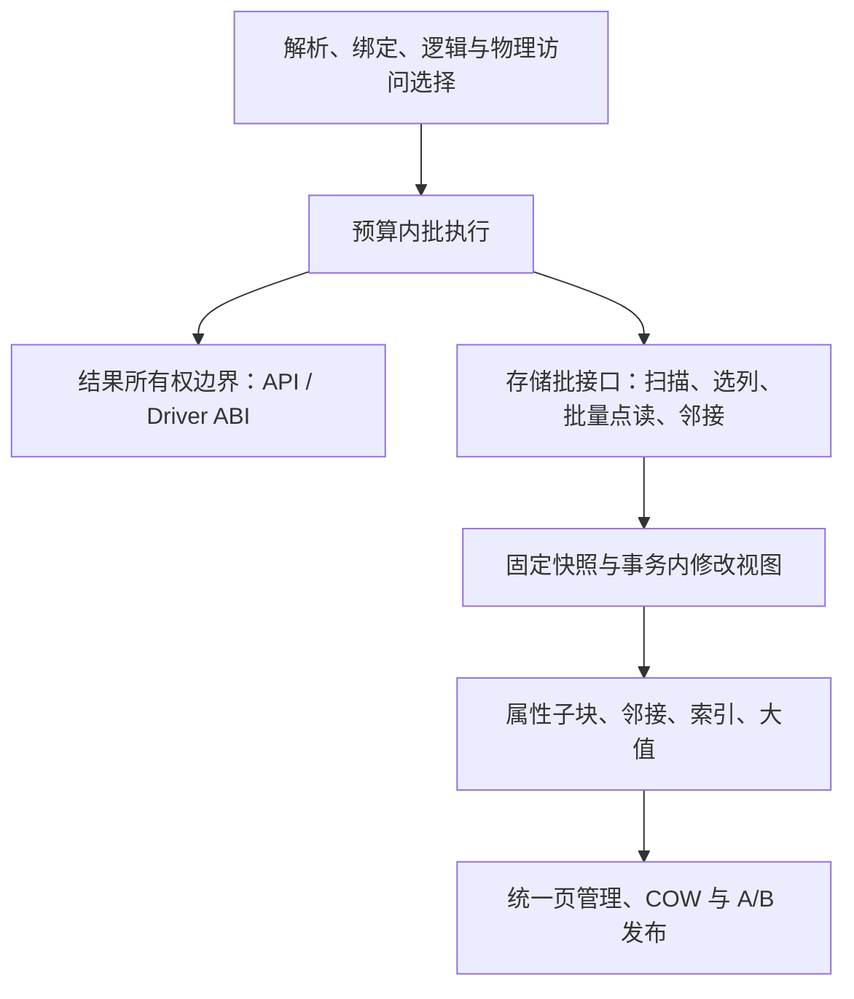

# COW 图数据库性能重构实施方案

更新：2026-10-22。计划标识：`cow-performance-20261019`。**本页是当前优化的唯一实施入口。新路线 R0–R7 共 24 项，已验收 21/24（87.5%）。按用户最新要求继续完成全部未完成项；原固定五项 R3.2/R3.3/R5.1/R5.2/R5.3 仍按既定合同推进，性能准入不提前计数。R7.3 仍是整体 100% 所需的最终收尾项。**

**最新验收（2026-10-22）：** R1.3／R2.3／R4.3／R5.2／R5.3已按完整窗口和最多两轮控制验收，总进度21/24（87.5%）。R3.3字段删除保护仍待关闭，R7.2／R7.3未验收；不把候选拒绝算作生产完成。默认格式31 ROW保持，覆盖／分段不自动采用，Kuzu目标未达到。详见`20261022-r7-five-path-admission/`及页末记录。

目标是在保留现有公开能力的前提下，减少每次查询和更新所需的定位、解码、转换、物化及元数据维护工作。保留现有引擎，进行有证据支持的局部结构性重构；不整体重写 backend，不承诺所有负载超过 Kuzu。

已完成的 S0–S6 为 **34/34**，只代表上一轮交付。其完整中英文文档、旧存储规范、发布导航和机器进度已按原始字节归档到 `benchmarks/architecture-design/archive/20261019-completed-s0-s6/`，`manifest.json` 保存来源和 SHA-256。旧 A/O/S 编号、过程百分比和当时的待办不再驱动实施。历史采用/拒绝记录仍是证据，不自动授予新布局生产准入。

## 1. 固定边界与执行规则

### 1.1 产品、持久化与兼容性

- 保持通用属性图、动态属性与类型、多标签、稳定逻辑 ID、现有 Cypher/QueryBuilder/GDS/Vector/Driver ABI 和语言绑定行为。只改变内部表示，不顺带删减能力或改变查询语义。
- 保持严格单文件：持久数据、恢复信息和支持的查询 scratch 均由同一数据库文件管理，不新增 WAL/SHM/临时 sidecar。
- 保留 COW 与 A/B Superblock。保持 data-before-root 和 durable acknowledgement；不引入 WAL、跨事务 group commit、不关闭同步或减少持久化保证。若未来小事务瓶颈证明需要改变协议，另立提交与恢复设计，不混入本路线。
- 保持逻辑/物理身份分离、快照、read-your-writes、完整性认证、统一分配、搬迁及安全回收。逻辑 ID 不复用；物理页/槽复用须验证身份与 generation。
- 公共功能兼容不等于文件字节兼容。当前开发期策略仍是新格式新建、旧格式明确拒绝，不自动迁移或删除用户文件。新增 codec/root 之前先更新[单文件存储规范](native-single-file-storage-plan)及兼容矩阵，不能悄悄改写旧版本含义。迁移器不在本轮必做范围；稳定格式发布前仍须确定迁移与备份合同。
- 保持 macOS/Linux/Windows 可移植及 WASM 非 JIT 路径。实际验证平台单独记录，Linux 成绩不能充当另外两平台实测。

单文件是物理包装，COW/WAL 是持久化机制，行列布局和批执行是访问机制。Kuzu 0.11 起使用单个主文件，但可创建 `.wal`、`.shadow`、`.tmp`（见[官方说明](https://kuzudb.github.io/docs/developer-guide/files/)）；不能用文件数量解释扫描差距，也不能由“用了 WAL”推断查询性能。

### 1.2 实施与文档职责

实施开始时核对远程 `work` 与本地改动；快进更新或在隔离工作树推进，不能 reset/stash 覆盖用户修改。冻结实际源码而非只记录 HEAD。每轮报告已验收任务、证据和剩余问题；提交/推送遵循会话中有效授权，不从历史批准推导任意新载荷授权。

只运行必要的受影响模块单元测试，不执行全量单元测试，覆盖率不是门禁。开发期间采用短小正确性/机制检查，不频繁跑 benchmark；完整规模正确性、长时间资源检查与正式性能对照集中在实现完成后的最终窗口。文档修改仅验证文档。`scripts/run_tests.sh --file` 只限制覆盖率展示，不能单独用它限制测试范围。

本页管理顺序、任务状态和准入；[单文件存储规范](native-single-file-storage-plan)管理现行格式；[能力矩阵](native-capability-acceptance-matrix)管理消费者和语义证据；[发布事项](native-remaining-work-roadmap)管理独立发布边界。设计决策放在 `benchmarks/architecture-design/decisions/`，本地原始结果放在被忽略的 `benchmarks/architecture-design/results/`，正式证据不能只存在于被忽略目录。

## 2. 已实现基础、剩余缺口与测量依据

### 2.1 实施起点与当前增量

本次文档审查基于仓库提交 `0427be26001073e3caf66621e1b8e62fd3da84dc`；上一轮正式评测生产源码为 `c28794a7c92434e809f9bbb17d48e8c457a70263`。实施时若源码不同，R0 重新核对，不能照搬下表作为新源码结论。

以下表格记录 R0 冻结的启动状态。当前增量：R1.1/R1.2 已新增直接属性单元生产者，贯通适用的原生扫描、数值/字符串过滤、单/多键聚合和 DISTINCT；复杂消费者及参数残余仍按明确有界适配器保留，R1.3 的适配器登记与语义验证已完成、待 R7 性能准入；R2 已接入认证 radix 只读视图，并修复跨句柄发布后的可变页池控制镜像缓存身份。

| 领域 | 已有基础，必须复用 | 本轮真实缺口 |
|---|---|---|
| 执行 | AST/Expression/逻辑优化、绑定槽位与描述符、批身份、EntityRef、选择向量、类型化数值过滤、预算回退 | 部分批路径仍由通用值转换产生类型列，随后回到逐行属性表；需贯通生产者与消费者 |
| 属性 | 选列解码、排序批量定位、字段暂存、行布局与大值处理、属性名批处理 | owner 级定位和集合编码仍可能放大扫描/小写；混合布局实验未获生产准入 |
| 元数据 | 有界解码/路由缓存、不可变路由分支复用、批量查询、回收触发合并 | 尚需量化并减少重复定位、认证、复制与共享路径更新；不能重复建设同类缓存 |
| 图访问 | 全局 key-only 邻接树、主 Edge 认证、按快照的有界批遍历和会话复用 | 首次读取通常仍取主 Edge；覆盖/分段实验不能直接启用 |
| 事务 | COW/A-B、快照、overlay、普通图根 fence、受限 blind patch 安全 rebase | 通用不相交写仍可能冲突；不声称 serializable 或通用多写者 |
| 资源与 spill | 进程/数据库账户、QUERY/CACHE/WRITE/MAINT 归属、结果生命周期、文件内排序 run/归并、分区 DISTINCT/UNION | 批接口改造需保持这些能力；聚合状态/哈希连接并非已有通用 spill |
| 优化器与诊断 | 基数估计、已有索引/范围选择与重写、EXPLAIN/PROFILE、PerfTrace | 需要补齐新路径的成本、选择理由和实际工作量，不能宣称从零建设优化器 |

排序、DISTINCT 的现有实现见 `src/query/execution/ExternalQuerySort.hpp`、`ExternalQueryKeySet.hpp`；范围及资源边界见决策 `20261016-s53-budget-and-spill-acceptance/zh.md`。已有能力在本轮只作为保护合同，不再次计作新增完成。

### 2.2 最新正式参考与解释限制

Linux x86_64、medium 22.5 万节点/86 万边，热态基础窗口每来源 3 个独立进程、每场景 3 次预热和 10 次测量。下表是各进程 P50 的中位数，单位 ms；不是本轮新基线或 P95 精度声明。

| 场景 | 上轮优化后 ZYX | Kuzu 0.11.3 | ZYX/Kuzu |
|---|---:|---:|---:|
| 节点点查 | 2.285855 | 0.234714 | 9.7 |
| 两跳 | 2.168795 | 0.824298 | 2.6 |
| 标签属性过滤 | 332.551 | 2.136180 | 155.7 |
| 实际 country 分组计数 | 440.596 | 3.644591 | 120.9 |
| 全节点 score 过滤 | 634.9675 | 0.873943 | 726.6 |

精确值及逐进程分布见 `benchmarks/architecture-design/decisions/20261018-route-reuse-base-read-checkpoint/proof.json`；完整准入和资源成本见 `20261018-route-reuse-final-admission/`。原始 `d09fc467` 对照只用于历史改善分析，下一轮 before 应为实际开始实现的源码。`aggregation_group_by` 的历史 workload 名实际对应 COUNT DISTINCT；真正分组输出为 `aggregation_count_by_group`，不能混用。

保留以下限制：ZYX native IPC 与 Kuzu Python 入口不同，schema/索引/提交语义并非全部等价；不支持记 N/A，实际失败/超时保留为失败/超时。上一轮部分准备/索引路径全进程峰值 RSS 增加约 7–11%，扫描降低约 55–57%；不能仅展示更好的查询阶段峰值。单次诊断、累计物化字节、存储层 read bytes 和嵌套 timer 均不能分别冒充正式延迟、峰值内存、磁盘设备读取量或可相加的 CPU 份额。

## 3. 目标结构与共同合同

这些是职责边界，不要求新增同等数量的包装对象或第二套完整执行器。以下合同适用于所有阶段：

1. **身份与生命周期**：描述符包含足以验证的数据库/快照/布局/属性身份；批行引用检查 owner 与 incarnation。计划绑定和执行 pin 分离，明确 schema/布局变化的失效规则。借用值不能越过页 pin、批复用或事务生命周期；需要逃逸时复制并转移预算。
2. **语义**：保留缺失/存储 NULL/有效值的内部区别及现有 Cypher 映射、类型比较/哈希、溢出、重复次数、别名、ORDER BY、OPTIONAL、路径和关联子查询。易变表达式及副作用的求值次数不能因批处理、重试或下推改变。
3. **唯一权威与原子可见性**：属性、实体、派生索引、邻接、统计及退役信息按现有合同共同发布。物理页映射更新不能替代语义版本推进；当前图根 fence 不含所有物理目录，新增布局必须更新正确的语义 fence。
4. **错误边界**：仅对事先定义的可选优化额度拒绝回退。损坏、取消、I/O 错误和已开始输出后的失败不得捕获后重放输入或当作“无数据”。预交付拆批必须不重复输出，不改变错误语义。
5. **资源**：计入容量、嵌套载荷、索引、缓冲、pin 和逃逸输出，使用现有账户，不重复收费或提前退款。可计费内存与 RSS 分开。锁内不得等待必须靠同一锁释放的资源。
6. **有界工作**：列出单次定位、重编码、分裂、回收和重试的工作上限。不能将前台开销无限转移后台，也不能依赖无限增长的缓存、delta 链或日志。

## 4. 必须落实的实现合同

### 4.1 R1：贯通存储生产者与批消费者

复用现有 `BoundNodeScanBatch`、批身份、绑定程序和预算设施，扩展同一内部批合同。分别定义范围扫描和随机 gather，保留输入 ordinal、重复 ID、缺失实体及结果顺序；不能强迫点读扫描整组。批次由字节和行数双重限制，宽行/大值可缩小批次，不能固定大 reserve。

常见整数/浮点/布尔及字符串路径直接产生可被下游消费的数据；字符串先采用明确 owner 的偏移/字节区或等价有界表示。字典编码是条件性实验，不同字典的编号不能直接比较。动态复杂值保留等价且计费的回退。不得仅把 PropertyValue 数组再次复制成类型数组就宣布消除转换。

第一条必做贯通路径为 scan → filter/project → aggregate → owning output，覆盖数值过滤、字符串过滤、真实单/多键 group-by、COUNT DISTINCT 和空输入。分组键必须作为完整 tuple 比较；聚合状态的 NULL、数值类型、合并与错误规则沿用现有语义。不得把各列分别 DISTINCT 后组合成错误分组结果。

随后接入 Top-K/sort、join/expand 的适用批边界，并登记 UNWIND、procedure、subquery、mutation 读侧及其他消费者的批路径或有界适配器。每个保留适配器写明触发条件、数据所有权、预算、成本计数和退出条件。普通扫描过滤聚合不能整体退回旧行路径而声称贯通；复杂路径可以暂留明确适配器。已有 sort/DISTINCT spill 要继续可用。

平坦批为必做基线；因子化/分组中间结果、并行执行、SIMD、JIT 不作为这一阶段依赖。将来采用时另验重复次数、相关性和任务局部状态，不能用改变线程数掩盖单线程数据路径成本。

### 4.2 R2：精简读取元数据与认证路径

先按点查、扫描、邻接 gather 列出 token → owner/目录 → 路由 → 页 → 值的实际链路，区分调用次数、唯一页、缓存命中、codec 解码、校验字节、复制和 I/O。核查已有缓存及路由复用，禁止叠加含义重叠的缓存。

同一快照内按页归并定位、复用游标和已认证不可变页，恢复原 ordinal。缓存键覆盖数据库身份、逻辑页/路由身份、generation 与解析上下文；缺失结果只有在明确有效期时才缓存。文件增长、另一个合法句柄发布、搬迁、页复用和旧快照均有失效/隔离测试。文件大小检查只能在有等价边界与并发证明后合并，不能直接删除。

首次加载必须完成当前格式要求的认证；owner/generation/范围验证不能因缓存命中丢失。点访问验证已访问对象，完整 integrity 检查验证全局不一致；明确缓存期间外部破坏在哪个后续认证/完整性阶段发现，不承诺每次逻辑读取检测所有介质变化。

目标是让顺序扫描的定位工作趋近所访问的组/页，避免对每个值重复下降相同目录；保留随机点读的有界定位能力。R2 本身不改持久格式，若确需格式变更转交 R3/R4 的版本合同。

### 4.3 R3：有界混合属性子块与字段更新

**生产切换有条件，完整生命周期原型和成本验证必做。** 复用已有字段 set/remove、map 合并/完整替换和 overlay 语义；本轮解决其下层仍可能完整集合编码的问题，不重复实现字段暂存。

- 逻辑实体分组、物理页、压缩块和 COW 更新单元分别定义。旧 A3 的 64-ID 组只是已有候选，不是新性能结论；R3.1 用成本记录明确组容量、子块大小、稀疏阈值和单次工作上限，编码前关闭这些未决项。
- Node/Edge 分开；标签只表示成员关系。稠密且类型适合的字段进紧凑列，稀疏/混合类型进有界扩展；动态类型不变成永久 schema。每个 owner/token 在快照内唯一归属，扩展不再保存完整第二份行。
- presence、NULL、类型、存活信息必须明确编码。实体有实际字段枚举路径，完整读取按实际字段工作，不遍历全库 token 或整组全部字段。避免每实体/字段独立树和稀疏组独占大尾页。
- 大值独立存储且认证；小字段更新复用未变引用。选列读取不能解码无关大值；修改一值不能无条件重写整组/完整大集合。无需变化的索引不删建；no-op、类型变化、REMOVE、整 map 替换分别验证。
- 数据子块、归属描述符、成员枚举、图路由、索引、语义 fence、分配/退役在同一发布协议内切换。稳定逻辑页不代表语义版本不变。旧快照保持旧布局；重开、搬迁、删除和发布失败都有精确可达性与回收规则。
- 先用少量明确编码与显式有界转换。不得引入自动布局抖动、无界增量链或整容器重写作为默认更新。超出编码/容量条件时保留可用行布局，不丢字段。

R3.1 必须提交访问/成本表：单实体单字段、完整实体、N 实体 f 字段扫描、单字段修改、删除/回收，各自读取和 COW 哪些页。计入目录、owner 枚举、presence/type、部分填充、分配器、索引与旧版本空间。逻辑字段数 F、实体数 E、组数 G、组内字段种类 K 的增长关系要明确，尤其避免 O(E×K) 的稀疏成员元数据。

验证稠密/稀疏、独有字段、随机交错形状、多标签、持续变型、删除后稀疏组、宽实体/大值及邻居属性 gather。与同一批执行器下的现行行布局比较，不能把 R1 收益算成布局收益。原型缺少图路由、双向生命周期、退休或完整成本时不得生产准入。失败可完成比较项 R3.2，不能自动完成生产项 R3.3。

### 4.4 R4：有界 COW 写入与维护

复用当前不可变分支共享和回收批次机制。事务内同页/同树路径修改尽量合并，最终编码与索引更新基于实际变化；已经发布或被读者引用的页面不得原地修改。字段接口、实际页重写量和发布总量分别测量。

保持“写候选数据及元数据 → data fence → 写非当前 A/B 槽 → superblock fence → 确认”的顺序。恢复选最新有效根，处理 torn write、失败 sync 和不确定提交；有效根选择不代替全库 integrity。ID 预留、普通提交与维护发布分别计数，不把多次内部发布隐藏成一次廉价事务。

列出 catalog、allocator、页映射、索引、路由和 retire queue 的实际修改集合。目标是工作随变化页和必要共享路径增长；不对每次小写执行与无关存量成比例的重建。若某路径仍需全局扫描，必须登记触发条件、上限及为什么不能增量化。

前台/维护分别设页数、字节或时间预算，并报告积压、最老 pin、可复用空闲页和尾部可裁剪页。长快照阻止回收时提供背压/明确资源拒绝，不能回收活页或无界增长。碎片整理、物理搬迁和尾部缩文件分别验证；文件长度不等于活数据大小。不得用提高内存/文件额度、无限延后清理或强行要求每次关闭所有退休量为零来制造收益。

隔离合同保持现状。复用已验证的受限 blind rebase；不得仅删除图根 fence。若后续扩大范围，需另记录读/缺失/范围/约束/schema/端点依赖、验证点及重试上限；同页不相交写须在最新页重建或保守拒绝，不能覆盖对方修改，不能自动重放有副作用的语句。通用多写者和更强隔离级别不计入本轮承诺。

### 4.5 R5：邻接与访问计划

先定义可被批消费者直接读取的 EdgeId、NeighborId、TypeId、方向、可见性和 continuation 合同。保留多重边、自环、类型过滤、overlay 和顺序语义。对照为当前 key-only 树加已实现的批量主记录复用。

先比较覆盖 B+Tree 与共享分段邻接，不恢复退休的 per-node root/delta 实现。主 Edge 仍是拓扑权威；派生数据可直接读取的前提是原子维护、身份认证和明确的故障检测合同。必须逐项规定合法 checksum 但错误 endpoint/type、缺反向项、重复/孤儿项、陈旧 generation 在普通读取、提交还是 integrity 阶段检测。替代协议通过前保留当前主记录检查。

候选涵盖创建/删除、双向邻接、主记录、类型索引、统计、旧快照、重开和退役，不能只接读路径。覆盖树已满足目标时优先较小改动；分段方案必须抵消新增目录、更新和空间成本。随机插删、热点/幂律度数、超级节点和多跳是保护场景。

在既有优化器上补充实际需要的标签/type/属性选择率、度数分布或有界估计；明确统计身份、更新/失效、误差和退化策略。规划不能扫描全图收集统计。选择索引/gather/扫描、过滤时机、连接与扩展顺序时计入候选数量、列宽、页数、物化和内存成本；未知或陈旧统计保持安全且稳定的计划。只把受证明的语义等价重写下推，特别保护 LIMIT、OPTIONAL、NULL、重复及易变表达式。

### 4.6 R6：资源、生命周期与可观测性

复用现有资源协调和 scratch 实现，将新批、缓存、算子状态及输出纳入同一账户。批量预约可以摊销计费，但持有的容量必须持续收费，取消和异常必须归还。输出存活时间可以长于事务；零复制导致长期 pin 时须有有界复制/拒绝策略。

维持文件内 sort 和 DISTINCT/UNION spill。明确新批消费者是否支持它们；不支持落盘的 group-by/hash join 在超额时清楚失败，不能宣称通用外存执行。新增这些 spill 算法属于后续独立扩展，不以本轮 100% 暗示完成。

逻辑只读事务仅可在既有内部权限允许且文件可写时使用 scratch；物理只读绝不写 scratch。临时页使用查询 owner 与独立生命周期，不被无关用户长快照保留；scratch 与用户提交共享 allocator 更新不得互相覆盖。验证取消、磁盘满、崩溃重开、并发别名和 cleanup 重试。

扩展已有 EXPLAIN/PROFILE，显示实际访问路径、批/行适配器及原因、估计/实际行数、选择率、读取/解码/校验量、物化与预算峰值、spill 和发布阶段。指标注明单位、累计/峰值、包含范围和是否嵌套；关闭 instrumentation 的正式计时独立进行。

拆分超大实现文件时按绑定、算子、存储访问、预算与发布职责拆分，保留单一实现所有者。拆文件不是性能成果，不新增长期并行 backend；移除旧适配器前证明所有消费者已替换，并保留必要语义测试。

## 5. 阶段依赖、交付与进度

主线为 R0 → R1 → R2 → R3 → R4 → R5 → R6 → R7。公共身份/资源合同和受影响正确性测试随阶段落实，不能拖到 R6；R3/R5 的有界原型可在接口稳定后提前验证。性能准入统一在 R7 窗口完成，在此之前可标“实现完成、待准入”，不能提前标已验收。后续阶段以所需接口和正确性合同就绪为依赖，不要求前一阶段先取得最终性能验收，以免形成 R7 循环等待。

| 阶段 | 三项独立交付及完成条件 | 已验收 |
|---|---|---:|
| R0 起点与合同 | **R0.1** 源码/能力/适配器审计；**R0.2** 同条件基线及正式采样、资源、收益/保护指标预登记；**R0.3** 调用链/机制计数与接口/格式决策清单，正确性关键问题明确归属 | 3/3 |
| R1 批执行 | **R1.1** 存储批生产者、身份及所有权；**R1.2** 数值/字符串过滤与真实聚合贯通；**R1.3** 其余消费者接入或明确有界适配器、语义保护及 R7 性能复核（已验收） | 3/3 |
| R2 读取元数据 | **R2.1** 实际路径和重复工作归因；**R2.2** 认证/定位/游标复用实现及失效测试；**R2.3** 点查/扫描/gather 工作量与 R7 性能准入（已验收） | 3/3 |
| R3 属性子块 | **R3.1** 字节布局、参数、成本及生命周期决策；**R3.2** 完整生命周期原型和同执行器对照结论（已验收，候选字节门槛拒绝）；**R3.3** 获准方案生产接入、格式更新及 R7 读写/空间准入 | 2/3 |
| R4 COW 写入 | **R4.1** 增量页/路径合并及小写实现；**R4.2** 发布、故障、快照、回收和背压验证；**R4.3** 成熟库小事务/批写/持续更新的 R7 准入 | 3/3 |
| R5 图访问与规划 | **R5.1** 邻接一致性协议及覆盖树候选完整生命周期（已验收）；**R5.2** 获准访问路径生产接入与 R7 图读写/空间准入；**R5.3** 新访问路径成本、计划选择与留出负载验证 | 3/3 |
| R6 工程与资源 | **R6.1** 新路径预算、结果生命周期及现有 spill 兼容；**R6.2** EXPLAIN/PROFILE 与物理工作量可观测；**R6.3** 资源/取消/read-only 故障、职责整理及跨平台验证范围记录 | 3/3 |
| R7 最终验收 | **R7.1** 冻结最终候选、受影响模块及完整规模正确性（已验收）；**R7.2** 同条件读写/资源/稳态与 Kuzu 对照，逐项准入；**R7.3** 最终能力/格式/决策同步、原始证据清理及剩余差距报告 | 1/3 |

**总计：21/24（87.5%）。** 状态仅为待开始、进行中、实现完成待准入、已验收、阻塞。每项有证据才能计一次；本页是唯一手工进度表，机器摘要只能派生。旧 `decisions/current-progress.json` 的 34/34 明确仅属历史，不沿用其分母。

正确性关键接口/codec/协议在相应生产实现前定案；布局是否有收益可留到最终窗口。候选需可隔离选择/构建以完成对照，未准入不得作为唯一默认生产格式。最终不达标时拒绝候选、保留现行生产路径；可以完成比较项，生产项保持阻塞。不能用“决定不采用”替代必做的生产能力，不能缩小分母凑 100%；必要的范围调整须明确提出并经用户确认。

上一组固定五项为 R0.1/R0.2/R0.3/R1.1/R1.2。R0 证据见 `benchmarks/architecture-design/decisions/20261019-r0-five-item-start/`；R1.1/R1.2 事前按基础能力合同验收，性能收益仍由 R1.3/R7 判定，不提前宣称提速。

R1.1 证据：`benchmarks/architecture-design/decisions/20261019-r1-direct-property-producer/`。直接生产者、三态/混型、重复 gather、旧快照、取消与预算合同已验收；R1.2 的后续贯通已验收，见 `benchmarks/architecture-design/decisions/20261019-r1-continuous-filter-aggregate/`。最终 75 项定向检查通过；真实存储跨批过滤、联合分组与 DISTINCT 精确结果通过。

第二组固定五项为 **R1.3/R2.1/R2.2/R2.3/R3.1**，证据见 `benchmarks/architecture-design/decisions/20261019-r2-next-five/`。R2.1/R2.2/R3.1 已验收；R1.3 的适配器/语义工作和 R2.3 的工作量证据已完成，按既定阶段依赖保留“实现完成待准入”，不提前计入完成数。必要模块共 183 个不同用例最终状态通过（182 项首轮含 9 项控制页预热 fixture 失败，修正预热后 22 项受影响检查全通过；不是一次 183/183）。跨句柄首轮真实失败及修复证据另行保留，未运行全量单测或新增正式性能窗口。

R3.1 已固定单一 64-ID 候选、48-slot 列资格、独立字段子块、共享成员/列/extension/组目录、明确描述符与额外语义 fence、完整成本准入和双向生命周期；详见上述目录的 `r3-layout-zh.md`。已开始独立 payload 编码验证，尚未接入原生文件/生命周期，不代表生产布局已切换；原型/格式/生产准入仍属 R3.2/R3.3。

本组固定五项 **R4.1/R4.2/R6.1/R6.2/R6.3** 已按事前登记的基础/正确性/资源/观测合同验收。证据见 `benchmarks/architecture-design/decisions/20261019-r46-five/`。基于已就绪 COW 和 R1/R2 接口落实公共合同，不替代 R3 格式原型、R5 邻接候选或 R7 性能准入。

已有 owner 更新/no-op/删除不再无条件枚举属性页池；复用既有同页 COW 合并并移动 owning plan/大值缓冲。8 owner 更新验证合并为 1 份 4032 字节 replacement payload、旧 pin 和重开值精确、无属性池枚举。PROFILE 以固定、计费的线程局部观测报告实际批/适配器、双层过滤、读取/校验、局部预算峰值、内部 ID/图发布与 fence；原列顺序保留并追加 summary 列，现有 Driver ABI map 读取已验证。EXPLAIN 保持不读快照，只显示候选和适配条件；未知估计明确 NULL，不把诊断说成性能。

必要模块最终 245 项通过；最终 PROFILE/ABI 改动后 99 项受影响检查通过，合计 263 个不同用例最新状态通过（分批，非一次 263 项运行）。首轮 166 项的 3 项失败及修复/测试原因保留。覆盖发布/搬迁故障、pin/回收/文件背压/尾裁剪、低预算/guard/结果逃逸和现有 sort/DISTINCT/UNION spill；仅实际验证 Linux x86_64，不宣称三平台或完整绑定矩阵通过。R6 合同约束未来 R3/R5 接入，新增生产路径仍须补对应验证，最终 R7 不得略过。R4.3 仍需成熟写入、稳态资源及维护观测准入，未运行新的正式性能窗口。

R3.2 进行中：列/组头/192 字节描述符、成员/定位编码和完整成本证据门禁已实现为独立 payload 实验；原生共享 map 复用 key-only B+Tree 的有序前缀/值后缀，复合事务和 fresh rebuild 保留 EMPTY 叶布局。九个必要原生模块 178 项通过，覆盖旧 pin/重开、重复前缀、页池耗尽重建、整树退役和 A/B 中断。单字段替换/低于 48 槽或变型降级、组/列/描述符代际及当前组 live 权威合同已加纯内核；codec/门禁与转换共 33 项通过，含真实 PropertyValue 的 144 对 no-op 比较。ASan/UBSan 关闭环境不支持的泄漏检测后通过，失败/审阅中间证据保留。

证据分别见 `benchmarks/architecture-design/decisions/20261019-r3-codec-five/`、`20261019-r3-native-directories/`、`20261019-r3-field-transitions/`。这三个历史检查点当时未持久化 hybrid 描述符/列格式；最新隔离元数据原型见下，仍未安装属性路由；成本门禁仍无原生完整估计器；普通图元数据的当前源读取／私有准备接合进展见第 7 节，尚未原子发布物理字段或 extension。R3.2 仍须按 R3.1 完成原生格式/根/fence/完整生命周期、真实分配及同执行器 ROW 对照。五个编码子项、通用 map 和纯转换内核均不能计作完整阶段验收，总计仍为 13/24，不提前宣称性能收益。

此前检查点推进 **R1.3/R2.3/R3.2/R4.3/R5.1** 的五项有界实现/验证，证据见 `benchmarks/architecture-design/decisions/20261019-five-remaining/`。Sort key-slot 拒绝改为类型化资源异常并核对 Top-K 指针容量；旧 runtime 源码反向对照按预期失败，当前真实查询拒绝/独立重试通过。点路由根/内部下降改借用视图，20 次预热点查的固定复制计数为 0（机制证据，不是延迟）。转换封装持有真实同账户预约并在拒绝/异常时归还。显式维护观测增加排除自身 pin 的数目/最老代际及队列记录积压。邻接私有批在过滤前核对主 Edge、顺序、身份和精确 continuation，不暴露部分结果。最终 14 个必要模块、17 个 suite 共 170 项通过；首轮 fixture 失败及旧源对照证据保留。

这五项推进不等于五项阶段验收；R1.3/R2.3 仍待 R7，R3.2 仍缺原生格式/完整生命周期/成本对照，R4.3 仍缺成熟稳态和空闲/尾部准入，R5.1 仍缺原生覆盖/分段候选原子生命周期/全局完整性。邻接主 Edge 检查继续保留，不启用未经准入的持久布局。总计仍为 **13/24（54.2%）**；未跑全量单测或正式性能/Kuzu 窗口，仅验证 Linux x86_64。

此前固定五项为 **R3.2/R3.3/R5.1/R5.2/R5.3**，均未完成；2026-10-20 根据用户要求扩展为页首登记的十项。中间检查点见 `benchmarks/architecture-design/decisions/20261019-r35-five-deliverables/`：现有原生固定 map 的最终前缀合并、计费的 64-owner/4096-member 组规划与反向投影已验证，另补内存中的原生描述符认证 codec，五个必要模块 58 项通过。默认格式仍为 31；隔离格式 32 仅接通空描述符元数据生命周期，尚未安装属性子块路由、完成完整生命周期/成本估计，不能验收 R3.2；R3.3 和 R5 三项仍须按原合同完成。无新正式性能窗口，总计保持 13/24。

原生根检查点见 `benchmarks/architecture-design/decisions/20261019-r3-native-root/`：默认构建保持 31/header 336/profile 5，实验选项默认关闭；隔离构建使用 32/header 352/profile 6，仅允许空描述符。独立物理根已纳入第八根图 fence、元数据恢复/只读发现/可达性/旧 pin/保守搬迁与清除回收，默认/实验 format token 不同。非空 hybrid 根在 reader/writer/open 明确拒绝，完整性检查也会访问描述符；原生字段数据页、转换和生产属性路由尚未接通。未变更阶段准入条件，不提前宣称读写提速。 新快照也认证描述符并在失败时归还 pin；固定 PROFILE registry 计费并报告其累计解码尝试。分批定向检查：默认构建 285 个不同用例最新通过；隔离构建 294 个不同用例最新状态为 293 通过、1 项默认格式专用测试跳过。未运行全量单测或正式性能窗口，仅验证 Linux x86_64。

## 6. 验证与准入

### 6.1 基线、采样和工作负载

R0 冻结源码清单/dirty diff、构建选项、依赖、二进制 hash、硬件/OS、线程、buffer pool/查询预算、数据 seed/hash、格式、schema/索引、入口及结果消费方式。已有基线只有身份与条件全部一致才可复用，否则优化前补一次。保留正式对照二进制，不能从改过的源码重建后冒充 before。

R7 冻结后先完成必要正确性，再统一计时。基础热态每场景至少 3 个独立进程、3 次预热和 10 次测量；R0 预登记聚合方式、P95 不确定性、补测条件与总时间预算。小样本不保证尾延迟精度，不能反复测到通过。冷态、fresh-open、warm 分开；重启进程不等于清除 OS cache。同机交错运行来源，写案例从相同逻辑基线恢复，固定 open/commit/close 和 durability 的计时边界。

必含命中/未命中点查、随机字段/完整实体、标签/type 扫描、数值/字符串过滤、真实 group-by/COUNT DISTINCT、sort/Top-K、单/多跳/超级节点、动态字段、宽行/大值、单条小写/批写/混合读写、长快照、删除整理、低预算/spill 和持续更新。规模、选择率、度数、类型和稀疏度保留未调优组合。精确验证 ID、值、类型、NULL、顺序要求及重复次数，不能仅比较行数。

同资源比较，不提高上限制造收益。上一轮合同使用 64 MiB 查询、6 GiB 地址空间、2 GiB 文件和每家族 1800 秒，作为复用该矩阵时的保护设置，不是产品默认值。新增必要场景在 R0 预登记独立合理预算，不改写旧成绩；失败保留端点与原因，不对未变源码重复长跑。

### 6.2 准入门槛与反证

- 正确性、公开语义、原子发布、恢复、快照、资源清理先通过。性能优化默认主要目标 P50 改善至少 10%，跨进程可重复；保护场景 P50/P95 不出现超过 5% 且超出控制波动的稳定退化。接近门槛或证据不足标不确定，按预登记规则补测。
- 内存、读写字节、分配次数、稳态空间和维护积压分别报告；超过 5% 的稳定资源增长必须解释并形成明确准入决定。不得靠无界写放大、空间、点读/更新退化换扫描速度。突破保护门槛需提出具体取舍并经用户确认。
- 接口/正确性基础工作按依赖能力、语义、生命周期及保护成本验收，不机械要求每次提交提速 10%；任务性质在测量前确定，不能失败后改名逃避准入。
- R1 反证：普通过滤聚合仍逐行构造属性表、转成类型列后又全量还原；R2 反证：只扩大缓存而工作量未降；R3 反证：只计载荷、点更新重写整组、生命周期不完整；R4 反证：同步变弱、回收积压无界；R5 反证：跳过认证或读快写慢且未过保护；R6 反证：未计费容量、提前退款、输出逃逸失效。
- 清单完成与 Kuzu 目标分开。最终逐场景披露差距、N/A、失败、API/schema/durability 差异，不能用几何平均或少数胜项掩盖退化，不能把诊断计数直接换算成加速倍数。

### 6.3 必要测试与证据

| 变更 | 必须覆盖的受影响合同 |
|---|---|
| 批/算子 | 类型/NULL/溢出、字符串比较与哈希、多键分组、空输入、重复、排序、OPTIONAL/路径/关联、易变求值次数、预算/取消、批复用及结果逃逸 |
| 属性/元数据 | 字段操作语义、no-op、索引/唯一性、动态/稀疏/大值、旧快照、别名句柄、页复用、合法校验和下的身份错误、重开/搬迁/回收 |
| 发布/邻接 | data/root 各故障点、不确定提交、自环/多边/正反向/continuation/overlay、孤儿或缺失索引项、端点删除冲突、同页更新与保守拒绝 |
| 资源/scratch | 实际容量、转移/退款、低预算、磁盘不足、只读、取消/OOM、输出长于事务、并发别名、崩溃清理和有界维护积压 |

查找实际 GoogleTest suite 后运行明确 filter；只扩展受影响合同，不重复全量或已通过长矩阵。修复实现缺陷，不能删断言或调整预期掩盖错误。新格式必须覆盖 writer/reader/integrity/reclaimer 与旧格式拒绝；涉及三平台持久化边界时保留各平台证据，缺失明确标未验证。

每个准入记录含任务 ID、before/after 源码/二进制、假设与反证、接口/格式决定、命令、完整结果 oracle、原始样本及摘要 hash、资源/波动、采用或拒绝原因、未解决问题和私有产物清理清单。不覆盖旧结果。仅清理本轮创建的 DB、日志、进程和构建副本，不删除用户数据库或其他任务资源。

## 7. 源码入口与既有决策

| 工作 | 当前源码定位入口；不是整文件重写清单 |
|---|---|
| R1 | `src/query/execution/LogicalPlanReadRuntime.cpp`、`DirectPropertyColumns.hpp`、`BoundNodeScanBatch.hpp`、`PrimitiveNumericColumns.hpp`、`BatchEnvelope.hpp`；`include/graph/query/execution/` |
| R1/R3 | `src/storage/relocatable/entity/PageBackedGraphReadAdapter.cpp`、`PageBackedLogicalGraphReadAdapter.cpp`；`src/storage/relocatable/property/PropertyCollectionRootStore.cpp` |
| R2 | `include/graph/storage/relocatable/entity/NativeReadSession.hpp`；`src/storage/relocatable/metadata/`；`src/storage/StorageIO.cpp` |
| R3/R4 | `include/graph/storage/LogicalGraphWrite.hpp`、`src/storage/LogicalGraphTransactionOverlay.cpp`；`src/storage/relocatable/entity/NativeGraphMutationExecutor.cpp`、`NativeGraphWritePlanner.cpp` |
| R4 | `src/storage/relocatable/metadata/RelocatableMetadataStore.cpp`、`MetadataWriteBatch.cpp`；`src/storage/relocatable/format/SuperblockFile.cpp`；`src/storage/relocatable/backend/RelocatableStorageBackend.cpp` |
| R5 | `src/storage/relocatable/adjacency/`、`src/storage/relocatable/index/`；`src/query/optimization/LogicalPlanOptimizer.cpp` |
| R6 | `src/query/execution/ResourceCoordinator.hpp`、`ProcessResourceDomains.hpp`、`ExternalQuerySort.hpp`、`ExternalQueryKeySet.hpp`；`include/graph/storage/LogicalQueryScratch.hpp` |
| 验证 | `apps/compare_benchmark/main.cpp`；`benchmarks/graphdb-comparison/runner/`；`tests/src/query/`、`tests/src/storage/` |

优先阅读的既有决策均在 `benchmarks/architecture-design/decisions/`：`20261014-a1-design-contract/`（身份与批语义）、`20261014-a3-layout-contract/`（属性权威与成本）、`20261014-a4-adjacency-fault-contract/`（故障责任）、`20261014-a5-isolation-contract/` 与 `20261014-s5-bounded-blind-rebase/`（隔离边界）、`20261013-a7-format-boundary/`（格式）、`20261016-s53-budget-and-spill-acceptance/`（已实现资源/spill）、`20261018-immutable-route-branch-reuse/`（已实现发布复用）。它们的历史进度不生效；改变仍适用的合同须在新决策中明确替代关系，不能在实现中默默绕过。

R3.2 当前实现边界：类型化 group／column／extension 编码、固定 owner／field／group map、带账户的私有 SlottedPage 图像及实验 owner kind 16 绑定已准备；13–15 仍为退役编码。extension 使用 12+16 字节前缀／locator，变长内容留在共享字段页，新增定位及读页成本必须计入准入。绑定前检查池／页／LSN 和所有 live 记录；普通池读写继续拒绝字段页。描述符区分元数据／语义代数和独立的树池物理代际；实际池代际 99 的原生树可在较低元数据代数下发布／读取，错误代际 100 被类型化根发布拒绝。后续字段 reader 仍须认证 namespace／pin／实际根，不能只信 frame CRC。证据：`20261019-r3-native-records/`、`20261019-r3-native-extension/`、`20261019-r3-page-image/`、`20261019-r3-page-binding/`（均位于上述决策目录）；最后一个检查点的 7 个必要模块在默认／隔离构建分别 108/108、122/122 通过。

物理字段读取现复用原生共享页池的快照、Catalog、分配位图及 Page Directory 认证；专用 reader 只接受 PROPERTY 池中的字段 owner 16，普通 ROW 入口继续拒绝该类型。返回对象持有 Buffer Pool pin 或同账户的复制缓冲，搬移后借用 view 仍有效；配额拒绝可释放后重试。读取不将物理池 epoch 与语义代数比较，字段语义仍受 group／descriptor／snapshot 约束。退休标记本身不使仍由有效旧 pin 路由的帧不可读，也不授权复用该帧。按 owner 枚举已校验有序 token、唯一归属及来源；列读取直接返回 presence／NULL／原始标量位。共享树读取现可绑定数据库身份、精确快照代数、固定命名空间及目录根，沿原有单次根解析继续认证实际页；延迟创建的扫描也保留绑定。逻辑 PageId／池 epoch 在 COW 后可不变，不能据此跨快照复用。读取上下文已串联实际空描述符读取、目录绑定、实际字段枚举与列／扩展定位，并核对 Entity Map 存活信息及排除竞争 ROW 路由；可直接附着已有 pin，在持有写入锁时不再次获取快照。候选非空描述符目前仅由测试专用入口提供，以验证真实文件中的目录与字段页；普通入口仍保留非空描述符拒绝。单字段 owning 点读已接入 Property Store 及 cursor，并保留 cursor 取消检查；兼容层只为需要 PropertyValue 的调用方物化值，类型化批消费者必须直接使用原始标量位。独立大字段复用 LargeValueStore 的 manifest／内容认证，拒绝合法哈希的多字段载体；返回值计费由调用方持有，临时引用／目录／读缓冲独立归还。Store 的单实体计数／token 及 Store／cursor 存在性已接入：计数／token 验证实际成员元数据，不读取未访问的字段体；存在性不跟随大值引用，非 NULL 检查才认证大值并检查 canonical 头，均不物化 PropertyValue。B+Tree 内部读取临时字节／slot 数组使用当前或来源原生账户，离开作用域的解码条目保留来源账户，不借用属性输出额度。完整实体 owning 读取已接入 Store／cursor：按实际 owner 成员获取 token，先准入全部编码字节，再分配返回槽位和解码；无字段返回空 optional，临时 token／目录额度独立归还。排序 selected／count／selected+count 和 cursor sink 已接入同一快照上下文；仅填充 hybrid 的原始 owner／token 位置，混合 ROW 继续原有目录路径，全 hybrid 可跳过 ROW merge。原始标量通路已接入 LogicalGraphRead → 原生 adapter／cursor → 执行器 DirectPropertyColumns：已认证列的整数／浮点原始位、布尔和 NULL 可同步写入计费的类型化数组，避免 PropertyValue 中转；缺失不等于 NULL，输入顺序／重复 ID 及重复 key 的输出位置须保留。扩展字段及 ROW／overlay／其他 reader 保留 owning 回退。15 个受影响模块已通过两种格式验证（默认228/228、隔离286/286），包括真实布尔／IEEE 位／NULL、输出额度拒绝／重试及既有直接查询／后端保护；同步回调使用命名引用，避免新增回调堆缓冲，非空生产布局仍未启用。纯 selected 批次最多访问一个实际成员以检查属性根存在性，只有请求 count 时才完整枚举 owner 成员；未访问的字段体及无关成员来源错误由相应字段读取／integrity 检查，不为投影强制扫描整个 owner。完整读取的预准入可能重复认证大值，raw 通路中的扩展回退也会重复定位；这些开销必须计入最终比较。非空描述符发布、普通字段写入、完整生命周期与成本准入仍未完成，不增加 R3 验收计数。

存储模块 `HybridPropertyGroupConversion.hpp` 持有唯一的有界分类／反向投影实现，benchmark 只适配实验视图。原生私有准备从同一 MetadataWriteBatch 取得逻辑 PageId，生成类型化图像和最终 slot locator；先前迁移／私有准备证据见 `20261019-r3-native-planner/`（默认 33/33、隔离 38/38）。八个保留 namespace ID 与描述符 ordinal 精确匹配，普通标量暂存五入口在两种构建中均拒绝该范围；命名空间证据见 `20261019-r3-namespaces/`（42/42、52/52），单文件规范已同步默认／实验兼容矩阵。

普通元数据发布入口接收单组显式转换请求，不接收调用方来源载荷、逻辑 ID、已选定物理帧或规划回调。正数预留范围与字段池 owner 是显式输入，物理分配权仍归元数据。入口要求精确预期元数据代际及上限 1 MiB 的共享 MaterializedByteBudget，在同一 writer pin 下认证实际 Node/Edge 存活及 ROW 所有权，解码任何值前先核对完整 4096 成员上限；原生分类与私有字段页／定位符准备使用同一 MetadataWriteBatch。现已通过既有稠密 B+Tree 构建器规划 owner／column／extension／group 固定 map，使用各角色保留命名空间与 key-only 布局。空目录保持缺席，但已有同名目录一律拒绝，即使本次目录应为空。来源持有不可变最终定位符及账户；规划节点、分隔键、向量、回调存储和语义 CRC 临时 backing 均先准入再分配。这不代表尚未安装的物理发布／退役路径已完成计费。

该早期阶段仍在物理发布前明确拒绝，不以发布空描述符或消耗 ID 冒充成功；初始转换请求不得混入其他图变更。目录规划检查点：`20261019-r3-directory-plans/`，六个必要模块默认 60/60、隔离实验 84/84 通过。完整 64-owner／4096-member 稠密组在原有 1 MiB 上限内完成准备，来源／退款／父预算／错误 owner／LargeValue 保护继续覆盖；原生树规划离开分配作用域并复制后仍保留账户，额度拒绝不改变根或文件内容。较早的来源夹具失败保留在 `20261019-r3-ordinary-conversion/`；最新证据保留首次编译中断及源码稳定后重建结果。不宣称正式性能或生产转换完成。

元数据 writer 现还会选择真实 allocator 空闲且互不重复的池位置，将私有字段图像绑定到实际池／帧身份，从同一 batch 分配树 PageId，并通过既有构建器第二遍编码及仅限元数据的图像 sink 准备树页，验证最终描述符的树根绑定。sink 为 metadata friend 的私有入口，普通 native builder 仍保持既有写入行为。此阶段不写入或发布 data／catalog／allocator／描述符帧，所选位置也未登记为持久分配。临时分配表与持有图像计入转换账户。仅有1／2／3个空闲池时拒绝，文件／根／ID不变；测试中的扩展组在4个池时完成私有准备，拒绝后这些池仍为空闲。最新证据：`20261020-r3-physical-preparation/`，六个必要模块默认60/60、隔离86/86，完整4096成员组继续在1MiB内通过；全部私有图像／最终根准备后取消也会退款，并可在文件／根不变的前提下重试；编译中断日志保留，源码稳定后重建通过。

计数器 `native_graph.hybrid.private_field_frames`、`private_index_frames`、`private_data_pool_bytes` 仅描述私有准备。字节计数包含每个完整128KiB所选数据池及未填充帧，元数据、旧版本及退役另计。稠密夹具中候选所选数据池容量高于实际来源ROW数据池容量；这是防止只算载荷的机制／部分成本证据，不是完整成本结论、正式性能成绩或成功布局转换。

原生列变更现从已认证的 group／column 及原生 slot locator 规划，并在调用方账户中保留数据库／源代数 fence。no-op 与 ROW 一致（+0 等于 -0，NaN 不等于自身）；NULL、类型变化、删除及单字段最多64单元的降级均不重建其他字段，复杂新值仍借用独立计费的不可变 replacement root。兼容替换按列合并多个 owner，再按实际源 PageId 合并组／列修改；先验证全部源记录，再覆盖私有图像，每个实际源页只复制一次，无关 extension 字节保持不变。额度拒绝及已分配私有帧后的取消可退款重试，源文件／根／ID 不变。这仍是私有准备：降级明确等待 owner／extension 目录原子协调，物理位置登记及 Page Directory／池／allocator／描述符／退役发布尚未安装。不得绕过非空布局保护或据此验收 R3.2／R3.3。

描述符绑定的目录 integrity 原型现按既有固定 map 流式校验：逐组检查64个 primary／存活位置，owner selector、列 presence、extension 归属及组计数必须一致；通过全 map 基数核对排除未登记 group 中的孤立目录项，无需全库 ownership 集合，逻辑键重复在回调前拒绝。inline canonical 及单字段 LargeValue 载体均不构造 PropertyValue；当前大值认证仍通过既有 read API 物化编码体，必须计入完整缓冲开销，流式大值校验及完整 Page Directory／退役版本遍历接入尚未完成。该只读原型不回收存储，也不启用非空布局路由。

当前原生页另有反向核对：每个 live typed slot 必须等于描述符绑定的 group／column／extension 精确 locator（含 slot generation），SlottedPage 空闲字节必须与 Page Directory 一致；目录正向遍历不可见的合法校验和重复物理记录会被拒绝。空页可在描述符移除后保留复用，存在 live 记录却没有描述符则拒绝。这仍是逐页原型，未安装完整全库恢复／回收流程。即便私有列图像为空，writer 也必须先复核源 fence，才能把语句视为已提交的 no-op。

逐页反查还可在认证不可变 manifest／引用完整身份后输出 LargeValue 引用，不读取正文；共享同一值的多个 owner 分别输出。回收必须合并全部 ROW／native 来源，出错丢弃不完整访问结果，并在退役前复核完整引用快照的 fence。测试覆盖同一64KiB账户下两个 owner 共享超过64KiB的编码值、回调中断退款重试，以及错误 manifest 哈希在输出前拒绝；此引用提供器尚未接入全局回收器。

独立字段 LargeValue 已补齐带账户的准备逻辑：单字段 PMR 编码与既有载体逐字节一致；基于真实源 pin 的内容索引查找保留正文认证和逐字节比较，共享引用不重复创建值，不同 token 不复用同一载体。新值仅提出同批 ID 及数据／manifest 页数，不消耗 ID、不写文件。编码体和引用随提案保留账户，额度拒绝、取消及异常可退款重试。仍须在最终 writer 中复核来源和复用引用，并将数据／manifest／内容索引／字段引用同批发布；不能据此验收 R3。

转换协调器已接入上述提案：在获取 writer 前附着内容索引，writer 内仅使用受 fence 保护的源 pin；超出字段页容量的 extension 转为真实单字段引用。已发布的合法单字段载体可复用；同一私有批次中新建的相同完整载体按字节合并，并由同一 MetadataWriteBatch 预留连续 ID，不把整个多字段 ROW 载体当成单字段值。引用编码、插槽追加及物理 owner 绑定各自保留必要缓冲预约。最新25个受影响模块、30个 suite 默认316/316、实验389/389通过（含8项既有去重／内容索引测试）；仅 Linux 验证，拒绝后源文件、根、ID及旧快照仍不变。此时大值仍是私有提案，尚未分配数据／manifest 物理池或进入最终发布；现有私有字段／索引池计数不包含这些待分配的大值池，完整成本必须另计。

去重正文比较现同时限定候选与输入的完整范围，修复损坏内容索引指向更长、同前缀值时可能发生的越界读取。独立 AddressSanitizer 反向对照在旧比较中复现 heap-buffer-overflow，修复版本在同一用例通过；此内存安全验证不属于性能结果。

物理池准备现将选中槽位登记到同一 MetadataWriteBatch 的数据槽预留表，后续元数据分配必须排除这些槽位。单槽／区间的顺序表和查找节点直接使用显式持有的转换账户，账户随批次存活，失败插入回滚、销毁后退款；这仅覆盖预留表，不等同于已覆盖全部元数据发布开销。预留仍是内存中的批次状态，尚未登记为持久 allocator／Catalog 或发布字段根。当前源码清单、双格式范围结果和ASAN对照见 `benchmarks/architecture-design/decisions/20261020-r3-native-checkpoint/`。

仍须完成这些物理池／最终 map／描述符的登记及原子发布，以及全部属性读写／索引／overlay 路由；独立字段大值的创建／内容认证及跨 owner 精确退役；双向转换／降级／删除和完整恢复／integrity／退役／搬迁／复用；实际分配的完整成本与同执行器 ROW 对照。backend／公开事务层尚未暂存转换请求，生产属性仍为 ROW；完整生命周期就绪前继续保留独立字段发布、非空根保护及明确的未安装发布拒绝。本轮固定十项均未验收，总进度 13/24（54.2%）。未执行最终冻结的正式性能／Kuzu 窗口；当前检查点按用户单独授权提交并推送，与阶段验收分别记录。

2026-10-20 有界大字段检查进展：完整内容哈希现复用已认证 chunk 遍历，不分配整段正文；同一 canonical 检查器支持范围读取，map 键用有界块比较。原生 integrity、非 NULL 和输出编码预准入共用同快照检查与计费的单块缓存；分层 manifest 及 512 KiB 字段在 128 KiB 工作额度内验证通过。默认／实验逐用例最新状态分别 86／124 项通过，来自分批受影响模块；新大来源夹具的固定 PageId 冲突及修复证据保留。证据：`benchmarks/architecture-design/decisions/20261020-r3-streaming-large-field-inspection/`。本轮用户要求的起点 small／单线程／三轮 ZYX–Kuzu 对照及结果校验已完成，十个场景仍均慢于 Kuzu；入口和资源差异已披露，不能替代最终同条件准入。未运行后续性能窗口或全量单测。物理发布、完整生命周期和 R5／R7 仍未完成，无新增验收项，总进度仍为 13/24（54.2%）；按本轮授权条件不提交、不推送。

2026-10-20 最新固定五项推进：R3.2 已准备同批次独立字段大值物理私有帧；R3.3 已接入内部原生事务暂存、所有权与冲突保护，提交仍受未安装发布保护；R5.1 continuation 增加数据库身份并贯通分页 adapter；R5.2 完整私有邻接批先认证再回调；R5.3 锚点重排增加窗口/OPTIONAL/表达式语义边界。默认 121/121、实验 135/135 个必要模块测试通过，无全量单测或新性能窗口。详情及剩余验收缺口见 `benchmarks/architecture-design/decisions/20261020-r35-five-scoped-advance/`。没有阶段新增验收，总进度仍为 **13/24（54.2%）**，依用户条件不提交、不推送；继续推进这五项。

R3.2 继续推进单字段降级的私有协调：认证实际 group/column 后，按真实页复制一次，调整 group 计数、移除旧列，生成最多64个共享页 extension 及最终 owner/extension 目录变更；无关 extension（含大值引用）字节不变。超大 replacement 依赖同批次独立字段 resolver，整 owner 删除仍等待全部字段/live 协调；多字段最终合并、物理登记/退役和原子发布尚未完成。证据继续登记于 `benchmarks/architecture-design/decisions/20261020-r35-five-scoped-advance/`。不增加阶段验收，仍 **13/24（54.2%）**，不提交/推送。

2026-10-20 固定五项继续推进：R3.2 按整批最终 presence 合并同字段变更并协调降级，新增有账户的混合→ROW 来源准备（尚未发布）；R3.3 早期取消保持原生事务可重试，并避开普通租约 scratch；R5.1 原生覆盖树候选已有双向创建/删除、精确 seek 续读、旧 pin/重开/整树退役及 A/B 中断验证，仍不接生产路由；R5.2 无效 continuation 不再消费游标额度或推进状态；R5.3 统计发现与重排共享语义边界，仅使用本次批量锚点统计。11个必要模块通过默认 **200/200**、实验 **261/261** 项测试，无全量单测或新性能窗口。证据及完整剩余缺口见 `benchmarks/architecture-design/decisions/20261020-r35-five-native-lifecycle/`。没有阶段新增验收，进度仍 **13/24（54.2%）**；不提交、不推送，继续推进原五项。

2026-10-20 R5.1 覆盖树候选继续推进：同一 pin 下双遍全局核对，发现缺失反向/重复前缀/孤儿及错误 suffix；主 Edge 游标具有独立元数据页上限，不完整扫描/取消不输出成功报告。复用类型化 B+Tree 搬迁并验证旧 pin 阻止释放、释放后来源物理槽安全复用及重开。两个必要模块在默认/实验构建均 **60/60** 通过，未跑全量单测或性能窗口。证据见 `benchmarks/architecture-design/decisions/20261020-r51-global-reconciliation/`。backend/统计/type索引/overlay 完整协调、分段候选及完整成本/准入仍未完成；不增加阶段验收，总计保持 **13/24（54.2%）**，未提交/推送，继续原五项。

2026-10-20 R3.2 混合字段协调继续推进：同一 group 的兼容更新、仍合格的列删除及多个字段降级合并最终计数，实际源页只复制一次，认证全部来源后才修改；新 extension 跨字段共享页，最终目录变更排序。新增无效计划/no-op、额度/取消退款及48-member边界验证。相关模块默认 **4/4**、实验 **52/52** 通过，无全量单测或新性能窗口。证据：`benchmarks/architecture-design/decisions/20261020-r32-mixed-group-mutations/`。whole-owner/已有 extension、跨组及物理原子发布/退休和完整对照仍未完成；生产保护保留。阶段验收仍 **13/24（54.2%）**，不提交/推送，继续固定五项。

2026-10-20 R3.2 整 owner 删除继续推进：按同一 pin 完整枚举同组 owner 字段，合并多 owner 列删除后再判断阈值，同步移除旧 extension、最终 owner/extension 目录键并清 live 位；最后一个 owner 消失时移除 group。未参与列可保持旧 live 快照及原始字节，共享 LargeValue 不因单个引用删除而退役。移除先前私有合并器对整个 group 总成员数的4096限制，该限制仅用于转换工作量，不能成为终生容量。相关模块默认 **4/4**、实验 **56/56** 通过，无全量单测或新增性能窗口。证据：`benchmarks/architecture-design/decisions/20261020-r32-whole-owner-deletion/`。实际 Entity Map 删除、字段/目录/物理原子发布、已有 extension set/remove、跨组和完整退休/对照仍未完成；生产保护保留。验收仍 **13/24（54.2%）**，不提交/推送，继续固定五项。

2026-10-20 R3.2 真实持久链路推进：显式实验候选通过原生事务在一个 A/B 发布中安装物理字段/目录、allocator/Catalog/Page Directory、ROW 权威删除及非空描述符。来源 ROW 页按真实 PageId 做 COW，保留同页未转换 owner，避免当前物理孤儿；全局完整性扫描已接混合目录和物理反向归属。真实只读重开、旧 pin、A/B 恢复、部分物理写后取消/重试、空属性组、独立大值复用及合法CRC根替换拒绝均验证。11个必要模块默认 **220项通过**、实验 **323项通过/1项条件跳过**，无全量单测或新性能窗口。证据、可重建源码补丁及哈希见 `benchmarks/architecture-design/decisions/20261020-r32-durable-candidate/`。这是只读持久原型，完整写入/逆转换、跨组 map、新 LargeValue 内容索引/引用回收、旧物理空间退休复用和完整对照仍未完成。总验收仍 **13/24（54.2%）**，不提交/推送，继续固定五项。

2026-10-20 R3.2 持久逆转换推进：受控原生事务恢复 ROW root/路由，在同一 A/B 提交中移除 native 目录和字段/树页映射、清除描述符、登记旧候选池退休队列。普通 ROW 写入随后恢复，旧 pin 阻止释放，释放后不同物理代际可复用同一槽且旧定位不别名。独立大字段复用不新增 Value ID；propertyless、NULL/负零/NaN、A/B恢复、写盘前后取消/额度退款和可写重开已验证。最大64 owner/4096成员测试曾发现前向真实提交超过1 MiB，已缩短 ROW解码值/分类工作区生命周期，保持原限额后双向通过。12个必要模块默认 **246项通过**、实验 **359项通过/1项条件跳过**，没有全量单测或新增性能窗口。证据、失败/修复及代码补丁见 `benchmarks/architecture-design/decisions/20261020-r32-durable-inverse/`。active native字段/whole-owner发布、多组、通用大值、空ROW页/旧池完整退休与成本对照仍未完成。验收仍 **13/24（54.2%）**，不提交/推送，继续固定五项。

### 2026-10-20 R3.2：真实列修改及转换源池回收

证据：`benchmarks/architecture-design/decisions/20261020-r32-durable-column-reclamation/`。

- 前向转换不再为清空的 ROW 页写出空 COW 副本，原子删除其当前 Page Directory 映射。只在每个来源池至多31个物理 frame 的当前路由均由本次转换取代/删除时退休整池；含未转换当前页的池保留。旧 pin 的原始物理字节不动，退休队列与目录/描述符同批发布。
- 元数据拥有既有列标量修改入口，最多64个固定大小 cell、共享账户不超过1 MiB。认证 owner/token/来源代际后合并 COW，仅改实际涉及页，保留其他字段字节及四目录根。支持兼容类型和 NULL；no-op 不发布新代际。新物理帧先写，Page Directory、描述符和可退休旧池随后一次 A/B 发布。
- Native 事务显式暂存 cell 副本并保留账户和 pin；移动、回滚、冲突及早期取消后重试均覆盖。不允许与 Entity、ID 预留、普通 Property、索引或 Vector 混用。隔离入口对存在 SystemCatalog 根的数据库保守拒绝，尚未承担派生索引/约束更新。
- 相关12个模块：默认格式246通过；候选格式368通过、1个条件跳过（该默认格式专用保护在默认构建中已执行）。覆盖旧快照/重开、缺失字段/类型变化/重复 cell 拒绝、quota/写帧后取消退款重试、A/B恢复，以及三轮转换→列修改→逆转换→释放旧池后的物理槽复用。最大64 owner/4096成员双向1 MiB测试仍通过。未执行全量单测或性能基准。

这些是实验格式32的有界真实生命周期实现，不是生产采用或完整 native 写路由。通用字段增删/类型变化和整 owner 删除尚未持久发布；多组增量目录、通用 LargeValue 与引用回收、native 活跃期间的通用回收/搬迁及完整成本/同执行器 ROW 对照仍待完成。**R3.2/R3.3/R5.1/R5.2/R5.3 均未新增验收，总进度仍13/24（54.2%）；按会话要求不提交、不推送。**

### 2026-10-20 R3.2：活跃候选的受控整池回收与可写重开

证据：`benchmarks/architecture-design/decisions/20261020-r32-active-pool-reclamation/`。

已验证通过现有延迟 reconciliation 模式重开可写元数据、继续 Native 事务列修改、再次只读重开验证，再逆转换回 ROW 恢复普通写入。没有绕过普通池的保护性拒绝。

`tryReleaseRetiredCatalogSegments` 对活跃候选增加受控分支：每批最多64个已退休 Property/Index 池；先核对持久队列、Catalog身份/epoch与快照屏障，再逐池最多31个 frame 认证并拒绝当前路由，随后一次 A/B 发布清队列、释放 allocator 位和删除这些确切 Catalog 身份。该分支不执行全 Catalog 历史扫描，不改字段 bytes/描述符，不放开逐帧 reconciliation 或通用搬迁。未退休或其他池种仍拒绝，旧 pin 未释放则整批不执行。

五轮持续 native 列修改直接回收/复用通过，不再要求每次先逆转换，且已释放池的 Catalog 身份不逐轮累积。覆盖旧 pin 阻挡、A/B新旧完整状态、过大批次、重复/陈旧身份和源池损坏拒绝后的恢复重试。仍未新增任务验收；**总进度13/24（54.2%），未提交/推送，未运行性能基准。** 通用字段增删/类型变化、整 owner 删除、多组目录、大值引用生命周期、搬迁及完整成本验收仍是后续工作。

### 2026-10-20 R3.2：既有列字段删除与类型变化的真实目录提交

证据：`benchmarks/architecture-design/decisions/20261020-r32-durable-field-demotion/`。

- 显式 `field_lifecycle` 路径支持同组最多64个既有列 cell 的标量修改/删除，仍使用上限1 MiB账户。`erase=true` 删除成员；`monostate` 且 `erase=false` 保存 NULL。默认兼容列入口的限制保留，Native事务仍复制暂存并禁止混用 Entity/ID/普通 Property/索引/Vector。
- 同列全部变更先合并再判定最终48槽阈值，允许同批兼容修改、成员删除和列降级。字段页、owner/column/extension 目录、Index Root Directory、描述符及整池退休一次提交；清空的字段页与空目录根一同移除。owner 存活及 Entity Map 不受字段删除影响。
- 目录更新复用现有 B+Tree 覆盖层，增加元数据私有镜像模式：仅生成脏路径页，不写来源池、不执行容量搜索/reconciliation/可选整树重建；新 extension 命名空间才使用已有初始流式构建器。精确旧 suffix 先删除再插入新 suffix。虚拟 PageId 归同一 MetadataWriteBatch，真实池/帧统一由最终协调器分配。
- 私有覆盖层在128 KiB固定前沿之外，每个实际加载/虚拟节点先计入64 KiB标准容器保守额度；原生键宽16/24/28字节受认证，codec/页镜像另按现有账户计费。额度在其治理的容器之后归还；这是分配请求计费，不代表完整进程 RSS 或完整成本验收。
- 15个受影响模块：默认302通过；候选437通过、1个条件跳过。覆盖混合降级、50→48保留列而48→47降级、清空所有成员后保留 live group、Node/Edge、只改实际字段页与目录路径、主Edge/邻接不变、NULL/-0/NaN位模式、逆转换、A/B恢复、预算不足及写帧前后取消/退款/重试。未运行全量单测或性能基准。

仍只涉及**原已在列中的成员**。缺失字段插入、既有 extension 更新/删除与晋升、通用值类型/大值、整 owner 删除及 Entity Map 联动、多组地图、搬迁和最终完整成本/同执行器 ROW 对照尚未完成；默认生产格式31未采用。**R3.2/R3.3/R5.1/R5.2/R5.3 未新增验收，总进度13/24（54.2%）；本轮不提交、不推送。**

### 2026-10-20 R3.2：既有 inline extension 更新与删除

证据：`benchmarks/architecture-design/decisions/20261020-r32-durable-inline-mutations/`。

- 显式字段生命周期入口现在也认证既有 inline extension，支持标量/NULL替换与删除，并与同组列更新/降级合并最终计数。每批最多64个不同 owner/token，仍共享不超过1 MiB账户；缺失字段和 LargeValue 引用修改/删除继续在写盘前拒绝。
- 只复制实际相关字段页，删除旧 slot 后在已计费的私有页中放置替换，必要时 compact 或分配同批新逻辑页。extension目录精确旧suffix被替换，增长引发的定位变化不会保留重复前缀。group计数、owner/extension目录、物理页与整池退休仍由同一次 A/B 发布协调；删空字段保留实体live位和主Edge权威。
- 短scalar的相同值不发布，double按位比较以保存显式负零/NaN载荷。复杂inline来源只认证其借用编码，不为了替换而解码完整 owning值。旧slot记录的持有字节覆盖借用view生命周期。
- 15个相关模块：默认302通过；候选444通过、1个条件跳过。新增覆盖已有稀疏字段、列降级后的后续写入、混合列/extension同批、NULL到int增长、删空namespace、重复/缺失/no-op零写盘、Native事务、取消前后退款重试、旧pin、A/B恢复，以及 LargeValue引用保护。没有全量单测或性能基准。

尚未完成缺失字段插入/晋升、通用类型及大值引用回收、整owner/Entity Map联动、多组、搬迁和最终成本/同执行器ROW对照。**无新增阶段验收，总进度13/24（54.2%）；不提交、不推送。**

### 2026-10-20 R3.2：缺失字段插入与既有列成员新增

证据：`benchmarks/architecture-design/decisions/20261020-r32-durable-field-insertion/`。

显式生命周期入口支持存活组内缺失标量/NULL字段插入。先认证 owner membership 不存在，且没有冲突 extension locator；已有同token列时认证真实列/缺失presence，生成新增成员delta。与删除/更新合并后再判断48槽阈值，兼容值直接扩列，异型值将全部最终成员降级。没有列时创建独立extension，空存活组可首次建立共享owner/extension目录；缺失字段删除为无写盘no-op。默认兼容列入口仍不接受新增字段。

正负membership效果共同计算，不把4096转换工作上限当成group终生容量。新增owner来源、字段页/目录、描述符和整池退休同次发布；存活位、主Edge及旧pin保持有效。15个相关模块默认302通过，候选447通过、1个条件跳过；新增覆盖49号无属性owner加入已有列、同字段一删一增仍保留48槽列、NULL、新token扩展、异型新增降级、空组首次建图和逆转换。未跑全量单测或性能窗口。

扩展晋升、通用值/大值引用生命周期、整owner/Entity Map联动、多组、搬迁和最终成本/ROW对照仍未完成。**无新增阶段验收，13/24（54.2%）；不提交、不推送。**

### 2026-10-20 R3.2：扩展字段晋升与阈值往返

**已撤回：本节仅保留历史失败过程。自动重新晋升违反 R3 定案，不是当前实现或待办；相关代码已删除，当前测试要求保持 extension。**

证据：`benchmarks/architecture-design/decisions/20261020-r32-durable-field-promotion/`。

- 显式生命周期仅对本次实际变更的extension token重判列资格，每个token最多64个存活槽、每批最多64个token。基于同一source pin读取并叠加整批最终替换/删除/新增，满足至少48个成员且非NULL值为同一int/double/bool类型时晋升。纯NULL字段不猜测类型；异型/复杂/大值来源保留独立字段。
- 只复制实际存放该字段的页，擦除最终成员对应的extension slot，放入共享私有页中的列记录；更新owner来源、精确extension suffix、列目录和group列计数。与其他字段变更/退休共享一次A/B发布，不重建整个group，也不创建per-owner树。字段扫描、短scalar解码、私有记录和目录镜像仍属于原1 MiB账户。
- 15个模块默认302通过；候选452通过、1个条件跳过。新增覆盖首次插入64槽稠密double字段、NULL/-0/NaN位模式、晋升时A/B完整恢复、47→48重新晋升及逆转换、两个token同批晋升、修复唯一异型extension、纯NULL等候类型，以及额度/写盘前后取消退款和重试。没有全量单测或性能基准。

通用类型/大值内容索引及引用回收、整owner/Entity Map联动、多组、native搬迁、生产接入和最终完整成本/同执行器ROW对照仍待完成。**尚无新增阶段验收，总计13/24（54.2%）；不提交、不推送。**

额度测试首轮将首次建图误设为128 KiB必然拒绝；实际可在该额度内成功。已改用已有extension目录晋升触发增量覆盖层计费，保留失败证据，最终模块回归通过。

### 2026-10-20 R3.2：字段池有界搬迁、退休与物理槽复用

证据：`benchmarks/architecture-design/decisions/20261020-r32-field-pool-relocation/`。

显式元数据维护入口按数据库/generation/描述符/source SegmentId精确fence，每次只检查一个来源池至多31个frame。对照当前Page Directory，只复制仍路由到该池的原生字段页；存在当前ROW或退休frame则拒绝。先写新的字段池，再在一个A/B发布中更新Page Directory、登记旧池退休和Retire Queue，保留PageId、逻辑字段/目录及描述符原根。来源池字节不修改，也不为此扫描全Catalog或整库字段。

旧pin继续读取原始字段并阻止释放；pin排空后通过已有受控整池回收清理旧身份，再以新逻辑SegmentId复用其物理槽。片段池仅搬当前frame，不复制已失去路由的旧frame。共享账户上限仍1 MiB；目的槽不足、额度、取消和错误fence在发布前明确拒绝。

16个必要模块：默认303通过；候选459通过、1个条件跳过。覆盖宽组多页、更新后的碎片池、物理路由与逻辑根不变、Node/Edge、只读重开、旧pin/释放/复用、A/B恢复、预算/取消前后退款重试、无可用目的槽和来源pool损坏。首次复用夹具误用了短页readAt，已按接口改为整页读取后解码envelope；失败日志保留。测试公共fixture已提取，单个测试文件保持2000行以内。没有全量单测或新增性能窗口。

目录树搬迁/混合物理代际后写入、通用大值/引用回收、整owner/Entity Map协调、多组及最终完整成本/同执行器ROW对照仍待完成。**无新增阶段验收，总计13/24（54.2%）；不提交、不推送。**

### 2026-10-20 R3.2：目录池搬迁、物理代际混用与退休反查

证据：`benchmarks/architecture-design/decisions/20261020-r32-directory-pool-relocation/`。

- 受控目录搬迁每次检查一个原生保留namespace的Index池，最多31个frame，只复制当前路由，目的池使用新SegmentId和递增物理generation。根移动时，同次A/B发布重绑Page Directory、Index Root和描述符根；替换描述符遵循现有本批generation fence，字段值与记录语义不变。只移动子页时保持原描述符根。
- 原生私有B+Tree覆盖层对子页使用同一pin的实际Page Directory代际，根仍受Index Root fence认证。支持先搬整个目录池，再只重写一条脏路径、搬剩余子页、继续修改及逆转换；普通非原生覆盖层行为保留。
- 统一受控退休/搬迁/释放的反向物理检查：逐一探测全部31个frame位置的有效owner，而非只遍历位图的已分配位。当前路由对应的空闲位、退休标记或错误代际必须拒绝，避免CRC合法的位图漏标隐藏活页；无路由的空白/截断/陈旧位置不授予所有权。仍是有界局部检查，不替代全局integrity。该固定探测I/O必须计入最终成本。
- 16个必要模块：默认303通过；候选464通过、1个条件跳过。覆盖Node/Edge、根与子页迁移、物理1/2/3代际混用后的增量写入/逆转换、精确描述符fence、A/B恢复、旧pin/释放/复用、额度/取消以及合法CRC的空闲位图漏标。没有全量单测或性能窗口。

本轮先修复了目录替换必须携带本批generation的格式约束；另将已被两次修改耗尽的源池夹具改为在第一次修改后搬剩余子页。执行环境随后重启，未归档的/tmp失败日志丢失；代码与既有归档保留，模块入口恢复到持久工作区并重新跑完当前验证。

通用值/大值内容索引与引用回收、整owner/Entity Map联动、多组、生产采用和最终完整成本/同执行器ROW对照仍未完成。**没有新增阶段验收，总进度13/24（54.2%）；不提交、不推送。**

### 2026-10-20 R3.2：受控Node整实体删除与Entity Map原子协调

证据：`benchmarks/architecture-design/decisions/20261020-r32-durable-node-deletion/`。

- 原生事务新增复制/计费的owner删除暂存，延续原有独占、移动、回滚、冲突和早期取消后重试合同。元数据入口在同一代际协调固定Node页COW/空页移除、Entity Map擦除、group live、字段降级/删除、目录/描述符及退休队列。源实际Entity页只复制一次，保留同页其他实体和slot身份。
- 当前入口明确只接通同组、无边数据库中的无标签Node，且没有SystemCatalog或State根；Edge、标签、派生状态和LargeValue引用删除仍在写盘前拒绝。检查/删除工作上限4096字段，每批至多64 owner，账户上限仍1 MiB，不作为group终生字段容量。
- 最后一组删除先逐目录核对有界精确键集合，再使用有界现有整树退休计划，避免为4096个擦除建立逐键覆盖层。清空的实体/字段页与保留namespace根一同移除，逻辑ID不回收。普通ROW写入可在原生描述符清空后恢复；原文件保持格式32。
- 活跃候选的受控整池释放加入已由此协调器退休的Entity池，同样验证持久队列/身份、pin屏障及全部31个物理位置的反向路由，不启用通用逐帧reconciliation。
- 17个必要模块：默认304通过；候选477通过、1个条件跳过。覆盖实际Node/字段一起消失、propertyless最后owner、部分删除后逆转换、最大64 owner/4096字段1 MiB删除、普通写入恢复且ID不复用、A/B完整恢复、暂存所有权/移动/回滚/冲突/早期取消、预算及写盘前后取消退款、连续native删除后的Entity池释放、标签/Edge/LargeValue保护。没有全量单测或性能窗口。

首轮夹具误将逻辑空Entity Map等同于无物理根，并在期望释放时保留了退休代际的检查pin；改为检查实际ID均不存在并显式释放该pin，保留失败记录。未放宽回收屏障。完整Edge/标签/派生状态/大值生命周期、多组、通用维护、生产采用和最终完整成本/同执行器ROW对照仍未完成。**没有新增阶段验收，13/24（54.2%）；不提交、不推送。**

### 2026-10-20 R3.2：Edge、原生字段与双向邻接同次删除

证据：`benchmarks/architecture-design/decisions/20261020-r32-durable-edge-deletion/`。

- 同一显式owner暂存/发布入口加入Edge：先读取主Edge和两个端点Entity，认证由主记录构造的OUT/IN键均存在，再原子协调固定Edge页、Edge Map、字段/组live、保留目录、普通全局邻接和退休队列。保留主Edge作为拓扑权威，不引入覆盖读取准入。
- 共享固定map支持零字节suffix的key-only集合，直接复用既有17字节全局邻接键；两种格式均验证普通邻接读取。元数据私有脏页覆盖层仅额外准入这个确切namespace与17字节键宽，仍不触碰来源池、不整树重建、不放开其他namespace。
- Edge删除仍拒绝SystemCatalog/State根和LargeValue引用；尚未协调生产type索引/统计/约束。Node继续要求数据库逻辑无Edge且目标无标签；该检查用有界首项探测，允许“物理根仍在但逻辑为空”的Edge Map，同时拒绝孤儿邻接项。
- 最后一组Edge删除可清掉全局邻接根而保留端点，并恢复普通ROW Edge创建且ID不复用。自环的两个方向保持独立，parallel Edge及type 0主记录语义保留；旧pin不受新提交影响。
- 17个必要模块默认305通过；候选486通过、1个条件跳过。覆盖上述行为、删除后逆转换、暂存复制所有权、64 Edge/4096字段原1 MiB删除、A/B/取消及合法CRC、相同free-byte几何下缺失反向键的写前拒绝/恢复重试。没有全量单测或性能窗口。

初始损坏夹具给bulk page factory传了非零entry_count，已按已有合同清零再构建，失败记录保留。schema/标签/统计/type索引/大值生命周期、多组、Entity池碎片搬迁、生产采用和最终完整成本/同执行器ROW对照仍待完成。**没有新增阶段验收，总计13/24（54.2%）；不提交、不推送。**

### 2026-10-20 R3.2：Entity 池搬迁与写入合同纠偏

证据：`benchmarks/architecture-design/decisions/20261020-r32-entity-pool-and-write-contract/`。

受控维护现在支持 Node/Edge 固定页及 LabelSet 溢出页的物理搬迁。每池核对全部31个物理位置与当前 Page Directory，保留逻辑引用，复制存活页并在同一 A/B 发布新路由和旧池退休；旧 pin 阻止回收，释放后可复用物理槽。字段、目录及 Entity 池统一拒绝有效 CRC 下隐藏当前页的空闲位图。

复核 R3 定案发现此前自动重新晋升偏离“只显式转换”合同，已删除，晋升目录中的历史证据标记撤回。当前稠密新增、47→48、纯 NULL 后出现标量及恢复同型均保留 extension；显式回到 ROW 再转换仍可建列。扩展标量 no-op 恢复 ROW 相等语义，+0/-0 不发布，NaN 即使位相同仍发布并保留位模式。

只运行17个相关模块，默认305通过；候选计数见 proof.json。未运行全量单测或性能窗口。通用类型/大值生命周期、schema/统计/标签协调、多组、生产采用及最终完整成本/同执行器 ROW 对照仍待完成。**没有新增阶段验收，13/24（54.2%），不提交、不推送。**

### 2026-10-20 R3.2：通用 inline 值与不可变事务输入

证据：`benchmarks/architecture-design/decisions/20261020-r32-durable-inline-values/`。

显式字段生命周期现支持字符串、bytes、list/map 嵌套值及 date/datetime/duration。复用现有 `OwnedPropertyValue`：跨账户复制先预约实际堆请求，事务暂存和直接元数据入口均保留预算内不可变输入；同账户共享，移动、冲突、回滚及取消归还额度。列变成复杂类型仅降级对应字段，其他列及旧 pin 保持原值；不自动晋升。

只解码当前选中 inline 字段进行 ROW 递归相等判断，不物化整 owner；map/list 内的 NaN 仍不等于自身。超过原生 inline 上限在复制/写盘前明确拒绝，不扩大1 MiB账户，也不绕过尚未完成的大值内容索引/引用回收合同。

7项新候选回归通过，覆盖复杂列降级、缺失字段插入、Node/Edge、全部 inline 类型、递归 no-op/NaN 位模式、只读重开、旧 pin、逆转换、事务移动/冲突/回滚、直接及暂存预算拒绝退款、私有准备后取消重试、A/B 完整恢复及字段删除。最终只运行18个相关模块，确切计数见 proof.json；未运行全量单测或性能窗口。首次编译漏直接 include，已补齐并保留失败日志。

大值生命周期、schema/统计/标签协调、多组、完整维护/生产路由及最终完整成本/同执行器 ROW 对照仍待完成。**无新增阶段验收，13/24（54.2%）；不提交、不推送。**

### 2026-10-20 R3.2：新独立大值与内容索引原子发布

证据：`benchmarks/architecture-design/decisions/20261020-r32-fresh-large-publication/`。

显式 ROW→hybrid 现能发布新独立字段大值。私有数据/manifest 帧、manifest 目录、新内容索引项、字段引用、allocator/Catalog/Page Directory及源池精确退休同属一次 A/B；同批相同单字段载荷只分配一个 ID。已有内容索引保留 U64 叶布局，只复制变化路径；不重建整树，不原地修改源物理池。内容树子页按其 pin 下 Page Directory 核对物理代际，根仍保留精确 Index Root fence。字段及旧 ROW carrier 的跨 owner 退休判断没有放宽。

新增6项定向回归通过：Node/Edge、新身份和内容索引去重、旧 pin/只读重开、A/B完整恢复、原1 MiB额度内的128 KiB拒绝和私有准备后取消退款重试、多层内容树96个其他media值保持及未触及页不变、源内容索引池等pin后释放。首轮旧测试仍期待已撤销的“新内容一律拒绝”，已改为 preparation-only 不发布测试；新 fixture 的引用准入/命名空间/退役请求类型错误已修正，保留全部失败日志。

最终仅22个相关存储模块回归：默认366通过；候选566通过、1个条件跳过。未运行全量单测或性能基准。已同步隔离格式规范，默认生产格式31不采用该布局。通用大值 SET/引用删除、跨owner GC、复杂超大ROW逆转换、schema/统计/标签协调、多组、完整成本/同执行器ROW对照及生产准入仍未完成。**没有新增阶段验收，13/24（54.2%），不提交、不推送。**

### 2026-10-20 R3.2：完整大型 ROW carrier 的双向发布与精确回收

证据：`benchmarks/architecture-design/decisions/20261020-r32-large-row-inverse/`。

受控逆转换现可复用完全匹配的既有完整 ROW carrier，也能在字段变化后创建新 carrier。新大值 ID、数据/manifest、内容索引 COW 和 ROW 引用随 native 根/页退休同一次 A/B 发布；同批多个 owner 相同内容只分配一次身份。前向及逆向复用同一个元数据私有内容索引准备器；既有树只修改变化路径，根与子页分别核对物理代际。

完整 owner-neutral version-3 编码新增同账户 PMR 输出，不复制成标准整包缓冲；与原编码逐字节一致。目录预检先验证有序 token，额度拒绝及编码中取消均退款。B+Tree 覆盖层的内部 separator、条目和分裂/合并暂存改用现有精确计费容器，长内容键解压后的容量不再只靠固定短键暂存信用。

定向覆盖已有/新建 carrier、Node/Edge、同批跨owner去重、字段改后逆转换、只读重开/旧pin、A/B完整恢复、128 KiB额度拒绝与私有准备后取消重试；返回ROW后继续普通大值写入，既有精确GC保留两位owner共享的当前carrier，回收3个无引用身份，并保证旧native pin可读。native描述符仍活跃时的通用大值SET/引用删除/GC保持保护。旧拒绝测试改为验证已实现的成功路径，并用恢复后不同载荷、故障和额度测试保留原子性检查；直接include、提取回调的metadata参数、fixture owner策略及gtest同一行标签问题均已修正，失败日志保留。

最终仅23个相关存储模块回归，确切计数见 proof.json。未运行全量单测或性能窗口。完整schema/统计/标签协调、native活跃期间大值引用生命周期、多组、通用维护、完整原生成本/同执行器ROW对照和生产/R7准入仍待完成。**无新增阶段验收，13/24（54.2%），不提交、不推送。**

### 2026-10-20 R3.2：native 大值字段修改、移除与 owner 删除

证据：`benchmarks/architecture-design/decisions/20261020-r32-durable-large-field-mutations/`。

显式字段生命周期支持缺失字段→大值、列→大值的单字段降级、既有大值→inline/大值及 REMOVE；受控 Node/Edge owner 删除也先认证其大值内容。新增身份及数据/manifest/内容索引仍同次 A/B 发布，同 token 相同内容跨 owner 复用身份。只验证/物化当前选中字段，不恢复整 owner。完整内容流式认证后，长度可能相等的 no-op 使用 ROW 递归值相等，+0/-0 不发布，含 NaN 的相同字节仍发布但可复用身份。

REMOVE/owner 删除不凭局部引用差集退休全局大值；manifest 和内容索引保持，等待精确可达性 GC。仍存活的共享 owner 及旧 pin 保持可读，损坏内容不能被删除操作静默丢弃。native 活跃期间 GC 仍受保护，尚未生产采用。原1 MiB账户包括不可变输入、来源 store 固定前沿、读取/解码及所有私有图像，不提高额度。

8项新回归通过，覆盖新增内容索引、同批去重、Node/Edge、仅目标列降级、旧 pin/只读重开、替换/REMOVE/owner删除后共享内容保留、NaN/±0、大值事务移动/冲突/回滚/私有准备后取消及独立重试、128 KiB/超账户拒绝、A/B恢复和损坏大值拒绝。首轮新增 extension 漏传引用解码准入回调，已修复并保留失败日志；原“拒绝大值”测试改为验证新支持路径与真实额度边界。

最终仅24个相关存储模块回归：默认386通过；候选599通过、1个条件跳过。没有全量单测或性能窗口。下一步为 native 可达性扫描/受授权 GC、完整 schema/统计/标签协调、多组、通用维护及完整成本/同执行器ROW和生产/R7准入。**无新增阶段验收，13/24（54.2%），不提交、不推送。**

### 2026-10-20 R3.2：混合所有权扫描与凭据保护的原生大值回收

证据：`benchmarks/architecture-design/decisions/20261020-r32-native-large-reachability/`。直接有界回收现合并 ROW Property Directory、Node／Edge 原生成员的逻辑顺序；通过 inclusive fixed-map seek 跳过已完成 owner 的全部字段，只有完整 owner 扫描后才推进游标。完整目录预算、实际成员预算及 lookahead 都受限；部分扫描不能声称 exhausted，引用逐项核对 Manifest 身份，扫描不解码整个大值正文。

只有完成所有登记媒体扫描的 reclaimer 能构造私有回收凭据，绑定数据库、metadata generation、原生描述符及精确删除身份。writer 在同一次内容索引／Manifest Directory／Page 退役发布前复核；并发写使凭据失效。无凭据调用在内容索引规划之前拒绝；字段 REMOVE／owner 删除仍不能依据局部差集回收共享内容。GC 不改变原生描述符及字段语义 fence。

物理维护仅放行共享 immutable LargeData／Manifest 和保留内容索引池，原有当前 Page Directory、Catalog／allocator、全部旧 pin 和整池逆向路由证明仍保留。旧 pin 排空后允许退役池释放；通用图写入／通用协调仍受保护。native 活跃时的持久 State／journal GC 尚待接合；直接有界 GC 已接通，不能据此宣称所有维护入口完成。

新增8项定向用例通过：混合 ROW／native 和 Node／Edge、宽 owner／页预算拒绝与续扫、无凭据拒绝、保留5个当前值只退役1个孤立值、删除全部native大值后的整池释放、旧pin读、A/B两种恢复、扫描后的并发写拒绝。全部字段删除后的属性根正确为 missing，修正了夹具误用要求根存在接口的问题并保存失败记录。最终只运行27个相关存储模块：默认437通过；候选657通过、1个条件跳过。完整性检查通过；未运行全量单测或性能基准，仅验证Linux。

label／schema／derived-state协调、多组共享目录、完整成本／同执行器ROW对照及R7准入仍待完成。**无新增阶段验收，13/24（54.2%）；不提交、不推送。**

### 2026-10-20 R3.2：多组共享目录与 Node／Edge 独立生命周期

证据：`benchmarks/architecture-design/decisions/20261020-r32-multiple-shared-groups/`。64-ID／4096实际成员／1 MiB是单次工作上限，不再误作数据库只能保存一个组。显式正转换可以为另一个组创建字段帧，通过已有目录的私有脏路径COW增加前缀，保留其他组／Node／Edge根；同一组选中后重复正转换仍在写入前拒绝。孤立的保留Index Root若缺少描述符绑定，继续按原非法状态合同拒绝。

逆转换只枚举和认证选定组的成员、列、extension及专用字段帧，通过逐项精确前缀删除保留其他组；全树仅在有界精确清点证明全部条目均属于本次删除时退役。受影响Index帧和完整旧池按当前路由证明退役，仍被其他当前帧引用的池保留。全部命名空间清空前，不能清除描述符；同理，整组owner删除不再将共享目录当成该组的独占树。逆转换不再为选定组执行全库目录integrity扫描，完整全局检查仍由显式scanner承担。

新增7项用例，覆盖相邻两组的正逆转换、两代旧pin、整组实体删除保留另一组、Node／Edge独立回退、额度／私有准备后取消、第二组A/B恢复、跨组字段更新与共享大值GC。删除第一组的大值引用后，第二组仍引用的相同内容身份保留。原4096成员逆转换、64-owner／4096-field及64-Edge／4096-field删除仍在原1 MiB内通过：不为不存在的extension／locator预留最大容量，空目录采用精确整树退役，不能提高额度掩盖overlay峰值。

保留了构建／源描述符代数／额度／夹具失败及孤立目录错误分类回归记录，并修复实际原因。最终只运行28个相关存储模块：默认438通过；候选664通过、1个条件跳过。未执行全量单测或性能基准，仅验证Linux。schema／derived-state／label／State协调、完整成本／同执行器ROW对照与R7仍待完成。**总计仍为13/24（54.2%）；无新增阶段验收，不提交、不推送。**

### 2026-10-20 R3.2：带标签 Node 的字段／实体／LabelSet 原子删除

证据：`benchmarks/architecture-design/decisions/20261020-r32-labeled-owner-deletion/`。受控Node删除现在认证完整inline及overflow标签，逐个删除其独占LabelSet槽；同一源LabelSet页的多次删除合并成一份私有图像。其他Node的稳定slot locator与标签内容保持不变；非空标签页采用同PageId的私有物理COW，空页移除当前Page Directory路由。LabelSet、固定Node／Entity Map、原生字段目录／组头、Catalog／allocator及退役队列仍在同一次A/B发布。

源页及free-byte提示经类型化认证；整个Entity池仅在所有当前帧都被替换／移除时退役。旧pin可继续读取被删Node及原标签，排空后受限整池释放生效。标签页及编码／复制缓冲沿用调用方账户；额度拒绝和私有准备后取消不写源页／根，退款后可独立重试。仍要求无schema／derived State协调需求，Node删除的拓扑边界仍保守保留，不能据此宣称通用图写入已完成。

原inline标签拒绝夹具已在实现接合后改为验证成功删除、保留另一owner及旧pin；保存了原失败记录。新增6项标签删除用例覆盖未转换拒绝、共享页邻居槽、合并空页移除、全部owner删除后的旧pin／池释放、额度／取消及A/B两种恢复。最终只运行31个相关存储模块（加入既有LabelSet存储／公开合同模块）：默认460通过；候选691通过、1个条件跳过。未执行全量单测或性能基准，仅验证Linux。

schema／统计／索引／State及通用拓扑事务接合、完整成本／同执行器ROW对照和R7仍待完成。**验收进度13/24（54.2%）；不提交、不推送。**

### 2026-10-20 R3.2／R4.3：原生持久日志、受保护推进与有界窗口回收

证据：`benchmarks/architecture-design/decisions/20261020-r32-native-journal-reclamation/`。native 活跃时，专用 State COW 现可保存并恢复 GC 游标。保留身份 `.v2` 与旧 ROW `.v1` 等宽，payload 仍为原 version-1／固定容量，不新增 LargeValue 或字段根。通用 State writer 在两种构建均拒绝创建受保护身份；旧 ROW 进度在 native 活跃时不作为证据，并通过一次重置迁移。

普通 journal 只可开始／重置 manifest 枚举。owner 扫描结果带回收器私有签发的数据库／metadata generation／描述符／完整输出绑定凭据；保存时再次比对，不能修改候选、reachable、游标或 phase。非枚举阶段先匹配当前持久化的受保护 journal，最终回收也要求已持久化的完整 RECLAIM 证据；手写phase、篡改推进结果及旧 ROW 伪未来代数均不能授权删除。图写入推进generation使旧扫描失效；规范inline journal不再无谓阻止受控owner删除，未知State／schema协调保护保留。

State更新保持逻辑PageId／slot定位，COW追加到认证的当前State池；检查全部31位置（含bitmap-free）及所有活跃快照的精确物理路由，再复用无pin旧帧。钉满时换池，完整旧池退役并在pin排空后释放；不开放通用State写入或通用池协调。描述符／字段语义fence保持不变。候选窗口外的有效引用改为认证后保留，不能误报引用缺失；两个内建媒体的增量扫描可跨窗口完整结束，额外媒体的持久证明仍明确拒绝。

journal／推进凭据的ID向量改为实际计费的OwnedStdVector，跨scope返回仍持有额度，析构退款。测试覆盖70次同池复用、33个被钉住版本后的换池／释放、A/B恢复、关闭全部原句柄后的owner游标续跑、旧快照、拒绝／退款、保留5个活跃值且只退役1个孤立值的6窗口流程，以及伪造／篡改／旧日志迁移。新增13项定向测试通过；最终只运行34个相关模块（含State store与maintenance service）：默认497通过；候选738通过、1个条件跳过。未执行全量单测或性能基准，仅验证Linux。

这不是R3／R4阶段整体准入。原生池实际填充／完整分配成本、schema／统计／索引及通用拓扑事务、生产接入、同执行器ROW对照及R7成熟稳态仍待完成。**总验收进度13/24（54.2%）；不提交、不推送。**

### 2026-10-20 R3.2／R4.3：实际原生池填充与中断后的跨对象恢复

证据：`benchmarks/architecture-design/decisions/20261020-r32-native-pool-filling/`。显式正向转换、共享目录／内容索引的变化路径、字段 SET／REMOVE 和受控 Node／Edge／LabelSet 删除现可复用已认证池的空闲／无 pin 旧帧。放置先在私有影子容量中完成，之后才物理清理／追加并共同发布。每池至多31帧；固定12项 kind／owner 提示、直接源／根和两个邻组只提供候选，逐次核对 Catalog、allocator、全部位置及精确当前／旧 pin 路由，普通小写不扫描全库。

同批的后续私有追加不会再次被物理清理；接收新帧的池在源池整体退役证明前选定并排除。暂存树根的 epoch1 在放置后绑定实际池 epoch，同时更新 Index Root／描述符。只有真正新建的池才增加 allocator／Catalog 和新池空间计数，复用池不冒充新增128KiB分配。逆转换 ROW 载体和显式搬迁继续沿用原有新池放置。

写锁释放时记录未成功确认且发生 I/O 的原生写入；下次原生写入及首次可写重开，在任何新发布前流式恢复可见池的未发布帧。先核对当前与 pin 可见 bitmap，再清理，保留旧物理版本；通用未适配 writer 仍拒绝。成功发布在统一入口刷新 I/O 基线，no-op 不触发恢复写。此全库流式遍历只用于中断／重开恢复，不用于正常放置发现。

验证包括第二组不增加实际字段／目录池、冷重开邻组复用、70次字段小写不增长字段池、33个旧实体版本耗尽后的换池与 pin 后释放、同池追加 A/B 失败后写入其他对象／重开、独立物理代际搬迁后继续写和逆转换，以及统一实际写帧观测点上的取消。修复了统一成功发布基线遗漏和实际根代际绑定错误；保留失败日志。旧测试中“每次 COW 必须换池”的假设改为检查物理帧和显式维护／pin 耗尽后的退役。

最终仅运行34个相关模块：默认497通过；候选744通过、1个条件跳过。未执行全量单测、性能基准或非 Linux 平台验证。完整分配成本估计／同执行器 ROW 对照、schema／统计／索引／未知 State 和通用拓扑协调、R5剩余项及R7仍未完成。**验收进度13/24（54.2%）；没有阶段增长，不提交、不推送。**

### 2026-10-20 R3.2／R4.3：完整已分配池核对与实际字节反例

证据：`benchmarks/architecture-design/decisions/20261020-r32-full-allocation-census/`。新增只读、有额度及独立工作上限的 allocation census。沿认证 allocator radix 枚举全部已分配位，含物理文件范围外或无 Catalog owner 的位；跨 logical bootstrap／旧快照保持实际路由身份，页／visitor 上限返回未完成。与当前 Catalog、两类 Retire Queue 及不进普通 Catalog 的应急元数据池核对，重复物理归属／已提交池丢失 allocation 属于错误；不把损坏、取消或额度拒绝当零成本。

按完整128KiB池计入实体／属性／hybrid map／查询索引／大值／vector／State／metadata，包含未用帧与活池内旧版本。描述符、Catalog、allocator、Page Directory／metadata route 和退役 framing 一并包含在完整 metadata 池内，不重复加 payload。退役 Catalog 池和搬迁源另计；无归属位／private scratch 保持未知，不能授权转换。已分配字节与物理文件 high-water 分开，当前 generation／I/O epoch 变动时拒绝观测，饱和 epoch 无法证明稳定性时返回未知。

同一原生格式、64个owner各16个int64字段的实际例子：ROW稳态655360B（640KiB），候选1179648B（1152KiB），另保留131072B退役池；已分配峰值1310720B，文件high-water6029312B。该形状没有满足至少省10%的字节门禁。使用相同Property Store核对两个布局的值与旧pin，并核对完整分配分类；这只是字节／机制正确性证据，不是正式性能或完整形状矩阵，也不是完整查询执行器对照。

六项census测试和25项allocator模块定向检查通过。最终仅运行36个相关模块：默认527通过；候选775通过、1个条件跳过。没有全量单测或性能窗口。完整转换前估计器、同执行器查询对照、其余生命周期与R5／R7继续未完成。**总验收仍13/24（54.2%），不提交、不推送。**

### 2026-10-20 R3.2／R4.3：发布前完整实配门禁、ROW 保留与恢复

证据：`benchmarks/architecture-design/decisions/20261020-r32-prepublication-allocation-admission/`。显式格式32正向转换可附带 allocation_admission：源与完全准备好的私有候选均由元数据协调器核对持久allocator／Catalog／退役／reserve，固定至少省10%的字节门禁，并核对准入峰值／文件high-water阈值。调用方不能提交伪造成本凭据；成本未知、已登记的可选census额度不足、收益不足或超过准入阈值时保留原ROW根／ID／值；损坏、取消和I/O错误继续传播。

统一发布拆为私有最终metadata／route准备与A/B发布，准备只执行一次。私有页先刷出cache，再按稳定epoch观察，后续发布不再分配漏计metadata池。这是发布前的完整实配判断：会发生私有COW／flush及放弃后的恢复I/O，不是无需I/O的预测器；仍是显式实验入口，不是生产切换。准入阈值不替代原WRITE额度与StorageIO硬文件上限，私有准备也不能绕过原硬上限。

拒绝的候选可能已向当前ROW内容索引池追加未发布帧；即使没有hybrid描述符，下次普通ROW或仅metadata发布以及可写重开也先恢复。只在真正遇到共享数据池时预约恢复frontier，空metadata库不多占该工作区。修复并保留启动恢复的既有FERR_INVALID_STATE分类，三个损坏拒绝测试未放宽。

新增12项门禁／恢复检查：未知成本无写入保留ROW、稠密小形状字节拒绝、峰值与文件阈值、实际StorageIO硬上限、完整准备后的取消、缓存dirty页清空、ROW内容索引失败后的普通写／metadata-only重开恢复，以及相同已恢复源文件的私有计费与真实发布后分配完全一致。最终仅运行37个相关模块：默认528通过；候选787通过、1个条件跳过。未跑全量单测或性能窗口，仅验证Linux。

完整map事务、schema／统计／查询索引／未知State及通用拓扑生命周期、同执行器查询对照、生产准入及R5／R7仍待完成。**总计13/24（54.2%）；没有阶段增长，不提交、不推送。**

### 2026-10-20 R3.2：完整 map 显式事务暂存与相同槽位更新

证据：`benchmarks/architecture-design/decisions/20261020-r32-map-transactions/`。新增显式 MERGE／REPLACE 暂存入口：合并保留未指定字段，替换删除省略字段；只对真实变化生成字段更新，区分 stored NULL 与缺失，沿用 ROW 的 signed-zero／NaN（含嵌套）比较。活的 propertyless native owner 可认证；大值不变时复用，局部删除不推断全局退役。空合并与相等 map 是有来源 fence 的无写入提交。暂存值归同一预算所有，取消／额度拒绝不遗留半个请求，move／rollback／冲突释放所有权。

宽 map 定向测试发现同长度 extension SET 先删除再插入导致 locator 改变、多写目录帧。修复为认证旧记录后在私有 COW 页保留同一槽位覆盖；仅增长需重新放置时更新定位。192 字段 map 修改一个字段最多准备字段／group 两帧，旧 pin 与全库完整性保持有效。保留失败日志，未放宽帧数断言。

新增12个定向测试。仅验证38个相关模块，默认530项通过；候选799项通过、1项条件跳过。未跑全量单测或中间性能基准，仅验证Linux。入口仍限单个64-ID组、64个owner、输入4096字段、最多64个实际变更和1MiB；不是通用无界map事务。schema／统计／查询索引／未知State及通用拓扑协调、同执行器对照与R5／R7仍待完成，生产保护保持。**总计13/24（54.2%），无验收增长，不提交、不推送。**

### 2026-10-20 R3.2：未知 State 发布保护与同执行器正确性对照

证据：`benchmarks/architecture-design/decisions/20261020-r32-state-query-parity/`。新回归真实复现未知State存在时字段／map修改仍能发布；原来只有owner删除检查。现将同一有界State census移到全部字段修改的共同发布入口，保留规范maintenance journal、拒绝未知派生State／未来代际／不完整census；拒绝前不写私有帧，不更改根／属性／State，原额度退款。未知State并未获得通用写入支持，schema／派生索引保护未移除。

增加同一LogicalPlanReadRuntime执行器的端到端正确性对照：通过公开backend建立schema／属性索引、64节点与64条多重边，用相同查询依次核对ROW、Node候选、Node＋Edge候选、两次逆转换后的结果。覆盖范围过滤、count／sum、字符串与缺失NULL、OPTIONAL与聚合、多重边遍历、ORDER／LIMIT，基线64节点及sum2016有独立断言。每次只读重开后执行，不执行性能采样。初版夹具漏填分页边界，修正为显式正值，失败日志保留。

最终仅运行39个相关模块：默认531通过；候选802通过、1个条件跳过。未跑全量单测或中间性能基准，仅验证Linux。这是小规模语义对照，不代替完整形状／空间矩阵、同条件性能结论及生产准入。schema／统计／查询索引的写入协调、通用拓扑与剩余R5／R7继续待办。**总计13/24（54.2%），没有验收增长，不提交、不推送。**

### 2026-10-20 R5.1：从最终 Edge 状态协调覆盖树双向更新

证据：`benchmarks/architecture-design/decisions/20261020-r5-covered-final-state-coordinator/`。为既有覆盖树实验根增加显式事务协调入口，从最终Edge创建／删除记录生成两个方向的派生变化，不再要求调用方重复抄写endpoint／type。发布前逐项核对旧方向与权威Edge完全一致，新Edge不能覆盖已有候选键；同事务先创建后删除不留下派生记录。保持主Edge认证和全候选integrity；不安装默认backend路由，不新增持久格式或保留IndexId。

入口只允许非schema／非内部保留命名空间、最多64个变化Edge及同一最多1MiB账户；直接手工修改同一候选根与自动协调不可混用。成功后封住继续暂存（含move之后），拒绝／取消后必须成功重试或rollback，不能忽略错误只提交主Edge。PMR合并器／边界缓冲受此账户约束，既有事务暂存和WRITE硬限制保持原合同；没有把局部额度宣称为全部发布内存。

新增4个回归覆盖自环、多重边、最终状态、旧pin、移交封口、命名空间、额度／取消／变更数量拒绝与可重试、合法CRC错误反向项的拒绝及防止失败后漏维护提交。既有只读重开与A/B两种故障测试改走协调入口，断言仍核对主Edge及两方向一致。

40个相关模块的扩大回归：默认545通过，候选816通过／1项条件跳过。随后收口失败提交保护与命名空间，重新构建两种格式并各跑覆盖树14项，均通过。未跑全量单测或中间性能基准，仅验证Linux。原始候选根构建仍显式，完整backend type索引／统计／overlay协调、访问计划／留出负载与R7准入继续待办。**总计13/24（54.2%）；没有验收增长，不提交、不推送。**

### 2026-10-20 R3.2／R5.1：形状空间核对与覆盖树类型索引／统计协调

证据：`benchmarks/architecture-design/decisions/20261020-r5-derived-state-and-shape-costs/`。显式覆盖树协调入口可接收同一metadata域的既有scalar planner和SystemCatalog，从最终Edge创建／删除记录更新类型索引、已知图计数和完整类型计数。未知统计继续未知；先校验计数下溢／溢出、域及schema index别名，再暂存。统计模式暂不支持Node／标签变化，endpoint读取缓存不算Node语义修改。失败后仍禁止忽略错误提交主Edge，成功后仍封住后续暂存。未安装默认backend路由或新的持久命名空间。

新增5项集成回归，覆盖自环／多重边、主Edge＋双向覆盖树＋类型索引＋统计共同发布、旧pin、重开、未知统计保留、非法完整计数与未支持Node变化，以及A/B部分写保留旧状态和完整inactive写恢复新状态。合并既有14项覆盖树测试后19项通过。

新增8种固定属性形状核对：47／48／64占用、稀疏独有token、混型NULL／字符串、多标签、共享大值及4096实际成员宽组。每项逐owner比较ROW／候选／只读重开，执行完整integrity并统计所有实配128KiB池、退休、峰值与文件高水位；这是空间及正确性单测，不是性能基准。共享已有大值的源wire缓冲在每owner解码后释放；完整payload相等的proposal只保留一份，仍按完整字节比较且不改变全局退休证明。

最终41个相关模块：默认550通过；候选829通过、1项条件跳过。8种形状的候选均未通过至少节省10%的完整空间门槛；原始数值在`shape-costs.json`与测试日志中保留。未跑全量单测或中间性能基准，仅验证Linux。R3完整schema／索引／拓扑生命周期及生产准入、R5 backend／overlay／计划整合与R7仍待完成。**总计13/24（54.2%），本轮验收增长0，不提交、不推送。**

### 2026-10-20 R5.1：混合 Node／标签／Edge 统计生命周期

证据：`benchmarks/architecture-design/decisions/20261020-r5-node-label-statistics/`。显式覆盖树协调器补齐同次拓扑修改中的Node数量和完整标签计数维护：创建、替换标签、删除均从同一pin的旧状态与事务最终状态求差；未知统计继续未知。Node／标签与Edge变化共享最多64项及同一最多1MiB规划账户，endpoint只读缓存不算语义变化。其余scalar／property索引仍由原调用方暂存；可选scalar planner仅自动维护Edge类型索引，不宣称完整backend接入。

相互抵消的计数不再暂存，图计数不变时不写统计键；回归断言整个SystemCatalog根保持不变。溢出上限按照现有codec最大可表示的UINT64_MAX−1校验，先拒绝再暂存。新增Node创建／改标签／删边后删Node、旧pin及重开、相同类型替换的目录根保留、合法最大计数再递增拒绝3项回归。初版溢出夹具使用codec本来禁止的UINT64_MAX，失败日志保留，修正为真实可编码边界，没有放宽检查。

两种格式均重建现有41模块二进制，只运行本次受影响的覆盖树22项，均通过；前一轮41模块扩大回归的550／829通过及1条件跳过证据保持独立归档，不当作本次全跑。未跑全量单测或中间性能基准。**总计13/24（54.2%），验收增长0，不提交、不推送。**

### 2026-10-20 R5.1：协调失败重试的参与者身份

证据：`benchmarks/architecture-design/decisions/20261020-r5-coordinator-retry-identity/`。修复失败后可通过换候选根或省略统计目录重试、进而绕过原协调义务的缺口。首次有效请求记录候选IndexId和可选type planner／SystemCatalog身份；失败重试必须相同，事务move保留绑定。允许增加同合同内的规划额度／操作上限来处理可恢复拒绝；不能借重试更换派生状态参与者。绑定只比较身份，不在事务结束后解引用参与者。

边界计数拒绝回归增加“省略目录／更换根／move后省略目录”的拒绝断言，最终仍不能只提交主Edge。两种格式重建后各跑22项受影响覆盖树回归，全部通过；源码patch反向核对与空白检查通过。未跑全量单测或中间性能基准。**总计13/24（54.2%），验收增长0，不提交、不推送。**

### 2026-10-21 R3.2：成熟多组目录的单次规划额度

证据：`benchmarks/architecture-design/decisions/20261021-r32-mature-directory-workspace/`。新增512owner、8组、每组64字段的真实ROW→候选用例，每次只处理64owner／4096实际成员，累计32768成员。第二组原先因保守预留8192操作、同时保留整份操作向量和overlay，并对每页另计64KiB而额度拒绝。现认证并缓存仅被选中key的旧值、计算实际操作数，将单条编码操作送入原有脏路径overlay；私有source核对准确操作总数及每条取消。现有span入口复用相同实现，不放宽8192实际操作边界、1MiB账户或认证／物理／发布检查。

overlay既有节点表和pool序号表改为保留owner的精确分配；已精确计费的key、leaf／internal向量、虚拟页deque及页image不再额外按64KiB重复估算。其余标准API计划／请求／frontier记录以明确结构sizeof及保守同时存活副本额度计费，仍保留固定frontier额度。初始拒绝与定位日志保留。增加实际目录操作数及脏路径规划次数计数，不以其宣称性能收益。

用例连续完成8次转换，每次原账户退款；全部512owner逐一核对旧pin、候选及只读重开，执行目录和全库integrity。源ROW完整分配1835008B，候选2621440B，退休1179648B，实际分配峰值3801088B，文件高水位8388608B；含旧pin及活池旧版本／空闲帧，不通过10%空间门槛。这是空间／资源／正确性用例，不是计时基准，也不代替最终持续维护／RSS／形状及同执行器对照。

最终41个相关模块：默认553通过；候选833通过、1项条件跳过。未跑全量单测或中途性能基准。**总计13/24（54.2%），验收增长0，不提交、不推送。**

### 2026-10-21 R3.2：原生活跃布局的逻辑 ID 租约

证据：`benchmarks/architecture-design/decisions/20261021-r32-native-logical-id-leases/`。直接及缓存逻辑ID租约此前被原生活跃布局的通用写保护拒绝。两个只推进持久高水位及bootstrap路由上下文的元数据入口现使用受控writer；仍在锁内认证描述符并执行必要的中断池恢复。补齐缓存租约成功发布后的IO epoch确认，避免将已确认的租约发布误记为未完成私有写入。图／字段／索引／State根保持相同，未授予普通图发布或pool reconciliation权限。

新增6个条件用例（默认1项、候选6项）覆盖原格式租约、原生字段／旧pin保持、缓存单次使用、重开跳过未使用尾段、A/B两种中断的无重复恢复、read-only与普通写保护；取得Node ID后普通图commit仍必须拒绝且不写物理数据。原生可写重开夹具仅为读取实体／字段构造read-only pool适配器，元数据租约自身仍可写，没有解除allocator构造保护。

重建44个选定模块的二进制，仅运行本次租约／元数据相关3组：默认157通过，候选162通过。上一轮41模块553／833通过及1条件跳过的完整源码证据另存，不重复记作本轮全跑。初始3项真实拒绝日志保留；未跑全量单测或中间性能基准。**总计13/24（54.2%），验收增长0，不提交、不推送。**

### 2026-10-21 R3.2：属性无关的 SystemCatalog 与真实字段修改

证据：`benchmarks/architecture-design/decisions/20261021-r32-property-independent-catalog/`。字段修改不再仅因SystemCatalog非空而拒绝：在相同writer／pin下认证有界完整目录控制census，token、配置、图／token计数及label/type索引可保持原样。property／composite／vector索引定义、约束及任何带目录的owner删除仍拒绝，未知控制命名空间、孤立／非规范索引方向、非法配置／统计标记及不完整census不能绕过协调。census暂限4096目录记录及原1MiB账户，未宣称任意规模schema或完整schema写支持。

同一LogicalPlanReadRuntime新增真实修改对照：公开backend建立64节点／64多重边但不建property索引，保留目录配置；转换后修改再恢复age字段，逐项验证范围过滤、count／sum、字符串／缺失NULL、OPTIONAL、多重边和TopK，SC根／图计数／旧pin字段值保持。另有实际property索引、NOT NULL约束、owner删除和合法BTree校验的未知控制键拒绝用例。拒绝前的首次可写重开可能执行必要pool恢复；夹具先用已验证的只改高水位租约完成恢复，再断言字段拒绝没有私有IO。初版混淆恢复IO与字段写IO的失败记录保留，未放宽保护来通过断言。

最终44个相关模块，排除已独立冻结且未受schema变更影响的成熟多组空间用例：默认586通过，候选875通过／1条件跳过；本轮查询对照7项均通过。未跑全量单测或中间性能基准。完整属性索引／约束／拓扑协调及R5／R7继续待办。**总计13/24（54.2%），验收增长0，不提交、不推送。**

### 2026-10-21 R2.2／R3.2：目录依赖的有界范围证明

证据：`benchmarks/architecture-design/decisions/20261021-r32-bounded-schema-range-proofs/`。上一轮遍历完整SC控制表的4096记录门禁会误拒绝仅多出无关property token的数据库。新增真实回归加入4097个无关token（超过8194条name／reverse记录），复现拒绝；现按已认证的有序命名空间seek证明依赖和未知控制范围，不扫描／物化未变的token字典、配置及当前计数。仍完整校验有界索引定义及规范name／semantic方向，拒绝property／composite／vector定义、约束区间、未知计数子类型和未来控制前缀，bootstrap／sequence形状保持检查；range cursor绑定同一writer pin并显式接收取消。

这是当前格式的字段独立性证明，不宣称完整校验每条未访问SC记录。4096上限仅约束本次定义／控制处理，8192方向上限及原1MiB规划账户保持；不再把无关字典总量变成字段写入限制。4097-token用例现在完成转换、字段修改和同执行器聚合核对，原始失败记录保留。7项原正确性／拒绝对照加该用例共8项通过。

最终44相关模块继续排除未受影响且已冻结的成熟多组空间用例：默认586通过，候选876通过／1条件跳过。没有全量单测、中途性能基准或生产准入结论。后续仍需属性索引／约束／拓扑的真实原子协调。**总计13/24（54.2%），验收增长0，不提交、不推送。**

### 2026-10-21 R3.2／R6.1：canonical 索引差分的只读准备与所有权

证据：`benchmarks/architecture-design/decisions/20261021-r32-canonical-index-preparation/`。为后续原子索引协调抽出只读borrowed-key差分visitor，现有事务`stagePropertyDelta`直接复用同一实现，保留scalar／composite、部分索引成员、canonical key无变化跳过及错误传播。visitor即使没有definition／没有差分也要求当前metadata域的注册pin和有效callback；相同DatabaseId／generation的外域pin不能通过缓存绕过。callback只在调用期间借用key，不获得发布权限。

单值／复合key准备不再复制整棵`PropertyValue`载荷：最多64个指针的栈上视图复用同一编码循环，编码字节、正负零规范化、键大小／组件数边界不变；仅超长键返回无加速项，非有限值、空引用、非法EntityId等错误仍抛出。根存在性缓存的node／bucket改为保留owner的PMR分配，离开构造scope仍计费，重复命中不重复增长，销毁退款。

新增6个准备／codec／账户回归，并连同现有物理索引生命周期验证，两种格式各96项、5组通过；重建47个选定模块的二进制，没有运行全库单测，上一轮44模块回归证据独立保留。本轮没有开放原生property/composite索引发布，相关保护仍在，下一步仍需真实索引页／根与字段的共同准备和原子发布。没有性能基准或生产准入结论。**总计13/24（54.2%），验收增长0，不提交、不推送。**

### 2026-10-21 R3.2／R6.1：字段与标量／复合索引原子发布

证据：`benchmarks/architecture-design/decisions/20261021-r32-atomic-scalar-publication/`。有界字段更新现从同一认证pin读取schema和必要旧字段，复用canonical差分语义，借用最终字段值，按索引聚合私有BTree页。字段、索引页、物理路由、索引根和退休记录经原有A/B发布共同生效。准备前核对旧键存在／新键缺失，损坏的派生状态拒绝而不静默修复；活跃schema的最后一个键删除后保留合法空根。未匹配的部分索引和未改变的canonical键不重写索引。

新增真实Node／Edge、多字段复合、部分成员、跨类型降级、超长键、同列多owner、旧pin、只读重开、A/B故障、取消及损坏索引拒绝验证；与同一LogicalPlanReadRuntime核对查询结果并执行完整性扫描。8192差分／64owner／1MiB账户约束保持，字段与key不复制为第二棵完整属性树。约束、VECTOR、带schema的owner删除和普通拓扑写入仍待协调。

47个相关模块（排除已独立验证且未受本次修改影响的成熟多组空间用例）：默认651通过；候选953通过、1项条件跳过。未跑全库单测或性能基准，不宣称生产准入。**总计13/24（54.2%），验收增长0，不提交、不推送。**

### 2026-10-21 R3.2／R6.1：非空与类型约束的最终字段验证

证据：`benchmarks/architecture-design/decisions/20261021-r32-local-constraint-publication/`。字段schema证明现在认证有界NOT NULL／PROPERTY TYPE定义及其规范name／semantic方向，不再拒绝所有约束。Node标签和Edge类型分别匹配约束作用域，按最终字段值调用现有验证器共享的borrowed-value规则，不复制整棵属性树。违规在物理写入前拒绝；合法更新与标量／复合索引共同发布。UNIQUE／NODE KEY支持树、VECTOR及带schema的owner删除仍保持保护，继续待办。

新增非空缺失／显式NULL拒绝、整数与浮点严格区分、类型约束允许缺失、Edge类型作用域及旧pin／索引一致性用例。抽出本地规则时曾误要求已分配的持久约束ID，导致普通创建的草稿定义被拒；现保留原先草稿语义，并加直接回归，初始失败日志保留。扩大到50个相关模块，成熟多组空间用例仍使用独立冻结证据；没有全库单测或性能基准。**总计13/24（54.2%），验收增长0，不提交、不推送。**

### 2026-10-21 R3.2／R6.1：UNIQUE／NODE KEY 支持树原子维护

证据：`benchmarks/architecture-design/decisions/20261021-r32-unique-support-publication/`。有界字段更新现协调全部现有约束种类：按每个约束保留本批owner的完整canonical旧／最终key，先验证最终唯一性再生成支持树差分，允许同批合法交换。摘要仅作路由，候选碰撞仍回读权威字段并比较完整canonical字节；标量索引因键长省略的大值仍参与唯一性检查。支持树、标量／复合索引及字段共同准备和A/B发布，最后一项删除保留活跃空根；未改变约束key或不匹配作用域不重写支持树。

新增9个原生生命周期回归覆盖重复值、复合NODE KEY缺失／同批重复／交换、Node／Edge、超长值、旧pin、A/B、完整性扫描、缺失／ghost支持键拒绝、空根重新插入、物理根保持及支持页准备后取消／重试。每个支持前缀最多64碰撞，8192派生差分与原1MiB账户保持；canonical临时空间按约束释放。新增独立private_constraint_index_images观测，与scalar页计数分离。

50个相关模块继续排除已有独立冻结证据且未受影响的成熟多组空间用例；未执行全库单测或计时基准。VECTOR、带schema的owner删除及普通拓扑写入协调继续待办，尚无生产准入。**总计13/24（54.2%），验收增长0，不提交、不推送。**

### 2026-10-21 R3.2／R6.1：带schema的实体删除与统计原子协调

证据：`benchmarks/architecture-design/decisions/20261021-r32-catalog-owner-deletion/`。有界Node／Edge删除现移除实际label/type、property/composite及约束支持键，和Entity Map、字段目录、双向邻接及退休一起发布。只更新已知图计数和完整label/type计数；未知统计保留未知、未完整的旧计数记录不改写，计数下溢在物理写入前拒绝。SC私有BTree路径仅允许规范计数upsert，不授予token／schema／配置的任意修改权限；单独观察private_catalog_index_images。

移除“全库必须无边”的临时限制：通过目标Node的OUT／IN前缀各一次认证seek证明孤立；有incident Edge仍拒绝，无全局邻接根且存在Edge时也拒绝。没有扫描无关Edge或把数据库规模变成单次删除上限。标量／支持树保留原键编码和源一致性检查，8192总派生差分、4096受影响schema token及1MiB原账户保持。

新增8个删除／统计回归，以及同执行器公开后端对照，覆盖孤立Node、incident拒绝、Node／Edge所有派生状态、已知／未知统计、图及label计数下溢、A/B、旧pin、完整性扫描、64KiB额度退款、SC页准备后取消／重试。首次用例误要求COW改变逻辑根ID；现验证实际物理路由及新旧内容，失败日志保留。50相关模块：默认739通过；候选1061通过、1项条件跳过。成熟多组空间用例保留独立证据，无全库单测／性能基准。普通拓扑写入及VECTOR协调、剩余R5／R7继续待办。**总计13/24（54.2%），验收增长0，不提交、不推送。**

### 2026-10-21 R3.2：交错形状、重复邻居gather与持续变型

证据：`benchmarks/architecture-design/decisions/20261021-r32-interleaved-gather-morph/`。增加固定的交错稠密／稀疏形状：64owner、16token，各token通过奇数置换确定成员，8字段各48present进列，8字段各8present保留extension；逐项核对448个实际成员和64个extension、所有owner及只读重开。完整ROW分配655360B，候选1310720B，退休131072B、分配峰值1441792B，未通过10%空间门槛，没有把负面成本隐藏成优化收益。

同一个LogicalPlanReadRuntime增加第7条邻居属性查询；64条边指向确定的无序重复邻居，逐行核对weight／目标age／字符串／缺失NULL，Node与Edge正向及反向转换全程保持相同结果。另做两轮共16次字段修改：int→double降级后，依次int／NULL／bool／独立大字符串／int、REMOVE及重新插入；每步核对128个成员、无自动晋升、其他owner与字段不变及旧pin，最后完整成本／integrity和逆转换。SC物理根始终保持。

本轮只修改验证；重建50模块二进制，按影响范围运行默认1项、候选51项（查询／生命周期／9种形状）均通过。上一轮50模块739／1061通过加1条件跳过的源码证据独立保留；成熟多组成本已有独立证据。本轮没有全库单测或计时基准，仍未宣称完整原型／生产准入。**总计13/24（54.2%），验收增长0，不提交、不推送。**

### 2026-10-21 R5.1／R5.2：同执行器的显式只读覆盖邻接对照

证据：`benchmarks/architecture-design/decisions/20261021-r5-covered-read-control/`。增加显式openCoveredAdjacencyCandidateReadSnapshot：只允许物理只读backend，使用调用方账户分配快照对象，保留其真实metadata pin；setup显式执行有独立Edge／metadata页上限和取消的双向全局integrity。不是普通点读／查询规划中的全库扫描，也不接受外部报告授予权限。默认读入口不变，不创建writer hook／生产namespace／格式开关。

候选只接单源和多源reference批路径，其他接口保留原实现；批接口完整验证页后才调用消费者，保持有序unique输入、总Edge上限和提前停止。每页最多64条但不是总库上限；支持90边超级节点跨页、空树且无Edge的证明及Node存在性检查。逻辑continuation没有物理身份，必须在该pin中验证previous成员与精确next；首EdgeId=1的前驱验证使用initial scan，不放宽私有协议的非零continuation要求。输出容量通过既有buffer-admission交给消费者持有；私有工作空间及setup取消／额度拒绝退款。主Edge认证仍保留。

同一个LogicalPlanReadRuntime对照key-only／covered，使用已绑定源的WITH扩展，实际reference_pages必须大于0；验证OPTIONAL／聚合／重复邻居gather、hybrid属性和原生字段修改后的相同结果。全Edge扫描计划本来不经过邻接，不能仅因结果相同声称候选被调用。初版缺批接口及首continuation拒绝的失败记录保留。新增损坏缺反向项／合法CRC错误endpoint拒绝、预算、取消、continuation、批顺序／stop／总量、只读权限、超级节点和空图回归。

55相关模块：默认879通过；候选1205通过、1条件跳过；成熟多组空间已有独立证据。本轮无全库单测或性能基准。该入口仅为实验对照，尚无自动布局选择／生产采用，overlay和剩余生命周期／成本／R7继续推进。**总计13/24（54.2%），验收增长0，不提交、不推送。**

### 2026-10-21 R5.1：无类型Edge的完整统计修复

证据：`benchmarks/architecture-design/decisions/20261021-r5-untyped-cardinality/`。现有codec与普通图写入允许RELATIONSHIP_TYPE token0表示无类型Edge，覆盖候选协调器此前却跳过其统计差分。新增真实删除回归先复现完整计数仍为30、应为29；现将0纳入已完整类型统计的增删，与普通写入语义一致。类型索引仍按既有合同不为无类型边建立标签项，不把统计修复变成索引格式变更。

两项新用例覆盖无类型删除／创建／旧pin／重开、完整计数缺失视为0后的下溢拒绝及pending协调错误不能提交main-only状态。健康的90-edge统计夹具补全原本缺失的30个无类型计数；故意损坏的完整计数拒绝夹具保持。初始失败日志保留。重建56选定模块，仅跑协调器／scalar planner／SystemCatalog三个相关suite，两种格式各106项通过；上一轮55模块879／1205加1条件跳过的证据独立保留。无全库单测、性能基准或新增生产准入。**总计13/24（54.2%），验收增长0，不提交、不推送。**

### 2026-10-21 R5.1／R6.1：overlay拓扑适配与完整原型成本

证据：`benchmarks/architecture-design/decisions/20261021-r5-overlay-and-whole-cost/`。已修改overlay会通过拓扑页适配再生成reference，而非直接调用base reference入口；覆盖候选对照现同步接入单源topology页，先完整认证reference批，再按同一pin解析类型名（无类型token0保留空类型）。结果vector／名称及转换重叠容量均通过原buffer-admission报告，未验证的空名称不进入缓存；不复制完整属性集合。其他接口和默认路径不变。

使用真实LogicalGraphTransactionOverlay，加一个仅内存暂存且拒绝commit的测试transaction，在物理只读候选快照上暂存节点属性变化、删除和新增重复邻居边；同一个执行器与key-only对照相同，实际候选页计数非零。此用例不授予只读文件持久写权限。另核对类型名／无类型、结果存活期额度及转换拒绝退款。初版不兼容DISTINCT／行上限夹具，以及遗漏overlay拓扑适配导致计数为0的失败记录保留。

90边热点原型完整分配：key-only1703936B，保留canonical树并增加covered树后1835008B，增加一个128KiB索引池；退休0B、分配峰值1835008B、文件5373952B。完整成本包含原canonical树，未假设生产替换后可抵消，也不是时延收益或生产准入。重建56模块二进制，仅跑受影响查询／生命周期／coordinator／backend组：默认164通过，候选206通过。上一轮55模块879／1205加1条件跳过及各独立验证不重复计作本轮全跑。无全量单测或性能基准。**总计13/24（54.2%），验收增长0，不提交、不推送。**

### 2026-10-21 R5.1：协议／完整生命周期原型验收

验收合同、逐项故障检测阶段、资源及性能边界见`benchmarks/architecture-design/decisions/20261021-r5-lifecycle-protocol/protocol-zh.md`。新增Node-only创建／改标签／删除可协调统计且不改写覆盖树；仍认证现有root／首叶，拒绝普通scalar root及超过变化上限。最后Edge删除后保留空候选root再建，4轮确定性偏斜插删逐节点核对双向／全部类型计数，多跳同执行器保留四条平行边路径；初始Node-only拒绝日志保留。

最终56相关模块（排除已独立冻结、未受影响的成熟多组空间例）：默认897通过，候选1223通过／1条件跳过。协议和原型所需的主记录、双向生命周期、type索引／统计、旧pin、重开、退役／搬迁、一致性检测及同执行器／overlay对照已有证据，R5.1验收完成。**总计14/24（58.3%），本轮增加1项；按用户约定提交并推送远程work。**

这不是生产准入。R3.2／R3.3与R5.2／R5.3继续待办：普通writer hook／持久选择和覆盖／共享分段最终取舍、完整资源／稳态／成本与计划选择，以及R7最终性能／Kuzu对照均未关闭。没有中途性能基准或全库单测，不以候选拒绝减少分母。

### 2026-10-21 R3.2：向量依赖隔离与语义不变的字段发布

证据：`benchmarks/architecture-design/decisions/20261021-r32-vector-independent-publication/`。有界schema证明现认证VECTOR定义及canonical方向；字段写入先检查映射／Manifest成对存在和维度上限，再按真实Node标签和属性token判定依赖。无关字段、非匹配owner及空索引不再因存在VECTOR定义而被整体拒绝；实际缺失的索引属性token不能被当作空索引。未知控制状态仍拒绝。

向量规划器增加借用选定值的只读准备入口，普通完整root入口委托同一实现，沿用现有BFloat16／metric语义。逻辑属性不同而编码向量相同时，属性可发布且映射／Manifest的逻辑与物理位置保持；真正向量变化／索引owner删除仍拒绝，等待同批原子增量发布。单次仍受64owner／1MiB限制，临时向量编码先计费，不复制完整属性树。

真实非空／空向量索引、精确搜索重开、物理root不变、旧pin、BFloat16等价与真实变化、缺映射半发布、缺属性token、超维度及写前拒绝／退款均有回归。57相关模块：默认907通过；候选1236通过、1条件跳过；随后维度防护及两个损坏schema新增用例仅重跑受影响组，默认10通过、候选15通过。成熟多组空间例保留独立证据，无全库单测或性能基准。R3.2的真实向量增量和普通拓扑接入仍未完成，**总计14/24（58.3%），验收增长0，不提交、不推送。**

### 2026-10-21 R3.2：删除前拒绝残留向量映射

证据：`benchmarks/architecture-design/decisions/20261021-r32-vector-owner-delete-proof/`。回归先复现：低层属性替换移除embedding但故意不协调VECTOR后，原生owner删除会成功发布并遗留映射。现对每个待删Node查询实际Node→Vector映射，检查位于标签范围判断之前；即使属性／标签不再匹配，也不能把残留映射误当作无依赖。存在映射时写前拒绝，等待真正原子删除协调，不尝试自动修复损坏索引。

同一组还验证：其他节点仍有非空VECTOR索引时，不属于该向量标签的孤立Node可正常删除。夹具最初用了错误的ROW属性池owner，已改为从实际源路由读取；夹具失败与真实发布缺陷的失败日志分开保留。最终只重跑向量规划／查询及删除相关组：默认10通过、候选18通过；前一轮57模块907／1236加1条件跳过证据独立保留。无全库单测或性能基准，**总计14/24（58.3%），验收增长0，不提交、不推送。**

### 2026-10-21 R3.2：私有准备与最终元数据发布分离

证据：`benchmarks/architecture-design/decisions/20261021-r32-shared-batch-preparation/`。原生字段入口继续在取写锁前创建读取组件并持有已认证source pin；私有prepare函数现在接受现有MetadataWriteBatch和placement，核对同一源及尚未替换的descriptor，在该批次中准备字段、目录、索引、统计和退役，不执行最终publish。外层保留source pin及placement到单次publish结果确定后，再记录已验证的复用提示。no-op仍不发布。

这是后续VECTOR同批协调所需的内部结构，不是已经接通向量增量／bootstrap，也未放开普通native拓扑writer。拆分后的字段／索引／删除／map／大值／journal及同执行器相关验证：默认32通过、候选128通过；此前57模块与向量缺陷回归证据独立保留，没有重复声称全跑。无全库单测或性能基准，**总计14/24（58.3%），验收增长0，不提交、不推送。**

### 2026-10-21 R3.2／R6.1：字段与向量 bootstrap／delta 同批原子发布

协议及原始证据：`benchmarks/architecture-design/decisions/20261021-r32-atomic-vector-publication/`。显式字段／map／owner事务可调用`coordinateHybridPropertyVectors`，复用已有BFloat16／metric及Vector bootstrap／delta规划。向量暂存放在独立临时事务中，核对同一源后仅转移其派生工作；原字段事务的暂存保护始终保留，取消回调不能附加无关scalar操作。失败暂存阻断commit，移动保留状态及账户；确定在发布前的取消仍可重试。

commit内部生成仅能绑定当前metadata和实际derived对象的不可构造证明；元数据层限制其根命名空间及工作形状，并用真实旧／最终选定字段重新核对全部向量语义。字段、标量／约束、统计、独立LargeValue、Node／反向／delta映射、Raw／Manifest及退役共用一个MetadataWriteBatch和一次最终publish。没有分次提交或新持久格式。ROW相等规则先于向量字节比较；回归先复现+0／-0错误触发差分，修复后整个no-op不改变generation／VectorId／IO epoch。

当前13项定向用例通过：首次向量发布、真实替换、最后字段删除／重建、仅INSERT的最后delta退役并保留base、索引owner删除／统计、旧pin／原Raw、真正跨对象移动、非法值及64KiB拒绝／退款、取消重试、回调暂存保护、两种A/B中断重开、64-owner批次在原1MiB账户内完成、512维独立大值及UNIQUE共存／重复值写前拒绝；成功路径均做完整integrity。默认／普通向量及查询对照51项通过。此前58相关模块默认934通过，候选1276通过／1条件跳过／1读取夹具失败；补齐LargeValueStore绑定后只重跑受影响组，未冒称候选宽回归全绿。初始编译／夹具／异常合同错误和有符号零真实失败均保留。

1MiB包括已计费容器及保守的向量工作前沿，不是进程RSS准入；较大既有delta可因额度拒绝，仍需稳态维护／完整资源验证。普通native拓扑writer、R3完整生产空间门槛、R5生产／规划与R7尚未完成。无全库单测或中途性能基准。**总计14/24（58.3%），验收增长0，不提交、不推送。**

### 2026-10-21 R3.2：普通拓扑发布保持原生字段

证据：`benchmarks/architecture-design/decisions/20261021-r32-topology-preservation/`。普通声明式执行器生成绑定源快照的内部证明；元数据认证原生根、Catalog控制及有界State，拒绝Schema/字段根变更和原生组内所有者/属性修改，并在同一最终发布中迁移未修改的原生描述符。当前放行原生组外ROW所有者增删，以及沿用现有标量、计数、约束和Vector协调的原生标签变更。任意底层事务仍受保护。可写后端以只读适配器挂接原生池；启动尾部截断保留分配与快照检查。

7个拓扑用例、6个尾部回归通过。相关59模块：默认940通过；候选1293通过、1个条件跳过。最初插入测试误以为重开后下一个ID仍在第一个原生组内；持久租约会跳过未使用ID。修正用例验证实际的组外插入及原生存活状态不变，不声称覆盖组内插入；保留原始失败日志。代码快照早于后续公共属性路由修改。原生组内CRUD/属性接入、生产空间与资源门槛及剩余R5/R7尚未完成。没有全量单测或性能测试。**总计14/24（58.3%），验收增长0，不提交或推送。**

### 2026-10-21 R3.2：公共原生属性整体替换

证据：`benchmarks/architecture-design/decisions/20261021-r32-public-native-properties/`。公共属性替换在ROW物化前选择已认证的原生所有者，使用同快照SystemCatalog解析已有名称，复用原生map与原子Vector协调器，使字段、标量索引、约束和Vector共同发布。拒绝ROW/原生混合批次及新属性名；保留单类型/单组、64所有者/4096输入字段/64变化单元/1MiB限制，不声称完整进程资源准入。

相关5模块：候选185、默认111通过。覆盖旧快照、标量/Vector更新与重开、必填错误、未知token、64所有者替换、重复写入代次不变、完整性/退款及混合路由拒绝时双方不变。最初两个正向失败暴露SystemCatalog模式下Token回调不存在，现使用正确的快照Catalog；必填拒绝检查真实约束错误信息。代码与日志已在后续删除工作前冻结。公共patch/删除/创建、混合图生命周期、生产门槛及R5/R7尚未完成。没有全量单测或性能测试。**总计14/24（58.3%），验收增长0，不提交或推送。**

### 2026-10-21 R3.2：公共同类原生所有者删除

证据：`benchmarks/architecture-design/decisions/20261021-r32-public-native-deletion/`。公共孤立Node及Edge删除选择已认证原生所有者，复用字段/Entity/邻接/标量/约束/计数/Vector生命周期写入器，共同发布。同类原生批次保留64所有者与1MiB限制；ROW/原生混合删除和detach仍受保护，有关联边的Node在发布前拒绝。

相关5模块：候选189、默认111通过。新增公共用例覆盖旧快照/重开、孤立Node删除、Edge邻接/计数、Vector成员删除且保留旧embedding、完整64条Edge组删除及完整性/退款、有边Node/未支持detach拒绝且字段不变。源代码快照早于后续patch接入。原生创建、patch与普通混合/detach生命周期、生产空间/资源及R5/R7仍未完成。没有全量单测或性能测试。**总计14/24（58.3%），验收增长0，不提交或推送。**

### 2026-10-21 R3.2：公共原生属性选择性patch

证据：`benchmarks/architecture-design/decisions/20261021-r32-public-native-patches/`。仅属性的公共SET/REMOVE批次通过同快照解析已有名称，以拥有预算的原生单元暂存变更，无需把未修改字段物化为替换根。沿用字段/标量/约束/Vector联合发布。未知名称REMOVE为无变化操作；未知名称SET及ROW/原生混合批次拒绝。保留64所有者/64字段操作/1MiB限制及现有分组生命周期限制，取消与源fence检查继续生效。

相关5模块：候选192、默认111通过。新增公共用例覆盖标量更新及字段删除/恢复与旧快照、embedding删除/重建和精确Vector检索、未知字段删除fence不变、必填拒绝且检查真实约束错误；完整性与账户退款通过。原生创建、新属性token分配、混合/detach/跨组图生命周期、scratch启动恢复与生产门槛以及R5/R7仍开放。没有全量单测或性能测试。**总计14/24（58.3%），验收增长0，不提交或推送。**

### 2026-10-21 R3.2：原生布局下回收孤立query scratch

证据：`benchmarks/architecture-design/decisions/20261021-r32-native-query-scratch-recovery/`。用例复现了原生组与已封存孤立query scratch并存时可写打开失败。现有query专用释放在认证有界类型/所有者/代次/分配身份并拒绝所有公开Page/Extent引用后进入类型化原生写入端，在同次元数据发布中迁移未修改描述符。保留私有读者静默及envelope/校验和验证。

相关7模块：候选277、默认195通过，涵盖启动回收且原生查询结果不变与完整性、query/bulk类型隔离、外来代次/所有者/重复身份及损坏公开Page/Extent注册拒绝。保留原始失败及后续bulk修改前的准确源码。bulk scratch退役/恢复继续单独推进，其余原生写入、生产/R5/R7缺口仍开放。没有全量单测或性能测试。**总计14/24（58.3%），验收增长0，不提交或推送。**

### 2026-10-21 R3.2：原生bulk scratch退役与延迟恢复

证据：`benchmarks/architecture-design/decisions/20261021-r32-native-bulk-scratch-recovery/`。原生元数据退役仅在拒绝所有当前公开Page/Extent路由后接受有界BULK_SCRATCH。既有类型化退役批次认证退役身份与旧pin屏障，保留共享池逐帧检查，并避免将bulk scratch误作页池解析。NativeBulkRunStore使用精准释放，避免调用宽泛的原生回收；启动恢复按有界批次清理旧pin留下的已退役bulk，仍有pin时停止复用。

相关7模块：候选279、默认195通过。覆盖孤立bulk可写重开且原生字段/完整性不变；持有旧pin时退役后物理槽仍分配且旧payload可读；释放pin后恢复才释放物理槽。query控制及普通bulk行为继续覆盖。代码快照早于后续原生scratch新分配工作。原生创建/新token/混合/detach/跨组生命周期及生产/R5/R7门槛仍开放。没有全量单测或性能测试。**总计14/24（58.3%），验收增长0，不提交或推送。**

### 2026-10-21 R3.2：原生字段激活时分配私有scratch

证据：`benchmarks/architecture-design/decisions/20261021-r32-native-scratch-allocation/`。用例复现了原生转换后scratch创建被拒绝。纯Segment-ID命名空间预留现以64ID为界保持原生字段；物理分配仅允许既有preparer写入最多64个新建、封存、同类、同所有者的QUERY/BULK scratch，禁止公开Page/Extent/Entity/Vector路由且要求身份不存在。两次发布均迁移未修改原生描述符，普通未适配池写入仍受保护。

主要7模块：默认195、候选281通过，覆盖新query/bulk scratch分配/清理、源查询/完整性、旧pin退役及Segment命名空间两种A/B中断边界。额外4个分配/元数据模块：默认59通过；候选49通过、10个物理分配器故障/回收用例因池envelope与Catalog不一致失败。只将两个元数据归档对象替换为HEAD实现后复现完全相同的10项失败；该对照保留当前头文件和其余归档对象，并非完整HEAD检出。归档所有失败、对照源码与日志，不将候选控制组记为全绿。命名空间故障用例已包含在281中，不重复计数。源码快照早于测试fixture拆分。原生所有者插入/新token/混合/detach/跨组及完整生产/资源/稳态/R5/R7仍开放。没有全量单测或性能测试。**总计14/24（58.3%），验收增长0，不提交或推送。**

### 2026-10-21 R3.2：新属性token与原生字段及Vector共同发布

证据：`benchmarks/architecture-design/decisions/20261021-r32-native-property-catalog/`。公共原生map/patch可在同源临时Catalog事务中分配新属性名，仅将规范的属性正反映射及属性序列转交字段事务，排除Schema/索引/约束控制修改。绑定源及实际derived对象的私有证明将Catalog根纳入既有字段/Vector批次；只有该密封Catalog转换才允许空Vector语义。临时事务不发布。暂存名称在分配前准入、信用转移前实际销毁，标量缓冲/闭包销毁后再退款；保留原1MiB账户，不声称完整RSS准入。

相关6模块：候选203、默认111通过。覆盖整体替换及选择性patch新名称、旧快照与删除/恢复、64所有者在原预算内共享新token、新名称/Vector联合变更、非法Vector值及暂存后约束拒绝不留下Catalog名称、部分/完整bootstrap写入中断后Catalog/字段/Vector共同恢复与完整性。初版拒绝用例误期望FormatException，既有Vector接口实际正确抛出invalid_argument，保留原始日志。源码快照包含已拆分共享fixture和公共生命周期模块。原生所有者插入/混合/detach/跨组生命周期、底层原语token成员校验及完整资源/空间/稳态/R5/R7仍开放。没有全量单测或性能测试。**总计14/24（58.3%），验收增长0，不提交或推送。**

### 2026-10-21 R3.2：认证底层字段token与密封分配集合

证据：`benchmarks/architecture-design/decisions/20261021-r32-native-token-authority/`。用例复现了未登记token999仍可成功发布底层字段。存在Catalog时，字段变更及所有者删除现要求已登记token身份。私有Catalog协调器从规范反向键/值操作派生有界、有序、唯一token集合；元数据检查准确证明形态，拒绝源中已命名的ID，仅允许该密封集合中的新token且源成员关系必须不存在。无Catalog的匿名存储原型保留数字token契约。token存储使用原字段账户，并随事务移动/清理保留实际信用生命周期。

相关6模块：候选204、默认111通过，覆盖复现的底层token拒绝及所有新名称/64所有者/故障用例。修复后的首轮底层测试将合法首次写入池恢复混入IO计数；现与已有拒绝fixture一致，先单独完成启动屏障，再断言拒绝发布不写入，保留两份原始日志。原生所有者插入与混合/detach/跨组生命周期，以及生产/资源/空间/稳态/R5/R7仍开放。没有全量单测或性能测试。**总计14/24（58.3%），验收增长0，不提交或推送。**

### 2026-10-21 R3.2：待插入所有者的私有列计划

证据：`benchmarks/architecture-design/decisions/20261021-r32-pending-owner-columns/`。私有列规划可在已安装组中描述尚不存在的所有者，独立记录新增组存活位并保留准确源fence。兼容新增扩展列存活位，类型不兼容仍仅降级当前字段；同列合并联合最终列位图及新增存活效果。既有仅列及普通混合准备拒绝新增存活效果，包括成员数净变化为零的情况。不授予Entity Map、逻辑ID租约或发布权限。已有存活所有者可向较旧列存活快照补字段，无需重写无关字段。

相关2模块：候选12、默认2通过，覆盖63到64的私有列数据、Entity Map/源字节不变、类型不兼容的字段局部变更、合并保护、配额/退款及普通内联变更回归。组级准备及实际Entity/租约/派生状态发布仍未完成，其余混合/detach/跨组及生产/R5/R7亦开放。没有全量单测或性能测试。**总计14/24（58.3%），验收增长0，不提交或推送。**

### 2026-10-21 R3.2：待插入所有者的私有组准备

证据：`benchmarks/architecture-design/decisions/20261021-r32-pending-owner-groups/`。有界单组私有入口在准确源pin下认证缺失且不重复的所有者，仅接受声明的新增存活效果，并合并兼容列或字段局部降级。无属性所有者及全部字段无变化的输入仍准备组存活位变更，保留未修改列的较旧字节。普通准备仍不能授权待插入所有者效果。这里只生成私有页/目录编辑，不安装Entity Map、租约、索引/计数、物理放置及最终发布。

相关5模块：候选59、默认7通过。新增测试用物理分配必抛异常的分配器，检查准确所有者/extension/column目录增量、无属性/无变化增长、重复/已存活所有者拒绝、私有克隆后取消、配额/退款及源根/IO不变。首版兼容页检查误用旧列代次读取替换记录，现按实际替换身份认证并保留失败日志。实际图发布及其余混合/detach/跨组/生产/R5/R7门槛仍开放。没有全量单测或性能测试。**总计14/24（58.3%），验收增长0，不提交或推送。**

### 2026-10-21 R3.2：无属性原生所有者原子发布

证据：`benchmarks/architecture-design/decisions/20261021-r32-propertyless-owner-publication/`。私有拓扑能力现允许在一个已有原生组中有界创建无属性实体；普通 writer 认证真实逻辑 ID 租约和 Entity Map 插入，同一元数据批准备组存活位、实体／邻接／派生更新及语义描述符。公开原始字段请求不能授权待创建所有者。原有列保持旧字节，后续显式插入字段时可扩展列的存活快照。带属性创建仍明确拒绝，检查已前移到 ROW 放置之前；负例暴露的错误 ROW 池探测由认证的所属组只读探测修复。

七个相关模块：候选 98 项、默认 7 项通过。覆盖 Node／Edge 创建、首个字段插入、旧 pin、只读重开、完整性、带属性创建拒绝及四个超级块部分／完整写入中断。故障专用夹具使用跨平台原生文件句柄，原流式 IO 不触发原生钩子的失败、空属性根约定失败及 ROW 探测失败均保留。空集合沿用无属性根约定。带属性实际创建、混合／detach／跨组生命周期及生产／R5／R7 准入仍待完成。未跑全库单测或性能基准。**总计 14/24（58.3%），验收增长 0，不提交或推送。**

### 2026-10-21 R3.2：带属性租约新实体原子发布

证据：`benchmarks/architecture-design/decisions/20261021-r32-bearing-owner-publication/`。逻辑图 writer 在 ROW 放置前提取有界的新实体规范字段，将已计费值、实际派生修改对象和规范新属性 token 绑定到同源私有拓扑能力。元数据再次核对租约 Entity 插入和单组未存活所有者，在同一批中准备兼容列插入、字段局部降级或 extension／LargeValue，并与实体／邻接／Catalog／标量／Vector 工作共同发布。已有实体及混合 ROW／原生属性工作继续受保护，公开原始字段调用不能生成该授权。派生语义仍由普通逻辑图规划负责，字段准备不读取尚不存在的源实体或另建竞争的派生根。

十个必要模块：候选 219 项、默认 100 项通过。新增 36 项生命周期测试覆盖 Node／Edge、16 所有者列合并、新 extension 字段、70KB 大值及降级、真实 Catalog 总数／关系类型计数、同批新字段名、标量索引和后续字段修改、旧 pin／重开／完整性，以及超级块部分／完整写入中断和同句柄继续写入。空派生计划在 EntityPageStore 中必须保留对象身份，原先替换为空对象导致了实际 Node 回归；异常路径的普通池协调还会掩盖原始错误，现仅对封闭原生路径跳过该普通协调，候选帧由类型化元数据 writer／恢复负责。原始失败及符号化诊断栈保留。两个夹具错误分别缺失计数完整标记、使用了不合法的关系属性索引类型范围，均按既有合同修正。本轮不等于 R3.2 完整验收：混合／detach／跨组生命周期、其他派生形状和生产／资源／空间／稳态／R5／R7 仍待完成。未跑全库单测或性能基准。**总计 14/24（58.3%），验收增长 0，不提交或推送。**

### 2026-10-21 R3.2：新实体 Vector 与约束证据

证据：`benchmarks/architecture-design/decisions/20261021-r32-owner-derived-publication/`。生产源码与此前十模块检查点（候选219／默认100）一致；扩展后的生命周期模块候选56项通过，默认格式编译通过。新增检查覆盖原生字段降级与 Node Vector bootstrap 同批发布、超级块部分／完整写入恢复、Node／Edge UNIQUE 支持树、NOT NULL 与整数类型约束、批内／源库重复值拒绝，以及必填失败不留下新 Catalog 字段名。故障场景继续在旧 pin 保留时通过同句柄写入。定向正确性不等于性能证据；测试改用具名选项。混合／detach／跨组与完整准入仍待完成。**14/24（58.3%），验收无增长，不提交或推送。**

### 2026-10-21 R3.2：单一实体命名空间的跨组字段生命周期

证据：`benchmarks/architecture-design/decisions/20261021-r32-cross-group-lifecycle/`。原生 map 暂存现允许同一实体命名空间中的多个已有组。兼容列复用既有跨组 COW 准备器；生命周期准备认证所有源组／列，按组维护成员／列计数，并对每张共享页仅建立一份私有图像。字段局部降级共享 extension 尾页，目录修改全局按键排序；已有或新增 extension 使用自身组计数及同一组私有图像，覆盖共享页上的删除／扩容。完整有界输入的字段／目录／派生状态／描述符仍只发布一次。兼容列和删除路径显式初始化源组身份，相邻 Edge 检查保持原有顺序。

十一个必要模块：候选 308 项、默认 104 项通过。组模块23项覆盖128源所有者中的64字段修改、map替换、删除后重插、双组降级且不自动升列、共享extension页上的降级／删除／扩容、混合map效果、70KB去重值及旧pin／剩余所有者、包含类型变更的标量键、配额拒绝、两个超级块中断及完整性／重开。首轮扩大回归发现的删除检查顺序回归已修复复验；大值检查夹具漏掉必需的引用缓冲预约，公共Catalog夹具提取首轮遗漏了局部reader，原始失败均保留。这些是正确性／资源机制验证，未跑中途性能基准或全库单测。混合Node／Edge与ROW／原生工作、detach／所有者生命周期、生产／资源／空间／稳态和R5／R7仍待完成。**14/24（58.3%），验收增长0，不提交或推送。**

### 2026-10-21 R3.2：混合Node／Edge原生字段发布

证据：`benchmarks/architecture-design/decisions/20261021-r32-mixed-kind-lifecycle/`。私有生命周期图像现可覆盖Node和Edge组，所有者／列／extension目录修改按命名空间分别保存，旧访问器的首个源命名空间保持稳定；相同Node／Edge ID和token字节不会串写目录。两类实体仍共享同一组已计费私有页，只进行一次物理／派生／描述符发布。公开map替换和patch暂存可使用该路径；显式命名空间span禁止从临时对象借用。所有者删除、一般拓扑／ROW混合继续分别受保护。

十一个相关模块：候选 318 项、默认 104 项通过。新增混合验证覆盖兼容列、同时字段局部降级、成员删除／重插、共享页extension扩容／删除、70KB单一值身份及另一实体种类的剩余所有者、公开共享新字段名、Node VECTOR与Edge标量同批修改、字段／token／Vector的超级块部分／完整恢复，以及必填约束失败时两类实体和新token均不发布。旧快照和全局完整性保持有效。未跑全库单测或中途性能基准。**14/24（58.3%），验收增长0，不提交或推送。**

### 2026-10-21 R3.2：跨组／实体种类删除与原生detach

证据：`benchmarks/architecture-design/decisions/20261021-r32-native-detach/`。删除准备现认证每组删除台账，按实际列定位合并计划，分别维护extension／存活位并发布按命名空间隔离的被删除组键。共享图像、全局目录和派生状态仍处于同一批。Node的完整有界邻接前缀必须指向本批将删除的规范主Edge；各Edge的OUT／IN键和端点还会独立核对。公开原生删除接受混合Node／Edge请求，detach闭包发现先支付暂存预算并去重；ROW／原生混合闭包继续受保护。

十一个必要模块：候选 330 项、默认 104 项通过。所有者删除28项包括原有64所有者／4096字段1MiB验证、跨组删除／降级／末组退休、同ID Node／Edge、两种超级块中断、缺少平行边拒绝、自环及无类型边。六个新增公开用例覆盖detach、非detach显式完整闭包、边界失败同句柄重试、64所有者操作限制后的继续推进、剩余字段降级与标量索引，以及字段／Entity／计数／Vector原子恢复。旧pin、只读重开、完整性及全部原生组删除后继续创建普通ROW实体均通过。未跑全库单测或中途性能基准。一般ROW／原生及图／属性组合工作、生产／资源／空间／稳态／R5／R7仍待完成。**14/24（58.3%），验收无增长，不提交或推送。**

### 2026-10-21 R3.2: ROW/native pool isolation

已复现原生字段更新后创建ROW节点的普通放置失败。slotted分配索引现通过私有类型化路径认证原生字段页，核对剩余空间提示与池命名空间一致性，将全部原生帧排除出普通分配候选。公开创建、旧快照、重开与完整性通过，普通读取权限仍被拒绝。十一个生命周期模块候选332／默认104通过；slotted分配模块两个格式各32项通过。父源码检查点为20261021-r32-native-detach，本目录仅保存两个改动文件。未跑性能基准或全库单测。一般ROW／原生混合事务与LargeValue共享规划仍待完成。**14/24（58.3%），无验收增长，不提交或推送。**

### 2026-10-21 R3.2: Joint logical property lifecycle

Evidence: `benchmarks/architecture-design/decisions/20261021-r32-joint-property-lifecycle/`. 普通逻辑协调器现同时密封已有所有者字段差量与新所有者字段；元数据独立认证存活／待插入成员并绑定实际派生对象，使原生物理字段与ROW根、标签、标量／约束／计数／Vector及新token同批发布。混合ROW／原生替换与SET／REMOVE补丁转入此协调器。复用同源临时map差量准备，保留64所有者／64变化单元与1MiB操作限制，不授予临时事务发布权限。原生实体创建与已有字段修改／字段局部降级可共享组／列图像。双方同批产生新LargeValue时，元数据先保留ROW的精确ID区间，再分配原生提案，并为两组值生成唯一内容索引计划，普通预规划不再创建竞争根。

十一个必要模块：候选341／默认104项通过。十个定向用例覆盖混合map／patch、新字段名、两个70KB值、重标记与标量成员、native／ROW／Vector两种超级块中断整体恢复、Node／Edge创建与已有字段修改、字段局部降级与创建故障恢复。旧pin、重开与完整性通过。未跑全库单测或中途性能基准。父检查点为20261021-r32-row-pool-isolation，本目录只保存八个改动源码文件。混合布局删除、更广的创建／组／删除组合、生产／资源／空间／稳态／R5／R7仍待完成。**14/24（58.3%），无验收增长，不提交或推送。**

### 2026-10-21 R3.2: Joint owner lifecycle

Evidence: `benchmarks/architecture-design/decisions/20261021-r32-joint-owner-lifecycle/`. 混合ROW／原生Node／Edge删除与detach现由规范逻辑协调器维护Entity、邻接、标量／约束／计数／Vector。密封证明将精确的原生存活所有者绑定到实际Entity删除，布局准备只维护字段与成员。幸存字段修改与所有者删除按实际列定位合并；待插入存活位按实体种类／组分别计算，支持无属性组，并可与删除进入同一最终计划。创建、删除、字段变化共享单次64个不同原生所有者操作限制。

十一个必要模块候选356／默认104通过，31项组合定向用例通过。覆盖ROW／原生节点／边删除与detach、Vector／旧pin／两种超级块中断、同列删除与修改、47成员降级及70KB新扩展、Node／Edge同时创建、无属性创建、创建／删除与故障，以及128个来源／新生ID范围内的第2组插入与第1组字段修改／降级。既有不可变成本对照仍拒绝固定候选的10%字节门槛，没有为无关逻辑路由修改重跑。未跑性能基准或全库单测。父检查点20261021-r32-joint-property-lifecycle，本目录保存十个改动文件。下一步核对非空布局上的索引／约束schema生命周期；生产／资源／空间／稳态／R5／R7仍待完成。**14/24（58.3%），无验收增长，不提交或推送。**

### 2026-10-21 R3.2验收：完整有界生命周期与对照结论

证据：`benchmarks/architecture-design/decisions/20261021-r32-complete-lifecycle/`。**R3.2已验收，总计15/24（62.5%）。** 事前合同允许失败的布局对照完成R3.2，并明确不能自动完成R3.3。

隔离格式32原型现可原子协调Node／Edge创建、重标记、删除与detach，字段SET／REMOVE和map合并／完整替换，ROW／原生、实体种类及组混合，创建／删除／幸存字段组合，新token、标量／复合／约束／计数／Vector状态，以及标量／复合索引、Node／Edge约束和Vector定义的创建／删除。元数据密封实际Entity／派生工作及来源归属，字段、成员与派生根共用一次发布。显式正反向转换、字段降级、大值引用／回收、完整性、搬迁／复用、scratch退休、旧pin、配额／取消与发布故障恢复由本检查点和关联的不可变前序证据覆盖。保留事前登记的单次操作预算，未协调或未知元数据扩展继续拒绝。本项验收的是有界原型与对照结论，不代表生产或性能准入。

最终必要模块：生命周期11模块候选363／默认104，schema／恢复／缓存6模块115／115，分配器5模块61／59，同执行器查询模块76／14。未跑全库单测或中途性能基准。schema文件拆分至2000行以内后保留原有85个用例。先前分配器10个失败现已解决：恢复器区分经认证的整段envelope和共享页池；元数据容量夹具不再伪造未分配的共享池。负向用例验证整段对象不能冒充共享帧路由，合法checksum下的envelope身份错配仍拒绝。writer解码缓存保留受控归属且不消耗snapshot pin。真实RAW2MiB重开的读取回归已在不放宽IO上限的前提下修复：候选由23351312降至978320字节，默认为528400字节；完整帧边界与页头checksum拒绝仍有测试。这是IO工作量证据，不是延迟／Kuzu结论。

持久转换布局未变，已冻结的完整分配对照仍适用，全部登记形状拒绝10%空间门槛。成熟512所有者／8组／64字段形状：ROW1835008字节、候选2621440（增加42.9%）、退休1179648、分配峰值3801088、文件8388608。本轮没有为无关逻辑路由／元数据读取修改重复该成本形状。格式31的ROW仍是默认生产路径，格式32继续显式隔离。**R3.3、R5生产／规划与R7仍待完成，R1.3／R2.3／R4.3继续等待最终准入。**

### 2026-10-21 R5.2 普通逻辑写入协调

证据：`benchmarks/architecture-design/decisions/20261021-r52-logical-coordinator/`。显式实验执行器选项在普通图记录、标量／约束／Vector与目录工作完成后，维护既有覆盖根并同批发布，不重复请求类型索引／计数增量。启用时原生快路径转入统一协调器，避免Edge删除遗漏覆盖维护。纯属性与ID预留发布认证并保留候选根。命名空间、变更实体数及最多1MiB工作空间均显式限定，默认关闭。

两个必要模块通过默认 **67/67**、候选 **67/67**。新增逻辑协调验证包括双向删除、自环增删、平行边新增、旧快照、标签／纯属性更新，以及超限删除／detach整批回滚。持久生产选择、旧writer兼容、最终访问路径取舍、成本／计划留出验证及R7准入仍未完成，保留主Edge认证。无中途性能基准或全量单测；进度 **15/24（62.5%）**，不提交、不推送。

### 2026-10-21 R5.3 同快照关系类型规划统计

证据：`benchmarks/architecture-design/decisions/20261021-r53-type-planning/`。可选规划批量接口增加所请求的关系类型计数，与图／标签计数由原生存储在同一元数据pin中认证，重复类型名共享查询。非法／缺失名称、未知统计及超过全图边数的计数保持不可用；兼容后端返回未知类型估算。不扫描图，也不另开逻辑读快照。

只收集实际JOIN遍历所需的类型，沿用最多64名称／深度限制。类型化JOIN基数使用已维护计数，先乘后除，避免把全图稀有边向上取整为每节点一条；溢出保留有界回退，both按两端出现估算并保持保守边界。统计只影响计划，不回答查询。计数发布改变既有目录／页目录身份，从而使计划缓存失效；估算仅存于本次provider。

八个相关模块通过默认 **114/114**、候选 **114/114**，覆盖缺失／异常／错长度批量计数、零／单条／常见类型、相等估算、目录身份刷新及真实提交／重开计数。初版缓存刷新用例遗漏了后端身份能力，已使fixture遵循既有目录身份合同。列宽／页数／物化成本、留出计划、最终生产访问路径取舍及R7准入仍待完成。无全量单测或中途性能基准；进度 **15/24（62.5%）**，不提交、不推送。

### 2026-10-21 R5.3 引用行宽与JOIN保留成本

证据：`benchmarks/architecture-design/decisions/20261021-r53-reference-width-cost/`。JOIN选择增加两侧可选保留字节估算；任一宽度未知时沿用基数选择，字节估算相等时保留原顺序。原生provider仅对有可用维护统计、无属性负载的有界Node扫描／单跳引用链估算，宽度对应既有逻辑运行时行指标：行对象、变量名、值variant和EntityRef，再以有溢出检查的预计行数相乘。这是逻辑保留成本，不是分配器／RSS估计，也不授予内存额度，实际运行时预算仍是权威。

标签／类型计数未知或异常、算子包络不支持、包含属性负载时拒绝该模型并回退。初次回归发现未知标签计数下变量名长度可能驱动重排，现已要求相关维护统计可用。八个必要模块通过默认 **115/115**、候选 **115/115**，覆盖较少但更宽的行、字节成本选择、部分不可用及相等成本稳定性。物理页／访问成本和留出准入仍待完成，无全量单测或中途性能基准。进度 **15/24（62.5%）**，不提交、不推送。

### 2026-10-21 R5.3 JOIN顺序边界与正确性留出负载

证据：`benchmarks/architecture-design/decisions/20261021-r53-window-and-holdouts/`。成本驱动的JOIN反转与类型／标签统计发现现在共用明确语义包络：LIMIT／SKIP、OPTIONAL／相关边界、DISTINCT、未证明稳定的函数及不支持的算子阻止向下重排；已证明安全的引用／字面量／属性表达式和id()仍可穿过支持的投影／过滤／排序层。这保护无排序LIMIT，避免嵌套循环顺序改变其所取子集。锚点反转沿用单独、更严格的合同。

八个必要模块通过默认 **116/116**、候选 **116/116**。每种构建另有一个集成留出用例，在真实24节点／71边存储上，对9条查询在重开前后比较原始／优化计划（18次比较）。数据包含热点、平行边／自环／无类型边、缺失属性及选择性类型；有向／双向重数、OPTIONAL的NULL行、有序／无序LIMIT与多跳结果一致，并独立断言有向计数72、双向132行、OPTIONAL14行及缺失目标计数24。这是固定正确性fixture，不替代已登记的完整规模性能留出负载，也不是计时采样。无全量单测／性能基准；物理／资源／生产及R7门槛仍待完成，进度 **15/24（62.5%）**，不提交、不推送。

### 2026-10-21 R3.3／R4 原生池尾部复用

证据：`benchmarks/architecture-design/decisions/20261021-r33-pool-tail-reuse/`。原生转换字段页及既有目录脏页改为逐页预留目的容量，不再要求整批脏页放入同一池。沿用的12项提示环保留不同池身份，不再以同所有者的新目的池覆盖较早目的池。认证、当前／旧快照精确帧可见性、池种类隔离、单批发布及所有操作／资源界限保持。没有新增编码／格式，也没有扩大前台全局扫描。

新增三组用例证明先填满旧字段池的尾部，再把剩余帧分配到其他池，ROW／原生旧快照及当前读数精确。七个相关模块通过候选 **279**、默认 **8** 项；新定向用例另行通过。因实际放置已改变，只核对一次事前登记的成熟分配成本，保留同一512所有者／8组／64字段及旧pin：ROW1835008、候选2097152（此前2621440）、退休1179648、峰值3276800、文件7864320。候选分配减少20%，但仍比ROW多14.3%，**仍拒绝10%空间门槛**。分类合计：原生字段393216、混合目录917504、元数据393216、实体131072；bootstrap／应急各131072。ROW属性池1179648及元数据262144完整计入。无延迟性能基准或全量单测。R3.3仍未完成，进度 **15/24（62.5%）**，不提交、不推送。

### 2026-10-21 R3.3 组内列成员布局验证中

按已登记合同，隔离候选从创建时使用 envelope7／Superblock33，拒绝先前6／32实验文件，不做原地迁移；默认5／31不变。未知标志不足以防止旧A/B读取器回退，因此新文件的两个槽均使用新格式。组内列成员位图替代重复列选择器，extension保留共享owner目录；组头与位图同页，私有发布仍走原协调器和完整证明。

新增端到端用例通过纯列转换、全部owner与ROW逐一比较、值更新、两列依次降级、旧快照、重开、反向ROW和完整性扫描；连同格式模块共16项通过。首次验证发现描述符仍强制列目录必须有owner目录，现仅在新特征标志下允许纯列省略，extension和旧组约束不放宽。其余生命周期模块正在用同一断言显式验证紧凑变体，完整成本尚未重新核对。未做中途计时基准、全库单测、生产采用或新增验收；进度15／24（62.5%），不提交、不推送。

紧凑生命周期检查点：`benchmarks/architecture-design/decisions/20261021-r33-compact-membership-lifecycle/`。七个相关模块紧凑变体279/279，六个原语／显式生命周期模块102/102，默认格式原语47/47、生命周期8/8。显式Node／Edge位图反向转换及缓存原账户／完整性绕过均通过。成本核对仍在运行，进度15/24（62.5%），没有新增验收或提交推送。

新增旧组／紧凑组同事务混合用例亦通过，六模块原语／生命周期结果增至103/103。十个登记形状的完整成本用例全部通过正确性。成熟512owner／8个64-ID组／64字段：ROW1835008，紧凑1441792（减少21.43%），退休1179648、峰值2621440、文件7208960。混合目录从尾部复用后的917504降到262144；字段393216、元数据393216、实体131072，bootstrap／应急各131072。该成熟整体通过固定10%门槛，其余九种形状仍拒绝，保留完整原始成本。整体fixture通过不代表每个初始组可安全自动准入，亦不代替生产／R7准入；默认ROW不变。

### 2026-10-21 R2／R3 已认证列复用

同一固定快照HybridPropertyReadContext中，最多八个已认证原始列复用精确的组、token、locator与定长解码值；交付前仍验证成员／owner。上下文保留创建时的资源账户，可选缓存预算拒绝退回无缓存，不吞没损坏、IO、取消或bad_alloc。epoch变化失效，顺序完整性读取绕过两个缓存。固定大小的拥有型列返回保护回调重入时的淘汰；位图缓存仍限两项。不改持久字节、格式、转换上限或资源额度。四个新计数加入既有固定PROFILE注册表。

同列64-owner读取仅解码一次、命中63次，顺序源检查重新解码。必要测试覆盖回调重入／淘汰、预算拒绝／退款、写入epoch失效且旧快照值精确，以及命中前取消。两个定向模块19/19，七个紧凑生命周期模块279/279，默认查询／规划控制116/116。未跑全量单测或计时基准；持久布局不变，完整空间证据继续有效且不重复核对。仅Linux，已验收进度15/24（62.5%），不提交／推送。

### 2026-10-21 R4.3：流式邻接与成员索引有界增量

证据：`benchmarks/architecture-design/decisions/20261021-r43-streamed-small-delta/`、`20261021-r43-streamed-membership-delta/`。完整规模未计时准备在原AS6GiB／文件2GiB上限下失败，文件核对发现全局邻接12785池、EDGE成员1725池；原流式路径每批完整替换两棵树。现沿用4096-key阈值及现有脏路径overlay，将认证私有图像在原元数据批次中放置并发布。固定两个可选形状提示由底层Page Directory物理引用（含分配代数）与精确IndexRoot认证；未知／过期仍回退原完整builder，不做成功小写的全树计数。源凭证仍验证当前代数／作用域私有读取租约，成员入口再次核对真实LABEL／EDGE schema，不放宽原hybrid标量入口。格式与公开资源上限不变。

纯邻接检查点默认20/20、候选20/20；加入成员增量后七个相关模块默认92/92、候选92/92通过，原有1项禁用测试保持禁用。覆盖旧pin、重开、带属性1000行批次／精确类型计数、最终条目拒绝、损坏scratch、分配／磁盘／目录故障及部分／完整A/B写入不确定发布。初次成员探测游标未释放导致的失败与修复保留；物理只读重开只核对已恢复可见图／计数，再经可写打开回收遗留私有scratch后检查完整性，不绕过只读保护。完整规模未计时导入重试使用冻结的纯邻接版本，尚未完成，不归功于后续成员修改。无计时基准、全量单测或阶段新增验收；进度15/24（62.5%），不提交、不推送。

纠正实际路径归因：公共加载器的未计时机制检查中streamed指标全为零，Transaction::createEdgesColumnar实际使用普通读己写overlay。冻结纯邻接版本仍在225000节点／783000边处触及2GiB，邻接12094池、EDGE成员2412池；1024与1000批次的失败边数差异不算收益。streamed修改的模块证据有效，但不能据此宣称实际加载器空间问题已解决。普通路径帧不足时的整树回退正在单独修复，合同／反例见`benchmarks/architecture-design/decisions/20261021-r43-ordinary-index-images/`。验收进度仍15/24（62.5%）。

### 2026-10-21 R4.3／R1.3 完整规模准备与相关 OPTIONAL 修复

普通公共批导入实际走 read-your-writes overlay，不能将流式路径的计数归因给它。现普通全局邻接及 EDGE 成员索引均使用私有增量图像，并在原发布批次内认证与安装。完整规模再现的两个错误已修复：共享放置器的新池只登记一次；调用方已预留的 Entity SegmentId／PageId 在任何私有索引分配前进入批次身份空间，防止索引池与实体池重号。最终目的帧及 Catalog 身份另在发布前校验。十三个必要模块默认171/171、实验171/171通过，既有一项禁用保留；紧凑属性兼容279/279通过。

同一1000行批次、AS6GiB／文件2GiB上限，两套完整准备均成功：medium 225000节点／860000边，文件313655296字节；holdout 163000节点／772000边，文件264372224字节。没有测量导入延迟。此前9000边的身份冲突文件明确无效，不能用于正确性或性能输入。8MiB通用完整性扫描明确资源拒绝，不能记作通过；另用同额度只读流式核验实际页路由、主记录、双向邻接与类型成员，结果单列。

medium完整类型结果首轮19/20通过，剩余UNWIND＋OPTIONAL引用外部标量报未解析变量。复用现有计费CALL/import/SingleRow适配器修复相关作用域，保留重复、缺失、NULL、旧有不相关OPTIONAL与普通CALL。六模块默认186/186、实验186/186通过。新二进制仅重跑medium失败项并通过；holdout二十项一次全部通过，保留不同二进制来源而不合并成同次测试。包含多键／tuple DISTINCT、空聚合、多跳、完整实体、Top-K及重复／缺失gather。

证据：`20261021-r43-ordinary-index-images/source-identity-complete-working-delta.*`与`20261021-r13-correlated-optional-inputs/`。上述均为未计时正确性／工作量验证，不替代R3／R5生产选择或R7准入。已验收仍15/24（62.5%），无全量单测，无新增性能窗口，无提交／推送。

### 2026-10-21 R3.3 整批准入与 R7.1 最终候选冻结

证据：`benchmarks/architecture-design/decisions/20261021-r33-cohort-prefix-admission/`。首组转换的实际候选2097152字节高于源1835008，门禁正确拒绝；不能借用未来8组的收益。现增加显式最多8个连续64-ID组的纯列维护转换，每组仍最多4096成员、整体最多512所有者，仍共用同一个至多1MiB账户。全部私有图像、ROW移除、目录、退休与完整成本在一个MetadataWriteBatch内，只在最终空间／峰值／文件门禁通过后发布一次A/B。无新增持久编码／格式、自动晋升或资源额度。已清空ROW页及时只保留ID，避免保存无用页体。

原生事务路径的8项定向检查通过，另有共享额度拒绝1项、公共接入1项通过；候选9个生命周期模块290/290，默认9/9，默认格式提前拒绝1项。分批验证，不是一次总和运行。覆盖完整发布、部分／完整A/B、取消、后续非纯列组、整批收益不足、低额度退款与旧pin。成熟整体源1835008、候选1441792（−21.43%），退休1179648、峰值2621440、文件7208960；字段393216、混合目录262144、元数据393216、实体131072，bootstrap／应急各131072。默认自适应ROW公共接口建库另验证2621440→2097152（−20%）：全部512所有者旧／新值、重开、聚合、64字段完整实体、普通更新、重复／缺失相关OPTIONAL及关闭后拥有型输出均通过。最初误用只读QueryEngine构造器的fixture失败保留，未将它归因于存储。

R5最终候选选择canonical key-only树与有界主记录复用，覆盖／共享分段不自动生产采用；完整理由见`20261021-r52-final-path-selection/`。R3／R5的最终时延和保护准入仍未提前验收。

**R7.1已验收，总进度16/24（66.7%）。** 最终源delta、before／after二进制与静态引擎库、构建选项及必要模块／完整规模正确性冻结在`20261021-r71-final-candidate/`。medium原19项加修复后的失败项、holdout20项均保持正确，按不同二进制来源记录；两套图索引8MiB只读核验及各6项原始／优化计划对照通过。secondary-index输入另完成每套2次DDL及4个受影响语义合同（12/12）；DDL的实际返回为“Index created”，初始零行oracle错误已单列保留，没有重复已成功DDL。通用完整性扫描的8MiB资源拒绝仍明确不是通过。仅Linux／必要模块，无全库单测。尚未启动新的正式计时窗口。按用户规则，进度增长后提交并推送，随后继续R7统一读写／资源／稳态／Kuzu验收。

### 2026-10-21 R7 最终窗口中的定向修复（未验收）

冻结提交b6a6e87的统一窗口已启动，原始证据保留在`results/20261020-work-resume/r7-final/window/`。同执行器ROW/native布局各三轮：native完整实体扫描P50约3.8秒，ROW约25毫秒，所有十项布局读写均触发稳定保护退化；不得以20%空间收益覆盖延迟失败。medium第一轮1000边批写约4608→497毫秒，但创建后删除约515→1849毫秒，仍待三进程结论。扫描大致持平；before已含主要R1批执行，不能把既有收益重新计入。Kuzu扫描／聚合明显更快，未达到超越目标。两家原生维护8192字节fixture均因固定31次退休上限拒绝，完整保留错误，不提高资源上限或当作通过。

限定源修复：显式未修改事务转发原生属性单元／标量生产能力，任何已修改overlay回退，所有admission／sink回调前后检查revision；按同一pin和I/O epoch复用最多两个认证组及每owner归属证明，顺序完整性读取强制重认证；完整实体游标持有原账户内的可选有界列窗口，只填实际请求字段，代替每owner新建上下文与八列窗口抖动，不保存第二份ROW；小批删除接同一不可变dirty-path overlay，删空全局根仍使用既有完整退休协议。新增直接能力／NULL／缺失／回调修改、64字段跨owner／游标移动／退款及双向删除／旧pin／重开／A/B中断测试。

这些源修改尚未编译验收。当前正式计时二进制和静态库保持冻结；必要模块构建已安排在完整窗口结束后才开始，避免干扰采样。之后仅按已登记修复规则冻结新身份并复测受影响片段，保留失败候选。进度仍16/24（66.7%），无新增提交／推送。

### 2026-10-22 R7 修复复测与完整实体剩余退化

原统一窗口已结束，282个进程结果全部保留，包括维护固定退休上限拒绝、before-medium导入超时，以及最后一个当前候选holdout导入被总窗口截止终止。截止不是独立进程超时。禁止把失败、部分样本或不支持项记为通过。

第一版修复的必要模块最终状态：实验候选559个不同执行用例通过，另1个原有禁用项；默认272个执行用例通过，另1个原有禁用项。候选首轮558/559通过后，仅重跑修正了错误缺失值预期的1项；保留首轮失败及未改变生产静态库的SHA证明，不声称一次559/559。未运行全量单测。Release、输入SHA、CSV独立oracle及未计时预检全部通过后，开启唯一60分钟修复窗口；原失败候选不替换。

该窗口的三轮ROW/native结果再次拒绝R3.3：完整实体扫描约53/25毫秒，完整实体点读约6.2/3.5毫秒；过滤约2.0/2.3毫秒，单字段更新仍约9.7/6.6毫秒。虽然完整扫描较原3.8秒明显改善，保护门槛仍未通过。下一修改严格限定纯列完整实体：认证实际成员后，仅当实际字段数等于组内列数且无扩展目录时，用一次有界列目录游标读取实际字段，复用一个已认证物理页，并在拥有型输出前复制标量位；混合、稀疏及物理完整性路径维持原逐字段认证。复用原账户及现有可选列窗口，无新布局或第二份ROW。源码修改不影响正在运行的冻结静态二进制；模块编译安排在其完整结束之后。

修复窗口其他场景仍在运行，不以第一轮收益提前验收。进度保持16/24（66.7%），无提交／推送。原始进程峰值RSS包含观察器fork/exec准备，不是独立引擎RSS；另报可计费保留读上下文字节。

### 2026-10-22 五条现行路径验收

证据：`benchmarks/architecture-design/decisions/20261022-r7-five-path-admission/`。R1.3／R2.3／R4.3／R5.2／R5.3已验收，21/24（87.5%）。完整输入／语义／必要模块与固定控制均保留。主收益包括显式事务过滤约38%、实际分组约47%、medium1000边批写约89%；Kuzu仍显著更快。最大值包络P95尖峰与所有失败／N/A仍明确报告，不宣称所有单项合并尾延迟达标。R3字段删除不确定，新增认证复用正在验证；R3.3／R7.2／R7.3仍待完成。进度增长后按用户条件提交、推送并继续。
