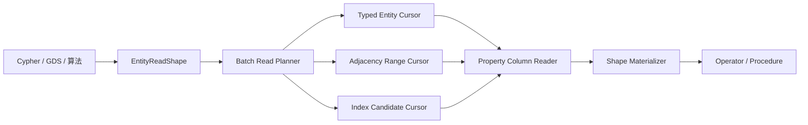

# 优化策略

本文是 ZYX 新架构性能优化的唯一执行文档。它描述如何把当前实现收敛为通用的批量读取和执行框架，不针对任何一个 benchmark、Cypher 文本或数据集添加特例。持久化布局、页格式、Catalog、Page Directory、恢复、搬迁和空间回收以[原生单文件存储重构方案](native-single-file-storage-plan)为准；功能迁移与遗留实现状态以[原生能力验收矩阵](native-capability-acceptance-matrix)为准。

当前目标是让查询和图算法声明所需的数据形状，由统一执行框架按 snapshot、逻辑页和批次组织读取。优化必须同时保持快照隔离、损坏检测、资源上限、取消、结果顺序、重复行、`NULL`、`LIMIT` 和 `SKIP` 语义。

## 当前判断

Release 基准已经证明，新架构的写入和索引构建路径并非全面退化：索引加载构建曾快于旧架构，点查接近旧架构。主要回归集中在全量实体扫描、属性过滤、索引候选验证和短路径遍历。

当前回归的共同原因是读取路径重复执行以下工作：

```text
通用 Page Directory 路由
  -> Entity Map 定位
  -> Entity page 校验
  -> Property Directory 定位
  -> Property page 校验
  -> 完整对象物化
```

这条链路在每个实体或每个候选上重复执行时，会抵消新架构的空间、快照和可搬迁优势。后续工作必须优先消除重复工作，再根据结构计数器决定是否需要调整页粒度或写入布局。

当前代码中可复用的基础包括：

- `EntityReadShape`：描述 identity、topology、type、label、selected Property 和完整对象需求；
- `NativeReadSession`：绑定一个 snapshot，保存路由、实体、token 和 Property 读取状态；
- `BoundedBatch`、`SelectionVector`：提供有界批次、选择和结果重排；
- `BTreeIndex::RangeCursor`：在一个 pinned snapshot 中保持 B+Tree 路由；
- selected-column Property API；
- Node/Edge 有序批量读取和 adjacency topology/reference API；
- LargeValue manifest、chunk、压缩和范围读取基础。

这些基础已经存在不代表所有消费者已经迁移完成。每个阶段都要完成消费者审计、必要测试和生命周期验证后才能关闭。

## 总体目标架构



读取框架分为五个边界：

1. **Shape**：调用方声明字段，不直接选择物理读取函数。
2. **Plan**：将逻辑 ID、Property token 和资源预算组织成有序批次。
3. **Execute**：按 typed directory、PageId 和 page slot 分组读取。
4. **Validate**：在 page admission、record decode 和语义交叉校验三个层次执行验证。
5. **Materialize**：只生成调用方声明的结果形状，并保持逻辑顺序。

任何新消费者都必须进入这五个边界，不能重新实现一套逐实体读取循环。

## 读取形状契约

所有 Node、Edge、adjacency 和索引读取都必须使用显式形状。形状至少支持：

| 形状 | 数据 |
| --- | --- |
| `IDENTITY` | NodeId 或 EdgeId、存在性和 state |
| `TOPOLOGY` | EdgeId、source、target、relationship type、state |
| `LABELS` | identity 加 label token |
| `SELECTED_PROPERTIES` | identity 加调用方声明的 Property token 列 |
| `COMPLETE` | 完整的逻辑 Node 或 Edge |

形状还必须携带：

- pinned snapshot；
- 最大记录数和最大临时字节数；
- cancellation checkpoint；
- 是否允许 sequential admission 和预取；
- 是否严格要求 early-stop；
- 结果顺序和重复项契约。

默认规则如下：

| 消费者 | 默认形状 |
| --- | --- |
| degree、count、BFS、DFS、shortest path、Leiden | `TOPOLOGY` |
| relationship type filter | `TOPOLOGY` |
| 只返回实体引用 | `IDENTITY` |
| Property predicate | `TOPOLOGY + SELECTED_PROPERTIES` |
| GDS 投影 | 由投影字段声明决定 |
| `RETURN n` 或 `RETURN r` | `COMPLETE` |

`COMPLETE` 只能由确实需要完整结果的消费者请求。拓扑算法不得因为通用 adapter 的方便而创建 Property cursor。

## 批量读取契约

批量读取必须采用 gather、execute、scatter 三阶段：

```text
Gather:
  收集逻辑 ID、shape、Property token 和资源预算

Execute:
  解析目录，按 PageId 分组，顺序 pin 物理 page，页内批量解码

Scatter:
  根据输入 ordinal 恢复调用方要求的顺序
```

物理读取可以排序和去重，但对外结果必须保持：

- 输入要求的逻辑顺序；
- 重复逻辑 ID；
- `NULL` 和缺失值位置；
- `LIMIT`、`SKIP` 和 visitor early-stop；
- pinned snapshot 下的可见性。

批次同时受记录数和字节数限制。任何变长 Property、LargeValue、label 集合或结果对象都必须在进入下游之前计费；不能先使用默认容量暂存，再在结果边界才失败。

一个批次的物理成本应接近以下量，而不是输入记录数：

```text
Directory range calls
+ distinct metadata pages
+ distinct physical data pages
+ decoded records
+ selected values
```

## Typed Entity Page Cursor

Node 和 Edge 扫描必须直接使用按实体类型组织的目录入口。禁止先调用通用 `visitPageLocationsUntil()` 遍历全部 Page Directory，再按 segment 或 owner 过滤。

需要提供并统一复用：

```text
NodePageCursor
EdgePageCursor
PropertyPageCursor
IndexPageCursor
AdjacencyRangeCursor
```

每个 cursor 必须：

1. 绑定一个 `MetadataSnapshotPin`；
2. 只读取自己的 typed directory；
3. 缓存当前 pool route；
4. 一个 page 只执行一次 admission 和 pin；
5. 在页内扫描多个 record；
6. 使用有界 sequential admission 和预取；
7. 通过逻辑 continuation 恢复，不暴露物理 offset；
8. 在达到记录、字节、取消或 visitor 边界时立即停止。

一个 record 扫描不能触发一次 Page Directory root descent。一个 page 在同一个 read session 中不能因为多个 owner 被重复认证和 pin。

## Property Column Reader

Property page 是共享的 4 KiB slotted page。多个 Node 和 Edge 的 Property root 可以位于同一页。Property 读取必须以 page 为单位组织：

```text
EntityPropertyKey
  -> 一次 Property Directory range merge
  -> 按 Property PageId 分组
  -> 每个 Property page 只 pin 一次
  -> 页内解析多个 owner root
  -> 只解码所需 token
  -> 恢复 Entity 顺序
```

统一 reader 至少提供：

```text
readSelectedColumns(keys, tokens, budget)
readPropertyCounts(keys, budget)
readPropertyExists(keys, tokens, budget)
readFullRoots(keys, budget)
```

小属性只需要解析 root header、slot、token offset 和目标 value。一个 selected Property 请求不得因为调用方只需要一个 token 而解码整个 root。

Property reader 必须共享：

- Directory cursor；
- page route cache；
- 当前 page image；
- slot generation 和 owner 验证；
- token offset directory；
- snapshot generation；
- cancellation；
- record/byte budget。

## LargeValue 读取

无法放进 Property page 的属性集合在 Property page 中只保存 `LargeValueRef`。真实数据由通用 LargeValueStore 以 manifest、chunk 和 4 KiB data page 保存。它可用于代码、JSON、文本、图片和任意二进制数据，不增加场景专用 Store。

当前 LargeValue 的完整读取能力包括：

- immutable logical `LargeValueId`；
- manifest tree；
- 多个 chunk 和 data page；
- 每 chunk 的 `RAW`、`LZ4` 或 `ZSTD` codec；
- content hash 和有界 dedup；
- `read()` 和 `readRange()`；
- generation-aware retirement 和 snapshot-safe reclaim。

后续必须补齐 selected Property 的范围读取：Property payload 的 offset directory 应能映射到 LargeValue chunk 范围，只读取目标 token 涉及的 chunk。读取单个小字段不能无条件读取整个大型代码片段或二进制对象。

当前 selected 路径在解析 LargeValue directory 后会复用同一份已认证的 manifest 路由，再读取各个目标 entry 的重叠 chunk；不会为每个 token 重新执行 manifest directory lookup。完整 Property 读取仍使用完整内容校验，范围读取仍保留 chunk、codec、checksum 和 snapshot 校验。

压缩策略按 chunk 生效。压缩收益低于策略阈值时可以保留 RAW。不得为某种文件类型写固定压缩特例；codec、最低收益和 raw fallback 都由通用写入选项控制。

## Topology-first Adjacency

普通图 adjacency 是全局 Packed B+Tree 的 key-only access path：

```text
(direction, NodeId, EdgeId) -> empty
```

Edge Entity page 仍然是 endpoint、type 和 state 的权威来源。adjacency leaf 不保存完整 Edge、Property、另一端 endpoint 或物理位置。

应统一提供：

```text
scanTopology(node, direction)
scanReferences(node, direction)
scanSelected(node, direction, shape)
scanFull(node, direction, shape)
scanForNodes(nodes, direction, shape)
```

多 Node 扫描必须复用 `GlobalAdjacencyIndex::visitForNodes()` 的连续 range cursor，减少每个 Node 的 root descent。EdgeId 得到后按 Entity page 批量解析 topology，再根据 type 和其他轻量条件筛选，最后只为通过筛选的 Edge 读取 selected Property。

Topology-only 路径的强制不变量：

- 不 pin 无关 Property page；
- 不构造完整 `LogicalGraphEdge`；
- 不解析 Property token name；
- 不读取 LargeValue；
- endpoint 与 direction 必须在同一个 snapshot 中验证；
- self-loop、parallel Edge、continuation 和 early-stop 语义保持不变。

## Index Candidate Stream

索引使用 `(canonical value tuple, EntityId)` key。索引是 access path，权威 Property 仍在 Property Store。索引读取统一输出 generation-bound candidate batch：

```text
canonical key
EntityId
index definition/version
snapshot generation
```

Exact、scalar range 和 composite range 必须共享：

1. 一次 root descent 的 `BTreeIndex::RangeCursor`；
2. 有界 candidate batch；
3. Entity page 分组读取；
4. Property selected-column 分组读取；
5. candidate 与 Property column 的对齐和重排；
6. residual predicate 验证；
7. early-stop 和字节预算。

索引候选验证不能对每个候选独立执行 Entity Directory 和 Property Directory root lookup。索引和 Property 在同一 generation 原子发布后，查询只做必要的 liveness、shape 和 residual 验证；完整交叉校验由 index build、maintenance、recovery 和 integrity scanner 完成。

任何 candidate stream 都必须拒绝：

- 错误 snapshot 或 index definition；
- 零 ID、重复 ID 或非法 key；
- owner、generation、checksum、codec 不一致；
- 缺失 Property 或列长度不一致；
- 超过记录或字节预算；
- 无法恢复逻辑输出顺序的物理重排。

## Snapshot-local Cache

缓存只缓存物理读取结果和已认证的中间状态，不缓存某条查询的最终答案。分为三层：

1. **Buffer Pool**：缓存物理 4 KiB page；
2. **Snapshot route cache**：缓存逻辑 PageId 到当前物理 route 的解析；
3. **NativeReadSession**：缓存本次 snapshot 中的 typed page、Entity record、token 和 Property column。

缓存身份必须包含：

```text
logical identity
snapshot generation
page generation
owner kind
codec/layout version
```

Page relocation 只改变 Page Directory route。route generation 变化时，旧 route 自动失效；逻辑 PageId、EntityId、EdgeId、LargeValueRef 和 cursor continuation 不得变化。

同一 session 内，一个 page 的 owner、generation、LSN、checksum 和 layout 校验结果可以复用。跨 snapshot、跨 generation 或跨 owner kind 不得复用。

## 分层校验

校验分为三个层次：

| 层次 | 校验 |
| --- | --- |
| Page admission | magic、owner、kind、generation、LSN、checksum、layout |
| Page scan | slot bounds、bitmap/slot directory、record kind、page-local offset |
| Semantic read | logical ID、endpoint、direction、index key、Property token、snapshot visibility |

完整校验必须在 page admission、recovery 和 integrity scan 执行。已认证 page 在同一 session 内可以使用轻量 record 检查，但不能绕过语义校验，也不能因为 benchmark 模式关闭损坏检测。

## Batch Execution Primitives

`BoundedBatch`、typed columns 和 `SelectionVector` 必须成为 scan、filter、project、aggregate、JOIN、OPTIONAL MATCH、UNION、`LOAD CSV`、`LIMIT` 和 `SKIP` 的共同执行原语。

每个 batch 必须明确：

- row count；
- selected row count；
- materialized bytes；
- column validity/null mask；
- logical ordinal；
- cancellation state；
- downstream ownership。

Filter 应尽可能只修改 selection vector，不复制未选中的完整对象。Project 只有在列被保留时才复制 Property payload。Count、degree 和 existence 操作不得生成完整结果行。

所有算子必须保持原有 null、重复、排序、短路和异常语义。批处理只改变内部执行顺序，不改变 Cypher 可观察结果。

## 写入与维护

在线 mutation、bulk ingest、index build、adjacency rebuild 和后台 maintenance 共享：

```text
canonical sort order
byte-aware page builder
fill/split/merge policy
codec and checksum
COW publication
retirement and reclaim
```

批量 Edge 写入在一个 transaction-local sorted overlay 中同时规划：

```text
Edge Entity
OUT adjacency
IN adjacency
Property root
affected indexes
```

批量 Edge 写入的预检只解析 Property key/token 的 canonical 形状，不复制或排序 Property value；同一事务 snapshot 内的 token 命中和未命中结果会缓存，预检和物化不会为同一个 key 重复访问 Catalog/Index。真正的 Property root 在统一写入阶段只物化一次。这样可以避免大批量写入在验证阶段产生第二份完整 resolved payload。

标量 Index 写入规划还会按数据库和基准 snapshot generation 缓存已发布 root 的存在性。这样不同实体的 staging 不会重复查询同一个 Metadata Directory；进入新的 generation 后缓存会失效，再为下一个事务重新确认。

不能为每一条 Edge 单独执行 root-to-leaf insertion、page split 或 metadata publication。只有在结构计数器证明 COW amplification 仍是主要成本时，才增加通用 dirty-path COW、Directory merge 或共享 B+Tree WriteBatch；如果证据不成立，保留现有简单路径。

任何写入优化都必须验证：

- writer conflict 和 rebase；
- short write、ENOSPC 和中断；
- old snapshot 读取；
- reopen/recovery；
- retire queue 和 frame reclaim；
- 单文件 durability；
- mutation 前后索引、Property 和 adjacency 的原子可见性。

## 分阶段执行计划

下面是唯一执行顺序。阶段名称描述通用能力，不对应某个 benchmark。

### Stage 0：可信基线和结构计数器

关闭 profile 的诊断开销，固定 Release 编译、数据集、seed、warmup、iterations 和 execution mode。统一记录 `directory_range_calls`、`root_descents`、`metadata_pages_read`、`distinct_page_pins`、`records_decoded`、`selected_values_decoded`、`full_materializations`、`materialized_bytes` 和 `large_value_chunks_read`。计数器必须饱和且不能改变查询结果。

关闭条件：同一运行能够同时解释 latency 和结构工作量，必要测试通过。

### Stage 1：Typed Entity Cursor

Node/Edge 扫描改用 typed page-location cursor，移除通用 Page Directory 全量遍历和 segment 过滤，缓存 pool route 和已认证 page，接入 sequential admission、有界预取和 cancellation。

关闭条件：root descent 与 page pin 不再随每条 record 重复，relocation、reopen、old snapshot、corruption 和 early-stop 测试通过。

### Stage 2：统一 EntityReadShape

审计 query、GDS、procedure、overlay、constraint 和 maintenance 的 Node/Edge 入口，全部使用显式 shape；删除 field-by-field read 和 premature complete materialization，统一 session、budget、cancellation 和 logical order。

关闭条件：topology-only consumer 不创建 Property cursor，完整对象只由 `COMPLETE` 请求产生，null、duplicate、order、limit 和 snapshot 回归通过。

### Stage 3：Property Page Batch Reader

实现 gather/execute/scatter Property page batch；owner root 按 PageId 分组；selected token 使用 offset directory 定位；count、exists、selected、full root API 共享 page cursor；建立 LargeValue offset 到 chunk range 的映射。

关闭条件：一个 session 中一个 Property page 只认证和 pin 一次，selected read 不解码未请求 token，LargeValue selected read 不无条件读取完整 payload，大属性和损坏测试通过。

### Stage 4：Topology-first Adjacency

traversal、degree、count、shortest path、Leiden、GDS 和 procedure 使用 topology/reference shape；多 Node adjacency 使用连续 range cursor；按 Entity page 批量解析 Edge topology；type/endpoint 条件在完整 Property 读取前执行。

关闭条件：topology-only 无无关 Property pin/decode，supernode 可跨多个 leaf 流式读取，self-loop、parallel Edge、continuation、early-stop 和 cancellation 测试通过。

### Stage 5：Index Candidate Stream

exact、range、composite 统一 candidate stream；一次 root descent，按 Entity/Property page 分组验证；保留 generation、owner、checksum、codec、liveness 和 residual 验证；支持 value-major batch 的局部排序、去重和结果重排。

关闭条件：root descent 不随候选数量增长，candidate 不再逐条独立访问两个目录，stale、missing field、duplicate、corruption、concurrent snapshot 和 resource bound 测试通过。

### Stage 6：Batch Execution

将 `BoundedBatch`、typed columns、`SelectionVector` 接入 scan/filter/project/aggregate/JOIN/OPTIONAL MATCH/UNION/LOAD CSV/`LIMIT`/`SKIP`；selection 与 payload 分离；统一 byte budget 和 cancellation。

关闭条件：empty、all-selected、all-rejected、null、duplicate、unsorted、early-stop 和 aggregate-boundary 语义回归通过，count-like 操作不生成完整实体。

### Stage 7：Snapshot-local Cache 和校验分层

统一 Buffer Pool、route cache、NativeReadSession 生命周期；复用同一 session 内已认证 page；完整 page 校验集中到 admission/recovery/integrity scan，保留 record 和 semantic fail-closed 检查。

关闭条件：route generation 变化不会命中旧 route，跨 snapshot 不污染缓存，corruption、relocation、reopen 和 reclaim 测试通过。

### Stage 8：通用写入批处理

统计 replacement、append、retirement、publication、scratch decode 和 bytes-per-mutation；只有证据证明 COW amplification 是主要成本时，才实现通用 target-page grouping、sorted Directory merge 和 B+Tree WriteBatch。online、bulk、rebuild 共用 page builder 和 publication。

关闭条件：writer conflict、fault injection、ENOSPC、recovery、reclaim、old snapshot 和 concurrent write 测试通过；优化适用于一类 mutation，而不是某个 workload。

### Stage 9：最终评估和覆盖率收口

使用无 profile 的 Release binary，在 macOS、Linux、Windows 执行 smoke、small、medium 以及 warm、opened、cold-ish 矩阵，对比 latency、page work、bytes、内存和文件大小。所有阶段功能和必要测试通过后，再执行完整四维 coverage 收口。

## 测试协议

开发阶段使用最小相关测试：

```bash
./scripts/run_tests.sh --quick --gtest-filter "SuiteName.*" --file path/to/changed/source.cpp
```

每个阶段至少覆盖正常单页、跨页、空结果、满结果、early-stop、unsorted、duplicate、missing、malformed input、relocation、reopen、old snapshot、owner/generation/slot generation/checksum/codec corruption、cancellation、record budget、byte budget、LargeValue、压缩、范围读取和 reclaim。完成阶段功能后运行：

```bash
./scripts/run_tests.sh --quick
```

全面四维 coverage 在 Stage 9 执行。任何测试不得通过修改断言来掩盖源代码问题。

## 结构验收指标

| 指标 | 目标 |
| --- | --- |
| root descents | 与 range/batch 数量相关 |
| directory range calls | 不随 record 数量线性增长 |
| distinct page pins | 不超过实际所需 page 的有界倍数 |
| full materializations | 不超过 shape 明确要求 |
| selected decodes | 只覆盖请求 token |
| LargeValue chunks | 只覆盖请求范围 |
| materialized bytes | 始终受 batch budget 控制 |
| result order | 与旧语义完全一致 |

如果性能改善无法由这些结构指标解释，阶段不能关闭，应回到共享框架查找重复工作。

## 禁止事项

- 针对 benchmark 名称、Cypher 文本、固定节点数或固定度数添加分支；
- 恢复旧 Segment Chain 或 Edge 双向链表；
- 在索引中复制完整 Property 作为 covering copy；
- 在查询层缓存最终结果；
- 通过关闭 owner、generation、checksum 或 snapshot 校验换取速度；
- 假设固定的每页实体数量；
- 为代码、图片或其他领域增加专用 Store；
- 增加第二个持久化数据库文件或外部 WAL；
- 先扩大 page 或 bitmap，再跳过读取路径归因。

完成定义是：所有消费者通过通用 shape、batch、typed cursor、Property column、topology cursor 和 snapshot cache 工作；所有必要功能、生命周期、损坏和资源测试通过；最后的无 profile 多平台 Release 评估能够由结构计数器解释。

## 相关文档

- [原生单文件存储重构方案](native-single-file-storage-plan)
- [原生能力验收矩阵](native-capability-acceptance-matrix)
- [关系遍历](../algorithms/relationship-traversal)
- [属性索引](../algorithms/property-index)
- [Packed B+Tree 索引](../algorithms/btree-indexing)
