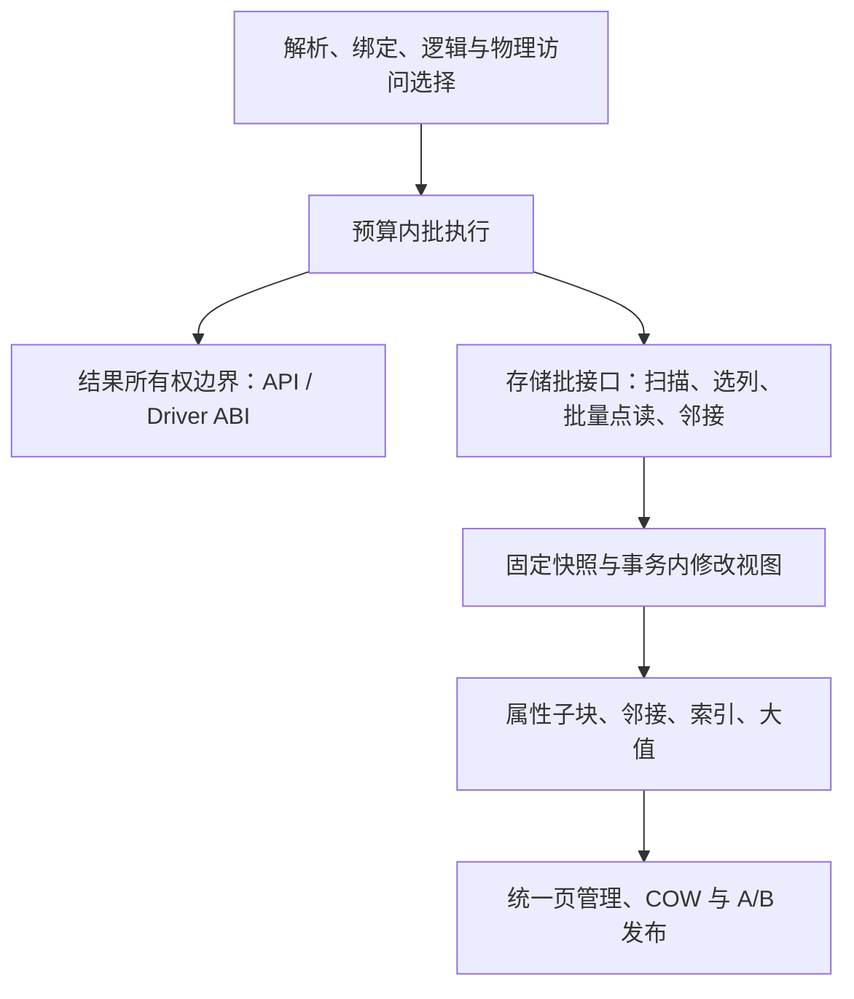

# COW 图数据库性能重构实施方案

更新：2026-10-19。计划标识：`cow-performance-20261019`。**本页是当前优化的唯一实施入口。新路线 R0–R7 共 24 项，已验收 13/24（54.2%）。本轮推进 R1.3/R2.3/R3.2/R4.3/R5.1，原生完整生命周期仍进行中；R1.3/R2.3 及 R4.3 等性能项仍待 R7，不提前计数。**

目标是在保留现有公开能力的前提下，减少每次查询和更新所需的定位、解码、转换、物化及元数据维护工作。保留现有引擎，进行有证据支持的局部结构性重构；不整体重写 backend，不承诺所有负载超过 Kuzu。

已完成的 S0–S6 为 **34/34**，只代表上一轮交付。其完整中英文文档、旧存储规范、发布导航和机器进度已按原始字节归档到 `benchmarks/architecture-design/archive/20261019-completed-s0-s6/`，`manifest.json` 保存来源和 SHA-256。旧 A/O/S 编号、过程百分比和当时的待办不再驱动实施。历史采用/拒绝记录仍是证据，不自动授予新布局生产准入。

## 1. 固定边界与执行规则

### 1.1 产品、持久化与兼容性

- 保持通用属性图、动态属性与类型、多标签、稳定逻辑 ID、现有 Cypher/QueryBuilder/GDS/Vector/Driver ABI 和语言绑定行为。只改变内部表示，不顺带删减能力或改变查询语义。
- 保持严格单文件：持久数据、恢复信息和支持的查询 scratch 均由同一数据库文件管理，不新增 WAL/SHM/临时 sidecar。
- 保留 COW 与 A/B Superblock。保持 data-before-root 和 durable acknowledgement；不引入 WAL、跨事务 group commit、不关闭同步或减少持久化保证。若未来小事务瓶颈证明需要改变协议，另立提交与恢复设计，不混入本路线。
- 保持逻辑/物理身份分离、快照、read-your-writes、完整性认证、统一分配、搬迁及安全回收。逻辑 ID 不复用；物理页/槽复用须验证身份与 generation。
- 公共功能兼容不等于文件字节兼容。当前开发期策略仍是新格式新建、旧格式明确拒绝，不自动迁移或删除用户文件。新增 codec/root 之前先更新[单文件存储规范](native-single-file-storage-plan)及兼容矩阵，不能悄悄改写旧版本含义。迁移器不在本轮必做范围；稳定格式发布前仍须确定迁移与备份合同。
- 保持 macOS/Linux/Windows 可移植及 WASM 非 JIT 路径。实际验证平台单独记录，Linux 成绩不能充当另外两平台实测。

单文件是物理包装，COW/WAL 是持久化机制，行列布局和批执行是访问机制。Kuzu 0.11 起使用单个主文件，但可创建 `.wal`、`.shadow`、`.tmp`（见[官方说明](https://kuzudb.github.io/docs/developer-guide/files/)）；不能用文件数量解释扫描差距，也不能由“用了 WAL”推断查询性能。

### 1.2 实施与文档职责

实施开始时核对远程 `work` 与本地改动；快进更新或在隔离工作树推进，不能 reset/stash 覆盖用户修改。冻结实际源码而非只记录 HEAD。每轮报告已验收任务、证据和剩余问题；提交/推送遵循会话中有效授权，不从历史批准推导任意新载荷授权。

只运行必要的受影响模块单元测试，不执行全量单元测试，覆盖率不是门禁。开发期间采用短小正确性/机制检查，不频繁跑 benchmark；完整规模正确性、长时间资源检查与正式性能对照集中在实现完成后的最终窗口。文档修改仅验证文档。`scripts/run_tests.sh --file` 只限制覆盖率展示，不能单独用它限制测试范围。

本页管理顺序、任务状态和准入；[单文件存储规范](native-single-file-storage-plan)管理现行格式；[能力矩阵](native-capability-acceptance-matrix)管理消费者和语义证据；[发布事项](native-remaining-work-roadmap)管理独立发布边界。设计决策放在 `benchmarks/architecture-design/decisions/`，本地原始结果放在被忽略的 `benchmarks/architecture-design/results/`，正式证据不能只存在于被忽略目录。

## 2. 已实现基础、剩余缺口与测量依据

### 2.1 实施起点与当前增量

本次文档审查基于仓库提交 `0427be26001073e3caf66621e1b8e62fd3da84dc`；上一轮正式评测生产源码为 `c28794a7c92434e809f9bbb17d48e8c457a70263`。实施时若源码不同，R0 重新核对，不能照搬下表作为新源码结论。

以下表格记录 R0 冻结的启动状态。当前增量：R1.1/R1.2 已新增直接属性单元生产者，贯通适用的原生扫描、数值/字符串过滤、单/多键聚合和 DISTINCT；复杂消费者及参数残余仍按明确有界适配器保留，R1.3 的适配器登记与语义验证已完成、待 R7 性能准入；R2 已接入认证 radix 只读视图，并修复跨句柄发布后的可变页池控制镜像缓存身份。

| 领域 | 已有基础，必须复用 | 本轮真实缺口 |
|---|---|---|
| 执行 | AST/Expression/逻辑优化、绑定槽位与描述符、批身份、EntityRef、选择向量、类型化数值过滤、预算回退 | 部分批路径仍由通用值转换产生类型列，随后回到逐行属性表；需贯通生产者与消费者 |
| 属性 | 选列解码、排序批量定位、字段暂存、行布局与大值处理、属性名批处理 | owner 级定位和集合编码仍可能放大扫描/小写；混合布局实验未获生产准入 |
| 元数据 | 有界解码/路由缓存、不可变路由分支复用、批量查询、回收触发合并 | 尚需量化并减少重复定位、认证、复制与共享路径更新；不能重复建设同类缓存 |
| 图访问 | 全局 key-only 邻接树、主 Edge 认证、按快照的有界批遍历和会话复用 | 首次读取通常仍取主 Edge；覆盖/分段实验不能直接启用 |
| 事务 | COW/A-B、快照、overlay、普通图根 fence、受限 blind patch 安全 rebase | 通用不相交写仍可能冲突；不声称 serializable 或通用多写者 |
| 资源与 spill | 进程/数据库账户、QUERY/CACHE/WRITE/MAINT 归属、结果生命周期、文件内排序 run/归并、分区 DISTINCT/UNION | 批接口改造需保持这些能力；聚合状态/哈希连接并非已有通用 spill |
| 优化器与诊断 | 基数估计、已有索引/范围选择与重写、EXPLAIN/PROFILE、PerfTrace | 需要补齐新路径的成本、选择理由和实际工作量，不能宣称从零建设优化器 |

排序、DISTINCT 的现有实现见 `src/query/execution/ExternalQuerySort.hpp`、`ExternalQueryKeySet.hpp`；范围及资源边界见决策 `20261016-s53-budget-and-spill-acceptance/zh.md`。已有能力在本轮只作为保护合同，不再次计作新增完成。

### 2.2 最新正式参考与解释限制

Linux x86_64、medium 22.5 万节点/86 万边，热态基础窗口每来源 3 个独立进程、每场景 3 次预热和 10 次测量。下表是各进程 P50 的中位数，单位 ms；不是本轮新基线或 P95 精度声明。

| 场景 | 上轮优化后 ZYX | Kuzu 0.11.3 | ZYX/Kuzu |
|---|---:|---:|---:|
| 节点点查 | 2.285855 | 0.234714 | 9.7 |
| 两跳 | 2.168795 | 0.824298 | 2.6 |
| 标签属性过滤 | 332.551 | 2.136180 | 155.7 |
| 实际 country 分组计数 | 440.596 | 3.644591 | 120.9 |
| 全节点 score 过滤 | 634.9675 | 0.873943 | 726.6 |

精确值及逐进程分布见 `benchmarks/architecture-design/decisions/20261018-route-reuse-base-read-checkpoint/proof.json`；完整准入和资源成本见 `20261018-route-reuse-final-admission/`。原始 `d09fc467` 对照只用于历史改善分析，下一轮 before 应为实际开始实现的源码。`aggregation_group_by` 的历史 workload 名实际对应 COUNT DISTINCT；真正分组输出为 `aggregation_count_by_group`，不能混用。

保留以下限制：ZYX native IPC 与 Kuzu Python 入口不同，schema/索引/提交语义并非全部等价；不支持记 N/A，实际失败/超时保留为失败/超时。上一轮部分准备/索引路径全进程峰值 RSS 增加约 7–11%，扫描降低约 55–57%；不能仅展示更好的查询阶段峰值。单次诊断、累计物化字节、存储层 read bytes 和嵌套 timer 均不能分别冒充正式延迟、峰值内存、磁盘设备读取量或可相加的 CPU 份额。

## 3. 目标结构与共同合同

这些是职责边界，不要求新增同等数量的包装对象或第二套完整执行器。以下合同适用于所有阶段：

1. **身份与生命周期**：描述符包含足以验证的数据库/快照/布局/属性身份；批行引用检查 owner 与 incarnation。计划绑定和执行 pin 分离，明确 schema/布局变化的失效规则。借用值不能越过页 pin、批复用或事务生命周期；需要逃逸时复制并转移预算。
2. **语义**：保留缺失/存储 NULL/有效值的内部区别及现有 Cypher 映射、类型比较/哈希、溢出、重复次数、别名、ORDER BY、OPTIONAL、路径和关联子查询。易变表达式及副作用的求值次数不能因批处理、重试或下推改变。
3. **唯一权威与原子可见性**：属性、实体、派生索引、邻接、统计及退役信息按现有合同共同发布。物理页映射更新不能替代语义版本推进；当前图根 fence 不含所有物理目录，新增布局必须更新正确的语义 fence。
4. **错误边界**：仅对事先定义的可选优化额度拒绝回退。损坏、取消、I/O 错误和已开始输出后的失败不得捕获后重放输入或当作“无数据”。预交付拆批必须不重复输出，不改变错误语义。
5. **资源**：计入容量、嵌套载荷、索引、缓冲、pin 和逃逸输出，使用现有账户，不重复收费或提前退款。可计费内存与 RSS 分开。锁内不得等待必须靠同一锁释放的资源。
6. **有界工作**：列出单次定位、重编码、分裂、回收和重试的工作上限。不能将前台开销无限转移后台，也不能依赖无限增长的缓存、delta 链或日志。

## 4. 必须落实的实现合同

### 4.1 R1：贯通存储生产者与批消费者

复用现有 `BoundNodeScanBatch`、批身份、绑定程序和预算设施，扩展同一内部批合同。分别定义范围扫描和随机 gather，保留输入 ordinal、重复 ID、缺失实体及结果顺序；不能强迫点读扫描整组。批次由字节和行数双重限制，宽行/大值可缩小批次，不能固定大 reserve。

常见整数/浮点/布尔及字符串路径直接产生可被下游消费的数据；字符串先采用明确 owner 的偏移/字节区或等价有界表示。字典编码是条件性实验，不同字典的编号不能直接比较。动态复杂值保留等价且计费的回退。不得仅把 PropertyValue 数组再次复制成类型数组就宣布消除转换。

第一条必做贯通路径为 scan → filter/project → aggregate → owning output，覆盖数值过滤、字符串过滤、真实单/多键 group-by、COUNT DISTINCT 和空输入。分组键必须作为完整 tuple 比较；聚合状态的 NULL、数值类型、合并与错误规则沿用现有语义。不得把各列分别 DISTINCT 后组合成错误分组结果。

随后接入 Top-K/sort、join/expand 的适用批边界，并登记 UNWIND、procedure、subquery、mutation 读侧及其他消费者的批路径或有界适配器。每个保留适配器写明触发条件、数据所有权、预算、成本计数和退出条件。普通扫描过滤聚合不能整体退回旧行路径而声称贯通；复杂路径可以暂留明确适配器。已有 sort/DISTINCT spill 要继续可用。

平坦批为必做基线；因子化/分组中间结果、并行执行、SIMD、JIT 不作为这一阶段依赖。将来采用时另验重复次数、相关性和任务局部状态，不能用改变线程数掩盖单线程数据路径成本。

### 4.2 R2：精简读取元数据与认证路径

先按点查、扫描、邻接 gather 列出 token → owner/目录 → 路由 → 页 → 值的实际链路，区分调用次数、唯一页、缓存命中、codec 解码、校验字节、复制和 I/O。核查已有缓存及路由复用，禁止叠加含义重叠的缓存。

同一快照内按页归并定位、复用游标和已认证不可变页，恢复原 ordinal。缓存键覆盖数据库身份、逻辑页/路由身份、generation 与解析上下文；缺失结果只有在明确有效期时才缓存。文件增长、另一个合法句柄发布、搬迁、页复用和旧快照均有失效/隔离测试。文件大小检查只能在有等价边界与并发证明后合并，不能直接删除。

首次加载必须完成当前格式要求的认证；owner/generation/范围验证不能因缓存命中丢失。点访问验证已访问对象，完整 integrity 检查验证全局不一致；明确缓存期间外部破坏在哪个后续认证/完整性阶段发现，不承诺每次逻辑读取检测所有介质变化。

目标是让顺序扫描的定位工作趋近所访问的组/页，避免对每个值重复下降相同目录；保留随机点读的有界定位能力。R2 本身不改持久格式，若确需格式变更转交 R3/R4 的版本合同。

### 4.3 R3：有界混合属性子块与字段更新

**生产切换有条件，完整生命周期原型和成本验证必做。** 复用已有字段 set/remove、map 合并/完整替换和 overlay 语义；本轮解决其下层仍可能完整集合编码的问题，不重复实现字段暂存。

- 逻辑实体分组、物理页、压缩块和 COW 更新单元分别定义。旧 A3 的 64-ID 组只是已有候选，不是新性能结论；R3.1 用成本记录明确组容量、子块大小、稀疏阈值和单次工作上限，编码前关闭这些未决项。
- Node/Edge 分开；标签只表示成员关系。稠密且类型适合的字段进紧凑列，稀疏/混合类型进有界扩展；动态类型不变成永久 schema。每个 owner/token 在快照内唯一归属，扩展不再保存完整第二份行。
- presence、NULL、类型、存活信息必须明确编码。实体有实际字段枚举路径，完整读取按实际字段工作，不遍历全库 token 或整组全部字段。避免每实体/字段独立树和稀疏组独占大尾页。
- 大值独立存储且认证；小字段更新复用未变引用。选列读取不能解码无关大值；修改一值不能无条件重写整组/完整大集合。无需变化的索引不删建；no-op、类型变化、REMOVE、整 map 替换分别验证。
- 数据子块、归属描述符、成员枚举、图路由、索引、语义 fence、分配/退役在同一发布协议内切换。稳定逻辑页不代表语义版本不变。旧快照保持旧布局；重开、搬迁、删除和发布失败都有精确可达性与回收规则。
- 先用少量明确编码与显式有界转换。不得引入自动布局抖动、无界增量链或整容器重写作为默认更新。超出编码/容量条件时保留可用行布局，不丢字段。

R3.1 必须提交访问/成本表：单实体单字段、完整实体、N 实体 f 字段扫描、单字段修改、删除/回收，各自读取和 COW 哪些页。计入目录、owner 枚举、presence/type、部分填充、分配器、索引与旧版本空间。逻辑字段数 F、实体数 E、组数 G、组内字段种类 K 的增长关系要明确，尤其避免 O(E×K) 的稀疏成员元数据。

验证稠密/稀疏、独有字段、随机交错形状、多标签、持续变型、删除后稀疏组、宽实体/大值及邻居属性 gather。与同一批执行器下的现行行布局比较，不能把 R1 收益算成布局收益。原型缺少图路由、双向生命周期、退休或完整成本时不得生产准入。失败可完成比较项 R3.2，不能自动完成生产项 R3.3。

### 4.4 R4：有界 COW 写入与维护

复用当前不可变分支共享和回收批次机制。事务内同页/同树路径修改尽量合并，最终编码与索引更新基于实际变化；已经发布或被读者引用的页面不得原地修改。字段接口、实际页重写量和发布总量分别测量。

保持“写候选数据及元数据 → data fence → 写非当前 A/B 槽 → superblock fence → 确认”的顺序。恢复选最新有效根，处理 torn write、失败 sync 和不确定提交；有效根选择不代替全库 integrity。ID 预留、普通提交与维护发布分别计数，不把多次内部发布隐藏成一次廉价事务。

列出 catalog、allocator、页映射、索引、路由和 retire queue 的实际修改集合。目标是工作随变化页和必要共享路径增长；不对每次小写执行与无关存量成比例的重建。若某路径仍需全局扫描，必须登记触发条件、上限及为什么不能增量化。

前台/维护分别设页数、字节或时间预算，并报告积压、最老 pin、可复用空闲页和尾部可裁剪页。长快照阻止回收时提供背压/明确资源拒绝，不能回收活页或无界增长。碎片整理、物理搬迁和尾部缩文件分别验证；文件长度不等于活数据大小。不得用提高内存/文件额度、无限延后清理或强行要求每次关闭所有退休量为零来制造收益。

隔离合同保持现状。复用已验证的受限 blind rebase；不得仅删除图根 fence。若后续扩大范围，需另记录读/缺失/范围/约束/schema/端点依赖、验证点及重试上限；同页不相交写须在最新页重建或保守拒绝，不能覆盖对方修改，不能自动重放有副作用的语句。通用多写者和更强隔离级别不计入本轮承诺。

### 4.5 R5：邻接与访问计划

先定义可被批消费者直接读取的 EdgeId、NeighborId、TypeId、方向、可见性和 continuation 合同。保留多重边、自环、类型过滤、overlay 和顺序语义。对照为当前 key-only 树加已实现的批量主记录复用。

先比较覆盖 B+Tree 与共享分段邻接，不恢复退休的 per-node root/delta 实现。主 Edge 仍是拓扑权威；派生数据可直接读取的前提是原子维护、身份认证和明确的故障检测合同。必须逐项规定合法 checksum 但错误 endpoint/type、缺反向项、重复/孤儿项、陈旧 generation 在普通读取、提交还是 integrity 阶段检测。替代协议通过前保留当前主记录检查。

候选涵盖创建/删除、双向邻接、主记录、类型索引、统计、旧快照、重开和退役，不能只接读路径。覆盖树已满足目标时优先较小改动；分段方案必须抵消新增目录、更新和空间成本。随机插删、热点/幂律度数、超级节点和多跳是保护场景。

在既有优化器上补充实际需要的标签/type/属性选择率、度数分布或有界估计；明确统计身份、更新/失效、误差和退化策略。规划不能扫描全图收集统计。选择索引/gather/扫描、过滤时机、连接与扩展顺序时计入候选数量、列宽、页数、物化和内存成本；未知或陈旧统计保持安全且稳定的计划。只把受证明的语义等价重写下推，特别保护 LIMIT、OPTIONAL、NULL、重复及易变表达式。

### 4.6 R6：资源、生命周期与可观测性

复用现有资源协调和 scratch 实现，将新批、缓存、算子状态及输出纳入同一账户。批量预约可以摊销计费，但持有的容量必须持续收费，取消和异常必须归还。输出存活时间可以长于事务；零复制导致长期 pin 时须有有界复制/拒绝策略。

维持文件内 sort 和 DISTINCT/UNION spill。明确新批消费者是否支持它们；不支持落盘的 group-by/hash join 在超额时清楚失败，不能宣称通用外存执行。新增这些 spill 算法属于后续独立扩展，不以本轮 100% 暗示完成。

逻辑只读事务仅可在既有内部权限允许且文件可写时使用 scratch；物理只读绝不写 scratch。临时页使用查询 owner 与独立生命周期，不被无关用户长快照保留；scratch 与用户提交共享 allocator 更新不得互相覆盖。验证取消、磁盘满、崩溃重开、并发别名和 cleanup 重试。

扩展已有 EXPLAIN/PROFILE，显示实际访问路径、批/行适配器及原因、估计/实际行数、选择率、读取/解码/校验量、物化与预算峰值、spill 和发布阶段。指标注明单位、累计/峰值、包含范围和是否嵌套；关闭 instrumentation 的正式计时独立进行。

拆分超大实现文件时按绑定、算子、存储访问、预算与发布职责拆分，保留单一实现所有者。拆文件不是性能成果，不新增长期并行 backend；移除旧适配器前证明所有消费者已替换，并保留必要语义测试。

## 5. 阶段依赖、交付与进度

主线为 R0 → R1 → R2 → R3 → R4 → R5 → R6 → R7。公共身份/资源合同和受影响正确性测试随阶段落实，不能拖到 R6；R3/R5 的有界原型可在接口稳定后提前验证。性能准入统一在 R7 窗口完成，在此之前可标“实现完成、待准入”，不能提前标已验收。后续阶段以所需接口和正确性合同就绪为依赖，不要求前一阶段先取得最终性能验收，以免形成 R7 循环等待。

| 阶段 | 三项独立交付及完成条件 | 已验收 |
|---|---|---:|
| R0 起点与合同 | **R0.1** 源码/能力/适配器审计；**R0.2** 同条件基线及正式采样、资源、收益/保护指标预登记；**R0.3** 调用链/机制计数与接口/格式决策清单，正确性关键问题明确归属 | 3/3 |
| R1 批执行 | **R1.1** 存储批生产者、身份及所有权；**R1.2** 数值/字符串过滤与真实聚合贯通；**R1.3** 其余消费者接入或明确有界适配器、语义保护及 R7 性能复核（实现完成待准入） | 2/3 |
| R2 读取元数据 | **R2.1** 实际路径和重复工作归因；**R2.2** 认证/定位/游标复用实现及失效测试；**R2.3** 点查/扫描/gather 工作量与 R7 性能准入（实现完成待准入） | 2/3 |
| R3 属性子块 | **R3.1** 字节布局、参数、成本及生命周期决策；**R3.2** 完整生命周期原型和同执行器对照结论（进行中）；**R3.3** 获准方案生产接入、格式更新及 R7 读写/空间准入 | 1/3 |
| R4 COW 写入 | **R4.1** 增量页/路径合并及小写实现；**R4.2** 发布、故障、快照、回收和背压验证；**R4.3** 成熟库小事务/批写/持续更新的 R7 准入 | 2/3 |
| R5 图访问与规划 | **R5.1** 邻接一致性协议及候选完整生命周期（进行中）；**R5.2** 获准访问路径生产接入与 R7 图读写/空间准入；**R5.3** 新访问路径成本、计划选择与留出负载验证 | 0/3 |
| R6 工程与资源 | **R6.1** 新路径预算、结果生命周期及现有 spill 兼容；**R6.2** EXPLAIN/PROFILE 与物理工作量可观测；**R6.3** 资源/取消/read-only 故障、职责整理及跨平台验证范围记录 | 3/3 |
| R7 最终验收 | **R7.1** 冻结最终候选、受影响模块及完整规模正确性；**R7.2** 同条件读写/资源/稳态与 Kuzu 对照，逐项准入；**R7.3** 最终能力/格式/决策同步、原始证据清理及剩余差距报告 | 0/3 |

**总计：13/24（54.2%）。** 状态仅为待开始、进行中、实现完成待准入、已验收、阻塞。每项有证据才能计一次；本页是唯一手工进度表，机器摘要只能派生。旧 `decisions/current-progress.json` 的 34/34 明确仅属历史，不沿用其分母。

正确性关键接口/codec/协议在相应生产实现前定案；布局是否有收益可留到最终窗口。候选需可隔离选择/构建以完成对照，未准入不得作为唯一默认生产格式。最终不达标时拒绝候选、保留现行生产路径；可以完成比较项，生产项保持阻塞。不能用“决定不采用”替代必做的生产能力，不能缩小分母凑 100%；必要的范围调整须明确提出并经用户确认。

上一组固定五项为 R0.1/R0.2/R0.3/R1.1/R1.2。R0 证据见 `benchmarks/architecture-design/decisions/20261019-r0-five-item-start/`；R1.1/R1.2 事前按基础能力合同验收，性能收益仍由 R1.3/R7 判定，不提前宣称提速。

R1.1 证据：`benchmarks/architecture-design/decisions/20261019-r1-direct-property-producer/`。直接生产者、三态/混型、重复 gather、旧快照、取消与预算合同已验收；R1.2 的后续贯通已验收，见 `benchmarks/architecture-design/decisions/20261019-r1-continuous-filter-aggregate/`。最终 75 项定向检查通过；真实存储跨批过滤、联合分组与 DISTINCT 精确结果通过。

第二组固定五项为 **R1.3/R2.1/R2.2/R2.3/R3.1**，证据见 `benchmarks/architecture-design/decisions/20261019-r2-next-five/`。R2.1/R2.2/R3.1 已验收；R1.3 的适配器/语义工作和 R2.3 的工作量证据已完成，按既定阶段依赖保留“实现完成待准入”，不提前计入完成数。必要模块共 183 个不同用例最终状态通过（182 项首轮含 9 项控制页预热 fixture 失败，修正预热后 22 项受影响检查全通过；不是一次 183/183）。跨句柄首轮真实失败及修复证据另行保留，未运行全量单测或新增正式性能窗口。

R3.1 已固定单一 64-ID 候选、48-slot 列资格、独立字段子块、共享成员/列/extension/组目录、明确描述符与额外语义 fence、完整成本准入和双向生命周期；详见上述目录的 `r3-layout-zh.md`。已开始独立 payload 编码验证，尚未接入原生文件/生命周期，不代表生产布局已切换；原型/格式/生产准入仍属 R3.2/R3.3。

本组固定五项 **R4.1/R4.2/R6.1/R6.2/R6.3** 已按事前登记的基础/正确性/资源/观测合同验收。证据见 `benchmarks/architecture-design/decisions/20261019-r46-five/`。基于已就绪 COW 和 R1/R2 接口落实公共合同，不替代 R3 格式原型、R5 邻接候选或 R7 性能准入。

已有 owner 更新/no-op/删除不再无条件枚举属性页池；复用既有同页 COW 合并并移动 owning plan/大值缓冲。8 owner 更新验证合并为 1 份 4032 字节 replacement payload、旧 pin 和重开值精确、无属性池枚举。PROFILE 以固定、计费的线程局部观测报告实际批/适配器、双层过滤、读取/校验、局部预算峰值、内部 ID/图发布与 fence；原列顺序保留并追加 summary 列，现有 Driver ABI map 读取已验证。EXPLAIN 保持不读快照，只显示候选和适配条件；未知估计明确 NULL，不把诊断说成性能。

必要模块最终 245 项通过；最终 PROFILE/ABI 改动后 99 项受影响检查通过，合计 263 个不同用例最新状态通过（分批，非一次 263 项运行）。首轮 166 项的 3 项失败及修复/测试原因保留。覆盖发布/搬迁故障、pin/回收/文件背压/尾裁剪、低预算/guard/结果逃逸和现有 sort/DISTINCT/UNION spill；仅实际验证 Linux x86_64，不宣称三平台或完整绑定矩阵通过。R6 合同约束未来 R3/R5 接入，新增生产路径仍须补对应验证，最终 R7 不得略过。R4.3 仍需成熟写入、稳态资源及维护观测准入，未运行新的正式性能窗口。

R3.2 进行中：列/组头/192 字节描述符、成员/定位编码和完整成本证据门禁已实现为独立 payload 实验；原生共享 map 复用 key-only B+Tree 的有序前缀/值后缀，复合事务和 fresh rebuild 保留 EMPTY 叶布局。九个必要原生模块 178 项通过，覆盖旧 pin/重开、重复前缀、页池耗尽重建、整树退役和 A/B 中断。单字段替换/低于 48 槽或变型降级、组/列/描述符代际及当前组 live 权威合同已加纯内核；codec/门禁与转换共 33 项通过，含真实 PropertyValue 的 144 对 no-op 比较。ASan/UBSan 关闭环境不支持的泄漏检测后通过，失败/审阅中间证据保留。

证据分别见 `benchmarks/architecture-design/decisions/20261019-r3-codec-five/`、`20261019-r3-native-directories/`、`20261019-r3-field-transitions/`。未持久化 hybrid 描述符/列格式，未安装属性路由；成本门禁尚无原生完整估计器，纯转换已补真实账户预约持有封装，但尚未接入原生 writer 或原子发布 extension。R3.2 仍须按 R3.1 完成原生格式/根/fence/完整生命周期、真实分配及同执行器 ROW 对照。五个编码子项、通用 map 和纯转换内核均不能计作完整阶段验收，总计仍为 13/24，不提前宣称性能收益。

本轮固定推进 **R1.3/R2.3/R3.2/R4.3/R5.1** 的五项有界实现/验证，证据见 `benchmarks/architecture-design/decisions/20261019-five-remaining/`。Sort key-slot 拒绝改为类型化资源异常并核对 Top-K 指针容量；旧 runtime 源码反向对照按预期失败，当前真实查询拒绝/独立重试通过。点路由根/内部下降改借用视图，20 次预热点查的固定复制计数为 0（机制证据，不是延迟）。转换封装持有真实同账户预约并在拒绝/异常时归还。显式维护观测增加排除自身 pin 的数目/最老代际及队列记录积压。邻接私有批在过滤前核对主 Edge、顺序、身份和精确 continuation，不暴露部分结果。最终 14 个必要模块、17 个 suite 共 170 项通过；首轮 fixture 失败及旧源对照证据保留。

这五项推进不等于五项阶段验收；R1.3/R2.3 仍待 R7，R3.2 仍缺原生格式/完整生命周期/成本对照，R4.3 仍缺成熟稳态和空闲/尾部准入，R5.1 仍缺原生覆盖/分段候选原子生命周期/全局完整性。邻接主 Edge 检查继续保留，不启用未经准入的持久布局。总计仍为 **13/24（54.2%）**；未跑全量单测或正式性能/Kuzu 窗口，仅验证 Linux x86_64。

## 6. 验证与准入

### 6.1 基线、采样和工作负载

R0 冻结源码清单/dirty diff、构建选项、依赖、二进制 hash、硬件/OS、线程、buffer pool/查询预算、数据 seed/hash、格式、schema/索引、入口及结果消费方式。已有基线只有身份与条件全部一致才可复用，否则优化前补一次。保留正式对照二进制，不能从改过的源码重建后冒充 before。

R7 冻结后先完成必要正确性，再统一计时。基础热态每场景至少 3 个独立进程、3 次预热和 10 次测量；R0 预登记聚合方式、P95 不确定性、补测条件与总时间预算。小样本不保证尾延迟精度，不能反复测到通过。冷态、fresh-open、warm 分开；重启进程不等于清除 OS cache。同机交错运行来源，写案例从相同逻辑基线恢复，固定 open/commit/close 和 durability 的计时边界。

必含命中/未命中点查、随机字段/完整实体、标签/type 扫描、数值/字符串过滤、真实 group-by/COUNT DISTINCT、sort/Top-K、单/多跳/超级节点、动态字段、宽行/大值、单条小写/批写/混合读写、长快照、删除整理、低预算/spill 和持续更新。规模、选择率、度数、类型和稀疏度保留未调优组合。精确验证 ID、值、类型、NULL、顺序要求及重复次数，不能仅比较行数。

同资源比较，不提高上限制造收益。上一轮合同使用 64 MiB 查询、6 GiB 地址空间、2 GiB 文件和每家族 1800 秒，作为复用该矩阵时的保护设置，不是产品默认值。新增必要场景在 R0 预登记独立合理预算，不改写旧成绩；失败保留端点与原因，不对未变源码重复长跑。

### 6.2 准入门槛与反证

- 正确性、公开语义、原子发布、恢复、快照、资源清理先通过。性能优化默认主要目标 P50 改善至少 10%，跨进程可重复；保护场景 P50/P95 不出现超过 5% 且超出控制波动的稳定退化。接近门槛或证据不足标不确定，按预登记规则补测。
- 内存、读写字节、分配次数、稳态空间和维护积压分别报告；超过 5% 的稳定资源增长必须解释并形成明确准入决定。不得靠无界写放大、空间、点读/更新退化换扫描速度。突破保护门槛需提出具体取舍并经用户确认。
- 接口/正确性基础工作按依赖能力、语义、生命周期及保护成本验收，不机械要求每次提交提速 10%；任务性质在测量前确定，不能失败后改名逃避准入。
- R1 反证：普通过滤聚合仍逐行构造属性表、转成类型列后又全量还原；R2 反证：只扩大缓存而工作量未降；R3 反证：只计载荷、点更新重写整组、生命周期不完整；R4 反证：同步变弱、回收积压无界；R5 反证：跳过认证或读快写慢且未过保护；R6 反证：未计费容量、提前退款、输出逃逸失效。
- 清单完成与 Kuzu 目标分开。最终逐场景披露差距、N/A、失败、API/schema/durability 差异，不能用几何平均或少数胜项掩盖退化，不能把诊断计数直接换算成加速倍数。

### 6.3 必要测试与证据

| 变更 | 必须覆盖的受影响合同 |
|---|---|
| 批/算子 | 类型/NULL/溢出、字符串比较与哈希、多键分组、空输入、重复、排序、OPTIONAL/路径/关联、易变求值次数、预算/取消、批复用及结果逃逸 |
| 属性/元数据 | 字段操作语义、no-op、索引/唯一性、动态/稀疏/大值、旧快照、别名句柄、页复用、合法校验和下的身份错误、重开/搬迁/回收 |
| 发布/邻接 | data/root 各故障点、不确定提交、自环/多边/正反向/continuation/overlay、孤儿或缺失索引项、端点删除冲突、同页更新与保守拒绝 |
| 资源/scratch | 实际容量、转移/退款、低预算、磁盘不足、只读、取消/OOM、输出长于事务、并发别名、崩溃清理和有界维护积压 |

查找实际 GoogleTest suite 后运行明确 filter；只扩展受影响合同，不重复全量或已通过长矩阵。修复实现缺陷，不能删断言或调整预期掩盖错误。新格式必须覆盖 writer/reader/integrity/reclaimer 与旧格式拒绝；涉及三平台持久化边界时保留各平台证据，缺失明确标未验证。

每个准入记录含任务 ID、before/after 源码/二进制、假设与反证、接口/格式决定、命令、完整结果 oracle、原始样本及摘要 hash、资源/波动、采用或拒绝原因、未解决问题和私有产物清理清单。不覆盖旧结果。仅清理本轮创建的 DB、日志、进程和构建副本，不删除用户数据库或其他任务资源。

## 7. 源码入口与既有决策

| 工作 | 当前源码定位入口；不是整文件重写清单 |
|---|---|
| R1 | `src/query/execution/LogicalPlanReadRuntime.cpp`、`DirectPropertyColumns.hpp`、`BoundNodeScanBatch.hpp`、`PrimitiveNumericColumns.hpp`、`BatchEnvelope.hpp`；`include/graph/query/execution/` |
| R1/R3 | `src/storage/relocatable/entity/PageBackedGraphReadAdapter.cpp`、`PageBackedLogicalGraphReadAdapter.cpp`；`src/storage/relocatable/property/PropertyCollectionRootStore.cpp` |
| R2 | `include/graph/storage/relocatable/entity/NativeReadSession.hpp`；`src/storage/relocatable/metadata/`；`src/storage/StorageIO.cpp` |
| R3/R4 | `include/graph/storage/LogicalGraphWrite.hpp`、`src/storage/LogicalGraphTransactionOverlay.cpp`；`src/storage/relocatable/entity/NativeGraphMutationExecutor.cpp`、`NativeGraphWritePlanner.cpp` |
| R4 | `src/storage/relocatable/metadata/RelocatableMetadataStore.cpp`、`MetadataWriteBatch.cpp`；`src/storage/relocatable/format/SuperblockFile.cpp`；`src/storage/relocatable/backend/RelocatableStorageBackend.cpp` |
| R5 | `src/storage/relocatable/adjacency/`、`src/storage/relocatable/index/`；`src/query/optimization/LogicalPlanOptimizer.cpp` |
| R6 | `src/query/execution/ResourceCoordinator.hpp`、`ProcessResourceDomains.hpp`、`ExternalQuerySort.hpp`、`ExternalQueryKeySet.hpp`；`include/graph/storage/LogicalQueryScratch.hpp` |
| 验证 | `apps/compare_benchmark/main.cpp`；`benchmarks/graphdb-comparison/runner/`；`tests/src/query/`、`tests/src/storage/` |

优先阅读的既有决策均在 `benchmarks/architecture-design/decisions/`：`20261014-a1-design-contract/`（身份与批语义）、`20261014-a3-layout-contract/`（属性权威与成本）、`20261014-a4-adjacency-fault-contract/`（故障责任）、`20261014-a5-isolation-contract/` 与 `20261014-s5-bounded-blind-rebase/`（隔离边界）、`20261013-a7-format-boundary/`（格式）、`20261016-s53-budget-and-spill-acceptance/`（已实现资源/spill）、`20261018-immutable-route-branch-reuse/`（已实现发布复用）。它们的历史进度不生效；改变仍适用的合同须在新决策中明确替代关系，不能在实现中默默绕过。
