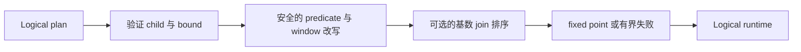
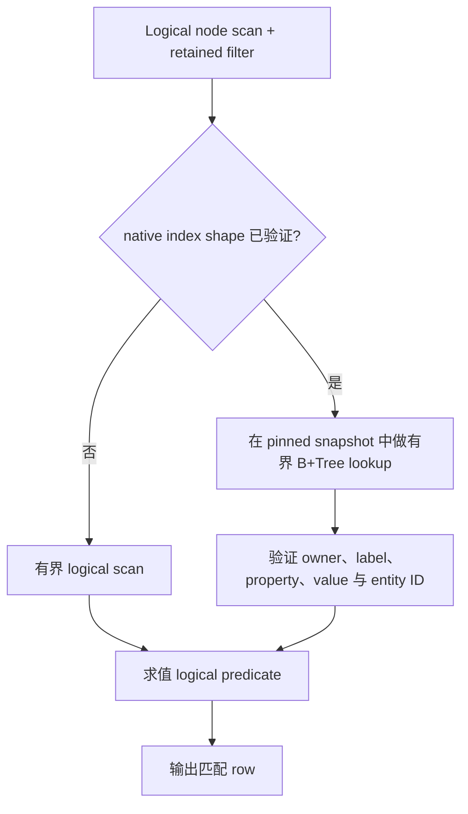

# 优化策略

优化受正确性约束：它可以减少工作量，但不能削弱验证、改变可观察的 Cypher 语义，也不能绕过 pinned-snapshot storage check。当前 native 实现分为三层：逻辑计划改写、已验证的 native access path 和 relocatable storage I/O。

## 逻辑计划改写

`LogicalPlanOptimizer` 在解析完成可优化逻辑计划后、runtime 分派前运行。它限制 pass 与 depth，递归验证 non-null child，只在达到 fixed point 时停止。它保持 storage-neutral；可选的 `LogicalStatisticsProvider` 提供有界估计，但不暴露 page 或 physical operator。

已实现的改写刻意保持很小且明确：

| 改写 | 前置条件与保留保证 |
|---|---|
| Equality scan hint | direct node scan 具有静态、非空、property-left/literal-right 的 equality；filter 仍保留在计划中。 |
| Range scan hint | direct node scan 对一个 property 有兼容 literal bound；可以是 equality prefix 加 trailing range；filter 仍保留。 |
| Cartesian join 顺序 | 两侧估计都有效且左侧严格更小，因为 runtime 会 materialize 右侧；tie 或缺失估计保持原顺序。 |
| `LIMIT` 穿过 project | limit 非负，且 project 非 `DISTINCT` 并具有有效 item。 |
| 相邻 window | nested `LIMIT`、nested `SKIP` 与正 `LIMIT(Skip(...))` 只在值非负且不溢出时归一化；`LIMIT 0`、非法与溢出 window 保留 runtime 行为。 |

优化器不宣称已实现通用 filter 或 projection pushdown。它会拒绝或保留不变的 reversed operand、null equality、模糊 range 组合、无效的既有 scan predicate、不安全的 `SKIP` 移动、tie 和未知统计。这个保守策略避免改变行顺序、expression failure 或 null 行为。

## Native Access Path

read runtime 仍是语义权威。只有 storage reader 能在一个 pinned snapshot 内完成验证时，logical node-scan hint 才能使用 native B+Tree scalar、range 或 composite equality-prefix/trailing-range lookup。

index 不可用时，只有 runtime 支持有界 logical scan 才会回退。index state malformed、stale、mismatched 或超限时 fail closed。未知 property 产生空结果，不会推断匹配。native statistics 只是 advisory，绝不能触发 planning-time graph scan。

## 执行与资源上限

logical runtime 在可能处流式读取；调用方未提供 guard 时，安装带数据库策略默认值的 `QueryGuard`。runtime bound 覆盖 node record、metadata page、adjacency record、property、row、distinct row、vector work 和 GDS work。transaction-owned overlay 会在 owner commit 前保持 staged write 私有；它不是独立的 autocommit optimization path。

vector search 与 maintenance 走 native relocatable vector path。当前 smoke calibration 只证明 source-set 与 report wiring；production Recall、QPS、build-time、memory、update 和 recovery target 仍是 acceptance gate，不是可在文档中声称的性能结论。

## Storage I/O 与缓存

`StorageIO` 为 relocatable backend 提供经检查的 typed file I/O。metadata 通过 pinned snapshot 读取，generation-aware `BufferPool` 缓存已验证 page 而不会暴露 stale mapping。publication 使用 native storage plan 所定义的 single-file A/B Superblock protocol；query 与 optimization 不得绕过 codec、owner、generation、checksum 或 snapshot validation。

已退休的 segment-chain `DataManager`、`PageBufferPool`、external-WAL group commit 与 HNSW execution 描述都是 historical migration material，不属于当前性能架构，并仍受 roadmap replacement/retirement gate 的约束。
