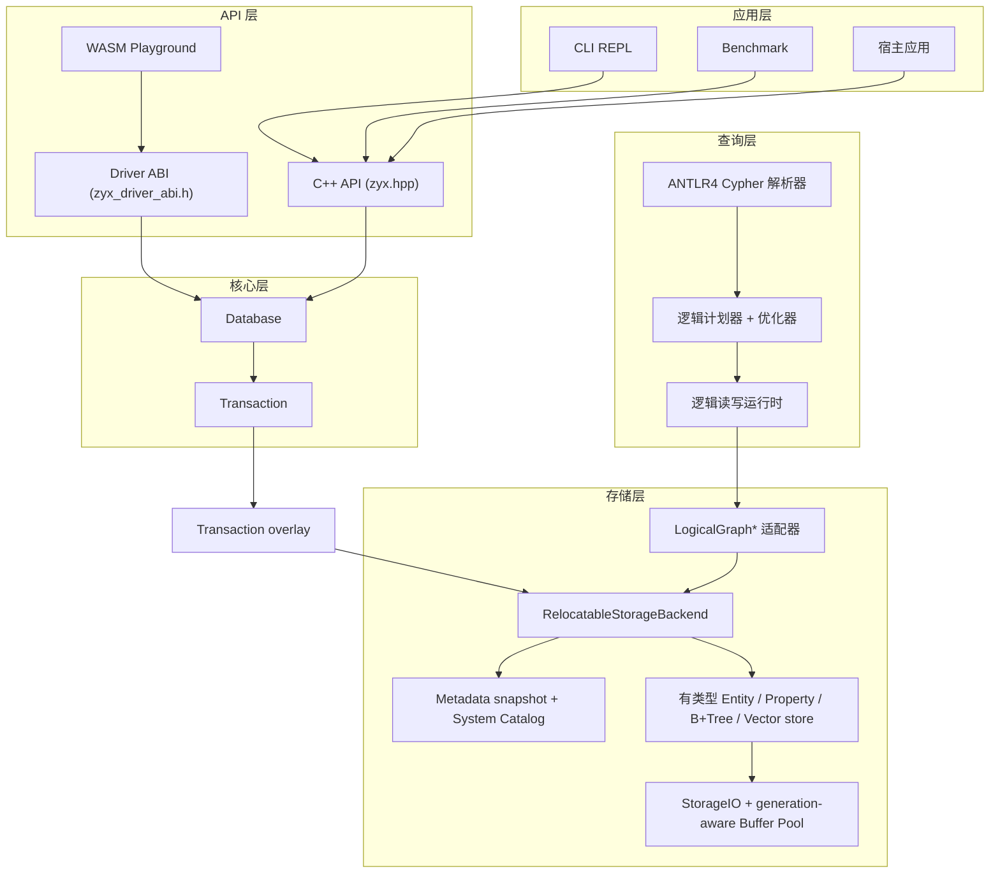
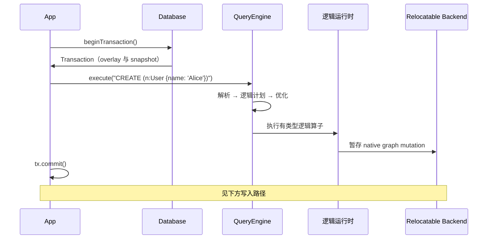
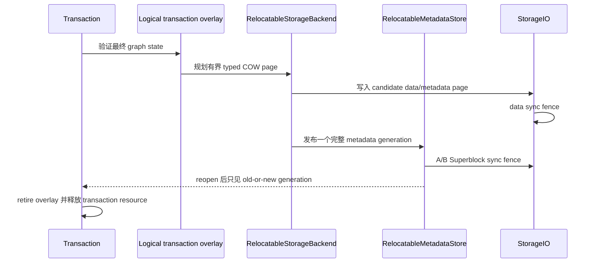
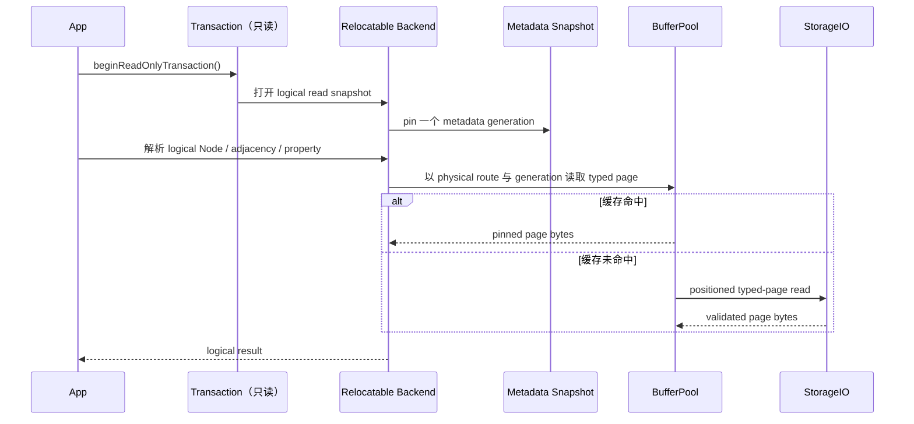

# 架构概述

> 本页描述当前 native logical/relocatable 生产路径。[原生单文件存储重构方案](native-single-file-storage-plan)是格式和生命周期的规范性契约。legacy `DataManager`、段链、外部 WAL 和物理执行器仅作为迁移历史资料，不属于当前架构。

ZYX 是可嵌入式图数据库引擎，核心是单进程内库调用模型，不依赖独立服务进程。

## 分层结构

**各层职责：**

- **应用层** — CLI 工具、benchmark 套件以及嵌入 ZYX 的宿主应用。
- **API 层** — C++ API（`zyx.hpp`）、稳定 Driver ABI（`zyx_driver_abi.h`）、语言绑定及 WASM 绑定。
- **查询层** — Cypher 文本生成带类型的逻辑计划。逻辑优化器在不改变语义的前提下做有界 scan 与 row-window 归一化；逻辑读写运行时通过 storage-neutral 接口执行计划。
- **存储层** — `RelocatableStorageBackend` 负责单一数据库文件、pinned metadata snapshot、canonical System Catalog、有类型 page store 与 native maintenance。`StorageIO` 和 generation-aware Buffer Pool 是有类型 I/O 边界；生产协议不依赖外部 WAL/SHM sidecar。
- **核心层** — `Database` 拥有 backend，并惰性初始化 `QueryEngine` 和线程池；`Transaction` 拥有 native logical transaction、read-your-writes overlay 和 pinned lifetime。

## 关键对象

| 对象 | 职责 |
|------|------|
| `graph::Database` | backend 生命周期管理，QueryEngine / ThreadPool 惰性初始化 |
| `graph::query::QueryEngine` | Cypher 解析、计划构建与执行 |
| `graph::storage::RelocatableStorageBackend` | 单文件 native graph、schema、Vector、snapshot 与 maintenance 边界 |
| `graph::storage::RelocatableMetadataStore` | A/B Superblock publication、Catalog root、allocator state 与 snapshot pin |
| `graph::storage::StorageIO` | 已校验 positioned I/O 与 data/Superblock sync fence |
| `graph::Transaction` | transaction-owned logical overlay、commit/rollback 与 backend lifetime |

## 主执行路径

### 查询路径

### 写入路径（提交）

### 读取路径

## 设计原则

1. **嵌入式优先** — ZYX 是库而非服务器，直接链接到进程内。
2. **Pinned snapshot** — 每次 native read 都经由一个 immutable metadata generation 解析，page relocation/reuse 不会混合 generation。
3. **单文件 COW publication** — candidate page durable 后才进行一次 A/B Superblock publication；reopen 只能观察完整 old 或完整 new generation。
4. **有类型且有界的 I/O** — Entity、Property、Index、Catalog 和 Vector store 保留 owner/generation/checksum 校验，并使用有限 cursor 和 admission-aware cache read。
5. **Fail closed** — 格式错误的 route、key、checksum、owner、generation 或资源上限一律拒绝，不回退到 legacy representation。
