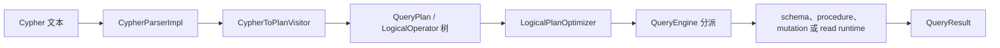

# 查询引擎

当前查询路径是原生的 **解析 -> 逻辑计划 -> 逻辑优化 -> 逻辑运行时** 流水线，不再将计划转换为已退休的物理算子执行器。所有运行时都经由 logical storage backend 读取，因此查询代码不依赖段布局或物理位置。

## 流水线总览

`QueryEngine` 负责 parser 复用、逻辑 `PlanCache`、可选的 native 基数统计、执行上限和分派。缓存命中时返回可复用的逻辑 `QueryPlan`；修改 schema 的计划会使缓存失效。执行变更计划前，engine 会先检查 execution mode；调用方未提供时，会安装数据库资源策略与 `QueryGuard`。

## 1. 解析与逻辑计划

ANTLR4 从 `src/query/parser/cypher/generated/` 下的语法文件生成 Cypher parser。`CypherParserImpl` 产生 parse tree，`CypherToPlanVisitor` 直接构建 `LogicalOperator` 树；没有独立的公开 AST 执行层。

逻辑算子是 storage-neutral、可检查、可 clone 的计划节点。类型枚举使用 `LOP_` 前缀以兼容 Windows。其 family 包括：

| family | 示例 |
|---|---|
| 读取与整形 | node scan、filter、project、aggregate、sort、limit、skip、join、traversal、变长 traversal、unwind、union |
| 变更 | create node/edge、set、remove、delete、merge、foreach、subquery |
| Schema 与管理 | index/constraint DDL、show indexes/constraints、transaction control、procedure、vector 操作 |
| 可观测性 | explain 与 profile |

精确支持的 Cypher surface 以 `UNSUPPORTED_CYPHER_FEATURES.md` 为准。enum 中存在某个逻辑算子并不自动意味着已支持：相应 runtime 必须显式实现它，否则 native 路径会 fail closed，而不会回退到已退休的 executor。

## 2. 逻辑优化

`LogicalPlanOptimizer` 有意保持 storage-neutral。它限制 rewrite pass 和计划深度，验证 child 结构，只执行能保持可观察 Cypher 行为的变换。它可以使用 native backend 提供的有界基数估计，但自身不读取 storage page 或 physical index。

当前变换包括：

- 将 direct node scan 上静态、非空的 property equality predicate 暴露为 scan hint，同时保留原始 filter 作为语义权威；
- 暴露一个 direct literal range；在有效时包含 equality-prefix 加 trailing-range 的 scan shape；
- 当两个 Cartesian join 输入都有严格、已验证的估计时，把较小的一侧置于 runtime 会 materialize 的右侧；
- 在 item 有效且非 `DISTINCT` 的 projection 下推非负 `LIMIT`；
- 只在值非负且算术可表示时归一化相邻的 `LIMIT` 与 `SKIP` window。

优化器会刻意保留语义不明确或不安全的情况。例如，它不会反转 literal/property operand，不会为 `NULL` 虚构 access path，也不会仅为减少工作量把 `SKIP` 下推到 projection 之下；这些改写可能改变错误或行语义。read runtime 仍负责验证 scan boundary 并应用保留的 predicate。

## 3. 运行时分派与事务

`QueryEngine::executePlan()` 会解包 `EXPLAIN` 或 `PROFILE`，再按能力分派内部逻辑计划：

| 计划类别 | runtime |
|---|---|
| Schema mutation 或 schema read | `LogicalPlanSchemaRuntime` |
| Procedure call | `LogicalPlanProcedureRuntime` |
| Data mutation | `LogicalPlanMutationRuntime` |
| 其余 native read plan | `LogicalPlanReadRuntime` |

`EXPLAIN` 只渲染 logical tree，不打开 storage snapshot，也不发布工作。`PROFILE` 执行相同分派并追加一行 logical-plan timing summary。只读 context 拒绝 data/schema mutation（`EXPLAIN` 的检查例外）；常规 read-write transaction 拒绝 schema mutation。

调用方拥有的 logical transaction 使用 `executePlanWithLogicalTransactionOverlay()`。读取和受支持的 procedure 会看到该 overlay，staged write 在 owner commit 前不会发布。该 overlay 明确拒绝 schema mutation，并应用相同的 execution guard 与有界 runtime option。

## 4. Native Read Boundary

`LogicalPlanReadRuntime` 是 streaming 且有界的。它通过 `LogicalGraphReadBackend` 打开 logical snapshot，携带 logical node/edge value 而不是 token ID 或 physical location，并只在输出边界 materialize result entity。它的限制覆盖 node/adjacency record、metadata page、property、row 和 distinct row。

native index-assisted scan 只是 hint。storage reader 会在 pinned snapshot 中完成 exact lookup 或 range validation；状态 malformed、stale、unavailable 或超出上限时都会 fail closed。逻辑计划中保留的 predicate 仍是最终语义检查，因此 optimization hint 不能扩大结果集。

## 历史迁移资料

旧文档可能将 `PhysicalPlanConverter`、`PhysicalOperator`、`QueryExecutor`、`QueryPlanner` 或旧 GDS/Leiden implementation 描述为当前执行组件。该 physical query family 已在 native logical replacement 验证后移除。segment-chain scan 与 `DataManager` 仍是独立 gate 管理的 storage migration material，也不属于当前 native query path。
