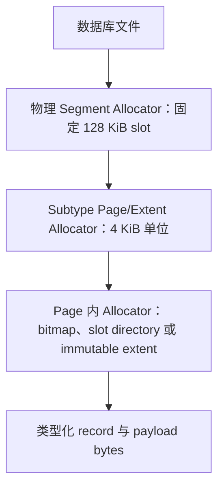

# 下一代 Segment 存储设计

> **状态：仅设计，尚未实现。** 本文定义未来文件格式版本的目标架构和分阶段实施计划，不描述当前磁盘格式。当前实现请参阅[段格式](segment-format)。

## 决策摘要

以下决策是 vNext 不可破坏的架构约束：

| 领域 | 决策 |
|---|---|
| 物理分配 | 每个物理 segment 始终固定为 128 KiB，并按 page 对齐 |
| 全局复用 | 完全空闲的 segment 可供任意 subtype 复用；free list 不区分类型 |
| 空洞回收 | 任意类型的活跃尾部 segment 都可迁移到任意前部空闲 segment |
| 内部分配 | Subtype 可将 segment 划分为 4 KiB page 和连续多 page extent |
| 物理引用 | 持久化消费者使用稳定逻辑 ID，绝不保存原始文件 offset |
| 固定记录 | Node、Edge、raw-vector 和 PQ record 使用固定 stride 及按 capacity 推导的 bitmap |
| 变长记录 | Property、vector adjacency 和 B+Tree entry 使用 slotted page |
| 多 owner | 多个 index 可在 page 或 extent 粒度共享一个物理 pool segment |
| 大对象 | Blob 成为面向大型 opaque value 的 extent-backed store，而不是通用序列化层 |
| 发布 | 迁移与替换使用 copy-on-write generation 和 WAL 支持的原子发布 |
| 兼容性 | 新格式使用新版本和明确的重建或迁移工具；禁止部分猜测解释 |

全局 16/32/64/128 KiB 可变物理 segment size class 被明确排除。它会让空洞复用受大小限制、产生外部碎片并增加尾部截断复杂度。只允许在固定 128 KiB segment 内部使用这些大小的逻辑 extent。

## 设计目标

下一代存储架构必须：

- 保留当前不受类型限制的整 segment 空间回收模型；
- 移除磁盘上的固定 256 字节 padding，提高 Node 和 Edge 密度；
- 同时支持紧凑固定记录与高效变长记录，不再扩张单一通用 header；
- 让大量小型 Property、B+Tree、Blob 和 vector index 安全共享物理 segment；
- 保证固定记录和 vector 热点循环不发生逐记录虚函数分派或 layout 检查；
- 降低元数据写放大，避免每次小更新都重新计算整个 mutable segment 的 checksum；
- 支持稳定逻辑身份、在线迁移、snapshot、copy-on-write 发布与崩溃恢复；
- 定义独立于 C++ 对象布局和编译器 ABI 的显式跨平台磁盘编码；
- 以可独立测试的阶段交付重构，并保证 line、branch、function 和 region coverage 分别达到 95% 以上。

兼容当前格式中的薄弱抽象不是目标。除非单独批准 API 变更，否则仍必须保持语义层 API 兼容。

## 不可妥协的约束

1. **物理 segment 始终为 128 KiB。** 任何 subtype 都不能改变文件 allocator 的分配单位。
2. **空闲物理 segment 没有类型。** 重新初始化时可分配任意受支持的 segment kind。
3. **逻辑身份稳定。** 移动物理字节不能改变业务层 Node ID、Edge ID、Page ID、Blob ID 或 index identity。
4. **先发布新数据，再回收旧数据。** 禁止 delete-before-create 替换。
5. **Reader 永远看不到部分初始化的数据。** Generation 只有在验证并提交发布后才可见。
6. **一个热点单元只有一种 layout。** 固定 record page 或 extent 只包含一个 owner、kind、version、encoding、dimension 和 stride。
7. **字节是公共统计单位。** 通用组件不能根据 subtype record count 推测 fragmentation。
8. **磁盘字节必须防御性解码。** 使用前验证 length、offset、算术、enum、generation 和 checksum。
9. **每个阶段都保持仓库可构建、可测试。** vNext 实验路径在最终切换前保持隔离。

## 分层空间模型



物理 allocator 只理解固定大小 segment slot。Subtype 可以将整个 segment 用作固定记录区域，也可以划分为三十二个 4 KiB page。Page 分组是逻辑分配策略，不改变物理 segment 大小。

### 分配与回收单位

| 层级 | 单位 | 职责 |
|---|---:|---|
| 文件 allocator | 128 KiB 物理 segment | 预留、复用、迁移和截断文件空间 |
| Pool allocator | 4 KiB page 或连续 page extent | 向 subtype 和逻辑 owner 分配空间 |
| 固定布局 | 固定 record slot | 直接寻址和 occupancy bitmap |
| 变长布局 | Slotted record | Offset、length、generation 与 page-local compaction |
| 大对象布局 | Immutable extent generation | 流式字节、压缩、checksum 与淘汰 |

## 物理 Segment Envelope

起始 64 字节是稳定公共 envelope。Subtype metadata 位于其后，`header_bytes` 指向第一个由 subtype 控制的 payload 字节。

| 字段 | 宽度 | 职责 |
|---|---:|---|
| `magic` | 32 位 | 拒绝未初始化或不相关数据 |
| `format_version` | 16 位 | 标识公共 envelope 版本 |
| `header_bytes` | 16 位 | 定位 subtype 数据并允许 subtype header 扩展 |
| `kind` | 16 位 | 选择已注册的 layout codec |
| `state` | 16 位 | 表示 free、building、sealed、retired 和 obsolete 状态 |
| `flags` | 32 位 | 只保存公共生命周期标志 |
| `segment_id` | 64 位 | 稳定逻辑 segment identity |
| `owner_id` | 64 位 | 标识 store 或共享 pool；page header 标识逐 page owner |
| `generation` | 64 位 | 支持 copy-on-write 发布和 snapshot |
| `committed_lsn` | 64 位 | 保证 WAL 重放幂等 |
| `payload_bytes` | 32 位 | 限制完整性验证和读取范围 |
| `header_crc` | 32 位 | 在信任 offset 和 length 前验证元数据 |
| `payload_crc` | 32 位 | 验证 immutable 或 sealed payload |
| reserved | 32 位 | 在 envelope 保持 64 字节的情况下兼容扩展 |

公共 envelope 不得包含 record capacity、high watermark、live count、ID range、bitmap、slot directory、compaction threshold 或链表 offset。

规划中的 segment kind 使用带前缀的 Windows-safe 枚举成员。初始 registry 包括 `SGK_ENTITY_FIXED`、`SGK_PROPERTY_PAGE_POOL`、`SGK_INDEX_PAGE_POOL`、`SGK_VECTOR_RAW_POOL`、`SGK_VECTOR_PQ_POOL`、`SGK_VECTOR_ADJACENCY_POOL`、`SGK_LARGE_OBJECT_POOL`、`SGK_CODEBOOK_EXTENT` 和 `SGK_CATALOG`。生命周期成员同样使用前缀，包括 `SGS_FREE`、`SGS_BUILDING`、`SGS_SEALED`、`SGS_RETIRED` 和 `SGS_OBSOLETE`。

## 显式磁盘 Codec

磁盘 codec 定义精确字段 offset、整数宽度、字节序、编码大小、验证和版本转换，不序列化原生 C++ struct。

内存中的 `Node` 和 `Edge` 类可以保留 STL 容器和便捷方法，其磁盘 record 仍是紧凑固定字节序列。初始 sizing target 是 96 字节 Node record 和 80 字节 Edge record；只有通过 layout 验证和 benchmark 后才能接受最终 stride。

Node record 只包含固定拓扑与引用元数据：ID、首条入边和出边 ID、property reference、固定 label reference、label count 和 property storage kind。Edge record 包含自身 ID、端点 ID、关系链 reference、property reference 和 type ID。变长 property payload 始终位于 Node 和 Edge record 之外。活跃状态由 layout bitmap 表示，不在 record 内重复保存 bool。

所有 codec 必须：

- 使用固定宽度整数和显式 little-endian 编码；
- 禁止持久化原生 enum、`bool`、pointer、STL、padding 和 `sizeof(struct)`；
- 拒绝不支持的 version 和未知 required flag；
- 在索引固定数组前验证 count；
- 在构造 offset 或 allocation 前使用受检加法和乘法；
- 保持 reserved bytes 为零，并在版本要求时拒绝非零 reserved bit；
- 提供由 macOS、Linux 和 Windows 测试共享的 golden byte fixture。

## 固定记录布局与 Bitmap

Node、Edge、raw-vector 和 PQ-code layout 使用直接 slot 寻址。其 subtype header 拥有：

| 元数据 | 含义 |
|---|---|
| `record_bytes` | 一条 record 的逻辑编码字节数 |
| `record_stride` | 相邻 record 之间对齐后的物理距离 |
| `capacity` | 可寻址 slot 数量 |
| `high_watermark` | 第一个从未分配的 slot |
| `live_count` | 当前可见 record 数量 |
| `first_logical_id` | 可选的连续 ID 到 slot 映射基址 |
| `bitmap_offset` 和 `bitmap_bytes` | Activity bitmap 的位置和精确大小 |
| `records_offset` | 固定 record 区域的对齐起点 |

Activity bitmap 始终使用每 slot 一个 bit。原始大小为 `ceil(capacity / 8)`。Bitmap 从 64 字节对齐位置开始，record 区域位于 bitmap 之后满足所需 alignment 的下一个位置。Bitmap 大小不是全局常量，也不内嵌在公共 envelope 中。

Capacity 和 bitmap size 相互依赖。Layout builder 选择满足对齐 header、bitmap 和所有固定 record 都位于 128 KiB 内的最大 capacity，并持久化计算结果。打开时使用受检算法重新验证。扫描循环直接消费已验证结果，不重复计算。

在最终 subtype header 确定前，近似目标如下：

| Layout | 目标 stride | 近似 capacity | 原始 bitmap bytes |
|---|---:|---:|---:|
| 当前 256 字节 record | 256 B | 512 | 64 B |
| Node vNext | 96 B | 约 1,360 | 约 170 B |
| Edge vNext | 80 B | 约 1,630 | 约 204 B |
| Raw BF16，384 维 | 768 B | 约 170 | 约 22 B |
| Raw FP32，384 维 | 1,536 B | 约 85 | 约 11 B |
| PQ code，32 字节 | 32 B | 约 4,070 | 约 509 B |

Node 和 Edge bitmap 变大是预期行为，且代价很小：一个 bit 只有 0.125 字节。每条 record 减少 160 字节以上固定 padding 的收益远大于新增 bitmap 字节。

`high_watermark` 区分从未分配的尾部 slot 与已删除 slot。`live_count` 避免常用统计反复执行 popcount。Free-slot hint 可以加速复用，但 bitmap 仍是事实来源。

## Slotted Page

变长 Property、vector-adjacency 和 B+Tree record 使用 slotted page。Page header 与 slot directory 从前部增长，payload bytes 从后部增长。


Slot entry 保存 offset、length、state flag 和 generation。外部引用使用稳定 Page ID、slot ID 和 generation，而不是 payload offset。Page-local compaction 可以移动 payload bytes 并更新 slot offset，而无需改变外部引用。

变长 record 更新顺序为：

1. 现有 allocation 足够且 WAL 保护修改时原地覆盖；
2. 相邻连续空间足够时原地扩展；
3. 在同一 page 其他位置写入 replacement payload，再发布 slot entry；
4. 只有总空闲字节足够但连续空闲字节不足时，才整理该 4 KiB page；
5. 否则在其他 page 分配新 slot，发布新引用，再淘汰旧 slot。

Page-local compaction、subtype segment evacuation、整 segment 物理迁移和文件截断是不同操作。小型 Property 更新绝不能触发整个文件的 compaction 路径。

每个变长 page 报告 `live_bytes`、`reclaimable_bytes`、`contiguous_free_bytes`、metadata bytes、slot count 和 live slot count。插入选择使用 free-space index，而不是扫描所有 page。

## Node 与 Edge Store

同一 layout version 中的 Node 和 Edge record 保持固定大小。同类实体不会因为 property、large value 或未来变长 metadata 而具有不同 base-record stride，这些变长内容位于独立 store 中。

vNext 实现必须保持：

- 热点扫描的直接 slot 寻址；
- compaction 和物理迁移过程中的稳定 Node 与 Edge ID；
- relationship traversal 语义及入边、出边链完整性；
- multi-label 行为，以及在独立 label store 获得单独设计前的当前最大 label 契约；
- 能够先发布 replacement、再删除旧值的 property reference；
- snapshot 可见性与 rollback 行为。

因为每个 cache 和 I/O unit 可以容纳更多有效 record，密集 Node 与 Edge segment 扫描应当变快。必须测量 codec 开销，但禁止通过原生 packed struct 或非对齐字段访问绕过 codec。

## Property Store

Property Store 负责 property key、value type、结构化编码和大型 value 引用。小型和中型 record 使用 slotted page。Node 与 Edge record 保存逻辑 Property reference，不保存 payload bytes。

存储策略在以下方式中选择：

| Value 形态 | 存储方式 |
|---|---|
| 小型 scalar、string、list 或 map | Property slotted page inline |
| 中型结构化 value | Property overflow page 或 typed chunk |
| 作为整体访问的大型 value | Blob/Large Object reference |
| 需要逐元素访问的大型 list 或 map | 类型化分块 Property layout |
| Vector value | 专用 Vector Store reference |

大小阈值属于 allocation policy，不是文件格式常量。必须通过 benchmark 调优，并允许在不改变编码兼容性的情况下配置。

Property key 使用 token ID，不重复保存 key string。当查询引擎需要逐元素访问或局部更新时，大型结构化容器按 chunk 存储。只有整体 value 语义足够时，才允许将整个 value 编码为 Blob。

跨 page 更新使用 copy-on-write：写入并验证新 record，通过 WAL 发布新 Property reference，然后淘汰旧 slot。可回收空洞在需要前保留在 page 内；page-local compaction 可以合并它们，因此空洞不会永久限制未来 record size。

## B+Tree Page Store

B+Tree node 使用真正的 4 KiB page，替代 256 字节 `Index` entity。每个 page 使用 slot directory 管理变长 key 和 value。Prefix compression、posting 或 overflow page 以及 page-level checksum 替代结构化 index 数据的通用 Blob overflow。

多个逻辑 index 在 page 粒度共享 `SGK_INDEX_PAGE_POOL` segment。一个 128 KiB segment 包含三十二个 4 KiB page 和 page-allocation bitmap。每个活跃 page header 标识 owner index 和 generation。Page 在已提交 merge 或 index drop 后立即可复用；只有所有 page 都空闲时，物理 segment 才返回全局 free list。

持久化 child、sibling 和 root reference 使用稳定 Page ID。Page Directory 将 Page ID 映射到 Segment ID、page index 和 generation。Page 在 pool segment 之间移动时只更新 directory，不重写所有 B+Tree pointer。

B+Tree mutation 必须保持标准 redistribution、split、merge、root-collapse、leaf-link 和崩溃原子性约束。多 page 结构变更通过 WAL 提交后，被淘汰 page 才能复用。

## Vector Storage

一个物理 128 KiB segment 可以存储属于多个 vector index 的 page 或 extent。共享发生在 page 或连续 extent 粒度，绝不能交错混放无边界的不同逐 record layout。

每个 vector page 或 extent 对以下属性保持同质：

- owner vector-index ID；
- page kind 与 layout version；
- dimension 与 element encoding；
- record stride 或 PQ code size；
- codebook generation；
- publication generation。

分配优先选择具有相同 layout key 和连续空闲 page 的现有 pool。大型 index 自然获得完整 segment，小型 index 只消耗少量 page 并共享剩余物理空间。

### Raw Vector Pool

Raw vector 使用固定 record 和按 capacity 推导的 bitmap。逻辑 vector 或图 Node ID 映射到 Page ID、slot ID 和 generation。搜索和训练热点循环只打开一次 typed extent，不执行逐 record owner、dimension 或 encoding 检查。

### PQ Code Pool

PQ code 使用固定 record 和自己的 bitmap。Page header 持久化 code size 与 codebook generation。重新编码时先发布新 generation，再淘汰旧 PQ page。

### Vector Adjacency Pool

Vector adjacency 指 DiskANN 使用的变长邻居列表，不是 Node 和 Edge record 保存的普通图关系链。Adjacency record 使用 slotted page 和 copy-on-write 发布。初始 segment 重构不改变普通图 adjacency 表示。

### Codebook Extent

Quantizer 和 codebook 是不可变版本化对象，存储在一个或多个 extent 中。Manifest 记录 identity、generation、chunk ordering、total bytes 和 checksum，不使用逐 record activity bitmap。

### Vector Manifest

每个 vector index 拥有不可变 manifest，列出 raw extent、PQ extent、adjacency page、codebook generation、entry point、dimension、metric 和 encoding。删除 index 时淘汰其 manifest，并在 snapshot 安全允许后释放所有引用 page 或 extent。

## Blob 与 Large Object Store

Blob 是面向大型 opaque byte value 的 extent-backed store，不是结构化引擎数据的默认持久化机制。

适合 Blob 的 payload 包括大型 string、binary value、按整体访问的 JSON 或 document、大型不可变 list 或 map，以及 plugin 定义的 opaque data。Raw vector、PQ code、vector adjacency、B+Tree page、posting list、普通 Property record 和 codebook 使用专用 layout。

Blob object 具有稳定 Object ID 和不可变 generation。其 manifest 记录总逻辑字节、压缩策略、extent 顺序、block length 和 checksum。大型 value 可以通过逻辑 extent 列表跨越任意数量的固定物理 segment；单个逻辑对象不受一个 segment 大小限制。

是否压缩与是否使用 Blob 存储相互独立。大型可压缩 value 使用独立压缩 block，保证 range read 不需要解压整个对象。不可压缩或已经压缩的 block 保持 raw。编码格式持久化实际 codec、compressed length、uncompressed length 和 checksum。压缩策略与阈值保持可配置。

Blob 替换遵守 create、validate、publish、retire、reclaim 顺序。旧 extent 在没有 snapshot 引用其 generation 前保持可读。

## 共享 Pool 与 Ownership

Pool segment 让大量小 owner 共享一个物理 segment，同时避免逐 record layout 检查。

| Pool | 共享单位 | 单位 owner |
|---|---|---|
| Property pool | Slotted page | Entity/property-store scope |
| Index pool | 4 KiB B+Tree page | 逻辑 index ID |
| Raw-vector pool | 固定 record page 或 extent | Vector-index ID |
| PQ pool | 固定 record page 或 extent | Vector-index ID 与 codebook generation |
| Adjacency pool | Slotted page | Vector-index ID |
| Large-object pool | Page extent | Blob Object ID 与 generation |

Segment envelope 标识 pool，page 或 extent header 标识逻辑 owner。Allocation policy 对兼容 layout 分组并优先分配连续范围，manifest 保证 reader 不扫描无关 owner。

## 稳定 ID、Catalog 与 Manifest

Segment Catalog 将每个稳定 Segment ID 映射到 physical offset、kind、owner 或 pool、generation、lifecycle state 和 committed LSN。Physical offset 绝不能成为持久化业务层引用。

Page 和 extent directory 将稳定 Page ID 与 Extent ID 映射到 Segment ID、page index、page count 和 generation。Store manifest 保存逻辑 ID 列表而不是 offset。Catalog 与 manifest 更新具有 checksum、WAL 保护并可重放。

整 segment 迁移因此只改变 Segment Catalog mapping。Page evacuation 只改变 Page 或 Extent Directory。Node ID、Edge ID、B+Tree pointer、Blob reference 和 vector mapping 保持稳定。

## 空间统计

通用存储组件消费归一化字节统计：

| 统计量 | 含义 |
|---|---|
| `live_bytes` | 可见数据需要的字节数 |
| `reclaimable_bytes` | 可通过 compaction 回收的 retired、deleted 或 fragmented bytes |
| `immediately_free_bytes` | 无需 compaction 即可使用的空间 |
| `contiguous_free_bytes` | 适用场景中的最大直接可用区域 |
| `metadata_bytes` | Header、bitmap、directory 与 manifest |
| `reserved_tail_bytes` | 当前尾部或 extent 中已分配但未使用的字节 |

新的 fragmentation 概念不能把从未使用的 append space 当作删除碎片。Compaction priority 综合 reclaimable bytes、expected output bytes、rewrite cost、age、snapshot visibility 和可实现的尾部截断收益。

密集固定 record layout 的 record 区域利用率目标超过 90%。仅元数据更新不得要求读取或计算整个 128 KiB mutable segment 的 checksum。

## Compaction 与类型无关回收

Compaction 拆分为四种明确操作：

| 操作 | 是否理解 subtype | 单位 |
|---|---|---|
| Page-local compaction | 是 | 一个 4 KiB 变长 record page |
| Subtype evacuation | 是 | 稀疏 segment 中的 record、page 或 extent |
| Physical relocation | 否 | 一个完整 128 KiB segment |
| File truncation | 否 | 连续空闲尾部 segment |


部分空闲 segment 仍归其 subtype 所有。只有 bitmap、page map 或 extent map 为空，且所有 retired generation 都安全后，才能进入全局类型无关 free list。复用前必须使旧 subtype header 失效。

由于所有物理 segment 大小相同，任意活跃尾部 segment 都可迁移到任意前部空闲 segment。Relocation 复制 segment、验证数据、通过 WAL 发布 Segment Catalog mapping、淘汰旧位置、等待 pin 或 snapshot，最后将旧 slot 标记为 free。该操作不解释 segment payload。

## 并发与 Snapshot 安全

- Reader 将逻辑 ID 解析到某个 generation，pin page 或 segment，并且不跟随正在回收的位置。
- Mutable page 更新使用 page latch 与 WAL；跨位置替换使用 copy-on-write 发布。
- 新 page、extent、manifest 和 segment 在 checksum 验证并提交前保持 building 状态。
- Retired generation 只有在最旧可见 snapshot 和所有 buffer-pool pin 都推进后才能回收。
- Slot generation 防止 stale reference 读取复用后的 slot。
- 每个 store 在启用并发前必须记录 lock 与 latch 顺序；record-level 热点循环不得获取 catalog lock。
- Cache entry 包含 generation 或在发布时失效，防止迁移后返回 stale bytes。

## WAL、完整性与恢复

WAL 保证事务顺序与幂等重放。Page checksum 保护 mutable page，sealed immutable extent 与 segment 使用 payload checksum。Header checksum 独立存在，防止损坏 length 驱动不安全读取。

恢复必须处理：

- 已分配但未发布的 segment、page 和 extent；
- catalog 更新已提交但旧物理位置仍存在；
- torn page write 和 checksum mismatch；
- 新 manifest 已发布但旧 generation 尚未完成淘汰；
- 中断的 page evacuation 和整 segment relocation；
- 中断的 index split、merge 和 root collapse；
- 截断或损坏的 slot directory 与 overflow reference；
- 未知 kind、version、codec、enum value 和 required flag；
- 重复 ownership、重叠 extent 和 catalog cycle。

Recovery 丢弃未发布 building object，按 LSN 重放已提交 mapping，保留最新有效 committed generation，并且永远不猜测不支持格式的含义。

## 运行时组件边界

| 组件 | 负责 | 不负责 |
|---|---|---|
| Physical Segment Allocator | 固定 slot 分配、free list、迁移目标和尾部空间 | Record capacity、vector dimension、Property encoding |
| Segment Catalog | Segment ID 到物理位置和生命周期 | Subtype record 解释 |
| Page/Extent Directory | 稳定 Page 或 Extent ID 到 segment 位置 | Query 语义 |
| Envelope Codec | 公共编码字段与验证 | 原生 struct 序列化 |
| Layout Registry | 冷路径分派、验证、统计和 recovery hook | 逐 record 查询循环 |
| Typed Store | Record 操作、typed view 和 owner manifest | 全局物理分配策略 |
| Compaction Planner | Priority、budget 和截断收益 | Layout 专属字节搬迁 |
| Subtype Compactor | 安全 evacuation 与 relocation output | 跨 store 调度 |
| Blob Store | Opaque large object 与 block compression | Vector、B+Tree 或 Property 语义 |

## 分阶段实施计划

vNext 在实验性 storage-format 边界之后开发。当前格式在最终切换前仍是 production default。只有代码、测试、coverage、benchmark、恢复行为和文档全部通过阶段退出门禁，该阶段才算完成。

### 阶段 0：基线、指标与格式契约

完成：

- 固化当前格式 golden fixture，记录当前 file size、scan、insert、update、recovery 和 compaction 基线；
- 在不改变磁盘语义的前提下增加逐 subtype live、free、metadata 和 write-amplification 测量；
- 定义 vNext 数字 format version、逻辑 ID width、alignment rule、enum value 与 invalid-value policy；
- 定义 empty、small、medium、dense、delete-heavy、update-heavy、multi-index、vector 和 large-Blob benchmark 数据集；
- 清点依赖 physical offset、256 字节 record、512-slot bitmap、Blob chain 或原生 header 的测试。

测试与门禁：

- 当前完整测试套件保持通过；
- 当前格式 fixture 在 macOS、Linux 和 Windows 上重开结果一致；
- 测量代码的 line、branch、function 和 region coverage 分别达到 95%；
- 除测量噪声外，baseline benchmark 不发生变化。

### 阶段 1：Codec 与 Layout 基础

完成：

- 实现受检 little-endian primitive、envelope codec、subtype-header codec 和 checked arithmetic helper；
- 实现固定 layout capacity solver 和 bitmap sizing；
- 实现 layout registry validation，但不连接 production read/write path；
- 为 Segment ID、Page ID、Extent ID、generation 和 LSN 增加稳定 typed wrapper；
- 为 malformed 与 unsupported storage 增加确定性错误分类。

测试与门禁：

- golden byte 测试覆盖每个字段和所有平台；
- truncation、overflow、bad alignment、invalid enum、unknown version、checksum 和 reserved-bit 测试安全失败；
- property-based round-trip 测试覆盖有效边界值；
- 每个新增基础模块的四项 coverage 均达到 95%；
- sanitizer 与 static analysis 不报告越界或整数溢出缺陷。

### 阶段 2：Segment Catalog 与物理迁移

完成：

- 实现固定 128 KiB physical-slot allocator、类型无关 free list、Segment Catalog 和 generation lifecycle；
- 实现 building、publish、retire、free 与 recovery 状态转换；
- 使用 Segment ID 而不是物理 offset 链实现整 segment relocation；
- 保持任意尾部 subtype 都能迁移到任意前部 free slot；
- 实现 pin 和 snapshot 感知的延迟复用；
- 在迁移 production entity store 前使用 synthetic payload layout 测试。

测试与门禁：

- allocate、free、reuse、relocate、reopen 与 tail-truncate 测试覆盖每个状态转换；
- 矩阵测试将每个 synthetic subtype 移入由其他所有 subtype 创建的空洞；
- failpoint 覆盖 copy 前、copy 后、publish 前、publish 后和旧 slot 复用前崩溃；
- 并发 pin 与 relocation 测试证明旧字节不会提前复用；
- catalog、allocator、relocation 和 recovery 模块的四项 coverage 均达到 95%。

### 阶段 3：紧凑 Node 与 Edge Store

完成：

- 实现版本化 Node/Edge 磁盘 codec 与固定 record subtype header；
- 移除磁盘 256 字节 padding 和 record 内重复 activity flag；
- 集成按 capacity 推导的 bitmap、high watermark、live count 和直接 slot scan；
- 保持 ID、label、relationship chain、CRUD、transaction、WAL、snapshot 和 rollback 语义；
- 实现 Node/Edge subtype evacuation，同时保持逻辑 ID 稳定；
- vNext 保持实验状态并与当前 production format 隔离。

测试与门禁：

- codec golden fixture 和边界测试覆盖精确编码字节；
- 现有语义 Node、Edge、traversal、Cypher CRUD、transaction、WAL 和 recovery 测试在逻辑断言适用时保持不变；
- 物理 layout 测试使用显式 vNext fixture 替换，而不是弱化断言；
- 随机 create、update、delete、reopen、compact 和 traverse 序列与内存模型对比；
- Node 与 Edge 模块的四项 coverage 均达到 95%；
- 密集扫描吞吐回退不超过 5%，每个 live Node/Edge 的字节数相对 baseline 获得显著改善。

### 阶段 4：Page Pool 与 Slotted-Page 框架

完成：

- 在固定物理 segment 内实现 4 KiB page allocation；
- 实现 page-allocation bitmap、稳定 Page ID、Page Directory、latch、checksum 和 free-space index；
- 实现 slot directory create、read、overwrite、move、delete、reuse、generation 和 page-local compaction；
- 实现共享 pool ownership 与整 page evacuation；
- 只有所有 page 和 retired generation 都空闲后，才把物理 segment 交还全局 free list。

测试与门禁：

- model-based 测试执行随机 slot 操作并对比精确 live record；
- 测试覆盖 fragmented free space、slot reuse、stale generation、full page、corrupt directory 和 page evacuation；
- 多 owner 共享一个 pool segment 时不存在可见性泄漏；
- page-local compaction 保持 Page ID 与 slot ID；
- page pool 与 slotted-page 模块的四项 coverage 均达到 95%。

### 阶段 5：Property 与 Large Object Store

完成：

- 将普通 Property record 迁移到使用 tokenized key 和 typed encoding 的 slotted page；
- 实现可配置的 inline、overflow-page、typed-chunk 和 Blob/Large Object 策略；
- 实现稳定 Property reference 和跨 page copy-on-write update；
- 使用 extent-backed immutable Blob generation 替换固定 256 字节 Blob chain；
- 实现 block compression metadata、raw fallback、range read、checksum 和 snapshot-safe retirement；
- 支持大于一个物理 segment 的 value，不继承当前 Blob-chain layout 限制。

测试与门禁：

- 现有 Property 语义、Cypher value、parameter、update、removal、constraint 和 index 测试保持逻辑断言；
- 边界测试覆盖 policy threshold、growth、shrink、page movement、fragmentation 和跨多个 segment 的 value；
- 压缩测试覆盖 compressible、incompressible、already-compressed、corrupt、partial-range 和 mixed-codec block；
- failpoint 证明 write、validate、publish、retire 与 reclaim 顺序；
- Property、Blob、compression 和 recovery 模块的四项 coverage 均达到 95%；
- property-heavy benchmark 报告 latency、throughput、space utilization 和 write amplification。

### 阶段 6：B+Tree Page Store

完成：

- 使用 4 KiB B+Tree page 替换 256 字节 Index entity；
- 实现 slotted key/value、适用场景中的 prefix compression，以及专用 overflow 或 posting page；
- 多个 index 在 page 粒度共享 index pool segment；
- parent、child、root 和 leaf sibling reference 使用稳定 Page ID；
- 实现 WAL 原子的 redistribution、split、merge、root collapse、page release、evacuation 和 reopen；
- 从通用 Blob Store 移除结构化 B+Tree overflow。

测试与门禁：

- 现有 exact、range、composite、constraint、planner 和 persistence 测试保持语义结果；
- 随机 insert、duplicate、remove、split、merge 和 reopen 序列与有序参考模型对比；
- 多个 index 在一个物理 segment 中共享、增长、删除、evacuate 和复用；
- failpoint 覆盖每个多 page 结构发布边界；
- B+Tree、page allocator 和 recovery 变更的四项 coverage 均达到 95%；
- fanout、tree height、lookup latency、write amplification 和 bytes/key 改善或满足批准的 baseline。

### 阶段 7：Raw Vector 与 PQ Pool

完成：

- 增加共享 raw-vector 和 PQ page/extent pool，每个 extent 保持同质 layout；
- 允许多个 vector index 共享一个物理 segment，且不进行逐 record owner filtering；
- 增加稳定 vector-location mapping 和不可变 per-index manifest；
- 保持 idempotent upsert、bulk coalescing、dimension validation、PQ generation 与错误传播；
- 为大型 index 分配连续范围，为小型 index 复用小范围；
- 现有 Blob-backed vector storage 只保留在旧格式实现内部。

测试与门禁：

- 测试覆盖共享物理 segment 的相同 layout 和不同 layout index；
- 覆盖 dimension、encoding、stride、codebook generation、duplicate ID、update、remove、drop、reopen 和 evacuation；
- 现有 vector query 和 Driver ABI 结果保持语义一致；
- corruption 与 failpoint 测试覆盖 mapping 和 manifest publication；
- vector pool 模块的四项 coverage 均达到 95%；
- search recall、latency、build throughput、memory、disk bytes 和 write amplification 满足批准 baseline。

### 阶段 8：Vector Adjacency 与 Codebook Extent

完成：

- 将 DiskANN neighbor list 迁移到 copy-on-write adjacency slotted page；
- 将 quantizer 和 codebook 迁移到不可变 checksummed extent；
- 使 vector index manifest 原子发布 raw、PQ、adjacency、codebook 和 entry-point generation；
- 实现 adjacency page compaction、index drop、snapshot retirement 和 recovery；
- 移除 vNext Blob Store 中的 vector 专属数据。

测试与门禁：

- 完成 adjacency boundary、large-neighbor-list、fragmentation、update、prune、delete 和 corruption 测试；
- 完成 codebook training、replacement、reopen、partial write、unknown codec 和 generation mismatch 测试；
- agent-memory、long-conversation、bulk 和 Driver ABI vector 回归保持通过；
- adjacency、codebook、manifest 和 recovery 模块的四项 coverage 均达到 95%；
- DiskANN recall 与 latency 保持在批准容差内。

### 阶段 9：统一 Compaction、完整性与压力验证

完成：

- 将基于字节的规划连接到每个 subtype 的 page-local 与 evacuation 操作；
- 为所有 production subtype 实现类型无关整 segment relocation 和 tail truncation；
- 在打开和 inspector 中验证 catalog、page、extent、manifest、ownership、checksum 和 reference 完整性；
- 增加有界后台 compaction budget 与可观测性；
- 运行长时间并发 reader、writer、snapshot、compaction、reopen 和 crash-recovery workload。

测试与门禁：

- 每个 subtype 都能创建由其他每个 subtype 复用的 free segment；
- 混合 workload 反复 evacuation 稀疏 segment、填充前部空洞并截断尾部；
- crash matrix 覆盖所有 lifecycle 和 publication transition；
- corruption 测试永远不会使用不受信任 length 或 offset 分配内存；
- 变更的 compaction、integrity 和 recovery 模块四项 coverage 均达到 95%；
- 持续 workload 表现出有界 space amplification，并且 retired generation 不会无限增长。

### 阶段 10：迁移、切换与遗留移除

完成：

- 提供明确的 offline migration 或逻辑 export/rebuild 工具，具有验证和可恢复进度；
- 确定性拒绝不支持或部分转换的文件；
- 对比 source/destination entity count、label、relationship、property、index、vector result 和 checksum；
- 只有所有前置门禁在全部支持平台通过后，才让新数据库默认使用 vNext；
- 如果产品策略要求，旧格式打开只能保留为明确隔离的 migration input path；
- cutover 后移除旧 `SegmentHeader` 持久化、raw offset chain、固定 64 字节公共 bitmap 假设、256 字节 Index entity 和 vector Blob layout；
- 同步更新中英文 architecture、migration、operation、inspection 和 troubleshooting 文档。

测试与门禁：

- migration fixture 覆盖 empty、small、large、fragmented、indexed、vector、Blob-heavy 和 corrupt database；
- binding 与 Driver ABI suite 在迁移和新建数据库上均通过；
- `./scripts/run_tests.sh --quick` 与完整 coverage workflow 在 macOS、Linux 和 Windows 上通过；
- 每个变更模块的 line、branch、function 和 region coverage 分别至少达到 95%；
- 删除旧 write path 前完成 performance 与 space report 评审。

## 测试与 Coverage 策略

每个阶段遵守以下规则：

- 修改现有测试预期前先识别根因；
- 当只有物理 layout 改变时，保持语义 API 和 query 测试；
- 使用版本化 golden fixture 替换物理 layout 断言，绝不弱化断言；
- 为每个持久化 codec 增加 corruption、truncation、overflow、failpoint、rollback、reopen 和跨平台覆盖；
- 为 allocator、slotted page、B+Tree 和 compaction 增加确定性 model-based 或随机 state-machine 测试；
- 在测试文件超过仓库 2,000 行限制前拆分；
- line、branch、function 和 region coverage 分别保持 95% 以上，不能只依赖聚合 line coverage；
- 阶段开发期间运行 focused coverage，阶段验收前运行完整套件。

项目验证命令包括：

```bash
./scripts/run_tests.sh --quick
./scripts/run_tests.sh --html
./scripts/run_tests.sh --quick --file src/storage/SegmentTracker.cpp
cmake --build buildDir --target zyx_test_suite
./buildDir/zyx_test_suite --gtest_filter="SuiteName.TestName"
```

当文件格式契约有意改变导致测试修改时，变更说明必须指出旧物理假设、新契约和保持不变的语义行为。

## 性能与空间门禁

每个阶段报告相关指标，不能把所有性能验证推迟到 cutover：

| 领域 | 必须测量的指标 |
|---|---|
| 固定实体 | Bytes/live record、sequential scan throughput、random lookup、insert、update、delete |
| Slotted page | Allocation latency、update latency、page compaction bytes、fragmentation、fill factor |
| B+Tree | Fanout、height、lookup/range latency、split/merge rate、write amplification |
| Vector | Build throughput、query latency、recall、bytes/vector、PQ compression、adjacency bytes |
| Blob | Compression ratio、encode/decode throughput、range-read latency、bytes/object |
| Compaction | Reclaimed bytes、bytes rewritten、pause time、background bandwidth、tail truncation |
| Recovery | Open time、WAL replay time、catalog validation time、corrupt-file failure latency |

任何热点路径阶段都不能接受相对已批准 baseline 超过 5% 且无法解释的回退。空间改善必须分别报告密集 payload utilization 与 whole-file amplification，不能用 record-level 数字掩盖 tail slack。

## 最终验收标准

- 所有物理 segment 保持固定 128 KiB，并且可在无 subtype 限制的情况下全局复用。
- 任意 kind 的尾部 segment 都能填补前部 free segment 并允许文件截断。
- Node/Edge 磁盘 record 紧凑、固定、显式编码，并与当前 API 语义一致。
- Bitmap size 随 layout capacity 变化，不存在通用 512-slot 上限。
- 变长 record 使用经过验证的 slotted page、稳定引用和有界 page-local compaction。
- 多个 B+Tree 和 vector index 可以共享 pool segment，且无需逐 record owner filtering。
- Blob 只存储适合的大型 opaque value，并支持跨 segment、checksum、block compression generation。
- Catalog、manifest、page、extent 和 slot generation 防止 stale 或部分发布读取。
- 损坏 header、directory、offset、count、codec、checksum 和 manifest 安全失败。
- 仅元数据更新不要求重新计算整 segment checksum。
- 每个变更模块的 line、branch、function 和 region coverage 均至少达到 95%。
- Golden-format、semantic、recovery、binding、Driver ABI 与 performance 门禁在 macOS、Linux 和 Windows 上通过。

## 明确不做的事情

- 保留当前 `SegmentHeader` 的原生二进制表示。
- 引入全局可变大小物理 segment 或全局 buddy allocator。
- 让不同逐 record vector layout 交错存储在同一个固定 record 区域。
- 让 Node 或 Edge base record 变长。
- 将所有 occupancy bitmap 放入公共 envelope。
- 将通用 Blob storage 作为结构化 vector、Property 或 index 数据的持久化层。
- 在核心 allocator、WAL、buffer pool、catalog 和 recovery 基础设施之外构建独立 vector storage engine。
- 通过日志隐藏 storage 或 vector-index 写入失败。

## 相关文档

- [当前段格式](segment-format)
- [存储系统](storage)
- [预写日志](wal)
- [段分配](../algorithms/segment-allocation)
- [段压缩](../algorithms/segment-compaction)
- [DiskANN](../algorithms/diskann)
- [乘积量化](../algorithms/product-quantization)
