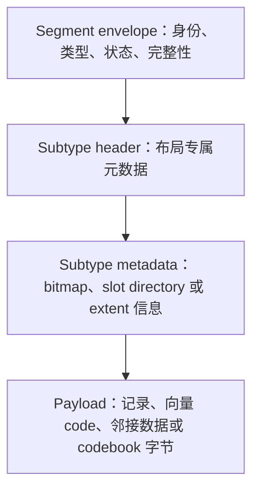
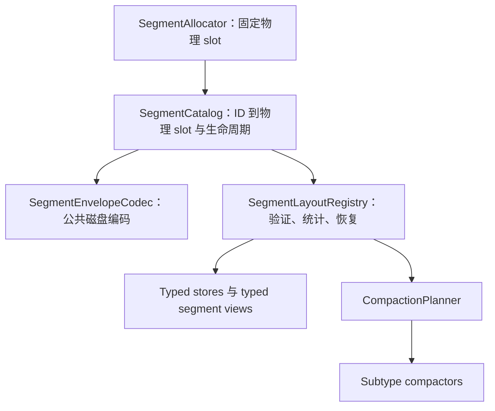
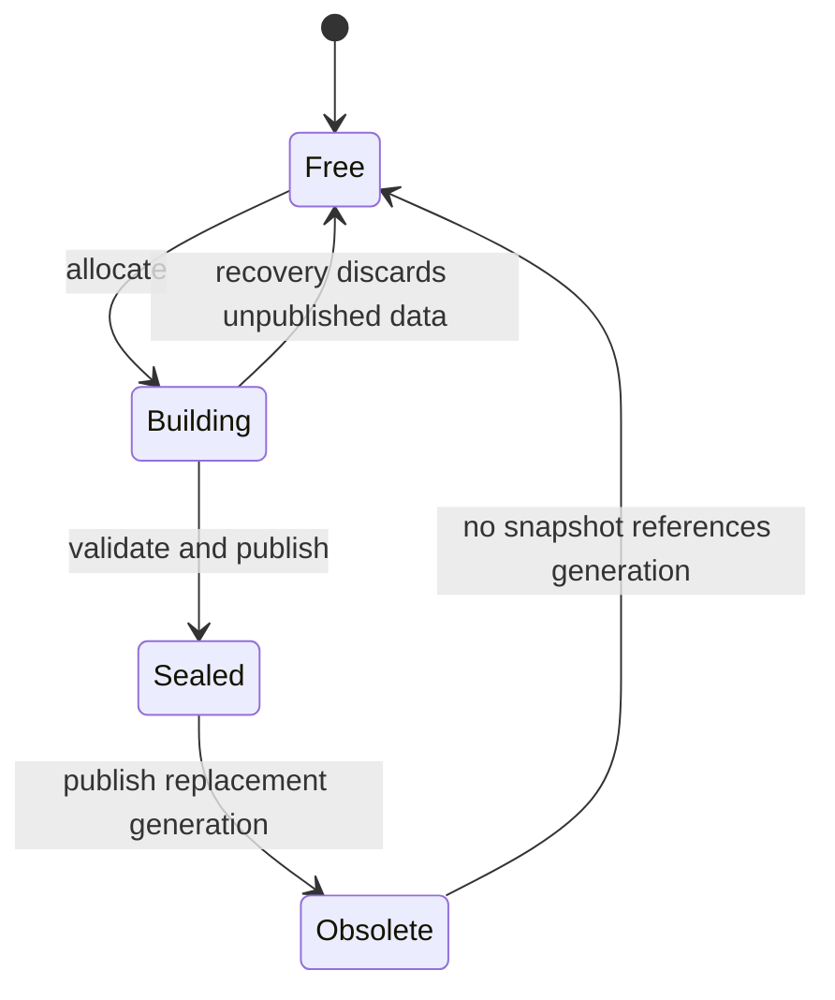

# 下一代 Segment 存储设计

> **状态：仅设计，尚未实现。** 本文记录未来文件格式版本的目标架构，不描述当前磁盘格式。当前实现请参阅[段格式](segment-format)。

## 设计目标

下一代 segment 架构将物理存储职责与布局专属的记录语义分离，目标包括：

- 保留固定大小、页对齐的 segment，复用现有 I/O、缓冲池、WAL 与恢复基础设施；
- 支持固定图实体、原始向量、PQ code、变长邻接表、codebook 及未来布局，不再持续扩张单一通用 header；
- 保证热点扫描使用静态类型，逐记录路径不发生虚函数分派；
- 降低元数据更新和校验维护产生的写放大；
- 支持位置迁移、copy-on-write generation、在线压缩及未来多文件存储；
- 定义独立于 C++ struct padding 和编译器 ABI 的显式跨平台磁盘编码。

兼容当前文件格式不是本设计的约束。实现时应引入新的文件格式版本，并提供明确的迁移或重建工具，而不是为了兼容旧格式保留不合理的抽象。

## 设计原则

1. **物理 envelope 统一，payload 布局专用。** Segment 大小、生命周期、身份、完整性和归属是公共概念；容量、占用、查找和压缩属于 subtype。
2. **逻辑身份稳定。** 持久化引用使用 segment ID，不使用原始文件偏移。
3. **字节是公共统计单位。** 记录数量由 subtype 定义；通用规划只使用 live、reclaimable 和 free bytes。
4. **每个 segment 只分派一次。** 冷控制路径使用注册的布局操作；热点循环打开 typed view 后不再逐记录检查类型。
5. **磁盘编码必须显式。** 整数宽度、字节序、边界、checksum 和版本转换由 codec 定义，不由原生 struct 布局决定。
6. **在 manifest 层原子发布。** 新 generation 私下构建并验证完成后，通过已提交的 catalog 或 manifest 更新变为可见。

## 分层模型

物理 allocator 只理解固定大小 slot。各 subtype store 负责初始化和解释 slot 内部字节。

## 物理 Segment Envelope

目标格式使用固定 128 KiB 物理 segment。起始 64 字节是稳定 envelope，`header_bytes` 指向 subtype metadata 之后对齐的 payload。

| 字段 | 宽度 | 职责 |
|---|---:|---|
| `magic` | 32 位 | 拒绝未初始化或不相关的数据 |
| `format_version` | 16 位 | 标识公共 envelope 版本 |
| `header_bytes` | 16 位 | 定位 payload，并允许 subtype header 扩展 |
| `kind` | 16 位 | 选择注册的 layout codec |
| `state` | 16 位 | 表示 free、building、sealed、obsolete 状态 |
| `flags` | 32 位 | 仅保存公共生命周期标志 |
| `segment_id` | 64 位 | 稳定逻辑身份 |
| `owner_id` | 64 位 | 标识实体 store、索引或 vector index |
| `generation` | 64 位 | 支持 copy-on-write 发布和 snapshot |
| `committed_lsn` | 64 位 | 保证 WAL 重放幂等 |
| `payload_bytes` | 32 位 | 限制完整性校验和读取范围 |
| `header_crc` | 32 位 | 在信任 offset 和 length 前验证元数据 |
| `payload_crc` | 32 位 | 验证 sealed payload 数据 |
| reserved | 32 位 | 在 envelope 大小不变的情况下兼容扩展 |

Envelope 明确不包含记录容量、high watermark、live count、实体 ID 范围、occupancy bitmap、压缩策略和链表 offset。

规划中的 segment kind 使用带前缀的枚举成员以保证 Windows 安全，包括 `SGK_ENTITY_FIXED`、`SGK_VECTOR_RAW`、`SGK_VECTOR_PQ`、`SGK_VECTOR_ADJACENCY`、`SGK_VECTOR_CODEBOOK` 和 `SGK_INDEX_PAGE`。Segment state 同样使用 `SGS_FREE`、`SGS_BUILDING`、`SGS_SEALED` 和 `SGS_OBSOLETE`。

## Subtype 布局

### 固定记录布局

节点、边、属性等固定大小实体继续使用直接 slot 寻址。其 subtype header 独立拥有：

| 元数据 | 含义 |
|---|---|
| Record size 与 stride | 逻辑记录字节数，以及相邻记录间对齐后的物理距离 |
| Record capacity | 该具体布局可寻址的 slot 数量 |
| High watermark | 第一个从未分配过的 slot |
| Live count | 当前可见记录数量 |
| First entity ID | store 使用连续 ID 时的 ID 到 slot 映射基址 |
| Occupancy offset 与 bytes | subtype 自有 activity bitmap 的位置 |
| Records offset | 固定记录区域对齐后的起点 |

High watermark 和 live count 替代含义模糊的 `used` 与 `inactive_count` 组合。删除记录只改变 live count 和 occupancy，不改写分配历史。

### 原始向量布局

每个 raw-vector segment 的维度、元素编码、stride、owner 和 generation 都保持一致。Subtype header 保存 dimension、element type、逻辑 record size、对齐 stride、capacity、high watermark、live count、occupancy 位置、records offset 和 first vector ordinal。

容量只在 segment 创建时计算一次。例如 384 维 BF16 向量的逻辑记录大小是 768 字节，metadata 和对齐会使精确容量略低于只按 payload 计算的理论上限。因此 FP32、BF16 和未来编码可以拥有不同容量，同时保持相同物理 segment 大小。

### Product-Quantized Code 布局

PQ code 是固定大小记录，但单个 segment 可容纳数千条。其 bitmap 存放在 subtype metadata 中，而不是公共 envelope。Subtype header 记录 codebook generation、code size、stride、capacity、high watermark、live count、occupancy 位置、code 区域和 first vector ordinal。

这消除了当前通用 512-slot bitmap 上限，并保持小型 code 的紧凑存储。

### 邻接布局

变长邻接记录使用 slotted-page 布局。Slot directory 向前增长，编码后的邻接数据向后增长。

Header 报告 slot count、live slot count、slot-directory end、payload beginning、live bytes、reclaimable bytes 和 graph generation。它不暴露通用 record capacity，因为对变长记录而言该值具有误导性。

邻接更新应使用 copy-on-write block 或 generation，保证 reader 永远看不到正在原地改写的 offset。

### Codebook Extent 布局

Quantizer 和 codebook 是不可变版本化对象，拆分到一个或多个 extent。其 subtype metadata 记录 codebook identity、generation、chunk index、chunk count、chunk bytes 和 total bytes，不需要 occupancy bitmap 或逐记录压缩。

### 布局对比

| 布局 | 直接访问单位 | Occupancy 模型 | 压缩单位 |
|---|---|---|---|
| 固定实体 | 固定 record slot | Subtype bitmap | Live records |
| 原始向量 | 对齐后的 vector slot | Subtype bitmap | Live vectors |
| PQ code | 紧凑 code slot | Payload bitmap 或 tombstone map | Live codes |
| 邻接 | 变长 slot | Slot directory 与 generation | Copy-on-write block |
| Codebook | 不可变 extent | 整体对象状态 | 整个 generation |

## 容量计算

固定记录容量取决于 subtype header、occupancy bytes、record stride 和 alignment。Bitmap 大小依赖 capacity，而 capacity 又受 bitmap 大小影响，因此 layout builder 在 segment 创建时收敛到稳定容量，并持久化最终 capacity 与 offset。

打开 segment 时必须验证所有乘法和加法不会溢出，并证明完整 records 区域位于物理 segment 范围内。扫描热点循环不得重复计算 capacity。

## 公共空间统计

通用存储组件使用归一化字节统计，不再假设所有布局共享 record count：

| 统计量 | 含义 |
|---|---|
| Live bytes | 可见数据必需的字节数 |
| Reclaimable bytes | 可通过压缩或淘汰 generation 回收的占用字节 |
| Immediately free bytes | 不压缩即可直接使用的空间 |
| Metadata bytes | 不计入可用 payload 的布局开销 |

Compaction planner 按字节利用率、可回收字节比例、重写成本、数据年龄和 snapshot 可见性排序。Subtype compactor 执行实际重写，并在逻辑位置改变时返回 relocation 结果。

## 运行时架构

### 冷路径

数据库打开、完整性检查、恢复、inspector 和压缩调度根据 segment kind 选择一次注册操作。操作集合提供验证、空间统计、恢复和压缩入口。

### 热路径

实体和 vector store 验证 kind 与 version 后打开 typed segment view。View 缓存解码后的 offset 和 typed metadata，后续扫描直接寻址，不发生逐记录虚函数调用或 segment-kind switch。

## Segment Catalog 与 Manifest

持久化消费者保存 segment ID、slot 和 generation。Catalog 将 segment ID 映射到 physical slot、kind、owner、generation 和生命周期状态，物理 offset 只是 allocator 的内部细节。

每个 store 或 index 的 manifest 保存不可变、有序的 segment-ID 列表。发布替换 generation 时提交新 manifest；旧 generation 在没有 snapshot 引用后回收。

该方案替代每个 segment 中的 `next` 和 `previous` 文件偏移，迁移位置时不再改写相邻 segment，并支持未来文件重组和冷热分层。

## 磁盘编码与跨平台规则

- 所有持久化整数使用显式 little-endian 编码和固定宽度。
- 磁盘 codec 而不是原生 C++ struct 定义 offset 与 encoded size。
- Enum 值和宽度必须显式且稳定。
- Decoder 在暴露 view 前验证 magic、version、state、kind、length、alignment、算术溢出和 checksum。
- 不支持的版本必须确定性失败，绝不能用最新内存 struct 猜测解释。
- 测试必须在 macOS、Linux 和 Windows 使用 golden byte fixture，并覆盖损坏、截断和未知版本。

## 完整性与写放大

Envelope 具有独立 header checksum，防止损坏的 length 驱动越界读取。Mutable 数据使用 WAL 和页级 checksum；不可变 segment 在 seal 时计算完整 payload checksum，不在每次元数据更新后重新读取 128 KiB。

三类职责相互分离：

- WAL 保证事务持久性和幂等重放；
- Page checksum 检测 mutable segment 的局部损坏；
- Sealed payload checksum 高效验证不可变 generation。

## 生命周期与崩溃恢复

Writer 私下构建 segment，写入 subtype metadata 和 payload，验证 checksum，通过 WAL 记录 catalog 或 manifest 变更，最后发布 sealed generation。Reader 只解析已提交的 sealed generation。Recovery 丢弃未发布的 building segment，并使用 committed LSN 幂等重放已提交的 manifest 更新。

## 组件边界

| 组件 | 负责 | 不负责 |
|---|---|---|
| Segment allocator | 物理 slot 分配与复用 | Record capacity、ID、vector dimension |
| Segment catalog | 逻辑到物理映射及生命周期 | Subtype record 解释 |
| Envelope codec | 公共编码字段与验证 | 原生 struct 序列化 |
| Layout registry | 按 kind 的冷路径分派 | 逐记录查询循环 |
| Typed store | Record 操作与 typed view | 全局物理分配策略 |
| Compaction planner | 优先级和预算决策 | 布局专属字节移动 |
| Subtype compactor | 安全重写与 relocation 输出 | 跨 store 调度策略 |

## 实施阶段

1. 引入磁盘 codec、segment ID 和跨平台 golden format 测试，不改变当前读取路径。
2. 在新文件格式版本后实现 physical-slot allocator 和 catalog。
3. 将现有固定实体迁移到 fixed-record subtype，并验证语义一致性。
4. 增加 raw-vector 和 PQ-code store，替换基于 blob 的向量 payload。
5. 增加 copy-on-write adjacency 和不可变 codebook extent。
6. 将通用统计与压缩规划切换为字节口径。
7. 删除旧 chain head、raw-offset 引用和通用 bitmap 假设。

每个阶段都必须可独立测试。数据库只能按当前格式打开，或被明确迁移、重建为新格式；禁止对部分转换的数据进行原地猜测解释。

## 验收标准

- Line、branch、function 和 region coverage 分别达到项目阈值。
- Golden disk-format 测试在 Windows、macOS 和 Linux 的 MSVC、Clang 与 GCC 环境通过。
- Header 损坏、非法 offset、算术溢出、torn write、未知 kind 和 payload 截断都能安全失败。
- Raw-vector 与 PQ 热点扫描不存在逐记录虚函数分派或 layout-kind switch。
- 仅元数据更新不需要读取整个 segment 或重新计算整段 checksum。
- Compaction 保持 snapshot 可见性，绝不暴露部分发布的 generation。
- Segment 迁移位置不需要改写业务层持久化引用。
- Benchmark 覆盖各 subtype 的扫描吞吐、插入吞吐、写放大、恢复时间、压缩带宽和空间利用率。

## 明确不做的事情

- 保留当前原生 `SegmentHeader` 的二进制表示。
- 强迫所有 subtype 共享 record-count 语义。
- 将所有 occupancy bitmap 放入公共 envelope。
- 在核心 allocator、WAL、buffer pool 和 recovery 之外构建独立 vector 存储引擎。
- 通过日志隐藏 vector-index 写入失败。

## 相关文档

- [当前段格式](segment-format)
- [存储系统](storage)
- [预写日志](wal)
- [段分配](../algorithms/segment-allocation)
- [段压缩](../algorithms/segment-compaction)
- [DiskANN](../algorithms/diskann)
- [乘积量化](../algorithms/product-quantization)
