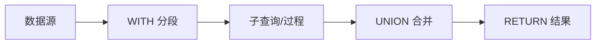

# 高级查询

本页介绍用于组装复杂查询管线的核心构造。



## WITH — 切分管线

`WITH` 将查询分成多个阶段，每个阶段可以独立过滤和投影：

```cypher
MATCH (p:Person)
WITH p, p.age AS age
WHERE age >= 30
RETURN p.name, age
ORDER BY age DESC;
```

:::info
`WITH` 之后只有被列出的变量在后续阶段可用，未列出的变量会被丢弃。
:::

## UNION / UNION ALL

合并多个结构相同的查询结果：

```cypher
MATCH (n:Person) RETURN n.name AS name
UNION ALL
MATCH (n:Company) RETURN n.name AS name;
```

| 类型 | 行为 |
|---|---|
| `UNION` | 去重合并 |
| `UNION ALL` | 保留所有行（含重复） |

## UNWIND — 展开为行

将列表展开成多行，常用于批量操作的数据源：

```cypher
UNWIND [1, 2, 3] AS x
RETURN x, x * 10;
```

## CALL 子查询与事务分批

```cypher
MATCH (n:Input)
CALL {
  WITH n
  CREATE (:Output {v: n.val})
} IN TRANSACTIONS OF 1000 ROWS
RETURN n.val;
```

:::tip
`IN TRANSACTIONS OF N ROWS` 会按 N 行分批提交，适合大批量写入。详见[批处理操作](batch-operations)。

当前原生 runtime 中，该功能仅支持无导出的仅写 `CREATE` 子查询，且只能在 autocommit 下使用。
:::

## LOAD CSV

`LOAD CSV` 在 Cypher 管线中读取受限的本地文件。普通 native 数据库的导入根目录是数据库文件所在目录。例如，数据库位于 `/srv/graphs/demo.zyx` 时，可以导入 `/srv/graphs/users.csv`：

```cypher
LOAD CSV WITH HEADERS FROM 'file:///srv/graphs/users.csv' AS row
RETURN row.name, row.age;
```

自定义字段分隔符（如 TSV）：

```cypher
LOAD CSV WITH HEADERS FROM 'file:///srv/graphs/users.tsv' AS row FIELDTERMINATOR '\t'
RETURN row.name;
```

仅接受位于已配置导入根目录之下的本地 `file:///` URI。远程 URL、带 host 的 URI、query/fragment 形式，以及逃逸根目录的路径（包括百分号编码的路径遍历）都会被拒绝。CSV 解析还会强制执行已配置的文件、行、记录、列和字段上限。大数据集请使用 CLI [`import`](import-export#路径-2cli-批量导入) 工作流。

## 内置过程

### Native Runtime 边界

native logical runtime 只支持拥有原生、snapshot-pinned 实现的过程。`dbms.listConfig()`、`dbms.getConfig(key)`、`dbms.setConfig(key, value)`、`dbms.showStats()` 和 `dbms.resetStats()` 只允许在 autocommit 模式执行，并使用 Database-owned native configuration service。durable key 经由与 graph metadata 相同的单文件 COW metadata boundary 发布；process-local `stats.enabled` 不会创建 database-file record。不支持的 key 和 explicit transaction 调用都会在产生任何 administration side effect 前 fail closed。

### 向量索引

| 过程 | 说明 |
|---|---|
| `db.index.vector.queryNodes(idx, k, vec)` | 向量近邻检索 |
| `db.index.vector.train(idx)` | 训练向量索引 |

### 图算法

| 过程 | 说明 |
|---|---|
| `algo.shortestPath(startId, endId)` | 最短路径 |

### GDS 图算法

GDS（Graph Data Science）过程使用命名投影模式：先投影子图，再运行算法。

| 过程 | 参数 | 说明 |
|---|---|---|
| `gds.graph.project(name, config)` | 投影名、节点/关系选择、方向和权重 | 创建命名图投影 |
| `gds.graph.drop(name)` | 投影名 | 删除图投影 |
| `gds.graph.dropAll()` | 无 | 删除全部图投影 |
| `gds.graph.exists(name)` | 投影名 | 检查投影是否存在 |
| `gds.graph.list(name?)` | 可选投影名 | 列出 catalog descriptor |
| `gds.graph.schema(name)` | 投影名 | 检查规范化后的投影 schema |
| `gds.pageRank.stream(name, maxIter?, damping?)` | 投影名、可选迭代次数、可选阻尼系数 | PageRank |
| `gds.wcc.stream(name)` | 投影名 | 弱连通分量 |
| `gds.betweenness.stream(name, samplingSize?)` | 投影名、可选采样数 | 介数中心性 |
| `gds.closeness.stream(name)` | 投影名 | 接近中心性 |
| `gds.shortestPath.dijkstra.stream(name, startId, endId)` | 投影名、起点 ID、终点 ID | Dijkstra 最短路径 |
| `gds.leiden.stream(name, options?)` | 投影名、可选 Leiden options Map | Leiden 社区检测 |

结构化投影 schema 和 catalog 生命周期见 [GDS 图投影](/zh/docs/zyx/algorithms/graph-projections)，算法参数见 [Leiden 社区检测](/zh/docs/zyx/algorithms/community-detection)。

## EXPLAIN / PROFILE

查询调优的两个关键工具：

| 命令 | 用途 |
|---|---|
| `EXPLAIN` | 查看逻辑执行计划结构（不实际执行） |
| `PROFILE` | 执行查询并返回耗时信息；native relocatable logical 路径当前追加一条整条 plan 的 summary row，而不是逐 operator metric |


