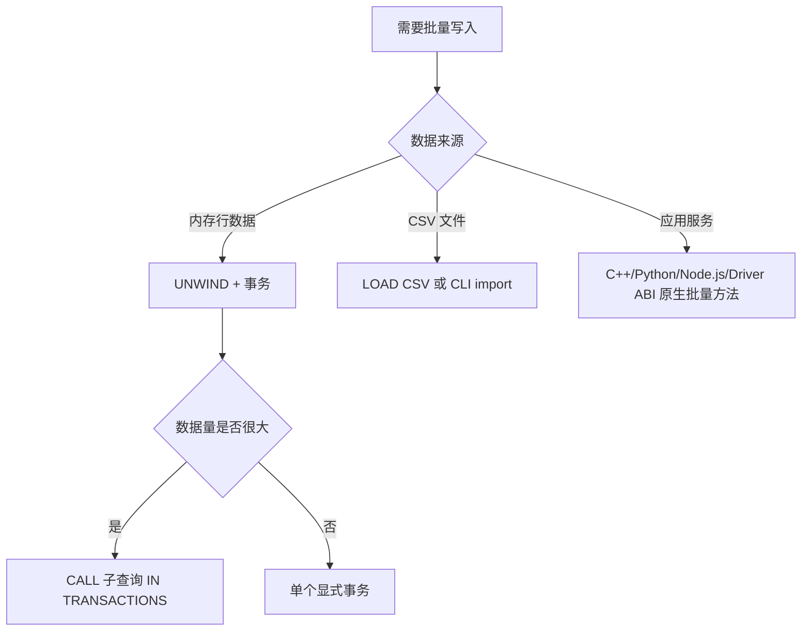

# 批处理操作

## 策略选择



## 方案 A：UNWIND + 显式事务

适用于中等规模、内存中已有数据列表的场景：

```cypher
BEGIN;
UNWIND [
  {name: 'u1', age: 20},
  {name: 'u2', age: 21}
] AS row
CREATE (:User {name: row.name, age: row.age});
COMMIT;
```

## 方案 B：子查询事务分批

适用于大规模写入，自动按批次提交：

```cypher
UNWIND $rows AS row
CALL {
  WITH row
  CREATE (:User {name: row.name})
} IN TRANSACTIONS OF 1000 ROWS
RETURN row;
```

:::info
`IN TRANSACTIONS OF N ROWS` 会将数据按 N 行分批，每批独立提交。某批失败不影响已完成批次。

当前原生契约接受仅写、无导出、且使用基于 `CREATE` 的一元 mutation chain 的子查询。它会在第一次写入前受限物化外层输入，避免前一批修改图后遗漏或重复后续 batch。它还会在第一个 batch 前物化所支持的外层 `RETURN` projection，因此 projection error 不会在独立 batch 已提交后才报告失败。它不能在显式 `Transaction` 中运行，应使用 autocommit query。`OF` 必须使用正整数 literal。`MERGE`、导出变量、其他子查询 mutation 形式，以及外层 `DISTINCT`/`ORDER BY`/`SKIP`/`LIMIT` result pipeline 暂不属于这一初始原生批处理契约。每个 batch 的 publication 前都会立即检查取消和超时；若取消阻止后续 batch 发布，已经完成的 batch 保持 durable，而被中断的 batch 不会发布。需要全有或全无语义的应用应使用单个显式 transaction，而不是 `IN TRANSACTIONS`。
:::

## 方案 C：脚本模式

适合重复执行的运维任务和 CI 初始化：

```bash
zyx database exec ./demo.zyx ./batch.cypher
```

## 方案 D：原生批量 API

### C++

所有创建方法现在均返回 ID，便于后续操作：

| 方法 | 说明 |
|---|---|
| `Database::createNode(label, props)` | 创建节点并返回 ID |
| `Database::createNodes(label, propsList)` | 批量创建节点，返回 ID 列表 |
| `Database::createEdge(srcId, dstId, type, props)` | 按 ID 创建边，返回边 ID |
| `Database::createEdges(edges)` | 批量创建边，返回边 ID 列表 |

:::tip
`createEdge` 绕过查询解析和索引查找，直接通过内部 ID 建边，是最高效的边创建方式。
:::

### Python

```python
import zyxdb

with zyxdb.Database("/tmp/bulk.zyx") as db:
    # 批量创建节点（返回 ID 列表）
    ids = db.create_nodes("User", [
        {"name": "Alice", "age": 30},
        {"name": "Bob", "age": 25},
        {"name": "Charlie", "age": 35},
    ])

    # 批量创建边（返回边 ID 列表）
    edge_ids = db.create_edges("KNOWS", [
        (ids[0], ids[1], {"since": 2020}),
        (ids[1], ids[2], None),
    ])
```

:::tip
完整的 Python 批量 API 参考请查看 [Python API 参考](../api/python-api#高性能写入-api)。
:::

## 运维检查清单

- 固定批大小与提交节奏
- 记录成功/失败批次范围，便于断点恢复
- 对可重放流程设计幂等键（必要时使用 `MERGE`）
- 每个大批次后执行一致性校验查询
