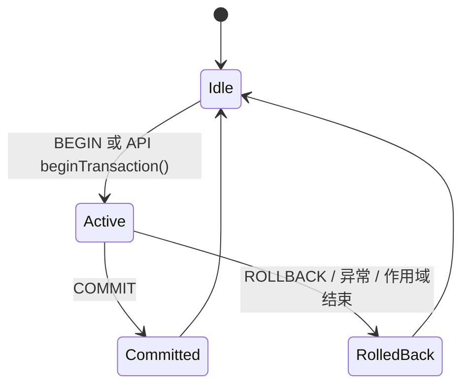
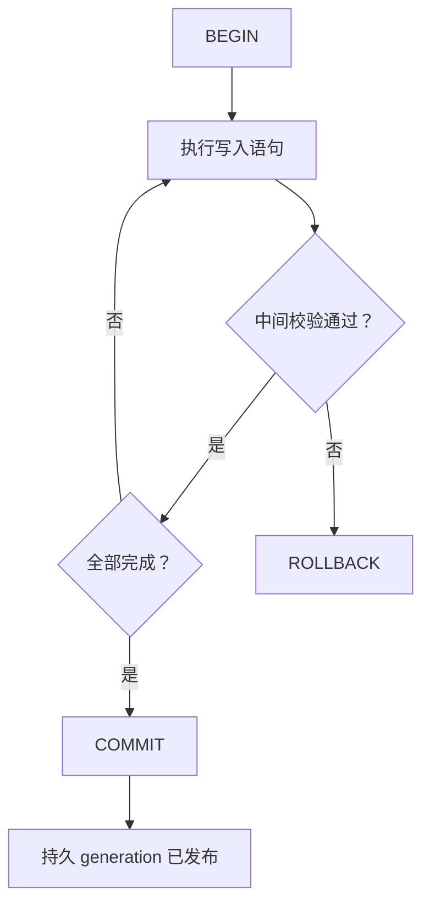

# 事务控制

## 事务生命周期



## REPL 中的显式事务

```cypher
BEGIN;
CREATE (:User {name: 'Alice'});
CREATE (:User {name: 'Bob'});
COMMIT;
```

回滚示例：

```cypher
BEGIN;
CREATE (:User {name: 'Temp'});
ROLLBACK;
```

## 三种事务模式

| 模式 | 适用场景 | 说明 |
|---|---|---|
| 隐式（单语句） | 简单一次性读写 | 每条语句自动包裹事务，开销最低 |
| 显式（`BEGIN...COMMIT`） | 多步骤原子写入 | 成功/失败边界清晰 |
| API 事务对象 | 服务端流程编排 | C++ `Transaction` 析构时未提交则自动回滚；Python `with` 块正常退出自动提交，异常时自动回滚 |

:::tip API 事务自动回滚
通过 C++ API 获取的 `Transaction` 对象在析构时如果没有调用 `commit()`，会自动执行回滚，确保不会留下未提交的脏数据。
:::

## Python 事务示例

```python
import zyxdb

with zyxdb.Database("/tmp/mydb.zyx") as db:
    # 写事务 — 正常退出时自动提交
    with db.begin_transaction() as tx:
        tx.execute("CREATE (n:User {name: 'Alice'})")
        tx.execute("CREATE (n:User {name: 'Bob'})")
        # 此处自动提交

    # 显式回滚
    with db.begin_transaction() as tx:
        tx.execute("CREATE (n:User {name: 'Temp'})")
        tx.rollback()

    # 异常时自动回滚
    try:
        with db.begin_transaction() as tx:
            tx.execute("CREATE (n:User {name: 'Ghost'})")
            raise ValueError("oops")  # 自动回滚
    except ValueError:
        pass

    # 只读事务（快照隔离）
    with db.begin_read_only_transaction() as tx:
        rows = list(tx.execute("MATCH (n:User) RETURN n.name AS name"))
```

:::tip
完整的 Python 事务 API 请参考 [Python API 参考](../api/python-api#transaction)。
:::

## 行为要点

:::warning 并发模型
原生后端提供**固定快照读取和保守的乐观写验证**。多个普通写事务可以暂存修改，同一可写后端内部串行持久发布。另一修改图的事务提交后，旧写事务可能冲突，即使修改的是不同实体；重试须创建新事务并重新读取。只读事务保持原快照。这不构成通用的可串行化隔离保证。使用一个可写数据库所有者；独立可写句柄/进程不在此合同范围内。不支持嵌套事务。
:::

- 未提交的数据在 `COMMIT` 前不具备持久性
- 原生 `COMMIT` 成功时已持久发布完整 COW generation，不依赖后续 `save()` 或旧 WAL 路径
- 提交失败使事务进入终态。持久结果不确定时，关闭/重开数据库并检查恢复状态后再决定重试；不得自动重放过程或其他外部副作用
- 普通事务可读取自己的暂存修改；流式 bulk append 采用独立合同，不提供此覆盖层行为

## 故障处理模式



1. 多步骤写入统一放入显式事务
2. 中间用 `MATCH ... RETURN` 做关键校验
3. 全部通过后再 `COMMIT`
4. 任一步失败立即 `ROLLBACK`

有界原生盲写例外允许最多 64 个持久 Node 属性 owner 安全重建。仅在事务读取快照或 Vector 快照从未暴露时适用，排除 patch、创建/删除、标签和 Edge 变更。发布门内逐个核对 owner 的 Property Directory 槽身份/代际（含缺失）与 Node 存活状态，再由执行器从最新根重建并验证当前约束/索引；最多构建三次。任何暴露读取、不支持操作或超出依赖上限的事务仍使用全图 fence。没有自动回放查询/过程，也未增加跨可写 owner 并发能力。
