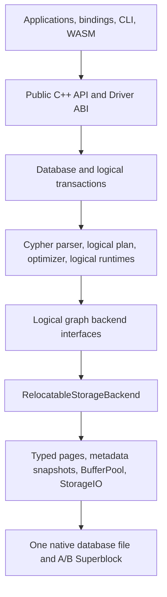
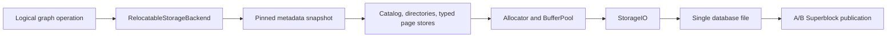
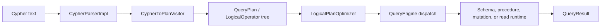

# Architecture Reference

## Scope And Source Of Truth

This document describes the current native production path. The authoritative source-set allowlists are in `cmake/SourceSets.cmake`; a source file left in the checkout is not automatically a production dependency. The native format and its failure/lifecycle contracts are specified by `docs/apps/docs/content/docs/zh/zyx/architecture/native-single-file-storage-plan.mdx` and its acceptance matrix.

Legacy `FileStorage`, `DataManager`, segment-chain, external-WAL, physical-executor, and old Vector trees have been physically retired from the source tree. Their documentation is historical migration material only; do not use those names or designs for new production code.

## Layered Architecture



### Database And Transactions

`include/graph/core/Database.hpp` is the main internal entry point. It owns the generic `StorageBackend`, its `RelocatableStorageBackend` native implementation, and a lazily initialized `QueryEngine`.

- `Database::open()`, `flush()`, and `close()` operate on the native backend.
- `beginTransaction()`, `beginBulkTransaction()`, and `beginReadOnlyTransaction()` create native logical transactions.
- `Transaction` owns a pinned logical transaction plus a read-your-writes `LogicalGraphTransactionOverlay`.
- Queries executed through a public `Transaction` use that overlay explicitly; a database-scoped query does not inherit another transaction's state.
- Schema mutation is intentionally excluded from transaction overlays. Read-only execution rejects data and schema mutation before a mutation runtime is entered.

The backend publishes visible state through copy-on-write metadata and a single A/B Superblock publication point. A snapshot carries backend provenance and a pinned metadata root; malformed cross-backend, stale, or invalid state must fail closed.

### Storage

`include/graph/storage/relocatable/backend/RelocatableStorageBackend.hpp` is the native storage owner. It implements the generic storage, logical read, write, schema, administration, statistics, vector, and maintenance boundaries rather than exposing physical offsets to callers.



Native storage responsibilities are divided by format family:

| Area | Native components |
|---|---|
| Format and I/O | explicit little-endian codecs, `StorageIO`, checksums, superblock file, format validation |
| Metadata | metadata store, Catalog tree, location directory, token/schema records, snapshot registry |
| Allocation and cache | physical segment allocator, shared/slotted page pools, generation-aware `BufferPool` |
| Graph data | entity pages, label sets, property and large-value stores, global adjacency B+Tree |
| Schema and indexes | System Catalog, scalar/composite B+Tree indexes, constraints and support trees |
| Vector | native raw/base/delta/vector page stores plus bounded maintenance and rebuild services |
| Maintenance | integrity scanner, reachability reclaimers, explicit maintenance service |

Every persisted field is decoded and validated before use. Lengths, offsets, counts, generations, owners, checksums, enum values, and reserved fields are format boundaries, not trusted in-memory state. Normal open is bounded; full integrity scans are explicitly requested rather than being an implicit full-file scan.

### Query Engine

`include/graph/query/api/QueryEngine.hpp` owns the current query pipeline:



- ANTLR4 grammar and generated parser files live under `src/query/parser/cypher/`; regenerate them with `bash src/query/parser/cypher/generate.sh` after a grammar change.
- `CypherToPlanVisitor` directly builds the storage-neutral logical tree and its mutation flags.
- `PlanCache` caches reusable logical plans. Schema mutation invalidates cached plans.
- `LogicalPlanOptimizer` has bounded pass/depth limits and only performs semantic-safe rewrites. It may use bounded native cardinality estimates, but it never reads physical pages.
- `QueryEngine` dispatches schema plans to `LogicalPlanSchemaRuntime`, procedures to `LogicalPlanProcedureRuntime`, data mutation to `LogicalPlanMutationRuntime`, and native reads to `LogicalPlanReadRuntime`.
- Unsupported runtime operators fail closed. Do not add a legacy physical-executor fallback.
- `EXPLAIN` renders the logical tree without opening a snapshot or publishing work. `PROFILE` preserves normal execution and adds a logical timing summary.

The current optimizer exposes only validated, conservative access hints: static equality and range scan shapes retain their filters; cardinality may reorder a Cartesian join only when both estimates are valid; and window normalization is bounded and overflow-safe. Do not document generic predicate/projection pushdown unless its semantic contract and native runtime support are implemented and tested.

### Logical Graph Boundaries

`LogicalGraphReadBackend`, `LogicalGraphWriteBackend`, `LogicalGraphSchemaBackend`, and related interfaces are the boundary between query code and the native format.

- Read runtimes open logical snapshots and stream bounded rows.
- Logical nodes and edges carry resolved logical labels/types/properties, never legacy token IDs or physical locations.
- Native B+Tree scan hints are validated inside a pinned snapshot. Owner, label, property, value, entity ID, bounds, and corruption checks remain storage responsibilities.
- Procedure, vector, GDS, CSV, and configuration paths have independent work, row, memory, path, or import-root constraints as appropriate.
- A `QueryGuard` supplies timeout and resource policy at the execution boundary.

### Public Surface And Bindings

- C++ API: `include/zyx/zyx.hpp`
- Stable Driver ABI: `include/zyx/zyx_driver_abi.h`
- C++ implementation and ABI adapters: `src/api/`
- Language bindings: `bindings/nodejs/`, `bindings/python/`, and `bindings/rust/`

The Driver ABI is the long-term binding boundary. New public behavior must preserve result/value ownership, transaction lifetime, read-only enforcement, and error contracts across C++, Node.js, Python, Rust, and WASM where declared.

### Vector And Algorithms

Native Vector storage is in `include/graph/storage/relocatable/vector/` and its maintenance code. Shared math belongs in `include/graph/common/VectorMath.hpp`. The former `graph/vector` implementation has been physically removed; native code must use these relocatable owners exclusively.

GDS projections are process-local derived state. A `QueryEngine` owns its database-scoped catalog, and a caller-owned transaction has a separate transaction-local catalog. Neither is a durable graph-format replacement without an explicit publication design.

## Directory Guide

```text
include/
  zyx/                         Public C++ API and Driver ABI
  graph/
    core/                      Database, Transaction, public graph types
    storage/                   Generic logical/storage interfaces and native relocatable backend
      relocatable/             Format, metadata, allocation, cache, entity, property, index, schema, vector, maintenance
    query/                     Parser contracts, logical operators, optimizer, runtimes, expressions, GDS
    common/                    Storage-independent shared utilities, including Vector math
src/
  api/                         Public API and Driver ABI implementations
  core/                        Database and Transaction implementation
  storage/relocatable/         Native storage implementation by format family
  query/                       Logical parser, optimizer, runtimes, expressions, and GDS implementation
tests/src/
  storage/relocatable/         Native format, fault, integrity, and lifecycle tests
  query/                       Native logical query and parser tests
  api/                         C++ API and Driver ABI contract tests
bindings/                      Node.js, Python, and Rust SDKs/tests
cmake/SourceSets.cmake         Explicit native production and test source allowlists
scripts/                       Build, test, coverage, release, and WASM scripts
docs/apps/docs/                Documentation site and browser playground
```

## Build, Test, And Coverage

The project uses CMake, Conan, Ninja, and Google Test. Use the commands in the root `AGENTS.md`:

- `./scripts/run_tests.sh --quick` is the required complete local regression after code or build-configuration changes.
- During development, pair a narrow `--gtest-filter` with `--file <source-path>` to inspect production coverage.
- Final C7 acceptance requires the exact current test binary to reach at least 95% for line, branch, function, and region coverage, as well as clean macOS, Linux, and Windows builds/tests.
- Run all binding tests after public API/ABI changes with `./scripts/test_bindings.sh`.

## WASM And Playground

`ZYX_WASM=ON` configures the Emscripten build. `scripts/build_wasm.sh` produces `build_wasm/zyx.js` and `build_wasm/zyx.wasm`; browser-visible Driver ABI functions must also be listed in its `-sEXPORTED_FUNCTIONS`.

The docs playground uses the Driver ABI and begins read-only transactions with `zyx_driver_txn_begin_read_only` before executing user Cypher. The wrapper contract test is useful but does not replace a real wasm32 build and browser integration test. The normal native format is one database file; new playground/data workflows must not introduce external WAL or SHM sidecars.

## Cross-Platform Requirements

All changes must preserve macOS, Linux, and Windows behavior. In particular:

- use prefixed enum members to avoid Windows macro collisions;
- keep paths, file I/O, synchronization, and error reporting platform-neutral;
- do not hardcode Visual Studio paths or versions;
- do not rely on POSIX-only I/O without the existing portable `StorageIO` boundary;
- keep generated files, build artifacts, coverage profiles, and machine-local configuration out of commits.

## Legacy Retirement

Before deleting a legacy family, identify its capability row and C-gate, find every source/test/binding/benchmark/documentation consumer, add and run the native behavior replacement, configure from a clean build directory, run the full suite and affected bindings, and obtain the required three-platform evidence. A clean native source list alone does not authorize deleting a retained behavior family.
